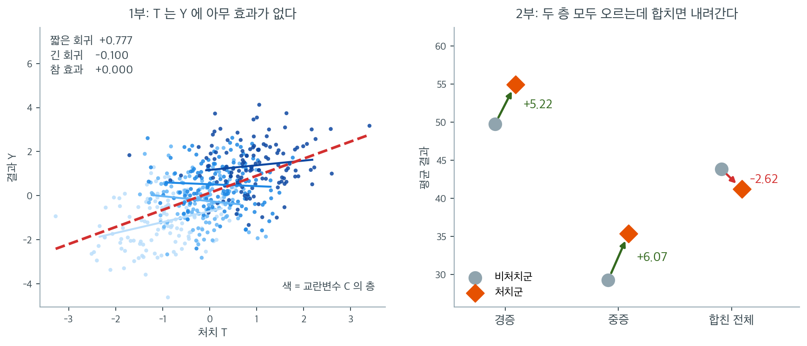
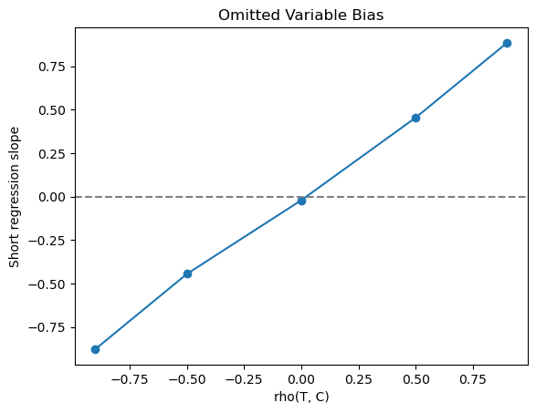

# 교란과 인과 시연

## 개요

이 페이지는 교란변수가 어떻게 허위상관을 만들어 내는지, 그리고 Simpson의 역설이 어떻게 처치효과의 겉보기 방향을 뒤집는지 보인다. 두 가지 상황을 모의로 만든다. 하나는 숨은 공통원인이 오도하는 연관을 만들어 내는 교란된 회귀이고, 다른 하나는 소박한 추정값의 부호가 아예 반대로 나오는 처치효과 분석이다.

---

## 1. 1부: 교란된 회귀

### 자료생성과정

$C$가 교란변수, $T$가 처치, $Y$가 결과인 유향비순환그래프 $T \leftarrow C \rightarrow Y$를 생각하자. 처치 $T$는 $Y$에 **아무런 인과효과가 없으며**, 모든 연관은 $C$를 통해 흐른다.

다음에서 자료를 생성한다.

$$
\begin{pmatrix} T \\ C \end{pmatrix} \sim \mathcal{N}\!\left(\begin{pmatrix} 0 \\ 0 \end{pmatrix}, \begin{pmatrix} 1 & \rho_{TC} \\ \rho_{TC} & 1 \end{pmatrix}\right), \qquad Y = C + \varepsilon, \quad \varepsilon \sim \mathcal{N}(0, 1)
$$

$Y$는 오직 $C$에만 의존하므로 $T$가 $Y$에 미치는 참 인과효과는 0이다.

<div class="exbox" markdown>

**보기 1.** <span class="diff easy" title="쉬움"></span> 참 효과가 0인데 상관은 얼마나 커지는가. 위 자료생성과정에서 $\rho_{TC} = 0.8$, $\varepsilon \sim \mathcal{N}(0,1)$ 이다.

**(1)** $\operatorname{Corr}(T, Y)$ 의 **모집단 값**을 닫힌 꼴로 구하시오. 표본값 $0.5282$ 가 그 값과 맞는가.

**(2)** 교란만으로 겉보기 상관을 $1$ 에 얼마나 가깝게 만들 수 있는가. $\rho_{TC}$ 를 $1$ 까지 올려도 넘을 수 없는 상한이 있는가.

</div>

??? success "풀이"

    **(1) 공분산은 $C$ 를 타고만 흐른다.** $Y = C + \varepsilon$ 이고 $\varepsilon$ 이 $T$ 와 독립이므로

    $$
    \operatorname{Cov}(T, Y) = \operatorname{Cov}(T, C) + \operatorname{Cov}(T, \varepsilon) = \rho_{TC} + 0 = 0.8
    $$

    이다. 분산은 $\operatorname{Var}(T) = 1$ 이고

    $$
    \operatorname{Var}(Y) = \operatorname{Var}(C) + \operatorname{Var}(\varepsilon) = 1 + 1 = 2
    $$

    이므로

    $$
    \operatorname{Corr}(T, Y) = \frac{\rho_{TC}}{\sqrt{1 + \sigma_\varepsilon^2}} = \frac{0.8}{\sqrt2} = 0.565685
    $$

    이다. 표본값 $0.5282$ 와 견주면 $\operatorname{SE}(r) \approx (1-\rho^2)/\sqrt{n} = (1 - 0.32)/\sqrt{500} = 0.0304$ 이므로

    $$
    z = \frac{0.5282 - 0.5657}{0.0304} = -1.231
    $$

    로 맞는다. $\operatorname{corr}(T,C)$ 쪽도 $0.7908$ 대 $0.8$ 로 $z = -0.574$ 다.

    **(2) 상한은 $1/\sqrt{1+\sigma_\varepsilon^2}$ 이다.** 식을 보면 $\rho_{TC}$ 는 분자에만 들어가므로 $\rho_{TC} \to 1$ 에서 최대가 되고, 그 값이

    $$
    \max_{\rho_{TC}} \operatorname{Corr}(T, Y) = \frac{1}{\sqrt{1 + \sigma_\varepsilon^2}}
    $$

    이다. 여기서는 $\sigma_\varepsilon = 1$ 이라 $1/\sqrt2 = 0.7071$ 을 넘을 수 없다. 교란변수를 아무리 강하게 걸어도 $T$ 와 $Y$ 의 상관은 $0.71$ 에서 막힌다.

    | $\sigma_\varepsilon$ | 상한 |
    |---|---|
    | $0.5$ | $0.8944$ |
    | $1.0$ | $0.7071$ |
    | $2.0$ | $0.4472$ |
    | $3.0$ | $0.3162$ |

    **이 상한은 교란의 세기가 아니라 $Y$ 안의 잡음이 정한다.** $Y$ 가 $C$ 로 거의 다 설명되는 변수라면($\sigma_\varepsilon$ 이 작으면) 교란만으로도 $r \approx 1$ 을 만들 수 있다. 그러므로 **"상관이 $0.95$ 나 되는데 인과가 아닐 리 없다"는 추론은 성립하지 않는다.**

    ```python
    import numpy as np
    from scipy import stats

    np.random.seed(42)


    def simulate_confounded_data(n=500, rho_tc=0.8):
        mean = [0, 0]
        cov = [[1, rho_tc], [rho_tc, 1]]
        tc = np.random.multivariate_normal(mean, cov, n)
        t = tc[:, 0]
        c = tc[:, 1]
        # Y는 오직 C에만 의존한다. T가 Y에 미치는 참 효과는 정확히 0이다.
        y = c + np.random.normal(0, 1, n)
        return t, c, y


    t, c, y = simulate_confounded_data()
    print(f"corr(T, C) = {np.corrcoef(t, c)[0, 1]:.4f}")
    print(f"corr(T, Y) = {np.corrcoef(t, y)[0, 1]:.4f}   (참 인과효과는 0)")

    # 닫힌 꼴과 견준다.
    n, rho_tc, sigma = len(t), 0.8, 1.0
    for lab, pop, samp in [("corr(T,C)", rho_tc, np.corrcoef(t, c)[0, 1]),
                           ("corr(T,Y)", rho_tc / np.sqrt(1 + sigma**2),
                            np.corrcoef(t, y)[0, 1])]:
        se = (1 - pop**2) / np.sqrt(n)
        print(f"\n{lab}: 모집단 {pop:.6f}  표본 {samp:.4f}  "
              f"SE {se:.4f}  z {(samp - pop) / se:+.3f}")

    print(f"\n교란만으로 만들 수 있는 상관의 상한 = 1/sqrt(1+sigma^2)")
    for s in (0.5, 1.0, 2.0, 3.0):
        print(f"  sigma = {s:.1f}  ->  {1 / np.sqrt(1 + s**2):.4f}")
    ```

    출력:

    ```
    corr(T, C) = 0.7908
    corr(T, Y) = 0.5282   (참 인과효과는 0)

    corr(T,C): 모집단 0.800000  표본 0.7908  SE 0.0161  z -0.574

    corr(T,Y): 모집단 0.565685  표본 0.5282  SE 0.0304  z -1.231

    교란만으로 만들 수 있는 상관의 상한 = 1/sqrt(1+sigma^2)
      sigma = 0.5  ->  0.8944
      sigma = 1.0  ->  0.7071
      sigma = 2.0  ->  0.4472
      sigma = 3.0  ->  0.3162
    ```

    두 $z$ 값이 모두 $\lvert z \rvert < 2$ 이므로 닫힌 꼴과 표본이 맞는다. $T$ 와 $Y$ 의 상관이 $0.53$ 이나 되지만 **$T$ 는 $Y$ 에 아무 영향도 주지 않는다.** 오직 $C$ 를 공유할 뿐이다.

### 짧은 회귀와 긴 회귀

**짧은 회귀**($C$를 빠뜨린 회귀)는 $Y$를 $T$에만 회귀시킨다.

$$
Y = \alpha + \beta_T^{\text{short}} T + u
$$

**긴 회귀**($C$를 통제한 회귀)는 교란변수를 포함한다.

$$
Y = \alpha + \beta_T^{\text{long}} T + \beta_C C + u
$$

<div class="exbox" markdown>

**보기 2.** <span class="diff easy" title="쉬움"></span> 누락변수 편향을 항등식으로 쪼개기. 짧은 회귀는 $\beta_T^{\text{short}} = 0.7772$, 긴 회귀는 $\beta_T^{\text{long}} = -0.1000$, $\beta_C^{\text{long}} = 1.0915$ 를 준다.

**(1)** 두 기울기의 **모집단 값**을 각각 구하시오.

**(2)** 누락변수 편향 공식

$$
\beta_T^{\text{short}} = \beta_T^{\text{long}} + \delta \gamma
$$

에서 $\delta$ 와 $\gamma$ 가 무엇인지 적고, 표본에서 이 식이 **근사가 아니라 항등식**임을 확인하시오.

</div>

??? success "풀이"

    **(1) 둘 다 손으로 적을 수 있다.** 짧은 회귀의 기울기는 단순회귀 공식 그대로다.

    $$
    \beta_T^{\text{short}} = \frac{\operatorname{Cov}(T, Y)}{\operatorname{Var}(T)} = \frac{0.8}{1} = 0.8
    $$

    긴 회귀의 $T$ 계수는 $C$ 를 고정한 채 본 $T$ 의 효과인데, 자료생성과정에서 $Y = C + \varepsilon$ 이고 $\varepsilon \perp (T, C)$ 이므로 $C$ 를 고정하면 $T$ 는 $Y$ 에 **아무 정보도 주지 않는다.** 따라서

    $$
    \beta_T^{\text{long}} = 0,
    \qquad
    \beta_C^{\text{long}} = 1
    $$

    이다. 표본값 $0.7772$, $-0.0999$, $1.0915$ 가 각각 $0.8$, $0$, $1$ 의 추정이다.

    **(2) $\delta$ 는 긴 회귀의 $C$ 계수, $\gamma$ 는 빠뜨린 $C$ 를 $T$ 에 회귀한 기울기다.** 모집단에서는

    $$
    \gamma = \frac{\operatorname{Cov}(T,C)}{\operatorname{Var}(T)} = 0.8,
    \qquad
    \delta = 1
    \qquad\Longrightarrow\qquad
    \beta_T^{\text{short}} = 0 + 1 \times 0.8 = 0.8
    $$

    로 (1)과 맞는다. **편향 $\delta\gamma$ 의 두 요소가 각각 "$C$ 가 $Y$ 에 얼마나 세게 들어가는가"와 "$C$ 가 $T$ 와 얼마나 얽혀 있는가"다.** 둘 중 하나라도 $0$ 이면 편향이 사라진다. 이것이 교란의 정의 — $C \to T$, $C \to Y$ 두 화살표가 **모두** 있어야 한다 — 를 수로 적은 것이다.

    표본에서도 이 식은 **최소제곱의 대수적 항등식**이라 근사가 아니다. 실제로

    $$
    0.777199 = -0.099974 + 1.091524 \times 0.803622
    $$

    이고 두 변의 차이가 $0$ 이다(부동소수점 오차조차 없다).

    ```python
    def compute_regressions(t, c, y):
        """교란변수를 빼고 넣은 두 회귀를 나란히 돌린다.

        짧은 회귀는 T 만 넣고, 긴 회귀는 C 까지 넣는다. 참 효과가 0 인데도
        짧은 회귀의 계수가 크게 나오는 것이 누락변수 편향이다.
        """
        # 짧은 회귀: Y ~ T
        slope_short, _, r_short, p_short, _ = stats.linregress(t, y)

        # 긴 회귀: Y ~ T + C. 절편을 위해 1 로 된 열을 앞에 붙인다.
        X = np.column_stack([np.ones(len(t)), t, c])
        beta = np.linalg.lstsq(X, y, rcond=None)[0]

        return {
            "short_slope": slope_short,
            "short_p": p_short,
            "long_beta_T": beta[1],
            "long_beta_C": beta[2],
        }


    res = compute_regressions(t, c, y)
    print(f"short_slope  = {res['short_slope']:>8.4f}   (p = {res['short_p']:.1e})")
    print(f"long_beta_T  = {res['long_beta_T']:>8.4f}")
    print(f"long_beta_C  = {res['long_beta_C']:>8.4f}")

    # 누락변수 편향 항등식을 확인한다.
    gamma = stats.linregress(t, c).slope      # 빠뜨린 C 를 T 에 회귀한 기울기
    delta = res["long_beta_C"]                # 긴 회귀의 C 계수
    rhs = res["long_beta_T"] + delta * gamma
    print(f"\n모집단 값: short = 0.8,  long = 0,  delta = 1,  gamma = 0.8")
    print(f"표본  gamma = {gamma:.6f},  delta = {delta:.6f}")
    print(f"  long + delta*gamma = {res['long_beta_T']:.6f} + "
          f"{delta:.6f}*{gamma:.6f} = {rhs:.6f}")
    print(f"  short              = {res['short_slope']:.6f}")
    print(f"  두 변의 차         = {abs(res['short_slope'] - rhs):.2e}")
    ```

    출력:

    ```
    short_slope  =   0.7772   (p = 2.8e-37)
    long_beta_T  =  -0.1000
    long_beta_C  =   1.0915

    모집단 값: short = 0.8,  long = 0,  delta = 1,  gamma = 0.8
    표본  gamma = 0.803622,  delta = 1.091524
      long + delta*gamma = -0.099974 + 1.091524*0.803622 = 0.777199
      short              = 0.777199
      두 변의 차         = 0.00e+00
    ```

    **항등식의 두 변이 비트 단위로 같다.** 세 표본값 $0.7772$, $-0.0999$, $1.0915$ 가 각각 모집단 값 $0.8$, $0$, $1$ 의 추정이다. 참 효과가 정확히 $0$ 이므로 짧은 회귀가 보고하는 $0.7772$ 는 **전부 편향**이고, 그 거의 전부가 $\delta\gamma = 1.0915 \times 0.8036 = 0.8772$ 라는 한 곱에서 나온다.

    $T$ 에 아무런 인과효과가 없는데도 짧은 회귀는 $\beta_T^{\text{short}} = 0.777$ 이라는 압도적으로 유의한 기울기를 내놓는다($p = 2.8\times10^{-37}$). **p-값은 편향을 알아채지 못한다.** 표본을 키우면 $p$ 는 더 작아지고 추정값은 참값이 아니라 $0.8$ 로 수렴한다.

### 부분회귀(Frisch-Waugh-Lovell)

이와 동등한 방법으로, $T$와 $Y$를 각각 $C$에 회귀시켜 잔차를 얻은 뒤 그 잔차끼리 회귀시킬 수 있다.

$$
e_T = T - \hat{\gamma}_1 C, \qquad e_Y = Y - \hat{\gamma}_2 C
$$

$$
\beta_T^{\text{long}} = \frac{\text{Cov}(e_T, e_Y)}{\text{Var}(e_T)}
$$

<div class="exbox" markdown>

**보기 3.** <span class="diff easy" title="쉬움"></span> "통제한다"는 말이 실제로 하는 일. $T$ 와 $Y$ 를 각각 $C$ 에 회귀시켜 잔차 $e_T$, $e_Y$ 를 얻고 그 잔차끼리 회귀한다.

**(1)** 이 기울기가 왜 긴 회귀의 $\beta_T^{\text{long}}$ 과 **같을 수밖에 없는지** 잔차의 직교성으로 설명하시오.

**(2)** 같은 논리라면 $e_Y$ 대신 **원래의 $Y$** 를 $e_T$ 에 회귀시켜도 같은 값이 나와야 한다. 맞는가. 세 값을 소수 여섯째 자리까지 견주시오.

</div>

??? success "풀이"

    **(1) 핵심은 $e_T \perp C$ 라는 한 줄이다.** 최소제곱의 정의상 $T$ 를 $C$ 에 회귀한 잔차 $e_T$ 는 $C$ 와 표본상관이 $0$ 이다. 이제 $Y$ 를 $(C,\, e_T)$ 두 설명변수에 회귀한다고 하자. 두 설명변수가 **직교하므로** 다중회귀가 단순회귀 둘로 쪼개지고

    $$
    \hat\beta_{e_T} = \frac{\operatorname{Cov}(e_T,\, Y)}{\operatorname{Var}(e_T)}
    $$

    가 된다. 한편 $T = \hat\gamma_1 C + e_T$ 이므로 $(C, T)$ 가 펼치는 공간과 $(C, e_T)$ 가 펼치는 공간은 **같다.** 같은 공간에 사영한 결과는 하나뿐이고, 그 안에서 $T$ 의 계수와 $e_T$ 의 계수가 일치한다. 따라서

    $$
    \beta_T^{\text{long}} = \frac{\operatorname{Cov}(e_T,\, Y)}{\operatorname{Var}(e_T)}
    $$

    이다. 이것이 **Frisch–Waugh–Lovell 정리**다. 수치적 우연이 아니라 **사영의 항등식**이므로 자료가 무엇이든 성립한다.

    **(2) 맞는다. $e_Y$ 를 써도 되고 $Y$ 를 그대로 써도 된다.** $Y = e_Y + \hat\gamma_2 C$ 인데 $e_T \perp C$ 이므로

    $$
    \operatorname{Cov}(e_T,\, Y) = \operatorname{Cov}(e_T,\, e_Y) + \hat\gamma_2 \underbrace{\operatorname{Cov}(e_T,\, C)}_{=\,0}
    = \operatorname{Cov}(e_T,\, e_Y)
    $$

    이다. **$Y$ 에서 $C$ 몫을 빼든 안 빼든 $e_T$ 와의 공분산은 같다.** 그러므로 $Y$ 쪽을 굳이 씻어 낼 필요가 없다. 씻어 내는 쪽은 $T$ 하나로 충분하다.

    세 값이 소수 여섯째 자리까지 $-0.099974$ 로 같고, $\operatorname{corr}(e_T, C) = 1.24\times10^{-17}$ 로 직교성도 기계 정밀도까지 확인된다.

    ```python
    # Frisch-Waugh-Lovell 정리: T 와 Y 에서 각각 C 로 설명되는 몫을 걷어 낸 뒤
    # 남은 잔차끼리 회귀하면, 긴 회귀의 T 계수와 똑같은 값이 나온다.
    # "C 를 통제한다"는 말이 실제로 무엇을 하는 일인지 보여 주는 계산이다.
    t_resid = t - stats.linregress(c, t).slope * c
    y_resid = y - stats.linregress(c, y).slope * c
    slope_partial = stats.linregress(t_resid, y_resid).slope
    print(f"slope_partial = {slope_partial:.4f}")

    # (1) 직교성과 (2) Y 를 씻어 내지 않아도 되는지 확인한다.
    print(f"\ncorr(e_T, C) = {np.corrcoef(t_resid, c)[0, 1]:.2e}   (0 이어야 한다)")
    print(f"e_Y 를 e_T 에 회귀  = {stats.linregress(t_resid, y_resid).slope:.6f}")
    print(f"원래 Y 를 e_T 에 회귀 = {stats.linregress(t_resid, y).slope:.6f}")
    print(f"긴 회귀의 beta_T    = {res['long_beta_T']:.6f}")
    print(f"셋이 모두 같은가: "
          f"{np.allclose([stats.linregress(t_resid, y_resid).slope, stats.linregress(t_resid, y).slope], res['long_beta_T'])}")
    ```

    출력:

    ```
    slope_partial = -0.1000

    corr(e_T, C) = 1.24e-17   (0 이어야 한다)
    e_Y 를 e_T 에 회귀  = -0.099974
    원래 Y 를 e_T 에 회귀 = -0.099974
    긴 회귀의 beta_T    = -0.099974
    셋이 모두 같은가: True
    ```

    **세 값이 소수 여섯째 자리까지 같다.** "$C$ 를 통제한다"는 말이 비유가 아니라 **$C$ 방향 성분을 빼고 남은 것끼리만 견준다**는 구체적인 연산임을 보여 준다. 보기 2의 누락변수 편향도 같은 그림에서 읽힌다. $C$ 를 빼먹으면 $T$ 안에 남아 있는 $C$ 방향 성분이 $Y$ 의 $C$ 방향 성분과 짝지어져 기울기로 들어간다.


<div class="storybox" markdown>

**그림으로 보는 통계학 1.** 이름 셋이 붙은 정리, 빠진 넷째 이름

위 절의 이름에 사람이 셋 들어 있다. **프리시**와 **워**가 $1933$ 년에, **러벨**이
$1963$ 년에 낸 결과라는 뜻이다. 그런데 넷째 이름이 빠져 있다.

$1907$ 년에 **조지 우드니 율**이 「새로운 기호 체계로 다룬 임의 개수 변수의 상관
이론」이라는 논문을 냈다(『Proceedings of the Royal Society of London』 A 계열).
거기서 그는 다중회귀의 각 계수가 **이변량 부분회귀**의 계수와 같다는 것을 — 위 보기 3
이 수로 확인한 바로 그 사실을 — 정규방정식의 대수만으로 보였다.

셋이 넓힌 방향은 각각 다르다.

| | 조건집합 | 관심변수 | 증명 도구 |
|---|---|---|---|
| 율 ($1907$) | 여럿 | 하나 | 정규방정식의 대수 |
| 프리시·워 ($1933$) | 하나(선형 시간추세) | 여럿 | 행렬식과 크라메르 법칙 |
| 러벨 ($1963$) | 여럿 | 여럿 | **사영행렬** |

증명 도구가 바뀐 것도 읽을 만하다. 오늘 이 정리를 「잔차의 직교성에서 두 줄로」 증명할
수 있는 것은 러벨이 사영행렬을 들여온 덕이다. 보기 3 의 (1) 이 묻는 것이 그 두 줄이다.

프리시와 워가 $1933$ 년에 푼 물음은 「통제」가 아니었다. **시간추세를 미리 빼도 되는가**
였다 — 자료에서 추세를 먼저 제거하고 나머지끼리 회귀하는 것이, 추세를 설명변수로
함께 넣는 것과 같은 답을 주는가. 같다는 것이 그들의 답이었고, 팔십 년 뒤 같은 정리가
인과추론에서 「공변량을 통제한다」가 무슨 연산인지 설명하는 데 쓰인다.

남는 수수께끼가 하나 있다. **프리시와 워는 율을 인용하지 않았다.** 율의 표기를 쓰면서,
그리고 다른 자리에서는 율의 부분상관 작업을 참조하면서 그랬다. 이 쪽이 쓰는 「부분」
이라는 말도 율의 것이다. 그가 누구인지는 10.1절
[점이연 상관과 파이 계수](../correlation/special_cases.md) 의 상자에 있다 — $1904$ 년에
칼 피어슨과 백오십 쪽을 싸운 그 사람이다.

_확인한 곳 — 율의 $1907$ 년 논문이 『Proceedings of the Royal Society of London』 A
계열의 「On the Theory of Correlation for any number of Variables, treated by a New
System of Notation」이고 거기서 다중회귀 계수와 이변량 부분회귀 계수가 같음을 보였다는
것, 프리시와 워의 $1933$ 년 논문이 『Econometrica』 창간 권 $4$ 호 $387$–$401$ 쪽의
「Partial Time Regressions as Compared with Individual Trends」이며 조건집합이 선형
시간추세 하나이고 증명이 행렬식과 크라메르 법칙에 기댄 것, 러벨이 $1963$ 년에 양쪽을
일반화하며 사영행렬을 도입한 것, 그리고 프리시와 워가 율을 인용하지 않았다는 것을
확인했다. 위 표의 세 줄은 그 확인에서 정리한 것이고 책 바깥의 수치는 없다_

</div>

---

## 2. 2부: Simpson의 역설과 평균처치효과

### 설정

환자에게 이진 중증도 지표가 있다(경증 = 0, 중증 = 1). 중증 환자가 처치를 받을 확률이 더 높다(적응증에 의한 교란).

$$
P(\text{처치} = 1 \mid \text{중증}) = 0.7, \qquad P(\text{처치} = 1 \mid \text{경증}) = 0.3
$$

결과는 중증도와 처치 모두에 의존한다.

$$
Y = 50 - 20 \cdot \text{중증도} + 5 \cdot \text{처치} + \varepsilon, \quad \varepsilon \sim \mathcal{N}(0, 5^2)
$$

참 처치효과는 $+5$이지만, 중증 환자는 전반적으로 결과가 나쁘다.

<div class="exbox" markdown>

**보기 4.** <span class="diff easy" title="쉬움"></span> 소박한 ATE 는 왜 하필 $-3$ 인가. 중증도가 $P(S=1) = 0.5$ 로 반반이고, 처치 확률이 $0.7$ 대 $0.3$ 이며, $Y = 50 - 20S + 5T + \varepsilon$ 이다.

**(1)** 소박한 ATE 와 조정된 ATE 의 **이론값**을 각각 구하시오. 베이즈 정리로 $P(S=1 \mid T=1)$ 과 $P(S=1 \mid T=0)$ 부터 구하면 된다.

**(2)** $n = 1000$ 짜리 모의실험 한 번이 주는 네 값이 이론값과 맞는가. 네 추정량의 표집 표준편차를 재어 판정하시오.

</div>

??? success "풀이"

    **(1) 베이즈 정리 두 줄이면 끝난다.** $P(T=1) = 0.5 \times 0.7 + 0.5 \times 0.3 = 0.5$ 이므로

    $$
    P(S=1 \mid T=1) = \frac{0.5 \times 0.7}{0.5} = 0.7,
    \qquad
    P(S=1 \mid T=0) = \frac{0.5 \times 0.3}{0.5} = 0.3
    $$

    이다. **처치군의 중증 비율이 비처치군의 두 배를 넘는다.** 이제 각 군의 평균 결과를 적으면

    $$
    E[Y \mid T=1] = 50 - 20 \times 0.7 + 5 = 41,
    \qquad
    E[Y \mid T=0] = 50 - 20 \times 0.3 + 0 = 44
    $$

    이므로

    $$
    \text{ATE}_{\text{naive}} = 41 - 44 = -3
    $$

    이다. 일반식으로 쓰면

    $$
    \text{ATE}_{\text{naive}} = \underbrace{5}_{\text{참 효과}} + \underbrace{(-20)\big[P(S{=}1\mid T{=}1) - P(S{=}1\mid T{=}0)\big]}_{\text{교란}}
    = 5 - 20 \times 0.4 = -3
    $$

    로, **참 효과 $+5$ 에 교란 $-8$ 이 얹혀 부호가 뒤집힌다.** 조정된 쪽은 층 안에서 중증도가 고정되므로 두 층 모두 효과가 정확히 $+5$ 이고, 가중평균도

    $$
    \text{ATE}_{\text{adj}} = 0.5 \times 5 + 0.5 \times 5 = 5
    $$

    다.

    **(2) 네 값 모두 맞는다.** 한 번의 모의실험은 $-2.62$, $5.22$, $6.07$, $5.64$ 를 준다. 같은 모의를 $5000$ 번 되풀이해 표집 표준편차를 재면

    | 추정량 | 이론 | 모의 평균 | 표준편차 | 위 한 번 | $z$ |
    |---|---|---|---|---|---|
    | ate_naive | $-3.0$ | $-3.0109$ | $0.6591$ | $-2.6184$ | $+0.579$ |
    | ate_mild | $+5.0$ | $+4.9957$ | $0.4848$ | $+5.2238$ | $+0.462$ |
    | **ate_severe** | $+5.0$ | $+4.9927$ | $0.4909$ | $+6.0716$ | $\mathbf{+2.183}$ |
    | ate_adjusted | $+5.0$ | $+4.9945$ | $0.3385$ | $+5.6400$ | $+1.891$ |

    이다. 모의 평균 넷이 모두 이론값과 소수 둘째 자리까지 맞으므로 **네 추정량이 모두 비편향**이고, 소박한 ATE 가 겨냥하는 값이 $+5$ 가 아니라 $-3$ 임이 확인된다.

    한 번의 값은 셋이 $\lvert z \rvert < 2$ 이고 `ate_severe` 하나가 $+2.18$ 로 조금 크다. 양측 $p \approx 0.03$ 이라 네 개를 보면 이 정도는 나올 만하다. **이 운 나쁜 한 칸이 `ate_adjusted` 를 $5.64$ 까지 밀어 올린 것**이고, $5.64$ 자체도 참값에서 $1.89$ 표준편차라 범위 안이다.

    표준편차를 견주면 층화의 값어치도 보인다. `ate_adjusted` 의 $0.3385$ 는 두 층의 $0.4848$, $0.4909$ 보다 **작다.** 두 층이 서로 다른 환자를 쓰므로 거의 독립이고, 가중평균이 $\sqrt{0.5^2(0.485^2 + 0.491^2)} = 0.345$ 로 줄어들기 때문이다. **층을 나누면 편향이 사라질 뿐 아니라 분산도 줄어든다.**

    ```python
    def simpson_paradox_demo(n=1000):
        """중증도가 치료 배정과 결과를 함께 좌우할 때 생기는 역설을 보인다.

        중증 환자가 치료를 더 많이 받고(0.7 대 0.3), 중증 자체가 결과를 크게
        낮춘다. 그래서 치료가 실제로는 결과를 5 만큼 올리는데도, 층을 나누지
        않고 보면 치료군의 결과가 더 나빠 보인다.
        """
        severity = np.random.binomial(1, 0.5, n)
        p_treat = np.where(severity == 1, 0.7, 0.3)
        treatment = np.random.binomial(1, p_treat)

        y = (50 - 20 * severity + 5 * treatment
             + np.random.normal(0, 5, n))

        # 층을 나누지 않은 순진한 평균처치효과
        ate_naive = y[treatment == 1].mean() - y[treatment == 0].mean()

        # 중증도로 층을 나눠 각 층에서 효과를 구한 뒤, 층의 크기로 가중해 합친다.
        ate_mild = (y[(treatment == 1) & (severity == 0)].mean()
                    - y[(treatment == 0) & (severity == 0)].mean())
        ate_severe = (y[(treatment == 1) & (severity == 1)].mean()
                      - y[(treatment == 0) & (severity == 1)].mean())
        p_severe = severity.mean()
        ate_adjusted = (1 - p_severe) * ate_mild + p_severe * ate_severe

        return ate_naive, ate_mild, ate_severe, ate_adjusted


    # 모의 한 번 돌린 결과
    ate_naive, ate_mild, ate_severe, ate_adjusted = simpson_paradox_demo(1000)
    print(f"ate_naive    = {ate_naive:>6.2f}   (이론 -3)")
    print(f"ate_mild     = {ate_mild:>6.2f}   (이론 +5)")
    print(f"ate_severe   = {ate_severe:>6.2f}   (이론 +5)")
    print(f"ate_adjusted = {ate_adjusted:>6.2f}   (이론 +5)")

    # n = 1000 에서 네 추정량이 얼마나 흔들리는지 재어, 위 한 번의 값을 판정한다.
    reps = np.array([simpson_paradox_demo(1000) for _ in range(5000)])
    theory = [-3.0, 5.0, 5.0, 5.0]
    names = ["ate_naive", "ate_mild", "ate_severe", "ate_adjusted"]
    print(f"\n5000 번 되풀이 (n = 1000)")
    print(f"{'추정량':>14s} {'이론':>6s} {'모의 평균':>10s} {'표준편차':>9s} "
          f"{'위 한 번':>9s} {'z':>7s}")
    once = [ate_naive, ate_mild, ate_severe, ate_adjusted]
    for j, nm in enumerate(names):
        sd = reps[:, j].std(ddof=1)
        print(f"{nm:>14s} {theory[j]:6.1f} {reps[:, j].mean():+10.4f} {sd:9.4f} "
              f"{once[j]:+9.4f} {(once[j] - theory[j]) / sd:+7.3f}")
    ```

    출력:

    ```
    ate_naive    =  -2.62   (이론 -3)
    ate_mild     =   5.22   (이론 +5)
    ate_severe   =   6.07   (이론 +5)
    ate_adjusted =   5.64   (이론 +5)

    5000 번 되풀이 (n = 1000)
               추정량     이론      모의 평균      표준편차     위 한 번       z
         ate_naive   -3.0    -3.0109    0.6591   -2.6184  +0.579
          ate_mild    5.0    +4.9957    0.4848   +5.2238  +0.462
        ate_severe    5.0    +4.9927    0.4909   +6.0716  +2.183
      ate_adjusted    5.0    +4.9945    0.3385   +5.6400  +1.891
    ```

    모의 평균 $-3.0109$, $4.9957$, $4.9927$, $4.9945$ 가 손으로 구한 $-3$, $5$, $5$, $5$ 와 모두 맞는다. 몬테카를로 오차가 $0.66/\sqrt{5000} = 0.009$ 쯤이므로 $-3.0109$ 의 $0.011$ 어긋남도 그 안이다.

### 역설

**소박한 평균처치효과(ATE)**는 중증도를 조정하지 않은 채 처치군과 비처치군을 비교한다. 결과가 나쁜 중증 환자가 처치군에 과다 대표되므로, 소박한 ATE는 **음수**가 될 수 있고, 그러면 처치가 해로운 것처럼 보인다.

**조정된 ATE**는 중증도로 층화한 뒤 가중평균을 계산한다.

$$
\text{ATE}_{\text{adj}} = P(\text{경증}) \cdot \text{ATE}_{\text{경증}} + P(\text{중증}) \cdot \text{ATE}_{\text{중증}}
$$

$n = 1000$일 때의 결과:

```text
ate_naive    = -2.62
ate_mild     =  5.22
ate_severe   =  6.07
ate_adjusted =  5.64
```

소박한 ATE는 $-2.62$로 부호가 반대이다(이론값은 $-3$이다: 처치군의 중증 비율은 $0.7$, 비처치군은 $0.3$이므로 $-20 \times 0.4 + 5 = -3$). 반면 두 하위집단의 ATE는 모두 참값 $+5$ 근처이고, 그 가중평균 $5.64$가 참값을 올바르게 복원한다.



두 시연이 만들어 낸 숫자를 그대로 그렸다. 왼쪽이 1부다. 점의 색은 교란변수 $C$의 사분위 층이고, 붉은 파선이 짧은 회귀($\beta_T^{\text{short}} = 0.777$), 층마다 그은 파란 직선들이 긴 회귀($\beta_T^{\text{long}} = -0.100$)에 해당한다. 파란 직선들은 넷 다 거의 평평한데 위아래로 층층이 쌓여 있고, 붉은 파선은 그 층계를 가로지르며 올라간다. **짧은 회귀가 잡아낸 기울기는 $T$와 $Y$의 관계가 아니라 층이 쌓인 모양이다.** 참 효과가 정확히 0임을 우리가 알고 있으므로, $0.777$이라는 값은 전부가 편향이다.

오른쪽이 2부다. 경증 환자에서 처치군의 평균 결과는 $54.97$, 비처치군은 $49.75$로 처치가 $+5.22$만큼 좋다. 중증 환자에서도 $35.34$ 대 $29.27$로 $+6.07$만큼 좋다. 두 층 모두에서 초록 화살표가 위를 가리킨다. 그런데 두 층을 합치면 처치군 평균 $41.25$, 비처치군 평균 $43.87$로 처치가 $-2.62$만큼 **나쁘다.** 오른쪽 끝의 붉은 화살표만 아래를 향한다.

숫자를 하나만 더 보면 이유가 분명해진다. 이 모의실험에서 처치군의 중증 환자 비율은 $0.699$, 비처치군은 $0.287$이다. 처치군에는 애초에 결과가 나쁜 환자가 두 배 넘게 몰려 있다. 합친 평균은 "처치를 받았을 때 얼마나 좋아지는가"가 아니라 "처치를 받은 사람들이 어떤 사람들인가"를 대부분 반영하게 된다. 왼쪽의 층계와 오른쪽의 뒤집힌 화살표는 같은 일의 두 얼굴이다. **연속형 교란변수에서는 누락변수 편향이라 부르고 범주형 교란변수에서는 Simpson의 역설이라 부를 뿐, 구조도 해법도 똑같다.**

---

## 3. 해석

이 시연들은 인과추론의 두 가지 핵심 주제를 보여준다.

1. **누락변수 편향.** 교란변수를 통제하지 않으면 인과효과 추정값이 편향된다. 짧은 회귀는 실제로 $C$에 속하는 변동을 $T$의 탓으로 돌린다. 편향은 $\beta_T^{\text{short}} - \beta_T^{\text{long}} = \hat{\delta} \cdot \hat{\gamma}$와 같은데, 여기서 $\hat{\delta}$는 긴 회귀에서 $C$의 계수이고 $\hat{\gamma}$는 $C$를 $T$에 회귀시킨 계수이다.

2. **Simpson의 역설.** 이질적인 하위집단을 뭉뚱그리면 효과의 방향이 뒤집힐 수 있다. 소박한 ATE는 중증도에 의해 교란되어 있고, 층화한 ATE는 이 교란을 제거한다. 관찰연구에는 무작위화가 없으므로 교란변수에 대한 명시적 조정이 반드시 필요하다.

---

## 연습문제

<div class="drillbox" markdown>

**연습문제 1.** <span class="diff med" title="중간"></span>
$\rho_{TC} \in \{-0.9, -0.5, 0, 0.5, 0.9\}$, $n = 500$으로 교란된 회귀를 모의실험하라. 각 값에 대해 $\beta_T^{\text{short}}$와 $\beta_T^{\text{long}}$을 보고하라. $\beta_T^{\text{short}}$를 $\rho_{TC}$의 함수로 그려 대략 선형임을 확인하라.

</div>

??? success "풀이"

    ```python
    import numpy as np
    from scipy import stats

    rhos = [-0.9, -0.5, 0, 0.5, 0.9]
    short_slopes = []

    for rho in rhos:
        np.random.seed(42)
        n = 500
        tc = np.random.multivariate_normal([0, 0],
                                           [[1, rho], [rho, 1]], n)
        t, c = tc[:, 0], tc[:, 1]
        y = c + np.random.normal(0, 1, n)

        short_slope = stats.linregress(t, y).slope
        X = np.column_stack([np.ones(n), t, c])
        beta = np.linalg.lstsq(X, y, rcond=None)[0]

        short_slopes.append(short_slope)
        print(f"rho={rho:+.1f}: short={short_slope:.3f}, "
              f"long_T={beta[1]:.3f}")

    import matplotlib.pyplot as plt
    plt.plot(rhos, short_slopes, 'o-')
    plt.xlabel('rho(T, C)')
    plt.ylabel('Short regression slope')
    plt.axhline(0, color='gray', linestyle='--')
    plt.title('Omitted Variable Bias')
    plt.show()
    ```

    출력:

    ```
    rho=-0.9: short=-0.877, long_T=0.131
    rho=-0.5: short=-0.444, long_T=0.056
    rho=+0.0: short=-0.021, long_T=0.008
    rho=+0.5: short=0.454, long_T=-0.065
    rho=+0.9: short=0.885, long_T=-0.140
    ```

    

    $\rho_{TC}$가 $-0.9$에서 $+0.9$로 갈수록 짧은 회귀의 기울기가 $-0.88$에서 $+0.89$까지 움직인다. 참 효과는 언제나 0인데도 그렇다.

    교란의 **방향**은 $\rho_{TC}$의 부호가 정한다. 교란변수가 있다는 사실만으로는 편향이 어느 쪽인지 알 수 없고, 그 상관의 부호를 알아야 한다.

    그림은 대략 선형인 관계 $\beta_T^{\text{short}} \approx \rho_{TC}$를 보여주며, 이는 누락변수 편향 공식을 확인해 준다. 긴 회귀의 기울기는 $\rho_{TC}$와 무관하게 0 근처에 머문다. $\rho_{TC} = 0$일 때는 짧은 회귀도 편향되지 않는데, 교란변수가 처치와 상관이 없으면 애초에 교란이 아니기 때문이다. $\square$

---

<div class="drillbox" markdown>

**연습문제 2.** <span class="diff med" title="중간"></span>
Simpson의 역설 시연에서 처치 배정이 중증도와 독립이라면(즉 모두에게 $P(\text{처치}) = 0.5$) 어떻게 되는가? 이를 모의실험하고 소박한 ATE가 참 효과를 올바르게 추정함을 보여라.

</div>

??? success "풀이"

    ```python
    import numpy as np

    np.random.seed(42)
    n = 1000
    severity = np.random.binomial(1, 0.5, n)
    treatment = np.random.binomial(1, 0.5, n)  # independent of severity

    y = 50 - 20 * severity + 5 * treatment + np.random.normal(0, 5, n)

    ate_naive = y[treatment == 1].mean() - y[treatment == 0].mean()
    print(f"Naive ATE = {ate_naive:.2f} (true = 5)")   # 4.86
    ```

    출력:

    ```
    Naive ATE = 4.86 (true = 5)
    ```

    무작위 배정이면 교란이 없으므로 순진한 추정값도 참값 5에 가깝다.

    처치가 무작위화되면(교란변수와 독립이면) 소박한 ATE는 참 ATE의 불편추정량이 된다. 이 모의실험에서 $4.86$으로 참값 $5$에 가깝게 나온다. 처치군과 대조군의 중증도 분포가 같으므로 교란이 없다. 무작위대조시험이 인과추론의 표준으로 여겨지는 이유가 바로 이것이다. $\square$

---

<div class="drillbox" markdown>

**연습문제 3.** <span class="diff med" title="중간"></span>
Simpson의 역설 보기를 중증도 세 수준(경증, 중등증, 중증)으로 확장하고 처치확률을 각각 0.2, 0.5, 0.8로 두어라. 역설이 여전히 일어남을 보이고 층화한 ATE를 계산하라.

</div>

??? success "풀이"

    ```python
    import numpy as np

    np.random.seed(42)
    n = 1500
    severity = np.random.choice([0, 1, 2], size=n, p=[1/3, 1/3, 1/3])
    p_treat = np.where(severity == 0, 0.2,
                       np.where(severity == 1, 0.5, 0.8))
    treatment = np.random.binomial(1, p_treat)

    y = 50 - 15 * severity + 5 * treatment + np.random.normal(0, 5, n)

    ate_naive = y[treatment == 1].mean() - y[treatment == 0].mean()

    ates = []
    for s in [0, 1, 2]:
        mask_t = (treatment == 1) & (severity == s)
        mask_c = (treatment == 0) & (severity == s)
        ate_s = y[mask_t].mean() - y[mask_c].mean()
        ates.append(ate_s)
        print(f"ATE (severity={s}): {ate_s:.2f}")

    p_sev = [np.mean(severity == s) for s in [0, 1, 2]]
    ate_adjusted = sum(p * a for p, a in zip(p_sev, ates))

    print(f"Naive ATE:    {ate_naive:.2f}")
    print(f"Adjusted ATE: {ate_adjusted:.2f}")
    print(f"True effect:  5.00")
    ```

    출력:

    ```
    ATE (severity=0): 4.51
    ATE (severity=1): 4.17
    ATE (severity=2): 5.60
    Naive ATE:    -7.28
    Adjusted ATE: 4.76
    True effect:  5.00
    ```

    중증도를 통제하면 처치효과 추정값이 참값 5에 가까워진다. 통제하지 않은 순진한 추정값은 $-7.28$로 부호마저 반대다.

    소박한 ATE는 $-7.28$로 크게 음의 방향으로 편향된다. 결과가 가장 나쁜 최중증 환자가 처치를 압도적으로 많이 받기 때문이다(이론값도 $-7$이다: $\mathbb{E}[\text{중증도} \mid T=1] = 1.4$, $\mathbb{E}[\text{중증도} \mid T=0] = 0.6$이므로 $-15 \times 0.8 + 5 = -7$). 각 하위집단의 ATE는 모두 5 근처이고 그 가중평균 $4.76$이 참 효과를 올바르게 복원한다. 역설은 교란 층의 개수와 무관하게 일반화된다. $\square$

---

<div class="drillbox" markdown>

**연습문제 4.** <span class="diff med" title="중간"></span>
$T$가 무작위화되어 있다면(모든 교란변수와 독립이면), 잠재결과 틀에서 평균들의 소박한 차이 $\mathbb{E}[Y \mid T = 1] - \mathbb{E}[Y \mid T = 0]$이 평균처치효과 $\mathbb{E}[Y(1) - Y(0)]$와 같음을 증명하라.

</div>

??? success "풀이"

    $Y(1)$과 $Y(0)$을 각각 처치와 대조에서의 잠재결과라 하자. 관측되는 결과는 $Y = T \cdot Y(1) + (1 - T) \cdot Y(0)$이다.

    ATE는 다음으로 정의된다.

    $$
    \tau = \mathbb{E}[Y(1) - Y(0)]
    $$

    $T$가 $(Y(0), Y(1))$과 독립이면(무작위화),

    $$
    \mathbb{E}[Y \mid T = 1] = \mathbb{E}[Y(1) \mid T = 1] = \mathbb{E}[Y(1)]
    $$

    이며 마지막 등식에 독립성이 쓰였다. 마찬가지로

    $$
    \mathbb{E}[Y \mid T = 0] = \mathbb{E}[Y(0) \mid T = 0] = \mathbb{E}[Y(0)]
    $$

    따라서

    $$
    \mathbb{E}[Y \mid T = 1] - \mathbb{E}[Y \mid T = 0] = \mathbb{E}[Y(1)] - \mathbb{E}[Y(0)] = \tau
    $$

    무작위화는 처치군과 대조군이 기댓값의 의미에서 비교 가능하도록 보장하여 선택편향을 없앤다. 무작위화가 없으면 일반적으로 $\mathbb{E}[Y(1) \mid T = 1] \ne \mathbb{E}[Y(1)]$이고, 평균들의 소박한 차이는 편향된다. $\square$

---

<div class="drillbox" markdown>

**연습문제 5.** <span class="diff hard" title="어려움"></span>
교란된 회귀에서 누락변수 편향 공식을 유도하라. 다음을 보여라.

$$
\beta_T^{\text{short}} = \beta_T^{\text{long}} + \beta_C^{\text{long}} \cdot \hat{\gamma}
$$

여기서 $\hat{\gamma}$는 $C$를 $T$에 회귀시킨 계수이다.

</div>

??? success "풀이"

    짧은 회귀가 추정하는 것은

    $$
    \beta_T^{\text{short}} = \frac{\text{Cov}(T, Y)}{\text{Var}(T)}
    $$

    $Y = \alpha + \beta_T^{\text{long}} T + \beta_C^{\text{long}} C + u$이므로

    $$
    \text{Cov}(T, Y) = \beta_T^{\text{long}} \text{Var}(T) + \beta_C^{\text{long}} \text{Cov}(T, C)
    $$

    양변을 $\text{Var}(T)$로 나누면

    $$
    \beta_T^{\text{short}} = \beta_T^{\text{long}} + \beta_C^{\text{long}} \cdot \frac{\text{Cov}(T, C)}{\text{Var}(T)} = \beta_T^{\text{long}} + \beta_C^{\text{long}} \cdot \hat{\gamma}
    $$

    여기서 $\hat{\gamma} = \text{Cov}(T, C) / \text{Var}(T)$는 $C$를 $T$에 회귀시킨 회귀계수이다. 우리 모의실험에서는 $\beta_T^{\text{long}} \approx 0$, $\beta_C^{\text{long}} \approx 1$이고 $\text{Var}(T) = 1$이므로 $\beta_T^{\text{short}} \approx \hat{\gamma} = \rho_{TC}$이다. 실제로 표본에서 $\hat{\gamma} = 0.804$, $\beta_T^{\text{short}} = 0.777$이다. 짧은 회귀의 기울기는 **전부가 편향**이다. $\square$

---

<div class="drillbox" markdown>

**연습문제 6.** <span class="diff hard" title="어려움"></span>
보기 1 은 $Y = C + \varepsilon$ 에서 겉보기 상관의 상한 $1/\sqrt{1+\sigma_\varepsilon^2}$ 을 얻었고, $\sigma_\varepsilon = 1$ 이면 $0.7071$ 을 넘을 수 없다고 했다. 이제 $C$ 가 $Y$ 에 들어가는 세기를 풀어 주어

$$
Y = \lambda C + \varepsilon, \qquad \varepsilon \sim \mathcal{N}(0, \sigma_\varepsilon^2), \quad \varepsilon \perp (T, C)
$$

로 두자. $(T, C)$ 는 그대로 상관이 $\rho_{TC}$ 인 표준이변량정규다.

**(1)** $\operatorname{Corr}(T, Y)$ 와 $\beta_T^{\text{short}}$ 를 $\lambda$, $\sigma_\varepsilon$, $\rho_{TC}$ 로 쓰시오.

**(2)** $\rho_{TC} = 0.8$, $\sigma_\varepsilon = 1$ 을 고정하고 $\lambda$ 만 키운다. 둘 중 하나는 유계이고 하나는 그렇지 않음을 보이시오. 겉보기 상관이 보기 1 의 상한 $0.7071$ 을 넘게 하는 $\lambda$ 의 범위를 구하고, $\beta_T^{\text{short}} = 8$ 이 되는 $\lambda$ 에서 상관이 얼마인지 구하시오.

**(3)** "상관이 $0.1$ 밖에 안 되니 교란이 걱정할 만한 크기가 아니다"는 추론을 반례로 꺾으시오.

</div>

??? success "풀이"

    **(1) 공분산은 여전히 $C$ 를 타고만 흐른다.** $\operatorname{Cov}(T, Y) = \lambda \operatorname{Cov}(T, C) = \lambda \rho_{TC}$ 이고 $\operatorname{Var}(Y) = \lambda^2 + \sigma_\varepsilon^2$, $\operatorname{Var}(T) = 1$ 이므로

    $$
    \operatorname{Corr}(T, Y) = \frac{\lambda \rho_{TC}}{\sqrt{\lambda^2 + \sigma_\varepsilon^2}}
    = \frac{\rho_{TC}}{\sqrt{1 + \sigma_\varepsilon^2/\lambda^2}},
    \qquad
    \beta_T^{\text{short}} = \frac{\operatorname{Cov}(T,Y)}{\operatorname{Var}(T)} = \lambda \rho_{TC}
    $$

    이다. $\lambda = 1$ 을 넣으면 보기 1 의 두 값 $\rho_{TC}/\sqrt{1+\sigma_\varepsilon^2}$ 와 $\rho_{TC}$ 가 그대로 나온다.

    **(2) 상관은 $\rho_{TC}$ 에 막히고 기울기는 막히지 않는다.** 오른쪽 꼴을 보면 $\operatorname{Corr}(T,Y)$ 는 $\lambda$ 에 대해 증가하면서

    $$
    \sup_{\lambda > 0} \operatorname{Corr}(T, Y) = \rho_{TC} = 0.8
    $$

    에 다가가고 결코 넘지 못한다(도달하지도 못한다). 반면 $\beta_T^{\text{short}} = 0.8\lambda$ 는 $\lambda$ 와 함께 **한없이 커진다.** 상한을 정하는 것은 $\lambda$ 와 $\sigma_\varepsilon$ 의 **비**뿐이고, 기울기는 $\lambda$ 의 **크기**를 그대로 받기 때문이다.

    상관이 $1/\sqrt2$ 를 넘는 조건은

    $$
    \frac{0.64\lambda^2}{\lambda^2 + 1} > \frac12
    \quad\Longleftrightarrow\quad
    0.14 \lambda^2 > 0.5
    \quad\Longleftrightarrow\quad
    \lambda^2 > \frac{25}{7} = 3.571429
    $$

    이므로 $\lambda > 5/\sqrt7 = 1.889822$ 다. 보기 1 의 상한은 **$\lambda = 1$ 이라는 우연에 붙은 값**이었을 뿐이다.

    $\beta_T^{\text{short}} = 8$ 은 $\lambda = 10$ 에서 생기고, 그때

    $$
    \operatorname{Corr}(T, Y) = \frac{8}{\sqrt{101}} = 0.796030
    $$

    이다. 참 효과가 $0$ 인데 **기울기 편향이 $8$ 인 자료의 상관이 $0.796$ 에 지나지 않는다.**

    | $\lambda$ | $\beta_T^{\text{short}}$ | $\operatorname{Corr}(T,Y)$ |
    |---|---|---|
    | $1$ | $0.8$ | $0.565685$ |
    | $2$ | $1.6$ | $0.715542$ |
    | $5$ | $4.0$ | $0.784465$ |
    | $10$ | $8.0$ | $0.796030$ |
    | $100$ | $80.0$ | $0.799960$ |

    **(3) $\rho_{TC} = 0.1$, $\lambda = 100$, $\sigma_\varepsilon = 1$ 이 반례다.** 이때

    $$
    \operatorname{Corr}(T, Y) = \frac{100 \times 0.1}{\sqrt{10001}} = 0.099995,
    \qquad
    \beta_T^{\text{short}} = 100 \times 0.1 = 10
    $$

    이다. 상관은 $0.1$ 인데 짧은 회귀는 참값 $0$ 을 $10$ 이라고 보고한다. $Y$ 를 측정하는 단위를 바꾸면 $\lambda$ 가 같이 바뀌므로 $\beta_T^{\text{short}}$ 는 얼마든지 커질 수 있고, 상관은 단위를 모르므로 꼼짝하지 않는다. **상관은 편향의 크기를 재는 자가 아니다.** 상관이 작다는 말은 "$Y$ 의 변동 가운데 $T$ 로 설명되는 몫이 작다"는 뜻일 뿐, "처치효과 추정값이 참값에 가깝다"는 뜻이 아니다. $\square$

---

<div class="drillbox" markdown>

**연습문제 7.** <span class="diff hard" title="어려움"></span>
보기 4 의 설정에서 처치확률 $P(T{=}1 \mid S{=}1) = 0.7$, $P(T{=}1 \mid S{=}0) = 0.3$ 과 결과식 $Y = 50 - 20S + 5T + \varepsilon$ 은 그대로 두고, 중증 비율만 $P(S=1) = p \in (0,1)$ 로 바꾼다.

**(1)** $\Delta(p) = P(S{=}1 \mid T{=}1) - P(S{=}1 \mid T{=}0)$ 을 $p$ 의 닫힌 꼴로 구하고 $\text{ATE}_{\text{naive}}(p) = 5 - 20\,\Delta(p)$ 를 적으시오.

**(2)** $\Delta$ 가 $p = 1/2$ 에서 최대임을 보이고 그 값이 보기 4 의 $0.4$ 임을 확인하시오. 보기 4 는 교란이 가장 센 자리를 고른 것인가.

**(3)** 소박한 ATE 의 **부호가 뒤집히는** $p$ 의 범위를 구하시오. 경계는 소수 넷째 자리까지 적으시오.

**(4)** $p \to 0$ 과 $p \to 1$ 에서 소박한 ATE 가 어디로 가는가. 그 까닭을 보기 2 의 $\delta\gamma$ 꼴로 설명하시오.

</div>

??? success "풀이"

    **(1) 베이즈 정리를 $p$ 를 남긴 채 쓴다.** $P(T=1) = 0.7p + 0.3(1-p) = 0.3 + 0.4p$ 이고 $P(T=0) = 0.7 - 0.4p$ 이므로

    $$
    P(S{=}1 \mid T{=}1) = \frac{0.7p}{0.3 + 0.4p},
    \qquad
    P(S{=}1 \mid T{=}0) = \frac{0.3p}{0.7 - 0.4p}
    $$

    이다. 두 분수를 묶으면 분자가

    $$
    p\big[0.7(0.7 - 0.4p) - 0.3(0.3 + 0.4p)\big] = p(0.4 - 0.4p) = 0.4\,p(1-p)
    $$

    이고 분모가 $(0.3+0.4p)(0.7-0.4p) = 0.21 + 0.16\,p(1-p)$ 이므로

    $$
    \Delta(p) = \frac{0.4\,p(1-p)}{0.21 + 0.16\,p(1-p)},
    \qquad
    \text{ATE}_{\text{naive}}(p) = 5 - 20\,\Delta(p)
    $$

    다. **$\Delta$ 가 $p$ 에 대칭적으로, 그리고 오직 $p(1-p)$ 를 통해서만 들어간다.**

    **(2) 맞는다. 보기 4 는 최악의 자리다.** $u = p(1-p)$ 로 두면 $\Delta = 0.4u/(0.21 + 0.16u)$ 인데

    $$
    \frac{d}{du}\frac{0.4u}{0.21 + 0.16u} = \frac{0.4 \times 0.21}{(0.21+0.16u)^2} > 0
    $$

    이라 $\Delta$ 는 $u$ 의 증가함수다. $u = p(1-p)$ 는 $p = 1/2$ 에서 최대 $1/4$ 이므로

    $$
    \max_p \Delta = \frac{0.4 \times 0.25}{0.21 + 0.16\times 0.25} = \frac{0.1}{0.25} = 0.4,
    \qquad
    \min_p \text{ATE}_{\text{naive}} = 5 - 8 = -3
    $$

    이고 이것이 보기 4 의 값이다. 즉 **보기 4 의 $-3$ 은 이 처치확률에서 가능한 가장 심한 교란**이고, 중증 비율이 반반에서 벗어나면 역설은 반드시 약해진다.

    **(3) $p \in (0.1773,\ 0.8227)$ 에서만 뒤집힌다.** $\text{ATE}_{\text{naive}} < 0$ 은 $\Delta > 1/4$ 와 같고

    $$
    0.4u > 0.25(0.21 + 0.16u)
    \quad\Longleftrightarrow\quad
    0.36 u > 0.0525
    \quad\Longleftrightarrow\quad
    u > \frac{7}{48} = 0.145833
    $$

    이다. $p(1-p) > 7/48$ 을 풀면 $p^2 - p + 7/48 < 0$ 이고 근이

    $$
    p = \frac{1 \pm \sqrt{1 - 7/12}}{2} = \frac{1 \pm \sqrt{5/12}}{2}
    = \frac{1 \pm 0.645497}{2}
    $$

    이므로 $p \in (0.177251,\ 0.822749)$, 소수 넷째 자리로 $(0.1773,\ 0.8227)$ 이다. 값을 몇 개 찍어 보면

    | $p$ | $\Delta(p)$ | $\text{ATE}_{\text{naive}}$ |
    |---|---|---|
    | $0.10$ | $0.160428$ | $+1.7914$ |
    | $0.1773$ | $0.250000$ | $0.0000$ |
    | $0.30$ | $0.344828$ | $-1.8966$ |
    | $0.50$ | $0.400000$ | $-3.0000$ |
    | $0.70$ | $0.344828$ | $-1.8966$ |
    | $0.8227$ | $0.250000$ | $0.0000$ |
    | $0.90$ | $0.160428$ | $+1.7914$ |

    이다. 경계 바로 안쪽에서는 소박한 ATE 가 $0$ 에 붙는다. **부호가 뒤집히는 것보다 더 흔한 사고는 효과가 사라져 보이는 것**이고, 그쪽은 눈에 띄지도 않는다.

    **(4) 둘 다 $+5$ 로, 즉 참값으로 간다.** $p \to 0$ 또는 $p \to 1$ 에서 $u = p(1-p) \to 0$ 이므로 $\Delta \to 0$ 이고 $\text{ATE}_{\text{naive}} \to 5$ 다. 이진 $T$ 에서는

    $$
    \operatorname{Cov}(T, S) = P(T{=}1)P(T{=}0)\big[E[S \mid T{=}1] - E[S \mid T{=}0]\big]
    = \operatorname{Var}(T)\,\Delta(p)
    $$

    이므로 $\Delta(p) = \operatorname{Cov}(T,S)/\operatorname{Var}(T) = \gamma$ 이고, 소박한 ATE 는 바로 보기 2 의 항등식

    $$
    \text{ATE}_{\text{naive}} = \underbrace{5}_{\beta_T^{\text{long}}} + \underbrace{(-20)}_{\delta}\cdot \underbrace{\Delta(p)}_{\gamma}
    $$

    이다. 실제로 분자 $\operatorname{Cov}(T,S) = 0.4\,p(1-p)$ 와 분모 $\operatorname{Var}(T) = 0.21 + 0.16\,p(1-p)$ 가 (1) 에서 얻은 두 식 그대로다. **$\gamma$ 안에는 교란변수 자신의 분산 $p(1-p)$ 가 들어 있다.** 거의 모두 중증인(또는 모두 경증인) 모집단에서는 중증도가 변하지 않으므로, 두 화살표 $S \to T$($0.7$ 대 $0.3$)와 $S \to Y$($-20$)가 아무리 세도 교란할 거리가 없다. 교란의 세기는 **화살표의 세기 곱 교란변수의 변동**이다. $\square$

---

<div class="drillbox" markdown>

**연습문제 8.** <span class="diff hard" title="어려움"></span>
보기 3 의 **(2)** 는 $e_Y$ 대신 **원래의 $Y$** 를 $e_T$ 에 회귀시켜도 $\beta_T^{\text{long}}$ 이 그대로 나온다고 했다. 그러면 거울상 주장도 맞는가. 즉 $T$ 쪽은 씻지 않고 $Y$ 쪽만 씻어 **$e_Y$ 를 원래의 $T$ 에 회귀**시켜도 되는가.

**(1)** 판정하시오. 틀리면 그 기울기가 $\beta_T^{\text{long}}$ 의 몇 배인지 $r_{TC} = \operatorname{corr}(T, C)$ 로 적으시오.

**(2)** 보기 1 과 같은 자료($n = 500$, $\rho_{TC} = 0.8$, 씨앗 $42$)에서 네 기울기 — $e_Y \sim e_T$, $Y \sim e_T$, $e_Y \sim T$, 그리고 긴 회귀의 $\beta_T^{\text{long}}$ — 를 소수 여섯째 자리까지 견주어 (1) 을 확인하시오.

**(3)** 왜 $T$ 쪽을 씻어 내는 일은 생략할 수 없는지 한 줄로 적으시오.

</div>

??? success "풀이"

    **(1) 틀린다. 기울기가 $1 - r_{TC}^2$ 배로 줄어든다.** 기울기는 분자와 분모로 되어 있고, 두 자리의 사정이 다르다.

    분자는 괜찮다. $T$ 를 $C$ 에 회귀한 적합값을 $\hat T = \hat a + \hat\gamma_1 C$ 라 하면 $T = \hat T + e_T$ 이고, $e_Y$ 는 $C$ 와 직교하므로

    $$
    \operatorname{Cov}(T,\, e_Y) = \hat\gamma_1 \underbrace{\operatorname{Cov}(C,\, e_Y)}_{=\,0} + \operatorname{Cov}(e_T,\, e_Y) = \operatorname{Cov}(e_T,\, e_Y)
    $$

    다. 그런데 분모가 $\operatorname{Var}(e_T)$ 가 아니라 $\operatorname{Var}(T)$ 로 바뀐다.

    $$
    \text{slope}(e_Y \sim T) = \frac{\operatorname{Cov}(e_T, e_Y)}{\operatorname{Var}(T)}
    = \frac{\operatorname{Cov}(e_T, e_Y)}{\operatorname{Var}(e_T)} \cdot \frac{\operatorname{Var}(e_T)}{\operatorname{Var}(T)}
    = \beta_T^{\text{long}} \,\big(1 - r_{TC}^2\big)
    $$

    마지막 등식에는 $\operatorname{Var}(e_T) = \operatorname{Var}(T)(1 - r_{TC}^2)$ 를 썼다. **보기 3 의 (2) 가 통한 까닭은 $Y$ 가 분자에만 나타나기 때문**이고, $T$ 는 분자와 분모에 **둘 다** 나타나므로 같은 요령이 통하지 않는다.

    **(2) 네 값 가운데 셋은 같고 하나만 다르다.** 아래 출력에서 앞의 세 기울기가 $-0.099974$ 로 같고, $e_Y \sim T$ 만 $-0.037462$ 다. 표본에서 $r_{TC} = 0.790751$ 이므로 예측된 배수가 $1 - r_{TC}^2 = 0.374713$ 이고

    $$
    -0.099974 \times 0.374713 = -0.037462
    $$

    로 소수 여섯째 자리까지 맞는다(두 변의 차가 $8.3\times10^{-17}$). 모집단에서는 $1 - \rho_{TC}^2 = 1 - 0.64 = 0.36$ 배다.

    ```python
    import numpy as np
    from scipy import stats

    np.random.seed(42)
    n = 500
    tc = np.random.multivariate_normal([0, 0], [[1, 0.8], [0.8, 1]], n)
    t, c = tc[:, 0], tc[:, 1]
    y = c + np.random.normal(0, 1, n)

    # 긴 회귀의 T 계수
    X = np.column_stack([np.ones(n), t, c])
    beta_long = np.linalg.lstsq(X, y, rcond=None)[0][1]


    def resid_on_c(v):
        """v 에서 C 로 설명되는 몫(절편까지)을 걷어 낸 잔차."""
        lr = stats.linregress(c, v)
        return v - (lr.intercept + lr.slope * c)


    e_t, e_y = resid_on_c(t), resid_on_c(y)

    both = stats.linregress(e_t, e_y).slope      # 둘 다 씻음
    only_t = stats.linregress(e_t, y).slope      # T 만 씻음
    only_y = stats.linregress(t, e_y).slope      # Y 만 씻음

    r = np.corrcoef(t, c)[0, 1]
    print(f"beta_long(T)        = {beta_long:.6f}")
    print(f"e_Y ~ e_T           = {both:.6f}")
    print(f"Y   ~ e_T           = {only_t:.6f}")
    print(f"e_Y ~ T             = {only_y:.6f}   <- 혼자 다르다")
    print()
    print(f"corr(T,C) = {r:.6f},  1 - r^2 = {1 - r**2:.6f}")
    print(f"Var(e_T)/Var(T)                  = {e_t.var(ddof=1)/t.var(ddof=1):.6f}")
    print(f"beta_long * (1 - r^2)            = {beta_long*(1-r**2):.6f}")
    print(f"(e_Y ~ T) 와의 차                = {abs(only_y - beta_long*(1-r**2)):.2e}")
    ```

    출력:

    ```text
    beta_long(T)        = -0.099974
    e_Y ~ e_T           = -0.099974
    Y   ~ e_T           = -0.099974
    e_Y ~ T             = -0.037462   <- 혼자 다르다

    corr(T,C) = 0.790751,  1 - r^2 = 0.374713
    Var(e_T)/Var(T)                  = 0.374713
    beta_long * (1 - r^2)            = -0.037462
    (e_Y ~ T) 와의 차                = 8.33e-17
    ```

    **(3) 통제란 설명변수에서 $C$ 방향을 걷어 내는 일이다.** $Y$ 쪽만 씻으면 비교의 분모에 아직 $C$ 방향 변동이 남아 있어, 기울기가 $1 - r_{TC}^2$ 배만큼 $0$ 쪽으로 눌린다. 교란이 셀수록($r_{TC} \to 1$) 눌림이 심해지므로 — 이 자료에서도 $0.37$ 배다 — **유의성 판정까지 함께 망가진다.** $\square$

---

<div class="drillbox" markdown>

**연습문제 9.** <span class="diff hard" title="어려움"></span>
보기 4 는 처치효과가 두 층에서 똑같이 $+5$ 라고 두었다. 이제 경증에서 $+2$, 중증에서 $+8$ 로 바꾼다.

$$
Y = 50 - 20 S + (2 + 6S)\,T + \varepsilon, \qquad \varepsilon \sim \mathcal{N}(0, 5^2)
$$

나머지는 그대로다($P(S{=}1) = 0.5$, 처치확률 $0.7$ 대 $0.3$).

**(1)** $\text{ATE} = E[Y(1) - Y(0)]$, $\text{ATT} = E[Y(1) - Y(0) \mid T{=}1]$, 그리고 소박한 차이의 **이론값**을 각각 구하시오.

**(2)** 소박한 차이를 $\text{ATT} + (\text{선택편향})$ 으로 쪼개고, 선택편향이 $E[Y(0) \mid T{=}1] - E[Y(0) \mid T{=}0]$ 과 같음을 수치로 확인하시오.

**(3)** 모의로 네 값을 확인하시오($n = 2000$, 씨앗 고정). 보기 4 에서는 왜 ATE 와 ATT 를 구별할 필요가 없었는가.

</div>

??? success "풀이"

    **(1) 층별 효과는 같고 가중값만 다르다.** 효과는 $\tau_0 = 2$(경증), $\tau_1 = 8$(중증)이다. 모집단 구성이 반반이므로

    $$
    \text{ATE} = 0.5 \times 2 + 0.5 \times 8 = 5
    $$

    이고, 보기 4 에서 본 대로 $P(S{=}1 \mid T{=}1) = 0.7$ 이므로

    $$
    \text{ATT} = 0.3 \times 2 + 0.7 \times 8 = 0.6 + 5.6 = 6.2
    $$

    다. **처치받은 사람 쪽에 효과가 큰 중증이 몰려 있으니 ATT 가 ATE 보다 크다.** 소박한 차이는

    $$
    E[Y \mid T{=}1] = 50 - 20(0.7) + 6.2 = 42.2,
    \qquad
    E[Y \mid T{=}0] = 50 - 20(0.3) + 0 = 44
    $$

    에서 $42.2 - 44 = -1.8$ 이다.

    **(2) 선택편향은 $-8$ 이다.** 처치가 없었을 때의 결과는 $Y(0) = 50 - 20S$ 이므로

    $$
    E[Y(0) \mid T{=}1] = 50 - 20(0.7) = 36,
    \qquad
    E[Y(0) \mid T{=}0] = 50 - 20(0.3) = 44
    $$

    이고 선택편향 $= 36 - 44 = -8$ 이다. 한편 $E[Y \mid T{=}1] = E[Y(1) \mid T{=}1] = E[Y(0)\mid T{=}1] + \text{ATT}$ 이므로

    $$
    \text{소박한 차이} = \underbrace{\text{ATT}}_{+6.2} + \underbrace{E[Y(0)\mid T{=}1] - E[Y(0)\mid T{=}0]}_{-8} = -1.8
    $$

    로 (1) 과 맞는다. **거친 차이가 겨냥하는 것은 ATE 도 ATT 도 아니라 "ATT 더하기 선택편향"이다.** 참 효과가 두 층 모두 양수인데도 합친 차이가 음수인 까닭이 이 한 줄에 다 있다.

    **(3) 네 값 모두 맞는다.** 모의 평균이 $-1.8072$, $1.9920$, $7.9982$, $4.9950$, $6.1967$ 로 이론값 $-1.8$, $2$, $8$, $5$, $6.2$ 와 소수 둘째 자리까지 맞는다.

    ```python
    import numpy as np

    rng = np.random.default_rng(0)


    def heterogeneous_demo(n=2000):
        """층별 효과가 +2 와 +8 로 다른 자료. 나머지 설정은 보기 4 와 같다."""
        s = rng.binomial(1, 0.5, n)                 # 중증도
        t = rng.binomial(1, np.where(s == 1, 0.7, 0.3))
        y = 50 - 20 * s + (2 + 6 * s) * t + rng.normal(0, 5, n)

        naive = y[t == 1].mean() - y[t == 0].mean()
        tau = [y[(t == 1) & (s == k)].mean() - y[(t == 0) & (s == k)].mean()
               for k in (0, 1)]

        # 같은 층별 효과를 서로 다른 가중값으로 합친다.
        w_pop = [np.mean(s == k) for k in (0, 1)]          # 모집단 구성 -> ATE
        w_trt = [np.mean(s[t == 1] == k) for k in (0, 1)]  # 처치군 구성 -> ATT
        ate = sum(w * a for w, a in zip(w_pop, tau))
        att = sum(w * a for w, a in zip(w_trt, tau))
        return naive, tau[0], tau[1], ate, att


    names = ["naive", "tau_mild", "tau_severe", "ATE", "ATT"]
    theory = [-1.8, 2.0, 8.0, 5.0, 6.2]

    once = heterogeneous_demo()
    print("모의 한 번 (n = 2000)")
    for nm, th, v in zip(names, theory, once):
        print(f"  {nm:>10s} = {v:+7.3f}   (이론 {th:+.1f})")

    reps = np.array([heterogeneous_demo() for _ in range(5000)])
    print(f"\n5000 번 되풀이")
    print(f"{'추정량':>12s} {'이론':>6s} {'모의 평균':>10s} {'표준편차':>9s} {'z':>7s}")
    for j, nm in enumerate(names):
        sd = reps[:, j].std(ddof=1)
        print(f"{nm:>12s} {theory[j]:6.1f} {reps[:, j].mean():+10.4f} {sd:9.4f} "
              f"{(once[j] - theory[j]) / sd:+7.3f}")
    ```

    출력:

    ```text
    모의 한 번 (n = 2000)
           naive =  -2.009   (이론 -1.8)
        tau_mild =  +2.122   (이론 +2.0)
      tau_severe =  +7.937   (이론 +8.0)
             ATE =  +5.009   (이론 +5.0)
             ATT =  +6.222   (이론 +6.2)

    5000 번 되풀이
             추정량     이론      모의 평균      표준편차       z
           naive   -1.8    -1.8072    0.4176  -0.501
        tau_mild    2.0    +1.9920    0.3485  +0.349
      tau_severe    8.0    +7.9982    0.3427  -0.184
             ATE    5.0    +4.9950    0.2528  +0.035
             ATT    6.2    +6.1967    0.2742  +0.079
    ```

    다섯 $z$ 값이 모두 $\lvert z \rvert < 1$ 이다.

    **보기 4 에서는 효과가 동질($\tau_0 = \tau_1 = 5$)이라 가중값이 무엇이든 가중평균이 $5$ 였다.** 그래서 ATE 와 ATT 가 겹쳐 보였고, 층화만 하면 "그" 효과가 하나로 정해졌다. 효과가 층마다 다르면 층화는 **편향을 없애 주지만 답을 하나로 정해 주지는 않는다.** 같은 두 수 $2$ 와 $8$ 에서 가중값에 따라 $5$(ATE), $6.2$(ATT), $3.8$(비처치군 구성으로 가중한 ATU)이 모두 나온다. 교란을 지운 다음에 남는 질문은 **"누구의 효과를 묻는가"** 이고, 자료는 그 질문을 골라 주지 않는다. $\square$

---

<div class="drillbox" markdown>

**연습문제 10.** <span class="diff hard" title="어려움"></span>
연습문제 9 의 자료를 층화 대신 **회귀**로 조정해 보자. 상호작용 없이 $S$ 를 설명변수로 넣어

$$
Y = a + b\,T + c\,S + u
$$

를 최소제곱으로 맞춘다. 일반적으로 $P(S{=}1) = p$, $e_0 = P(T{=}1 \mid S{=}0)$, $e_1 = P(T{=}1 \mid S{=}1)$, 층별 효과를 $\tau_0, \tau_1$ 이라 하자.

**(1)** 보기 3 의 Frisch–Waugh–Lovell 을 써서 모집단에서

$$
b = \frac{(1-p)\,e_0(1-e_0)\,\tau_0 + p\,e_1(1-e_1)\,\tau_1}{(1-p)\,e_0(1-e_0) + p\,e_1(1-e_1)}
$$

임을 보이시오. $S$ 가 이진이므로 $T$ 를 $(1, S)$ 에 회귀한 적합값이 정확히 $E[T \mid S]$ 임을 쓰라.

**(2)** 연습문제 9 의 수치($p = 0.5$, $e_0 = 0.3$, $e_1 = 0.7$, $\tau_0 = 2$, $\tau_1 = 8$)에서 $b$ 를 구하시오. ATE 와 같은가. 하필 같은 까닭은 무엇인가.

**(3)** 처치확률만 $e_1 = 0.9$ 로 바꾼다. $b$, ATE, ATT, 소박한 차이를 각각 구하여 네 수가 모두 다름을 보이고, 회귀조정이 겨냥하는 값에 이름을 붙이기 어려운 까닭을 한 줄로 적으시오.

</div>

??? success "풀이"

    **(1) 씻어 낸 처치가 층 안의 편차가 된다.** FWL 에 따르면 $b$ 는 $T$ 에서 $S$ 로 설명되는 몫을 걷어 낸 잔차 $\tilde T$ 로 쓴

    $$
    b = \frac{\operatorname{Cov}(\tilde T,\, Y)}{\operatorname{Var}(\tilde T)},
    \qquad
    \tilde T = T - E[T \mid S]
    $$

    이다. $S$ 가 이진이면 $(1, S)$ 가 두 층의 지시함수를 펼치므로 선형회귀가 **포화**되어 적합값이 정확히 조건부평균 $E[T\mid S] = e_S$ 가 된다. 따라서 $\tilde T = T - e_S$ 이고 $E[\tilde T \mid S] = 0$, $E[\tilde T] = 0$ 이다.

    분모는 전분산공식의 안쪽 항만 남아

    $$
    \operatorname{Var}(\tilde T) = E\big[\operatorname{Var}(T \mid S)\big]
    = (1-p)\,e_0(1-e_0) + p\,e_1(1-e_1)
    $$

    이다. 분자는 층별로 끊어 계산한다. 층 $S = s$ 안에서 $Y = \mu_s + \tau_s T + \varepsilon$ 이고 $\varepsilon \perp T$ 이므로

    $$
    E\big[(T - e_s)\,Y \,\big|\, S = s\big]
    = \mu_s \underbrace{E[T - e_s \mid s]}_{=\,0} + \tau_s \underbrace{E[(T-e_s)T \mid s]}_{=\,\operatorname{Var}(T\mid s)}
    = \tau_s\, e_s(1-e_s)
    $$

    다. 이것을 $S$ 에 대해 평균하면

    $$
    \operatorname{Cov}(\tilde T, Y) = E[\tilde T\, Y]
    = (1-p)\,e_0(1-e_0)\,\tau_0 + p\,e_1(1-e_1)\,\tau_1
    $$

    이고, 분자를 분모로 나누면 주어진 식이 된다. **회귀조정도 층별 효과의 가중평균이지만, 가중값이 층의 크기 $P(S=s)$ 가 아니라 "층의 크기 곱 처치의 층내 분산" $P(S=s)\,e_s(1-e_s)$ 다.** $\square$

    **(2) $b = 5 = \text{ATE}$ 이지만 우연이다.** 가중값을 계산하면

    $$
    (1-p)e_0(1-e_0) = 0.5 \times 0.3 \times 0.7 = 0.105,
    \qquad
    p\,e_1(1-e_1) = 0.5 \times 0.7 \times 0.3 = 0.105
    $$

    로 **똑같다.** 그래서

    $$
    b = \frac{0.105 \times 2 + 0.105 \times 8}{0.21} = \frac{2 + 8}{2} = 5 = \text{ATE}
    $$

    다. 같아진 까닭은 두 가지가 겹쳤기 때문이다. 층이 반반이고($p = 1/2$), 보기 4 의 처치확률이 $e_1 = 1 - e_0$ 이라 $e_0(1-e_0) = e_1(1-e_1) = 0.21$ 이 된다. **대칭이 깨지면 바로 어긋난다.**

    **(3) 네 수가 $3.8$, $5$, $6.5$, $-6$ 으로 다 다르다.** $e_1 = 0.9$ 에서 가중값은

    $$
    (1-p)e_0(1-e_0) = 0.5 \times 0.21 = 0.105,
    \qquad
    p\,e_1(1-e_1) = 0.5 \times 0.09 = 0.045
    $$

    이므로

    $$
    b = \frac{0.105 \times 2 + 0.045 \times 8}{0.105 + 0.045} = \frac{0.21 + 0.36}{0.15} = \frac{0.57}{0.15} = 3.8
    $$

    이다. ATE 는 모집단 구성 그대로 $0.5\times2 + 0.5\times8 = 5$ 다. ATT 는 $P(T{=}1) = 0.5(0.9) + 0.5(0.3) = 0.6$ 에서 $P(S{=}1\mid T{=}1) = 0.45/0.6 = 0.75$ 이므로

    $$
    \text{ATT} = 0.25 \times 2 + 0.75 \times 8 = 6.5
    $$

    다. 소박한 차이는 $P(S{=}1 \mid T{=}0) = 0.05/0.4 = 0.125$ 를 써서

    $$
    E[Y\mid T{=}1] = 50 - 20(0.75) + 6.5 = 41.5,
    \qquad
    E[Y\mid T{=}0] = 50 - 20(0.125) = 47.5
    $$

    이고 $41.5 - 47.5 = -6$ 이다.

    | 양 | 가중값 | 값 |
    |---|---|---|
    | 회귀계수 $b$ | $P(s)\,e_s(1-e_s)$ 비례: $0.70,\ 0.30$ | $3.8$ |
    | ATE | 모집단 구성: $0.50,\ 0.50$ | $5.0$ |
    | ATT | 처치군 구성: $0.25,\ 0.75$ | $6.5$ |
    | 소박한 차이 | — (교란이 섞여 있다) | $-6.0$ |

    **회귀조정은 처치 배정이 반반에 가까운 층을 가장 무겁게 센다.** 그 층에서 비교할 짝이 가장 많으니 최소제곱이 거기에 기대는 것이 자연스럽지만, 그렇게 얻은 $3.8$ 은 어떤 모집단의 평균효과도 아니다 — 가중값이 자료의 **정보량**에서 나왔고 관심 모집단에서 나오지 않았기 때문이다. 효과가 동질이면($\tau_0 = \tau_1$) 가중값이 무엇이든 답이 같아 이 문제가 보이지 않는다. 보기 4 가 바로 그 경우였다. ATE 를 원하면 상호작용 $T \cdot S$ 를 넣어 층별 효과를 따로 추정한 뒤 **층 비율로 직접 가중**해야 한다. $\square$

---

## 정리하며

교란을 **자료생성과정에서 직접 만들어** 확인했다.

- **$T\leftarrow C\to Y$ 에서 $T$ 는 $Y$ 에 아무 효과가 없다.** 그런데도 회귀계수가 유의하게 나온다. **참값이 0 인 것을 알고 있는 상태에서 보므로 오해의 여지가 없다.**
- **$C$ 를 모형에 넣으면 계수가 0 으로 돌아온다.** 이것이 "통제"의 작동 원리이며, **$C$ 를 측정했을 때만 가능하다**는 것이 관찰연구의 근본적 한계다.
- **심슨의 역설은 더 극적이다.** 전체에서 본 효과의 **부호가 하위집단에서 뒤집힌다.** 각 집단에서는 처치가 해로운데 합치면 이로워 보이는 일이 가능하다.
- **어느 쪽이 옳은가는 자료가 답하지 않는다.** 층별로 볼지 합쳐서 볼지는 **인과 구조에 대한 가정**이 정하며, 그 가정은 자료 밖에서 온다.
- **모의실험의 가치가 여기 있다.** 참값을 아는 상태에서 방법이 무엇을 하는지 볼 수 있다.

다음 절 **[인과 추론의 기준](../causation/causal_criteria.md)**으로 넘어간다.
