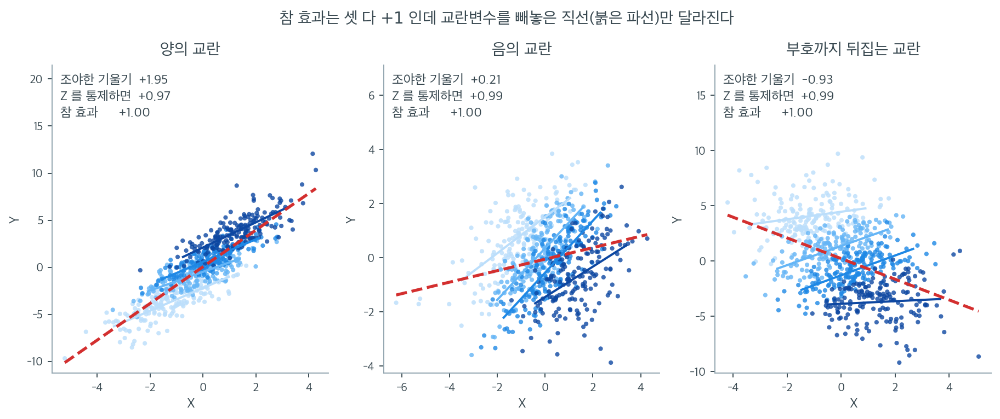
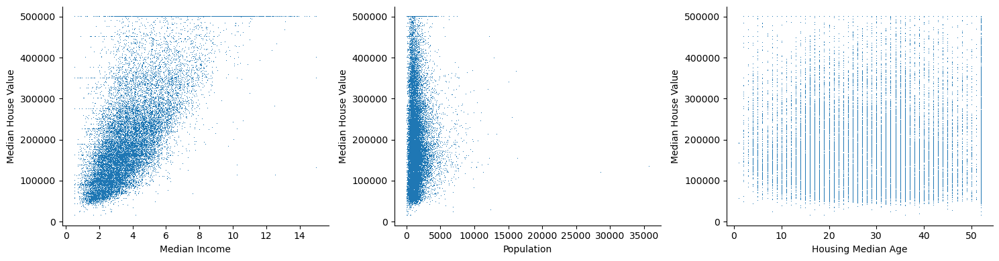
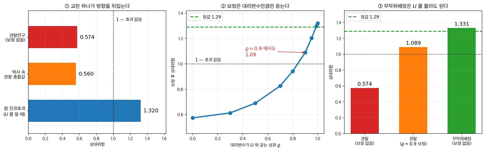
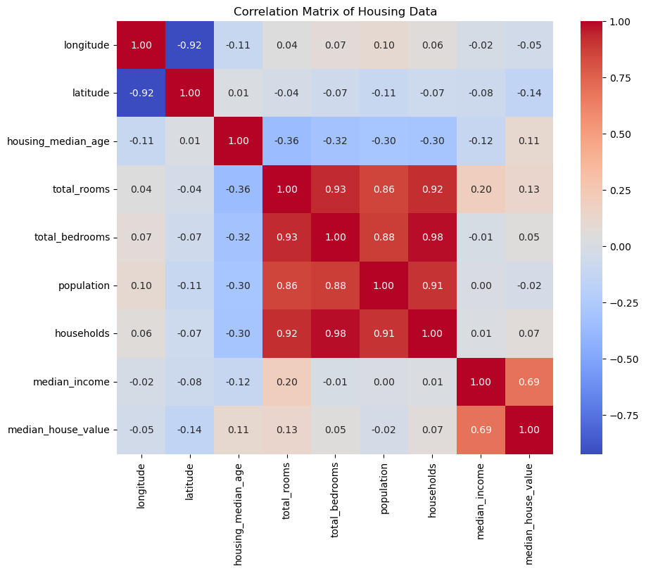
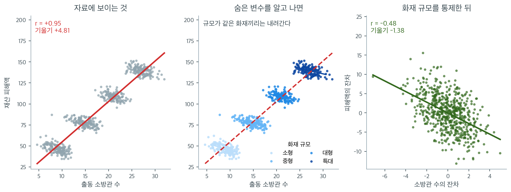

# 교란변수

**교란변수**는 노출(또는 설명변수)과 결과 모두에 영향을 주어 둘 사이에 허위 연관을 만드는 변수이다. 인과가 아닌 관계를 인과처럼 보이게 하거나 진짜 인과효과를 가릴 수 있으므로, 교란은 통계학과 역학에서 가장 중요한 개념 중 하나이다. 교란요인을 올바르게 식별하고 통제하는 일은 관찰자료에서 타당한 결론을 이끌어내는 데 필수적이다.

---

<div class="defn" markdown>

### 정의 1. 교란요인 { .dfn }

변수 $Z$가 $X$(노출)와 $Y$(결과) 사이 관계의 **교란요인**이 되려면 다음 세 조건이 모두 성립해야 한다.

1. $Z$가 $X$(노출)와 연관되어 있다.
2. $X$를 조건으로 했을 때 $Z$가 $Y$(결과)와 연관되어 있다.
3. $Z$가 $X$에서 $Y$로 가는 인과 경로 위에 있지 않다(즉 $Z$가 매개자가 아니다).

교란요인이 있으면 관측된 $X$–$Y$ 연관은 (있다면) 직접적인 관계와 $Z$를 통한 간접 경로를 함께 반영한다. $Z$를 반영하지 않으면 $X$–$Y$ 관계의 추정이 **교란**된다.

---

</div>

---

## 1. 교란의 구조

교란의 바탕이 되는 인과 구조는 $Z$에서 $X$와 $Y$ 모두로 화살표가 향하는 그림으로 나타낼 수 있다.

$$
X \leftarrow Z \rightarrow Y
$$

이 "공통원인" 구조는 $X$와 $Y$ 사이에 직접적인 인과 연결이 없어도 둘이 연관됨을 뜻한다. 연관은 전적으로 뒷문 경로 $X \leftarrow Z \rightarrow Y$를 통해 생긴다.

??? example "고전적인 예: 커피와 암"
    초기 관찰연구들은 커피 소비($X$)와 폐암($Y$) 사이에 양의 연관을 발견했다. 그러나 커피를 마시는 사람은 담배도 피울 가능성이 높았다($Z$). 흡연은 커피 소비와 폐암 모두와 연관되어 있다. 흡연을 통제하자 커피–암 연관은 대부분 사라졌다. 흡연이 교란요인이었다.

---

## 2. 양의 교란과 음의 교란

교란은 참 효과를 부풀릴 수도 가릴 수도 있다.

- **양의 교란**: 교란요인이 양의 연관을 만들거나 부풀린다. 조정하지 않은 연관이 참 효과를 과대추정한다.
- **음의 교란**: 교란요인이 참 연관을 가리거나 줄인다. 조정하지 않은 연관이 참 효과를 과소추정한다.

교란의 방향은 $Z$와 $X$의 관계, $Z$와 $Y$의 관계가 갖는 부호에 달려 있다.



세 자료는 모두 같은 방식으로 만들었다. $Z \to X$의 관계도 같고, $X$가 $Y$에 미치는 **참 효과도 셋 다 $+1$로 똑같다.** 다른 것은 $Z$가 $Y$에 미치는 효과의 부호와 크기뿐이다. 그런데 교란변수를 빼고 $Y$를 $X$에만 회귀시킨 붉은 파선의 기울기는 차례로 $+1.95$, $+0.21$, $-0.93$이 나온다. 같은 효과를 두 배로 부풀리기도 하고, 5분의 1로 줄여 없는 것처럼 보이게도 하고, 아예 반대 방향으로 뒤집어 놓기도 한 것이다.

반면 $Z$를 모형에 넣은 기울기는 $+0.97$, $+0.99$, $+0.99$로 세 자료 모두 참값 $+1$ 위에 정확히 내려앉는다. 그림에서 각 층의 옅은 파랑부터 진한 파랑까지 짧은 직선들이 그 조정된 기울기에 해당하며, 세 판 모두 같은 방향으로 완만하게 올라간다. **층 안의 기울기는 한 번도 변하지 않았고 층의 위치만 달라졌다는 것**이 교란의 정확한 정체다.

여기서 실무적으로 중요한 결론이 나온다. **"교란이 있으면 효과가 과대추정된다"는 말은 절반만 맞다.** 가운데 판은 참으로 존재하는 효과가 교란 때문에 거의 사라져 보이는 경우이고, 이럴 때 연구자는 "유의하지 않으니 효과가 없다"고 잘못 결론짓기 쉽다. 교란의 존재를 아는 것만으로는 부족하고, $Z$가 $X$와 $Y$ 각각에 어느 부호로 작용하는지까지 따져야 편향의 방향을 짐작할 수 있다. 아래의 "추정값 변화" 기준이 차이의 **크기**만이 아니라 **방향**까지 보라고 요구하는 이유다.

---

## 3. 교란을 탐지하는 방법

실무에서는 조정하지 않은(조야한) 연관과 조정한 연관을 비교하여 교란을 탐지한다.

1. ($Z$를 무시하고) $X$와 $Y$ 사이의 조야한 연관을 계산한다.
2. $Z$를 통제한 조정 연관을 계산한다.
3. 두 추정값이 의미 있게 다르면(보통 10% 이상 차이 나면) $Z$가 교란요인이다.

이를 "추정값 변화" 기준이라 부르기도 한다. 형식적인 통계 검정이 아니라 실용적인 발견법이다.


### 편상관으로 실제로 걸러 보기

위 목록이 「제3 변수를 재서 보정한다」고 했다. 그 보정이 실제로 무엇을 하는지는
편상관의 닫힌 꼴로 한 번 계산해 보면 분명해진다.

<div class="exbox" markdown>

**보기 1.** <span class="diff easy" title="쉬움"></span> 주택 자료에서 교란을 실제로 찾아보기. 캘리포니아 주택 자료에서 중위소득과 중위집값의 상관은 $r = 0.6881$ 이다.

**(1)** 이 상관이 **위치** 때문에 생긴 것은 아닌지 의심해 보자. 편상관의 닫힌 꼴

$$
\rho_{XY\cdot Z} = \frac{r_{XY} - r_{XZ}r_{YZ}}{\sqrt{(1-r_{XZ}^2)(1-r_{YZ}^2)}}
$$

로 위도를 통제한 값을 구하고, 잔차 회귀로 같은 값이 나오는지 확인하시오. 여러 변수를 통제하면 어떻게 되는가.

**(2)** 집값이 $500{,}001$ 달러에서 **잘려 있다.** 잘린 구역을 빼고 다시 재면 $r$ 가 오르는가 내리는가. 그 까닭을 소득의 퍼짐으로 설명하고, 회귀 기울기도 같이 움직이는지 보시오.

</div>

??? success "풀이"

    **(1) 위치는 교란변수가 아니다.** 위도 하나를 통제하면

    $$
    r_{XZ} = -0.0798,\qquad r_{YZ} = -0.1442
    $$

    이므로

    $$
    \rho_{XY\cdot Z} = \frac{0.6881 - (-0.0798)(-0.1442)}{\sqrt{(1-0.0798^2)(1-0.1442^2)}}
    = \frac{0.6766}{0.9865} = 0.6859
    $$

    로 **$0.0022$ 밖에 안 움직인다.** 잔차 회귀로 구한 값도 $0.6859$ 로 소수 넷째 자리까지 같다. 닫힌 꼴과 "각자 $Z$ 에 회귀한 잔차끼리의 상관"이 같은 것이라는 사실이 그대로 확인된다.

    통제할 변수를 바꿔 가며 재어도 마찬가지다.

    | 통제한 변수 | 편상관 |
    |---|---|
    | 없음 | $0.6881$ |
    | 위도 | $0.6859$ |
    | 경도 | $0.6882$ |
    | 위도 + 경도 | $0.6717$ |
    | 주택연령 | $0.7096$ |
    | 인구 | $0.6884$ |
    | 넷 모두 | $0.6800$ |

    **어느 것을 통제해도 $0.67$ 과 $0.71$ 사이를 벗어나지 않는다.** 교란이라면 통제했을 때 상관이 무너져야 하는데 그런 일이 일어나지 않는다. 주택연령을 통제하면 오히려 **올라간다**는 점도 눈여겨볼 만하다. 교란변수를 통제하면 상관이 줄고, 억제변수(suppressor)를 통제하면 늘 수 있다.

    다만 **"교란이 없다"고 결론지을 수는 없다.** 이 자료에 들어 있지 않은 변수(학군, 직업 구성, 토지 규제 등)는 어떤 통제로도 다룰 수 없다. 편상관이 할 수 있는 말은 **"내가 재어 본 이 변수들로는 설명되지 않는다"** 까지다.

    **(2) 내려간다. $0.6881 \to 0.6426$ 이다.** 집값이 $500{,}001$ 인 구역이 $965$ 개로 전체의 $4.68\%$ 다. 이 구역들의 소득 평균은 $7.825$ 로 나머지 $3.677$ 의 두 배가 넘는다. **즉 잘린 구역은 소득이 가장 높은 쪽에 몰려 있다.** 그래서 이들을 빼면 소득의 표준편차가

    $$
    1.8998 \;\longrightarrow\; 1.5703 \qquad (-17.3\%)
    $$

    로 줄어든다. **범위 제한**이다.

    범위 제한이 상관을 깎는다는 것은 $r = \hat\beta \cdot s_X/s_Y$ 에서 바로 읽힌다. 기울기는 $41794 \to 39987$ 로 $4.3\%$ 만 변했는데 $s_X$ 가 $17\%$ 줄었다. **기울기는 관계의 기울기라 범위에 거의 무관하고, $r$ 는 $X$ 가 얼마나 퍼져 있느냐에 직접 달려 있다.**

    그러므로 $r$ 가 떨어진 것을 "절단을 없애니 참값이 나왔다"로 읽으면 안 된다. 둘 다 각자의 모집단에 대해 옳고, **모집단이 달라졌을 뿐**이다.

    ```python
    import os
    import tarfile
    import urllib.request
    import numpy as np
    import pandas as pd
    from scipy import stats

    DOWNLOAD_ROOT = "https://raw.githubusercontent.com/ageron/handson-ml2/7b7e23e7267356f8355580877eff98c43cda1bd0/"
    HOUSING_PATH = os.path.join("datasets", "housing")
    HOUSING_URL = DOWNLOAD_ROOT + "datasets/housing/housing.tgz"

    def fetch_housing_data(housing_url=HOUSING_URL, housing_path=HOUSING_PATH):
        if not os.path.isdir(housing_path):
            os.makedirs(housing_path)
        tgz_path = os.path.join(housing_path, "housing.tgz")
        urllib.request.urlretrieve(housing_url, tgz_path)
        with tarfile.open(tgz_path) as housing_tgz:
            housing_tgz.extractall(path=housing_path)

    def load_housing_data(housing_path=HOUSING_PATH):
        return pd.read_csv(os.path.join(housing_path, "housing.csv"))

    fetch_housing_data()
    df = load_housing_data()

    X, Y = "median_income", "median_house_value"

    # (1) 편상관의 닫힌 꼴과 잔차 회귀가 같은 값을 주는지 본다.
    def partial_corr(d, x, y, zs):
        """z 들을 통제한 x, y 의 편상관. 각자 z 에 회귀한 잔차끼리의 상관이다."""
        Z = np.column_stack([np.ones(len(d))] + [d[z].values for z in zs])
        ex = d[x].values - Z @ np.linalg.lstsq(Z, d[x].values, rcond=None)[0]
        ey = d[y].values - Z @ np.linalg.lstsq(Z, d[y].values, rcond=None)[0]
        return np.corrcoef(ex, ey)[0, 1]

    r_xy = df[X].corr(df[Y])
    z = "latitude"
    r_xz, r_yz = df[X].corr(df[z]), df[Y].corr(df[z])
    closed = (r_xy - r_xz * r_yz) / np.sqrt((1 - r_xz**2) * (1 - r_yz**2))
    print(f"통제 전 r = {r_xy:.4f}")
    print(f"\n위도 하나를 통제")
    print(f"  r_xz = {r_xz:+.4f},  r_yz = {r_yz:+.4f}")
    print(f"  닫힌 꼴   = {closed:.4f}")
    print(f"  잔차 회귀 = {partial_corr(df, X, Y, [z]):.4f}")

    print(f"\n무엇을 통제하든 거의 움직이지 않는다")
    for zs in (["latitude"], ["longitude"], ["latitude", "longitude"],
               ["housing_median_age"], ["population"],
               ["latitude", "longitude", "housing_median_age", "population"]):
        print(f"  {'+'.join(zs):>50s} -> {partial_corr(df, X, Y, zs):.4f}")

    # (2) 집값이 잘린 구역을 빼면 어떻게 되는가
    cap = df[Y].max()
    m = df[Y] == cap
    print(f"\n집값이 {cap:.0f} 로 잘린 구역 = {m.sum()} 개 ({m.mean():.2%})")
    print(f"  그 구역의 소득 평균 {df[X][m].mean():.3f},  나머지 {df[X][~m].mean():.3f}")
    print(f"  소득 표준편차: 전체 {df[X].std():.4f}  ->  제외 후 {df[X][~m].std():.4f}")
    print(f"  상관:          전체 {r_xy:.4f}  ->  제외 후 {df[X][~m].corr(df[Y][~m]):.4f}")
    s1 = stats.linregress(df[X], df[Y]).slope
    s2 = stats.linregress(df[X][~m], df[Y][~m]).slope
    print(f"  회귀 기울기:   전체 {s1:.1f}  ->  제외 후 {s2:.1f}  ({s2/s1 - 1:+.1%})")
    ```

    출력:

    ```
    통제 전 r = 0.6881

    위도 하나를 통제
      r_xz = -0.0798,  r_yz = -0.1442
      닫힌 꼴   = 0.6859
      잔차 회귀 = 0.6859

    무엇을 통제하든 거의 움직이지 않는다
                                                latitude -> 0.6859
                                               longitude -> 0.6882
                                      latitude+longitude -> 0.6717
                                      housing_median_age -> 0.7096
                                              population -> 0.6884
        latitude+longitude+housing_median_age+population -> 0.6800

    집값이 500001 로 잘린 구역 = 965 개 (4.68%)
      그 구역의 소득 평균 7.825,  나머지 3.677
      소득 표준편차: 전체 1.8998  ->  제외 후 1.5703
      상관:          전체 0.6881  ->  제외 후 0.6426
      회귀 기울기:   전체 41793.8  ->  제외 후 39987.0  (-4.3%)
    ```

    닫힌 꼴 $0.6859$ 와 잔차 회귀 $0.6859$ 가 맞고, 범위 제한의 $-17.3\%$ 와 기울기의 $-4.3\%$ 도 맞는다. 앞 보기들과 달리 **여기서는 교란이 잡히지 않았다.** 교란을 찾는 절차를 돌렸을 때 "찾지 못했다"가 나오는 경우를 한 번 보아 두는 것이 이 보기의 몫이다.

    아래 실습들은 이 자료로 상관을 직접 계산하고 그려 보는 연습이다.

```python
import os
import tarfile
import urllib.request
import pandas as pd
import matplotlib.pyplot as plt

DOWNLOAD_ROOT = "https://raw.githubusercontent.com/ageron/handson-ml2/7b7e23e7267356f8355580877eff98c43cda1bd0/"
HOUSING_PATH = os.path.join("datasets", "housing")
HOUSING_URL = DOWNLOAD_ROOT + "datasets/housing/housing.tgz"

def fetch_housing_data(housing_url=HOUSING_URL, housing_path=HOUSING_PATH):
    if not os.path.isdir(housing_path):
        os.makedirs(housing_path)
    tgz_path = os.path.join(housing_path, "housing.tgz")
    urllib.request.urlretrieve(housing_url, tgz_path)
    with tarfile.open(tgz_path) as housing_tgz:
        housing_tgz.extractall(path=housing_path)

def load_housing_data(housing_path=HOUSING_PATH):
    csv_path = os.path.join(housing_path, "housing.csv")
    return pd.read_csv(csv_path)

def plot_housing_data(df):
    fig, (ax0, ax1, ax2) = plt.subplots(1, 3, figsize=(15, 4))

    ax0.plot(df.median_income, df.median_house_value, ',')
    ax0.set_xlabel("Median Income")

    ax1.plot(df.population, df.median_house_value, ',')
    ax1.set_xlabel("Population")

    ax2.plot(df.housing_median_age, df.median_house_value, ',')
    ax2.set_xlabel("Housing Median Age")

    for ax in (ax0, ax1, ax2):
        ax.set_ylabel("Median House Value")
        ax.spines['top'].set_visible(False)
        ax.spines['right'].set_visible(False)

    plt.tight_layout()
    plt.show()

def main():
    fetch_housing_data()
    df = load_housing_data()
    plot_housing_data(df)

if __name__ == "__main__":
    main()
```



세 산점도 중 첫 번째(소득 대 집값)만 뚜렷한 양의 관계를 보인다. 오른쪽 위 모서리에 값이 잘린 자국이 보이는데, 집값이 500,001달러에서 절단된 자료이기 때문이다.

###  추가 실습

### 실습: 교란요인 찾기

겉보기 상관이 있는 연구 결과(예: 화면 사용 시간과 수면의 질, 소셜 미디어 사용과 정신 건강)를 제시하고, 잠재적 교란변수를 찾아 어떻게 통제할 수 있을지 논하라.

### 실습: 실험 설계하기

독서와 학업 성취 사이의 상관이 주어졌을 때, 사회경제적 지위와 이전 학업 성취 같은 교란요인을 통제하면서 인과관계를 검정할 실험을 설계하라.

### 실습: 실제 자료 분석하기

운동, 식습관, 체중 감량, 스트레스 수준 같은 변수가 있는 자료로 상관 분석을 수행한 뒤 다중회귀로 잠재적 교란요인을 통제하라.

---

---

## 4. 교란요인을 통제하는 방법

### 설계 단계에서

1. **무작위화.** 노출을 무작위로 배정하면 $X$와 $Z$의 연관이 끊어져 교란이 제거된다. 무작위 대조 시험이 인과추론의 표준인 이유이다. [실험과 인과](../causation/experiments_causation.md)를 보라.

2. **제한.** 연구를 $Z$의 값이 같은 개인들로 한정한다. 예를 들어 비흡연자만 연구하여 흡연을 교란요인에서 제거한다.

3. **짝짓기.** 노출된 개인마다 $Z$ 값이 같은(또는 비슷한) 비노출 개인을 고른다.

### 분석 단계에서

4. **층화.** $Z$의 각 수준 안에서 자료를 따로 분석한 뒤 Mantel-Haenszel 추정량 같은 방법으로 합친다.

5. **회귀 조정.** $Y$를 $X$에 회귀하는 모형에 $Z$를 공변량으로 넣는다. 그러면 $X$의 계수가 $Z$를 고정한 채의 $X$ 효과를 추정한다.

6. **성향점수 방법.** $Z$가 주어졌을 때 노출될 확률을 추정한 뒤, 이 성향점수를 짝짓기·층화·가중에 쓴다.

---

<div class="exbox" markdown>

**보기 2.** <span class="diff easy" title="쉬움"></span> 운동, 식습관, 심장질환. 규칙적으로 운동하는 사람($X = 1$)의 심장질환($Y$) 발생률이 낮다고 관측했다고 하자. 그런데 규칙적으로 운동하는 사람은 더 건강한 식습관($Z$)을 갖는 경향도 있다. 식습관은 다음 이유로 교란요인이다.

1. 식습관이 운동과 연관되어 있다($r_{XZ} > 0$).
2. 운동 여부를 주었을 때 식습관이 심장질환과 연관되어 있다($r_{YZ} \neq 0$).
3. 식습관이 운동에서 심장질환으로 가는 인과 경로 위에 있지 않다(이 맥락에서 운동이 식습관을 일으키지는 않는다).

</div>

??? success "풀이"
    식습관을 통제하지 않으면 관측된 운동의 이득 중 일부가 운동 자체가 아니라 운동하는 사람들의 건강한 식습관에 기인한 것일 수 있다.

    식습관을 조정한 뒤:

    - 운동–심장질환 연관이 **유지되면** 운동에 독립적인 보호 효과가 있다.
    - 연관이 **사라지면** 겉보기 이득은 식습관 때문이었다(교란).
    - 연관이 **약해지지만 남으면** 운동에 독립적인 효과가 있으나 조정 전 크기는 식습관으로 교란되어 있었다.

---

## 5. 교란, 매개, 충돌자 편향

교란을 관련되지만 다른 두 현상과 구별하는 일이 결정적이다.

| 구조 | 도식 | $Z$를 통제할 때의 효과 |
|:---|:---:|:---|
| 교란 | $X \leftarrow Z \rightarrow Y$ | 편향을 제거하고 참 $X \to Y$ 효과를 드러낸다 |
| 매개 | $X \rightarrow Z \rightarrow Y$ | 간접효과를 제거하고 직접효과만 남긴다 |
| 충돌자 | $X \rightarrow Z \leftarrow Y$ | 편향을 *만든다*. 허위 연관을 생성한다 |

매개자를 통제하는 것이 반드시 틀린 것은 아니지만 다른 질문(총효과가 아니라 직접효과)에 답하게 된다. 충돌자를 통제하는 것은 언제나 해롭다. 없던 편향을 만들어내기 때문이다. 이런 구별은 [방향성 비순환 그래프](../causation/dags.md)로 형식화된다.


<div class="storybox" markdown>

**그림으로 보는 통계학 1.** 교란으로는 설명되지 않는다고 적었다

위 목록의 첫 항목 — **다중회귀로 교란변수를 통제한다** — 이 얼마나 듣는지를 가장
크게 시험한 자리가 있다. 폐경기 호르몬요법과 심장병이다.

$1991$ 년에 스탬퍼와 콜디츠가 그때까지의 역학 증거를 모아 정리했다. 전향연구
**$16$ 개 가운데 $15$ 개**가 호르몬을 쓰는 여성에게서 심장병이 **적다**고 보고했고,
대부분 통계적으로 유의했다. 전부 묶은 상대위험이 **$0.56$**(신뢰구간 $0.50$–$0.61$)이었다.
생물학적 설명도 맞아떨어졌다 — 에스트로겐이 나쁜 콜레스테롤을 낮추고 좋은 쪽을 올린다.

그 논문의 문장 하나가 이 쪽의 주제를 정면으로 건드린다.

> 전체적으로 증거의 대부분이 에스트로겐의 보호효과를 강하게 뒷받침하며, 그것이
> **교란 요인으로 설명될 것 같지는 않다.**

$2002$ 년 $7$ 월, 여성건강이니셔티브가 그 물음을 무작위로 물었다. 폐경기 여성
**$16{,}608$ 명**을 에스트로겐+프로게스틴과 위약에 무작위 배정한 시험이었다.
$8.5$ 년을 계획했는데 **$5.2$ 년 만에 중단**되었다. 해가 이익을 넘었기 때문이다.
심장병이 **늘었다.**

관찰연구가 한결같이 「$0.56$」이라고 말한 것을 무작위배정은 「$1$ 보다 크다」고
답했다. 방향이 뒤집힌 것이다.



그런 일이 생기려면 교란이 얼마나 세야 하는지를 재어 보았다. 관측되지 않는 **건강 의식**
$U$ 가 둘을 함께 움직인다고 두었다 — 건강에 신경 쓰는 사람이 호르몬요법도 더 받고
심장병도 덜 걸린다.

- **①** 놀랍도록 약한 교란이면 된다. $U$ 가 복용 확률의 로그오즈와 발병 로그오즈를
  각각 **표준편차 하나만큼** 움직이게 두었더니, 참 인과효과가 $1.29$(해롭다)인데
  관찰되는 조잡 상대위험이 **$0.574$** 로 나왔다. 역사 속의 $0.56$ 과 사실상 같은 수다.
  특별한 설정을 찾아 맞춘 것이 아니라 $\alpha = \gamma = 1$ 을 넣은 것이다.
- **②** 그러면 보정하면 되지 않는가. 문제는 $U$ 를 **직접 잴 수 없다**는 것이다.
  상관 $\varrho$ 인 대리변수로 보정하면, $\varrho = 0.7$ 에서 $0.83$, $\varrho = 0.8$
  에서 **$0.943$**, $\varrho = 0.9$ 에서 $1.089$ 다. **상관 $0.8$ 짜리 훌륭한 대리변수로
  보정해도 결론은 여전히 「해롭지 않다」**이고, $0.9$ 라야 겨우 $1$ 을 넘는다.
  $\varrho = 0.7$ 짜리를 여러 개 넣어도 느리다 — $1$ 개에 $0.83$, $4$ 개에 $1.07$,
  $8$ 개에 $1.17$ 이다.
- **③** 같은 자료생성에서 **배정만 동전으로** 바꾸면, 보정을 하나도 하지 않고도
  $1.331$ 이 나온다. $U$ 를 몰라도 되고 대리변수도 필요 없다.

여기서 읽을 것은 「관찰연구는 쓸모없다」가 아니다. 그 연구들은 규모도 크고 추적도
꼼꼼했으며 알려진 교란요인들을 성실히 보정했다. ② 가 말하는 것은 **성실함의 한계**다.
보정은 우리가 **잰 것**까지만 듣고, 재지 못한 것은 대리변수의 상관만큼만 지워진다.
그리고 그 남은 몫이 결론의 부호를 바꿀 만큼 크다.

$1991$ 년의 그 문장이 오만해서 틀린 것도 아니다. 당시 기준으로는 성실한 판단이었다.
다만 **「교란으로 설명되지 않는다」는 자료 안에서 확인할 수 있는 종류의 말이 아니다.**
확인하려면 ③ 이 필요했고, 그것이 $11$ 년 뒤에 왔다.

_확인한 곳 — Stampfer · Colditz, "Estrogen replacement therapy and coronary heart
disease: a quantitative assessment of the epidemiologic evidence", 『Preventive Medicine』
$20$ 권 $47$–$63$ 쪽($1991$, Crossref)의 초록 — 전향연구 $16$ 개 가운데 $15$ 개가
상대위험 감소를 보고했고 대부분 유의했다는 것, 전체를 묶은 상대위험 $0.56$(신뢰구간
$0.50$–$0.61$)과 내부대조 전향·혈관조영 연구만 묶은 $0.50$($0.43$–$0.56$), 에스트로겐이
저밀도 지단백을 낮추고 고밀도를 올린다는 설명, 그리고 「전체적으로 증거의 대부분이
에스트로겐의 보호효과를 강하게 뒷받침하며 그것이 교란 요인으로 설명될 것 같지는 않다」
· 여성건강이니셔티브의 에스트로겐+프로게스틴 시험($2002$ 년 $7$ 월 『JAMA』) — 여성
$16{,}608$ 명을 무작위 배정($8{,}506$ 대 $8{,}102$)해 $8.5$ 년을 계획했으나 해가 이익을
넘어 $5.2$ 년 만에 중단했고 심장병·뇌졸중·폐색전증이 늘었다는 것. ①–③ 의 수는 모두
직접 계산한 값이며, 참값으로 쓴 $1.29$ 와 $U$ 의 설정은 이 상자가 고른 것이지 시험이
보고한 위험비가 아니다_

</div>


#### 실습 2: 상관 열지도

**목표**: 모든 수치형 변수 사이의 상관을 시각화한다.

```python
import seaborn as sns
import matplotlib.pyplot as plt

def plot_correlation_heatmap(df):
    # numeric_only=True가 없으면 문자열 열(ocean_proximity) 때문에 예외가 난다.
    # pandas 2부터 비수치 열을 조용히 건너뛰지 않는다.
    corr_matrix = df.corr(numeric_only=True)
    plt.figure(figsize=(10, 8))
    sns.heatmap(corr_matrix, annot=True, cmap="coolwarm", fmt=".2f")
    plt.title("Correlation Matrix of Housing Data")
    plt.show()

if __name__ == "__main__":
    df = load_housing_data()
    plot_correlation_heatmap(df)
```



median_income과 median_house_value 사이의 0.69가 가장 두드러진다. 나머지 변수들은 집값과 거의 무상관이다.

#### 실습 3: 산점도 행렬

**목표**: 쌍별 관계를 시각화하는 쌍 그림을 만든다.

```python
import seaborn as sns
import matplotlib.pyplot as plt

def plot_scatter_matrix(df):
    selected = ['median_income', 'median_house_value', 'population', 'housing_median_age']
    sns.pairplot(df[selected], diag_kind="kde")
    plt.suptitle("Scatter Plot Matrix of Selected Housing Variables", y=1.02)
    plt.show()

if __name__ == "__main__":
    df = load_housing_data()
    plot_scatter_matrix(df)
```


변수 쌍마다 산점도를 그려 어떤 관계가 선형이고 어떤 것이 아닌지 확인한다.

#### 실습 4: 이상점이 상관에 미치는 영향

**목표**: 이상점이 상관에 어떤 영향을 주는지 살펴본다.

```python
import pandas as pd
import matplotlib.pyplot as plt

def add_outliers(df):
    outliers = pd.DataFrame({
        'median_income': [20, 22],
        'median_house_value': [1000000, 1200000]
    })
    df_with_outliers = pd.concat([df, outliers], ignore_index=True)

    original_corr = df['median_income'].corr(df['median_house_value'])
    new_corr = df_with_outliers['median_income'].corr(df_with_outliers['median_house_value'])

    print(f"Original Correlation: {original_corr:.4f}")
    print(f"New Correlation with Outliers: {new_corr:.4f}")

    plt.figure(figsize=(8, 6))
    plt.plot(df['median_income'], df['median_house_value'], 'o', label='Original Data')
    plt.plot(outliers['median_income'], outliers['median_house_value'], 'ro', label='Outliers')
    plt.xlabel('Median Income')
    plt.ylabel('Median House Value')
    plt.legend()
    plt.title("Impact of Outliers on Correlation")
    plt.show()

if __name__ == "__main__":
    df = load_housing_data()
    add_outliers(df)
```

출력:

```
Original Correlation: 0.6881
New Correlation with Outliers: 0.6901
```


이상점 몇 개를 더해도 상관이 0.6881에서 0.6901로 거의 변하지 않는다. $n = 20{,}640$이라 몇 점의 영향이 묽어지기 때문이다. 이상점의 위력은 표본크기에 반비례한다.


## 6. 측정되지 않았다면 — 잠복변수

앞의 다섯 절은 $Z$ 를 **알고 재었을 때**의 이야기다. 그런데 정의 1 의 세 조건을 만족하는 변수가 자료에 **없을** 수도 있다. 그것을 **잠복변수**라 부른다 — 식별되어 측정되는 순간 교란요인이 되고, 그 전까지는 이름조차 없다.

### 잠복변수란

잠복변수는 다음과 같은 변수이다.

1. 현재 분석에서 **측정되지 않았거나** **포함되지 않았다**.
2. 설명변수 $X$와 반응변수 $Y$ 모두와 연관되어 있다.
3. $X$와 $Y$ 사이의 관측된 연관 중 일부 또는 전부를 설명할 수 있다.

교란요인과의 구별은 개념적이라기보다 실무적이다. 교란요인은 식별되어 측정된 잠복변수이고, 잠복변수는 여전히 숨어 있는 것이다. 통계적 결과는 같다. 관측된 $X$–$Y$ 관계가 왜곡된다.

### 공통원인 구조

가장 중요한 유형의 잠복변수는 **공통원인**, 즉 $X$와 $Y$ 모두에 인과적으로 영향을 주는 변수 $Z$이다. 인과 구조는

$$
X \leftarrow Z \rightarrow Y
$$

이다. $Z$가 $X$와 $Y$의 변동을 모두 일으키므로 둘 사이에 직접적인 인과 연결이 없어도 두 변수는 상관된다. 관측된 $X$–$Y$ 상관은 $Z$에 대한 공통 의존의 산물이다.

??? example "화재 피해와 소방관"
    출동한 소방관 수($X$)는 재산 피해액($Y$)과 양의 상관을 보인다. 잠복변수는 화재의 규모($Z$)이다. 큰 화재일수록 소방관도 더 많이 출동하고 피해도 크다. 소방관을 더 보낸다고 피해가 커지는 것이 아니다. 오히려 피해를 줄인다.

### 왜 위험한가

잠복변수는 특히 다루기 까다롭다.

1. **자료에서 보이지 않는다.** 측정되지 않았으므로 살펴보거나 통제할 열 자체가 자료에 없다.

2. **실제 상관을 만든다.** $X$와 $Y$의 연관은 통계적으로 진짜이며 자료 안에 존재한다. 문제는 상관이 틀렸다는 것이 아니라 그 인과적 해석이 틀렸다는 것이다.

3. **통계적으로 통제할 수 없다.** 측정되지 않은 변수를 회귀에 넣을 수는 없다. 부분상관, 층화, 회귀 조정 모두 그 변수가 관측되어야 가능하다.

4. **효과를 만들 수도 가릴 수도 있다.** 잠복 공통원인은 무관한 두 변수를 관련된 것처럼 보이게 하거나(양의 교란) 실제로 관련된 두 변수를 무관해 보이게(음의 교란) 할 수 있다.



위의 소방관 이야기를 자료로 만들어 보았다. 화재 600건을 생성하면서 규모가 클수록 소방관을 많이 보내되, **같은 규모의 화재에서는 소방관이 한 명 늘 때마다 피해가 $1.5$만큼 줄도록** 정해 두었다. 즉 참 인과효과는 분명히 음수다.

왼쪽이 분석가의 책상에 놓이는 자료다. $r = +0.95$, 회귀 기울기 $+4.81$. 소방관을 한 명 더 보낼 때마다 피해가 $4.8$씩 늘어나는 것처럼 보인다. 이 상관은 **가짜가 아니다.** 자료 안에 실제로 존재하며 어떤 검정을 돌려도 압도적으로 유의하다. 틀린 것은 숫자가 아니라 해석이다.

가운데는 같은 점들을 화재 규모별로 색칠했을 뿐인데 그림의 뜻이 뒤집힌다. 네 덩어리가 오른쪽 위로 줄지어 있는 것은 규모가 만든 배치이고, **각 덩어리 안에서 그은 직선은 모두 오른쪽 아래로 내려간다.** 오른쪽은 이를 하나의 숫자로 요약한 것으로, 규모를 통제한 뒤 남은 잔차끼리의 상관은 $r = -0.48$, 기울기는 $-1.38$로 참값 $-1.5$에 가깝다. 소방관은 피해를 키우는 것이 아니라 줄이고 있었다.

핵심은 왼쪽 그림만 보고서는 이 반전을 짐작할 방법이 **원리적으로 없다**는 점이다. 잔차도 정상이고 점구름도 깔끔하다. 규모라는 열이 자료에 없으면 가운데와 오른쪽 그림은 아예 그릴 수 없다. 잠복변수의 위험은 그것이 통계를 망가뜨린다는 데 있지 않고, 통계가 멀쩡해 보인다는 데 있다.

### 잠복변수의 예

### 황새와 출생률

유럽 여러 나라에서 황새 쌍의 수($X$)는 출생률($Y$)과 양의 상관을 보인다. 잠복변수는 농촌성($Z$)이다. 농촌 지역일수록 황새도 많고 출생률도 높다. 황새가 아기를 데려오지는 않는다.

### 교육비 지출과 학업 성취

학교 수준에서 학생 1인당 지출($X$)이 시험 점수($Y$)와 음의 상관을 보이는 경우가 있다. 잠복변수는 사회경제적 지위($Z$)이다. 부유한 학군은 (행정이 효율적이어서) 1인당 지출이 적으면서도 (가정 환경의 이점 덕분에) 시험 점수가 높을 수 있다. 사회경제적 요인을 통제한 뒤의 지출과 성취의 관계는 양일 수 있다.

### 유기농 식품과 자폐

시간에 걸쳐 유기농 식품 판매량($X$)이 자폐 진단율($Y$)과 상관된다. 잠복변수는 시간 그 자체($Z$)이다. 두 변수 모두 지난 20년 동안 전혀 무관한 이유로(건강 유행 대 진단 기준 변화) 증가했다.

### 대비하는 방법

잠복변수는 정의상 측정되지 않았으므로 직접 통제할 수 없다. 다만 다음 전략들이 영향을 줄여 준다.

1. **분야 지식.** $X$와 $Y$ 모두에 영향을 줄 만한 변수가 무엇인지 신중히 생각한다. 인과 도식을 그려 보고 빠뜨린 화살표가 없는지 묻는다.

2. **무작위 실험.** $X$를 무작위로 배정하면 측정되었든 아니든 임의의 잠복변수 $Z$와 $X$의 연관이 끊어진다. 관찰연구에 대한 실험의 결정적 장점이다. [실험과 인과](../causation/experiments_causation.md)를 보라.

3. **민감도 분석.** 관측된 연관을 설명하려면 측정되지 않은 교란요인이 얼마나 강해야 하는지 묻는다. 그럴듯한 정도의 교란에 연관이 견디면 결론의 신뢰도가 높아진다.

4. **더 많은 변수를 측정한다.** 잠재적 교란요인을 많이 측정해 통제할수록 측정되지 않은 잠복변수가 결과를 좌우할 여지가 줄어든다.

5. **여러 상황에서의 재현.** 잠복변수가 다를 법한 여러 모집단·기간·맥락에서 같은 연관이 나타나면 그 연관이 진짜일 가능성이 높다.

### 잠복변수와 교란요인과 매개자

| 개념 | 측정되었나? | 인과 구조 | $X$–$Y$ 연관에 대한 효과 |
|:---|:---:|:---:|:---|
| 잠복변수 | 아니오 | $X \leftarrow Z \rightarrow Y$ | 연관을 왜곡한다(방향은 알 수 없다) |
| 교란요인 | 예 | $X \leftarrow Z \rightarrow Y$ | 통제할 수 있다 |
| 매개자 | 예 | $X \rightarrow Z \rightarrow Y$ | 인과 경로의 일부이다 |

잠복변수는 식별되어 측정되는 순간 교란요인이 된다. 어려운 점은 애초에 그것이 존재함을 알아차리는 일이다.

---

## 7. 다섯 가지 관측을 교란으로 다시 읽기

아래 다섯은 모두 「상관을 보고 인과로 읽었다」는 같은 꼴이다. 각각에서 **무엇이
$X$ 와 $Y$ 모두에 앞서는가**를 찾는 연습이다. 다섯을 나란히 놓으면 교란요인이
늘 같은 자리에 숨어 있다는 것이 보인다.

<div class="exbox" markdown>

**보기 3.** <span class="diff easy" title="쉬움"></span> 학력과 소득.

- **관측**: 어떤 연구에서 높은 학력과 높은 소득 사이에 강한 상관을 발견했다.
- **처음의 해석**: 높은 학력이 높은 소득을 일으킨다.

</div>

??? success "풀이"
    - **교란요인**: **사회경제적 배경** — 사회경제적 배경이 좋은 개인은 더 나은 교육을 받을 수 있고 소득도 높은 경향이 있다.
    - **대처 방법**: 분석에서 사회경제적 지위를 통제한다. 가정 배경을 통제한 연구들은 학력이 소득에 양의 영향을 주지만 그 효과가 가정의 사회경제적 지위에 의해 조절됨을 보여준다.

<div class="exbox" markdown>

**보기 4.** <span class="diff easy" title="쉬움"></span> 비타민 섭취와 암 위험.

- **관측**: 비타민 보충제를 먹는 사람의 암 위험이 낮다.
- **처음의 해석**: 비타민 보충제가 암 위험을 줄인다.

</div>

??? success "풀이"
    - **교란요인**: **건강을 의식하는 행동** — 비타민을 먹는 사람은 전반적으로 건강을 더 의식하여 다른 건강한 행동(운동, 균형 잡힌 식사, 금연)도 함께 한다.
    - **대처 방법**: 다른 건강 행동을 통제하여 비타민 섭취가 암 위험에 미치는 효과를 분리한다. 전반적인 건강 행동을 반영한 연구들은 비타민만으로는 암 위험과의 관계가 처음 관측된 만큼 강하지 않다는 결과를 흔히 얻는다.

<div class="exbox" markdown>

**보기 5.** <span class="diff easy" title="쉬움"></span> 커피 소비와 심장질환.

- **관측**: 커피를 많이 마시는 것이 심장질환 발생 증가와 상관된다.
- **처음의 해석**: 커피가 심장질환을 일으킨다.

</div>

??? success "풀이"
    - **교란요인**: **흡연** — 커피를 마시는 사람이 담배를 피울 가능성이 더 높고, 흡연은 알려진 심장질환 위험요인이다.
    - **대처 방법**: 분석에서 흡연을 통제하여 커피 소비가 독립적으로 심장질환 위험에 영향을 주는지 판정한다.

<div class="exbox" markdown>

**보기 6.** <span class="diff easy" title="쉬움"></span> 운동과 체중 감량.

- **관측**: 규칙적으로 운동하는 사람이 체중을 줄이는 경향이 있다.
- **처음의 해석**: 운동이 체중 감량을 일으킨다.

</div>

??? success "풀이"
    - **교란요인**: **식습관** — 규칙적으로 운동하는 사람이 더 건강한 식사를 할 수 있다.
    - **대처 방법**: 식습관(열량 섭취와 식단의 질)을 통제한다. 통제하면 운동과 체중 감량의 관계가 더 뚜렷해지며 운동과 식습관이 모두 중요한 역할을 함이 드러난다.

<div class="exbox" markdown>

**보기 7.** <span class="diff easy" title="쉬움"></span> 업무 성과와 급여.

- **관측**: 성과가 좋은 직원이 급여를 더 많이 받는다.
- **처음의 해석**: 좋은 업무 성과가 높은 급여로 이어진다.

</div>

??? success "풀이"
    - **교란요인**: **경력과 근속** — 경력이 많은 직원은 성과도 좋고 연공에 따라 급여도 높을 수 있다.
    - **대처 방법**: 경력 연수와 근속 기간을 통제하여 성과가 급여에 미치는 직접 효과를 정확히 평가한다.

---

---

## 연습문제

<div class="drillbox" markdown>

**연습문제 1.** <span class="diff easy" title="쉬움"></span>
다음 각 상관에 대해 그럴듯한 교란변수를 적어도 하나씩 밝혀라 이렇게 된다.

1. 1인당 초콜릿 소비가 많은 나라일수록 노벨상 수상자가 많다.
2. 아침을 먹는 학생이 시험을 더 잘 본다.
3. 경찰관이 많은 도시일수록 범죄율이 높다.
4. 책을 많이 가진 사람일수록 소득이 높은 경향이 있다.

</div>

??? success "풀이"

    1. **국가의 부(1인당 GDP)**가 초콜릿 소비와 노벨상 모두를 교란한다. 부유한 나라는 초콜릿도 더 살 수 있고 교육과 연구 기반시설에도 더 투자한다.

    2. **사회경제적 지위**가 아침 식사와 시험 성적을 교란한다. 소득이 높은 가정의 학생은 아침을 규칙적으로 먹을 가능성이 크고 더 나은 교육 자원, 과외, 학습 환경도 갖는다.

    3. **도시 규모와 인구밀도**가 경찰관 수와 범죄율을 교란한다. 큰 도시는 경찰관을 더 많이 고용하고 인구밀도, 빈곤 집중 등 도시적 요인 때문에 범죄율도 높다.

    4. **학력**이 책 소유와 소득을 교란한다. 학력이 높은 사람은 책을 더 사고 소득도 더 높은 경향이 있다. 부모의 학력과 사회경제적 배경도 두 변수를 교란할 수 있다.

<div class="drillbox" markdown>

**연습문제 2.** <span class="diff med" title="중간"></span>
캘리포니아 주택 자료를 써서:

1. 전체 상관행렬을 계산하라
2. `median_house_value`와 가장 강하게 상관된 변수를 찾아라
3. `median_income`과 `median_house_value`의 관계에서 있을 수 있는 교란요인을 논하라
4. 가장 강하게 상관된 네 변수에 대해 산점도 행렬을 그려라

```python
import os, tarfile, urllib.request
import pandas as pd

DOWNLOAD_ROOT = "https://raw.githubusercontent.com/ageron/handson-ml2/7b7e23e7267356f8355580877eff98c43cda1bd0/"
HOUSING_PATH = os.path.join("datasets", "housing")
HOUSING_URL = DOWNLOAD_ROOT + "datasets/housing/housing.tgz"

def fetch_housing_data():
    if not os.path.isdir(HOUSING_PATH):
        os.makedirs(HOUSING_PATH)
    tgz_path = os.path.join(HOUSING_PATH, "housing.tgz")
    urllib.request.urlretrieve(HOUSING_URL, tgz_path)
    with tarfile.open(tgz_path) as f:
        f.extractall(path=HOUSING_PATH)

def load_housing_data():
    return pd.read_csv(os.path.join(HOUSING_PATH, "housing.csv"))

fetch_housing_data()
df = load_housing_data()

# numeric_only=True가 없으면 문자열 열(ocean_proximity) 때문에 예외가 난다.
corr = df.corr(numeric_only=True)["median_house_value"].sort_values(ascending=False)
print(corr.round(4).to_string())
```

출력:

```
median_house_value    1.0000
median_income         0.6881
total_rooms           0.1342
housing_median_age    0.1056
households            0.0658
total_bedrooms        0.0497
population           -0.0246
longitude            -0.0460
latitude             -0.1442
```

</div>

??? success "풀이"

    `median_house_value`와 가장 강하게 상관된 변수는 `median_income`이다. 이 관계에서 있을 수 있는 교란요인으로는 지리적 위치(해안 근접성, 도시 대 농촌), 주택 연식, 지역 편의시설(학군, 일자리)이 있다. 이 변수들은 (거주자의 분화를 통해) 중위소득에도, (수요를 통해) 주택 가격에도 영향을 준다. 상위 네 변수의 산점도 행렬을 그리면 많은 관계가 비선형이고, 이상점(예: \$500,000에서 잘린 주택 가격)이 상관 추정을 왜곡할 수 있음이 드러난다.

<div class="drillbox" markdown>

**연습문제 3.** <span class="diff med" title="중간"></span>
1 절의 커피–암 이야기를 수치로 만들어 보자. $X = 1$ 은 커피를 마심, $Y = 1$ 은 폐암 발병, $Z = 1$ 은 흡연이다. $2000$ 명을 흡연 여부로 층화하여 세었더니 다음과 같았다.

| $Z$ | $X$ | 사람 수 | 발병 수 |
|:---|:---|---:|---:|
| 비흡연 $(Z=0)$ | 커피 $(X=1)$ | 200 | 10 |
| 비흡연 $(Z=0)$ | 커피 안 마심 $(X=0)$ | 800 | 40 |
| 흡연 $(Z=1)$ | 커피 $(X=1)$ | 800 | 200 |
| 흡연 $(Z=1)$ | 커피 안 마심 $(X=0)$ | 200 | 50 |

**(a)** $Z$ 를 무시한 조야한 발병률 $\hat P(Y=1 \mid X=1)$ 과 $\hat P(Y=1 \mid X=0)$, 그리고 둘의 차이(위험차)와 비(위험비)를 구하라.

**(b)** 각 층 안의 위험차 $\Delta_z = \hat P(Y=1 \mid X=1, Z=z) - \hat P(Y=1 \mid X=0, Z=z)$ 를 구하라.

**(c)** $p_z = \hat P(Z=z \mid X=1)$, $q_z = \hat P(Z=z \mid X=0)$, $r_{xz} = \hat P(Y=1 \mid X=x, Z=z)$ 라 쓰면 조야한 위험차가 다음처럼 두 덩어리로 쪼개진다.

$$
\sum_z p_z r_{1z} - \sum_z q_z r_{0z} = \underbrace{\sum_z q_z \Delta_z}_{\text{층별 효과의 가중평균}} + \underbrace{\sum_z (p_z - q_z) r_{1z}}_{\text{구성 차이}}
$$

이 항등식을 보이고, 표의 수치로 두 항의 값을 각각 적어라.

**(d)** 정의 1 의 세 조건 가운데 이 표만 보고 확인할 수 있는 것은 무엇이고 확인할 수 없는 것은 무엇인가?

</div>

??? success "풀이"
    **(a)** 커피를 마신 $1000$ 명 중 발병은 $10 + 200 = 210$ 명이므로

    $$
    \hat P(Y=1 \mid X=1) = \frac{210}{1000} = 0.21 ,
    $$

    커피를 마시지 않은 $1000$ 명 중 발병은 $40 + 50 = 90$ 명이므로

    $$
    \hat P(Y=1 \mid X=0) = \frac{90}{1000} = 0.09 .
    $$

    조야한 위험차는 $0.21 - 0.09 = 0.12$(곧 $12$ 퍼센트포인트)이고 조야한 위험비는 $0.21 / 0.09 = 2.333$ 이다. 커피가 암 위험을 두 배 넘게 올리는 것처럼 보인다.

    **(b)** 네 칸의 발병률은

    $$
    r_{10} = \frac{10}{200} = 0.05, \quad r_{00} = \frac{40}{800} = 0.05, \quad r_{11} = \frac{200}{800} = 0.25, \quad r_{01} = \frac{50}{200} = 0.25
    $$

    이므로 $\Delta_0 = 0.05 - 0.05 = 0$, $\Delta_1 = 0.25 - 0.25 = 0$ 이다. 층 안에서는 커피의 효과가 **정확히 없다.** 층별 위험비도 둘 다 $1$ 이다.

    **(c)** 항등식은 $\sum_z q_z r_{1z}$ 를 더하고 빼면 바로 나온다.

    $$
    \sum_z p_z r_{1z} - \sum_z q_z r_{0z} = \Bigl(\sum_z q_z r_{1z} - \sum_z q_z r_{0z}\Bigr) + \Bigl(\sum_z p_z r_{1z} - \sum_z q_z r_{1z}\Bigr) = \sum_z q_z \Delta_z + \sum_z (p_z - q_z) r_{1z}
    $$

    표에서 $p_0 = 200/1000 = 0.2$, $p_1 = 0.8$, $q_0 = 800/1000 = 0.8$, $q_1 = 0.2$ 이다. 따라서

    $$
    \sum_z q_z \Delta_z = 0.8 \times 0 + 0.2 \times 0 = 0 ,
    $$

    $$
    \sum_z (p_z - q_z) r_{1z} = (0.2 - 0.8) \times 0.05 + (0.8 - 0.2) \times 0.25 = -0.03 + 0.15 = 0.12 .
    $$

    합은 $0 + 0.12 = 0.12$ 로 (a) 의 조야한 위험차와 맞는다. 관측된 $12$ 퍼센트포인트는 **전부** 구성 차이다. 커피를 마신 집단은 흡연자가 $80\%$, 마시지 않은 집단은 $20\%$ 여서, 고위험 층의 비중 차이 $0.6$ 에 층 사이의 위험 격차 $0.25 - 0.05 = 0.2$ 를 곱한 $0.12$ 가 그대로 나타난 것이다. 3 절의 기준으로 말하면 조정 위험차 $0$ 과 조야한 위험차 $0.12$ 의 차이는 $10\%$ 를 한참 넘으므로 흡연은 교란요인이다.

    **(d)** 조건 1 은 표에서 확인된다. $\hat P(Z=1 \mid X=1) = 0.8$ 이고 $\hat P(Z=1 \mid X=0) = 0.2$ 이니 $Z$ 는 $X$ 와 연관되어 있다. 조건 2 도 확인된다. $X=1$ 안에서 발병률이 $5\%$ 대 $25\%$, $X=0$ 안에서도 $5\%$ 대 $25\%$ 로 $Z$ 는 $X$ 를 고정해도 $Y$ 와 연관되어 있다.

    확인할 수 없는 것은 조건 3 이다. 똑같은 네 칸의 숫자는 "흡연이 커피 소비를 늘린다"는 구조($X \leftarrow Z$)에서도, "커피가 흡연을 늘린다"는 구조($X \to Z \to Y$, 곧 $Z$ 가 매개자)에서도 나올 수 있다. 뒤쪽이 참이라면 $Z$ 로 층화해 얻은 $0$ 은 교란을 제거한 값이 아니라 커피의 총효과를 통째로 지운 값이다. 조건 3 은 자료가 아니라 바탕 구조에 대한 지식이 공급해야 하는 가정이다.

<div class="drillbox" markdown>

**연습문제 4.** <span class="diff med" title="중간"></span>
2 절 그림의 세 판은 다음 모형으로 만들었다. $Z \sim N(0,1)$, $X = Z + \epsilon$, $Y = \beta X + a Z + \varepsilon$ 이고 $\epsilon \sim N(0,1)$, $\varepsilon$ 은 모두 서로 독립이다. 세 판은 $\beta = 1$ 로 같고 $a$ 만 다르다.

**(a)** 표본이 커질 때 $Y$ 를 $X$ 에만 회귀시킨 조야한 기울기가 $\beta + a/2$ 로 수렴함을 보여라.

**(b)** 본문에 적힌 조야한 기울기 $+1.95$, $+0.21$, $-0.93$ 에서 각 판의 $a$ 를 되짚어 추정하라.

**(c)** $a$ 를 얼마로 잡으면 조야한 기울기가 $0$ 이 되는가? 그런 자료를 받은 연구자가 $Z$ 를 모른 채 내릴 결론과, 3 절의 "추정값 변화" 기준이 $Z$ 를 알 때 말해 주는 것을 각각 적어라.

**(d)** $X = cZ + \epsilon$ 으로 일반화하면 편향이 어떻게 적히는가? $c = -1$, $a > 0$ 인 "네 번째 판"에서 조야한 기울기는 참값보다 큰가 작은가? 2 절이 "$Z$ 가 $X$ 와 $Y$ 각각에 어느 부호로 작용하는지까지 따져야" 한다고 한 이유를 이 식으로 설명하라.

</div>

??? success "풀이"
    **(a)** $\operatorname{Var}(X) = \operatorname{Var}(Z) + \operatorname{Var}(\epsilon) = 2$ 이고 $\operatorname{Cov}(X, Z) = \operatorname{Var}(Z) = 1$ 이다. 조야한 기울기는 표본이 커지면 $\operatorname{Cov}(X,Y)/\operatorname{Var}(X)$ 로 수렴하고

    $$
    \operatorname{Cov}(X, Y) = \beta \operatorname{Var}(X) + a \operatorname{Cov}(X, Z) = 2\beta + a
    $$

    이므로 극한은

    $$
    \frac{2\beta + a}{2} = \beta + \frac{a}{2} .
    $$

    편향은 $a/2$ 이다. $Z$ 를 넣은 회귀는 $Y$ 의 생성식이 바로 $X$ 와 $Z$ 의 선형식이고 $\varepsilon$ 이 둘과 독립이므로 $\beta$ 를 일치추정한다. 본문의 $+0.97$, $+0.99$, $+0.99$ 가 이것이다.

    **(b)** $\hat a = 2(\text{조야한 기울기} - 1)$ 이므로

    $$
    2(1.95 - 1) = 1.90, \qquad 2(0.21 - 1) = -1.58, \qquad 2(-0.93 - 1) = -3.86
    $$

    이고, 실제로 쓴 값 $2$, $-1.5$, $-4$ 를 $n = 700$ 의 표본오차 안에서 잘 되짚는다.

    **(c)** $\beta + a/2 = 0$ 에서 $a = -2\beta = -2$ 이다. $Z$ 를 모르는 연구자는 기울기가 $0$ 이니 "커피는 아무 효과가 없다"는 식의 결론을 내린다. 참 효과가 $+1$ 로 멀쩡히 있는데도 그렇다. 반면 $Z$ 를 가지고 있으면 조야한 값 $0$ 과 조정값 $+1$ 의 차이가 $100\%$ 여서 3 절의 기준이 교란을 분명히 잡아낸다. 2 절이 "교란이 있으면 과대추정된다는 말은 절반만 맞다"고 한 가운데 판의 극단이 이 경우다.

    **(d)** 이제 $\operatorname{Var}(X) = c^2 + 1$, $\operatorname{Cov}(X,Z) = c$ 이므로

    $$
    \text{조야한 기울기} \longrightarrow \beta + \frac{ac}{c^2 + 1} .
    $$

    편향의 부호는 $\operatorname{sign}(a c)$, 곧 **$Z \to Y$ 의 부호와 $Z \to X$ 의 부호를 곱한 것**이다. $c = -1$, $a > 0$ 이면 편향은 $-a/2 < 0$ 이므로 조야한 기울기는 참값보다 **작다.** $Z \to Y$ 가 양(+)이라는 사실만으로는 과대추정인지 과소추정인지 알 수 없고, $Z \to X$ 의 부호를 곱해야 비로소 방향이 정해진다. 세 판이 모두 $c = +1$ 이었기 때문에 그림에서는 $a$ 의 부호가 곧 편향의 부호로 보였을 뿐이다. 덧붙여 $\lvert c \rvert \to \infty$ 면 $ac/(c^2+1) \to 0$ 이다. $Z$ 가 $X$ 를 거의 전부 설명해 버리면 $X$ 의 남은 변동이 $Z$ 와 거의 무관해져 편향이 오히려 줄어든다. $\square$

<div class="drillbox" markdown>

**연습문제 5.** <span class="diff med" title="중간"></span>
연습문제 4 를 모의실험으로 확인하자. 아래 코드는 2 절 그림과 같은 씨앗으로 같은 자료를 다시 만들고, 네 번째로 $a = -2$ 를 덧붙인다.

**(a)** 코드를 돌려 본문에 적힌 여섯 개의 기울기가 그대로 재현되는지 확인하라.

**(b)** $a$ 가 어떻게 변해도 조정된 기울기는 $+0.97 \sim +0.99$ 에 머문다. 왜인가?

**(c)** 조야한 기울기와 예측값 $1 + a/2$ 의 차이는 $a = +2$ 에서 $-0.05$, $a = -4$ 에서 $+0.07$ 이다. 이 차이가 $\lvert a \rvert$ 와 함께 커지는 이유를 (a) 의 유도에서 설명하라.

```python
import numpy as np

BETA, n = 1.0, 700
rng = np.random.default_rng(11)          # 그림과 같은 씨앗

for a in (2.0, -1.5, -4.0, -2.0):
    Z = rng.normal(0, 1, n)
    X = Z + rng.normal(0, 1, n)
    Y = BETA * X + a * Z + rng.normal(0, 0.7, n)

    crude = np.polyfit(X, Y, 1)[0]                      # Z 를 뺀 기울기
    M = np.column_stack([np.ones(n), X, Z])
    adj = np.linalg.lstsq(M, Y, rcond=None)[0][1]       # Z 를 넣은 기울기

    print(f"a={a:+.1f}  조야={crude:+.2f}  예측값 1+a/2={1 + a / 2:+.2f}  "
          f"조정={adj:+.2f}")
```

</div>

??? success "풀이"
    출력:

    ```text
    a=+2.0  조야=+1.95  예측값 1+a/2=+2.00  조정=+0.97
    a=-1.5  조야=+0.21  예측값 1+a/2=+0.25  조정=+0.99
    a=-4.0  조야=-0.93  예측값 1+a/2=-1.00  조정=+0.99
    a=-2.0  조야=-0.02  예측값 1+a/2=+0.00  조정=+0.98
    ```

    **(a)** 앞의 세 줄이 본문의 $+1.95$, $+0.21$, $-0.93$ 과 $+0.97$, $+0.99$, $+0.99$ 를 그대로 준다. 세 판이 같은 난수열에서 차례로 뽑혔기 때문이다. 네 번째 줄은 연습문제 4(c) 의 예측대로 조야한 기울기가 $-0.02$, 곧 사실상 $0$ 이다. 참 효과 $+1$ 이 교란 때문에 완전히 지워진 자료다.

    **(b)** 조정된 회귀의 설명변수 $(X, Z)$ 가 $Y$ 의 생성식에 들어 있는 바로 그 두 변수이고 잡음 $\varepsilon$ 이 둘과 독립이므로, $a$ 가 무엇이든 $X$ 의 계수는 $\beta = 1$ 의 일치추정값이다. $a$ 는 $Z$ 의 계수만 바꾼다. 본문이 "층 안의 기울기는 한 번도 변하지 않았고 층의 위치만 달라졌다"고 한 것이 이 식의 말이다. $+0.97 \sim +0.99$ 의 흔들림은 $n = 700$ 의 표본오차뿐이다.

    **(c)** 표본에서 조야한 기울기는

    $$
    \hat\beta_{\text{조야}} = \beta + a \cdot \frac{\widehat{\operatorname{Cov}}(X,Z)}{\widehat{\operatorname{Var}}(X)} + (\text{잡음 항})
    $$

    의 꼴이다. 비 $\widehat{\operatorname{Cov}}(X,Z)/\widehat{\operatorname{Var}}(X)$ 는 참값 $1/2$ 에서 표본오차 $\delta$ 만큼 벗어나는데, 그 오차가 기울기에 실릴 때 $a$ 가 곱해진다. 곧 예측값과의 차이는 대략 $a\delta$ 여서 $\lvert a \rvert$ 에 비례해 커진다. 교란이 셀수록 같은 표본크기로도 조야한 추정이 더 불안정해진다는 뜻이다.

<div class="drillbox" markdown>

**연습문제 6.** <span class="diff hard" title="어려움"></span>
5 절 표는 충돌자 $X \rightarrow Z \leftarrow Y$ 를 통제하면 "편향을 만든다"고 한다. 그런데 정의 1 은 세 조건만으로 교란요인을 가린다. 둘을 한 자료에 동시에 들이대 보자.

두 질병 $X$ 와 $Y$ 는 인구에서 서로 독립이고 각각 확률 $1/2$ 로 생긴다. 둘 중 하나라도 걸리면 입원하고 둘 다 없으면 입원하지 않는다. 곧 $Z = \max(X, Y)$ 이다.

**(a)** 정의 1 의 세 조건을 하나씩 확인하여, 이 $Z$ 가 정의 1 에 따르면 $X$–$Y$ 관계의 교란요인으로 판정됨을 보여라.

**(b)** $X$ 가 $Y$ 에 미치는 참 인과효과는 $0$ 이다. 조야한 위험차 $P(Y=1 \mid X=1) - P(Y=1 \mid X=0)$ 을 구하라.

**(c)** $Z$ 로 층화하면 어떻게 되는가? 두 층의 위험차를 구하되, 한 층에서는 비교가 아예 불가능함을 지적하라. 층화로 얻는 "조정된" 추정값은 얼마인가?

**(d)** 정의 1 의 조건 3 을 어떻게 고쳐야 이 $Z$ 가 걸러지는가? "$Z$ 가 매개자가 아니다"로는 왜 부족한가?

</div>

??? success "풀이"
    네 값의 확률은 $P(X=x, Y=y) = 1/4$ 로 모두 같고, $Z=0$ 은 $(X,Y) = (0,0)$ 한 경우뿐이므로 $P(Z=0) = 1/4$, $P(Z=1) = 3/4$ 이다.

    **(a)** 조건 1: $P(Z=1 \mid X=1) = 1$ 이고 $P(Z=1 \mid X=0) = P(Y=1) = 1/2$ 이므로 $Z$ 는 $X$ 와 연관되어 있다.

    조건 2: $X = 0$ 인 층 안에서 $P(Y=1 \mid X=0, Z=1) = 1$ 이고 $P(Y=1 \mid X=0, Z=0) = 0$ 이다. $X$ 를 고정해도 $Z$ 는 $Y$ 와 연관되어 있다(실은 완벽하게 결정한다).

    조건 3: $Z$ 에서 나가는 화살표가 아예 없으므로 $Z$ 는 $X$ 에서 $Y$ 로 가는 어떤 인과 경로 위에도 있을 수 없다. 매개자가 아니다.

    세 조건이 모두 성립하니 정의 1 은 $Z$ 를 교란요인이라고 부른다.

    **(b)** $X$ 와 $Y$ 가 독립이므로 $P(Y=1 \mid X=1) = P(Y=1 \mid X=0) = 1/2$ 이고 조야한 위험차는 $0$ 이다. 참값과 같다. **조정하지 않은 분석이 옳은 답을 주고 있다.**

    **(c)** $Z=1$ 층에서는 $X=1$ 이면 자동으로 $Z=1$ 이므로

    $$
    P(Y=1 \mid X=1, Z=1) = P(Y=1 \mid X=1) = \frac{1}{2} ,
    $$

    반면 $X=0$ 이면서 $Z=1$ 이려면 $Y=1$ 이어야 하므로

    $$
    P(Y=1 \mid X=0, Z=1) = 1 .
    $$

    이 층의 위험차는 $1/2 - 1 = -1/2$ 다. $Z=0$ 층은 $(X,Y)=(0,0)$ 뿐이어서 $X=1$ 인 사람이 한 명도 없다. 위험차를 정의할 수 없다(양수성 조건이 깨진다). 따라서 층화 추정값은 비교가 가능한 $Z=1$ 층의 값 그대로 $-1/2$ 이다. 아무 효과도 없는데 "질병 $X$ 가 질병 $Y$ 를 $50$ 퍼센트포인트 막아 준다"는 결론이 나온다. 병원 환자만 모아 놓은 자료에서 두 질병이 음으로 상관되어 보이는 Berkson 의 역설이다.

    **(d)** 조건 1 과 2 는 연관에 관한 진술이고 연관은 화살표의 방향에 무관하므로, 그 둘로는 "$Z$ 가 $X$ 의 원인"과 "$Z$ 가 $X$ 의 결과"를 구별할 수 없다. 조건 3 은 $X \to Z \to Y$ 꼴만 막아 주는데 충돌자는 $X \to Z \leftarrow Y$ 여서 매개자가 아니고, 그래서 그물을 빠져나간다. 필요한 것은 더 센 조항이다.

    > 조건 3′: $Z$ 는 $X$ 의 후손도 $Y$ 의 후손도 아니다. 곧 $Z$ 는 뒷문 경로 $X \leftarrow \cdots \rightarrow Y$ 위에 있어야 한다.

    이렇게 고치면 $Z = \max(X,Y)$ 는 $X$ 와 $Y$ 의 공통결과이므로 곧바로 걸러진다. 1 절의 "뒷문 경로"라는 표현과 [방향성 비순환 그래프](../causation/dags.md)의 뒷문 기준이 조정 집합에서 $X$ 의 후손을 금지하는 이유가 바로 이것이다. 정의 1 은 실무에서 쓰기 쉬운 점검표이지만, 점검표만으로는 교란과 충돌자를 가르지 못한다. $\square$

<div class="drillbox" markdown>

**연습문제 7.** <span class="diff hard" title="어려움"></span>
3 절의 "추정값 변화" 기준은 조야한 추정값과 조정한 추정값이 $10\%$ 이상 다르면 교란이라고 판정한다. 이 기준이 교란을 통째로 놓치는 자료를 만들어 보자.

$Z_1, Z_2$ 는 서로 독립인 $N(0,1)$ 이고

$$
X = Z_1 + Z_2 + \epsilon, \qquad Y = \beta X + a_1 Z_1 + a_2 Z_2 + \varepsilon
$$

이며 $\epsilon \sim N(0,1)$, $\varepsilon$ 은 모두 독립이다. $\beta = 1$, $a_1 = 2$, $a_2 = -2$ 로 둔다.

**(a)** $Y$ 를 $X$ 에만 회귀시킨 기울기의 극한이 $\beta + (a_1 + a_2)/3$ 임을 보이고, 이 수치에서 그 값이 $\beta$ 와 **정확히** 같음을 확인하라. $Z_1$ 과 $Z_2$ 를 둘 다 넣은 조정값과 비교하면 추정값 변화는 몇 퍼센트인가? 그런데도 $Z_1$ 과 $Z_2$ 는 각각 정의 1 의 세 조건을 모두 만족하는가?

**(b)** $Z_1$ 만 관측되었다고 하자. $Y$ 를 $X$ 와 $Z_1$ 에 회귀시킨 $X$ 의 계수가 $\beta + a_2/2$ 로 수렴함을 보여라. 수치로는 얼마인가?

**(c)** 대칭으로 $Z_2$ 만 조정하면 얼마가 되는가? (a) 와 (b), (c) 를 나란히 놓고 "조정할 수 있는 교란요인부터 넣고 보자"는 실무 관행이 어떤 위험을 안고 있는지 적어라.

</div>

??? success "풀이"
    먼저 모형의 이차 적률을 적어 둔다. $\operatorname{Var}(X) = 1 + 1 + 1 = 3$, $\operatorname{Cov}(X, Z_1) = \operatorname{Cov}(X, Z_2) = 1$, $\operatorname{Cov}(Z_1, Z_2) = 0$ 이다.

    **(a)** 조야한 기울기의 극한은

    $$
    \frac{\operatorname{Cov}(X,Y)}{\operatorname{Var}(X)} = \frac{\beta \operatorname{Var}(X) + a_1 \operatorname{Cov}(X,Z_1) + a_2 \operatorname{Cov}(X,Z_2)}{\operatorname{Var}(X)} = \beta + \frac{a_1 + a_2}{3} .
    $$

    $a_1 + a_2 = 2 + (-2) = 0$ 이므로 극한은 $\beta = 1$ 이다. 두 교란요인의 편향이 서로 정확히 지워졌다. $Z_1, Z_2$ 를 둘 다 넣은 회귀도 $\beta = 1$ 을 주므로 추정값 변화는 $0\%$ 이고, 3 절의 기준은 "교란 없음"이라고 판정한다.

    그러나 정의 1 로 보면 $Z_1$ 은 교란요인이다. $\operatorname{Cov}(X, Z_1) = 1 \neq 0$ 이니 조건 1 이 성립하고, $X$ 를 고정해도 $Y$ 의 식에 $a_1 Z_1 = 2Z_1$ 이 남아 있으니 조건 2 가 성립하며, $Z_1$ 은 $X$ 보다 먼저 생성되어 인과 경로 위에 없으니 조건 3 도 성립한다. $Z_2$ 도 똑같다. 교란요인이 둘 다 멀쩡히 있는데 조야한 추정값만 우연히 맞은 것이다. 추정값 변화 기준은 편향의 **합**만 보기 때문에, 부호가 반대인 두 교란이 상쇄되면 아무것도 보지 못한다. 본문이 이 기준을 "형식적인 통계 검정이 아니라 실용적인 발견법"이라고 한 까닭이다.

    **(b)** 관측되지 않은 $Z_2$ 를 관측된 설명변수에 사영한다. $Z_2 = \gamma_X X + \gamma_1 Z_1 + u$ 로 쓰고 $u$ 가 $X, Z_1$ 과 무상관이 되도록 $\gamma$ 를 잡으면 정규방정식은

    $$
    \begin{cases} 3\gamma_X + \gamma_1 = \operatorname{Cov}(Z_2, X) = 1 \\ \gamma_X + \gamma_1 = \operatorname{Cov}(Z_2, Z_1) = 0 \end{cases}
    $$

    이고, 두 식을 빼면 $2\gamma_X = 1$ 이므로 $\gamma_X = 1/2$, $\gamma_1 = -1/2$ 다. 이를 $Y$ 의 식에 넣으면

    $$
    Y = \Bigl(\beta + \frac{a_2}{2}\Bigr) X + \Bigl(a_1 - \frac{a_2}{2}\Bigr) Z_1 + (a_2 u + \varepsilon)
    $$

    이고 새 오차 $a_2 u + \varepsilon$ 은 $X$ 와 $Z_1$ 모두와 무상관이므로, 이 식이 바로 모집단 회귀식이다. 따라서 $X$ 의 계수는 $\beta + a_2/2 = 1 - 1 = 0$ 으로 수렴한다.

    **(c)** $Z_1$ 과 $Z_2$ 의 역할만 바꾸면 $\beta + a_1/2 = 1 + 1 = 2$ 다. 네 추정값을 모으면

    | 조정 집합 | 극한 | 참값과의 차 |
    |:---|---:|---:|
    | 없음(조야) | $1$ | $0$ |
    | $\{Z_1\}$ | $0$ | $-1$ |
    | $\{Z_2\}$ | $2$ | $+1$ |
    | $\{Z_1, Z_2\}$ | $1$ | $0$ |

    교란요인 하나를 "제대로" 통제한 두 경우가 아무것도 통제하지 않은 경우보다 오히려 나쁘다. 편향은 통제한 변수의 개수에 따라 단조로 줄어드는 양이 아니고, 남아 있는 교란요인과 통제한 변수의 상관이 결정한다. 실무적 교훈은 둘이다. 첫째, 추정값 변화가 작다는 것이 교란이 없다는 증거가 되지 못한다. 둘째, 뒷문 경로를 **전부** 막지 못하는 부분 조정은 방향도 크기도 보장이 없으므로, 어떤 변수를 넣을지는 자료의 변화량이 아니라 바탕 구조를 보고 정해야 한다. $\square$

<div class="drillbox" markdown>

**연습문제 8.** <span class="diff hard" title="어려움"></span>
연습문제 7 의 네 극한값을 모의실험으로 확인하라. 아래 코드를 돌려 출력을 적고, 마지막 줄의 "추정값 변화"가 3 절의 $10\%$ 문턱에 비해 어떤 값인지, 그 판정이 왜 틀린 것인지 한 문장으로 쓰라.

```python
import numpy as np

rng = np.random.default_rng(0)
n = 200_000
Z1 = rng.normal(size=n)
Z2 = rng.normal(size=n)
X = Z1 + Z2 + rng.normal(size=n)
Y = 1.0 * X + 2.0 * Z1 - 2.0 * Z2 + rng.normal(0, 0.5, size=n)


def slope(*covs):
    """Y 를 X 와 covs 에 회귀시킨 뒤 X 의 계수를 돌려준다."""
    M = np.column_stack([np.ones(n), X, *covs])
    return np.linalg.lstsq(M, Y, rcond=None)[0][1]


b_crude = slope()
b_both = slope(Z1, Z2)
print(f"조야(둘 다 뺌) = {b_crude:+.3f}")
print(f"Z1 만 조정 = {slope(Z1):+.3f}")
print(f"Z2 만 조정 = {slope(Z2):+.3f}")
print(f"Z1, Z2 조정 = {b_both:+.3f}")
print(f"추정값 변화 = {abs(b_crude - b_both) / abs(b_both) * 100:.2f}%")
```

</div>

??? success "풀이"
    출력:

    ```text
    조야(둘 다 뺌) = +0.998
    Z1 만 조정 = -0.002
    Z2 만 조정 = +2.001
    Z1, Z2 조정 = +1.000
    추정값 변화 = 0.21%
    ```

    네 값이 연습문제 7 의 극한 $1$, $0$, $2$, $1$ 을 $n = 200{,}000$ 에서 소수 세째 자리까지 재현한다. 특히 $Z_1$ 만 조정한 값 $-0.002$ 는 $\beta + a_2/2 = 0$ 과 맞고, $Z_2$ 만 조정한 값 $+2.001$ 은 $\beta + a_1/2 = 2$ 와 맞는다. 참값 $+1$ 에서 각각 $-1$ 과 $+1$ 만큼 벗어나므로, 조정을 하나만 한 분석은 아무 조정도 하지 않은 분석보다 $1$ 만큼 더 틀린다.

    추정값 변화는 $0.21\%$ 로 $10\%$ 문턱에 한참 못 미치니 기준은 "$Z_1, Z_2$ 는 교란요인이 아니다"라고 판정한다. 틀린 판정이다. 기준이 보는 것은 두 교란이 만든 편향 $a_1/3$ 과 $a_2/3$ 의 **합**이고, 이 자료에서는 $+2/3$ 과 $-2/3$ 이 서로를 지워 합이 $0$ 이 되었을 뿐 각각의 교란은 그대로 살아 있다. 조야한 추정값이 맞은 것은 교란이 없어서가 아니라 운이 좋아서다.

<div class="drillbox" markdown>

**연습문제 9.** <span class="diff hard" title="어려움"></span>
정의 1 의 조건 3 과 5 절 표가 요구하는 구조 지식이 자료로는 결코 대체될 수 없음을 한 쌍의 모형으로 보이자. 모든 잡음은 서로 독립인 평균 $0$ 의 정규난수다.

- 모형 A(매개): $X \sim N(0,1)$, $Z = X + \eta$, $Y = Z + \xi$, $\operatorname{Var}(\eta) = \operatorname{Var}(\xi) = 1$
- 모형 B(교란): $Z \sim N(0,2)$, $X = \tfrac{1}{2} Z + u$, $Y = Z + v$, $\operatorname{Var}(u) = \tfrac{1}{2}$, $\operatorname{Var}(v) = 1$

**(a)** 두 모형에서 $(X, Z, Y)$ 의 공분산행렬을 각각 계산하여 **완전히 같음**을 보여라. 두 모형이 만드는 자료의 분포는 왜 구별 불가능한가?

**(b)** 각 모형에서 $Y$ 를 $X$ 에만 회귀시킨 기울기와, $Y$ 를 $X$ 와 $Z$ 에 회귀시킨 $X$ 의 계수를 구하라.

**(c)** $X$ 가 $Y$ 에 미치는 **총**효과의 참값은 각 모형에서 얼마인가? 3 절의 추정값 변화 기준이 두 모형에 똑같이 무엇이라 말하는지, 그리고 그 말이 어느 모형에서 옳고 어느 모형에서 해로운지 적어라.

**(d)** 관찰자료 밖의 어떤 정보가 두 모형을 가릴 수 있는가? 특히 $X$ 를 무작위 배정하면 두 모형에서 각각 무엇이 달라지는가?

</div>

??? success "풀이"
    **(a)** 모형 A: $\operatorname{Var}(X) = 1$, $\operatorname{Var}(Z) = 1 + 1 = 2$, $\operatorname{Var}(Y) = 2 + 1 = 3$ 이고 $\operatorname{Cov}(X,Z) = \operatorname{Var}(X) = 1$, $\operatorname{Cov}(Z,Y) = \operatorname{Var}(Z) = 2$, $\operatorname{Cov}(X,Y) = \operatorname{Cov}(X, Z + \xi) = 1$ 이다.

    모형 B: $\operatorname{Var}(Z) = 2$, $\operatorname{Var}(X) = \tfrac14 \cdot 2 + \tfrac12 = 1$, $\operatorname{Var}(Y) = 2 + 1 = 3$ 이고 $\operatorname{Cov}(X,Z) = \tfrac12 \cdot 2 = 1$, $\operatorname{Cov}(Z,Y) = 2$, $\operatorname{Cov}(X,Y) = \tfrac12 \cdot \operatorname{Var}(Z) = 1$ 이다. 따라서 두 모형 모두

    $$
    \operatorname{Cov}\begin{pmatrix} X \\ Z \\ Y \end{pmatrix} = \begin{pmatrix} 1 & 1 & 1 \\ 1 & 2 & 2 \\ 1 & 2 & 3 \end{pmatrix}
    $$

    이다. 두 모형의 $(X,Z,Y)$ 는 모두 평균 $0$ 의 삼변량 정규분포이고 정규분포는 평균과 공분산행렬로 완전히 결정되므로, **두 모형이 만드는 자료의 분포는 같다.** 표본이 무한히 커져도 어떤 통계량으로도 구별할 수 없다.

    **(b)** 두 모형 공통으로 조야한 기울기는 $\operatorname{Cov}(X,Y)/\operatorname{Var}(X) = 1/1 = 1$ 이다. $Z$ 를 넣으면 모형 A 에서는 $Y = Z + \xi$ 이고 $\xi$ 가 $(X,Z)$ 와 독립이므로 계수는 $(0, 1)$, 모형 B 에서도 $Y = Z + v$ 이고 $v$ 가 $(X,Z)$ 와 독립이므로 계수는 $(0,1)$ 이다. $X$ 의 계수는 둘 다 $0$ 이다. (a) 에서 분포가 같았으니 당연한 결과다.

    **(c)** 모형 A 에서는 $X \to Z \to Y$ 가 유일한 경로이므로 총효과는 $1 \times 1 = 1$ 이고, 조야한 기울기 $1$ 이 옳은 값이다. 모형 B 에서는 $X$ 에서 $Y$ 로 가는 화살표가 없으므로 총효과는 $0$ 이고, 조정값 $0$ 이 옳은 값이다.

    두 모형 모두에서 추정값 변화는 $\lvert 1 - 0 \rvert / 1 = 100\%$ 다. 기준은 똑같이 "$Z$ 가 교란요인이니 조정하라"고 말한다. 모형 B 에서는 그 말이 정확히 옳고, 모형 A 에서는 매개자를 통제해 총효과를 통째로 지우는 — 5 절 표의 둘째 줄 — 해로운 처방이 된다. 같은 자료, 같은 숫자, 정반대의 정답이다. 조건 3 은 검증 가능한 통계적 가설이 아니라 자료 밖에서 들여와야 하는 인과적 가정임을 보여 준다.

    **(d)** 시간 순서($Z$ 가 $X$ 보다 먼저 측정되었다면 $X \to Z$ 는 불가능하다), 기계적·생물학적 지식, 그리고 개입이 두 모형을 가른다. 가장 결정적인 것은 무작위화다. $X$ 를 무작위로 배정하면 모형 A 에서는 $X$ 가 이미 외생이므로 아무것도 달라지지 않고 조야한 기울기는 그대로 $1$ 이지만, 모형 B 에서는 $Z \to X$ 화살표가 끊겨 $\operatorname{Cov}(X,Y) = 0$ 이 되어 조야한 기울기가 $0$ 으로 떨어진다. 4 절이 무작위화를 "인과추론의 표준"이라 부르는 이유가 이것이다. 관찰자료로는 겹쳐 보이는 두 세계를 개입이 갈라 놓는다. $\square$

<div class="drillbox" markdown>

**연습문제 10.** <span class="diff hard" title="어려움"></span>
4 절의 여섯째 방법인 성향점수를 수치로 점검하자. $Z \sim N(0,1)$ 이고 노출은

$$
e(Z) = P(X = 1 \mid Z) = \frac{1}{1 + e^{-1.5 Z}}
$$

로 배정되며 $Y = 2X + 3Z + N(0,1)$ 이다. 참 효과는 $+2$ 다.

**(a)** 조야한 차이가 $2 + 3\bigl(E[Z \mid X=1] - E[Z \mid X=0]\bigr)$ 로 적힘을 설명하고, 출력의 수치로 확인하라.

**(b)** 성향점수를 다섯 층으로 나눈 추정값은 여전히 위로 치우쳐 있다. 출력의 층별 "Z 격차"를 근거로 그 까닭을 설명하고, 층을 몇 개로 늘려야 편향이 사실상 사라지는지 읽어라.

**(c)** 역확률 가중은 **참** 성향점수를 썼다. 실제 자료에서 이 방법이 무너지는 자리를 두 가지 적고, 그 가운데 어느 것도 고칠 수 없는 한 가지 한계를 말하라.

```python
import numpy as np

rng = np.random.default_rng(0)
n = 200_000
Z = rng.normal(size=n)
e = 1.0 / (1.0 + np.exp(-1.5 * Z))           # 성향점수 P(X=1 | Z)
X = (rng.random(n) < e).astype(float)
Y = 2.0 * X + 3.0 * Z + rng.normal(0, 1, n)  # 참 효과는 +2

print(f"E[Z | X=1] = {Z[X == 1].mean():+.3f},  E[Z | X=0] = {Z[X == 0].mean():+.3f}")
print(f"조야한 차이 = {Y[X == 1].mean() - Y[X == 0].mean():+.3f}")

M = np.column_stack([np.ones(n), X, Z])
print(f"회귀 조정 = {np.linalg.lstsq(M, Y, rcond=None)[0][1]:+.3f}")


def stratify(k, show=False):
    """성향점수를 k 개 층으로 나눈 뒤 층 안의 차이를 층 크기로 가중평균."""
    cut = np.quantile(e, np.linspace(0, 1, k + 1)[1:-1])
    s = np.digitize(e, cut)
    total = 0.0
    for j in range(k):
        m = s == j
        gap = Z[m & (X == 1)].mean() - Z[m & (X == 0)].mean()
        diff = Y[m & (X == 1)].mean() - Y[m & (X == 0)].mean()
        total += m.mean() * diff
        if show:
            print(f"  층 {j}: Z 격차 {gap:+.3f}, 층 안 차이 {diff:+.3f}")
    return total


print(f"성향점수 5 층 = {stratify(5, show=True):+.3f}")
print(f"성향점수 20 층 = {stratify(20):+.3f}")
print(f"성향점수 100 층 = {stratify(100):+.3f}")

w = np.where(X == 1, 1.0 / e, 1.0 / (1.0 - e))
ipw = (np.sum(w * X * Y) / np.sum(w * X)
       - np.sum(w * (1 - X) * Y) / np.sum(w * (1 - X)))
print(f"역확률 가중 = {ipw:+.3f}")
```

</div>

??? success "풀이"
    출력:

    ```text
    E[Z | X=1] = +0.531,  E[Z | X=0] = -0.531
    조야한 차이 = +5.184
    회귀 조정 = +1.996
      층 0: Z 격차 +0.234, 층 안 차이 +2.704
      층 1: Z 격차 +0.042, 층 안 차이 +2.108
      층 2: Z 격차 +0.031, 층 안 차이 +2.088
      층 3: Z 격차 +0.040, 층 안 차이 +2.131
      층 4: Z 격차 +0.230, 층 안 차이 +2.662
    성향점수 5 층 = +2.338
    성향점수 20 층 = +2.051
    성향점수 100 층 = +1.999
    역확률 가중 = +1.989
    ```

    **(a)** $Y = 2X + 3Z + \text{잡음}$ 이고 잡음은 $X$ 와 독립이므로

    $$
    E[Y \mid X=1] - E[Y \mid X=0] = 2 + 3 \bigl( E[Z \mid X=1] - E[Z \mid X=0] \bigr) .
    $$

    $e(Z)$ 가 $Z$ 의 증가함수이므로 노출된 사람의 $Z$ 가 체계적으로 높다. 출력에서 $0.531 - (-0.531) = 1.062$ 이고 $2 + 3 \times 1.062 = 5.186$ 으로 조야한 차이 $+5.184$ 와 맞는다. 참 효과 $+2$ 의 두 배 반이다. 교란 항 $3 \times 1.062 = 3.19$ 가 효과보다 크다.

    **(b)** 성향점수 층 안에서도 $Z$ 는 폭을 가지고 흔들리고, 그 폭 안에서 $Z$ 가 큰 사람이 더 자주 노출된다. 그래서 층 안에서조차 노출군의 $Z$ 평균이 더 높다. 출력의 "Z 격차"가 그 잔여 불균형이고, 층 안 차이는 $2 + 3 \times (\text{Z 격차})$ 를 거의 정확히 따른다. 예컨대 층 $0$ 은 $2 + 3 \times 0.234 = 2.70$, 층 $4$ 는 $2 + 3 \times 0.230 = 2.69$ 다. 격차가 가장 큰 곳은 성향점수가 양 끝에 몰린 두 층인데, 이 꼬리 층들은 $e$ 의 구간이 넓어 $Z$ 의 폭도 넓기 때문이다. 다섯 층의 가중평균은 $+2.338$ 로 $17\%$ 만큼 위로 치우치고, 이는 3 절의 $10\%$ 문턱을 넘는 **잔여 교란**이다. 층을 $20$ 개로 늘리면 $+2.051$, $100$ 개로 늘리면 $+1.999$ 로 참값에 내려앉는다. 각 층의 $e$ 구간이 좁아질수록 층 안의 $Z$ 분포가 노출군과 비노출군에서 같아지기 때문이다. 조정을 "했다"는 사실보다 **얼마나 곱게** 했는지가 남는 편향을 정한다.

    **(c)** 첫째, 양수성이 깨지는 자리다. 어떤 $Z$ 에서 $e(Z)$ 가 $0$ 이나 $1$ 에 가까우면 가중치 $1/e$ 또는 $1/(1-e)$ 가 폭발하여 몇 개체가 추정값을 지배하고 분산이 손쓸 수 없이 커진다. 이 모의실험에서는 $Z$ 가 정규분포라 $e$ 가 $0$ 과 $1$ 에서 적당히 떨어져 있어 가중이 잘 작동했을 뿐이다. 둘째, 실제 자료에서는 $e(Z)$ 를 **추정**해야 하므로 성향점수 모형이 틀리면(예: $Z$ 를 선형으로만 넣었는데 실제로는 비선형) 편향이 남는다.

    고칠 수 없는 한계는 셋째 것이다. 세 방법 모두 $Z$ 가 관측되었다는 전제 위에 서 있다. 관측되지 않은 교란요인이 있으면 성향점수를 아무리 정교하게 맞추어도 그 부분의 교란은 전혀 줄지 않는다. 회귀 조정 $+1.996$, 가중 $+1.989$, 촘촘한 층화 $+1.999$ 가 모두 참값을 맞힌 것은 이 자료에서 교란요인이 $Z$ 하나뿐이고 그것을 전부 보고 있기 때문이다. 성향점수는 교란을 다루는 기술이지 관측되지 않은 교란을 만들어 내는 마법이 아니다. $\square$

<div class="drillbox" markdown>

**연습문제 11.** <span class="diff easy" title="쉬움"></span>
어떤 연구에서 아이스크림 판매와 익사 사망이 양의 상관($r = 0.85$)을 보였다. 가장 그럴듯한 교란요인을 밝히고 그것이 허위 연관을 만드는 기제를 설명하라.

</div>

??? success "풀이"
    가장 그럴듯한 교란요인은 **기온(또는 계절)**이다. 여름철에는 기온이 높아 아이스크림 소비도 늘고 수영하는 사람도 많아져 익사 사망이 늘어난다. 아이스크림 판매와 익사의 상관은 **허위**이다. 하나가 다른 하나를 일으켜서가 아니라 두 변수가 같은 바탕 원인(기온)에 이끌리기 때문에 생긴다.

    형식적으로 $Z$ = 기온, $X$ = 아이스크림 판매, $Y$ = 익사 사망이라 하면 $Z \to X$이고 $Z \to Y$이지만 직접 경로 $X \to Y$는 없다.


<div class="drillbox" markdown>

**연습문제 12.** <span class="diff med" title="중간"></span>
다중회귀 모형에서 학력 통제변수를 추가하자 건강 결과에 대한 소득의 계수가 $\hat{\beta} = 0.45$에서 $\hat{\beta} = 0.12$로 줄었다. 이 변화를 교란의 관점에서 해석하라.

</div>

??? success "풀이"
    큰 감소(0.45에서 0.12로)는 소득과 건강의 관계에서 **학력이 교란요인**임을 나타낸다. 학력은 소득에도(학력이 높으면 소득이 높다) 건강에도(학력이 높으면 건강 행동과 결과가 좋다) 영향을 준다.

    조정하지 않은 계수(0.45)는 직접효과와 소득–학력 경로를 통한 간접효과를 함께 담고 있으므로 소득이 건강에 미치는 직접 효과를 과대추정한다. 학력을 통제한 뒤 남은 계수(0.12)는 학력이 아닌 경로로 작동하는 소득의 효과를 더 정확히 추정한 값이다.


<div class="drillbox" markdown>

**연습문제 13.** <span class="diff med" title="중간"></span>
교란변수와 매개변수의 차이를 설명하라. 회귀모형에 어떤 변수를 넣을지 결정할 때 둘을 구별하는 일이 왜 중요한가?

</div>

??? success "풀이"
    **교란요인**은 처치와 결과 모두를 일으켜 허위 연관을 만드는 변수이다. 교란요인을 통제하면 편향이 제거되고 참 인과효과가 드러난다.

    **매개자**는 처치와 결과 사이의 인과 경로 위에 있는 변수이다($X \to M \to Y$). 매개자를 통제하면 참 인과효과의 일부가 제거되어 총효과를 과소추정하게 된다.

    이 구별이 중요한 이유는 이렇다. 교란요인 통제는 타당한 인과추론에 **필수적**이지만, 총효과를 추정하는 것이 목표라면 매개자 통제는 **해롭다**. 예를 들어 운동이 대사 증가를 통해 부분적으로 체중 감량에 영향을 준다면($\text{운동} \to \text{대사} \to \text{체중 감량}$), 대사를 통제하면 실제 인과 경로가 제거되어 운동의 이득을 과소추정하게 된다.


<div class="drillbox" markdown>

**연습문제 14.** <span class="diff med" title="중간"></span>
Simpson의 역설은 집계 자료의 경향이 교란변수로 자료를 나누면 뒤집히는 현상이다. 처치가 둘, 하위집단이 둘일 때 치료 A의 전체 성공률이 더 높지만 모든 하위집단 안에서는 치료 B의 성공률이 더 높은 간단한 수치 예를 구성하라.

</div>

??? success "풀이"
    | | 하위집단 1(쉬운 사례) | 하위집단 2(어려운 사례) | 전체 |
    |---|---|---|---|
    | 치료 A | 87/100 (87%) | 4/10 (40%) | 91/110 (82.7%) |
    | 치료 B | 9/10 (90%) | 55/100 (55%) | 64/110 (58.2%) |

    하위집단 1에서는 B(90%) > A(87%)이고, 하위집단 2에서도 B(55%) > A(40%)이다. 그러나 전체로는 A(82.7%) > B(58.2%)이다.

    치료 A가 쉬운 사례에 불균형하게 많이 적용되어(110건 중 100건) 전체 성공률이 부풀려졌기 때문에 역설이 생긴다. 하위집단(사례의 난이도)이 교란요인이다.


<div class="drillbox" markdown>

**연습문제 15.** <span class="diff med" title="중간"></span>
보기 7 에서 소득($X$)과 집값($Y$)의 상관은 $r_{XY} = 0.6881$ 이고, 위도($Z$)와는 $r_{XZ} = -0.0798$, $r_{YZ} = -0.1442$ 였다. 편상관의 닫힌 꼴

$$
\rho_{XY\cdot Z} = \frac{r_{XY} - r_{XZ}r_{YZ}}{\sqrt{(1-r_{XZ}^2)(1-r_{YZ}^2)}}
$$

을 **방정식으로 거꾸로 읽어** 다음을 보이시오.

**(1)** $\rho_{XY\cdot Z} = 0$ 이 되려면 $r_{XZ}r_{YZ} = r_{XY}$ 여야 한다. 위도의 $r_{YZ} = -0.1442$ 를 그대로 둔 채 $r_{XZ}$ 를 아무렇게나 바꿀 수 있다고 하면, 상관을 완전히 설명하려면 $r_{XZ}$ 가 얼마여야 하는가. 그 값이 가능한가.

**(2)** 어떤 변수 $Z$ 가 $X$ 와 $Y$ 에 똑같은 세기로 얽혀 있다고 하자($\lvert r_{XZ} \rvert = \lvert r_{YZ} \rvert = \rho$). $0.6881$ 을 전부 허위상관으로 설명하려면 $\rho$ 가 최소 얼마여야 하는가. 두 상관의 부호에 대해서도 말하시오.

**(3)** (1)(2)로부터, 보기 7 의 결론인 "어느 것을 통제해도 $0.67$ 과 $0.71$ 사이를 벗어나지 않는다"가 **우연이 아니라 거의 피할 수 없는 일**이었던 까닭을 한 문장으로 쓰시오.

</div>

??? success "풀이"

    **(1) 불가능하다.** 분모는 항상 양수이므로 $\rho_{XY\cdot Z} = 0$ 은 분자가 $0$ 인 것과 같고, 곧 $r_{XZ}r_{YZ} = r_{XY}$ 다. $r_{YZ} = -0.1442$ 를 넣으면

    $$
    r_{XZ} = \frac{0.6881}{-0.1442} = -4.7718
    $$

    이다. 상관계수는 $[-1, 1]$ 을 벗어날 수 없으므로 이런 $r_{XZ}$ 는 **존재하지 않는다.** 즉 위도가 집값과 $-0.1442$ 만큼만 얽혀 있다는 사실 하나만으로, 위도는 소득을 아무리 강하게 예측하더라도 $0.6881$ 을 설명할 수 없다. $r_{XZ}$ 를 가장 유리한 $-1$ 로 잡아도 분자는 $0.6881 - 0.1442 = 0.5439$ 이고, $r_{XZ} = +1$ 이면 오히려 $0.6881 + 0.1442 = 0.8323$ 으로 커진다.

    **(2) $\rho \ge \sqrt{0.6881} = 0.8295$ 이고, 두 상관의 부호가 같아야 한다.** $r_{XZ}r_{YZ} = r_{XY} > 0$ 이려면 곱이 양수여야 하므로 $r_{XZ}$ 와 $r_{YZ}$ 가 같은 부호여야 하고(둘 다 양수이거나 둘 다 음수), 그때 $r_{XZ}r_{YZ} = (\pm\rho)(\pm\rho) = \rho^2$ 이므로

    $$
    \rho^2 = 0.6881 \quad\Longrightarrow\quad \rho = \sqrt{0.6881} = 0.8295
    $$

    다. 교란요인 하나로 이 상관을 전부 지우려면 **그 변수가 소득과도 $0.83$, 집값과도 $0.83$ 이상으로 상관되어야 한다.** 그 정도면 소득이나 집값과 거의 같은 변수다.

    **(3)** 보기 7 이 통제한 변수들은 집값과의 상관이 $\lvert r_{YZ} \rvert \le 0.15$ 수준(위도 $-0.1442$, 인구 $-0.0246$, 주택연령 $0.1056$)이라, (1)의 계산처럼 $r_{XZ}$ 를 극단으로 보내도 분자에서 $0.15$ 이상을 깎을 수 없다. **약한 교란 후보는 강한 상관을 지울 수 없다** — 교란이 상관을 무너뜨리려면 교란요인이 두 변수 **모두**와 세게 얽혀 있어야 하고, 이 자료의 나머지 변수들은 그 조건에서 한참 멀다.


<div class="drillbox" markdown>

**연습문제 16.** <span class="diff med" title="중간"></span>
연습문제 4 에서 만든 표를 1 장 「교란과 인과관계」의 정리 1 (거친 차이 $=$ 층별 효과의 가중평균 $+$ 구성 차이)로 분해하시오. $T = 1$ 은 치료 A, $T = 0$ 은 치료 B, $Y$ 는 성공 여부($0$ 또는 $1$), $Z$ 는 하위집단이다.

거친 차이 $\Delta$, 층별 효과 $\Delta_{z_1}$ 과 $\Delta_{z_2}$, 가중치 $P(z \mid T=1)$, 그리고 두 항의 값을 각각 구하고 합이 $\Delta$ 와 맞는지 확인하라. 교란항은 층별 항의 몇 배인가.

</div>

??? success "풀이"

    표에서 읽으면 $E[Y \mid 1] = 91/110 = 0.8273$, $E[Y \mid 0] = 64/110 = 0.5818$ 이므로

    $$
    \Delta = \frac{91}{110} - \frac{64}{110} = \frac{27}{110} = 0.2455
    $$

    다. 층별 효과는

    $$
    \Delta_{z_1} = 0.87 - 0.90 = -0.03, \qquad
    \Delta_{z_2} = 0.40 - 0.55 = -0.15
    $$

    로 **둘 다 음수**다. 가중치는 치료 A 의 층 구성이므로

    $$
    P(z_1 \mid T=1) = \frac{100}{110} = \frac{10}{11}, \qquad
    P(z_2 \mid T=1) = \frac{10}{110} = \frac{1}{11}
    $$

    이고, 치료 B 쪽은 정확히 거꾸로 $P(z_1 \mid T=0) = 1/11$, $P(z_2 \mid T=0) = 10/11$ 이다.

    **층별 효과의 가중평균:**

    $$
    (-0.03)\cdot\frac{10}{11} + (-0.15)\cdot\frac{1}{11}
    = -\frac{3}{110} - \frac{3}{220} = -\frac{9}{220} = -0.0409
    $$

    **구성 차이(교란항):** $E[Y \mid 0, z_1] = 0.90$, $E[Y \mid 0, z_2] = 0.55$ 이고 구성의 차이는 $\pm 9/11$ 이므로

    $$
    0.90\cdot\frac{9}{11} + 0.55\cdot\left(-\frac{9}{11}\right)
    = \frac{81}{110} - \frac{9}{20} = \frac{63}{220} = 0.2864
    $$

    **합:** $-9/220 + 63/220 = 54/220 = 27/110 = 0.2455 = \Delta$ 로 정리 1 과 맞는다.

    교란항은 층별 항의

    $$
    \frac{63/220}{9/220} = 7 \quad\text{배}
    $$

    이며 부호도 반대다. **이것이 심슨의 역설의 정체다.** 치료 A 의 참 효과는 $-0.041$(두 층 모두에서 A 가 나쁘다)인데, 구성 차이가 그 $7$ 배 크기로 반대 방향으로 밀어 $+0.246$ 을 만들었다. 거친 차이의 부호는 효과가 아니라 **배정의 불균형**이 정했다.


<div class="drillbox" markdown>

**연습문제 17.** <span class="diff hard" title="어려움"></span>
보기 7 은 "통제했을 때 상관이 무너지면 교란"이라는 절차를 썼고, 주택연령을 통제하면 상관이 $0.6881 \to 0.7096$ 으로 **올라간다**는 것도 보았다. 이 절차가 왜 교란의 판정법이 될 수 없는지를 충돌변수로 보이자.

$X$ 와 $Y$ 가 독립인 베르누이$(1/2)$ 확률변수이고 $C = X + Y$ 라 하자. $C$ 는 $X$ 와 $Y$ 의 공통 **결과**이므로 충돌변수다.

**(1)** $r_{XY}$, $r_{XC}$, $r_{YC}$ 를 구하시오.

**(2)** 보기 7 의 닫힌 꼴에 넣어 $\rho_{XY\cdot C}$ 를 구하시오.

**(3)** 잔차 쪽에서 같은 답을 한 줄로 확인하시오. ($E[X \mid C] = C/2$ 임을 쓰라.)

**(4)** $C$ 의 값마다 층을 나누어 (2)의 값이 어느 층에서 나온 것인지 밝히고, "통제하니 상관이 커졌다"를 교란의 증거로 읽으면 왜 안 되는지 쓰시오.

</div>

??? success "풀이"

    **(1)** 독립이므로 $r_{XY} = 0$ 이다. $\operatorname{Var}(X) = \operatorname{Var}(Y) = 1/4$ 이고 $\operatorname{Var}(C) = 1/4 + 1/4 = 1/2$ 이다. 또

    $$
    \operatorname{Cov}(X, C) = \operatorname{Cov}(X, X) + \operatorname{Cov}(X, Y) = \tfrac14 + 0 = \tfrac14
    $$

    이므로

    $$
    r_{XC} = \frac{1/4}{\sqrt{1/4}\sqrt{1/2}} = \frac{1/4}{(1/2)(1/\sqrt2)} = \frac{1}{\sqrt2} = 0.7071
    $$

    이고 대칭으로 $r_{YC} = 1/\sqrt2$ 다.

    **(2)** 닫힌 꼴에 넣으면

    $$
    \rho_{XY\cdot C}
    = \frac{0 - (1/\sqrt2)(1/\sqrt2)}{\sqrt{(1-\tfrac12)(1-\tfrac12)}}
    = \frac{-1/2}{1/2} = -1
    $$

    다. 무상관이던 두 변수가 $C$ 를 통제하자 **완전 음의 상관**이 되었다.

    **(3)** $E[X \mid C] = C/2$ 는 $C$ 의 선형함수이므로 $X$ 를 $C$ 에 회귀한 잔차는 $e_X = X - C/2$ 다. 그런데 $X + Y = C$ 이므로

    $$
    e_Y = Y - \frac{C}{2} = (C - X) - \frac{C}{2} = \frac{C}{2} - X = -e_X
    $$

    로 두 잔차가 **정확히 서로의 부호 반대**다. 따라서 잔차끼리의 상관은 $-1$ 이고 (2)와 같다.

    **(4)** $C = 0$ 이면 $(X,Y) = (0,0)$ 뿐이고 $C = 2$ 이면 $(1,1)$ 뿐이라 두 층 안에서는 $X$ 와 $Y$ 가 상수다(분산 $0$). 반면 $C = 1$ 인 층에서는 $(0,1)$ 과 $(1,0)$ 이 각각 확률 $1/2$ 이므로 그 안의 상관이 $-1$ 이다. $P(C=1) = 1/2$ 이고, $-1$ 은 전부 이 층에서 나온다. 즉 **"$X$ 와 $Y$ 중 하나뿐임을 아는 상태"가 둘 사이에 없던 연관을 만들어 낸다.**

    그러므로 통제가 상관을 바꾼다는 사실 자체는 아무것도 가리지 못한다. 교란요인을 통제하면 상관이 **줄고**, 매개변수를 통제하면 **줄고**(그런데 그건 편향이 아니라 참 경로를 지운 것이다), 억제변수를 통제하면 **늘고**, 충돌변수를 통제하면 **없던 상관이 생긴다.** 네 경우가 모두 "숫자가 움직였다"로 보이므로, 어느 쪽인지는 자료가 아니라 **변수들의 인과 순서에 대한 바깥의 지식**으로만 정할 수 있다. 보기 7 에서 주택연령 통제가 상관을 올린 것도, 억제변수인지 충돌변수인지는 편상관 표만 봐서는 알 수 없다.


<div class="drillbox" markdown>

**연습문제 18.** <span class="diff hard" title="어려움"></span>
보기 7 (2)는 범위 제한을 $r = \hat\beta \cdot s_X / s_Y$ 로 설명하면서 "$s_X$ 가 $17.3\%$ 줄었는데 기울기는 $4.3\%$ 만 변했다"고 했다. 이 설명을 숫자로 끝까지 따라가 보자. 보기 7 에서 얻은 값은

$$
\hat\beta: 41794 \to 39987, \qquad s_X: 1.8998 \to 1.5703, \qquad r: 0.6881 \to 0.6426
$$

이다.

**(1)** $s_Y$ 가 변하지 않았다고 가정하고 $r = \hat\beta s_X/s_Y$ 로 절단 후의 $r$ 를 예측하시오. 관측값 $0.6426$ 과 얼마나 어긋나는가.

**(2)** 어긋남을 메우려면 $s_Y$ 가 몇 퍼센트 변했어야 하는지 구하시오.

**(3)** (2)의 부호와 크기가 **당연한** 까닭을 밝히고, 보기 7 의 설명에서 빠진 한 조각을 한 문장으로 보충하시오.

</div>

??? success "풀이"

    **(1)** $r = \hat\beta s_X / s_Y$ 를 전후로 나누면

    $$
    \frac{r_{\text{후}}}{r_{\text{전}}}
    = \frac{\hat\beta_{\text{후}}}{\hat\beta_{\text{전}}}\cdot\frac{s_{X\text{후}}}{s_{X\text{전}}}\cdot\frac{s_{Y\text{전}}}{s_{Y\text{후}}}
    $$

    이다. 마지막 인자를 $1$ 로 놓으면

    $$
    \frac{39987}{41794} = 0.9568, \qquad \frac{1.5703}{1.8998} = 0.8266,
    \qquad 0.9568 \times 0.8266 = 0.7908
    $$

    이므로 예측값은 $0.6881 \times 0.7908 = 0.5441$ 이다. 관측값 $0.6426$ 보다 $0.098$ 이나 **낮다.** 상관의 하락폭을 두 배 넘게 과장한 셈이다($-21\%$ 로 예측했는데 실제는 $-6.6\%$).

    **(2)** 어긋남이 전부 $s_Y$ 에서 왔다고 하면

    $$
    \frac{s_{Y\text{후}}}{s_{Y\text{전}}}
    = \frac{0.9568 \times 0.8266}{0.6426/0.6881}
    = \frac{0.7908}{0.9339} = 0.8468
    $$

    이므로 $s_Y$ 도 약 $15.3\%$ 줄었어야 한다. 실제 자료에서 $115{,}396 \to 97{,}712$ 로 $-15.3\%$ 이니 정확히 맞는다.

    **(3)** 당연하다. **잘라 낸 것이 $Y$ 이기 때문이다.** 집값이 상한 $\$500{,}001$ 인 구역 $965$ 개를 빼는 일은 $Y$ 분포의 맨 윗부분을 통째로 없애는 것이므로 $s_Y$ 가 줄지 않을 수 없다. 그리고 그 구역들의 소득 평균이 $7.825$(나머지는 $3.677$)라 $X$ 의 윗부분도 함께 빠지므로 $s_X$ 와 $s_Y$ 가 **같은 방향으로** 줄고, $r$ 안에서 두 축소가 상당 부분 **서로 상쇄된다.** $17.3\%$ 와 $15.3\%$ 의 차이만 남아 $r$ 가 조금 내려간 것이다.

    보충할 한 문장은 이것이다. **범위 제한이 $r$ 를 깎는 것은 $s_X$ 가 줄기 때문이 아니라 $s_X$ 가 $s_Y$ 보다 더 줄기 때문이다.** 설명변수만 좁히면 $r$ 가 뚜렷하게 떨어지지만, 이 자료처럼 $Y$ 쪽을 잘라 양쪽이 같이 좁아지면 효과가 많이 지워진다.


<div class="drillbox" markdown>

**연습문제 19.** <span class="diff hard" title="어려움"></span>
"정리하며"는 집단 수준의 상관을 개인 수준으로 옮기는 **생태학적 오류**를 경고한다.

**(1)** 실습 1 의 $r = 0.6881$ 이 왜 생태학적 상관인지, 자료의 한 행이 무엇인지로 설명하시오.

**(2)** 구역이 둘, 구역마다 가구가 셋인 자료를 만들어 **구역 안에서는 소득과 집값의 상관이 $-1$ 인데 구역 중위값끼리의 상관은 $+1$ 이 되도록** 하시오. 소득은 만 달러, 집값은 천 달러 단위로 쓰라.

**(3)** 그 자료에서 가구 $6$ 개를 뭉쳐 계산한 개인 수준 상관도 구하시오. 세 수를 나란히 놓고 무엇을 배울 수 있는지 쓰시오.

</div>

??? success "풀이"

    **(1)** 주택 자료의 한 행은 가구가 아니라 **인구조사 구역**이고, `median_income` 과 `median_house_value` 는 그 구역의 **중위값**이다. 그러니 $r = 0.6881$ 은 "구역이 둘 있을 때 중위소득이 높은 구역이 중위집값도 높다"는 **구역 사이**의 사실이며, "소득이 높은 가구가 비싼 집에 산다"는 가구 사이의 사실이 아니다. $n = 20{,}640$ 은 가구 수가 아니라 구역 수다.

    **(2)** 다음과 같이 잡으면 된다.

    | 구역 | 가구별 (소득, 집값) | 중위값 |
    |---|---|---|
    | A | $(1, 110)$, $(2, 100)$, $(3, 90)$ | $(2, 100)$ |
    | B | $(5, 210)$, $(6, 200)$, $(7, 190)$ | $(6, 200)$ |

    구역 A 안에서 소득이 $1$ 늘 때 집값이 꼭 $10$ 씩 줄어 완전한 직선이므로 상관은 $-1$ 이고, 구역 B 도 마찬가지로 $-1$ 이다. 한편 중위값은 $(2, 100)$ 과 $(6, 200)$ 두 점뿐이므로 상관이 $+1$ 이다. **구역 중위값으로는 완벽한 양의 관계, 구역 안에서는 완벽한 음의 관계다.**

    **(3)** 여섯 가구를 모두 쓰면 $\bar x = 4$, $\bar y = 150$ 이고 편차는

    $$
    x - \bar x = -3, -2, -1, 1, 2, 3, \qquad
    y - \bar y = -40, -50, -60, 60, 50, 40
    $$

    이므로

    $$
    \sum (x-\bar x)(y-\bar y) = 120 + 100 + 60 + 60 + 100 + 120 = 560
    $$

    $$
    \sum (x-\bar x)^2 = 28, \qquad \sum (y-\bar y)^2 = 15400
    $$

    에서

    $$
    r = \frac{560}{\sqrt{28 \times 15400}} = \frac{560}{656.66} = 0.8528
    $$

    이다. 세 수를 나란히 놓으면

    | 무엇을 재는가 | 상관 |
    |---|---|
    | 구역 중위값끼리(생태학적) | $+1$ |
    | 구역 안의 가구끼리 | $-1$ |
    | 가구 전체를 뭉쳐서 | $+0.8528$ |

    로 **크기도 부호도 다 다르다.** 세 수 모두 옳지만 서로 다른 질문의 답이다. 생태학적 상관 $+1$ 은 구역 간 차이만 보고 구역 안의 변동을 평균으로 지워 버렸고, 뭉친 $+0.8528$ 은 구역 간 차이가 구역 내 차이보다 커서 그쪽으로 끌려간 값이다. 보기 7 의 $0.6881$ 도 첫째 줄에 해당하는 수이므로, 거기에 가구 수준의 해석을 붙이면 부호까지 틀릴 수 있다.


<div class="drillbox" markdown>

**연습문제 20.** <span class="diff hard" title="어려움"></span>
연습문제 6 의 분해에서 교란항

$$
B = \sum_z E[Y \mid T=0, Z=z]\bigl[P(z \mid 1) - P(z \mid 0)\bigr]
$$

의 크기가 무엇으로 정해지는지 재 보자. 기저 결과의 **범위**를

$$
R = \max_z E[Y \mid T=0, Z=z] - \min_z E[Y \mid T=0, Z=z]
$$

라 하고, 두 층 분포의 **총변동거리**를 $d = \tfrac12 \sum_z \lvert P(z \mid 1) - P(z \mid 0) \rvert$ 라 하자.

**(1)** $\lvert B \rvert \le R \cdot d$ 를 증명하시오. (힌트: $\sum_z [P(z\mid1) - P(z\mid0)] = 0$ 이므로 $E[Y\mid 0,z]$ 에서 아무 상수나 빼도 $B$ 가 변하지 않는다.)

**(2)** 연습문제 4 의 표에서 $R$ 과 $d$ 를 구해 한계값 $R \cdot d$ 를 계산하고, 연습문제 6 에서 얻은 $B$ 와 비교하시오.

**(3)** 이 표에서 $R = 0.35$ 를 그대로 두고 배정만 고친다면, 심슨의 역설이 일어나려면 $d$ 가 최소 얼마보다 커야 하는가.

**(4)** 무작위 대조 시험과 아이스크림–익사 예를 이 한계식으로 각각 한 문장씩 설명하시오.

</div>

??? success "풀이"

    **(1)** $a_z = E[Y \mid T=0, Z=z]$, $d_z = P(z \mid 1) - P(z \mid 0)$ 이라 쓰면 $\sum_z d_z = 1 - 1 = 0$ 이므로 임의의 상수 $c$ 에 대해

    $$
    B = \sum_z a_z d_z = \sum_z (a_z - c)\,d_z
    $$

    이다. 여기서 $c$ 를 중간값 $c = \tfrac12(\max_z a_z + \min_z a_z)$ 로 잡으면 모든 $z$ 에서 $\lvert a_z - c \rvert \le R/2$ 가 된다. 따라서

    $$
    \lvert B \rvert \le \sum_z \lvert a_z - c \rvert \lvert d_z \rvert
    \le \frac{R}{2} \sum_z \lvert d_z \rvert = \frac{R}{2} \cdot 2d = R\,d
    $$

    이다. $\square$

    **교란항은 두 수의 곱으로 묶인다.** $R$ 은 "층이 결과와 얼마나 얽혀 있는가", $d$ 는 "처치군과 대조군의 층 구성이 얼마나 다른가"다. 둘 중 **하나라도 $0$ 이면 교란항이 $0$** 이고, 이것이 1 장 정의 1 의 두 조건과 정확히 같다.

    **(2)** 기저 결과는 치료 B 의 성공률이므로 $a_{z_1} = 0.90$, $a_{z_2} = 0.55$ 에서

    $$
    R = 0.90 - 0.55 = 0.35
    $$

    이고, 구성의 차이는 $d_{z_1} = 9/11$, $d_{z_2} = -9/11$ 이므로

    $$
    d = \frac12\left(\frac{9}{11} + \frac{9}{11}\right) = \frac{9}{11} = 0.8182
    $$

    다. 따라서

    $$
    R\,d = 0.35 \times \frac{9}{11} = \frac{3.15}{11} = 0.2864
    $$

    인데 연습문제 6 에서 얻은 $B = 63/220 = 0.2864$ 와 **같다.** 한계가 등호로 달성된 것이다. 층이 둘뿐이면 $\lvert a_z - c \rvert = R/2$ 가 양쪽에서 똑같이 성립하고, 큰 $a_z$ 쪽($z_1$)에 양의 $d_z$ 가 붙어 부호까지 맞아떨어지기 때문이다. 이 표는 **주어진 $R$ 과 $d$ 로 만들 수 있는 최악의 교란**이다.

    **(3)** 역설이 일어나려면 교란항이 층별 항 $-0.0409$ 를 압도해 부호를 뒤집어야 하므로 $\lvert B \rvert > 9/220 = 0.0409$ 가 필요하고, $\lvert B \rvert \le 0.35 d$ 이므로

    $$
    0.35\,d > 0.0409 \quad\Longrightarrow\quad d > \frac{0.0409}{0.35} = 0.1169
    $$

    다. **층 구성이 최소 $11.7\%$ 포인트는 어긋나야** 역설이 가능하다. 이 표의 $d = 0.8182$ 는 그 문턱의 $7$ 배이니 역설이 넉넉히 일어난다.

    **(4) 무작위 대조 시험**은 동전으로 배정하므로 $P(z \mid 1) = P(z \mid 0)$ 이 되어 $d = 0$ 이고, $R$ 이 아무리 크든(층이 결과를 아무리 강하게 좌우하든) 한계식이 $\lvert B \rvert \le 0$ 을 주어 교란항을 **재지 않은 층 변수에 대해서까지** 지운다. 이것이 무작위화가 통제보다 강한 이유다.

    **아이스크림–익사**는 거꾸로 $d$ 가 극단적으로 큰 경우다. 아이스크림이 많이 팔린 날과 적게 팔린 날의 기온 구성이 완전히 다르고($d \approx 1$), 더운 날과 추운 날의 기저 익사율 차이 $R$ 도 크므로 $R \cdot d$ 가 커진다. 한계식은 허위상관의 크기가 **기온과 판매의 얽힘** 과 **기온과 익사의 얽힘** 의 곱으로 정해진다고 말해 주며, 이는 연습문제 5 에서 편상관으로 얻은 "두 쪽 모두와 세게 얽혀야 한다"는 결론과 같은 이야기다.


---

<div class="drillbox" markdown>

**연습문제 21.** <span class="diff easy" title="쉬움"></span>
아이스크림 판매량과 익사 사망은 양의 상관을 보인다. 잠복변수를 밝히고 인과 구조를 설명하라.

</div>

??? success "풀이"
    잠복변수는 **기온(계절/날씨)**이다. 더운 날씨가 아이스크림 소비도 늘리고 수영 활동도 늘려 익사가 많아진다. 인과 구조는

    기온 $\to$ 아이스크림 판매, 기온 $\to$ 익사

    이다. 아이스크림에서 익사로 가는 인과 연결은 없다. 관측된 양의 상관은 공통원인이 만든 전적으로 허위인 연관이다. 기온(또는 계절)으로 조건화하면 아이스크림 판매와 익사 사망의 연관이 사라진다.

<div class="drillbox" markdown>

**연습문제 22.** <span class="diff easy" title="쉬움"></span>
어떤 연구가 화재 현장의 소방관 수와 피해액 사이에 강한 양의 상관을 발견했다. 시는 화재에 보내는 소방관 수를 줄여야 하는가?

</div>

??? success "풀이"
    아니다. 잠복변수는 **화재의 심각도**이다. 크고 강한 화재일수록 피해도 크고 소방관도 더 많이 출동한다. 인과 구조는

    화재 심각도 $\to$ 소방관 수, 화재 심각도 $\to$ 피해액

    이다. 소방관과 피해액의 상관은 인과가 아니라 화재 심각도로 교란된 것이다. 소방관을 줄이면 피해가 줄기는커녕 늘어날 가능성이 크다. 올바른 분석은 화재 심각도로 조건화하는 것이다(예: 비슷한 규모의 화재에서 출동 소방관 수가 다른 경우의 피해액을 비교한다).

<div class="drillbox" markdown>

**연습문제 23.** <span class="diff med" title="중간"></span>
Simpson의 역설을 정의하고, 잠복변수로 조건화한 뒤 연관의 방향이 뒤집히는 구체적인 예를 들어라.

</div>

??? success "풀이"
    **Simpson의 역설**은 제3의 변수(교란요인)로 조건화한 뒤 두 변수 사이 연관의 방향이 뒤집히거나 사라질 때 일어난다.

    **예:** 어떤 병원이 치료 A의 전체 생존율이 치료 B보다 높다고 보고한다. 그러나 환자를 질병 중증도로 층화하면:

    - 경증 환자에서는 치료 B의 생존율이 더 높다.
    - 중증 환자에서도 치료 B의 생존율이 더 높다.

    치료 A가 (원래 생존율이 높은) 경증 환자에게 불균형하게 많이 시행되고 치료 B가 중증 환자에게 시행되었기 때문에 역설이 생긴다. 질병 중증도가 비교를 교란하는 잠복변수이다. (층화 분석에서 나오는) 올바른 결론은 치료 B가 낫다는 것이다.

<div class="drillbox" markdown>

**연습문제 24.** <span class="diff med" title="중간"></span>
급여를 경력 연수에 회귀했더니 계수가 양수였다. "부서"를 통제변수로 넣자 경력의 계수가 음수가 되었다. 어떻게 이런 일이 가능하며 어느 결과가 더 믿을 만한지 설명하라.

</div>

??? success "풀이"
    **부서**가 경력과 급여 모두와 연관된 잠복변수이면 이런 역전이 일어날 수 있다:

    - 경력이 오래된 직원이 급여가 낮은 부서에 몰려 있을 수 있다(그 부서들이 성장하던 시기에 입사했기 때문일 수 있다).
    - 그런데 어느 한 부서 안에서는 경력이 길수록 급여가 낮을 수 있다(최근 입사자가 그동안 오른 시장 임금을 받는 임금 압축 현상).

    부서를 통제하지 않으면 부서 간 변동이 만드는 양의 관계가 부서 내의 음의 패턴을 가린다.

    어느 결과가 더 믿을 만한지는 인과적 질문에 달려 있다. 부서가 교란요인(경력과 급여 모두를 일으킴)이면 그것으로 조건화한 쪽이 부서 내 경력의 수익률을 더 잘 추정한다. 그러나 부서가 매개자(경력 때문에 특정 부서로 옮기게 됨)라면 조건화가 인과효과의 일부를 제거하므로 총효과에는 조건화하지 않은 추정값이 더 적절할 수 있다.

<div class="drillbox" markdown>

**연습문제 25.** <span class="diff med" title="중간"></span>
3절의 소방관 자료에서는 기울기가 셋 나왔다. 거친 회귀의 기울기 $+4.81$, 규모를 통제한 뒤의 기울기 $-1.38$, 그리고 자료를 만들 때 넣어 둔 참 인과효과 $-1.5$ 다.

(a) 거친 기울기가 참값에서 벗어난 양, 즉 교란이 얹은 몫을 구하고 그것이 거친 기울기의 몇 %인지 구하라.

(b) 6절 「왜 위험한가」 4번은 잠복변수가 "효과를 만들 수도 가릴 수도" 있다고 했다. 이 자료는 둘 중 어느 쪽인가. 그 두 낱말만으로 다 담기지 않는 점은 무엇인가.

(c) 규모라는 열이 자료에 없다면 (a) 에서 구한 값을 자료만으로 알아낼 수 있는가. 근거가 되는 3절의 항목을 들어 답하라.

</div>

??? success "풀이"
    **(a)** 교란이 얹은 몫은

    $$
    4.81 - (-1.5) = 6.31
    $$

    이다. 거친 기울기에 대한 비는 $6.31 / 4.81 = 1.312$, 즉 $131.2\%$ 다. 참 효과가 차지하는 몫은 $-1.5 / 4.81 = -0.312$, 즉 $-31.2\%$ 이고 두 몫을 더하면 정확히 $100\%$ 가 된다. **교란항 하나가 거친 기울기보다 크다**는 뜻이고, 그래야 음수인 참 효과를 끌어올려 양수를 만들 수 있다.

    **(b)** 상향 편향이므로 "효과를 만드는" 쪽, 즉 양의 교란이다. 규모가 소방관 수도 늘리고 피해도 늘리므로 두 연관이 모두 양이고, 그 곱이 양의 치우침을 만든다.

    다만 이 자료는 그 낱말의 뜻을 넘어선다. 무관한 두 변수를 관련된 것처럼 보이게 한 것이 아니라, **실제로 음인 관계를 양으로 뒤집어** 놓았다. 상향 편향 $6.31$ 이 참 효과의 크기 $1.5$ 보다 네 배 넘게 크기 때문이다. 음의 교란의 극단이 "연관이 $0$ 으로 보임"이라면 양의 교란의 극단은 "부호가 반대로 보임"이고, 소방관 자료는 바로 그 극단에 있다.

    **(c)** 알아낼 수 없다. 6절 「왜 위험한가」 1번에 따라 규모가 측정되지 않았으면 살펴볼 열 자체가 없고, 6절 「왜 위험한가」 3번에 따라 측정되지 않은 변수는 회귀·층화·부분상관 어디에도 넣을 수 없다. 더구나 6절 「왜 위험한가」 2번이 말하듯 거친 상관 $r = +0.95$ 는 가짜가 아니라 진짜이므로 잔차 진단이나 유의성 검정으로는 아무 이상도 드러나지 않는다.

    따라서 $6.31$ 이라는 숫자는 참값을 우리가 정해 둔 **모의실험에서만** 계산할 수 있다. 현실의 자료에서는 그 몫이 $0$ 인지 $6.31$ 인지 가릴 방법이 원리적으로 없고, 그것이 잠복변수의 위험이다.

<div class="drillbox" markdown>

**연습문제 26.** <span class="diff med" title="중간"></span>
이 쪽에 나온 네 가지 사례 — 2절의 소방관, 4절의 황새·교육비 지출·유기농 식품 — 에서 잠복변수 $Z$ 가 $X$ 와 $Y$ 각각에 주는 영향의 **부호**를 적어라.

(a) 네 사례의 $Z \to X$, $Z \to Y$ 부호를 적고, 그 결과 관측된 $X$–$Y$ 연관이 참 효과보다 위로 치우쳤는지 아래로 치우쳤는지 판정하라.

(b) 두 부호의 네 가지 조합에 대해 치우침의 방향을 정하는 규칙을 한 줄로 쓰라.

(c) 6절의 표는 잠복변수에 대해 "연관을 왜곡한다(방향은 알 수 없다)"고 적어 두었다. (b) 의 규칙이 있는데도 방향을 알 수 없다는 말이 모순이 아닌 까닭을 설명하라.

</div>

??? success "풀이"
    **(a)**

    | 사례 | 잠복변수 $Z$ | $Z \to X$ | $Z \to Y$ | 치우침 |
    |:---|:---|:---:|:---:|:---:|
    | 소방관과 피해액 | 화재 규모 | 양 | 양 | 위 |
    | 황새와 출생률 | 농촌성 | 양 | 양 | 위 |
    | 교육비와 시험 점수 | 사회경제적 지위 | 음 | 양 | 아래 |
    | 유기농 식품과 자폐 | 시간 | 양 | 양 | 위 |

    소방관 사례는 참 효과 $-1.5$ 가 $+4.81$ 로 보였으므로 위로 치우쳤다. 황새와 유기농 사례는 참 효과가 $0$ 인데 양의 상관이 나왔으므로 역시 위다. 교육비 사례만 다르다. 부유한 학군은 1인당 지출이 **적으면서** 점수가 **높으므로** $Z \to X$ 는 음, $Z \to Y$ 는 양이고, 참으로는 양일 수 있는 관계가 음으로 관측되었으니 아래로 치우쳤다.

    **(b)** 치우침의 부호는 **두 부호의 곱**이다.

    | $Z \to X$ | $Z \to Y$ | 치우침 |
    |:---:|:---:|:---:|
    | 양 | 양 | 위 |
    | 음 | 음 | 위 |
    | 양 | 음 | 아래 |
    | 음 | 양 | 아래 |

    같은 부호면 위로, 다른 부호면 아래로 치우친다. 네 사례 중 셋이 "양·양"이라 교란이 늘 효과를 부풀린다는 인상을 받기 쉽지만, 교육비 사례 하나가 그 인상을 깬다.

    **(c)** 모순이 아니다. (b) 의 규칙은 **두 부호를 알고 있을 때만** 쓸 수 있는데, 잠복변수는 정의상 측정되지 않았으므로 그 부호를 자료에서 읽어낼 방법이 없다. 심지어 어떤 변수가 숨어 있는지조차 모를 수 있다.

    그래서 방향을 짐작하는 유일한 길은 자료가 아니라 6절 「대비하는 방법」 1번의 **분야 지식**이다. 화재 규모가 출동 인원과 피해를 모두 늘린다는 것은 자료가 알려준 사실이 아니라 우리가 화재에 대해 아는 사실이다. 측정되는 순간 $Z$ 는 교란요인이 되고 그때는 두 부호를 추정해 (b) 를 실제로 쓸 수 있다 — 6절 표의 둘째 줄이 "통제할 수 있다"로 바뀌는 것이 바로 그 차이다.

<div class="drillbox" markdown>

**연습문제 27.** <span class="diff hard" title="어려움"></span>
소방관 이야기를 층이 둘인 표로 줄여 보자. 화재 400건을 규모(소형·대형)와 출동 인원(적음 $T = 0$ · 많음 $T = 1$)으로 나누었고, 칸마다 건수와 평균 피해액(단위: 백만 원)이 다음과 같다.

| 규모 | $T = 0$ 건수 | $T = 0$ 평균 피해 | $T = 1$ 건수 | $T = 1$ 평균 피해 |
|:---|:---:|:---:|:---:|:---:|
| 소형 | 160 | 20 | 40 | 14 |
| 대형 | 40 | 70 | 160 | 64 |

(a) $E[Y \mid T=1]$, $E[Y \mid T=0]$, 거친 차이 $\Delta$ 를 구하라.

(b) 층별 효과 $\Delta_{\text{소}}, \Delta_{\text{대}}$ 를 구하고, $\Delta$ 를 층별 효과의 가중평균과 구성 차이의 합으로 쪼개어 (a) 와 맞는지 확인하라. (1장 정리 1 을 쓴다.)

(c) 칸 안의 평균 네 개는 그대로 두고 대형 화재의 비율만 $P(\text{대} \mid T=1) = p$, $P(\text{대} \mid T=0) = q$ 로 바꾼다. $\Delta$ 를 $p, q$ 로 쓰고, 거친 차이가 참 효과와 같은 **음수**로 보이기 위한 $p - q$ 의 조건을 구하라.

(d) 출동 인원을 동전으로 정했다면 $\Delta$ 는 얼마인가. (a)–(d) 를 3절 그림의 $+4.81$ 과 $-1.5$ 에 짝지어라.

</div>

??? success "풀이"
    **(a)** $T = 1$ 은 소형 40 건, 대형 160 건이므로

    $$
    E[Y \mid T=1] = \frac{40 \cdot 14 + 160 \cdot 64}{200} = \frac{560 + 10240}{200} = 54
    $$

    이고 $T = 0$ 은 소형 160 건, 대형 40 건이므로

    $$
    E[Y \mid T=0] = \frac{160 \cdot 20 + 40 \cdot 70}{200} = \frac{3200 + 2800}{200} = 30
    $$

    이다. 거친 차이는 $\Delta = 54 - 30 = +24$ 다. 소방관을 많이 보낸 화재가 평균 24 백만 원 더 많이 탔다.

    **(b)** 층별 효과는

    $$
    \Delta_{\text{소}} = 14 - 20 = -6, \qquad \Delta_{\text{대}} = 64 - 70 = -6
    $$

    으로 두 층 모두 음수다. 층 구성비는 $P(\text{대} \mid T=1) = 160/200 = 0.8$, $P(\text{대} \mid T=0) = 40/200 = 0.2$ 이므로 층별 효과의 가중평균은

    $$
    (-6)(0.2) + (-6)(0.8) = -6
    $$

    이고 구성 차이는

    $$
    20\,(0.2 - 0.8) + 70\,(0.8 - 0.2) = -12 + 42 = +30
    $$

    이다. 합이 $-6 + 30 = +24$ 로 (a) 와 정확히 맞는다. **거친 차이 $24$ 안에 참 효과는 $-6$ 뿐이고 $+30$ 은 전부 구성 차이**다.

    **(c)** 칸 안 평균이 그대로이므로

    $$
    E[Y \mid T=1] = 14(1-p) + 64p = 14 + 50p, \qquad E[Y \mid T=0] = 20(1-q) + 70q = 20 + 50q
    $$

    이고

    $$
    \Delta = (14 + 50p) - (20 + 50q) = -6 + 50(p - q)
    $$

    이다. 구성 차이 항이 $50(p-q)$ 로, 층 간 기저 피해 차이 $70 - 20 = 50$ 과 구성비 차이의 곱임을 알 수 있다. $\Delta < 0$ 이 되려면

    $$
    p - q < \frac{6}{50} = 0.12
    $$

    이어야 한다. 원래 자료는 $p - q = 0.6$ 으로 이 한계의 다섯 배이고, $p = 0.8$ 을 그대로 둔다면 $q > 0.68$ 까지 끌어올려야 비로소 부호가 제대로 보인다.

    **(d)** 동전으로 정하면 $T$ 와 규모가 독립이어서 $p = q$ 가 되고 구성 차이 항이 사라져 $\Delta = -6$ 이다. 거친 차이가 참 효과와 정확히 일치한다.

    짝지으면 이렇다. (a) 의 $+24$ 는 분석가의 책상에 놓인 거친 기울기 $+4.81$ 에, (b) 의 $-6$ 은 규모를 통제한 참 효과 $-1.5$ 에, (d) 의 무작위 배정은 6절 「대비하는 방법」 2번에 대응한다. 무작위화는 층별 효과 $\Delta_z$ 를 바꾸는 것이 아니라 $p - q$ 를 $0$ 으로 만들어 구성 차이 항을 **지운다**. 그리고 (c) 가 보여주듯 구성 차이를 지우는 일은 규모를 열로 가지고 있어야만 손으로 할 수 있다.

<div class="drillbox" markdown>

**연습문제 28.** <span class="diff hard" title="어려움"></span>
4절의 "유기농 식품과 자폐"에서 잠복변수는 시간 그 자체였다. 5년 동안의 가상 자료가 다음과 같다($t$ 는 연도 번호, $X$ 는 유기농 판매지수, $Y$ 는 1만 명당 진단율).

| $t$ | 1 | 2 | 3 | 4 | 5 |
|:---|:---:|:---:|:---:|:---:|:---:|
| $X$ | 15 | 17 | 22 | 25 | 31 |
| $Y$ | 21 | 25 | 26 | 29 | 29 |

(a) 거친 상관 $r_{XY}$ 를 구하라.

(b) $X$ 와 $Y$ 를 각각 $t$ 에 회귀한 잔차를 구하고, 두 잔차의 상관을 구하라.

(c) (a) 와 (b) 의 차이를 3절의 소방관 그림과 견주어 해석하라. (b) 의 값이 이 자료에서 유기농 식품이 자폐를 **막는다**는 증거가 되는가.

</div>

??? success "풀이"
    **(a)** $\bar{X} = 110/5 = 22$, $\bar{Y} = 130/5 = 26$ 이므로 편차는 $x = (-7, -5, 0, 3, 9)$, $y = (-5, -1, 0, 3, 3)$ 이다.

    $$
    \sum xy = 35 + 5 + 0 + 9 + 27 = 76, \qquad \sum x^2 = 164, \qquad \sum y^2 = 44
    $$

    이므로

    $$
    r_{XY} = \frac{76}{\sqrt{164 \cdot 44}} = \frac{76}{\sqrt{7216}} = \frac{76}{84.95} = +0.895
    $$

    다. 두 변수는 강한 양의 상관을 보인다.

    **(b)** $\bar{t} = 3$, $\sum (t - 3)^2 = 10$ 이고

    $$
    \sum (t-3)X = -30 - 17 + 0 + 25 + 62 = 40, \qquad \sum (t-3)Y = -42 - 25 + 0 + 29 + 58 = 20
    $$

    이므로 기울기는 각각 $40/10 = 4$, $20/10 = 2$ 이고 회귀식은

    $$
    \hat{X} = 10 + 4t, \qquad \hat{Y} = 20 + 2t
    $$

    이다. 적합값은 $\hat{X} = (14, 18, 22, 26, 30)$, $\hat{Y} = (22, 24, 26, 28, 30)$ 이고 잔차는

    $$
    e_X = (1, -1, 0, -1, 1), \qquad e_Y = (-1, 1, 0, 1, -1)
    $$

    이다. 두 잔차는 서로 정확히 부호만 반대이므로

    $$
    r_{e_X e_Y} = \frac{-1 - 1 + 0 - 1 - 1}{\sqrt{4 \cdot 4}} = \frac{-4}{4} = -1
    $$

    이다. 즉 시간을 통제한 부분상관은 $-1$ 이다.

    **(c)** 구조가 소방관 그림과 같다. 두 변수가 모두 시간을 따라 오르기 때문에 거친 상관은 $+0.895$ 로 강하게 양이지만, 추세를 뺀 뒤 남는 해마다의 흔들림은 완전히 반대로 움직인다. 소방관 자료의 $+0.95 \to -0.48$ 이 여기서 $+0.895 \to -1$ 로 되풀이되는 것이다. 네 덩어리가 오른쪽 위로 줄지어 있던 것이 규모가 만든 배치였듯이, 다섯 점이 오른쪽 위로 줄지어 있는 것은 **시간이 만든 배치**일 뿐이다.

    그러나 (b) 를 유기농 식품의 보호 효과로 읽을 수는 없다. 첫째, 시간을 통제했다고 해서 다른 잠복변수가 사라지지 않는다. 진단 기준의 변화나 보고 체계의 변화처럼 해마다 달라지는 요인이 두 변수에 반대 방향으로 작용하면 똑같은 음의 잔차 상관이 나온다. 둘째, 관측값이 5 개뿐이고 절편과 기울기로 2 를 쓰고 남은 자유도가 3 에 불과하므로 $\lvert r \rvert = 1$ 같은 값이 우연만으로도 나온다. 잠복변수 하나를 통제한 것은 6절 「대비하는 방법」 4번의 작은 한 걸음일 뿐이고, 측정되지 않은 나머지를 배제해 주지는 않는다.

<div class="drillbox" markdown>

**연습문제 29.** <span class="diff hard" title="어려움"></span>
6절 「대비하는 방법」 3번의 **민감도 분석**을 숫자로 해 보자. 어떤 관찰연구가 노출 $T \in \{0, 1\}$ 에 대해 거친 차이 $\Delta = E[Y \mid T=1] - E[Y \mid T=0] = +8$ 을 보고했다. 측정되지 않은 잠복변수 $Z$ 가 두 수준 "고·저"를 갖는다고 가정하고 $p = P(\text{고} \mid T=1)$, $q = P(\text{고} \mid T=0)$, $d = E[Y \mid T=0, \text{고}] - E[Y \mid T=0, \text{저}]$ 라 쓴다.

(a) 1장 정리 1 의 구성 차이 항이 $d\,(p - q)$ 와 같음을 보이라.

(b) 관측된 $+8$ 이 **전부** 교란이어서 층별 효과의 가중평균이 $0$ 이라고 하자. $d$ 와 $p - q$ 가 만족해야 하는 식을 쓰고, $p - q \le 1$ 이라는 사실만으로 $d$ 에 대해 어떤 하한이 나오는지 구하라. $d = 16$ 일 때와 $d = 10$ 일 때 필요한 $p - q$ 도 구하라.

(c) 분야 지식으로 $d \le 5$ 라고 확신할 수 있다면 어떤 결론이 나오는가. 층별 효과의 가중평균에 대한 하한을 구하라.

</div>

??? success "풀이"
    **(a)** $Z$ 가 두 값만 가지므로 구성 차이 항의 합은 두 항뿐이고, $P(\text{저} \mid T) = 1 - P(\text{고} \mid T)$ 를 쓰면

    $$
    \sum_z E[Y \mid 0, z]\bigl[P(z \mid 1) - P(z \mid 0)\bigr] = E[Y \mid 0, \text{고}](p - q) + E[Y \mid 0, \text{저}]\bigl[(1-p) - (1-q)\bigr]
    $$

    이다. 둘째 괄호는 $-(p - q)$ 이므로

    $$
    = \bigl(E[Y \mid 0, \text{고}] - E[Y \mid 0, \text{저}]\bigr)(p - q) = d\,(p - q)
    $$

    가 된다. **교란항은 두 수의 곱**이다 — 층이 결과와 얼마나 얽혀 있는지($d$) 와 두 집단의 층 구성이 얼마나 다른지($p - q$). $\square$

    **(b)** 정리 1 에서 $\Delta$ 는 층별 효과의 가중평균과 $d(p-q)$ 의 합이므로, 가중평균이 $0$ 이면

    $$
    d\,(p - q) = 8
    $$

    이어야 한다. 확률의 차이는 $p - q \le 1$ 이므로

    $$
    d = \frac{8}{p - q} \ge 8
    $$

    이다. 즉 잠복변수가 관측된 연관을 전부 설명하려면 **두 층의 기저 결과가 적어도 8 만큼 달라야** 하고, 하한 $d = 8$ 은 $p - q = 1$, 다시 말해 노출군이 전부 "고"이고 비노출군이 전부 "저"인 극단에서만 가능하다. $d = 16$ 이면 $p - q = 8/16 = 0.5$, $d = 10$ 이면 $p - q = 8/10 = 0.8$ 이 필요하다. $d$ 가 작아질수록 요구되는 구성 차이가 빠르게 1 에 다가간다.

    **(c)** $d \le 5$ 이면 교란항의 크기는 아무리 커도

    $$
    d\,(p - q) \le 5 \cdot 1 = 5
    $$

    를 넘지 못한다. 따라서 층별 효과의 가중평균은

    $$
    8 - d\,(p-q) \ge 8 - 5 = 3
    $$

    이다. 관측된 $+8$ 을 교란만으로 설명하는 것은 불가능하고, 참 효과가 적어도 $+3$ 은 된다.

    이것이 6절 「대비하는 방법」 3번이 말한 민감도 분석의 정확한 모습이다. 측정하지 못한 $Z$ 를 통제하는 대신, **$Z$ 가 얼마나 세야 결론이 뒤집히는지**를 계산해 그 세기가 그럴듯한지 묻는다. 주의할 점은 이 논증이 $d$ 의 상한을 어디선가 가져와야 성립한다는 것이다. 그 상한은 자료가 아니라 6절 「대비하는 방법」 1번의 분야 지식에서 오고, 소방관 자료처럼 층 간 기저 차이가 애초에 거대한 상황($d = 50$, 연습문제 7)에서는 어떤 상한도 보호해 주지 못한다.

<div class="drillbox" markdown>

**연습문제 30.** <span class="diff hard" title="어려움"></span>
3절의 모의실험을 선형 모형으로 적어 보자. 규모 $Z$ 를 $\operatorname{Var}(Z) = 1$ 로 표준화하고

$$
X = \delta Z + \eta, \qquad Y = -1.5X + \gamma Z + \varepsilon
$$

라 하자. 여기서 $\delta > 0$, $\gamma > 0$ 이고 $\eta$ 와 $\varepsilon$ 은 평균 $0$, $\operatorname{Var}(\eta) = 1$ 이며 $Z, \eta, \varepsilon$ 은 서로 무상관이다. 참 인과효과는 쪽에 적힌 대로 $-1.5$ 다.

(a) $Y$ 를 $X$ 에만 회귀한 거친 기울기 $b = \operatorname{Cov}(X, Y) / \operatorname{Var}(X)$ 를 $\delta, \gamma$ 로 나타내라.

(b) $\gamma = 2$ 로 고정하고 $\delta$ 를 $0$ 부터 $\infty$ 까지 움직인다. $b$ 를 가장 크게 하는 $\delta$ 와 그때의 $b$ 를 구하라. 이 경우 거친 기울기의 부호가 뒤집힐 수 있는가.

(c) 거친 기울기가 양수가 될 수 있으려면 $\gamma$ 가 어떤 범위에 있어야 하는가.

(d) $\delta = 1$ 에서 쪽에 적힌 $b = +4.81$ 이 나오게 하려면 $\gamma$ 는 얼마여야 하는가. $\delta \to \infty$ 일 때 $b$ 가 어디로 가는지도 구하고, 그 뜻을 한 줄로 해석하라.

</div>

??? success "풀이"
    **(a)** $Z$ 와 $\eta$ 가 무상관이므로 $\operatorname{Var}(X) = \delta^2 + 1$ 이고 $\operatorname{Cov}(X, Z) = \delta$ 다. 따라서

    $$
    \operatorname{Cov}(X, Y) = \operatorname{Cov}(X,\, -1.5X + \gamma Z + \varepsilon) = -1.5 \operatorname{Var}(X) + \gamma \operatorname{Cov}(X, Z) = -1.5(\delta^2 + 1) + \gamma \delta
    $$

    이고

    $$
    b = \frac{-1.5(\delta^2+1) + \gamma\delta}{\delta^2+1} = -1.5 + \frac{\gamma \delta}{\delta^2 + 1}
    $$

    이다. 참 효과 $-1.5$ 에 교란항 $\gamma\delta/(\delta^2+1)$ 이 얹힌 꼴이다. 교란항은 $\gamma$ 와 $\delta$ 가 모두 $0$ 이 아니어야 생긴다 — 규모가 피해에 영향을 주고($\gamma \ne 0$) 동시에 출동 인원과도 얽혀 있어야($\delta \ne 0$) 한다.

    **(b)** 산술–기하 평균 부등식으로 $\delta^2 + 1 \ge 2\delta$ 이므로

    $$
    \frac{\delta}{\delta^2+1} \le \frac{1}{2}
    $$

    이고 등호는 $\delta = 1$ 에서만 성립한다. 따라서 $\gamma = 2$ 일 때 최댓값은 $\delta = 1$ 에서

    $$
    b_{\max} = -1.5 + \frac{2 \cdot 1}{2} = -1.5 + 1 = -0.5
    $$

    다. $\delta$ 를 어떻게 골라도 $b \le -0.5 < 0$ 이므로 **부호는 절대 뒤집히지 않는다.** 규모가 피해에 주는 영향이 이 정도면 거친 기울기가 참값 $-1.5$ 를 $-0.5$ 까지 끌어올려 효과를 3분의 1 로 가릴 뿐이고, 소방관을 늘리면 피해가 커진다는 잘못된 결론까지는 가지 않는다.

    **(c)** (b) 의 부등식에서 $b$ 의 상한은 $-1.5 + \gamma/2$ 다. 이것이 양수가 되어야 하므로

    $$
    -1.5 + \frac{\gamma}{2} > 0 \iff \gamma > 3
    $$

    이다. **규모가 피해에 주는 영향이 참 효과 크기의 두 배를 넘어야** 비로소 부호 반전이 가능하다. 그리고 $\gamma > 3$ 이어도 $\delta$ 가 $1$ 에서 너무 멀면 여전히 $b < 0$ 이다.

    **(d)** $\delta = 1$ 이면 $b = -1.5 + \gamma/2$ 이므로

    $$
    -1.5 + \frac{\gamma}{2} = 4.81 \implies \gamma = 2(4.81 + 1.5) = 12.62
    $$

    다. 규모가 피해에 주는 영향이 소방관 한 명의 효과 크기 $1.5$ 의 여덟 배를 넘어야 그림 왼쪽 같은 $+4.81$ 이 나온다. 큰 화재가 작은 화재보다 압도적으로 많이 타는 것을 생각하면 이는 전혀 비현실적인 숫자가 아니다.

    한편 $\delta \to \infty$ 이면 $\gamma\delta/(\delta^2+1) \to 0$ 이므로 $b \to -1.5$ 로 참값에 **되돌아온다.** 규모가 출동 인원을 거의 완전히 결정해 버리면 $X$ 가 $Z$ 의 복사본이 되어, $Y$ 를 $X$ 에 회귀하는 것이 사실상 $Z$ 를 통제한 것과 같아지기 때문이다. 교란이 가장 고약한 자리는 $Z$ 와 $X$ 의 연관이 가장 센 곳이 아니라 $\delta = 1$ 처럼 **적당히 센 곳**이고, 이는 자료만 보고 교란의 크기를 짐작하려는 시도가 왜 통하지 않는지를 다시 보여준다.

---

---

## 정리하며

교란변수는 노출과 결과의 공통원인으로서 둘 사이의 관측된 연관을 왜곡한다. 교란은 참 효과를 부풀리거나 줄이거나 뒤집을 수 있다. 연구 설계(무작위화, 제한, 짝짓기)나 분석(층화, 회귀, 성향점수)으로 다룰 수 있다. 교란을 올바르게 다루는 열쇠는 바탕에 있는 인과 구조를 이해하는 것이며, 그것이 교란요인을 매개자·충돌자와 구별해 준다.

다음 쪽 **[허위상관](spurious_correlations.md)**으로 넘어간다. 교란은 허위상관을 만드는 길 가운데 **하나**일 뿐이다. 공통 추세, 유한 표본의 우연, 자료 채굴도 같은 그림을 만들어 내는데 바탕에 깔린 인과 구조는 서로 다르다.
