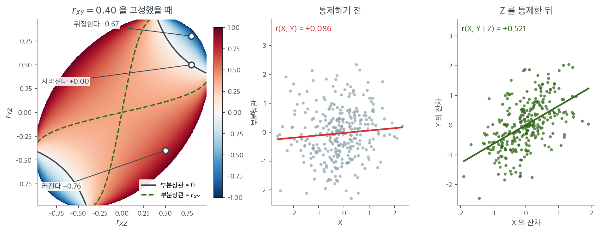

# 부분상관

두 변수가 단지 제3의 변수로부터 공통의 영향을 받기 때문에 상관된 것처럼 보일 수 있다. 예를 들어 아이스크림 판매량과 익사 사고는 양의 상관을 보이지만 둘 다 기온에 이끌린다. **부분상관**은 하나 이상의 통제변수의 선형 효과를 제거한 뒤 두 변수 사이의 선형 연관을 재어, 공통의 영향을 걷어내도 관계가 남는지를 드러낸다.

---

## 1. 그 상관이 제3의 변수 때문은 아닌가

변수 $X$와 $Y$ 사이에 강한 상관을 관측했다고 하자. $X$와 $Y$가 직접 관련되어 있다고 결론짓기 전에 물어야 한다. 이 연관이 제3의 변수 $Z$ 때문은 아닌가? 부분상관은 $Z$의 효과를 "덜어냄"으로써 이 질문에 답한다.

주변상관 $r_{XY}$가 큰데 부분상관 $r_{XY \cdot Z}$가 0에 가깝다면 $X$와 $Y$ 사이의 겉보기 연관은 대부분 $Z$로 설명된다. 반대로 $r_{XY \cdot Z}$가 여전히 크면 $Z$를 반영한 뒤에도 $X$와 $Y$의 관계가 남아 있는 것이다.

---

## 2. 정의: 1차 부분상관

변수 하나 $Z$를 통제한 $X$와 $Y$ 사이의 **부분상관**은

$$
r_{XY \cdot Z} = \frac{r_{XY} - r_{XZ} \, r_{YZ}}{\sqrt{1 - r_{XZ}^2} \; \sqrt{1 - r_{YZ}^2}}
$$

이며 $r_{XY}$, $r_{XZ}$, $r_{YZ}$는 쌍별 Pearson 상관이다.

변수 하나를 통제하므로 이 공식을 **1차** 부분상관이라 한다. 결과는 $-1 \le r_{XY \cdot Z} \le 1$을 만족한다.

---

## 3. 기하적 해석

부분상관은 선형회귀 잔차를 통해 동등하게 해석할 수 있다.

1. $X$를 $Z$에 회귀하여 잔차 $e_X = X - \hat{X}$를 계산한다.
2. $Y$를 $Z$에 회귀하여 잔차 $e_Y = Y - \hat{Y}$를 계산한다.
3. 부분상관 $r_{XY \cdot Z}$는 $e_X$와 $e_Y$ 사이의 Pearson 상관과 같다.

잔차 $e_X$와 $e_Y$는 $X$와 $Y$ 중 $Z$로 선형적으로 설명되지 않는 부분을 나타낸다. 따라서 부분상관은 $X$와 $Y$의 "설명되지 않은" 성분 사이의 선형 연관을 잰다.

---

## 4. 고차 부분상관

여러 변수 $Z_1, Z_2, \ldots, Z_k$를 통제할 때 부분상관 $r_{XY \cdot Z_1 Z_2 \cdots Z_k}$는 재귀적으로 계산할 수 있다.

$$
r_{XY \cdot Z_1 Z_2 \cdots Z_k} = \frac{r_{XY \cdot Z_1 \cdots Z_{k-1}} - r_{XZ_k \cdot Z_1 \cdots Z_{k-1}} \, r_{YZ_k \cdot Z_1 \cdots Z_{k-1}}}{\sqrt{1 - r_{XZ_k \cdot Z_1 \cdots Z_{k-1}}^2} \; \sqrt{1 - r_{YZ_k \cdot Z_1 \cdots Z_{k-1}}^2}}
$$

동등하게 $X$와 $Y$를 모든 통제변수 $Z_1, \ldots, Z_k$에 회귀한 뒤 잔차의 상관을 구해도 된다. 실무에서는 고차 부분상관에 잔차 방식이 더 간단하다.



부분상관을 "교란을 걷어내면 상관이 줄어드는 절차"로 기억하기 쉬운데, 공식을 보면 그렇지 않다. 왼쪽은 $r_{XY} = 0.40$으로 고정해 두고 나머지 두 상관 $r_{XZ}$와 $r_{YZ}$를 바꿔 가며 $r_{XY \cdot Z}$를 색으로 칠한 것이다. 타원 바깥은 세 상관을 동시에 가질 수 있는 자료가 존재하지 않는 영역이므로 비워 두었다.

세 지점을 보자. $r_{XZ} = 0.80$, $r_{YZ} = 0.50$이면 분자가 $0.40 - 0.40 = 0$이 되어 부분상관이 **정확히 사라진다.** 여기서 조금 더 올라가 $r_{YZ} = 0.80$이 되면 $-0.67$로 **부호까지 뒤집힌다.** 반대로 $r_{XZ} = 0.50$, $r_{YZ} = -0.40$처럼 $Z$가 $X$와 $Y$에 반대 방향으로 작용하면 부분상관은 $+0.76$으로 **주변상관의 두 배 가까이 커진다.** 초록 파선이 "통제해도 그대로인" 경계이고, 그 왼쪽 위와 오른쪽 아래의 넓은 붉은 영역 전체가 통제하면 상관이 **커지는** 곳이다.

가운데와 오른쪽이 마지막 경우를 자료로 만든 것이다. $X$와 $Y$의 주변상관은 $r = +0.086$으로 사실상 없는데, $Z$를 통제하면 $r_{XY \cdot Z} = +0.521$로 또렷한 관계가 드러난다. 이렇게 참 관계를 가려 버리는 $Z$를 **억제변수**라 부른다. 여기서는 $Z$가 $X$를 올리면서 $Y$는 내리기 때문에, $X \to Y$의 양의 효과가 $Z$를 통한 음의 경로에 상쇄되어 자료 표면에는 아무것도 남지 않았다.

실무적 함의는 분명하다. **주변상관이 0이라는 것은 "볼 것이 없다"는 뜻이 아니다.** 아이스크림과 익사처럼 $0.85 \to 0.22$로 줄어드는 경우만 기억하고 있으면, 통제 후에야 나타나는 관계를 놓치게 된다. 어느 쪽인지는 $r_{XZ}$와 $r_{YZ}$의 부호가 정하며, 그 부호는 위 지도에서 어느 사분면에 있는지를 보는 것과 같다.

---

<div class="exbox" markdown>

**보기 1.** <span class="diff easy" title="쉬움"></span> 아이스크림, 익사, 기온. 월별로 측정한 세 변수를 생각하자.

- $X$: 아이스크림 판매량(천 개)
- $Y$: 익사 사고 건수
- $Z$: 평균 기온(도)

쌍별 상관이 다음과 같다고 하자.

</div>

??? success "풀이"
    $$
    r_{XY} = 0.85, \quad r_{XZ} = 0.92, \quad r_{YZ} = 0.88
    $$

    기온을 통제한 아이스크림 판매량과 익사 사고의 부분상관은

    $$
    r_{XY \cdot Z} = \frac{0.85 - (0.92)(0.88)}{\sqrt{1 - 0.92^2}\;\sqrt{1 - 0.88^2}} = \frac{0.85 - 0.8096}{\sqrt{0.1536}\;\sqrt{0.2256}} = \frac{0.0404}{0.3920 \times 0.4750} \approx 0.22
    $$

    이다. 주변상관 $0.85$가 부분상관 약 $0.22$로 떨어진다. 아이스크림 판매량과 익사 사이의 겉보기 연관은 대부분 기온에 대한 공통 의존으로 설명된다.

### 편상관이 0 이 되는 것은 우연이 아니다

<div class="exbox" markdown>

**보기 2.** <span class="diff easy" title="쉬움"></span> 편상관이 $0$ 이 되는 것은 우연이 아니다. $Z \sim \mathcal N(0,1)$, $X = 0.7Z + \mathcal N(0, 0.5^2)$, $Y = 0.6Z + \mathcal N(0, 0.5^2)$ 이고 두 잡음은 서로 독립이다.

**(1)** $\rho_{XZ}$, $\rho_{YZ}$, $\rho_{XY}$ 를 닫힌 꼴로 구하고, 그 셋 사이에 성립하는 **한 줄짜리 관계**를 찾으시오. 그 관계가 편상관을 어떻게 만드는가.

**(2)** 표본값 $r_{XY} = 0.5699$ 와 $r_{XY\cdot Z} = -0.0201$ 이 모집단 값과 맞는가. 잔차 상관으로 구해도 같은 값이 나오는지 확인하시오.

</div>

??? success "풀이"

    **(1) 세 상관이 곱셈으로 묶인다.** $\operatorname{Var}(X) = 0.7^2 + 0.5^2 = 0.74$, $\operatorname{Var}(Y) = 0.6^2 + 0.5^2 = 0.61$ 이므로

    $$
    \rho_{XZ} = \frac{0.7}{\sqrt{0.74}} = 0.813733,
    \qquad
    \rho_{YZ} = \frac{0.6}{\sqrt{0.61}} = 0.768221
    $$

    이다. $X$ 와 $Y$ 의 공분산은 공통 부분에서만 나오므로 $\operatorname{Cov}(X,Y) = 0.7 \times 0.6 = 0.42$ 이고

    $$
    \rho_{XY} = \frac{0.42}{\sqrt{0.74 \times 0.61}} = 0.625127
    $$

    다. 여기서 눈여겨볼 것은

    $$
    \rho_{XZ}\,\rho_{YZ} = \frac{0.7}{\sqrt{0.74}} \cdot \frac{0.6}{\sqrt{0.61}} = \frac{0.42}{\sqrt{0.74 \times 0.61}} = \rho_{XY}
    $$

    **세 상관이 $\rho_{XY} = \rho_{XZ}\rho_{YZ}$ 로 묶인다**는 것이다. 이것이 "$X$ 와 $Y$ 사이의 모든 연관이 $Z$ 를 거쳐서만 흐른다"를 상관의 말로 옮긴 것이고, 편상관 공식의 분자가

    $$
    \rho_{XY} - \rho_{XZ}\rho_{YZ} = 0
    $$

    이 되어 **편상관이 정확히 $0$** 이 된다. 근사가 아니라 항등식이다. 거꾸로, 편상관이 $0$ 이 아니면 $Z$ 말고 다른 통로가 있다는 뜻이다.

    **(2) 둘 다 맞는다.**

    | 양 | 모집단 | 표본 | $\operatorname{SE}$ | $z$ |
    |---|---|---|---|---|
    | $\rho_{XY}$ | $0.625127$ | $0.5699$ | $0.0431$ | $-1.283$ |
    | $\rho_{XY\cdot Z}$ | $0$ | $-0.0201$ | $0.0712$ | $-0.283$ |

    편상관의 표준오차는 통제변수 하나를 썼으므로 $1/\sqrt{n-3} = 1/\sqrt{197} = 0.0712$ 로 잡았다. 둘 다 $\lvert z \rvert < 2$ 다.

    $X$ 와 $Y$ 를 각각 $Z$ 에 회귀한 잔차끼리의 상관도 $-0.020130$ 으로 닫힌 꼴과 **소수 여섯째 자리까지 같다.** 두 계산이 같은 것이라는 사실이 확인된다.

    ```python
    import numpy as np
    from scipy import stats

    n = 200
    np.random.seed(42)

    # 앞과 같은 구조다. Z 가 X 와 Y 를 함께 끌어 상관을 만든다.
    Z = np.random.normal(0, 1, n)
    X = 0.7 * Z + np.random.normal(0, 0.5, n)
    Y = 0.6 * Z + np.random.normal(0, 0.5, n)

    r_xy, p_xy = stats.pearsonr(X, Y)
    r_xz, _ = stats.pearsonr(X, Z)
    r_yz, _ = stats.pearsonr(Y, Z)

    r_xy_z = (r_xy - r_xz * r_yz) / np.sqrt((1 - r_xz**2) * (1 - r_yz**2))

    print(f"r(X, Y)    = {r_xy:.4f}  (appears significant)")
    print(f"r(X,Y | Z) = {r_xy_z:.4f}  (nearly vanishes)")

    # 모집단 값을 닫힌 꼴로 적는다.
    rho_xz = 0.7 / np.sqrt(0.7**2 + 0.5**2)
    rho_yz = 0.6 / np.sqrt(0.6**2 + 0.5**2)
    rho_xy = (0.7 * 0.6) / np.sqrt((0.7**2 + 0.5**2) * (0.6**2 + 0.5**2))
    part = (rho_xy - rho_xz * rho_yz) / np.sqrt((1 - rho_xz**2) * (1 - rho_yz**2))
    print(f"\n모집단: rho_XZ = {rho_xz:.6f},  rho_YZ = {rho_yz:.6f}")
    print(f"        rho_XY = rho_XZ * rho_YZ = {rho_xz * rho_yz:.6f}  (= {rho_xy:.6f})")
    print(f"        편상관 = {part:.2e}   (정확히 0)")
    se_xy = (1 - rho_xy**2) / np.sqrt(n)
    print(f"\n표본 r_XY = {r_xy:.4f}   SE = {se_xy:.4f}   z = {(r_xy - rho_xy) / se_xy:+.3f}")
    se_p = 1 / np.sqrt(n - 3)
    print(f"표본 편상관 = {r_xy_z:.4f}   SE = {se_p:.4f}   z = {r_xy_z / se_p:+.3f}")
    print(f"\n잔차로 구해도 같은가: ", end="")
    ex = X - np.polyfit(Z, X, 1)[0] * Z - np.polyfit(Z, X, 1)[1]
    ey = Y - np.polyfit(Z, Y, 1)[0] * Z - np.polyfit(Z, Y, 1)[1]
    print(f"{stats.pearsonr(ex, ey)[0]:.6f}  (닫힌 꼴 {r_xy_z:.6f})")
    ```

    출력:

    ```text
    r(X, Y)    = 0.5699  (appears significant)
    r(X,Y | Z) = -0.0201  (nearly vanishes)

    모집단: rho_XZ = 0.813733,  rho_YZ = 0.768221
            rho_XY = rho_XZ * rho_YZ = 0.625127  (= 0.625127)
            편상관 = 0.00e+00   (정확히 0)

    표본 r_XY = 0.5699   SE = 0.0431   z = -1.283
    표본 편상관 = -0.0201   SE = 0.0712   z = -0.283

    잔차로 구해도 같은가: -0.020130  (닫힌 꼴 -0.020130)
    ```

    항등식 $\rho_{XY} = \rho_{XZ}\rho_{YZ}$ 가 소수 여섯째 자리까지 맞고 편상관이 기계 정밀도로 $0$ 이다.

    $r(X, Y) = 0.570$ 은 $p \approx 1.3 \times 10^{-18}$ 로 압도적으로 유의하지만 편상관 $-0.020$ 은 $0$ 에 가깝다. **p-값이 작다는 것과 연관이 직접적이라는 것은 아무 관계가 없다.**


세 칸은 서로 다른 자료다. 왼쪽은 10.2절 [Simpson의 역설](../ecological_correlation/simpsons_paradox.md) 의 자료이고, 가운데와 오른쪽이 위의 보기 $2$ 다. 왼쪽을 보면 세 집단은 각각 기울기 $-0.5$로 뚜렷하게 **내려간다.** 그런데 집단을 구별하지 않고 150개 점을 한 덩어리로 보면 회귀직선의 기울기가 $+6.50$, 상관계수가 $r = 0.859$가 된다. 집단 안에서 성립하는 관계와 정반대다. 붉은 파선이 세 집단의 짧은 직선들을 가로지르며 올라가는 모습이 역설의 정체를 그대로 보여준다. 파선은 집단 **안**의 관계를 재는 것이 아니라 집단 **중심들**을 잇고 있을 뿐이다.

가운데와 오른쪽이 보기 $2$ 다. 가운데를 보면 $X$와 $Y$가 $r = 0.570$으로 확실히 함께 움직인다. 점만 보고는 흠잡을 데가 없고, $p$값도 $10^{-18}$ 수준이다. 그런데 $X$와 $Y$를 각각 $Z$에 회귀시켜 $Z$로 설명되는 부분을 덜어내고 남은 잔차끼리 다시 그린 것이 오른쪽이며, 그 상관은 $r = -0.020$으로 완전히 사라진다. 점구름이 둥글어졌다는 것은 $Z$를 알고 나면 $X$가 $Y$에 대해 더 알려줄 것이 없다는 뜻이다.

두 그림이 말하는 것은 같다. **상관계수 하나를 보고 나서 "그래서 $Z$는 어디 있나"를 묻지 않으면 안 된다.** 왼쪽에서는 $Z$가 집단 소속이었고 오른쪽에서는 연속형 변수였지만, 어느 쪽이든 $Z$를 무시한 계산은 $0.859$와 $0.570$이라는 큰 값을 내놓았고 그 값은 둘 다 실질적으로 틀렸다. 한 가지 더 새겨둘 것은, $Z$가 자료에 들어 있지 않으면 이 진단 자체가 불가능하다는 점이다. 부분상관은 **측정된** 교란만 지워 준다.

---

## 5. 부분상관과 준부분상관

부분상관과 **준부분상관**(또는 **부분**상관)을 구별하는 일이 중요하다.

| | 부분 $r_{XY \cdot Z}$ | 준부분 $r_{X(Y \cdot Z)}$ |
|:---|:---|:---|
| 무엇을 통제하는가 | $X$와 $Y$ **둘 다**에서 $Z$의 효과를 제거 | $Y$에서만 $Z$의 효과를 제거 |
| 해석 | 둘 다에서 $Z$를 제거한 뒤의 연관 | $Z$를 넘어선 $Y$의 고유 기여 |
| 흔한 용도 | 일반적인 연관 분석 | 회귀에서의 $R^2$ 분해 |

준부분상관은 다음으로 정의된다.

$$
r_{X(Y \cdot Z)} = \frac{r_{XY} - r_{XZ} \, r_{YZ}}{\sqrt{1 - r_{YZ}^2}}
$$

분자는 같지만 분모가 $Y$에 대한 $Z$의 효과만 조정한다는 점에 유의하라.

---

<div class="exbox" markdown>

**보기 3.** <span class="diff easy" title="쉬움"></span> 아이스크림과 익사 사고 — 부분상관. $n = 100$ 인 자료를 다음 규칙으로 만든다.

$$
Z \sim N(0,1),
\qquad
X = 2Z + \varepsilon_1,
\qquad
Y = 1.5Z + \varepsilon_2,
\qquad
\varepsilon_1, \varepsilon_2 \overset{\text{iid}}{\sim} N(0,1)
$$

$Z$ 는 기온, $X$ 는 아이스크림 판매량, $Y$ 는 익사 사고다. **$X$ 와 $Y$ 사이에 직접 연결이 없도록** 만들었다.

**(1)** 세 모상관 $\rho_{XZ}, \rho_{YZ}, \rho_{XY}$ 를 **닫힌 꼴로** 구하고, 부분상관 공식이 $\rho_{XY\cdot Z} = 0$ 을 주는지 확인하시오.

**(2)** 표본에서 얻은 $r_{XY} = 0.7190$ 과 $r_{XY\cdot Z} = -0.0109$ 가 (1)의 이론값과 얼마나 어긋나는가. 표본상관의 표준오차 $(1-\rho^2)/\sqrt n$ 에 비추어 판정하시오.

**(3)** 부분상관의 **부호가 뒤집히는 조건**은 무엇인가. 이 자료에서 $r_{YZ}$ 가 얼마를 넘으면 음수가 되는가. 실제 $r_{YZ}$ 와 견주시오.

**(4)** 코드로 확인하시오. 잔차 경로로 계산해도 같은 값이 나오는가.

</div>

??? success "풀이"

    **(1) 모상관을 손으로.** $Z$, $\varepsilon_1$, $\varepsilon_2$ 가 서로 독립이고 모두 분산 1 이므로

    $$
    \operatorname{Var}(X) = 4 + 1 = 5,
    \qquad
    \operatorname{Var}(Y) = 2.25 + 1 = 3.25,
    \qquad
    \operatorname{Cov}(X,Z) = 2,
    \quad
    \operatorname{Cov}(Y,Z) = 1.5
    $$

    다. 따라서

    $$
    \rho_{XZ} = \frac{2}{\sqrt5} = 0.894427,
    \qquad
    \rho_{YZ} = \frac{1.5}{\sqrt{3.25}} = 0.832050
    $$

    이다. $X$ 와 $Y$ 의 공분산은 $\operatorname{Cov}(2Z+\varepsilon_1,\ 1.5Z+\varepsilon_2) = 3$ 이므로

    $$
    \rho_{XY} = \frac{3}{\sqrt{5}\sqrt{3.25}} = \frac{3}{\sqrt{16.25}} = 0.744208
    $$

    다. **$\rho_{XY} = \rho_{XZ}\,\rho_{YZ}$ 가 정확히 성립한다.** $2/\sqrt5 \times 1.5/\sqrt{3.25} = 3/\sqrt{16.25}$ 이기 때문이다. 그러면 부분상관의 분자가

    $$
    \rho_{XY} - \rho_{XZ}\rho_{YZ} = 0
    $$

    이 되어

    $$
    \rho_{XY\cdot Z} = 0
    $$

    이다. $\square$ 당연한 결과이기도 하다. $Z$ 를 고정하면 $X - 2Z = \varepsilon_1$ 과 $Y - 1.5Z = \varepsilon_2$ 가 **독립**이므로 남을 상관이 없다. **"$\rho_{XY} = \rho_{XZ}\rho_{YZ}$" 가 곧 "$Z$ 가 모든 것을 설명한다" 는 말이다.**

    **(2) 표본과 이론.** 세 상관을 나란히 적는다. 표준오차는 $\operatorname{SE}(r) \approx (1-\rho^2)/\sqrt n$ 을 썼다.

    | | 표본 | 이론 | 차 | SE | 차/SE |
    |---|---:|---:|---:|---:|---:|
    | $r_{XY}$ | $0.7190$ | $0.7442$ | $-0.0252$ | $0.0446$ | $-0.57$ |
    | $r_{XZ}$ | $0.8724$ | $0.8944$ | $-0.0220$ | $0.0200$ | $-1.10$ |
    | $r_{YZ}$ | $0.8276$ | $0.8321$ | $-0.0045$ | $0.0308$ | $-0.15$ |

    **세 어긋남이 모두 표준오차 1.1 배 안쪽이다.** 우연의 범위이고 자료 생성이 의도대로 되었다는 뜻이다.

    부분상관 쪽은 자가 다르다. $\rho_{XY\cdot Z} = 0$ 일 때 $r_{XY\cdot Z}$ 의 표준오차는 통제변수 하나를 뺀 자유도를 써서 $1/\sqrt{n-3} = 1/\sqrt{97} = 0.1015$ 다. 관측값 $-0.0109$ 는

    $$
    \frac{-0.0109 - 0}{0.1015} = -0.107
    $$

    곧 **$0.11$ 표준오차**밖에 안 된다. $0$ 과 구별되지 않는다. 피셔 $z$ 로 구간을 만들어도 $[-0.207,\ 0.186]$ 으로 $0$ 을 넉넉히 품는다.

    **$0.719$ 가 $-0.011$ 로 주저앉았다.** 자료를 만들 때 $X$ 와 $Y$ 를 서로 독립으로 두었으므로 관측된 $0.719$ 는 둘 다 $Z$ 를 공유한 데서 온 **가짜 상관**이고, 부분상관이 그것을 걷어냈다.

    **(3) 부호가 뒤집히는 조건.** 분모는 언제나 양수이므로 부호는 분자가 정한다.

    $$
    r_{XY\cdot Z} < 0
    \quad\Longleftrightarrow\quad
    r_{XY} < r_{XZ}\,r_{YZ}
    $$

    $r_{XY}$ 와 $r_{XZ}$ 를 고정하고 $r_{YZ}$ 를 움직이면 경계는

    $$
    r_{YZ}^{*} = \frac{r_{XY}}{r_{XZ}} = \frac{0.718998}{0.872404} = 0.824157
    $$

    이다. 실제 표본값은 $r_{YZ} = 0.827584$ 로 이 문턱을 **$0.0034$ 만큼 넘었다.** 그래서 부분상관이 $0$ 이 아니라 아주 조금 음수인 $-0.0109$ 가 되었다.

    **이 보기의 $-0.0109$ 에서 마이너스 부호를 읽어 내려 하면 안 된다.** 참값이 정확히 $0$ 인 자리에서 표본이 문턱의 어느 쪽에 떨어질지는 동전 던지기이고, 그 자리의 흔들림은 $\pm 0.1$ 쯤이다.

    **(4) 수치적으로.**

    ```python
    import numpy as np
    from scipy import stats

    np.random.seed(42)
    n = 100

    # 기온이 아이스크림 판매와 익사 사고를 함께 끌어올린다. 둘 사이에 직접
    # 연결은 없다. 그런데도 상관은 크게 나온다.
    z = np.random.normal(0, 1, n)          # 기온 — 교란변수
    x = 2 * z + np.random.normal(0, 1, n)  # 아이스크림 판매량
    y = 1.5 * z + np.random.normal(0, 1, n)  # 익사 사고 건수

    # 먼저 쌍마다의 상관을 구한다.
    r_xy = stats.pearsonr(x, y)[0]
    r_xz = stats.pearsonr(x, z)[0]
    r_yz = stats.pearsonr(y, z)[0]

    # 부분상관 공식. Z 로 설명되는 몫을 걷어 낸 뒤 남는 상관이다.
    # 위 자료에서는 거의 0 으로 떨어져야 한다.
    r_xy_z = (r_xy - r_xz * r_yz) / (
        np.sqrt(1 - r_xz**2) * np.sqrt(1 - r_yz**2)
    )

    print(f"Marginal r(X,Y)     = {r_xy:.4f}")
    print(f"Partial r(X,Y | Z)  = {r_xy_z:.4f}")

    # (1)(2) 이론값과 표본값을 나란히
    t_xz, t_yz = 2 / np.sqrt(5), 1.5 / np.sqrt(3.25)
    t_xy = 3 / np.sqrt(16.25)
    print(f"\n이론: rho_xz = {t_xz:.6f}  rho_yz = {t_yz:.6f}  rho_xy = {t_xy:.6f}")
    print(f"      rho_xz * rho_yz = {t_xz * t_yz:.6f}  <- rho_xy 와 같다"
          f"   차 {t_xy - t_xz * t_yz:.1e}")
    for name, s, th in [("r_xy", r_xy, t_xy), ("r_xz", r_xz, t_xz), ("r_yz", r_yz, t_yz)]:
        se = (1 - th**2) / np.sqrt(n)
        print(f"  {name}: 표본 {s:.4f}  이론 {th:.4f}  차 {s - th:+.4f}"
              f"  SE {se:.4f}  ({(s - th) / se:+.2f} SE)")
    se_p = 1 / np.sqrt(n - 3)
    print(f"  부분상관: 표본 {r_xy_z:+.4f}  이론 0  SE {se_p:.4f}"
          f"  ({r_xy_z / se_p:+.3f} SE)")
    zf = np.arctanh(r_xy_z)
    print(f"  피셔 z 구간 [{np.tanh(zf - 1.96 * se_p):+.4f},"
          f" {np.tanh(zf + 1.96 * se_p):+.4f}]")

    # (3) 부호가 뒤집히는 문턱
    print(f"\n부분상관을 0 으로 만드는 r_yz = r_xy / r_xz = {r_xy / r_xz:.6f}")
    print(f"실제 r_yz = {r_yz:.6f}   문턱을 {r_yz - r_xy / r_xz:+.6f} 넘었다")

    # (4) 잔차 경로로도 같은 값이 나오는가
    e_x = x - np.polyval(np.polyfit(z, x, 1), z)
    e_y = y - np.polyval(np.polyfit(z, y, 1), z)
    print(f"\n잔차의 상관 {stats.pearsonr(e_x, e_y)[0]:.6f}"
          f"   공식 {r_xy_z:.6f}")
    ```

    출력:

    ```
    Marginal r(X,Y)     = 0.7190
    Partial r(X,Y | Z)  = -0.0109

    이론: rho_xz = 0.894427  rho_yz = 0.832050  rho_xy = 0.744208
          rho_xz * rho_yz = 0.744208  <- rho_xy 와 같다   차 0.0e+00
      r_xy: 표본 0.7190  이론 0.7442  차 -0.0252  SE 0.0446  (-0.57 SE)
      r_xz: 표본 0.8724  이론 0.8944  차 -0.0220  SE 0.0200  (-1.10 SE)
      r_yz: 표본 0.8276  이론 0.8321  차 -0.0045  SE 0.0308  (-0.15 SE)
      부분상관: 표본 -0.0109  이론 0  SE 0.1015  (-0.107 SE)
      피셔 z 구간 [-0.2069, +0.1859]

    부분상관을 0 으로 만드는 r_yz = r_xy / r_xz = 0.824157
    실제 r_yz = 0.827584   문턱을 +0.003427 넘었다

    잔차의 상관 -0.010897   공식 -0.010897
    ```

    $X$(아이스크림 판매)와 $Y$(익사 사고)의 상관이 0.719인데, $Z$(기온)를 통제하면 $-0.011$로 사라진다.

    (1)의 핵심이 `rho_xz * rho_yz = 0.744208` 과 `rho_xy = 0.744208` 이 **차 $0$ 으로 같다**는 줄이다. $Z$ 가 $X$ 와 $Y$ 를 잇는 유일한 경로일 때 상관이 경로를 따라 곱해진다는 것이고, 그래서 부분상관의 분자가 정확히 사라진다.

    (2)에서 세 표본상관의 어긋남이 모두 $1.1$ SE 안쪽이고, 부분상관은 $0.11$ SE 로 $0$ 과 구별되지 않는다. 피셔 구간 $[-0.2069, +0.1859]$ 도 $0$ 을 품는다.

    (3)이 $-0.0109$ 의 마이너스 부호가 어디서 왔는지 말해 준다. 문턱 $0.824157$ 을 실제 $r_{YZ}$ 가 $0.0034$ 넘었을 뿐이다. **그 작은 차이가 부호를 정했다. 부호를 해석하면 안 되는 자리다.**

    (4)의 마지막 줄이 기하적 해석을 수로 확인한다. $X$ 와 $Y$ 를 각각 $Z$ 에 회귀한 **잔차의 상관**이 $-0.010897$ 로 공식값과 여섯째 자리까지 같다.

    자료를 만들 때 $X$와 $Y$를 각각 $Z$에서 만들고 서로는 독립으로 두었으므로, 관측된 0.719는 둘 다 $Z$를 공유한 데서 온 **가짜 상관**이다. 편상관이 그것을 걷어냈다.

    교란변수의 작동 방식을 수치로 보여주는 가장 짧은 예다.

전용 함수로는 `pingouin` 라이브러리의 `pingouin.partial_corr`가 있으며 신뢰구간과 p-값도 함께 계산해 준다.

---

## 6. 다중회귀와의 연결

부분상관은 다중회귀의 계수 및 검정과 밀접하게 관련된다. $Y$를 $X$와 $Z$ 모두에 회귀할 때 $X$ 계수에 대한 t-검정은 $r_{XY \cdot Z} = 0$을 검정하는 것과 동치이다. 이 연결 덕분에 부분상관은 회귀 출력을 이해하는 기초 개념이 된다. 자세한 내용은 [다중회귀](../../ch11/linear_regression/multiple.md)를 보라.


<div class="aibox" markdown>

**AI로 보는 통계학 1.** 역행렬 한 번이 모든 쌍의 부분상관을 준다

$\S 4$ 의 고차 부분상관을 정의대로 구하면 **쌍마다** 회귀를 두 번 돌려야 한다. 변수가
$p$ 개면 쌍이 $\binom{p}{2}$ 개이니 회귀가 $p(p-1)$ 번이다. 그런데 모든 쌍의 부분상관이
**공분산행렬의 역행렬 한 개**에 이미 들어 있다. $\Theta = \Sigma^{-1}$ 을 **정밀도행렬**
이라 하면

$$
\rho_{ij \mid \text{나머지}} = -\frac{\Theta_{ij}}{\sqrt{\Theta_{ii}\,\Theta_{jj}}}
$$

이다. 부호가 뒤집히고 대각으로 정규화하는 것이 전부다. 기계학습에서 변수 사이의
**조건부 독립 그래프**를 추정하는 함수들이 쓰는 것이 이 식이고, 거기서 $\Theta_{ij} = 0$
이 「간선 없음」을 뜻한다. 정말 같은 수인지, 그리고 그 행렬이 구조를 보여 주는지 보자.

```python
import numpy as np

rng = np.random.default_rng(12)
p, n = 5, 400
# 사슬 구조: X0 - X1 - X2 - X3 - X4 (이웃만 직접 연결)
A = np.eye(p) * 2.0
for i in range(p - 1):
    A[i, i + 1] = A[i + 1, i] = -0.8
S_true = np.linalg.inv(A)                     # 참 공분산
X = rng.multivariate_normal(np.zeros(p), S_true, n)

S = np.cov(X, rowvar=False)
Theta = np.linalg.inv(S)                      # 표본 정밀도행렬
d = np.sqrt(np.diag(Theta))
P = -Theta / np.outer(d, d)                   # 부분상관 (대각은 뒤에서 1 로)
np.fill_diagonal(P, 1.0)

# 회귀로 구한 부분상관 — 한 쌍만, 나머지 셋을 통제한다
i, j, rest = 0, 2, [1, 3, 4]
Z = np.column_stack([np.ones(n), X[:, rest]])
ri = X[:, i] - Z @ np.linalg.lstsq(Z, X[:, i], rcond=None)[0]
rj = X[:, j] - Z @ np.linalg.lstsq(Z, X[:, j], rcond=None)[0]
reg = np.corrcoef(ri, rj)[0, 1]

print(f"역행렬에서 꺼낸 rho(0,2 | 나머지)  {P[i, j]:+.10f}")
print(f"회귀 잔차로 구한 같은 값            {reg:+.10f}")
print(f"차                                 {P[i, j] - reg:+.1e}")
print()
print("부분상관행렬 (이웃만 연결된 사슬이 참이다)")
print("      " + "".join(f"{k:>9}" for k in range(p)))
for k in range(p):
    print(f"  X{k}  " + "".join(f"{P[k, m]:+9.3f}" for m in range(p)))
```

출력:

```
역행렬에서 꺼낸 rho(0,2 | 나머지)  +0.0049880188
회귀 잔차로 구한 같은 값            +0.0049880188
차                                 +2.3e-16

부분상관행렬 (이웃만 연결된 사슬이 참이다)
              0        1        2        3        4
  X0     +1.000   +0.389   +0.005   +0.001   -0.005
  X1     +0.389   +1.000   +0.377   +0.019   -0.034
  X2     +0.005   +0.377   +1.000   +0.490   -0.055
  X3     +0.001   +0.019   +0.490   +1.000   +0.366
  X4     -0.005   -0.034   -0.055   +0.366   +1.000
```

같은 수이고, 표가 참 구조를 그대로 읽어 준다. 이웃 쌍 넷($X_0X_1$, $X_1X_2$,
$X_2X_3$, $X_3X_4$)은 $0.366$ 에서 $0.490$ 이고 이웃이 아닌 여섯 쌍은 $0.001$ 에서
$0.055$ 다. **보통 상관행렬로는 이렇게 갈리지 않는다** — 사슬에서 $X_0$ 과 $X_4$ 는
$X_1X_2X_3$ 을 거쳐 이어져 있으므로 상관이 0 이 아니다. 가운데를 통제하면 끊어지는
것이 부분상관이고, 그 끊어짐이 정밀도행렬의 $0$ 이다.

여기에 이 방법의 한계가 함께 적혀 있다. **이웃 아닌 쌍의 참값은 정확히 $0$ 인데 표가
주는 것은 $0.055$ 까지 간다.** 그러니 「간선이 있나 없나」를 정하려면 문턱이 필요하고,
실무에서 쓰는 벌점 추정은 그 문턱을 $\Theta$ 에 직접 걸어 작은 성분을 $0$ 으로 **민다.**
그렇게 나온 $0$ 은 자료가 「조건부 독립이다」라고 말한 것이 아니라 **벌점이 그렇게
만든 것**이다. 더구나 $p > n$ 이면 $S$ 가 특이해서 역행렬이 아예 없으므로, 그때는
벌점이 선택이 아니라 필수가 된다 — 간선의 유무가 자료보다 **벌점의 세기**에 더 많이
달려 있을 수 있다는 뜻이다.

</div>

---

## 연습문제

<div class="drillbox" markdown>

**연습문제 1.** <span class="diff easy" title="쉬움"></span>
세 변수 사이의 상관이 $r_{XY} = 0.80$, $r_{XZ} = 0.90$, $r_{YZ} = 0.85$이다. 부분상관 $r_{XY \cdot Z}$를 계산하라.

</div>

??? success "풀이"
    부분상관 공식은

    $$
    r_{XY \cdot Z} = \frac{r_{XY} - r_{XZ} \cdot r_{YZ}}{\sqrt{(1 - r_{XZ}^2)(1 - r_{YZ}^2)}}
    $$

    이다. 값을 대입하면

    $$
    r_{XY \cdot Z} = \frac{0.80 - (0.90)(0.85)}{\sqrt{(1 - 0.81)(1 - 0.7225)}} = \frac{0.80 - 0.765}{\sqrt{0.19 \times 0.2775}} = \frac{0.035}{\sqrt{0.052725}} = \frac{0.035}{0.2296} \approx 0.152
    $$

    이다. $Z$를 통제하면 $X$와 $Y$의 상관이 0.80에서 0.15로 떨어진다. 겉보기 연관의 상당 부분이 두 변수와 $Z$의 관계 때문이었다.

---

<div class="drillbox" markdown>

**연습문제 2.** <span class="diff easy" title="쉬움"></span>
부분상관의 **사용 지침**을 정리하라.

</div>

??? success "풀이"
    **정의 셋.**

    | 이름 | 식 | 뜻 |
    |---|---|---|
    | 주변 | $r_{XY}$ | 그대로의 관계 |
    | **부분** | $\operatorname{corr}(e_{X\cdot Z},\,e_{Y\cdot Z})$ | $Z$를 **양쪽에서** 제거 |
    | 준부분 | $\operatorname{corr}(e_{X\cdot Z},\,Y)$ | $Z$를 **$X$에서만** 제거 |

    **핵심 수치 다섯.**

    | 사실 | 값 |
    |---|---|
    | 충돌부를 통제하면 생기는 가짜 상관 | $-0.66$ |
    | 억제 구조에서 드러나는 상관 | $-0.06\to+0.59$ |
    | $k=5$, $n=20$에서 자유도를 틀렸을 때 피복 | **0.903** |
    | 준부분상관의 제곱 | $\Delta R^2$과 **동일** |
    | $Z^2$ 구조를 선형으로 통제했을 때 남는 상관 | **0.889**(전혀 줄지 않음) |

    **통제변수를 고르는 규칙.**

    ```text
    변수 Z 를 통제할 것인가?
        │
        ├─ Z 가 X 와 Y 의 공통 원인 (교란)   ──→ 통제한다
        ├─ Z 가 X 의 결과이면서 Y 의 원인 (매개)
        │     ├─ 직접효과가 궁금하다  ──→ 통제한다
        │     └─ 총효과가 궁금하다    ──→ 통제하지 않는다
        ├─ Z 가 X 와 Y 의 공통 결과 (충돌부) ──→ 절대 통제하지 않는다
        ├─ Z 가 X 의 원인일 뿐 (도구 성격)   ──→ 통제하면 검정력만 잃는다
        └─ 모르겠다                          ──→ 인과 그림을 먼저 그린다
    ```

    **마지막 줄이 요점이다.** 통제 여부는 **자료가 아니라 인과 모형**이 정한다.

    **추론.**

    | 목적 | 방법 |
    |---|---|
    | $H_0:\rho_{XY\cdot Z}=0$ | $t$ with $\text{df}=n-2-k$ |
    | 구간 | 피셔 $z$, $\operatorname{SE}=1/\sqrt{n-3-k}$ |
    | 비정규·비선형 | 부트스트랩 |

    **$k$를 빼는 것을 잊지 않는다.** $k=5$, $n=20$이면 피복이 0.95에서 0.90으로 떨어진다.

    **`pingouin` 사용법.**

    ```text
    import pingouin as pg
    pg.partial_corr(data=df, x="X", y="Y", covar=["Z1","Z2"])
      → r, CI95%, p-val  (부분상관)

    pg.partial_corr(data=df, x="X", y="Y", x_covar=["Z"])
      → 준부분상관

    method="spearman" 으로 순위 기반 부분상관도 가능
    ```

    **흔한 실수 다섯.**

    | 실수 | 대가 |
    |---|---|
    | **충돌부를 통제** | 없던 상관을 만든다 |
    | 매개변수를 통제하고 "총효과"라 부름 | 효과를 지운다 |
    | "혹시 몰라서" 다 넣음 | 자유도 손실 + 충돌부 위험 |
    | 자유도에서 $k$를 빼지 않음 | 구간이 좁아진다 |
    | **선형 통제로 충분하다고 가정** | 잔차 교란이 남는다 |

    **보고 형식.**

    ```text
    운동 시간과 수면의 질의 관계 (나이·성별·BMI 통제)

      주변 상관    r = 0.34  [0.25, 0.42]
      부분 상관    r = 0.21  [0.11, 0.30]   (k = 3, df = 195)

    통제변수는 선행 문헌에서 두 변수 모두의 원인으로 알려진 것만
    선택했다. 나이는 비선형 효과가 예상되어 자연 스플라인(df=3)으로
    넣었다.

    준부분상관 = 0.18 → 운동 시간이 수면의 질 변동의 3.2% 를
    추가로 설명한다.
    ```

    **통제변수를 왜 골랐는지 한 문장으로 밝히는 것**이 가장 중요한 보고 요소다.

    **한 문장.** 부분상관은 **"$Z$를 빼면 무엇이 남는가"를 재는 계산**이며, 그 계산이 교란 제거인지 인과 경로의 절단인지 가짜 상관의 생성인지는 **자료 바깥의 지식**이 정한다.

---

<div class="drillbox" markdown>

**연습문제 3.** <span class="diff med" title="중간"></span>
부분상관을 선형회귀 잔차로 해석하는 방법을 설명하라.

</div>

??? success "풀이"
    부분상관 $r_{XY \cdot Z}$는 두 회귀의 잔차 사이 Pearson 상관과 같다:

    1. $X$를 $Z$에 회귀하여 잔차 $e_X = X - \hat{X}$($X$ 중 $Z$로 설명되지 않는 부분)를 얻는다.
    2. $Y$를 $Z$에 회귀하여 잔차 $e_Y = Y - \hat{Y}$($Y$ 중 $Z$로 설명되지 않는 부분)를 얻는다.

    그러면 $r_{XY \cdot Z} = r(e_X, e_Y)$이다.

    직관적으로 부분상관은 $X$와 $Y$ 모두에서 $Z$의 선형 영향을 제거한 뒤 남은 선형 연관을 잰다. $Z$가 $X$–$Y$ 관계를 완전히 설명한다면 잔차들이 무상관이 되어 $r_{XY \cdot Z} = 0$이다. $Z$가 설명하는 것을 넘어 $X$와 $Y$에 직접적인 관계가 있으면 $r_{XY \cdot Z}$가 0이 아니다.

---

<div class="drillbox" markdown>

**연습문제 4.** <span class="diff med" title="중간"></span>
부분상관 $r_{XY \cdot Z}$가 주변상관 $r_{XY}$와 부호가 반대인 예를 들어라.

</div>

??? success "풀이"
    $Z$가 $X$와 $Y$ 모두에 강한 양의 영향을 주지만 $X$가 $Y$에 직접적인 음의 효과를 갖는 경우를 생각하자.

    구체적으로 $Z = $ 공부 시간, $X = $ 카페인 섭취, $Y = $ 수면의 질이라 하자. 공부를 많이 하는 학생은 커피를 더 마시고($r_{XZ} > 0$), 성적이 좋아 불안이 줄어 잠도 잘 잔다($r_{YZ} > 0$). 그래서 $r_{XY} > 0$이 된다(둘 다 공부와 연관되어 있다).

    그러나 카페인이 수면에 미치는 직접 효과는 음수이다. 공부 시간을 통제하면 $r_{XY \cdot Z} < 0$이다.

    수치로 보면 $r_{XY} = 0.40$, $r_{XZ} = 0.70$, $r_{YZ} = 0.65$일 때

    $$
    r_{XY \cdot Z} = \frac{0.40 - 0.455}{\sqrt{0.51 \times 0.5775}} = \frac{-0.055}{0.5427} \approx -0.101
    $$

    이다. 부호가 뒤집히는 이 현상은 상관 형태로 나타난 Simpson의 역설이다.

---

<div class="drillbox" markdown>

**연습문제 5.** <span class="diff med" title="중간"></span>
주변상관이 0이 아닌데도 부분상관이 0이 되는 것은 언제인가? 이는 $X$와 $Y$의 관계에 대해 무엇을 함의하는가?

</div>

??? success "풀이"
    $r_{XY} = r_{XZ} \cdot r_{YZ}$이면(부분상관 공식의 분자가 0이 되면) $r_{XY \cdot Z} = 0$이다. $X$와 $Y$ 사이의 연관 전부가 $Z$와의 상호 관계로 설명될 때 일어난다.

    이는 $Z$의 영향을 제거한 뒤 $X$와 $Y$ 사이에 직접적인 선형 연관이 없다는 뜻이다. 주변상관은 전적으로 $Z$에 의한 교란(또는 $Z$를 통한 매개) 때문이었다.

    DAG로 보면 $X$와 $Y$ 사이에 직접 간선이 없고 $Z$가 공통원인인 구조($X \leftarrow Z \to Y$)와 부합한다. $Z$로 조건화하면 $X$와 $Y$를 잇는 유일한 경로가 막혀 (적어도 선형적으로는) 조건부 독립이 된다.

---

<div class="drillbox" markdown>

**연습문제 6.** <span class="diff med" title="중간"></span>
**부분상관과 준부분상관(반부분상관)**의 차이를 정의하고 수치로 비교하라.

</div>

??? success "풀이"
    **두 측도.**

    | 이름 | 무엇에서 $Z$를 제거하나 |
    |---|---|
    | **부분상관** $r_{XY\cdot Z}$ | **$X$와 $Y$ 둘 다** |
    | **준부분상관** $r_{Y(X\cdot Z)}$ | **$X$에서만** |

    ```python
    import warnings
    warnings.filterwarnings("ignore")

    import numpy as np

    def resid(a, Z):
        M = np.column_stack([np.ones(len(a)), Z.reshape(len(a), -1)])
        return a - M @ np.linalg.lstsq(M, a, rcond=None)[0]

    rng = np.random.default_rng(22003)
    n = 200_000
    z = rng.standard_normal(n)
    x = 0.7 * z + rng.normal(0, 0.714, n)
    y = 0.5 * x + 0.5 * z + rng.normal(0, 0.6, n)

    rxy = np.corrcoef(x, y)[0, 1]
    part = np.corrcoef(resid(x, z), resid(y, z))[0, 1]
    semi = np.corrcoef(resid(x, z), y)[0, 1]
    print(f"주변 상관      r_xy      = {rxy:.4f}")
    print(f"부분 상관      r_xy·z    = {part:.4f}")
    print(f"준부분 상관    r_y(x·z)  = {semi:.4f}")
    print(f"\n관계: 준부분 = 부분 × √(1 - r_yz²)")
    ryz = np.corrcoef(y, z)[0, 1]
    print(f"  r_yz = {ryz:.4f}")
    print(f"  부분 × √(1-r_yz²) = {part * np.sqrt(1 - ryz**2):.4f}")

    print(f"\n회귀와의 연결 (y ~ x + z)")
    M = np.column_stack([np.ones(n), x, z])
    b = np.linalg.lstsq(M, y, rcond=None)[0]
    yhat = M @ b
    R2_full = 1 - ((y - yhat)**2).sum() / ((y - y.mean())**2).sum()
    M0 = np.column_stack([np.ones(n), z])
    b0 = np.linalg.lstsq(M0, y, rcond=None)[0]
    R2_z = 1 - ((y - M0 @ b0)**2).sum() / ((y - y.mean())**2).sum()
    print(f"  R²(y ~ x + z) = {R2_full:.4f}")
    print(f"  R²(y ~ z)     = {R2_z:.4f}")
    print(f"  차이 ΔR²      = {R2_full - R2_z:.4f}")
    print(f"  준부분상관의 제곱 = {semi**2:.4f}   ← 같다")
    ```

    ```text
    주변 상관      r_xy      = 0.7735
    부분 상관      r_xy·z    = 0.5154
    준부분 상관    r_y(x·z)  = 0.3279

    관계: 준부분 = 부분 × √(1 - r_yz²)
      r_yz = 0.7716
      부분 × √(1-r_yz²) = 0.3279

    회귀와의 연결 (y ~ x + z)
      R²(y ~ x + z) = 0.7028
      R²(y ~ z)     = 0.5953
      차이 ΔR²      = 0.1075
      준부분상관의 제곱 = 0.1075   ← 같다
    ```

    **준부분상관의 제곱이 $\Delta R^2$과 정확히 같다.**

    $$
    r_{Y(X\cdot Z)}^2=R^2_{Y\sim X,Z}-R^2_{Y\sim Z}
    =0.7028-0.5953=0.1075
    $$

    **이것이 준부분상관의 핵심 용도**다. **"$X$를 추가하면 설명력이 얼마나 느는가"**를 직접 답한다.

    | 측도 | 값 | 해석 |
    |---|---|---|
    | 주변 $r_{XY}$ | 0.774 | $Z$를 무시한 관계 |
    | **부분** $r_{XY\cdot Z}$ | 0.515 | **$Z$를 뺀 뒤 남은 부분끼리**의 관계 |
    | **준부분** $r_{Y(X\cdot Z)}$ | 0.328 | $X$의 **고유한 기여** |

    **공식도 정확히 맞는다.** $0.5154\times\sqrt{1-0.7716^2}=0.3279$다.

    **준부분이 언제나 부분보다 작다**(절댓값으로).

    $$
    r_{Y(X\cdot Z)}=r_{XY\cdot Z}\sqrt{1-r_{YZ}^2}
    $$

    $\sqrt{1-r_{YZ}^2}\leq1$이므로 그렇다.

    **언제 무엇을 쓰나.**

    | 질문 | 측도 |
    |---|---|
    | "$Z$가 같은 사람들 사이에서 $X$와 $Y$의 관계는?" | **부분상관** |
    | "$X$가 $Y$의 설명력에 얼마나 보태는가?" | **준부분상관** |
    | "$X$와 $Y$의 전체 관계는?" | 주변상관 |

    **회귀 보고에서는 준부분이 자연스럽다.** 표준화 회귀계수 $\beta$와도 가깝다.

    **명명의 혼란.** 영어로 partial / semi-partial(= part)인데, 한국어로 부분/준부분 또는 편/준편으로 옮긴다. **어느 것인지 반드시 명시**해야 한다.

    **소프트웨어 주의.**

    ```text
    pingouin.partial_corr(data, x, y, covar=...)      → 부분상관
    pingouin.partial_corr(data, x, y, x_covar=...)    → 준부분상관
    SPSS 의 "Part correlation" 열                     → 준부분상관
    ```

    **기본값이 부분상관인 경우가 많으므로** 준부분이 필요하면 명시적으로 지정해야 한다.

---

<div class="drillbox" markdown>

**연습문제 7.** <span class="diff hard" title="어려움"></span>
연습문제 3의 **잔차 해석**을 코드로 확인하라. 공식과 잔차 상관이 정말 같은가?

</div>

??? success "풀이"
    **두 가지 정의.**

    | 방식 | 내용 |
    |---|---|
    | **공식** | $r_{XY\cdot Z}=\dfrac{r_{XY}-r_{XZ}r_{YZ}}{\sqrt{(1-r_{XZ}^2)(1-r_{YZ}^2)}}$ |
    | **잔차** | $X$와 $Y$를 각각 $Z$에 회귀한 뒤 **잔차끼리의 상관** |

    ```python
    import warnings
    warnings.filterwarnings("ignore")

    import numpy as np

    def pcorr(x, y, z):
        """z 를 통제한 x, y 의 부분상관 (잔차의 상관)."""
        M = np.column_stack([np.ones(len(z)), z])
        bx = np.linalg.lstsq(M, x, rcond=None)[0]
        by = np.linalg.lstsq(M, y, rcond=None)[0]
        return np.corrcoef(x - M @ bx, y - M @ by)[0, 1]

    rng = np.random.default_rng(22001)
    n = 5_000
    z = rng.standard_normal(n)
    x = 0.8 * z + rng.normal(0, 0.6, n)
    y = 0.7 * z + rng.normal(0, 0.714, n)

    rxy = np.corrcoef(x, y)[0, 1]
    rxz = np.corrcoef(x, z)[0, 1]
    ryz = np.corrcoef(y, z)[0, 1]
    form = (rxy - rxz * ryz) / np.sqrt((1 - rxz**2) * (1 - ryz**2))
    print(f"  r_xy = {rxy:.6f}, r_xz = {rxz:.6f}, r_yz = {ryz:.6f}")
    print(f"  공식:      {form:.6f}")
    print(f"  잔차 상관: {pcorr(x, y, z):.6f}")
    ```

    ```text
      r_xy = 0.562896, r_xz = 0.806170, r_yz = 0.697538
      공식:      0.001325
      잔차 상관: 0.001325
    ```

    **소수점 여섯 자리까지 같다.** 두 정의는 **대수적으로 동일**하다.

    **자료의 구조를 보면 결과가 당연하다.**

    ```text
    z 를 만들고
    x = 0.8z + 잡음      (x 와 y 를 잇는 직접 경로는 없다)
    y = 0.7z + 잡음
    ```

    **$X$와 $Y$ 사이에 직접 연결이 없다.** 관측된 $r_{XY}=0.563$은 **전부 $Z$가 만든 것**이고, $Z$를 통제하면 0.001로 사라진다.

    **공식을 검산해 보면.**

    $$
    \frac{0.5629-0.8062\times0.6975}{\sqrt{(1-0.8062^2)(1-0.6975^2)}}
    =\frac{0.5629-0.5623}{0.5916\times0.7165}=0.0013
    $$

    **분자가 거의 0**이다. $r_{XY}$가 정확히 $r_{XZ}r_{YZ}$와 같으면 부분상관이 0이 된다.

    **왜 잔차 해석이 더 유용한가.**

    | 공식 | 잔차 |
    |---|---|
    | 통제변수 **하나**만 | **여러 개**로 바로 확장 |
    | 선형 통제만 | **비선형 항**도 넣을 수 있다 |
    | 계산은 빠름 | 회귀를 두 번 |

    **통제변수가 여럿이면 잔차 방식이 사실상 유일한 실용적 방법**이다. 공식은 재귀적으로 쓸 수 있지만 금방 복잡해진다.

    $$
    r_{XY\cdot ZW}=\frac{r_{XY\cdot Z}-r_{XW\cdot Z}r_{YW\cdot Z}}
    {\sqrt{(1-r_{XW\cdot Z}^2)(1-r_{YW\cdot Z}^2)}}
    $$

    **비선형 통제의 예.** $Z$의 효과가 곡선이면

    ```text
    M = [1, z, z², z³] 로 회귀한 뒤 잔차의 상관
      → "z 의 비선형 효과까지 제거한" 부분상관
    ```

    **주의 — 잔차 상관은 회귀의 형태에 의존한다.** $Z$를 선형으로만 통제하면 **남은 비선형 효과가 부분상관에 들어온다.**

---

<div class="drillbox" markdown>

**연습문제 8.** <span class="diff hard" title="어려움"></span>
연습문제 4·4의 상황을 **네 가지 인과 구조**로 만들어라. 같은 계산이 정반대의 의미를 갖는다는 것을 보여라.

</div>

??? success "풀이"
    ```python
    import warnings
    warnings.filterwarnings("ignore")

    import numpy as np

    def pcorr(x, y, z):
        M = np.column_stack([np.ones(len(z)), z])
        bx = np.linalg.lstsq(M, x, rcond=None)[0]
        by = np.linalg.lstsq(M, y, rcond=None)[0]
        return np.corrcoef(x - M @ bx, y - M @ by)[0, 1]

    rng = np.random.default_rng(22001)
    n = 200_000
    cases = {}

    z = rng.standard_normal(n)                       # (1) 교란
    x = 0.8 * z + rng.normal(0, 0.6, n)
    y = 0.8 * z + rng.normal(0, 0.6, n)
    cases["교란 Z→X, Z→Y"] = (x, y, z)

    x = rng.standard_normal(n)                       # (2) 매개
    z = 0.8 * x + rng.normal(0, 0.6, n)
    y = 0.8 * z + rng.normal(0, 0.6, n)
    cases["매개 X→Z→Y"] = (x, y, z)

    x = rng.standard_normal(n)                       # (3) 충돌
    y = rng.standard_normal(n)
    z = 0.7 * x + 0.7 * y + rng.normal(0, 0.5, n)
    cases["충돌 X→Z←Y"] = (x, y, z)

    z = rng.standard_normal(n)                       # (4) 억제
    x = 0.8 * z + rng.normal(0, 0.6, n)
    y = 0.6 * x - 0.8 * z + rng.normal(0, 0.5, n)
    cases["억제 (부호 상쇄)"] = (x, y, z)

    interp = {"교란 Z→X, Z→Y": "가짜 상관이 사라진다",
              "매개 X→Z→Y": "매개를 막으면 사라진다",
              "충돌 X→Z←Y": "없던 상관이 생긴다",
              "억제 (부호 상쇄)": "숨은 관계가 드러난다"}
    print(f"{'구조':>20s} {'주변 r_xy':>10s} {'부분 r_xy·z':>12s} {'해석':>24s}")
    for lab, (x, y, z) in cases.items():
        print(f"{lab:>20s} {np.corrcoef(x, y)[0, 1]:10.4f} "
              f"{pcorr(x, y, z):12.4f} {interp[lab]:>24s}")
    ```

    ```text
                      구조    주변 r_xy    부분 r_xy·z                       해석
             교란 Z→X, Z→Y     0.6416       0.0052              가짜 상관이 사라진다
                매개 X→Z→Y     0.6417       0.0039             매개를 막으면 사라진다
                충돌 X→Z←Y     0.0013      -0.6617               없던 상관이 생긴다
              억제 (부호 상쇄)    -0.0589       0.5849              숨은 관계가 드러난다
    ```

    **네 구조가 전혀 다른 이야기인데 자료만 보면 구분할 수 없다.**

    | 구조 | 주변 $r$ | 부분 $r$ | $Z$를 통제해야 하나 |
    |---|---|---|---|
    | **교란** | 0.641 | 0.004 | **그렇다** |
    | **매개** | 0.642 | 0.005 | **아니다**(총효과를 지운다) |
    | **충돌** | 0.001 | $\mathbf{-0.662}$ | **절대 안 된다** |
    | 억제 | $-0.059$ | **0.585** | 그렇다 |

    **교란과 매개가 수치적으로 구별되지 않는다.** 둘 다 $0.64\to0.00$이다. **그런데 결론이 정반대**다.

    ```text
    교란:  X 와 Y 는 실제로 무관하다.  Z 를 통제한 0.00 이 참이다.
    매개:  X 는 Z 를 통해 Y 에 영향을 준다.  총효과 0.64 가 참이고,
           Z 를 통제하면 그 효과를 지워 버린다.
    ```

    **어느 쪽인지는 자료가 아니라 인과 구조가 정한다.** 시간 순서나 이론이 필요하다.

    **충돌부가 가장 위험하다.** $X$와 $Y$가 **완전히 독립**인데 $Z$를 통제하면 $-0.662$의 강한 상관이 생긴다.

    **왜 그런가.** $Z=0.7X+0.7Y+\varepsilon$이므로, $Z$를 고정하면

    $$
    0.7X+0.7Y\approx\text{상수}
    \quad\Longrightarrow\quad
    Y\approx\text{상수}-X
    $$

    **$Z$를 안다는 조건에서 $X$와 $Y$가 서로를 설명**한다.

    **실생활의 예 — 버크슨의 역설.**

    ```text
    병원 입원 환자만 보면 (Z = 입원)
      당뇨(X)와 골절(Y)이 음의 상관을 보인다
      → 실제로는 무관하지만, 둘 중 하나만 있어도 입원하므로
        입원자 중에서는 "둘 다 있는 사람"이 드물다
    ```

    **억제 변수(suppressor).** $X$가 $Y$에 $+0.6$의 직접 효과를 주는데, $Z$가 $X$를 올리면서 $Y$를 내린다. **두 경로가 상쇄**되어 주변 상관이 $-0.059$로 거의 0이다.

    ```text
    직접:   X → Y   (+)
    간접:   X ← Z → Y  (Z→X 는 +, Z→Y 는 −)

    주변 r = 직접 + 간접 ≈ 0
    부분 r = 직접만 = +0.585
    ```

    **"상관이 없으니 관계가 없다"가 틀린 전형적인 경우**다.

    **결론 — 부분상관은 계산이지 해석이 아니다.**

    | 무엇을 계산하는가 | 무엇을 뜻하는가 |
    |---|---|
    | $Z$를 선형으로 제거한 뒤의 상관 | **인과 구조에 따라 다르다** |

    **통제할 변수를 고르는 것은 통계가 아니라 인과 모형의 일**이다. 이것이 DAG가 필요한 이유이며, 10장의 인과 절에서 다룬다.

---

<div class="drillbox" markdown>

**연습문제 9.** <span class="diff hard" title="어려움"></span>
부분상관의 **추론**은 어떻게 하는가? 자유도를 틀리면 얼마나 나빠지는가?

</div>

??? success "풀이"
    **자유도.** 통제변수가 $k$개면

    $$
    t=\frac{r_{XY\cdot Z}\sqrt{n-2-k}}{\sqrt{1-r_{XY\cdot Z}^2}}\sim t_{n-2-k}
    $$

    **구간은 피셔 $z$에 $\operatorname{SE}=1/\sqrt{n-3-k}$**를 쓴다.

    ```python
    import warnings
    warnings.filterwarnings("ignore")

    import numpy as np

    def pcorr(x, y, Z):
        Z = Z.reshape(len(x), -1)
        M = np.column_stack([np.ones(len(x)), Z])
        rx = x - M @ np.linalg.lstsq(M, x, rcond=None)[0]
        ry = y - M @ np.linalg.lstsq(M, y, rcond=None)[0]
        return np.corrcoef(rx, ry)[0, 1]

    rng = np.random.default_rng(22002)
    B = 4_000
    print("참 부분상관 0.4 를 덮는 비율 (명목 95%)")
    print(f"{'k':>4s} {'n':>5s} {'df=n-3-k 사용':>14s} {'df=n-3 사용(틀림)':>17s}")
    for k in [1, 3, 5]:
        for n in [20, 50]:
            a = b = 0
            for _ in range(B):
                Z = rng.standard_normal((n, k))
                e1, e2 = rng.standard_normal(n), rng.standard_normal(n)
                u = Z.sum(1)
                x = u + e1
                y = u + 0.4 * e1 + np.sqrt(1 - 0.16) * e2
                r = pcorr(x, y, Z)
                for use, which in [(n - 3 - k, "a"), (n - 3, "b")]:
                    se = 1 / np.sqrt(max(use, 1))
                    lo = np.tanh(np.arctanh(r) - 1.96 * se)
                    hi = np.tanh(np.arctanh(r) + 1.96 * se)
                    if which == "a":
                        a += lo <= 0.4 <= hi
                    else:
                        b += lo <= 0.4 <= hi
            print(f"{k:4d} {n:5d} {a / B:14.4f} {b / B:17.4f}")
    ```

    ```text
    참 부분상관 0.4 를 덮는 비율 (명목 95%)
       k     n    df=n-3-k 사용     df=n-3 사용(틀림)
       1    20         0.9433            0.9370
       1    50         0.9507            0.9487
       3    20         0.9467            0.9213
       3    50         0.9477            0.9403
       5    20         0.9495            0.9025
       5    50         0.9483            0.9325
    ```

    **$k$를 빼면 정확하고, 빼지 않으면 과소피복**이다.

    | 설정 | 올바른 df | 틀린 df |
    |---|---|---|
    | $k=1$, $n=20$ | 0.943 | 0.937 |
    | $k=3$, $n=20$ | 0.947 | 0.921 |
    | **$k=5$, $n=20$** | **0.950** | **0.903** |

    **통제변수가 많고 표본이 작을수록 차이가 커진다.** $k=5$, $n=20$이면 피복이 0.90으로 떨어진다.

    **직관.** 통제변수 $k$개를 회귀에서 제거하면 **자유도를 $k$개 쓴다.** 남은 정보가 그만큼 줄었는데 $n-3$을 쓰면 **정밀도를 과대평가**한다.

    **통제변수를 늘리면 검정의 크기는 어떻게 되나.**

    ```python
    from scipy import stats

    rng = np.random.default_rng(22002)
    B = 8_000
    n = 30
    print("\n참 부분상관 0 인데 통제변수를 k 개 넣는다 (n=30, 명목 0.05)")
    print(f"{'k':>4s} {'오류율':>8s} {'자유도':>8s}")
    for k in [0, 1, 3, 5, 10, 20]:
        a = 0
        for _ in range(B):
            Z = rng.standard_normal((n, max(k, 1)))
            x, y = rng.standard_normal(n), rng.standard_normal(n)
            if k == 0:
                r, df = np.corrcoef(x, y)[0, 1], n - 2
            else:
                r, df = pcorr(x, y, Z[:, :k]), n - 2 - k
            t = r * np.sqrt(df / (1 - r**2))
            a += 2 * stats.t.sf(abs(t), df) < 0.05
        print(f"{k:4d} {a / B:8.4f} {n - 2 - k:8d}")
    ```

    ```text

    참 부분상관 0 인데 통제변수를 k 개 넣는다 (n=30, 명목 0.05)
       k      오류율      자유도
       0   0.0495       28
       1   0.0529       27
       3   0.0498       25
       5   0.0527       23
      10   0.0509       18
      20   0.0519        8
    ```

    **자유도를 바르게 쓰면 $k=20$까지도 오류율이 유지된다**(0.050~0.053).

    **그러나 검정력은 급격히 떨어진다.** $n=30$에서 $k=20$이면 자유도가 8뿐이다. **"통제변수를 많이 넣으면 안전하다"는 생각은 틀렸다.**

    | $k$ | 자유도 | 남는 정보 |
    |---|---|---|
    | 0 | 28 | 100% |
    | 5 | 23 | 82% |
    | 10 | 18 | 64% |
    | **20** | **8** | **29%** |

    **통제변수 선택의 원칙 넷.**

    1. **인과 모형이 요구하는 것만** 넣는다(교란 변수).
    2. **매개변수는 넣지 않는다**(총효과를 지운다).
    3. **충돌부는 절대 넣지 않는다**(없던 상관을 만든다).
    4. **"혹시 몰라서" 넣지 않는다.** 자유도와 검정력을 잃고, 충돌부일 위험도 있다.

    **네 번째가 실무에서 자주 어긋난다.** "가능한 모든 변수를 통제했다"는 문장은 **강점이 아니라 위험 신호**일 수 있다.

---

<div class="drillbox" markdown>

**연습문제 10.** <span class="diff hard" title="어려움"></span>
부분상관으로 **조건부 독립**을 판정할 수 있는가? 한계를 보여라.

</div>

??? success "풀이"
    **조건부 독립과 부분상관의 관계.**

    | | 함의 |
    |---|---|
    | $X\perp Y\mid Z$ | $\Rightarrow$ $r_{XY\cdot Z}=0$ |
    | $r_{XY\cdot Z}=0$ | $\not\Rightarrow$ $X\perp Y\mid Z$ |

    **한쪽 방향만 성립한다.** 다변량 정규에서는 **양방향**이 성립하지만, 그 밖에서는 아니다.

    ```python
    import warnings
    warnings.filterwarnings("ignore")

    import numpy as np
    from scipy import stats

    def pcorr(x, y, z):
        M = np.column_stack([np.ones(len(z)), z])
        rx = x - M @ np.linalg.lstsq(M, x, rcond=None)[0]
        ry = y - M @ np.linalg.lstsq(M, y, rcond=None)[0]
        return np.corrcoef(rx, ry)[0, 1]

    rng = np.random.default_rng(22004)
    n = 200_000
    print("부분상관이 0 이지만 조건부 독립이 아닌 예")

    z = rng.standard_normal(n)
    x = rng.standard_normal(n)
    y = x**2 + z + rng.normal(0, 0.5, n)      # y 는 x 에 의존하지만 선형이 아니다
    print(f"  (가) y = x² + z:  r_xy·z = {pcorr(x, y, z):+.4f}")
    print(f"       |x| 와 y 의 부분상관 = {pcorr(np.abs(x), y, z):+.4f}  ← 의존이 드러난다")

    x = rng.standard_normal(n)
    s = np.abs(x) + 0.2
    y = rng.normal(0, 1, n) * s + z            # y 의 분산이 x 에 의존
    print(f"\n  (나) y 의 분산이 |x| 에 비례:  r_xy·z = {pcorr(x, y, z):+.4f}")
    print(f"       |x| 와 |y| 의 부분상관 = {pcorr(np.abs(x), np.abs(y), z):+.4f}  ← 드러난다")

    print("\n선형 통제의 한계: z 의 효과가 비선형일 때")
    z = rng.standard_normal(n)
    x = z**2 + rng.normal(0, 0.5, n)
    y = z**2 + rng.normal(0, 0.5, n)           # x, y 는 z² 를 통해서만 연결
    print(f"  주변 r_xy          = {np.corrcoef(x, y)[0, 1]:+.4f}")
    print(f"  z 로 선형 통제      = {pcorr(x, y, z):+.4f}   ← 남아 있다")
    Z2 = np.column_stack([z, z**2])
    M = np.column_stack([np.ones(n), Z2])
    rx = x - M @ np.linalg.lstsq(M, x, rcond=None)[0]
    ry = y - M @ np.linalg.lstsq(M, y, rcond=None)[0]
    print(f"  z, z² 로 통제       = {np.corrcoef(rx, ry)[0, 1]:+.4f}   ← 사라진다")
    ```

    ```text
    부분상관이 0 이지만 조건부 독립이 아닌 예
      (가) y = x² + z:  r_xy·z = +0.0043
           |x| 와 y 의 부분상관 = +0.8827  ← 의존이 드러난다

      (나) y 의 분산이 |x| 에 비례:  r_xy·z = -0.0010
           |x| 와 |y| 의 부분상관 = +0.3550  ← 드러난다

    선형 통제의 한계: z 의 효과가 비선형일 때
      주변 r_xy          = +0.8888
      z 로 선형 통제      = +0.8888   ← 남아 있다
      z, z² 로 통제       = +0.0019   ← 사라진다
    ```

    **세 가지 함정이 모두 드러난다.**

    **(가) 비선형 의존.** $Y=X^2+Z$이면 $Y$는 $X$로 **완전히 결정되는 부분**을 갖는데 $r_{XY\cdot Z}=+0.004$이다. $|X|$를 쓰면 0.883으로 드러난다.

    **(나) 분산의 의존.** $Y$의 **평균은 $X$와 무관**하지만 **분산이 $|X|$에 비례**한다. 부분상관은 $-0.001$이지만 $|X|$와 $|Y|$의 부분상관이 0.355다.

    **금융에서 흔한 구조**다. 수익률의 평균은 예측하기 어려워도 **변동성은 예측 가능**하다.

    **(다) 통제의 함수형이 틀리면.** $X=Z^2+\varepsilon$, $Y=Z^2+\eta$일 때 **$Z$로 선형 통제하면 0.889가 소수점 넷째 자리까지 그대로 남는다.** $Z^2$까지 넣어야 0.002가 된다.

    **이것이 "잔차 교란(residual confounding)"**이며, 관찰연구에서 가장 흔한 실패다.

    | 통제 방식 | 남은 상관 |
    |---|---|
    | 통제 없음 | 0.8888 |
    | $Z$ 선형 | **0.8888** |
    | $Z$, $Z^2$ | **0.0019** |

    **선형 통제가 아무 도움이 되지 않았다.** $Z$와 $X$의 관계가 $Z^2$이므로 **$Z$에 대한 선형회귀의 기울기가 0**이기 때문이다.

    **실무 지침 넷.**

    1. **부분상관이 0이어도 조건부 독립이라고 말하지 않는다.**
    2. **통제변수의 함수형**을 검토한다(스플라인, 다항항).
    3. **비선형 의존**이 의심되면 거리 상관이나 상호정보를 본다.
    4. **잔차 대 통제변수 그림**을 그려 남은 구조를 확인한다.

    **네 번째가 실용적이다.** $X$의 잔차를 $Z$에 대해 그렸을 때 **패턴이 남아 있으면** 통제가 불완전하다.

<div class="drillbox" markdown>

**연습문제 11.** <span class="diff hard" title="어려움"></span> 부분상관 공식

$$
r_{XY \cdot Z} = \frac{r_{XY} - r_{XZ}\,r_{YZ}}{\sqrt{(1 - r_{XZ}^2)(1 - r_{YZ}^2)}}
$$

이 주어졌을 때 $|r_{XY \cdot Z}| \le 1$임을 증명하라. 어떤 조건에서 $r_{XY \cdot Z} = 0$인가?

</div>

??? success "풀이"

    $X$와 $Y$를 각각 $Z$에 회귀시킨 뒤의 잔차 $e_X = X - \hat{X}_{Z}$와 $e_Y = Y - \hat{Y}_{Z}$를 생각하자. 다음이 알려져 있다.

    $$
    r_{XY \cdot Z} = r(e_X, e_Y)
    $$

    $r(e_X, e_Y)$는 Pearson 상관이므로 Cauchy--Schwarz 부등식에 의해 $|r(e_X, e_Y)| \le 1$이다. 따라서 $|r_{XY \cdot Z}| \le 1$이다.

    $r_{XY \cdot Z} = 0$인 것은 잔차 $e_X$와 $e_Y$가 무상관인 것과 동치이고, 이는 다음일 때 일어난다.

    $$
    r_{XY} = r_{XZ} \cdot r_{YZ}
    $$

    이는 $X$와 $Y$ 사이의 주변상관 전부가 두 변수가 $Z$에 공통으로 선형 의존하는 데서 설명된다는 뜻이다. $\square$

---


<div class="drillbox" markdown>

**연습문제 12.** <span class="diff hard" title="어려움"></span> 보기 2 은 합친 기울기가 두 기울기의 분산가중 평균

$$
\hat\beta_{\text{합}}
= \frac{V_{\text{사이}}\, b + V_{\text{안}}\, b_{\text{안}}}{V_{\text{사이}} + V_{\text{안}}}
$$

으로 쪼개짐을 보였다. 이 식을 **연습문제 3 의 두 집단 자료**에 적용하라. 곧 두 집단의 크기가 같고, $x$ 평균이 $1$ 과 $4$, 기준선이 $2$ 와 $10$, 집단 안 기울기가 둘 다 $b_{\text{안}} = -1$, 집단 안 $x$ 의 표준편차가 $\sigma_{\text{안}} = 0.3$ 이다.

**(1)** $b$, $V_{\text{사이}}$, $V_{\text{안}}$ 을 구하고 합친 기울기의 이론값을 구하시오. 연습문제 3 의 표본값 $1.531$ 과 견주시오.

**(2)** 다른 설정을 그대로 두고 집단 사이 기울기 $b$ 만 움직일 때, 역설이 일어나는($\hat\beta_{\text{합}} > 0$) 문턱을 구하시오. 실제 $b$ 는 그 문턱의 몇 배인가.

**(3)** 이번에는 $b$ 를 그대로 두고 $\sigma_{\text{안}}$ 만 키운다. 역설이 사라지는 문턱 $\sigma_{\text{안}}$ 을 구하고, 그것이 $0.3$ 의 몇 배인지 적으시오.

</div>

??? success "풀이"

    **(1) 이론값은 $1.5641$ 이다.** 집단 중심의 $y$ 좌표는 $y_b + b_{\text{안}}\bar x = y_b - \bar x$ 이므로 두 중심이

    $$
    (1,\; 2 - 1) = (1, 1), \qquad (4,\; 10 - 4) = (4, 6)
    $$

    이고 집단 사이 기울기는

    $$
    b = \frac{6 - 1}{4 - 1} = \frac{5}{3} = 1.666667
    $$

    이다. 두 집단 크기가 같으므로 $x$ 평균 $1, 4$ 의 분산은

    $$
    V_{\text{사이}} = \left(\frac{4-1}{2}\right)^2 = 1.5^2 = 2.25,
    \qquad
    V_{\text{안}} = 0.3^2 = 0.09
    $$

    이다. 따라서

    $$
    \hat\beta_{\text{합}}
    = \frac{2.25 \times \tfrac53 + 0.09 \times (-1)}{2.25 + 0.09}
    = \frac{3.75 - 0.09}{2.34}
    = \frac{3.66}{2.34}
    = 1.564103
    $$

    이고, 연습문제 3 의 표본값 $1.531$ 과 $0.033$ 차이로 맞는다($n = 120$ 의 표집 변동이다). 공분산의 두 몫이 $+3.75$ 와 $-0.09$ 로 **집단 사이 몫이 $41.7$ 배 무겁다.** 같은 쪼개기로 합친 상관도 나온다. $\operatorname{Var}(y) = \operatorname{Var}(1, 6) + \big(b_{\text{안}}^2 V_{\text{안}} + 0.5^2\big) = 6.25 + 0.34 = 6.59$ 이므로

    $$
    \rho = \frac{3.66}{\sqrt{2.34 \times 6.59}} = 0.9320
    $$

    이고 표본 $0.9263$ 과 맞는다.

    **(2) 문턱은 $b > 0.04$ 다.** $\hat\beta_{\text{합}}$ 의 분모가 양수이므로 부호는 분자가 결정한다.

    $$
    V_{\text{사이}}\, b + V_{\text{안}} \times (-1) > 0
    \qquad\Longleftrightarrow\qquad
    b > \frac{0.09}{2.25} = 0.04
    $$

    실제 $b = 5/3$ 은 이 문턱의 $\frac{5/3}{0.04} = 41.67$ 배다. **집단 중심들이 아주 조금만 올라가도 역설이 일어난다.**

    **(3) 문턱은 $\sigma_{\text{안}} = 1.9365$ 로 $0.3$ 의 $6.45$ 배다.** $b = 5/3$ 을 고정하고 $V_{\text{안}}$ 을 미지로 두면

    $$
    2.25 \times \tfrac53 - V_{\text{안}} \le 0
    \qquad\Longleftrightarrow\qquad
    V_{\text{안}} \ge 3.75
    \qquad\Longleftrightarrow\qquad
    \sigma_{\text{안}} \ge \sqrt{3.75} = 1.936492
    $$

    이고 $\sqrt{3.75}/0.3 = 6.4550$ 이다. 이때 $x$ 의 전체 분산 가운데 집단 사이 몫은 $2.25/(2.25 + 3.75) = 0.375$ 로 떨어져, 집단 소속이 $x$ 를 거의 설명하지 못한다.

    (2)와 (3)이 같은 말을 양쪽에서 한 것이다. **역설은 집단 사이 이동이 크고 집단 안 $x$ 의 폭이 좁을 때 일어난다.** 연습문제 3 의 자료가 역설을 보이는 까닭은 $-1$ 이라는 집단 안 기울기가 약해서가 아니라, 집단 안에서 $x$ 를 $\sigma = 0.3$ 의 좁은 창으로만 재었기 때문이다. $\square$

---


<div class="drillbox" markdown>

**연습문제 13.** <span class="diff hard" title="어려움"></span> 보기 2 는 $Z$ 를 통제하자 가짜 상관이 사라지는 자리를 보였다. 이번에는 반대쪽이다. $X, Y \sim \mathcal N(0,1)$ 이 **서로 독립**이고, 둘과 독립인 $\delta \sim \mathcal N(0, \sigma^2)$ 로

$$
Z = X + Y + \delta
$$

라 하자.

**(1)** $\rho_{XZ}$, $\rho_{YZ}$, $\rho_{XY}$ 를 $\sigma$ 의 식으로 쓰고 편상관 $\rho_{XY \cdot Z}$ 를 닫힌 꼴로 구하시오. $\sigma = 0$, $\sigma = 1$, $\sigma \to \infty$ 에서의 값을 적으시오.

**(2)** $\sigma = 0$ 에서 편상관이 정확히 $-1$ 이 되는 것이 우연이 아님을 보이시오. 곧 $\rho_{XZ} = \rho_{YZ} = t$ ($0 < \lvert t \rvert < 1$)로 고정했을 때 상관행렬이 양반정부호이기 위한 $\rho_{XY}$ 의 범위가 $[\,2t^2 - 1,\; 1\,]$ 임을 $3 \times 3$ 행렬식으로 보이고, 그 두 끝에서 편상관이 각각 $-1$ 과 $+1$ 임을 확인하시오.

**(3)** 연습문제 5 는 $r_{XY} = r_{XZ} r_{YZ}$ 가 편상관이 $0$ 이 되는 조건이라 했다. 이 예에서 그 조건이 깨지는 것을 확인하고, "측정한 변수는 모두 통제하는 것이 안전하다"는 규칙이 왜 틀렸는지 적으시오.

</div>

??? success "풀이"

    **(1) 편상관은 $-1/(1+\sigma^2)$ 이다.** $\operatorname{Var}(Z) = 1 + 1 + \sigma^2 = 2 + \sigma^2$ 이고 $\operatorname{Cov}(X, Z) = \operatorname{Var}(X) = 1$ 이므로

    $$
    \rho_{XZ} = \rho_{YZ} = \frac{1}{\sqrt{2 + \sigma^2}} =: t,
    \qquad
    \rho_{XY} = 0
    $$

    이다. 편상관 공식에 넣으면

    $$
    \rho_{XY \cdot Z}
    = \frac{0 - t^2}{\sqrt{(1-t^2)(1-t^2)}}
    = -\frac{t^2}{1 - t^2}
    = -\frac{1/(2+\sigma^2)}{(1+\sigma^2)/(2+\sigma^2)}
    = -\frac{1}{1 + \sigma^2}
    $$

    이다. 따라서

    $$
    \sigma = 0 \;\Rightarrow\; -1,
    \qquad
    \sigma = 1 \;\Rightarrow\; -\tfrac12,
    \qquad
    \sigma \to \infty \;\Rightarrow\; 0^{-}
    $$

    이다. **$X$ 와 $Y$ 는 참으로 독립인데 $Z$ 를 통제하면 상관이 생긴다.** $\sigma$ 가 커질수록 $Z$ 가 잡음에 묻혀 통제가 해를 덜 끼치고, $\sigma = 0$ 에서 해가 가장 크다.

    **(2) 하한이 곧 $\pm 1$ 이 되는 자리다.** $\rho_{XY} = r$, $\rho_{XZ} = \rho_{YZ} = t$ 인 상관행렬

    $$
    R = \begin{pmatrix} 1 & r & t \\ r & 1 & t \\ t & t & 1 \end{pmatrix}
    $$

    의 행렬식을 전개하면

    $$
    \det R = (1 - t^2) - r(r - t^2) + t(rt - t) = 1 - 2t^2 - r^2 + 2rt^2
    $$

    이다. $2 \times 2$ 소행렬식은 $\lvert r \rvert < 1$, $\lvert t \rvert < 1$ 에서 이미 양수이므로 양반정부호 조건은 $\det R \ge 0$ 하나로 줄고,

    $$
    r^2 - 2t^2 r + (2t^2 - 1) \le 0,
    \qquad
    r = t^2 \pm \sqrt{t^4 - 2t^2 + 1} = t^2 \pm (1 - t^2)
    $$

    에서 $r \in [\,2t^2 - 1,\; 1\,]$ 를 얻는다. 두 끝에서 편상관은

    $$
    r = 2t^2 - 1 \;\Rightarrow\; \frac{(2t^2-1) - t^2}{1 - t^2} = \frac{t^2 - 1}{1 - t^2} = -1,
    \qquad
    r = 1 \;\Rightarrow\; \frac{1 - t^2}{1 - t^2} = +1
    $$

    이다. 곧 **$t$ 를 고정해도 편상관은 $[-1, 1]$ 전체를 쓸고 지나가며, 양 끝은 $\det R = 0$, 곧 세 변수가 선형종속인 자리다.**

    이제 (1)로 돌아가면 $\sigma = 0$ 일 때 $t^2 = \tfrac12$ 이라 하한이 $2 \cdot \tfrac12 - 1 = 0$ 이고, 그것이 바로 $\rho_{XY} = 0$ 이다. 우리 자료가 허용 구간의 **끝에 정확히 앉아 있었던 것**이다. 실제로 $Z = X + Y$ 이면 $Y = Z - X$ 이므로 $Z$ 를 알 때 $X$ 가 $Y$ 를 완전히 결정하고, 그것이 편상관 $-1$ 의 뜻이다. $\sigma > 0$ 이면 하한이 $2t^2 - 1 = -\sigma^2/(2+\sigma^2) < 0 = \rho_{XY}$ 로 내려가 우리 점이 구간 안쪽으로 들어오고, 편상관의 크기도 $1/(1+\sigma^2) < 1$ 로 줄어든다. 두 계산이 맞물린다. $\square$

    **(3) 조건이 깨진다.** $\rho_{XZ}\rho_{YZ} = t^2 = 1/(2+\sigma^2) \neq 0 = \rho_{XY}$ 이므로 연습문제 5 의 조건이 성립하지 않고, 따라서 편상관이 $0$ 이 아니다. 보기 2 에서는 같은 등식이 **성립해서** 편상관이 사라졌다. 등식의 뜻이 두 경우에서 정반대다. 보기 2 의 $Z$ 는 $X$ 와 $Y$ 의 **공통 원인**이라 $X \to Z \to Y$ 의 통로를 끊는 것이 옳았고, 여기의 $Z$ 는 $X$ 와 $Y$ 의 **공통 결과**라 통제가 없던 통로를 만든다.

    그러므로 "측정한 것은 다 넣어라"는 규칙은 틀렸다. $X$ 와 $Y$ 가 독립인 공정에서 $Z$ 를 모형에 넣으면 $\rho_{XY \cdot Z} = -1$ 이라는 완벽한 가짜 상관이 나오고, 통제를 더 할수록 결론이 더 나빠진다. 보기 2 가 남긴 물음 "그래서 $Z$ 는 어디 있나"에는 한 마디가 더 붙어야 한다. **그 $Z$ 가 원인인가 결과인가.** 이 물음에 답하려면 상관행렬이 아니라 인과 구조가 필요하고, 그것이 이 장에서 유향비순환그래프를 그리는 까닭이다. $\square$


---

## 정리하며

부분상관은 하나 이상의 변수를 통제한 뒤 두 변수 사이의 선형 연관을 잰다. 쌍별 상관을 이용한 닫힌 형태의 공식으로 계산하거나 회귀 잔차의 상관으로 계산한다. 큰 주변상관이 제3의 변수를 통제한 뒤 사라지거나(크게 줄어들면) 그 겉보기 연관이 직접적인 관계가 아니라 공통의 영향에서 비롯되었음을 알려준다. 부분상관은 교란된 관계를 풀어내는 데 필수적이며 여러 회귀 진단의 통계적 토대를 이룬다.

**10.1절은 여기서 끝난다.** 다음 절 **[생태학적 상관](../ecological_correlation/ecological_fallacy.md)** ★ 으로 넘어간다. 이 쪽은 셋째 변수를 **알고 있고 재어 두었을 때** 그것을 덜어 내는 법을 세웠다. 거기서부터는 그 사정이 사라진다 — 집단 수준에서 잰 상관을 개인에게 옮기면 크기만 부풀는 데 그치지 않고 **부호까지 뒤집히는데**, 개인 자료가 없으면 뒤집혔다는 사실 자체를 알 수 없다. 10.3절 [허위상관](../confounding/spurious_correlations.md) ★ 의 보기 2 가 그 중간 지대를 보여 준다. 거기서는 통제변수가 **시간**이고, 자료를 직접 지어 참값을 알고 있으므로 추세를 덜어 낸 뒤 남은 $0.032$ 가 흔들림인지 관계인지까지 판정할 수 있다.
