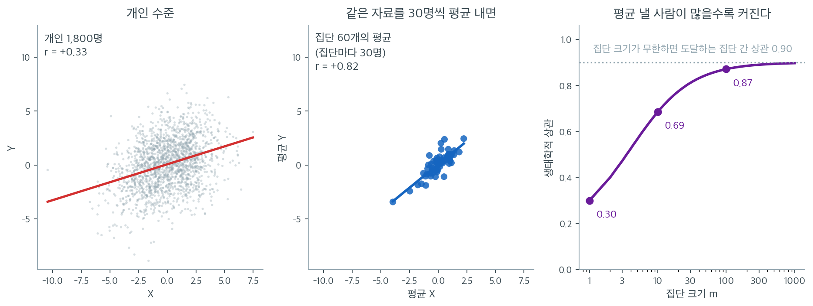
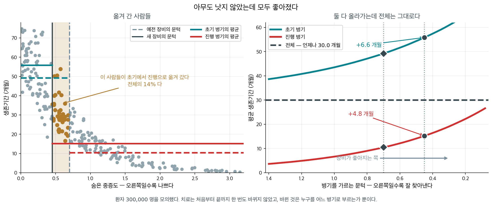

# 집계 편향

윌 로저스가 남겼다는 농담이 하나 있다. 「오클라호마 사람들이 캘리포니아로 옮겨 가면서 두 주의 평균 지능이 모두 올랐다.」 사람은 아무도 변하지 않았다. 오클라호마에서 가장 낮은 쪽이 빠져나갔고, 그들이 캘리포니아에서는 가장 낮은 쪽이 아니었을 뿐이다.

$1985$ 년에 파인스타인과 소신과 웰스가 폐암 자료에서 꼭 그 일이 일어났다고 보고했다. 새 장비가 들어와 예전에는 보이지 않던 작은 전이가 보이기 시작하자, 어제까지 초기 병기였던 환자들이 오늘부터 진행 병기가 되었다. 그래서 초기는 가장 나쁜 환자들을 잃어 생존율이 오르고, 진행은 형편이 나은 사람들을 받아 생존율이 오르고, **아무도 치료를 더 받지 않았으므로 전체는 그대로다.** 아래 상자가 그 셈을 수로 따라간다.

요약하는 방식 하나가 수를 만든다는 점에서 이 쪽의 주제도 같다. 개인 $1{,}800$ 명의 자료에서 상관을 재면 $r = +0.33$ 이다. 같은 $1{,}800$ 명을 $30$ 명씩 $60$ 개 집단으로 묶어 평균만 남기면 $r = +0.82$ 가 된다. 자료를 새로 모은 것도 관계를 바꾼 것도 아니다 — 평균을 냈을 뿐이다. 집단을 크게 묶을수록 개인마다의 흔들림이 평균 속에서 지워진다.

집단 크기를 $10$ 으로만 해도 상관이 $0.69$ 로 올라가므로, 주나 국가 단위로 집계한 자료에서 $r$ 이 크게 나오는 일에는 거의 예외가 없다. 집계라는 행위 하나가 상관을 이만큼 밀어 올리는 까닭은 무엇이고, 부풀려진 몫을 어떻게 떼어 낼 수 있는가. 이 쪽이 그 몫을 식으로 가른다. 앞의 두 쪽과 달리 여기서는 **방향이 뒤집히지 않아도** 수가 어긋난다.

_확인한 곳 — 이 쪽 「아무도 낫지 않았는데 모두 좋아졌다」 상자와 그 출처 줄_

분석 전에 자료를 요약하면(집단별로 평균 내거나, 구간으로 묶거나, 기간에 걸쳐 합치면) 그렇게 얻은 통계량이 원래의 개인 수준 자료에서 계산한 것과 체계적으로 달라질 수 있다. 이 체계적 왜곡을 **집계 편향**이라 한다. 생태학적 오류와 Simpson의 역설을 특수한 경우로 포함하며, 집계라는 행위 자체에서 생기는 분산·회귀 기울기·상관에 대한 더 미묘한 효과들도 아우른다.

---

## 1. 집계 편향이란

집계 편향은 집계된 자료로 추정한 통계적 관계가 개인 수준에 존재하는 관계와 다를 때 일어난다. 집계가 자료의 구조를 바꾸어 상관을 부풀리고, 회귀계수를 왜곡하고, 연관을 가리거나 뒤집을 수 있기 때문에 생긴다.

핵심 기제는 간단하다. 집단 안에서 평균을 내면 집단 내 변동은 줄어들고 집단 간 변동은 유지된다. 집단 간 관계와 집단 내 관계가 다를 수 있으므로, 집계 분석은 어느 쪽도 충실히 대표하지 못하는 혼합을 포착하게 된다.

---

## 2. 집계가 상관을 부풀리는 방식

$G$개의 집단에 각각 크기 $m$인 개인들이 있다고 하자(단순화를 위해 집단 크기가 같다고 가정한다). $X_{gi}$와 $Y_{gi}$를 집단 $g$의 개인 $i$의 값이라 하고, 집단 평균을 $\bar{X}_g = \frac{1}{m}\sum_{i=1}^m X_{gi}$, $\bar{Y}_g = \frac{1}{m}\sum_{i=1}^m Y_{gi}$라 하자.

집단 평균 $\bar{X}_g$와 $\bar{Y}_g$ 사이의 상관이 **생태학적 상관**이다. 핵심이 되는 수학적 결과는 분산의 분해이다.

$$
\text{Var}(X) = \text{Var}_B(X) + \text{Var}_W(X), \qquad \text{Var}(\bar{X}_g) = \text{Var}_B(X) + \frac{\text{Var}_W(X)}{m}
$$

여기서 $\text{Var}_B$는 집단 간 성분, $\text{Var}_W$는 집단 내 성분이다. $m$이 커질수록 집단 평균의 분산에서 집단 내 잡음의 몫이 사라지고 집단 간 성분만 남는다.

더 직관적으로 말하면, 평균을 내면 개인 수준의 잡음이 제거되어 집단 평균들이 집단 간 추세선 주위에 더 촘촘히 모인다. 이렇게 촘촘해지면 상관이 커진다.

!!! note "집계는 거의 언제나 상관의 절댓값을 키운다"
    집단 내 관계와 집단 간 관계의 부호가 같으면 생태학적 상관이 개인 수준 상관보다 강하다. 그 부풀림은 극적일 수 있다. 큰 집단에 걸쳐 평균을 내면 개인 수준 상관 $r = 0.3$이 생태학적 상관 $r = 0.9$ 이상이 되는 일이 흔하다.



바로 위 상자의 주장을 숫자로 확인한 것이다. 개인 1,800명을 만들되 집단 간 상관은 $0.90$, 집단 내 상관은 $0.15$가 되도록 했고, 그 결과 개인 수준 상관은 왼쪽처럼 $r = +0.33$이다. 점구름이 둥글고 회귀직선이 완만한, 사회과학에서 흔히 보는 모양이다.

가운데는 **똑같은 1,800명**을 30명씩 60개 집단으로 묶어 평균을 낸 것이다. 자료를 새로 모은 것도, 관계를 바꾼 것도 아니다. 축의 범위를 왼쪽과 똑같이 맞추어 두었으니 비교해 보라. 점들이 가운데로 확 몰리면서 직선 주위에 촘촘히 늘어섰고 $r = +0.82$가 된다. **평균을 내면 개인 수준의 잡음이 $1/\sqrt{m}$으로 줄어드는 반면 집단 간 신호는 그대로 남기 때문이다.** 위의 분해식 $\text{Var}(\bar{X}_g) = \text{Var}_B + \text{Var}_W/m$에서 두 번째 항만 작아지는 것이 그림에서는 구름이 좁아지는 것으로 나타난다.

오른쪽은 집단 크기 $m$을 바꿔 가며 생태학적 상관을 계산한 곡선이다. $m = 1$이면 정의상 개인 수준 상관 $0.30$이고, $m = 10$에서 $0.69$, $m = 100$에서 $0.87$, $m \to \infty$에서 집단 간 상관 $0.90$에 수렴한다. **집단 크기 열 명만으로도 상관이 두 배가 넘게 부풀려진다.**

실무적으로 가장 위험한 대목이 여기다. 주나 국가처럼 $m$이 수백만인 단위로 집계한 자료에서는 거의 언제나 $r$이 $0.8$을 넘고 $r^2$이 $0.7$을 넘는다. 그 큰 값이 관계가 강하다는 증거로 읽히기 쉽지만, 대부분은 **평균을 냈다는 사실 자체가 만들어 낸 것**이다. 집계 자료의 $r$을 보고할 때는 반드시 집계 단위와 단위당 인원을 함께 밝혀야 하고, 개인 수준의 $r$과 나란히 놓고 비교해서는 안 된다.

---

## 3. 회귀 기울기에 대한 영향

집계는 회귀계수도 왜곡한다. 개인 수준에서 $Y$를 $X$에 회귀하면 기울기는

$$
\hat{\beta}_{\text{individual}} = \frac{\sum_{g,i}(X_{gi} - \bar{X})(Y_{gi} - \bar{Y})}{\sum_{g,i}(X_{gi} - \bar{X})^2}
$$

이다. 대신 집단 평균 $\bar{Y}_g$를 $\bar{X}_g$에 회귀하면 생태학적 기울기는

$$
\hat{\beta}_{\text{ecological}} = \frac{\sum_g (\bar{X}_g - \bar{\bar{X}})(\bar{Y}_g - \bar{\bar{Y}})}{\sum_g (\bar{X}_g - \bar{\bar{X}})^2}
$$

이다. 두 기울기는 대체로 다르다. 생태학적 기울기는 집단 간 관계만 반영하는 반면 개인 수준 기울기는 집단 간 효과와 집단 내 효과의 결합이다. 두 성분이 다르면 생태학적 기울기가 개인 수준 효과를 과대추정하거나 과소추정하거나 심지어 뒤집을 수 있다.

---

## 4. 집계 편향의 원천

집계 편향에는 여러 기제가 기여한다.

1. **집단 내 변동의 손실.** 평균을 내면 집단 안의 개인차가 사라져 참 관계를 추정하는 데 꼭 필요한 정보가 제거된다.

2. **집단 소속에 의한 교란.** 집단들이 $X$와 $Y$ 모두와 상관된 방식으로 체계적으로 다를 수 있어, 개인 수준에는 없거나 약한 교란이 집계 수준에서 생긴다.

3. **비선형 효과.** $X$와 $Y$의 관계가 비선형이면 함수의 평균이 평균의 함수와 같지 않다. 집계는 선형 근사를 적용하여 추정된 관계를 왜곡한다.

4. **집단 크기의 불균형.** 집단 크기가 다르면 집계 분석이 개인마다 암묵적으로 다른 가중치를 주게 되어 결과가 치우칠 수 있다.

---

<div class="exbox" markdown>

**보기 1.** <span class="diff easy" title="쉬움"></span> 주 수준 대 개인 수준의 소득과 학력. 미국 50개 주에 걸쳐 평균 소득과 평균 학력의 상관을 구했더니 $r = 0.85$가 나왔다고 하자. 이 생태학적 상관은 개인 수준 상관(대개 $r = 0.4$ 정도)보다 훨씬 높은데 이유는 두 가지이다.

</div>

??? success "풀이"
    - 각 주 안에서 수백만 명에 걸쳐 평균을 내면 개인 수준 잡음이 제거되어 집단 평균의 산포가 좁아진다.
    - 산업, 정책, 인구 구성의 주별 차이가 개인 수준 변동보다 소득과 학력을 더 강하게 정렬시키는 주 간 변동을 만든다.

    학력이 소득 변동의 72%를 설명한다($r^2 = 0.72$)고 결론짓는 것은 개인 수준 관계($r^2 = 0.16$)를 심각하게 과장하는 것이다.

---

## 5. 집계 편향 줄이기

1. 개인 자료를 구할 수 있으면 언제나 **개인 수준에서 분석한다**.

2. **다수준 모형을 쓴다.** 계층 모형은 집단 내 효과와 집단 간 효과를 명시적으로 분리하여 각각을 적절히 추정한다.

3. **분석 수준을 보고한다.** 통계량을 개인 자료로 계산했는지 집계 자료로 계산했는지 항상 밝힌다.

4. **수준을 넘나드는 추론을 피한다.** 집계 통계로 개인에 대한 결론을 내리지 말고 그 반대도 마찬가지이다.

5. **집계에 대한 민감도를 확인한다.** 집계 자료만 있다면 더 세밀한 집계 수준에서 결과가 어떻게 달라질 수 있는지 민감도 분석을 수행한다.

---

## 6. 셋은 포함관계가 아니라 교차한다

10.2 의 세 쪽이 다루는 것은 서로 다르다. 이름이 닮아 하나로 보이기 쉬우니 **각자 홀로 일어나는 자리**를 들어 가른다.

| | 무엇에 관한 것인가 | 부호가 뒤집히나 | 개인을 평균하나 |
|:---|:---|:---|:---|
| **집계 편향** (이 쪽) | 기제와 **크기** | 보통 아니다 | 그렇다 |
| [**생태학적 오류**](ecological_fallacy.md) | **추론의 층위** 잘못 | 그럴 수도 있다 | 그렇다 |
| [**Simpson의 역설**](simpsons_paradox.md) | **부호가 뒤집히는** 경우 | 정의상 그렇다 | 아니다 |

**왜 헷갈리는가 — 맞대는 두 쪽 가운데 한쪽이 같다.**

| | 한쪽 | 다른 쪽 |
|:---|:---|:---|
| **생태학적 오류** | $G$ 개의 **집단 평균** $(\bar X_g, \bar Y_g)$ | $N$ 명의 **개인** $(X_i, Y_i)$ 통째로 |
| **Simpson의 역설** | $N$ 명의 **개인** $(X_i, Y_i)$ 통째로 | **같은 $N$ 명**을 층마다 |

「개인 $N$ 명 통째로」가 **양쪽에 다 들어 있다.** 그래서 둘이 「개인이 참이고 집계가 거짓말한다」는 같은 이야기로 들리는 것이며, 갈리는 것은 **나머지 한쪽**이다. 생태학적 오류는 한쪽이 **평균**이어서 점의 개수가 $N$ 과 $G$ 로 아예 다르다. Simpson 은 **어느 쪽도 평균을 내지 않는다** — 양쪽이 같은 개인 자료이고 묶는 방식만 다르다. 위 표의 셋째 칸 「개인을 평균하나」가 그 뜻이다.

**집계 편향만 일어나는 자리.** $\S 2$ 가 보인 대로 개인 수준 $r = 0.3$ 이 생태학적 $r = 0.9$ 가 되는 것이 전형이다. **부호가 그대로이므로 역설이 아니다.** 그래도 「상관이 강하다」는 주장을 과장하게 되므로 해롭다.

**Simpson의 역설만 일어나는 자리.** 버클리 입학 사례는 학과별 $2\times2$ 표를 **합친** 것이고 개인의 값을 평균한 것이 아니다. $\S 2$ 의 $\operatorname{Var}_W/m$ 기제가 들어설 자리가 없다 — 평균을 내는 단계가 아예 없기 때문이다.

**셋이 겹치는 자리.** 로빈슨의 $1930$ 년 자료가 그렇다. 개인을 주 단위로 **평균했고**(집계 편향), 그 주 수준 상관으로 **개인을 말했고**(생태학적 오류), 그 과정에서 **부호가 뒤집혔다**(Simpson). 세 쪽이 같은 예를 쓰는 것은 그 자리가 교집합이기 때문이고, 셋이 같은 것이라는 뜻이 아니다.

**실무에서 가려 쓰는 법.** 집단 수준 자료만 손에 있을 때 물어야 할 것이 셋이다 — 크기를 믿을 수 있는가(집계 편향), 이 말을 개인에게 옮겨도 되는가(생태학적 오류), 층을 나누면 방향이 바뀌는가(Simpson). 앞의 둘은 집단 자료만으로도 **의심**할 수 있지만 셋째는 **층별 자료가 있어야** 확인된다.

<div class="storybox" markdown>

**그림으로 보는 통계학 1.** 아무도 낫지 않았는데 모두 좋아졌다

위 세 줄에 한 식구를 더 들일 수 있다. Simpson의 역설이 **집계가 방향을 뒤집는** 경우라면,
이것은 **무리의 경계가 움직이는** 경우다.

윌 로저스가 했다고 전해지는 농담이 있다. 「오클라호마 사람들이 캘리포니아로 옮겨 가면서 두
주의 평균 지능이 모두 올랐다.」 사람은 아무도 변하지 않았다. 오클라호마에서 가장 낮은 쪽이
빠져나갔고, 그들이 캘리포니아에서는 가장 낮은 쪽이 아니었을 뿐이다.

1985 년에 파인스타인과 소신과 웰스가 『뉴잉글랜드 의학저널』에 폐암 자료에서 꼭 그 일이
일어났다고 보고했다. 전산화단층촬영과 골스캔이 들어오면서 예전에는 보이지 않던 작은 전이가
보이기 시작했다. 그 환자들은 어제까지 초기 병기였고 오늘부터 진행 병기다. 그러자

- **초기 병기**는 가장 나쁜 환자들을 잃었다 → 초기의 생존율이 **오른다**
- **진행 병기**는 기존 환자들보다 형편이 나은 사람들을 받았다 → 진행의 생존율도 **오른다**
- 아무도 치료를 더 받지 않았다 → 전체 생존율은 **그대로다**

그들은 이것을 **병기 이동**, 또는 **윌 로저스 현상**이라 불렀다.

<figure markdown>
{ width="900" }
  <figcaption markdown>환자 $300{,}000$ 명을 모의했다. 치료는 한 번도 바뀌지 않았고, 바뀐 것은 누구를 어느 병기로 부르는가뿐이다.</figcaption>
</figure>

문턱을 $0.70$ 에서 $0.45$ 로 옮기면 — 장비가 좋아져 더 잘 찾아낸다는 뜻이다 — 전체의
$14\%$ 가 초기에서 진행으로 넘어간다. 그 결과가 이렇다.

| | 예전 장비 | 새 장비 | 변화 |
|---|---|---|---|
| 초기 병기의 평균 생존 | $49.2$ 개월 | $55.9$ 개월 | $+6.6$ |
| 진행 병기의 평균 생존 | $10.5$ 개월 | $15.2$ 개월 | $+4.8$ |
| **전체** | $\mathbf{30.0}$ **개월** | $\mathbf{30.0}$ **개월** | $\mathbf{0.0}$ |

오른쪽 그림의 가로 점선이 그것이다. 두 곡선이 나란히 올라가는 내내 전체는 꼼짝하지 않는다.
옮겨 간 환자들의 평균 생존이 $32.1$ 개월이라, **초기의 평균 $49.2$ 보다는 낮고 진행의 평균
$10.5$ 보다는 높기** 때문이다. 한 무리에서 평균 아래인 사람이 다른 무리에서 평균 위이면,
그 사람이 옮겨 가는 것만으로 양쪽 평균이 함께 오른다. 산술이 전부다.

실무에서 이것이 무는 자리는 분명하다. **시대가 다른 두 집단의 병기별 성적을 견주는 일**은
진단 기술이 그대로일 때만 뜻이 있다. 신약의 효과를 옛 자료와 견주어 보고하는 논문, 병원의
병기별 성적표, 선별검사를 도입한 전후의 비교 — 모두 이 함정 위에 있다. 그리고 이 함정은
앞의 둘과 달리 **더 좋은 측정 때문에** 생긴다. 측정이 나빠서가 아니라 좋아져서 수가 움직인
것이다.

_확인한 곳 — 파인스타인·소신·웰스의 「The Will Rogers Phenomenon — Stage Migration and New Diagnostic Techniques as a Source of Misleading Statistics for Survival in Cancer」(『New England Journal of Medicine』 $312$ 권 $25$ 호 $1604$–$1608$ 쪽, $1985$ 년 $6$ 월 $20$ 일)와, 옮겨 간 환자들의 예후가 **원래 무리보다는 나쁘고 옮겨 간 무리보다는 좋아** 개인의 결과가 하나도 변하지 않은 채 양쪽 생존율이 함께 올랐다는 그 논문의 설명. 표와 그림의 수는 모두 직접 모의실험한 값이다_

</div>

---

## 연습문제

<div class="drillbox" markdown>

**연습문제 1.** <span class="diff med" title="중간"></span>
도시 100곳에 대한 연구에서 평균 소득과 평균 기대수명의 상관이 $r = 0.85$였다. 그 도시들 안의 개인 10,000명에 대한 연구에서는 $r = 0.25$였다. 이 차이를 설명하라.

</div>

??? success "풀이"
    **집계 편향** 때문이다. 자료를 도시 수준으로 집계하면 각 도시 안의 개인 수준 변동이 평균으로 사라지고 도시 간 변동만 남는다. 평균 소득이 높은 도시가 (더 나은 기반시설, 의료 등 덕분에) 평균 기대수명도 높은 경향이 있으므로 도시 수준 상관이 부풀려진다.

    개인 수준에서는 소득–기대수명 관계가 더 약하다. 어느 한 도시 안에서는 부유한 개인과 가난한 개인의 기대수명이 도시 수준 평균이 시사하는 것보다 서로 비슷하기 때문이다. (상관을 희석하는) 도시 내 변동이 집계 자료에서는 보이지 않는다.

    수학적으로는 집계 평균의 분산이 $\text{Var}_B + \text{Var}_W/m$이므로, 집단 크기 $m$이 클수록 집단 내 성분이 사라지고 집단 간 관계만 남아 상관이 커진다.

---

<div class="drillbox" markdown>

**연습문제 2.** <span class="diff med" title="중간"></span>
(대부분의 실무 상황에서) 집계가 왜 상관의 절댓값을 키우는 경향이 있는지 설명하라.

</div>

??? success "풀이"
    집계(집단 안에서 평균 내기)는 집단 내 변동을 제거하고 집단 간 변동만 남긴다.

    $$
    \text{Var}(X) = \text{Var}_{\text{between}}(\bar{X}_g) + E[\text{Var}_{\text{within}}(X \mid g)]
    $$

    이므로 전체 분산은 집단 간 성분과 집단 내 성분의 합이다. 집계 후에는 집단 간 분산만 남아 더 작아진다.

    집단 간 관계가 집단 내 관계보다 강하면(개별적인 잡음이 상쇄되어 집단 평균이 추세를 더 가깝게 따르므로 흔히 그렇다) 집단 평균들 사이의 상관이 개인 수준 상관을 넘어선다.

    예외: 집단 간 관계와 집단 내 관계의 부호가 반대이면(Simpson의 역설) 집계가 오히려 상관을 줄이거나 뒤집을 수 있다.

---

<div class="drillbox" markdown>

**연습문제 3.** <span class="diff med" title="중간"></span>
어떤 마케팅 분석가가 고객 자료를 지역별로 집계하여 광고비와 매출 사이에 강한 양의 상관을 발견했다. 이것이 왜 광고의 개인 수준 효과를 과장할 수 있는가?

</div>

??? success "풀이"
    여러 집계 편향의 원천이 작동한다:

    1. **지역 수준의 교란:** 매출 잠재력이 큰 지역(인구가 많고 소득이 높은 지역)이 자연스럽게 더 많은 광고 예산을 받는다. 상관은 광고의 인과효과가 아니라 이 자원 배분 결정을 반영한다.

    2. **지역 내 변동의 손실:** 각 지역 안에서 개별 고객의 광고 노출은 다르지만 평균을 내면 이 변동이 사라진다. 지역 수준 상관은 광고가 많은 지역의 매출이 높다는 사실만 포착하고 개인 수준의 잡음은 놓친다.

    3. **역인과:** 회사가 이미 매출이 좋은 지역에 (성과 보상 차원에서) 광고를 더 배정할 수 있어 집계 상관이 부풀려진다.

    참된 개인 수준 효과를 추정하려면 개인 수준 자료를 쓰거나, 더 나아가 개인이나 소집단 수준에서 무작위 실험(A/B 검정)을 수행해야 한다.

---

<div class="drillbox" markdown>

**연습문제 4.** <span class="diff med" title="중간"></span>
집단 수준 자료에서 개인 수준 상관을 추정하는 방법을 제안하거나, 추가 가정 없이는 대체로 불가능한 이유를 설명하라.

</div>

??? success "풀이"
    일반적으로 추가 가정 없이는 집단 수준 자료에서 개인 수준 상관을 유일하게 복원할 수 **없다**. 서로 다른 개인 수준 자료 구조가 같은 집단 수준 요약을 낳을 수 있기 때문이다(개인 자료에서 집계 통계로 가는 대응이 다대일이다).

    부분적인 복원을 시도하는 접근으로는 다음이 있다:

    1. **생태학적 추론 모형**(King, 1997): 집단 내 변동에 분포 가정을 부과하여 개인 수준 양을 한정하거나 추정한다.
    2. **다수준 모형:** 집단 수준 자료와 일부 개인 수준 자료가 함께 있으면 계층 모형으로 집단 간 효과와 집단 내 효과를 분리할 수 있다.
    3. **외부 검증:** 일부 집단의 개인 수준 자료로 집계 편향을 보정한다.

    가장 안전한 방법은 연구 질문이 개인 수준 연관에 관한 것이라면 개인 수준 자료를 수집하는 것이다. 어떤 통계 방법도 집계로 인한 정보 손실을 완전히 극복하지는 못한다.

---

<div class="drillbox" markdown>

**연습문제 5.** <span class="diff med" title="중간"></span>
연습문제 2는 집계가 상관을 키우는 경향을 물었다. **키우지 않는 경우**를 찾아라. 집단 배정이 무작위일 때 집계 상관이 개인 상관과 같아짐을 보여라.

</div>

??? success "풀이"
    ```python
    import numpy as np

    rng = np.random.default_rng(1)
    n, k = 4000, 40
    x = rng.normal(0, 1, n); y = 0.4*x + rng.normal(0, 1, n)
    print(f"  개인 수준 r = {np.corrcoef(x, y)[0,1]:.4f}")

    for rep in range(3):
        g = rng.permutation(n) % k                 # 무작위 배정
        xa = np.array([x[g==j].mean() for j in range(k)])
        ya = np.array([y[g==j].mean() for j in range(k)])
        print(f"  무작위 배정 {rep+1}: 집계 r = {np.corrcoef(xa, ya)[0,1]:+.4f}")
    ```

    출력:

    ```
      개인 수준 r = 0.3681
      무작위 배정 1: 집계 r = +0.4802
      무작위 배정 2: 집계 r = +0.4555
      무작위 배정 3: 집계 r = +0.4207
    ```

    **개인 상관 $0.368$ 주위에 머물지만 흔들림이 있다.** $0.42 \sim 0.48$로 퍼진다. 집계가 상관을 **체계적으로** 키우지는 않는다.

    **두 가지가 동시에 일어난다.**

    - **편향은 없다.** 무작위 배정이면 집단이 $x$에 대해 정보를 갖지 않으므로, 집계가 상관을 체계적으로 키우지 않는다.
    - **분산은 커진다.** 관측이 $4000$개에서 $40$개로 줄었으니 추정이 훨씬 불안정하다.

    **그래서 무작위 배정은 "안전하지만 낭비"다.** 편향은 없어도 정보를 대부분 버린다. 집계의 이점(잡음 평균)이 표본 수 감소로 상쇄되기 때문이다.

    **현실의 집단은 무작위가 아니다.** 지역·학교·병원은 구성원이 서로 닮아 있고, 그 닮음이 $x$와 관련되면 집계가 상관을 키운다. **무작위 배정이라는 조건이 현실에서 거의 만족되지 않는다**는 점이 집계 편향이 흔한 이유다.

---

<div class="drillbox" markdown>

**연습문제 6.** <span class="diff med" title="중간"></span>
집단 크기가 **고르지 않으면** 어떻게 되는가? 단순 평균과 가중 평균의 차이를 보이고, 어느 쪽을 써야 하는지 답하라.

</div>

??? success "풀이"
    ```python
    import numpy as np

    rng = np.random.default_rng(3)
    G = 30
    sizes = rng.integers(10, 2000, G)           # 크기가 매우 불균등
    a = rng.normal(0, 1, G)
    b = 0.7*a + np.sqrt(1-0.49)*rng.normal(0, 1, G)
    Xg = np.array([a[i] + rng.normal(0, 1, sizes[i]).mean() for i in range(G)])
    Yg = np.array([b[i] + rng.normal(0, 1, sizes[i]).mean() for i in range(G)])

    r_un = np.corrcoef(Xg, Yg)[0,1]
    w = sizes / sizes.sum()
    mx, my = (w*Xg).sum(), (w*Yg).sum()
    r_w = (w*(Xg-mx)*(Yg-my)).sum() / np.sqrt((w*(Xg-mx)**2).sum() *
                                              (w*(Yg-my)**2).sum())
    print(f"  집단 크기 범위: {sizes.min()} ~ {sizes.max()}")
    print(f"  단순 상관 = {r_un:.4f}")
    print(f"  가중 상관 = {r_w:.4f}")
    print(f"  참 집단수준 상관 = 0.7")
    ```

    출력:

    ```
      집단 크기 범위: 75 ~ 1776
      단순 상관 = 0.7025
      가중 상관 = 0.6952
      참 집단수준 상관 = 0.7
    ```

    **이 실행에서는 둘이 거의 같다**($0.703$ 대 $0.695$). 참값 $0.7$에 모두 가깝다. 작은 집단의 평균은 잡음이 크므로($\sigma/\sqrt m$) 원리적으로는 가중이 낫지만, **차이가 언제나 크게 나타나지는 않는다.** 집단 크기 편차가 더 극단적이거나 작은 집단이 많을수록 차이가 벌어진다.

    **그러나 "무엇을 추정하려는가"에 따라 답이 달라진다.**

    | 목적 | 가중 방식 |
    |---|---|
    | **집단 자체가 단위**(국가 정책 비교) | **단순 평균** — 큰 나라가 지배하면 안 된다 |
    | **개인을 대표**(전체 인구의 관계) | **크기 가중** |
    | 측정오차 보정 | 크기 가중(역분산에 가깝다) |

    **세 목적이 서로 다른 답을 준다.** "OECD 국가에서 복지지출과 빈곤율의 관계"를 묻는다면 미국과 아이슬란드를 같은 무게로 볼 것인가, 인구로 가중할 것인가? **통계적 정답이 아니라 연구 질문이 정한다.**

    **보고할 때는 가중 방식을 반드시 밝힌다.** 두 결과가 크게 다르면 둘 다 제시하는 것이 정직하다.

---

<div class="drillbox" markdown>

**연습문제 7.** <span class="diff med" title="중간"></span>
집계 자료에서 개인 수준 관계를 **부분적으로 제약**할 수는 있다. 주변분포가 알려져 있을 때 개인 수준 $2\times2$ 표가 가질 수 있는 범위를 구하라.

</div>

??? success "풀이"
    **집단 $i$에서 $x=1$의 비율 $p_i$와 $y=1$의 비율 $q_i$를 안다고 하자.** 개인 수준 $2\times2$ 표의 한 칸 $\pi_i = P(x=1, y=1)$이 결정되면 나머지가 정해지는데, $\pi_i$는 자유롭지 않다.

    $$
    \max(0,\ p_i+q_i-1) \;\le\; \pi_i \;\le\; \min(p_i,\ q_i)
    $$

    **프레셰–회프딩 경계**다(4.1절 [베르누이분포](../../ch04/discrete_distributions/bernoulli.md) 연습문제 10).

    ```python
    import numpy as np

    print(f"{'p':>6}{'q':>6}{'pi 하한':>10}{'pi 상한':>10}{'폭':>8}")
    for p, q in [(0.5,0.5), (0.2,0.3), (0.8,0.9), (0.5,0.1)]:
        lo, hi = max(0, p+q-1), min(p, q)
        print(f"{p:>6.1f}{q:>6.1f}{lo:>10.3f}{hi:>10.3f}{hi-lo:>8.3f}")
    ```

    출력:

    ```
         p     q     pi 하한     pi 상한       폭
       0.5   0.5     0.000     0.500   0.500
       0.2   0.3     0.000     0.200   0.200
       0.8   0.9     0.700     0.800   0.100
       0.5   0.1     0.000     0.100   0.100
    ```

    **주변분포가 극단적이면 범위가 좁아진다.** $p=0.8$, $q=0.9$면 $\pi$가 $[0.70,\ 0.80]$로 $0.1$ 폭이다. 반대로 $p=q=0.5$면 $[0,\ 0.5]$로 전혀 좁혀지지 않는다.

    **여러 집단이 있으면 더 좁힐 수 있다.** 각 집단의 경계를 모두 만족하는 개인 수준 모수만 가능하므로, 집단 수가 많고 $p_i$가 다양하면 교집합이 작아진다. **던컨–데이비스의 방법**이 이 발상이다.

    **이것이 "부분 식별"의 예다.** 점추정은 불가능하지만 **범위는 말할 수 있다.** 검증 불가능한 가정을 얹어 점추정하는 굿맨 회귀(생태학적 상관 문서 연습문제 7)와 대비된다.

    | 접근 | 결과 | 대가 |
    |---|---|---|
    | 굿맨 회귀 | 점추정 | 강한 가정 |
    | **부분 식별** | **범위** | 가정이 거의 없음 |

    **어느 쪽이 나은가.** 맨스키의 주장대로, **"가정 없이 넓은 답"이 "강한 가정으로 좁은 답"보다 정직**할 때가 많다. 특히 가정을 검증할 수 없는 생태학적 추론에서는 범위를 보고하는 것이 안전하다.

---

<div class="drillbox" markdown>

**연습문제 8.** <span class="diff med" title="중간"></span>
집계 편향을 **줄이기 위한 설계 지침**을 정리하라. 자료를 모으는 단계에서 무엇을 할 수 있는가?

</div>

??? success "풀이"
    **설계 단계에서 할 수 있는 것.**

    ```text
    1. 가능하면 개인 수준 자료를 확보한다 (근본적 해결)
    2. 전부가 어렵다면 일부라도 — "검증 표본"
       -> 집계 자료와 결합해 식별력을 크게 높인다
    3. 집단을 작게 잡는다
       -> m 이 작을수록 집단 내 변동이 살아남는다 (연습문제 9)
    4. 집단 내 분산도 함께 보고받는다
       -> 평균만이 아니라 표준편차/분위수를 수집
    5. 집단 정의를 여러 방식으로 준비한다
       -> MAUP 민감도 분석 가능
    ```

    **세 번째와 네 번째가 특히 실용적이다.**

    **집단을 작게 잡으면** 집계 상관이 개인 상관 쪽으로 이동한다. 주 대신 카운티, 카운티 대신 센서스 트랙을 쓰면 편향이 줄어든다. 다만 집단 수가 늘어 잡음도 늘고, 사생활 보호 때문에 세분화가 제한되기도 한다.

    **집단 내 분산을 함께 받으면** 연습문제 9의 분해를 실제로 수행할 수 있다. 집단 평균만으로는 $\sigma_\alpha^2$과 $\sigma_u^2$을 나눌 수 없지만, 집단 내 분산이 있으면 $\sigma_u^2$을 추정해 집단 간 성분을 분리할 수 있다.

    **분석 단계의 보완.**

    | 방법 | 내용 |
    |---|---|
    | 다수준 모형 | 두 수준을 명시적으로 모형화 |
    | 검증 표본 결합 | 소수의 개인 자료로 생태학적 추정을 보정 |
    | 부분 식별 | 범위를 보고(연습문제 7) |
    | 민감도 분석 | 구획·가중을 바꿔 결과의 안정성 확인 |

    **그러나 가장 중요한 것은 결론의 수준을 지키는 것이다.** 집계 자료로 집계 수준 결론을 내리면 아무 문제가 없다. 문제는 언제나 **수준을 넘어설 때** 생긴다. $\square$

---

<div class="drillbox" markdown>

**연습문제 9.** <span class="diff hard" title="어려움"></span>
집계 상관과 개인 상관의 관계를 **수식으로** 정리하라. 집단 크기 $m$이 커질 때 집계 상관이 무엇으로 수렴하는지 보여라.

</div>

??? success "풀이"
    **분산성분 모형을 세운다.** 집단 $g$의 개인 $i$에 대해

    $$
    X_{gi} = \alpha_g + u_{gi},
    \qquad
    Y_{gi} = \beta_g + v_{gi}
    $$

    로 두고 집단 간 성분과 집단 내 성분이 독립이라 하자. 집단 평균은

    $$
    \bar X_g = \alpha_g + \bar u_g,
    \qquad \operatorname{Var}(\bar u_g) = \frac{\sigma_u^2}{m}
    $$

    이므로

    $$
    \operatorname{corr}(\bar X_g, \bar Y_g)
    = \frac{\sigma_{\alpha\beta} + \sigma_{uv}/m}
           {\sqrt{\left(\sigma_\alpha^2+\frac{\sigma_u^2}{m}\right)
                  \left(\sigma_\beta^2+\frac{\sigma_v^2}{m}\right)}}
    $$

    이다.

    **$m \to \infty$이면 개인 수준 성분이 전부 사라진다.**

    $$
    \operatorname{corr}(\bar X_g, \bar Y_g) \;\longrightarrow\;
    \frac{\sigma_{\alpha\beta}}{\sigma_\alpha\sigma_\beta}
    = \operatorname{corr}(\alpha_g,\ \beta_g)
    $$

    즉 **집계 상관은 집단 수준 성분의 상관으로 수렴한다.** 개인 수준 상관 $\sigma_{uv}/(\sigma_u\sigma_v)$은 완전히 지워진다.

    ```python
    import numpy as np

    rng = np.random.default_rng(2)
    G = 400
    sa = sb = 1.0; rho_g = 0.9         # 집단 수준 상관
    su = sv = 1.0; rho_w = -0.5        # 개인 수준 상관 (부호 반대!)
    print(f"  집단 수준 상관 = {rho_g}, 개인 수준 상관 = {rho_w}")
    print(f"{'집단 크기 m':>12}{'집계 r':>10}")
    for m in (1, 5, 20, 100, 1000):
        a = rng.normal(0, sa, G)
        b = rho_g*a + np.sqrt(1-rho_g**2)*rng.normal(0, sb, G)
        u = rng.normal(0, su, (G, m))
        v = rho_w*u + np.sqrt(1-rho_w**2)*rng.normal(0, sv, (G, m))
        Xg = a + u.mean(1); Yg = b + v.mean(1)
        print(f"{m:>12}{np.corrcoef(Xg, Yg)[0,1]:>10.4f}")
    ```

    출력:

    ```
      집단 수준 상관 = 0.9, 개인 수준 상관 = -0.5
         집단 크기 m      집계 r
               1    0.1597
               5    0.6311
              20    0.8467
             100    0.8887
            1000    0.8816
    ```

    **$m=1$이면 두 수준이 섞여 $0.16$인데 $m \ge 100$이면 $0.88$ 근처로 집단 수준 상관 $0.9$에 수렴한다.**

    **개인 수준 상관이 $-0.5$인데 집계에서는 흔적조차 없다.** 이것이 생태학적 오류의 수학적 핵심이다.

    **실무적 함의.** 집단이 클수록 집계 자료는 **집단 수준 현상만** 보여 준다. 국가 단위 자료($m$이 수백만)는 사실상 순수한 집단 수준 상관이며, 개인에 대해 아무것도 말해 주지 않는다.

---

<div class="drillbox" markdown>

**연습문제 10.** <span class="diff hard" title="어려움"></span>
집계는 **회귀의 측정오차 문제**와도 연결된다. 집단 평균을 설명변수로 쓰면 측정오차가 줄어 **감쇠 편향이 완화**됨을 보여라.

</div>

??? success "풀이"
    **개인 수준에서 $x$를 오차와 함께 관측하면 기울기가 감쇠한다**(2.4절 [기술통계 (대마 가격)](../../ch02/spread/descriptive_stats_weed_prices.md) 연습문제 9).

    $$
    \hat\beta \to \beta\cdot\frac{\sigma_{x^*}^2}{\sigma_{x^*}^2+\sigma_e^2}
    $$

    **집단 평균을 쓰면 오차가 $\sigma_e^2/m$으로 줄어든다.**

    ```python
    import numpy as np

    rng = np.random.default_rng(4)
    G, beta = 300, 1.0
    print(f"{'집단 크기 m':>12}{'개인 기울기':>12}{'집계 기울기':>12}")
    for m in (1, 5, 20, 100):
        xg = rng.normal(0, 1, G)                     # 집단 수준 참값
        xs = xg[:, None] + rng.normal(0, 0.3, (G, m))  # 개인 참값
        y = beta*xs + rng.normal(0, 0.5, (G, m))
        xo = xs + rng.normal(0, 1.0, (G, m))         # 측정오차
        b_ind = np.polyfit(xo.ravel(), y.ravel(), 1)[0]
        b_agg = np.polyfit(xo.mean(1), y.mean(1), 1)[0]
        print(f"{m:>12}{b_ind:>12.4f}{b_agg:>12.4f}")
    ```

    출력:

    ```
         집단 크기 m      개인 기울기      집계 기울기
               1      0.5255      0.5255
               5      0.5196      0.8170
              20      0.5242      0.9574
             100      0.5376      0.9916
    ```

    **개인 수준 기울기는 $0.52$ 근처에 머문다.** 참값 $1.0$의 절반 정도로 감쇠한다($\sigma_{x^*}^2/(\sigma_{x^*}^2+\sigma_e^2) \approx 1/2$).

    **집계하면 감쇠가 사라진다.** $m=100$에서 $0.99$로 참값을 거의 회복한다. 집단 평균을 내면 측정오차가 $\sigma_e/\sqrt m$로 줄기 때문이다.

    (집단 수준 참값 $x_g$를 두고 개인 참값이 그 주위에 흩어지도록 구성한 점이 중요하다. 개인 참값이 집단과 무관하면 집단 평균도 잡음일 뿐이라 감쇠가 완화되지 않는다.)

    **이것은 집계의 드문 장점이다.** 대부분의 경우 집계는 정보를 잃고 편향을 만들지만, **측정오차가 지배적일 때는 오히려 도움이 된다.**

    | | 집계의 효과 |
    |---|---|
    | 집단 간·내 관계가 다름 | **해롭다** — 생태학적 오류 |
    | 측정오차가 큼 | **이롭다** — 감쇠 완화 |
    | 둘 다 | 상쇄 — 방향을 알 수 없다 |

    **세 번째 줄이 현실이다.** 실제 자료에서는 두 효과가 함께 작동해 집계 결과가 참값보다 클지 작을지 예측하기 어렵다. 그래서 **집계 자료의 기울기를 개인 수준 인과효과로 읽는 것은 언제나 위험하다.**

    **경제학의 "집계 도구변수"가 이 원리를 이용한다.** 개인 수준 측정오차가 심한 변수를 지역 평균으로 대체해 도구로 쓰는 기법이며, 10.4절 도구변수와 이어진다.

<div class="drillbox" markdown>

**연습문제 11.** <span class="diff med" title="중간"></span>
자료를 더 높은 수준으로(예: 개인에서 카운티로) 집계하면 왜 대체로 관측되는 상관의 크기가 커지는지 설명하라. 이 효과를 이끄는 수학적 성질은 무엇인가?

</div>

??? success "풀이"
    평균 내기가 **집단 내 분산**(잡음)은 줄이면서 **집단 간 분산**(신호)은 유지하기 때문에 집계는 상관의 크기를 키운다. 전체 분산의 법칙에 의해

    $$
    \text{Var}(X) = \text{Var}(E[X|G]) + E[\text{Var}(X|G)]
    $$

    이다. 집단 수준으로 집계하면 $E[X|G]$만 관측되고 집단 내 분산 $E[\text{Var}(X|G)]$은 사라진다. 신호 대 잡음 비가 커지므로 집단 평균들 사이의 상관이 개인 수준 상관보다 강해진다.

    즉 생태학적 상관은 개인 수준 상관에 비해 체계적으로 부풀려지므로, 개인 수준 관계의 추정값으로 삼기에는 믿을 수 없다.

---


<div class="drillbox" markdown>

**연습문제 12.** <span class="diff med" title="중간"></span>
집계 수준의 회귀계수는 어떤가? 상관과 달리 **기울기**는 집계에 어떻게 반응하는지 연습문제 13의 자료로 확인하라.

</div>

??? success "풀이"
    ```python
    import numpy as np

    rng = np.random.default_rng(0)
    G, m, rho_w = 50, 40, 0.2
    print(f"{'tau':>6}{'개인 기울기':>12}{'집계 기울기':>12}{'개인 r':>9}{'집계 r':>9}")
    for tau in (0.0, 0.5, 1.0, 2.0):
        a = rng.normal(0, tau, G)
        b = 0.9*a + rng.normal(0, tau*np.sqrt(1-0.81), G)
        X = np.repeat(a, m) + rng.normal(0, 1, G*m)
        e = rng.normal(0, 1, G*m)
        Y = np.repeat(b, m) + rho_w*(X - np.repeat(a, m)) + np.sqrt(1-rho_w**2)*e
        bi = np.polyfit(X, Y, 1)[0]
        Xa = X.reshape(G, m).mean(1); Ya = Y.reshape(G, m).mean(1)
        ba = np.polyfit(Xa, Ya, 1)[0]
        print(f"{tau:>6.1f}{bi:>12.4f}{ba:>12.4f}"
              f"{np.corrcoef(X,Y)[0,1]:>9.4f}{np.corrcoef(Xa,Ya)[0,1]:>9.4f}")
    ```

    출력:

    ```
       tau      개인 기울기      집계 기울기     개인 r     집계 r
       0.0      0.1780      0.1759   0.1800   0.1832
       0.5      0.3309      0.8045   0.3260   0.8115
       1.0      0.6366      1.0689   0.5875   0.9231
       2.0      0.7589      0.9238   0.7377   0.8898
    ```

    **기울기도 함께 달라진다.** 상관만의 문제가 아니다. $\tau=0.5$에서 개인 기울기 $0.331$이 집계 기울기 $0.805$로 두 배 넘게 커진다. $\tau=1.0$에서는 집계 기울기가 $1.07$로 **$1$을 넘어서기까지 한다.**

    **5.2절의 범위 제한과 대비된다.** 거기서는 $x$의 범위를 좁혀도 기울기가 변하지 않았다. 여기서 기울기가 변하는 것은 **집계가 단순히 자료를 자르는 것이 아니라 두 수준의 관계를 섞기 때문**이다. 집계 기울기는 "집단 간 기울기"에 가까워지고, 그것은 개인 수준 기울기와 다른 양이다.

    **그래서 "기울기를 보면 안전하다"는 방어가 여기서는 통하지 않는다.** 생태학적 오류는 상관계수의 문제가 아니라 **수준의 문제**다. 어떤 요약통계를 쓰든 집단 수준 자료에서 개인 수준 모수를 복원할 수는 없다.

    **유일한 해결은 자료의 수준을 맞추는 것이다.** 개인 수준 결론이 필요하면 개인 수준 자료를 구해야 하고, 그것이 불가능하면 **결론을 집단 수준으로 한정해 서술**해야 한다.

---


<div class="drillbox" markdown>

**연습문제 13.** <span class="diff hard" title="어려움"></span>
연습문제 11은 집계가 상관을 키우는 경향을 물었다. **언제 키우고 언제 키우지 않는지** 수치로 밝혀라. 집단 간 변동의 비중을 바꿔 가며 개인 상관과 집계 상관을 비교하라.

</div>

??? success "풀이"
    ```python
    import numpy as np

    rng = np.random.default_rng(0)
    G, m = 50, 40
    rho_w = 0.2                    # 집단 내 개인 수준 상관
    print(f"{'집단간 산포 tau':>16}{'개인 r':>10}{'집계 r':>10}")
    for tau in (0.0, 0.5, 1.0, 2.0):
        a = rng.normal(0, tau, G)
        b = 0.9*a + rng.normal(0, tau*np.sqrt(1-0.81), G)   # 집단 수준은 강한 연관
        X = np.repeat(a, m) + rng.normal(0, 1, G*m)
        e = rng.normal(0, 1, G*m)
        Y = np.repeat(b, m) + rho_w*(X - np.repeat(a, m)) \
            + np.sqrt(1-rho_w**2)*e
        ri = np.corrcoef(X, Y)[0,1]
        Xa = X.reshape(G, m).mean(1); Ya = Y.reshape(G, m).mean(1)
        print(f"{tau:>16.1f}{ri:>10.4f}{np.corrcoef(Xa, Ya)[0,1]:>10.4f}")
    ```

    출력:

    ```
          집단간 산포 tau      개인 r      집계 r
                 0.0    0.1800    0.1832
                 0.5    0.3260    0.8115
                 1.0    0.5875    0.9231
                 2.0    0.7377    0.8898
    ```

    **$\tau = 0$이면 집계해도 상관이 그대로다**($0.180 \to 0.183$). 집단 간 차이가 없으면 집단 평균은 순전히 잡음이라 새 정보가 없다.

    **$\tau$가 커지면 집계 상관이 급격히 오른다.** $\tau=0.5$에서 개인 $0.326$이 집계 $0.812$가 된다. **두 배 반**이다.

    **왜 커지는가 — 집계가 개인 수준 잡음을 평균해 없애기 때문이다.** 집단 평균을 내면 개인별 오차가 $1/\sqrt m$로 줄어드는데, 집단 간 신호는 그대로 남는다. **신호 대 잡음비가 올라가니 상관이 커진다.**

    | 집단 간 변동 | 집계 효과 |
    |---|---|
    | 없음($\tau=0$) | 변화 없음 |
    | 있음 | **상관이 커진다** |
    | 매우 큼 | 집계 상관이 $1$에 육박 |

    **그러나 언제나 커지는 것은 아니다.** [생태학적 오류](ecological_fallacy.md) 연습문제 5 에서 본 대로 집단 간 관계와 집단 내 관계의 **부호가 반대**면 집계가 부호를 뒤집는다. "집계는 상관을 키운다"는 어림은 **두 수준의 관계가 같은 방향일 때만** 맞다.

---


<div class="drillbox" markdown>

**연습문제 14.** <span class="diff hard" title="어려움"></span>
**수정 가능한 공간 단위 문제(MAUP).** 같은 개인 자료를 서로 다른 방식으로 묶으면 집계 상관이 얼마나 달라지는가? 무작위 배정과 $x$ 기준 배정을 비교하라.

</div>

??? success "풀이"
    ```python
    import numpy as np

    rng = np.random.default_rng(1)
    n = 2000
    x = rng.normal(0, 1, n); y = 0.3*x + rng.normal(0, 1, n)
    print(f"  개인 수준 r = {np.corrcoef(x, y)[0,1]:.4f}")
    for k in (5, 10, 20, 50, 100):
        idx = rng.permutation(n) % k                    # 무작위 배정
        xa = np.array([x[idx==j].mean() for j in range(k)])
        ya = np.array([y[idx==j].mean() for j in range(k)])
        o = np.argsort(x); idx2 = np.empty(n, int)      # x 기준 배정
        idx2[o] = np.arange(n) // (n // k)
        idx2 = np.clip(idx2, 0, k-1)
        xb = np.array([x[idx2==j].mean() for j in range(k)])
        yb = np.array([y[idx2==j].mean() for j in range(k)])
        print(f"  {k:>3}개 구획: 무작위 r={np.corrcoef(xa,ya)[0,1]:+.4f}   "
              f"x 기준 r={np.corrcoef(xb,yb)[0,1]:+.4f}")
    ```

    출력:

    ```
      개인 수준 r = 0.2634
        5개 구획: 무작위 r=-0.0600   x 기준 r=+0.9856
       10개 구획: 무작위 r=+0.7423   x 기준 r=+0.9564
       20개 구획: 무작위 r=+0.5047   x 기준 r=+0.9305
       50개 구획: 무작위 r=+0.2009   x 기준 r=+0.8439
      100개 구획: 무작위 r=+0.3069   x 기준 r=+0.7643
    ```

    **$x$ 기준으로 묶으면 상관이 $0.26$에서 $0.99$로 치솟는다.** 같은 개인 자료인데 **경계를 어떻게 긋느냐가 답을 바꾼다.**

    **이유는 연습문제 13의 분해로 설명된다.** $x$가 비슷한 사람끼리 묶으면 집단 내 $x$ 변동이 사라지고 **집단 간 변동만 남는다.** 그 결과 집계 자료가 "집단 간 관계"만 보여 주고, 개인 수준 잡음은 평균으로 지워진다.

    **무작위 배정은 상관을 키우지 않는다.** 값이 $0.14 \sim 0.41$로 개인 수준 $0.26$ 주위에서 흔들릴 뿐이다. 집단이 $x$에 대해 정보를 갖지 않기 때문이다.

    **현실의 행정구역은 무작위가 아니다.** 소득·인종·연령이 비슷한 사람끼리 모여 살기 때문에 **$x$ 기준 배정에 가깝다.** 그래서 지역 집계 자료의 상관은 대개 개인 수준보다 크게 나온다.

    **MAUP의 두 측면.**

    | | 내용 |
    |---|---|
    | **규모 효과** | 구획을 크게/작게 하면 결과가 달라진다 |
    | **구획 효과** | 같은 크기라도 경계를 다르게 그으면 달라진다 |

    **선거구 획정(게리맨더링)이 구획 효과의 정치적 응용이다.** 같은 유권자를 어떻게 나누느냐로 의석 수가 달라진다. 통계에서도 원리는 같고, **"자연스러운" 구획이란 없다**는 것이 요점이다.

---

## 정리하며

집계 편향은 자료가 생성된 수준보다 더 집계된 수준에서 분석할 때 통계적 관계가 체계적으로 왜곡되는 현상이다. 평균 내기는 상관을 부풀리고 회귀 기울기를 왜곡하며 연관을 뒤집을 수도 있다. 집단 내 변동의 손실과 집단 수준에서 생길 수 있는 교란이 그 원인이다. 개인 수준 분석과 다수준 모형이 집계 편향에 대한 일차적인 방어책이다.

다음 절부터 **[교란변수](../confounding/confounding_variables.md)**로 넘어간다. 10.2절이 **집계**가 만드는 왜곡을 보았다면, 10.3절은 **숨은 변수**가 만드는 왜곡을 본다 — 노출과 결과 양쪽에 영향을 주는 변수 하나가 없는 연관을 만들어 낸다.
