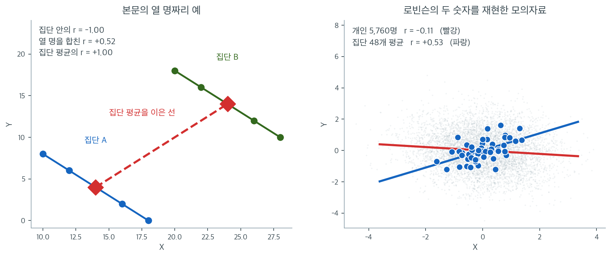

# 생태학적 오류

미국에서 선거구가 소수집단의 표를 희석했다고 다투려면 **인종에 따라 투표가 갈린다**는 것을 보여야 한다. 그것은 사람에 관한 진술인데, 누가 누구를 찍었는지는 아무도 모른다. **비밀투표이기 때문이다.** 자료로 남는 것은 투표구별 집계 둘뿐 — 그 투표구의 인종 구성과 후보별 득표다. $1986$ 년 손버그 대 깅글스 사건에서 미국 연방대법원은 그 집계로 개인의 투표 행태를 추정하는 방법 — 그 가운데 하나가 **생태학적 회귀**다 — 을 증명법으로 받아들였다. $1950$ 년에 「하면 안 된다」고 이름까지 붙은 그 방법이다. 개인 자료로 가는 문이 법으로 잠겨 있으니 집계에서 개인으로 거슬러 올라가는 수밖에 없었다. 아래 상자가 그 사정을 따라간다.

이름을 붙인 사람이 로빈슨이고, 그가 $1950$ 년에 미국 주별 자료로 재어 보고한 수는 둘이다. 주 수준에서 외국 태생 비율과 문해율의 상관은 $r \approx +0.53$ 이고, 개인 수준에서는 $r \approx -0.11$ 이다. 부호가 반대인데 **두 수가 모두 옳다** — 외국 태생이 많은 주는 실제로 문해율이 높았고, 외국 태생인 사람은 실제로 문해율이 낮았다. 두 문장이 함께 참일 수 있다는 것이 이 쪽의 출발점이다.

그러므로 잘못은 계산에 있지 않다. 두 수가 가리키는 단위가 애초에 다르기 때문이다. 주에 대한 문장을 사람에 대한 문장으로 옮기는 순간 무엇이 깨지는가. 집계된 수는 집계된 단위에 대한 사실이다 — 주에 대한 상관은 주에 대해서만 참이다. 이 쪽은 그 깨짐이 어디서 오는지 보이고, 집계만 손에 있을 때 할 수 있는 일과 할 수 없는 일을 가른다.

_확인한 곳 — 이 쪽 「투표용지가 비밀이라서 저지를 수밖에 없는 오류」 상자와 그 출처 줄_

집계된 자료(집단·지역·기간에 대한 평균)로 상관을 계산하면, 그렇게 얻은 **생태학적 상관**이 개인 수준에 존재하는 상관과 극적으로 다를 수 있다. 집단 수준의 상관에 근거해 개인에 대한 결론을 내리는 것을 **생태학적 오류**라 한다. 응용통계에서 가장 흔하고 파급력이 큰 잘못 중 하나이다.

---

<div class="defn" markdown>

### 정의 1. 생태학적 오류 { .dfn }

**생태학적 오류**는 집계 수준(예: 국가, 주, 학교)에서 변수 사이에 관측된 통계적 관계가 개인 수준에서도 성립한다고 잘못 가정할 때 일어난다.

더 정확히 말하면, $g = 1, \ldots, G$개의 집단에 걸쳐 집단 평균 $\bar{X}_g$와 $\bar{Y}_g$ 사이의 상관을 관측했다고 해서 개인 수준에서 $X_i$와 $Y_i$ 사이에 같은 상관이 존재하는 것은 아니다. 생태학적 상관은 개인 수준 상관보다 훨씬 강하거나 약할 수 있고 부호가 반대일 수도 있다.

---

</div>

---

## 1. Robinson의 역설

생태학적 오류의 고전적인 예는 William S. Robinson의 1950년 논문에서 나온다. Robinson은 미국의 주별로 외국 태생 거주자 비율과 문해율의 관계를 살폈다.

- **생태학적 상관**(주 수준): $r \approx 0.53$ — 외국 태생 비율이 높은 주일수록 문해율이 *높은* 경향이 있었다.
- **개인 수준 상관**: $r \approx -0.11$ — 실제로는 외국 태생 개인이 본토 태생 개인보다 문해율이 *낮은* 경향이 있었다.

이 역설이 생기는 것은 이민자들이 전반적으로 문해율이 높은 주(예: 뉴욕, 캘리포니아)에 정착하는 경향이 있어 양의 생태학적 상관이 만들어졌기 때문이다. 그러나 그 주들 안에서 개인 단위로는 이민자의 문해율이 본토 태생 인구보다 낮았다.

!!! warning "생태학적 상관은 부호가 뒤집힐 수 있다"
    Robinson의 예에서 생태학적 상관($+0.53$)은 개인 수준 상관($-0.11$)보다 단지 큰 것이 아니라 부호가 반대였다. 이는 예외적인 경우가 아니라 집단의 구성이 달라질 때마다 나타날 수 있는 체계적인 현상이다.

---

## 2. 왜 일어나는가

생태학적 오류는 집단 수준과 개인 수준 상관 사이의 수학적 관계에서 생긴다. 자료를 집단으로 묶으면 두 가지 변동 원천이 생태학적 상관에 기여한다.

1. **집단 간 변동**: 집단 평균의 차이.
2. **집단 내 변동**: 같은 집단 안의 개인들 사이의 차이.

집계는 집단 내 변동을 없애고 집단 간 변동만 남긴다. 집단 간 관계와 집단 내 관계는 크기와 부호가 다를 수 있으므로 생태학적 상관이 개인 수준 상관에서 크게 벗어날 수 있다.

형식적으로 전체 상관은 집단 간 성분과 집단 내 성분의 가중 결합으로 분해된다. 생태학적 상관은 집단 간 성분만 반영하며, 이것이 집단 내 패턴을 압도하거나 그와 모순될 수 있다.

집계가 개인 수준 관계를 어긋내는 길은 셋으로 갈린다.

1. **집계 편향**: 집단에 걸쳐 평균을 내면 개인 수준 변동이 사라져 연관이 생기거나 가려질 수 있다.
2. **집단 수준의 교란**: 집단 수준 변수가 관측된 패턴을 이끄는 다른 집단 특성과 상관되어 있을 수 있다.
3. **불균형한 가중**: Simpson의 역설이 보여주듯 집단의 구성이 전체 추세를 뒤집을 수 있다.


---

## 3. 수치 예시

각각 5명으로 이루어진 두 집단을 생각하자.

**집단 A:**

| 개인 | $X$ | $Y$ |
|:---:|:---:|:---:|
| 1 | 10 | 8 |
| 2 | 12 | 6 |
| 3 | 14 | 4 |
| 4 | 16 | 2 |
| 5 | 18 | 0 |

**집단 B:**

| 개인 | $X$ | $Y$ |
|:---:|:---:|:---:|
| 6 | 20 | 18 |
| 7 | 22 | 16 |
| 8 | 24 | 14 |
| 9 | 26 | 12 |
| 10 | 28 | 10 |

각 집단 안에서 $X$와 $Y$는 **완전한 음의** 상관($r = -1$)을 갖는다. 그러나 집단 평균은 $(\bar{X}_A, \bar{Y}_A) = (14, 4)$와 $(\bar{X}_B, \bar{Y}_B) = (24, 14)$이다. 두 집단 평균에 걸친 생태학적 상관은 **완전한 양**($r = +1$)이다. 평균 $X$가 클수록 평균 $Y$도 크다.

생태학적 자료(집단 평균이라는 두 점)만 본다면 강한 양의 관계라고 결론지을 것이다. 개인 자료는 정반대의 이야기를 한다.



왼쪽이 위 표의 열 명이다. 집단 A와 집단 B 각각에서 점들이 완전한 직선 위에 내려앉아 $r = -1.00$이고, 붉은 마름모 두 개를 이은 집단 평균의 선은 $r = +1.00$으로 정확히 반대다. 한 가지 더 눈여겨볼 것은 열 명을 그냥 한 덩어리로 놓고 계산한 상관이 $+0.52$라는 점이다. **개인 자료를 다 가지고 있어도 집단을 무시하면 양수가 나온다.** 집단 간 이동($+10, +10$)이 집단 내 기울기 $-1$을 압도하기 때문이며, 여기서 필요한 것은 "개인 자료"가 아니라 "집단을 넣은 모형"이다.

오른쪽은 Robinson이 1950년에 보고한 두 숫자, 곧 주 수준 $+0.53$과 개인 수준 $-0.11$이 그대로 나오도록 만든 모의자료다. 48개 집단에 각각 120명씩 모두 5,760명이 흐릿한 회색 점으로 깔려 있고, 그들에 맞춘 붉은 직선은 완만하게 **내려간다**($r = -0.11$). 같은 자료를 집단마다 평균 내면 파란 점 48개가 되고, 거기에 맞춘 파란 직선은 뚜렷하게 **올라간다**($r = +0.53$). 두 직선이 한 그림 안에서 엇갈리는 것이 생태학적 오류의 정확한 모습이다.

여기서 중요한 것은 **두 숫자 모두 옳다**는 점이다. $+0.53$은 "외국 태생 비율이 높은 주가 문해율도 높다"는 참인 진술이고, $-0.11$은 "외국 태생인 사람이 문해율이 낮다"는 참인 진술이다. 오류는 계산이 아니라 번역에서 생긴다. 주에 대한 문장을 사람에 대한 문장으로 옮기는 순간 틀린다.

회색 구름의 폭을 보면 왜 그런지도 보인다. 집단 평균 48개가 차지하는 범위는 개인 5,760명이 흩어진 범위의 3분의 1도 되지 않는다. 평균을 내는 순간 집단 내 변동, 곧 자료에 들어 있던 정보의 대부분이 사라지고 집단 간 변동만 남는다. 다음 절의 [집계 편향](aggregation_bias.md)이 이 손실을 정량적으로 다룬다.

---

## 4. 생태학적 오류가 흔한 상황

생태학적 오류는 다음에서 자주 나타난다.

아래 일곱은 모두 집단 수준에서 실제로 보고된 상관이다. **상관 자체는 참이고,
오류는 그것을 사람에 대한 문장으로 옮길 때 생긴다.**

### 음주와 관상동맥 심장질환

어떤 생태학적 연구가 여러 나라에 걸쳐 1인당 알코올 소비량과 관상동맥 심장질환(CHD) 사망률의 관계를 살폈다. 국가 수준에서 뚜렷한 **음의** 상관이 드러났다.

그러나 **개인**의 음주량을 분석한 코호트 연구는 **J자 형태**의 관계를 보였다. 적당히 마시는 사람은 금주자보다 사망률이 낮았지만, 소비가 적정 수준을 넘어서면 사망률이 뚜렷하게 선형으로 올라갔다.

생태학적 상관(선형, 음)은 개인 수준의 참 관계(비선형, J자)를 극적으로 단순화한다.

출처: [Ecological Studies — Boston University](https://sphweb.bumc.bu.edu/otlt/MPH-Modules/PH717-QuantCore/PH717-Module1B-DescriptiveStudies_and_Statistics/PH717-Module1B-DescriptiveStudies_and_Statistics6.html)

### 흡연과 폐암

1인당 평균 담배 소비가 많은 나라일수록 폐암 발생률이 높은 경향이 있다. 강한 양의 생태학적 상관이다. 그러나 이것이 개인의 위험을 직접 반영한다고 가정하면 생태학적 오류를 범하는 것이다. 담배 소비가 많은 나라에서는 대기오염이나 직업적 노출 같은 다른 요인도 높은 폐암 발생률에 기여할 수 있다.

### 국가별 콜레스테롤 수치와 심장질환

평균 콜레스테롤 수치가 높은 나라일수록 심장질환 발생률이 높은 경향이 있다(양의 생태학적 상관). 그러나 그 나라들 안에서 콜레스테롤이 높은 개인이 반드시 심장질환에 더 잘 걸린다는 뜻은 아니다. 식습관, 의료 접근성, 유전적 소인, 생활방식의 국가별 차이가 두 변수 모두에 영향을 줄 수 있다.

### 도시 지역의 학력과 범죄율

평균 학력이 높은 동네일수록 범죄율이 낮은 경우가 많다(음의 생태학적 상관). 그러나 이 상관이 각 동네 안의 개인에게 적용된다고 가정하면 오도될 수 있다. 경제적 기회, 치안, 지역사회 프로그램, 사회적 결속이 동네 수준에서 학력과 범죄율 모두에 영향을 줄 수 있다.

### 투표 성향과 소득 수준

부유한 선거구가 보수 후보에게 투표하는 경향을 보여 소득과 보수 투표 행동 사이에 생태학적 상관이 나타날 수 있다. 그러나 그 선거구의 저소득 개인도 보수적으로 투표할 수 있고 부유한 개인 중 일부는 진보 후보를 찍을 수 있다. 생태학적 상관은 개인 수준의 직접적인 관계가 아니라 더 넓은 지역적 추세를 반영한 것일 수 있다.

### 소득과 건강 결과

평균 소득이 높은 지역일수록 건강 결과가 좋고 기대수명이 긴 경향이 있다(양의 생태학적 상관). 그러나 저소득 지역의 개인도 탄탄한 지역 보건 프로그램 덕분에 건강할 수 있고, 고소득 지역의 개인도 스트레스나 생활방식 때문에 건강 문제를 겪을 수 있다.

### 문해율과 경제 발전

문해율이 높은 나라일수록 1인당 GDP가 높은 경향이 있다(양의 생태학적 상관). 그러나 이것이 문해율만 높이면 개인 소득이 올라간다는 뜻은 아니다. 경제 발전은 정부 정책, 천연자원, 무역, 산업화의 영향을 받는 복잡한 과정이다.

---

## 5. 생태학적 오류를 피하는 방법

1. 가능하면 언제나 **개인 수준 자료를 쓴다**. 연구 질문이 개인에 관한 것이라면 개인 관측값을 분석하라.

2. **분석 수준을 분명히 밝힌다.** 상관을 개인 수준에서 계산했는지, 집단 수준에서 계산했는지, 생태학적 수준에서 계산했는지 명시하라.

3. **다수준 모형을 쓴다.** 계층적/다수준 회귀모형은 집단 내 변동과 집단 간 변동을 동시에 반영하여 수준의 혼동을 피한다.

4. **두 수준을 함께 보고한다.** 집계 자료만 있을 때에는 그 한계를 인정하고 개인 수준의 결론을 내리지 말라.


<div class="storybox" markdown>

**그림으로 보는 통계학 1.** 투표용지가 비밀이라서 저지를 수밖에 없는 오류

위 목록의 첫 줄은 「가능하면 언제나 개인 수준 자료를 쓴다」이다. **그 문이 법으로 잠겨
있는 자리가 있다.**

미국 투표권법 제 $2$ 조로 선거구가 소수집단의 표를 희석했다고 다투려면 **인종에 따라
투표가 갈린다**는 것을 보여야 한다. 소수집단이 한 후보로 뭉치고 다수집단이 그에 맞서
한 덩어리로 투표한다는 주장이다. 이것은 **개인에 관한 진술**이다. 그런데 누가 누구를
찍었는지는 아무도 모른다. 비밀투표이기 때문이다. 자료로 남는 것은 투표구별 집계 둘뿐
— 그 투표구의 인종 구성과, 그 투표구에서 각 후보가 받은 표다. **로빈슨이 $1950$ 년에
「하면 안 된다」고 적은 바로 그 배치다.**

$1986$ 년 손버그 대 깅글스 사건에서 미국 연방대법원이 만장일치로 판단 기준 셋을 세웠고,
그 가운데 둘이 인종별 투표 갈림에 관한 것이다. 그리고 그것을 무엇으로 증명하는지도
받아들였다. 전문가 버나드 그로프먼이 주 의회 선거 $53$ 건의 자료를 두 가지 방법으로
분석했는데, 하나가 **동질 투표구 분석**이고 다른 하나가 **생태학적 회귀**였다.
$1950$ 년에 이름 붙은 오류가 $36$ 년 뒤 **헌법적 권리를 다투는 자리의 표준 증명법**이
된 것이다.

그 두 방법은 $1953$ 년 한 해에 정반대 철학으로 나왔다. 굿맨의 **생태학적 회귀**는
「한 집단이 그 후보를 찍을 성향 $p$ 와 다른 집단의 성향 $q$ 가 투표구가 바뀌어도
일정하다」고 가정하고 회귀로 $p$ 와 $q$ 를 뽑는다. 던컨과 데이비스는 반대로 **아무것도
가정하지 않고** 회계 항등식만으로 각 투표구에서 가능한 값의 **상하한**을 적었다.
가정을 넣으면 수가 하나 나오고, 넣지 않으면 구간만 나온다. 킹이 $1997$ 년에 둘을
합친 방법을 내며 책 제목을 「생태학적 추론 문제의 해법」이라 달았다.

**해법이라 불러도 되는지는 아직 다툼이 있다.** 프리드먼과 공저자들은 킹의 방법을
**개인의 진실을 따로 아는 자료**에 걸어 보았다 — 스톡턴의 출구조사와 로스앤젤레스
카운티의 유권자 등록 기록이다. 결과는 참값에서 멀었고 진단 지표도 믿을 수 없었다고
적으며 「그의 선언은 성급하다」로 끝맺는다. 굿맨의 회귀가 **지지율로 음수나 $1$ 을 넘는
수를 내놓는 일**이 있다는 것도 오래 알려져 있다. 그것은 계산 실수가 아니라, 집계만으로는
답이 **하나로 정해지지 않는다**는 사실이 수로 드러난 것이다.

로빈슨이 틀린 것이 아니다. 집계에서 개인으로 가는 안전한 길은 여전히 없다. 다만 그
길을 **법이 걸으라고 요구하는** 자리가 있고, 거기서 할 수 있는 최선은 가정을 분명히
적어 두는 것과, 가정 없이 말할 수 있는 것이 상하한뿐임을 아는 것이다.

_확인한 곳 — 손버그 대 깅글스($478$ U.S. $30$, $1986$)가 만장일치로 제 $2$ 조 판단 기준 셋을 세웠고 그 가운데 둘이 인종별 투표 갈림에 관한 것이라는 것, 지방법원이 버나드 그로프먼이 주 의회 예비·본선거 $53$ 건을 **동질 투표구 분석**과 **이변량 생태학적 회귀** 두 방법으로 분석한 통계 증거에 주로 기댔다는 것, 그리고 대법원이 그 두 방법을 받아들였다는 것 · 굿맨($1953$, $1959$)이 생태학적 회귀를 회귀모형으로 정식화하며 성향이 투표구에 걸쳐 일정하다고 가정한다는 것과 그 방법이 **불가능한 값**을 낼 수 있다는 것, 던컨과 데이비스($1953$)가 상하한을 처음 적었다는 것, 킹($1997$)이 둘을 합쳤다는 것 · D. A. 프리드먼·S. P. 클라인·M. 오스틀랜드·M. 로버츠의 서평 「On "Solutions" to the Ecological Inference Problem」의 초록이 「참값에서 먼 결과를 내고 진단 지표가 믿을 수 없다」와 「그의 선언은 성급하다」로 적고, 본문이 「투표함의 비밀이 직접적인 해답을 막으므로 간접적인 방법을 쓴다」고 적으며, 시험에 쓴 자료가 스톡턴 출구조사($1988$ 년 대통령 예비선거)와 로스앤젤레스 카운티의 센서스 구역 자료·$1988$ 년 총선 등록 기록이라는 것_

</div>

---

## 6. 뒤집힘은 이 오류의 정의가 아니다

로빈슨의 예가 부호까지 뒤집혔으므로 생태학적 오류를 「상관이 뒤집히는 현상」으로 기억하기 쉽다. **그것은 정의가 아니다.** 정의 1 이 적은 대로 생태학적 상관은 개인 수준보다 **훨씬 강하거나 약할 수도** 있고 그때도 오류는 그대로 오류다.

오히려 흔한 꼴은 **부호가 같고 크기만 부풀려지는 것**이다. 개인 수준 $r = 0.3$ 이 집단 수준에서 $r = 0.9$ 로 나오면 방향은 맞지만 「거의 결정적인 관계」라는 그림을 주게 된다 — 10.2절 [집계 편향](aggregation_bias.md)이 그 부풀림을 분산분해로 계산한다. **뒤집힘은 그 부풀림이 극단으로 간 특수한 경우**이고, 거기서 10.2절 [Simpson의 역설](simpsons_paradox.md)과 만난다.

그래서 셋은 포함관계가 아니라 **교차**한다. 이 오류는 **추론의 층위**에 관한 것이고(집단으로 개인을 말한다), 집계 편향은 **크기**에 관한 것이며, Simpson의 역설은 **부호가 뒤집히는** 경우에 관한 것이다. 셋의 관계를 한 표로 묶은 것은 [집계 편향](aggregation_bias.md) $\S 6$ 에 있다.

---

## 연습문제

<div class="drillbox" markdown>

**연습문제 1.** <span class="diff med" title="중간"></span>
생태학적 오류를 정의하고, 집단에 대한 결론을 개인에게 그대로 적용할 수 없는 이유를 설명하라.

</div>

??? success "풀이"
    **생태학적 오류**는 집단 수준(집계) 자료로부터 개인 수준의 관계를 추론하는 잘못이다. 집단 수준에서 관측된 상관이나 연관이 개인 수준에서 반드시 성립하지는 않기 때문에 생긴다.

    집단 수준 자료는 집단 간 변동만 반영하지만 개인의 행동에는 집단 간 변동과 집단 내 변동이 모두 관여한다. 집단 내 관계는 집단 간 관계와 크기가 다를 수도, 방향까지 다를 수도 있다.

    **예:** 평균 초콜릿 소비가 많은 나라일수록 인구당 노벨상 수상자가 많다(생태학적 상관). 초콜릿을 더 먹는 개인이 노벨상을 탈 가능성이 높다고 결론짓는 것이 생태학적 오류이다. 국가 수준의 연관은 부(富)에 이끌린 것일 수 있다(부유한 나라는 초콜릿도 더 소비하고 연구에도 더 많이 투자한다).

---

<div class="drillbox" markdown>

**연습문제 2.** <span class="diff med" title="중간"></span>
생태학적 상관은 양수인데 개인 수준 상관은 음수인 수치 예를 구성하라.

</div>

??? success "풀이"
    두 집단을 생각하자:

    - **집단 A**(부유한 도시): 개인들의 $X$ 평균 80, $Y$ 평균 90. 집단 안에서 $X$가 클수록 $Y$가 작다(개인 수준 $r = -0.5$).
    - **집단 B**(가난한 도시): 개인들의 $X$ 평균 20, $Y$ 평균 30. 집단 안에서도 $X$가 클수록 $Y$가 작다(개인 수준 $r = -0.5$).

    집단 수준에서는 집단 A가 $\bar{X}$도 크고(80 대 20) $\bar{Y}$도 크다(90 대 30). 집단 평균 사이의 생태학적 상관은 $r = +1$이다.

    이는 Simpson의 역설과 같은 구조이다. 각 집단 안에서는 관계가 음수이지만, 두 변수 모두에서 집단이 체계적으로 다르기 때문에 집단 간 추세는 양수이다. 집단 수준 자료만 분석하면 부호가 틀린 결론을 얻는다.

---

<div class="drillbox" markdown>

**연습문제 3.** <span class="diff med" title="중간"></span>
한 신문이 "평균 소득이 높은 주일수록 범죄율이 낮다. 소득이 높아지면 범죄가 줄어든다는 증거이다"라고 보도했다. 생태학적 오류를 지적하고 더 나은 분석을 제안하라.

</div>

??? success "풀이"
    *주 수준*의 집계 자료에 근거해 *개인의* 소득이 높아지면 범죄를 저지를 가능성이 낮아진다고 추론하는 것이 생태학적 오류이다. 주 수준의 상관은 여러 기제를 뒤섞는다:

    - 평균 소득이 높은 주는 치안, 교육, 사회복지가 더 나을 수 있다(제도적 요인).
    - 개인 소득과 개인의 범죄 사이 관계는 주 수준 패턴과 다를 수 있다.
    - 고소득 주는 소득 불평등도 클 수 있고, 평균이 높아도 불평등이 범죄를 늘릴 수 있다.

    **더 나은 분석:** 개인 소득과 범죄 행동을 연결한 개인 수준 자료를 쓰고 학력, 나이, 거주지 특성, 고용 상태 같은 교란요인을 통제한다. 패널 자료(개인을 시간에 걸쳐 추적)나 자연실험(예: 복권 당첨자)이 더 강한 인과적 증거를 준다.

---

<div class="drillbox" markdown>

**연습문제 4.** <span class="diff med" title="중간"></span>
"수정 가능한 공간 단위 문제(MAUP)"의 개념을 설명하고 생태학적 오류와 어떻게 관련되는지 밝혀라.

</div>

??? success "풀이"
    **수정 가능한 공간 단위 문제**(MAUP)는 집계된 공간 자료에 기반한 통계 결과가 지리 단위를 어떻게 정의하느냐에 달려 있다는 관찰이다. 두 요소가 있다:

    1. **축척 효과:** 집계 수준을 바꾸면(예: 인구조사 구역 대 카운티 대 주) 상관이 달라진다. 단위가 클수록 개인 수준 변동이 더 많이 평균되어 사라지므로 생태학적 상관이 강해진다.

    2. **구획 효과:** 같은 축척에서도 경계를 어떻게 긋느냐에 따라 결과가 달라진다. 게리맨더링이 극단적인 예이다.

    MAUP는 집계로 인한 정보 손실이라는 점에서 생태학적 오류와 관련된다. 생태학적 오류는 집계 결과를 개인 수준의 진실로 다루는 해석상의 잘못이다. MAUP는 집계 결과 자체도 안정적이지 않으며 분석 단위에 대한 임의적 선택에 좌우된다는 점을 보여준다. 둘을 합쳐 보면 집계 자료가 개인 수준 추론에 근본적으로 한계가 있음을 알 수 있다.

---

<div class="drillbox" markdown>

**연습문제 5.** <span class="diff med" title="중간"></span>
연습문제 2가 요구한 수치 예를 **간단한 정수 표**로 만들어라. 집단이 둘, 각 집단에 사람이 넷인 아주 작은 예로 충분하다.

</div>

??? success "풀이"
    **집단 평균은 함께 오르고 집단 내부는 내려가게 배치한다.**

    | 집단 | $x$ | $y$ |
    |---|---|---|
    | A | $1$ | $4$ |
    | A | $2$ | $3$ |
    | A | $3$ | $2$ |
    | A | $4$ | $1$ |
    | B | $5$ | $8$ |
    | B | $6$ | $7$ |
    | B | $7$ | $6$ |
    | B | $8$ | $5$ |

    ```python
    import numpy as np

    x = np.array([1,2,3,4, 5,6,7,8])
    y = np.array([4,3,2,1, 8,7,6,5])
    g = np.array([0]*4 + [1]*4)
    print(f"  전체(개인) r = {np.corrcoef(x, y)[0,1]:+.4f}")
    for i in (0, 1):
        print(f"    집단 {'AB'[i]} 내부 r = {np.corrcoef(x[g==i], y[g==i])[0,1]:+.4f}")
    gx = [x[g==i].mean() for i in (0,1)]; gy = [y[g==i].mean() for i in (0,1)]
    print(f"  집계(집단평균): A=({gx[0]}, {gy[0]}), B=({gx[1]}, {gy[1]})"
          f"  -> 기울기 {(gy[1]-gy[0])/(gx[1]-gx[0]):+.4f}")
    ```

    출력:

    ```
      전체(개인) r = +0.5238
        집단 A 내부 r = -1.0000
        집단 B 내부 r = -1.0000
      집계(집단평균): A=(2.5, 2.5), B=(6.5, 6.5)  -> 기울기 +1.0000
    ```

    **두 집단 모두 내부 상관이 정확히 $-1$인데 집계 기울기는 $+1$이다.**

    **손으로 확인할 수 있다.** A집단의 평균은 $(2.5,\ 2.5)$, B집단은 $(6.5,\ 6.5)$이므로 두 점을 잇는 기울기가 $+1$이다. 그런데 각 집단 안에서는 $x$가 $1$ 늘면 $y$가 $1$ 줄어든다.

    **집단이 둘뿐이면 집계 상관이 언제나 $\pm1$이다.** 두 점을 지나는 직선은 완벽히 맞기 때문이다. 이것 자체가 **집계 자료의 $n$이 작을 때의 함정**이며, "집계 상관 $0.99$"가 집단 수가 셋뿐이면 아무 의미가 없다.

    **작은 예의 가치.** 이런 표는 강의나 보고서에서 생태학적 오류를 설명할 때 유용하다. 모의실험보다 훨씬 설득력이 있는데, **독자가 직접 손으로 확인할 수 있기 때문**이다.

---

<div class="drillbox" markdown>

**연습문제 6.** <span class="diff med" title="중간"></span>
연습문제 3의 신문 보도를 **어떻게 고쳐 쓸지** 제안하라. 같은 자료로 정당하게 말할 수 있는 것과 없는 것을 구분하라.

</div>

??? success "풀이"
    **원문.** "평균 소득이 높은 주일수록 범죄율이 낮다. 소득이 높아지면 범죄가 줄어든다는 증거이다."

    **두 가지 오류가 겹쳐 있다.**

    | 오류 | 내용 |
    |---|---|
    | **생태학적 오류** | 주 수준 관계를 개인에게 적용 |
    | **인과 주장** | 관측 자료로 "높아지면 줄어든다"를 주장 |

    **정당하게 말할 수 있는 것.**

    ```text
    "미국 50개 주에서 평균 소득과 범죄율은 음의 상관을 보였다
     (r = -0.XX, n = 50)."
    ```

    **말할 수 없는 것.**

    - "소득이 높은 **사람**이 범죄를 덜 저지른다" — 수준을 넘었다.
    - "소득을 **높이면** 범죄가 **줄어든다**" — 인과를 주장했다.
    - "소득이 범죄를 **설명한다**" — 교란 가능성을 배제하지 않았다.

    **고쳐 쓴 보도.**

    ```text
    "주별 자료에서 평균 소득이 높은 주일수록 범죄율이 낮았다(r=-0.XX).
     다만 이는 주 단위의 연관이며, 소득이 높은 개인이 범죄를 덜
     저지른다는 뜻은 아니다. 또한 교육·도시화·연령 구성 등 여러
     요인이 두 지표 모두와 관련되어 있어, 소득 증가가 범죄를 줄인다는
     인과적 결론을 내릴 수는 없다."
    ```

    **더 나은 분석 제안.**

    - **개인 수준 자료**로 소득과 범죄 이력의 관계를 본다.
    - **다수준 모형**으로 개인 효과와 지역 효과를 분리한다.
    - **정책 변화를 이용한 자연실험**(최저임금 인상, 세액공제 확대)으로 인과를 노린다.
    - 최소한 **교란 후보를 통제한 다중회귀**를 제시한다.

    **핵심은 겸손한 서술이다.** 자료가 허용하는 범위를 넘지 않으면서도 유용한 정보를 전달하는 것이 좋은 보고다.

---

<div class="drillbox" markdown>

**연습문제 7.** <span class="diff med" title="중간"></span>
**다수준 모형**은 생태학적 오류를 어떻게 다루는가? 개인 수준 효과와 집단 수준 효과를 분리하는 모형을 적고, 두 계수가 무엇을 뜻하는지 밝혀라.

</div>

??? success "풀이"
    **핵심 기법은 집단 평균을 빼고 따로 넣는 것이다**(집단 평균 중심화).

    $$
    Y_{gi} = \beta_0 + \beta_W\underbrace{(X_{gi}-\bar X_g)}_{\text{집단 내}}
           + \beta_B\underbrace{\bar X_g}_{\text{집단 간}} + u_g + \varepsilon_{gi}
    $$

    - **$\beta_W$**: 같은 집단 안에서 $x$가 $1$ 늘 때 $y$의 변화 — **개인 수준 효과**
    - **$\beta_B$**: 집단 평균 $x$가 $1$ 높을 때 $y$의 변화 — **집단 수준(맥락) 효과**

    ```python
    import numpy as np
    import pandas as pd
    import statsmodels.formula.api as smf

    rng = np.random.default_rng(6)
    G, m = 60, 30
    bw, bb = -0.5, 1.5                       # 개인 내 음, 집단 간 양
    a = rng.normal(0, 1, G)
    rows = []
    for g in range(G):
        xg = a[g] + rng.normal(0, 1, m)
        yg = bw*(xg - xg.mean()) + bb*a[g] + rng.normal(0, 0.5, m)
        rows += [(g, xg[i], yg[i]) for i in range(m)]
    df = pd.DataFrame(rows, columns=['g', 'x', 'y'])
    df['xbar'] = df.groupby('g').x.transform('mean')
    df['xdev'] = df.x - df.xbar

    naive = smf.ols('y ~ x', df).fit()
    ml = smf.mixedlm('y ~ xdev + xbar', df, groups=df.g).fit()
    print(f"  단순회귀(수준 혼합) 기울기 = {naive.params['x']:+.4f}")
    print(f"  다수준: beta_W = {ml.params['xdev']:+.4f}  (참 {bw})")
    print(f"          beta_B = {ml.params['xbar']:+.4f}  (참 {bb})")
    ```

    출력:

    ```
      단순회귀(수준 혼합) 기울기 = +0.4728
      다수준: beta_W = -0.5005  (참 -0.5)
              beta_B = +1.4639  (참 1.5)
    ```

    **단순회귀는 $+0.47$이라는 어느 쪽도 아닌 값을 준다.** 두 수준의 효과가 섞여 평균된 것이다.

    **다수준 모형은 둘을 정확히 분리한다.** $\beta_W = -0.501$, $\beta_B = +1.464$로 참값을 되찾는다.

    **$\beta_W \ne \beta_B$이면 두 수준의 효과가 다르다는 뜻**이고, 그것 자체가 중요한 발견이다. 이 차이를 **맥락 효과**라 부른다.

    **주의: 다수준 모형도 만능이 아니다.**

    - **개인 수준 자료가 있어야 한다.** 집계 자료만으로는 $\beta_W$를 추정할 수 없다.
    - **$u_g$가 $x$와 무관하다는 가정**이 필요하다(랜덤효과 가정). 의심되면 고정효과를 쓴다.
    - **집단 수가 적으면** $\beta_B$의 추정이 불안정하다.

    **그래도 이것이 표준 도구다.** 교육·보건·조직 연구에서 개인과 맥락을 함께 다루는 표준적인 틀이며, 11장 회귀의 확장으로 볼 수 있다.

---

<div class="drillbox" markdown>

**연습문제 8.** <span class="diff med" title="중간"></span>
생태학적 오류를 피하기 위한 **독자용 점검 질문**을 만들어라. 논문이나 기사를 읽을 때 무엇을 물어야 하는가?

</div>

??? success "풀이"
    **읽을 때 던질 다섯 질문.**

    ```text
    1. 분석 단위가 무엇인가?
         국가/주/학교/병원  -> 집단 수준
         사람/환자/학생      -> 개인 수준
    2. 결론의 대상이 분석 단위와 같은가?
         다르면 -> 생태학적 오류(또는 개별주의 오류) 의심
    3. n 이 몇인가?
         집계 자료는 n 이 작다. "r=0.9, n=12" 는 약한 증거다.
    4. 집단이 어떻게 정의되었는가?
         행정구역이면 MAUP 민감성 확인
    5. 개인 수준 자료가 존재하는데 쓰지 않았는가?
         존재한다면 왜 집계했는지 물어야 한다
    ```

    **경고 신호 넷.**

    | 신호 | 뜻 |
    |---|---|
    | "국가/주/지역별 자료에서 …한 사람은" | 수준 혼동 |
    | 집계 상관이 유난히 높다($>0.9$) | 집계가 잡음을 지운 결과일 수 있다 |
    | 집단 수가 매우 적다 | 우연의 여지가 크다 |
    | 인과 동사("높이면", "줄이면") | 관측 자료에 인과 주장 |

    **좋은 논문이 하는 것.**

    - 분석 단위를 제목이나 초록에서 밝힌다.
    - 개인 수준 결론을 명시적으로 유보한다.
    - 가능하면 개인 수준 자료로 보완하거나, 왜 불가능한지 적는다.
    - 구획·가중을 바꾼 민감도 분석을 싣는다.

    **마지막으로, 생태학적 자료가 쓸모없다는 뜻이 아니다.** 10.3절에서 본 대로 집단이 관심 단위이면 오히려 옳은 자료이고, 가설을 세우는 단계에서도 유용하다. **문제는 자료가 아니라 결론이 자료를 넘어설 때 생긴다.** $\square$

---

<div class="drillbox" markdown>

**연습문제 9.** <span class="diff hard" title="어려움"></span>
생태학적 오류의 **거울상**인 **개별주의 오류**(atomistic fallacy)가 있다. 정의하고, 개인 자료로도 답할 수 없는 질문의 예를 들어라.

</div>

??? success "풀이"
    **개별주의 오류는 개인 수준 관계를 집단 수준으로 그대로 옮기는 것이다.** 생태학적 오류와 정확히 반대 방향이다.

    | 오류 | 방향 | 예 |
    |---|---|---|
    | **생태학적** | 집단 → 개인 | "부유한 주가 안전하니 부자가 안전하다" |
    | **개별주의** | 개인 → 집단 | "백신 맞은 사람이 덜 걸리니 접종률 높이면 그만큼 준다" |

    **개별주의 오류의 전형이 집단면역이다.** 개인 수준 백신 효과가 $80\%$라 해도, 접종률을 올리면 **미접종자까지 보호**받으므로 집단 수준 효과가 $80\%$보다 **크다.** 개인 자료만으로는 이 간접 효과를 볼 수 없다.

    **개인 자료로 답할 수 없는 질문들.**

    - **전염·확산.** 한 사람의 행동이 다른 사람의 위험을 바꾼다(간섭). 개인 수준 무작위화의 전제(SUTVA)가 깨진다.
    - **일반균형 효과.** "이 사람이 대학을 가면 임금이 오른다"와 "모두가 대학을 가면 임금이 오른다"는 다르다. 후자는 노동시장 전체가 바뀐다.
    - **규범과 맥락.** 금연 정책의 효과는 주변에 흡연자가 얼마나 있는지에 달려 있다.
    - **혼잡·희소성.** 한 사람이 도로를 이용하는 효과와 모두가 이용하는 효과가 다르다.

    **이것을 맥락 효과 또는 간섭이라 한다.** 개인 수준 인과추론의 표준 가정인 **SUTVA**(한 개인의 처치가 다른 개인의 결과에 영향을 주지 않음)가 성립하지 않는 상황이다.

    **그래서 두 수준이 모두 필요하다.**

    | 알고 싶은 것 | 필요한 자료 |
    |---|---|
    | 개인의 선택이 개인에게 미치는 효과 | 개인 수준 |
    | 정책이 집단에 미치는 효과 | **집단 수준**(군집 무작위화 등) |

    **군집 무작위 시험이 이 문제의 설계적 해답이다.** 마을 단위로 처치를 배정하면 간섭이 군집 안에 갇히므로 집단 수준 효과를 추정할 수 있다. 백신·공중보건·교육 정책 연구에서 표준적으로 쓰인다.

    **결론은 "수준을 넘지 말라"가 양방향이라는 것이다.** 집단에서 개인으로도, 개인에서 집단으로도 자동으로 옮겨 갈 수 없다.

---

<div class="drillbox" markdown>

**연습문제 10.** <span class="diff hard" title="어려움"></span>
생태학적 오류가 **실제 정책 오판으로 이어진 사례**를 하나 들고, 어떤 자료가 있었다면 막을 수 있었을지 논하라.

</div>

??? success "풀이"
    **고전적 사례 — 로빈슨(1950)의 문해율 연구.** (원 논문은 문맹률로 적었다. 부호가 뒤집히므로 어느 쪽으로 적는지 먼저 정해 두어야 한다 — 이 쪽은 줄곧 **문해율**로 적는다.)

    1930년 미국 인구조사에서 주 수준으로 집계하면 **외국 출생자 비율과 문해율이 양의 상관**($r \approx +0.53$)이었다. 곧 이민자가 많은 주일수록 글을 읽는 사람의 비율이 높았다.

    **개인 수준 자료는 반대였다**($r \approx -0.11$). 외국 출생자 개인은 오히려 문해율이 **낮았다.**

    **방향을 거꾸로 기억하기 쉬운 자리다.** 집계 자료가 이민자에게 **유리해** 보였고 개인 자료가 불리해 보였다. 당시 이민 제한을 주장하는 쪽은 개인 수준 수치를 들었고, 반대쪽은 주 수준 수치를 들 수 있었다 — **두 숫자가 모두 참이라서 양쪽이 각자 옳은 말을 하며 맞설 수 있었다.** $\S 3$ 이 그 두 숫자를 한 그림에 올려 둔다.

    **왜 뒤집혔는가.** 이민자는 산업화된 북부 도시에 몰렸고 그 지역은 원래 문해율이 높았다. 반면 문해율이 낮은 남부 농촌에는 이민자가 적었다. 그래서 **주를 단위로 보면** 이민자 비율과 문해율이 함께 높아 보인다. **지역이 두 변수 모두의 원인**인 전형적인 교란이다.

    **어떤 자료가 있었다면 막을 수 있었나.**

    | 자료 | 효과 |
    |---|---|
    | **개인 수준 교차표**(출생지 × 문해) | 즉시 해결 — 실제로 있었다 |
    | 주 내부의 하위 지역 자료 | 부분적 해결 — 집단을 작게 |
    | 지역 특성 변수(도시화율 등) | 교란 보정 가능 |

    **첫 줄이 중요하다.** 개인 수준 자료가 **이미 존재했는데** 집계 자료로 분석한 것이 문제였다. 집계가 계산이 쉽고 표가 작아서였다.

    **현대의 유사 사례.**

    - **지역별 백신 접종률과 자폐 진단율.** 진단 인프라가 좋은 지역이 둘 다 높아 양의 상관이 나온다. 개인 수준 대규모 코호트 연구가 관계 없음을 보였다.
    - **국가별 초콜릿 소비와 노벨상 수상.** 부유한 나라가 둘 다 높다. 명백한 농담이지만 구조는 같다.
    - **지역별 원격근무 비율과 생산성.** 산업 구성이 교란한다.

    **교훈 셋.**

    - **집계 자료는 편의의 산물이지 설계의 산물이 아닌 경우가 많다.** 왜 그 수준인지 물어야 한다.
    - **정책 결정에 쓰일 분석일수록 수준을 명시해야 한다.** 결론이 개인에 적용될 것이라면 개인 자료가 필요하다.
    - **뒤집힌 사례가 알려져 있다는 사실 자체가 경고다.** 로빈슨의 예는 $70$년이 넘었는데도 같은 실수가 반복된다.

<div class="drillbox" markdown>

**연습문제 11.** <span class="diff med" title="중간"></span>
50개국에 대한 연구에서 국가 평균 소득과 국가 평균 기대수명의 상관이 $r = 0.78$이었다. 돈을 더 버는 특정 개인이 더 오래 산다고 결론짓는 것이 왜 틀렸는지 설명하라.

</div>

??? success "풀이"
    이는 집단 수준의 관계를 개인에게 귀속시키는 **생태학적 오류**의 예이다. 상관 $r = 0.78$은 *국가 평균들* 사이의 관계를 기술하는 것이지 개인 소득과 개인 기대수명 사이의 관계가 아니다.

    개인 수준에서는 상관이 훨씬 약할 가능성이 크다. 어느 한 나라 안에서 소득과 기대수명의 변동이 국가 평균들 사이의 변동보다 훨씬 크기 때문이다. 게다가 국가 수준 상관은 개인 소득과 무관하게 모든 시민에게 도움이 되는 국가 기반시설, 의료체계, 공중보건 정책의 효과도 담고 있다.

---


<div class="drillbox" markdown>

**연습문제 12.** <span class="diff med" title="중간"></span>
생태학적 상관이 **정당한** 경우도 있다. 집단 자체가 관심 대상인 연구 셋을 들고, 각각에서 왜 오류가 아닌지 설명하라.

</div>

??? success "풀이"
    **오류는 "집단 자료로 개인을 말할 때" 생긴다.** 관심 대상이 처음부터 집단이면 문제가 없다.

    | 연구 | 관심 단위 | 왜 정당한가 |
    |---|---|---|
    | 국가별 담배세와 흡연율 | **국가** | 정책은 국가 단위로 시행된다 |
    | 학교별 급식 예산과 평균 성취 | **학교** | 예산 배정이 학교 단위다 |
    | 지역별 백신 접종률과 발생률 | **지역** | 집단면역은 집단 수준 현상이다 |

    **세 번째가 특히 중요하다.** 집단면역은 **개인 수준으로 환원되지 않는 현상**이다. "접종한 개인이 덜 걸린다"와 "접종률이 높은 지역이 발생률이 낮다"는 다른 진술이고, 후자에는 미접종자가 얻는 간접 보호까지 들어 있다. **개인 자료로는 잡을 수 없는 효과**이므로 오히려 집단 자료가 옳은 도구다.

    **일반 원칙.** 처치나 노출이 **집단 수준에서 정의되면**(정책, 환경, 규범, 전염) 집단이 올바른 분석 단위다. 이런 효과를 **맥락 효과**라 부르며, 개인 자료만으로는 식별되지 않는다.

    **그래도 주의할 점이 남는다.**

    - **집단 수준 교란.** 담배세가 높은 나라는 소득도 높을 수 있다. 수준이 맞아도 교란은 교란이다.
    - **표본이 작다.** 국가가 $30$개면 $n=30$이다. 집계는 관측 수를 급격히 줄인다.
    - **집단 정의의 자의성.** 연습문제 4의 MAUP 문제로 이어진다.

    **보고할 때는 분석 단위를 명시한다.** "국가 수준에서 담배세와 흡연율은 음의 관계였다($r=-0.6$, $n=32$)"처럼 쓰면, 독자가 개인 수준 결론으로 오독할 여지가 줄어든다.

---


<div class="drillbox" markdown>

**연습문제 13.** <span class="diff hard" title="어려움"></span>
집단 자료만 있을 때 개인 수준 관계를 **부분적으로라도** 복원할 수 있는가? 굿맨의 생태학적 회귀를 소개하고 그 한계를 밝혀라.

</div>

??? success "풀이"
    **굿맨의 발상.** 집단 $i$에서 $x$의 비율이 $p_i$이고 결과의 비율이 $q_i$일 때

    $$
    q_i = \beta_1 p_i + \beta_0 (1-p_i) + \varepsilon_i
    $$

    로 두면, $\beta_1$은 "$x=1$인 사람의 결과 비율", $\beta_0$은 "$x=0$인 사람의 결과 비율"로 해석된다. 정리하면

    $$
    q_i = \beta_0 + (\beta_1-\beta_0)p_i + \varepsilon_i
    $$

    이므로 **단순회귀의 절편과 기울기**로 두 개인 수준 비율을 추정한다.

    ```python
    import numpy as np

    rng = np.random.default_rng(2)
    G, m = 60, 200
    b1_true, b0_true = 0.70, 0.30          # 개인 수준 참값
    p = rng.uniform(0.1, 0.9, G)
    q = np.array([rng.binomial(m, b1_true*pi + b0_true*(1-pi))/m for pi in p])
    sl, ic = np.polyfit(p, q, 1)
    print(f"  참값     : b0={b0_true:.3f}  b1={b1_true:.3f}")
    print(f"  굿맨 추정: b0={ic:.3f}  b1={ic+sl:.3f}")

    # 가정이 깨지는 경우: 집단마다 b1 이 다르고 p 와 상관됨
    b1_i = 0.4 + 0.5*p
    q2 = np.array([rng.binomial(m, b1_i[i]*p[i] + b0_true*(1-p[i]))/m
                   for i in range(G)])
    sl2, ic2 = np.polyfit(p, q2, 1)
    print(f"\n  가정 위반 시: b0={ic2:.3f}  b1={ic2+sl2:.3f}  "
          f"(참 평균 b1={np.mean(b1_i):.3f})")
    ```

    출력:

    ```
      참값     : b0=0.300  b1=0.700
      굿맨 추정: b0=0.282  b1=0.713

      가정 위반 시: b0=0.193  b1=0.793  (참 평균 b1=0.658)
    ```

    **가정이 맞으면 잘 복원한다.** 참값 $0.300$, $0.700$에 대해 $0.282$, $0.713$로 표본오차 범위 안이다.

    **가정은 "개인 수준 비율이 집단마다 같다"는 것이다.** 이것이 깨지면($b_1$이 $p$에 따라 달라지면) 추정이 어긋난다. 위에서 $b_0$은 $0.193$으로 크게 과소, $b_1$은 $0.793$으로 과대 추정되었다(참 평균 $0.658$).

    **더 나쁜 점은 추정값이 $[0,1]$을 벗어날 수 있다는 것이다.** 회귀에는 그런 제약이 없으므로 "비율이 $-0.2$" 같은 답이 나오기도 한다. 그 자체가 가정 위반의 신호다.

    **현대적 대안.**

    | 방법 | 개선점 |
    |---|---|
    | 킹의 생태학적 추론 | $[0,1]$ 제약과 집단 간 이질성을 모형화 |
    | 계층 베이즈 모형 | 집단별 모수에 사전분포 |
    | **개인 자료 일부 확보** | 가장 확실 — 일부라도 있으면 식별이 크게 개선 |

    **결론은 겸손해야 한다는 것이다.** 생태학적 추론은 **검증 불가능한 가정 위에 서 있고**, 그 가정이 맞는지는 집단 자료만으로 확인할 수 없다. 가능하면 개인 자료를 구하고, 불가능하면 **결론의 불확실성을 크게 잡아 보고**해야 한다.


---

## 정리하며

생태학적 오류는 집단 수준에서 관측된 상관을 개인에게 잘못 귀속시킬 때 일어난다. Robinson의 역설은 생태학적 상관이 개인 수준 상관과 부호까지 반대일 수 있음을 보여준다. 집계가 집단 간 변동과 다른 신호를 담을 수 있는 집단 내 변동을 없애 버리기 때문이다. 생태학적 오류를 피하려면 적절한 수준에서 자료를 분석하고 집단 구조가 있을 때에는 다수준 모형을 쓰라.
