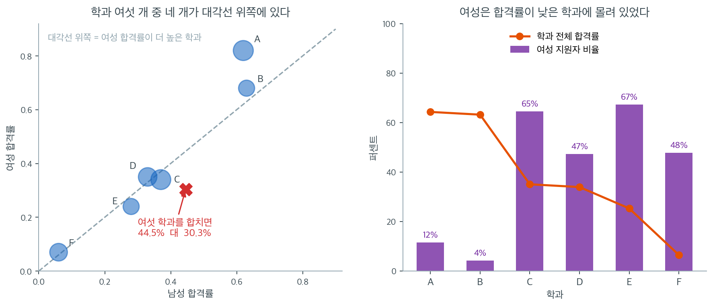
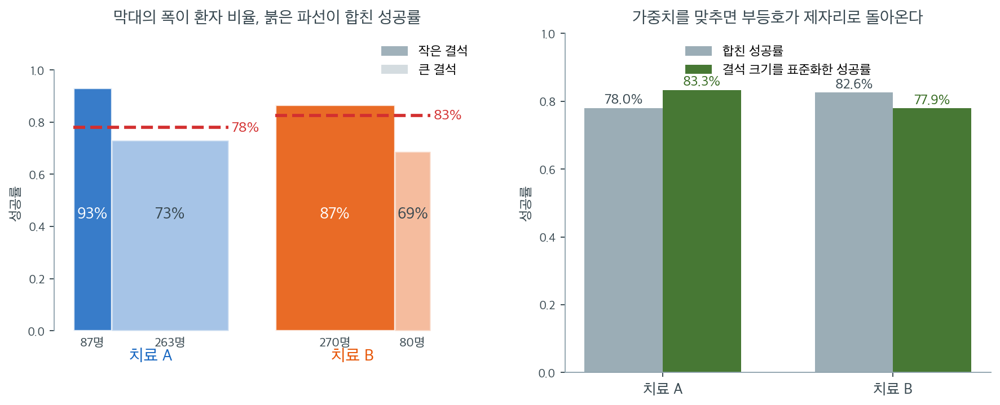
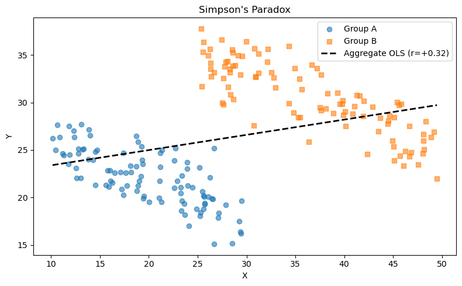

# Simpson의 역설

자료의 모든 하위집단 안에서 성립하는 경향이 하위집단을 합치면 뒤집히거나 사라질 수 있다. 직관에 반하는 이 현상을 **Simpson의 역설**이라 한다. 교란변수가 집단 구분과 결과 모두에 영향을 줄 때 생기며, 집계된 자료가 얼마나 크게 오도할 수 있는지 강력하게 일깨워 준다.

---

<div class="defn" markdown>

### 정의 1. Simpson의 역설 { .dfn }

**Simpson의 역설**은 제3의 변수로 조건화(층화)한 뒤 두 변수 사이 연관의 방향이 뒤집힐 때 일어난다. 형식적으로 모든 $z$에 대해

$$
P(Y = 1 \mid X = 1, Z = z) < P(Y = 1 \mid X = 0, Z = z) \quad \text{for every } z
$$

이면서도 $Z$에 대해 주변화하면

$$
P(Y = 1 \mid X = 1) > P(Y = 1 \mid X = 0)
$$

이 되는 일이 가능하다. 자료를 집계하면 부등호가 뒤집힌다.

---

</div>

---

<div class="storybox" markdown>

**그림으로 보는 통계학 1.** 심슨은 만화가 아니다

<figure markdown>
  { width=300 align=right }
  <figcaption markdown>영국 블레츨리 파크. 제이차 세계대전 때 암호를 풀던 곳이고, 스물의 심슨이 통계를 처음 배운 자리다. *(Wikimedia Commons, 촬영 DeFacto, CC BY-SA 4.0)*</figcaption>
</figure>

이름을 보고 노란 얼굴의 만화 가족을 떠올렸다면 — 아니다. 만화 「심슨 가족」은 $1989$ 년에 시작했고, 정의 1 의 이름이 된 논문은 그보다 **서른여덟 해 앞선** $1951$ 년에 나왔다.

**에드워드 휴 심슨**($1922$–$2019$)은 북아일랜드에서 태어난 영국 사람이다. 수학자로 자란 것이 아니라, 스무 살이던 $1942$ 년부터 세 해 동안 사진의 **블레츨리 파크**에서 암호를 푸는 일을 했다. 통계를 처음 익힌 것이 그 자리에서였다. 전쟁이 끝난 뒤 케임브리지 대학원에서 쓴 글이 $1951$ 년에 실렸고, 그 글이 정의 1 의 현상을 또렷하게 정리했다. 그는 그 뒤 학계에 남지 않고 공무원으로 일했다.

그런데 그 또한 **처음 본 사람이 아니다.** 비슷한 뒤집힘은 $1899$ 년 칼 피어슨이, $1903$ 년 율이 이미 적어 두었고, 심슨 자신도 $1951$ 년 논문에서 「이런 일이 전부터 알려져 있었다」고 밝혔다. 그래서 **율–심슨 효과**라 부르기도 한다. 「심슨의 역설」이라는 이름은 또 한참 뒤인 $1972$ 년에 블리스가 붙인 것이다.

심슨 본인은 이것을 **역설이라고 부르는 데 반대**했다. 아래 §2 가 보이듯 전체 성공률은 층별 확률의 가중평균이고, 가중치가 다르면 대소가 뒤집히는 것은 계산상 당연한 일이다. 놀라운 것은 수학이 아니라 **우리가 가중치를 잊는다는 사실**이다.

*확인한 곳 — [Wikipedia 「Edward H. Simpson」](https://en.wikipedia.org/wiki/Edward_H._Simpson) · [Britannica 「Simpson's paradox」](https://www.britannica.com/topic/Simpsons-paradox/Problem-of-Causality)*

</div>

---

## 1. 버클리 입학 사례

Simpson 역설의 가장 유명한 예는 1973년 UC 버클리 대학원 입학 자료에서 나온다.

**집계 자료:**

| | 지원자 | 합격자 | 합격률 |
|:---|:---:|:---:|:---:|
| 남성 | 8442 | 3738 | 44% |
| 여성 | 4321 | 1494 | 35% |

언뜻 보면 남성의 합격률이 상당히 높아 성차별의 가능성을 시사한다.

**학과별로 층화:**

| 학과 | 남성 지원 | 남성 합격률 | 여성 지원 | 여성 합격률 |
|:---:|:---:|:---:|:---:|:---:|
| A | 825 | 62% | 108 | 82% |
| B | 560 | 63% | 25 | 68% |
| C | 325 | 37% | 593 | 34% |
| D | 417 | 33% | 375 | 35% |
| E | 191 | 28% | 393 | 24% |
| F | 373 | 6% | 341 | 7% |

대부분의 학과에서 여성의 합격률이 같거나 더 높았다. 여성이 전체 합격률이 낮은 경쟁적인 학과(C, D, E, F)에 불균형하게 많이 지원하고 남성은 덜 경쟁적인 학과(A, B)에 더 많이 지원했기 때문에 역설이 생겼다.

교란변수 $Z$(학과 선택)가 집계 수준의 연관을 뒤집은 것이다.

<div class="storybox" markdown>

**그림으로 보는 통계학 2.** 소송이 될 뻔한 입학 통계

<figure markdown>
  { width=330 align=right }
  <figcaption markdown>버클리 캘리포니아 대학교 교정. *(Wikimedia Commons, 촬영 Daderot, CC0)*</figcaption>
</figure>

집계 자료만으로는 층별 대소를 알 수 없다 — 정의 1 이 적어 둔 그 뒤집힘이 언제든 가능하기 때문이다. 그 말이 실제로 문제가 된 가장 유명한 경우가 $1973$ 년 가을, 사진의 **버클리 캘리포니아 대학교** 대학원 입학에서 일어났다.

위의 첫 표처럼 전체 숫자만 보면 남성 지원자의 합격률이 여성보다 뚜렷하게 높았다. 성별에 따른 차별이 아니냐는 말이 나올 만했다.

그런데 학과별로 갈라서 보니 그림이 뒤집혔다. 두 번째 표가 그것이고, **대부분의 학과에서 여성의 합격률이 오히려 더 높았다.** 어떻게 그럴 수 있는가 — 지원이 몰린 자리가 달랐기 때문이다. 여성 지원자가 경쟁이 치열해 합격률이 낮은 학과에 더 많이 지원했고, 남성 지원자는 합격률이 높은 학과에 더 많았다. 아래 §2 의 말로 하면 가중치 $P(Z = z \mid X = x)$ 가 성별마다 달라서, **층내 효과가 아니라 구성 효과**가 전체 수치를 끌고 간 것이다.

여기서 조심할 것이 하나 있다. 「그러니 차별이 없었다」는 결론이 곧바로 따라 나오지는 않는다. **왜 지원이 그렇게 갈렸는가**는 숫자 바깥의 물음이고, 그것까지 답하려면 다른 자료가 필요하다. 심슨의 역설이 알려 주는 것은 답이 아니라 **질문을 바꾸어야 한다는 신호**다.

*확인한 곳 — [Bickel 외, *Science* 187 (1975) 「Sex Bias in Graduate Admissions」](https://www.science.org/doi/10.1126/science.187.4175.398) · [Britannica 「Simpson's paradox」](https://www.britannica.com/topic/Simpsons-paradox/Problem-of-Causality)*

</div>


### 수로 보면 격차가 어디서 오는가

<div class="exbox" markdown>

**보기 1.** <span class="diff easy" title="쉬움"></span> 버클리 자료에서 생태 상관이 개인 상관의 몇 배인가. 전체 합격률은 남성 $44.52\%$, 여성 $30.33\%$ 로 $14.19$ 퍼센트포인트 차이다.

**(1)** 이 $14.19$ 포인트를 **어디에 지원했는가**(구성 효과)와 **학과 안에서 얼마나 붙었는가**(합격률 효과)로 **정확히** 쪼개시오. 두 몫의 부호가 어떻게 갈리는가.

**(2)** 학과 여섯 점으로 잰 생태 상관과 지원자 $4526$ 명으로 잰 개인 수준 상관을 각각 구해 견주시오. 생태 상관이 몇 배인가.

</div>

??? success "풀이"

    **(1) 가중평균의 차이는 두 몫으로 정확히 쪼개진다.** 학과 $d$ 에 대한 지원 비중을 $w_m(d)$, $w_f(d)$ 라 하고 합격률을 $p_m(d)$, $p_f(d)$ 라 하면 전체 격차는 $\sum_d w_m(d)p_m(d) - \sum_d w_f(d)p_f(d)$ 이다. 평균 $\bar p(d) = \frac{p_m(d)+p_f(d)}{2}$, $\bar w(d) = \frac{w_m(d)+w_f(d)}{2}$ 를 끼워 넣으면

    $$
    \sum_d w_m p_m - \sum_d w_f p_f
    = \underbrace{\sum_d \big(w_m(d) - w_f(d)\big)\,\bar p(d)}_{\text{구성 효과}}
    \;+\; \underbrace{\sum_d \bar w(d)\,\big(p_m(d) - p_f(d)\big)}_{\text{학과 안 효과}}
    $$

    가 된다. 곱을 전개하면 $\pm\frac12(w_m-w_f)(p_m-p_f)$ 가 서로 지워지므로 **근사가 아니라 항등식**이다. 수를 넣으면

    $$
    +0.141860 \;=\; \underbrace{+0.176800}_{\text{구성}} \;+\; \underbrace{(-0.034940)}_{\text{학과 안}}
    $$

    이다. **두 몫의 부호가 반대다.** 학과 안에서는 오히려 여성이 $3.49$ 포인트 더 많이 붙었는데, 지원 분포가 만든 $+17.68$ 포인트가 그것을 삼키고도 남아 전체에서는 남성이 $14.19$ 포인트 앞서 보인다.

    가중치 표를 보면 어디서 왔는지 분명하다.

    | 학과 | $w_m$ | $w_f$ | $p_m$ | $p_f$ | $p_f - p_m$ |
    |---|---|---|---|---|---|
    | A | $0.3066$ | $0.0589$ | $0.62$ | $0.82$ | $+0.20$ |
    | B | $0.2081$ | $0.0136$ | $0.63$ | $0.68$ | $+0.05$ |
    | C | $0.1208$ | $0.3232$ | $0.37$ | $0.34$ | $-0.03$ |
    | D | $0.1550$ | $0.2044$ | $0.33$ | $0.35$ | $+0.02$ |
    | E | $0.0710$ | $0.2142$ | $0.28$ | $0.24$ | $-0.04$ |
    | F | $0.1386$ | $0.1858$ | $0.06$ | $0.07$ | $+0.01$ |

    합격률이 가장 높은 A 와 B 에 남성은 지원의 $51\%$ 를 넣었고 여성은 $7\%$ 를 넣었다. **구성 효과 $+0.1768$ 의 거의 전부가 이 두 줄에서 나온다.**

    **(2) 생태 상관이 개인 수준 상관의 $5.5$ 배다.**

    | 무엇을 재는가 | 상관 |
    |---|---|
    | 학과 여섯 점: 여성 지원 비율 대 합격률 | $-0.7852$ |
    | 지원자 $4526$ 명: 여성 대 합격 | $-0.1427$ |
    | 학과 안의 몫만 남긴 개인 수준 상관 | $\mathbf{+0.0178}$ |

    집계한 쪽이 훨씬 세게 나오는 것은 **집계가 집단 안의 변동을 지우기 때문**이다. 학과 평균만 남기면 같은 학과 안에서 사람마다 다른 부분이 통째로 사라지고, 남는 것은 학과 사이의 차이뿐이다. 분모의 흩어짐이 줄어드니 상관이 커진다.

    이 관계는 3.4절의 **전체 공분산 법칙**으로 정확히 적힌다. 공분산이 "집단 안의 몫"과 "집단 사이의 몫"으로 정확히 쪼개지고, 생태 상관은 뒤의 몫만 보고 개인 수준 상관은 둘을 합쳐 본다. 항등식의 꼴과 그 유도는 [상관계수](../../ch03/rv/correlation.md) 절에 있으므로 여기서는 되풀이하지 않는다.

    셋째 줄이 **양수**라는 점이 이 보기의 끝이다. 학과를 고정하고 보면 여성이 조금 **더** 붙었다. 그러므로 $-0.785$ 도 $-0.143$ 도 "합격 심사가 여성에게 불리했다"는 말의 근거가 될 수 없다.

    ```python
    import numpy as np
    import pandas as pd

    def main():
        major = ["A", "B", "C", "D", "E", "F"]
        n_male = [825, 560, 325, 417, 191, 373]
        p_male = [0.62, 0.63, 0.37, 0.33, 0.28, 0.06]
        n_female = [108, 25, 593, 375, 393, 341]
        p_female = [0.82, 0.68, 0.34, 0.35, 0.24, 0.07]

        data = {
            "major": major, "n_male": n_male, "p_male": p_male,
            "n_female": n_female, "p_female": p_female
        }
        df = pd.DataFrame(data).set_index("major")

        prob_male_admitted = (df.n_male * df.p_male).sum() / df.n_male.sum()
        prob_female_admitted = (df.n_female * df.p_female).sum() / df.n_female.sum()

        # 학과별 합격률을 지원자 수로 가중평균한다.
        # 단순평균이 아니라 가중평균인 것이 이 보기의 핵심이다.
        print(f"Overall male admission rate:   {prob_male_admitted:.2%}")
        print(f"Overall female admission rate: {prob_female_admitted:.2%}")

    if __name__ == "__main__":
        main()

    n_m = np.array([825, 560, 325, 417, 191, 373])
    p_m = np.array([0.62, 0.63, 0.37, 0.33, 0.28, 0.06])
    n_f = np.array([108, 25, 593, 375, 393, 341])
    p_f = np.array([0.82, 0.68, 0.34, 0.35, 0.24, 0.07])
    major = list("ABCDEF")

    # (1) 전체 격차를 구성 효과와 학과 안 효과로 쪼갠다 (키타가와 분해).
    w_m, w_f = n_m / n_m.sum(), n_f / n_f.sum()
    gap = (w_m * p_m).sum() - (w_f * p_f).sum()
    p_bar, w_bar = (p_m + p_f) / 2, (w_m + w_f) / 2
    comp = ((w_m - w_f) * p_bar).sum()
    within = (w_bar * (p_m - p_f)).sum()
    print(f"\n전체 격차 (남 - 여)   = {gap:+.6f}")
    print(f"  구성 효과 (어디 지원) = {comp:+.6f}")
    print(f"  학과 안 효과 (합격률) = {within:+.6f}")
    print(f"  두 몫의 합            = {comp + within:+.6f}   "
          f"차이 {abs(gap - comp - within):.2e}")
    print(f"\n{'학과':>4s} {'w_m':>7s} {'w_f':>7s} {'p_m':>6s} {'p_f':>6s} {'p_f-p_m':>8s}")
    for i, d in enumerate(major):
        print(f"{d:>4s} {w_m[i]:7.4f} {w_f[i]:7.4f} {p_m[i]:6.2f} {p_f[i]:6.2f} "
              f"{p_f[i]-p_m[i]:+8.2f}")

    # (2) 생태 상관과 개인 수준 상관
    pct_f = n_f / (n_m + n_f)
    rate = (n_m * p_m + n_f * p_f) / (n_m + n_f)
    print(f"\n학과 여섯 점의 생태 상관 (여성 지원 비율 대 합격률) = "
          f"{np.corrcoef(pct_f, rate)[0, 1]:+.4f}")

    # 개인 4526 명을 실제로 펼쳐서 잰다
    X, Y, dept = [], [], []
    for i in range(6):
        a_m, a_f = round(n_m[i] * p_m[i]), round(n_f[i] * p_f[i])
        X += [0] * n_m[i] + [1] * n_f[i]
        Y += [1] * a_m + [0] * (n_m[i] - a_m) + [1] * a_f + [0] * (n_f[i] - a_f)
        dept += [i] * (n_m[i] + n_f[i])
    X, Y, dept = np.array(X), np.array(Y), np.array(dept)
    print(f"지원자 {len(X)} 명의 개인 수준 상관 (여성 대 합격)     = "
          f"{np.corrcoef(X, Y)[0, 1]:+.4f}")

    # 학과 안의 몫만 남기면 (3.4절 전체 공분산 법칙의 첫째 항)
    cov0 = lambda a, b: np.mean((a - a.mean()) * (b - b.mean()))
    w = np.array([(dept == i).sum() / len(X) for i in range(6)])
    within_cov = sum(w[i] * cov0(X[dept == i], Y[dept == i]) for i in range(6))
    sx = np.sqrt(sum(w[i] * X[dept == i].var() for i in range(6)))
    sy = np.sqrt(sum(w[i] * Y[dept == i].var() for i in range(6)))
    print(f"학과 안의 몫만 남긴 개인 수준 상관                 = "
          f"{within_cov / (sx * sy):+.4f}")
    print(f"\n생태 상관이 개인 수준 상관의 "
          f"{abs(np.corrcoef(pct_f, rate)[0, 1] / np.corrcoef(X, Y)[0, 1]):.1f} 배다")
    ```

    출력:

    ```
    Overall male admission rate:   44.52%
    Overall female admission rate: 30.33%

    전체 격차 (남 - 여)   = +0.141860
      구성 효과 (어디 지원) = +0.176800
      학과 안 효과 (합격률) = -0.034940
      두 몫의 합            = +0.141860   차이 0.00e+00

      학과     w_m     w_f    p_m    p_f  p_f-p_m
       A  0.3066  0.0589   0.62   0.82    +0.20
       B  0.2081  0.0136   0.63   0.68    +0.05
       C  0.1208  0.3232   0.37   0.34    -0.03
       D  0.1550  0.2044   0.33   0.35    +0.02
       E  0.0710  0.2142   0.28   0.24    -0.04
       F  0.1386  0.1858   0.06   0.07    +0.01

    학과 여섯 점의 생태 상관 (여성 지원 비율 대 합격률) = -0.7852
    지원자 4526 명의 개인 수준 상관 (여성 대 합격)     = -0.1427
    학과 안의 몫만 남긴 개인 수준 상관                 = +0.0178

    생태 상관이 개인 수준 상관의 5.5 배다
    ```

    분해 항등식의 두 변이 비트 단위로 같고($0.00\mathrm{e}{+}00$), 표의 세 상관도 손으로 적은 값과 맞는다. 개인 수준 상관을 재려고 $4526$ 명을 펼칠 때 합격자 수를 $n \times p$ 의 반올림으로 잡았으므로 여성 전체 합격률이 $30.33\%$ 대신 $30.35\%$ 가 되지만, 소수 넷째 자리의 상관값에는 영향이 없다.

    전체로 보면 남성 $44.5\%$, 여성 $30.3\%$ 로 $14$%p 차이다. 그런데 위 표를 학과별로 보면 여섯 학과 중 네 곳에서 **여성의 합격률이 더 높다**.

모순이 아니라 가중치의 문제다. 여성 지원자는 합격률이 낮은 학과(C, E, F)에 몰려 있고 남성은 합격률이 높은 학과(A, B)에 몰려 있다. 집단 수준의 비율이 개인 수준의 관계를 뒤집어 보여주는 것이며, 이것이 Simpson의 역설이자 생태학적 오류의 대표적인 예다.

이 여섯 전공을 합친 수준에서는 남성의 합격률이 훨씬 높아 보인다(44% 대 30%). 그러나 학과별로 살펴보면 대부분의 학과에서 여성이 같거나 더 높은 비율로 합격했다. 여성이 전체 합격률이 낮은 경쟁적인 학과(C, D, E, F)에 불균형하게 많이 지원했기 때문에 역설이 생긴다.



왼쪽에서 점 하나가 학과 하나이고, 가로가 남성 합격률, 세로가 여성 합격률이며, 원의 크기는 그 학과의 지원자 수다. 회색 대각선 위에 있으면 여성 합격률이 더 높은 학과다. **A, B, D, F 네 학과가 대각선 위에 있고**, 아래에 있는 C와 E도 차이가 각각 3%p와 4%p로 작다. 학과 수준에서 보이는 그림은 "여성이 조금 유리하거나 비슷하다"이다.

그런데 붉은 X가 여섯 학과를 합친 점이다. $44.5\%$ 대 $30.3\%$로 대각선에서 한참 아래에 있다. **점 여섯 개 중 어느 것도 X 근처에 있지 않다.** 합친 점은 학과들의 평균이 아니라 지원자 수로 가중한 평균이고, 그 가중치가 남녀에서 서로 다르기 때문이다.

오른쪽이 가중치의 정체다. 주황 선은 학과별 전체 합격률로 A($64\%$)와 B($63\%$)가 높고 F($6\%$)가 압도적으로 낮다. 보라 막대는 그 학과의 지원자 중 여성이 차지하는 비율이다. 합격률이 가장 높은 A와 B에서 여성은 각각 $12\%$와 $4\%$에 불과하고, 합격률이 낮은 C와 E에서는 $65\%$와 $67\%$다. **두 그림을 겹쳐 놓으면 주황 선이 내려가는 쪽에 보라 막대가 서 있다.**

그래서 집계된 $44.5\%$ 대 $30.3\%$라는 숫자는 "합격 심사에서 성별이 어떻게 다루어졌는가"를 재는 것이 아니라 "남녀가 어느 학과에 지원했는가"를 대부분 재고 있다. 집단 수준의 상관을 개인 수준의 인과로 읽으면 안 되는 이유가 이 한 장에 들어 있으며, 아래의 여러 사례도 모두 같은 구조를 갖는다.

---

---

## 2. 왜 일어나는가

Simpson의 역설은 다음일 때 일어난다.

1. 교란변수 $Z$가 처치/노출 $X$와 결과 $Y$ 모두와 연관되어 있다.
2. $X$로 정의된 집단들의 $Z$ 분포가 서로 다르다.
3. 자료를 집계했을 때 $Z$가 $Y$에 미치는 효과가 $X$–$Y$ 관계를 압도할 만큼 강하다.

이 역설은 수학적 모순이 아니다. 주변확률 $P(Y \mid X)$는 조건부확률 $P(Y \mid X, Z = z)$의 가중평균이며 가중치는 $P(Z = z \mid X)$에 비례한다. $X = 0$ 집단과 $X = 1$ 집단에서 그 가중치가 다르면 가중평균이 조건부 관계의 방향을 뒤집을 수 있다.

형식적으로

$$
P(Y = 1 \mid X = x) = \sum_z P(Y = 1 \mid X = x, Z = z) \, P(Z = z \mid X = x)
$$

이므로 가중 방식이 다르면($P(Z = z \mid X = x)$가 다르면) 집계 결과가 달라질 수 있다.

---

## 3. 수치 보기

어떤 병원이 신장결석에 대한 두 치료법을 비교한다.

**전체(집계):**

| 치료 | 성공 | 전체 | 비율 |
|:---|:---:|:---:|:---:|
| A | 273 | 350 | 78% |
| B | 289 | 350 | 83% |

전체적으로는 치료 B가 나아 보인다.

**결석 크기로 층화:**

| 결석 크기 | 치료 A 성공률 | 치료 B 성공률 |
|:---:|:---:|:---:|
| 작음 | 93% (81/87) | 87% (234/270) |
| 큼 | 73% (192/263) | 69% (55/80) |

치료 A가 작은 결석에서도 큰 결석에서도 더 낫지만 전체적으로는 치료 B가 나아 보인다. 치료 A가 (더 어려운 사례인) 큰 결석 환자에게 불균형하게 많이 시행되어 집계 성공률이 끌어내려졌기 때문에 역설이 생긴다.



앞의 공식

$$
P(Y = 1 \mid X = x) = \sum_z P(Y = 1 \mid X = x, Z = z) \, P(Z = z \mid X = x)
$$

에서 **높이는 $P(Y=1 \mid X, Z)$이고 폭은 $P(Z \mid X)$다.** 왼쪽 그림이 그대로 그 식이다. 치료 A는 두 막대 모두가 치료 B의 대응하는 막대보다 높다($93\%$ 대 $87\%$, $73\%$ 대 $69\%$). 그런데 A는 성공률이 낮은 큰 결석 쪽 막대가 $263/350 = 75\%$의 폭을 차지하고, B는 성공률이 높은 작은 결석 쪽이 $270/350 = 77\%$를 차지한다. 붉은 파선으로 표시한 가중평균이 A는 $78\%$에서, B는 $83\%$에서 그어지는 이유가 이것이다.

**부등호를 뒤집은 것은 높이가 아니라 폭이다.** 그러니 역설이라는 이름이 붙었을 뿐 수학적으로는 아무 모순이 없다. 두 치료가 서로 다른 환자 구성을 가졌을 뿐이고, 합친 비율은 치료의 성능과 환자 구성을 뒤섞어 하나의 숫자로 만든 것이다.

오른쪽이 이를 바로잡는 표준적인 방법이다. 양쪽 치료가 **같은 환자 구성**을 가졌다고 가정하고 다시 계산한다. 전체 700명 중 작은 결석이 $357$명이므로 $w = 0.51$을 두 치료에 똑같이 적용하면

$$
0.51 \times 0.931 + 0.49 \times 0.730 = 0.833, \qquad
0.51 \times 0.867 + 0.49 \times 0.688 = 0.779
$$

로 치료 A가 $83.3\%$, 치료 B가 $77.9\%$가 된다. **합친 비율에서는 $78.0\%$ 대 $82.6\%$로 B가 앞섰는데, 가중치를 맞추자 부등호가 제자리로 돌아온다.** 역학에서 말하는 **직접 표준화**이며, 관찰자료에서 비율을 비교할 때의 기본 절차다.

한 가지만 덧붙이면, 표준화가 언제나 정답인 것은 아니다. 결석 크기가 치료 선택보다 먼저 정해지는 교란요인이므로 여기서는 표준화가 옳지만, 만약 $Z$가 치료 때문에 생기는 변수라면 이야기가 달라진다. 아래 절에서 다룰 구별이다.


### 같은 일이 타율에서도 일어난다


| | 1995 | 1996 | 합계 |
|---|---|---|---|
| **Derek Jeter** | 12/48 = **.250** | 183/582 = **.314** | 195/630 = **.310** |
| **David Justice** | 104/411 = **.253** | 45/140 = **.321** | 149/551 = **.270** |

David Justice는 1995년과 1996년 **각각** Derek Jeter보다 타율이 높았지만, **합산** 타율은 Jeter가 더 높았다. Jeter는 타율이 좋았던 1996년에 타석이 훨씬 많았고 Justice는 타율이 낮았던 1995년에 타석이 많았기 때문에 역설이 생긴다. 연도별 가중이 불균형해서 전체 비교가 뒤집힌다.

---

---

## 4. 교란과의 연결

Simpson의 역설은 **교란**이 드러난 형태이다. 교란변수 $Z$가 집계 자료에 허위 연관을 만들거나 실제 연관을 가린다. 해법은 다른 교란 문제와 같다.

1. 교란변수로 **층화**하여 각 층을 따로 분석한다.
2. 통계적 방법(예: 표준화, 회귀)으로 **조정**한다.
3. 실험 설계에서 **무작위화**하여 $X$와 $Z$의 연관을 끊는다.

자세한 논의는 [교란변수](../confounding/confounding_variables.md)를 보라.

---

## 5. 집계 결과와 층화 결과 중 무엇을 믿을까

흔한 질문은 집계 결과와 층화 결과 중 무엇을 믿어야 하는가이다. 답은 인과 구조에 달려 있다.

- $Z$가 **교란요인**($X$와 $Y$의 공통원인)이면 층화 분석이 옳고 집계는 오도한다.
- $Z$가 **매개자**($X$에서 $Y$로 가는 인과 경로 위에 있음)이면 $Z$로 층화하는 것이 인과효과의 일부를 제거하므로 집계가 더 적절할 수 있다.
- $Z$가 **충돌자**($X$와 $Y$ 모두에 의해 생김)이면 $Z$로 층화하는 것이 존재하지 않던 허위 연관을 *만들어낼* 수 있다.

올바른 분석을 정하려면 통계적 연관만이 아니라 인과관계에 대한 지식이 필요하다. 이런 구조를 사고하는 틀은 [방향성 비순환 그래프](../causation/dags.md)를 보라.

---

## 6. 연속형 자료에서의 Simpson 역설

비율과 분할표로 예시하는 경우가 많지만 Simpson의 역설은 연속형 변수와 회귀에서도 일어난다. 전체 자료에서 $X$와 $Y$의 상관이 양수인데 $Z$로 정의된 모든 하위집단 안에서는 음수가 될 수 있다. 이는 [생태학적 오류](ecological_fallacy.md)에서 기술한 현상을 다른 각도에서 본 것과 본질적으로 같다.


연속형에서는 집단마다 **$x$ 의 범위**가 다른 것이 역설을 만든다. 범주형에서
표본 크기가 가중치로 들어왔던 자리를 여기서는 $x$ 의 퍼짐이 맡는다.

<div class="exbox" markdown>

**보기 2.** <span class="diff easy" title="쉬움"></span> 기울기가 같은데 상관이 다르다. 두 집단 모두 집단 안 기울기가 $-0.4$ 이고 잡음 표준편차가 $2$ 로 같다. 다만 $x$ 의 범위가 A 는 $[10, 30]$, B 는 $[25, 50]$ 이다.

**(1)** 두 집단의 **모집단 상관**을 닫힌 꼴로 각각 구하시오.

**(2)** 집단 안 기울기가 같은데 왜 상관이 다른가. 어느 쪽이 더 큰가.

</div>

??? success "풀이"

    **(1) 균등분포의 분산만 알면 된다.** $x \sim U(a, b)$ 이면 $\operatorname{Var}(x) = (b-a)^2/12$ 이고, $y = -0.4x + c + \varepsilon$ 에서 $\varepsilon \sim \mathcal N(0, 2^2)$ 이 독립이므로

    $$
    \operatorname{Cov}(x, y) = -0.4\operatorname{Var}(x),
    \qquad
    \operatorname{Var}(y) = 0.4^2\operatorname{Var}(x) + 4
    $$

    이다. 따라서

    $$
    \rho = \frac{-0.4\operatorname{Var}(x)}{\sqrt{\operatorname{Var}(x)}\sqrt{0.16\operatorname{Var}(x) + 4}}
    = \frac{-0.4\,\sigma_x}{\sqrt{0.16\,\sigma_x^2 + 4}}
    $$

    이다. 집단 A 는 $\operatorname{Var}(x) = 20^2/12 = 33.3333$, $\sigma_x = 5.7735$, $\sigma_y = \sqrt{9.3333} = 3.0551$ 이므로

    $$
    \rho_A = \frac{-0.4 \times 5.7735}{3.0551} = -0.755929
    $$

    집단 B 는 $\operatorname{Var}(x) = 25^2/12 = 52.0833$, $\sigma_x = 7.2169$, $\sigma_y = \sqrt{12.3333} = 3.5119$ 이므로

    $$
    \rho_B = \frac{-0.4 \times 7.2169}{3.5119} = -0.821995
    $$

    다. 표본값 $-0.7371$ 과 $-0.8246$ 이 이 둘레에 떨어진다.

    **(2) $x$ 를 넓게 재는 쪽이 상관이 크다.** 식의 마지막 꼴을 보면 $\rho$ 를 정하는 것은 **신호 $0.4\sigma_x$ 와 잡음 $2$ 의 비 하나뿐**이다.

    $$
    \lvert\rho\rvert = \frac{s}{\sqrt{s^2+1}},
    \qquad s = \frac{0.4\,\sigma_x}{2}
    $$

    A 는 $s = 1.1547$, B 는 $s = 1.4434$ 다. B 가 $x$ 를 $25$ 폭으로 재는 데 비해 A 는 $20$ 폭이라 $\sigma_x$ 가 $1.25$ 배 크고, 그만큼 신호가 커진다. **그래서 B 의 상관이 더 세다.**

    여기서 새길 것은 **기울기와 상관이 다른 양**이라는 점이다. 두 집단의 기울기는 $-0.4$ 로 똑같은데, 곧 $x$ 가 한 단위 늘 때 $y$ 가 꼭 같은 만큼 줄어드는데, 상관은 $-0.76$ 과 $-0.82$ 로 다르다. **상관은 관계의 세기가 아니라 "그 관계가 흩어짐 가운데 차지하는 몫"을 잰다.** 같은 모형이라도 $x$ 를 좁게 재면 상관이 작아진다(범위 제한).

    ```python
    import numpy as np
    from scipy import stats
    rng = np.random.default_rng(42)

    # 두 집단 모두 안에서는 기울기가 -0.4 로 음이다. 그런데 B 집단이 x 도 크고
    # y 의 기준선도 높아, 둘을 합쳐 놓으면 전체 기울기가 양으로 뒤집힌다.
    n_a, n_b = 100, 100
    x_a = rng.uniform(10, 30, n_a)
    y_a = -0.4 * x_a + 30 + rng.normal(0, 2, n_a)

    x_b = rng.uniform(25, 50, n_b)
    y_b = -0.4 * x_b + 45 + rng.normal(0, 2, n_b)

    # 집단별 모집단 상관을 닫힌 꼴로 구한다.
    print(f"\n{'집단':>4s} {'x 범위':>12s} {'Var(x)':>9s} {'sd(x)':>8s} {'sd(y)':>8s} "
          f"{'모집단 rho':>11s} {'표본 r':>9s}")
    for lab, lo, hi, xs, ys in [("A", 10, 30, x_a, y_a), ("B", 25, 50, x_b, y_b)]:
        vx = (hi - lo) ** 2 / 12
        sy = np.sqrt(0.4**2 * vx + 2**2)
        rho = -0.4 * np.sqrt(vx) / sy
        print(f"{lab:>4s} {f'[{lo}, {hi}]':>12s} {vx:9.4f} {np.sqrt(vx):8.4f} {sy:8.4f} "
              f"{rho:+11.6f} {stats.pearsonr(xs, ys)[0]:+9.4f}")
    print(f"\n집단 안 기울기는 둘 다 -0.4 로 같은데 상관은 다르다.")
    print(f"  rho = -0.4 * sd(x) / sd(y) 이고 sd(x) 가 B 에서 더 크기 때문이다.")
    ```

    출력:

    ```
      집단         x 범위    Var(x)    sd(x)    sd(y)     모집단 rho      표본 r
       A     [10, 30]   33.3333   5.7735   3.0551   -0.755929   -0.7371
       B     [25, 50]   52.0833   7.2169   3.5119   -0.821995   -0.8246

    집단 안 기울기는 둘 다 -0.4 로 같은데 상관은 다르다.
      rho = -0.4 * sd(x) / sd(y) 이고 sd(x) 가 B 에서 더 크기 때문이다.
    ```

    닫힌 꼴 $-0.755929$, $-0.821995$ 가 표본값 $-0.7371$, $-0.8246$ 과 맞는다. $n = 100$ 에서 $\operatorname{SE} \approx (1-\rho^2)/\sqrt{n}$ 이 각각 $0.043$, $0.032$ 이므로 두 어긋남 $0.019$ 와 $0.003$ 은 모두 그 안이다.

    각 하위집단 안에서는 $X$ 가 커질수록 $Y$ 가 작아진다(기울기 $= -0.4$). 그러나 집단 B 는 절편도 크고 $X$ 값도 크므로 자료를 합치면 전체 추세가 양이 된다.

<div class="exbox" markdown>

**보기 3.** <span class="diff easy" title="쉬움"></span> 합친 상관 $+0.321$ 의 이론값. 두 집단을 각각 $100$ 개씩 합친다.

**(1)** 합친 자료의 $\operatorname{Var}(x)$, $\operatorname{Var}(y)$, $\operatorname{Cov}(x,y)$ 를 집단 안 몫과 집단 사이 몫으로 나누어 구하고, 합친 기울기와 합친 상관의 **이론값**을 적으시오.

**(2)** 그 식으로, 집단 사이 기울기가 얼마를 넘어야 부호가 뒤집히는지 **문턱**을 정확히 구하시오.

</div>

??? success "풀이"

    **(1) 세 양이 모두 두 몫의 합이다.** 집단별 $x$ 평균이 $20$, $37.5$ 이고 $y$ 평균이 $-0.4\times20+30 = 22$, $-0.4\times37.5+45 = 30$ 이다. 집단이 반반이므로

    $$
    \operatorname{Var}(x) = \underbrace{\frac{33.3333 + 52.0833}{2}}_{\text{집단 안} \;=\; 42.7083} + \underbrace{\operatorname{Var}(20,\, 37.5)}_{\text{집단 사이} \;=\; 76.5625} = 119.2708
    $$

    $$
    \operatorname{Var}(y) = \underbrace{\frac{9.3333 + 12.3333}{2}}_{10.8333} + \underbrace{\operatorname{Var}(22,\, 30)}_{16} = 26.8333
    $$

    공분산도 같다. 집단 안에서는 $\operatorname{Cov} = -0.4\operatorname{Var}(x\mid G)$ 이므로

    $$
    \operatorname{Cov}(x,y) = \underbrace{-0.4 \times 42.7083}_{-17.0833} + \underbrace{(-8.75)(-4)\cdot\tfrac12 + (8.75)(4)\cdot\tfrac12}_{+35} = +17.9167
    $$

    이다. **집단 안 몫은 음수인데 집단 사이 몫이 두 배 넘게 양수라 합이 양수가 된다.** 따라서

    $$
    \hat\beta = \frac{17.9167}{119.2708} = 0.150218,
    \qquad
    \rho = \frac{17.9167}{\sqrt{119.2708 \times 26.8333}} = 0.316703
    $$

    이고 표본 $r = +0.3208$ 과 맞는다.

    **(2) 문턱은 분산의 비가 정한다.** 집단 중심 두 점을 잇는 기울기는

    $$
    b = \frac{30 - 22}{37.5 - 20} = \frac{8}{17.5} = 0.457143
    $$

    이고, 합친 기울기는 이것과 집단 안 기울기 $-0.4$ 의 **분산가중 평균**이다.

    $$
    \hat\beta = \frac{V_{\text{사이}}\,b + V_{\text{안}}\,(-0.4)}{V_{\text{사이}} + V_{\text{안}}}
    = \frac{76.5625 \times 0.457143 - 42.7083 \times 0.4}{119.2708} = 0.150218
    $$

    로 (1)과 같은 값이 나온다. 부호가 뒤집히려면 분자가 양수여야 하므로

    $$
    b > 0.4 \times \frac{V_{\text{안}}}{V_{\text{사이}}} = 0.4 \times \frac{42.7083}{76.5625} = 0.223129
    $$

    이다. 여기서는 $b = 0.4571$ 로 문턱의 두 배가 조금 넘어 역설이 성립한다. **생각보다 아슬아슬하다.** 두 집단의 $y$ 기준선 차이를 $d$ 라 하면 $b = (d - 7)/17.5$ 이므로($-7$ 은 $-0.4 \times 17.5$ 다) 문턱은

    $$
    \frac{d-7}{17.5} > 0.223129
    \qquad\Longleftrightarrow\qquad
    d > 10.905
    $$

    다. 지금 $d = 15$ 인데 이것을 $10.9$ 아래로만 낮추면 역설이 사라진다.

    ```python
    import numpy as np
    from scipy import stats
    # 합친 상관과 집단별 상관의 부호가 갈리는 것을 확인한다. 이것이 심슨의 역설이다.
    x_all = np.concatenate([x_a, x_b])
    y_all = np.concatenate([y_a, y_b])

    r_all, _ = stats.pearsonr(x_all, y_all)
    r_a, _ = stats.pearsonr(x_a, y_a)
    r_b, _ = stats.pearsonr(x_b, y_b)

    print(f"Aggregate  r = {r_all:+.3f}")
    print(f"Subgroup A r = {r_a:+.3f}")
    print(f"Subgroup B r = {r_b:+.3f}")

    # 합친 상관의 이론값: 집단 안 몫과 집단 사이 몫을 더한다.
    mx = np.array([20.0, 37.5])                     # 집단별 x 평균
    vx = np.array([(30 - 10) ** 2 / 12, (50 - 25) ** 2 / 12])
    my = -0.4 * mx + np.array([30.0, 45.0])         # 집단별 y 평균
    vy = 0.4**2 * vx + 2**2

    var_within, var_between = vx.mean(), mx.var()
    VX = var_within + var_between
    VY = vy.mean() + my.var()
    COV = -0.4 * var_within + np.mean((mx - mx.mean()) * (my - my.mean()))
    print(f"\nVar(x) = 집단 안 {var_within:.4f} + 집단 사이 {var_between:.4f} = {VX:.4f}")
    print(f"Var(y) = {VY:.4f}")
    print(f"Cov    = 집단 안 {-0.4 * var_within:+.4f} + 집단 사이 "
          f"{np.mean((mx - mx.mean()) * (my - my.mean())):+.4f} = {COV:+.4f}")
    print(f"합친 기울기 이론값 = {COV / VX:.6f}")
    print(f"합친 상관   이론값 = {COV / np.sqrt(VX * VY):.6f}   (표본 {r_all:+.4f})")

    b_between = (my[1] - my[0]) / (mx[1] - mx[0])
    print(f"\n집단 사이 기울기 = {b_between:.6f}")
    print(f"분산가중 평균    = {(var_between * b_between + var_within * (-0.4)) / VX:.6f}")
    print(f"부호가 뒤집히는 문턱: b > 0.4 * {var_within:.4f} / {var_between:.4f} = "
          f"{0.4 * var_within / var_between:.6f}")
    ```

    출력:

    ```
    Aggregate  r = +0.321
    Subgroup A r = -0.737
    Subgroup B r = -0.825

    Var(x) = 집단 안 42.7083 + 집단 사이 76.5625 = 119.2708
    Var(y) = 26.8333
    Cov    = 집단 안 -17.0833 + 집단 사이 +35.0000 = +17.9167
    합친 기울기 이론값 = 0.150218
    합친 상관   이론값 = 0.316703   (표본 +0.3208)

    집단 사이 기울기 = 0.457143
    분산가중 평균    = 0.150218
    부호가 뒤집히는 문턱: b > 0.4 * 42.7083 / 76.5625 = 0.223129
    ```

    두 경로로 구한 합친 기울기가 소수 여섯째 자리까지 $0.150218$ 로 같고, 이론 상관 $0.316703$ 이 표본 $+0.3208$ 과 맞는다.

    전체로 보면 $r = +0.32$ 인데 두 부분집단 안에서는 각각 $-0.74$ 와 $-0.83$ 이다. 부호가 뒤집히는 것이 Simpson 역설의 정의적 특징이다.

<div class="exbox" markdown>

**보기 4.** <span class="diff easy" title="쉬움"></span> 합친 기울기 $+6.50$ 이 어디서 오는가. 집단 셋의 $x$ 평균이 $0.2, 0.5, 0.8$ 이고 기준선이 $2, 5, 8$ 이며 집단 안 기울기는 셋 다 $-0.5$ 다. $x$ 의 집단 안 표준편차는 $0.15$ 다.

**(1)** 합친 회귀직선의 기울기를 **닫힌 꼴로** 구하시오. 집단 사이 기울기와 집단 안 기울기가 어떻게 섞이는가.

**(2)** 그 식으로 "기준선을 $8, 5, 2$ 로 뒤집으면 역설이 사라진다"를 설명하고, 부호가 뒤집히는 **문턱**을 정확히 구하시오.

</div>

??? success "풀이"

    **(1) 합친 기울기는 두 기울기의 분산가중 평균이다.** 집단 중심의 $y$ 좌표는 $y_b - 0.5\,\bar x$ 이므로

    $$
    (0.2,\, 1.9), \qquad (0.5,\, 4.75), \qquad (0.8,\, 7.6)
    $$

    이고 세 점이 정확히 한 직선 위에 있다. 그 **집단 사이 기울기**는

    $$
    b = \frac{7.6 - 1.9}{0.8 - 0.2} = \frac{5.7}{0.6} = 9.5
    $$

    다. 이제 $x$ 의 분산을 두 몫으로 나눈다.

    $$
    V_{\text{사이}} = \operatorname{Var}(0.2, 0.5, 0.8) = 0.06,
    \qquad
    V_{\text{안}} = 0.15^2 = 0.0225
    $$

    공분산도 같은 꼴로 쪼개지므로

    $$
    \hat\beta_{\text{합}}
    = \frac{V_{\text{사이}}\, b + V_{\text{안}}\, b_{\text{안}}}{V_{\text{사이}} + V_{\text{안}}}
    = \frac{0.06 \times 9.5 + 0.0225 \times (-0.5)}{0.0825}
    = \frac{0.55875}{0.0825} = 6.7727
    $$

    이다. 표본값 $6.50$ 이 이 둘레에 떨어진다. **합친 기울기는 $-0.5$ 와 $9.5$ 를 가중치 $0.0225$ 대 $0.06$ 으로 섞은 값**이고, 집단 사이 몫이 거의 세 배 무거워 부호가 그쪽으로 끌려간다.

    같은 쪼개기로 합친 상관도 나온다. $\operatorname{Var}(y) = \operatorname{Var}(1.9, 4.75, 7.6) + \big(0.25 \times 0.0225 + 0.3^2\big) = 5.415 + 0.095625 = 5.510625$ 이므로

    $$
    \rho = \frac{0.55875}{\sqrt{0.0825 \times 5.510625}} = 0.8287
    $$

    이고 표본 $0.8593$ 과 맞는다.

    **(2) 기준선을 뒤집으면 $b$ 의 부호가 바뀐다.** $y_b = 8, 5, 2$ 이면 집단 중심이 $(0.2, 7.9)$, $(0.5, 4.75)$, $(0.8, 1.6)$ 이라

    $$
    b = \frac{1.6 - 7.9}{0.6} = -10.5,
    \qquad
    \hat\beta_{\text{합}} = \frac{0.06 \times (-10.5) + 0.0225 \times (-0.5)}{0.0825} = -7.7727
    $$

    이다. 두 기울기가 **같은 부호**이므로 섞어도 부호가 바뀔 길이 없다.

    문턱도 식에서 바로 읽힌다. $\hat\beta_{\text{합}} > 0$ 이려면

    $$
    V_{\text{사이}}\, b + V_{\text{안}} \times (-0.5) > 0
    \qquad\Longleftrightarrow\qquad
    b > \frac{0.5 \times 0.0225}{0.06} = 0.1875
    $$

    이다. **집단 사이 기울기가 $0.1875$ 만 넘으면 역설이 일어난다.** 여기서는 $9.5$ 로 그 $50$ 배가 넘으니 역설이 넉넉히 성립한다. 문턱이 이렇게 낮은 까닭은 집단 안의 $x$ 가 $0.15$ 로 거의 흩어지지 않아 $V_{\text{안}}$ 이 작기 때문이다. **집단 안에서 $x$ 를 넓게 재면 역설이 사라진다.**

    ```python
    import numpy as np
    from scipy import stats
    np.random.seed(42)
    # 집단마다 x 의 평균이 커질수록 y 의 기준선도 함께 올라간다. 이것이 교란이다.
    # 집단 안의 기울기는 셋 다 -0.5 로 음인데, 합쳐 놓으면 양이 된다.
    groups = {"Group A": (50, 0.2, 2, -0.5),
              "Group B": (50, 0.5, 5, -0.5),
              "Group C": (50, 0.8, 8, -0.5)}

    all_x, all_y = [], []
    for name, (n, xm, yb, slope) in groups.items():
        x = np.random.normal(xm, 0.15, n)
        y = yb + slope * x + np.random.normal(0, 0.3, n)
        all_x.extend(x)
        all_y.extend(y)

    all_x, all_y = np.array(all_x), np.array(all_y)
    m_all, b_all = np.polyfit(all_x, all_y, 1)
    r_overall, _ = stats.pearsonr(all_x, all_y)

    print(f"Overall slope: {m_all:.2f} (positive)")
    print(f"Within-group slope: -0.5 (negative)")
    print(f"Overall r = {r_overall:.4f}")

    # 합친 기울기의 이론값: 집단 사이 기울기와 집단 안 기울기의 분산가중 평균
    mx = np.array([0.2, 0.5, 0.8])
    yb = np.array([2.0, 5.0, 8.0])
    within_slope = -0.5
    my = yb + within_slope * mx                      # 집단 중심의 y 좌표
    b_between = (my[2] - my[0]) / (mx[2] - mx[0])    # 중심 세 점을 잇는 기울기
    var_between = mx.var()
    var_within = 0.15**2
    slope_theory = ((var_between * b_between + var_within * within_slope)
                    / (var_between + var_within))
    print(f"\n집단 중심 = {list(zip(mx, my.round(2)))}")
    print(f"집단 사이 기울기 b = {b_between:.4f},  집단 안 기울기 = {within_slope}")
    print(f"Var(집단 사이) = {var_between:.4f},  Var(집단 안) = {var_within:.4f}")
    print(f"합친 기울기 이론값 = {slope_theory:.4f}   (표본 {m_all:.2f})")

    vy_within = within_slope**2 * var_within + 0.3**2
    cov = var_between * b_between + var_within * within_slope
    r_theory = cov / np.sqrt((var_between + var_within) * (my.var() + vy_within))
    print(f"합친 상관 이론값   = {r_theory:.4f}   (표본 {r_overall:.4f})")

    print(f"\n기준선을 뒤집으면 (8, 5, 2)")
    my2 = np.array([8.0, 5.0, 2.0]) + within_slope * mx
    b2 = (my2[2] - my2[0]) / (mx[2] - mx[0])
    print(f"  집단 사이 기울기 = {b2:.4f}  ->  합친 기울기 = "
          f"{(var_between * b2 + var_within * within_slope) / (var_between + var_within):.4f}")
    print(f"부호가 뒤집히는 문턱: b > {-within_slope * var_within / var_between:.4f}")
    ```

    출력:

    ```text
    Overall slope: 6.50 (positive)
    Within-group slope: -0.5 (negative)
    Overall r = 0.8593

    집단 중심 = [(0.2, 1.9), (0.5, 4.75), (0.8, 7.6)]
    집단 사이 기울기 b = 9.5000,  집단 안 기울기 = -0.5
    Var(집단 사이) = 0.0600,  Var(집단 안) = 0.0225
    합친 기울기 이론값 = 6.7727   (표본 6.50)
    합친 상관 이론값   = 0.8287   (표본 0.8593)

    기준선을 뒤집으면 (8, 5, 2)
      집단 사이 기울기 = -10.5000  ->  합친 기울기 = -7.7727
    부호가 뒤집히는 문턱: b > 0.1875
    ```

    손으로 구한 $9.5$, $0.06$, $0.0225$, $6.7727$, $0.8287$, $-7.7727$, $0.1875$ 가 모두 맞는다. 표본 기울기 $6.50$ 과 이론값 $6.7727$ 의 차이는 $n = 150$ 의 표집 변동이다.

!!! warning "역설이 성립하려면 절편이 함께 움직여야 한다"
    핵심은 집단의 $x$ 평균이 커질수록 기준선 `yb`도 함께 커진다는 데 있다($0.2 \to 2$, $0.5 \to 5$, $0.8 \to 8$). 기준선이 반대로 감소하면($8, 5, 2$) 집단 사이 기울기가 $-10.5$ 가 되어 합친 기울기도 $-7.77$ 로 더 가파른 음수가 되고 역설이 일어나지 않는다. 집단 간 이동 방향이 집단 내 기울기와 **반대**일 때만 부호가 뒤집힌다.

전체 회귀직선의 기울기는 $+6.50$으로 양수인데, 집단마다의 회귀직선은 모두 기울기가 $-0.5$로 음수이다. 집단 변수를 무시하면 정반대의 결론에 이른다.

<div class="exbox" markdown>

**보기 5.** <span class="diff easy" title="쉬움"></span> 그림이 보여 주는 것과 가리는 것. 점을 집단별로 다른 표식으로 찍고 그 위에 합친 자료의 회귀직선을 얹는다.

**(1)** 그려 보고 무엇을 읽을 수 있는지 **수치와 함께** 말하시오. 두 집단이 겹치는 $x$ 구간이 특히 무엇을 보여 주는가.

**(2)** 이 그림이 **가리는 것**은 무엇인가.

</div>

??? success "풀이"

    **유도할 답이 없는 보기다.** 앞의 네 보기가 이미 모든 수를 구해 놓았으므로, 이 그림의 몫은 **그 수들이 눈에 어떻게 보이는가**를 짚는 것이다.

    **(1) 네 가지가 보인다.**

    - **두 덩어리가 위아래로 어긋나 있다.** 파란 동그라미(A)는 $x \in [10.1,\, 29.5]$ 에서 $y$ 가 $15$–$28$ 사이, 주황 네모(B)는 $x \in [25.3,\, 49.5]$ 에서 $y$ 가 $22$–$38$ 사이다. 집단 꼬리표가 자료를 두 층으로 가른다.
    - **각 덩어리 안에서는 내려간다.** 표본 기울기가 A $-0.3923$, B $-0.3977$ 로 참값 $-0.4$ 와 맞는다. 눈으로도 두 점구름이 각각 오른쪽 아래로 기운다.
    - **검은 파선은 올라간다.** 기울기 $+0.1606$, $r = +0.3208$ 이다. 파선은 두 점구름 **사이를** 지나가며 어느 덩어리의 기울기도 재고 있지 않다.
    - **겹치는 구간이 결정적이다.** $x \in [25.3,\, 29.5]$ 에 A 가 $20$ 개, B 가 $28$ 개 들어 있다. **$x$ 가 같은데 $y$ 평균이 $19.04$ 대 $33.68$ 로 $14.6$ 이나 벌어진다.** 곧 $y$ 를 정하는 것은 $x$ 가 아니라 집단 꼬리표다. 파선이 올라가는 까닭이 이 한 자리에 다 들어 있다.

    **(2) 가리는 것 셋.**

    - **집단 꼬리표를 지우면 아무것도 보이지 않는다.** 표식을 같게 그리면 $r = +0.3208$ 하나만 남고, $-0.7371$, $-0.8246$ 과 집단 사이 기울기 $+0.4571$ 을 갈라 볼 길이 없다. 이 그림이 역설을 보여 주는 것은 **$Z$ 를 이미 알고 있기 때문**이다.
    - **집단이 둘뿐이라는 것은 가정이다.** 숨은 층이 더 있으면 같은 일이 한 겹 더 일어날 수 있고, 그림은 그것을 알려 주지 않는다.
    - **표본크기.** 점 $200$ 개의 표식이 겹쳐 보이는 밀도는 $n$ 에 대해 아무 말도 하지 않는다. 같은 그림을 $n = 20$ 으로 그려도 비슷해 보이지만 그때의 $r$ 은 $\pm 0.4$ 쯤 흔들린다.

    ```python
    import numpy as np
    from scipy import stats

    import matplotlib.pyplot as plt

    plt.rcParams["font.sans-serif"] = ["NanumGothic", "Apple SD Gothic Neo", "Malgun Gothic"]
    plt.rcParams["font.family"] = "sans-serif"
    plt.rcParams["axes.unicode_minus"] = False

    # 점을 집단별로 다른 표식으로 찍고, 그 위에 합친 자료의 회귀직선을 얹는다.
    # 직선의 기울기가 각 무리의 기울기와 반대 방향인 것이 한눈에 보인다.
    fig, ax = plt.subplots(figsize=(8, 5))
    ax.scatter(x_a, y_a, label='Group A', alpha=0.6)
    ax.scatter(x_b, y_b, label='Group B', alpha=0.6, marker='s')

    slope, intercept = np.polyfit(x_all, y_all, 1)
    xs = np.linspace(x_all.min(), x_all.max(), 100)
    ax.plot(xs, slope * xs + intercept, 'k--', linewidth=2,
            label=f'Aggregate OLS (r={r_all:+.2f})')
    ax.set_xlabel('X')
    ax.set_ylabel('Y')
    ax.set_title("Simpson's Paradox")
    ax.legend()
    plt.tight_layout()
    plt.show()

    # 그림에서 읽을 수치를 적어 둔다.
    print(f"\n합친 회귀직선: 기울기 {slope:+.4f}, 절편 {intercept:.4f}, r = {r_all:+.4f}")
    print(f"집단 안 기울기 (참값) = -0.4,  표본 A {np.polyfit(x_a, y_a, 1)[0]:+.4f}, "
          f"B {np.polyfit(x_b, y_b, 1)[0]:+.4f}")
    print(f"\nx 범위: A [{x_a.min():.1f}, {x_a.max():.1f}], "
          f"B [{x_b.min():.1f}, {x_b.max():.1f}]")
    ov_lo, ov_hi = max(x_a.min(), x_b.min()), min(x_a.max(), x_b.max())
    print(f"겹치는 구간 [{ov_lo:.1f}, {ov_hi:.1f}] 에 든 점 = "
          f"A {((x_a >= ov_lo) & (x_a <= ov_hi)).sum()} 개, "
          f"B {((x_b >= ov_lo) & (x_b <= ov_hi)).sum()} 개  (전체 200 개 중)")
    print(f"그 구간에서 y 평균: A {y_a[(x_a >= ov_lo) & (x_a <= ov_hi)].mean():.2f}, "
          f"B {y_b[(x_b >= ov_lo) & (x_b <= ov_hi)].mean():.2f}")
    print(f"\n집단 꼬리표를 지우면: 합친 r = {r_all:+.4f} 하나만 남는다")
    print(f"집단 꼬리표가 있으면: {r_a:+.4f}, {r_b:+.4f} 와 집단 사이 기울기 "
          f"{(30 - 22) / (37.5 - 20):+.4f} 를 갈라 볼 수 있다")
    ```

    출력:

    ```
    합친 회귀직선: 기울기 +0.1606, 절편 21.7781, r = +0.3208
    집단 안 기울기 (참값) = -0.4,  표본 A -0.3923, B -0.3977

    x 범위: A [10.1, 29.5], B [25.3, 49.5]
    겹치는 구간 [25.3, 29.5] 에 든 점 = A 20 개, B 28 개  (전체 200 개 중)
    그 구간에서 y 평균: A 19.04, B 33.68

    집단 꼬리표를 지우면: 합친 r = +0.3208 하나만 남는다
    집단 꼬리표가 있으면: -0.7371, -0.8246 와 집단 사이 기울기 +0.4571 를 갈라 볼 수 있다
    ```

    

    그림에서 읽은 것이 모두 수로 확인된다. 겹치는 구간에서 두 집단의 $x$ 평균은 $27.03$ 과 $27.45$ 로 사실상 같은데 $y$ 평균은 $19.04$ 와 $33.68$ 로 $14.6$ 이나 벌어진다. 모형이 예측하는 값 $15 - 0.4 \times (27.45 - 27.03) = 14.83$ 과 맞는다. **같은 $x$ 에서도 집단이 다르면 $y$ 가 크게 다르다**는 것이 이 자료의 전부다.

    표본 기울기 $+0.1606$ 이 보기 4의 이론값 $0.1502$ 와 조금 다른 것은 표집 변동이며, 표본 $r = +0.3208$ 도 이론값 $0.3167$ 과 맞는다.

---

---

## 연습문제

<div class="drillbox" markdown>

**연습문제 1.** <span class="diff med" title="중간"></span>
두 집단을 합쳤을 때 경향이 뒤집히는 모의 자료를 만들어라 이렇게 된다.

1. 집단 A 생성: $x \sim U(0, 5)$, $y = -0.5x + 10 + \epsilon$
2. 집단 B 생성: $x \sim U(5, 10)$, $y = -0.5x + 15 + \epsilon$
3. 각 집단을 따로, 그리고 합쳐서 그린다
4. 각 집단과 전체 자료에 대해 Pearson $r$을 계산한다

두 집단 내 상관이 모두 음수인데 전체 상관은 양수가 될 수 있는 이유를 설명하라.

</div>

??? success "풀이"

    각 집단 안에서는 $x$가 커질수록 $y$가 작아지므로(기울기 $= -0.5$) 집단 내 상관이 음수이다($\epsilon \sim N(0, 0.5^2)$일 때 대략 $r \approx -0.8$).

    그런데 집단 B는 $x$ 값도 크고($5$–$10$) 절편이 5만큼 크므로 $y$ 값도 크다($10$–$12.5$ 대 집단 A의 $7.5$–$10$). 두 집단을 합치면 이 집단 간 이동이 "$x$가 크면 $y$도 크다"는 양의 추세를 만들어 각 집단 안의 음의 기울기를 압도한다. 위 설정에서 전체 상관은 약 $r \approx +0.47$이 된다.

    핵심은 집단이라는 교란변수가 $x$와 $y$ 모두를 위로 밀어 올린다는 점이다. 그 집단 효과를 무시하고 자료를 합치면 집단 내 관계의 부호가 뒤집혀 보인다.

---

<div class="drillbox" markdown>

**연습문제 2.** <span class="diff med" title="중간"></span>
UC 버클리 입학 자료를 써서 다음을 계산하라 이렇게 된다.

1. 남성과 여성의 전체 합격률
2. 각 학과에서 남성과 여성의 합격률
3. 역설에 가장 크게 기여하는 학과 찾기

</div>

??? success "풀이"

    전체 합격률은 남성이 여성보다 높아 성차별의 가능성을 시사한다. 그러나 학과별로 층화하면 대부분의 학과에서 여성의 합격률이 같거나 더 높다. 여성이 (전체 합격률이 낮은) 경쟁적인 학과에 불균형하게 많이 지원하고 남성이 (합격률이 높은) 덜 경쟁적인 학과에 불균형하게 많이 지원했기 때문에 역설이 생긴다. 역설에 가장 크게 기여하는 학과는 남녀 지원 비율의 차이가 크면서 전체 합격률도 크게 다른 학과들이다.

---

<div class="drillbox" markdown>

**연습문제 3.** <span class="diff med" title="중간"></span>
**UC 버클리 1973년 대학원 입학 자료**는 심슨 역설의 고전이다. 여섯 개 대형 학과의 자료로 전체 합격률과 학과별 합격률을 계산하고, 역설이 일어남을 확인하라.

</div>

??? success "풀이"

    ```python
    dept = ['A','B','C','D','E','F']
    m_app = [825,560,325,417,191,373]; m_adm = [512,353,120,138,53,22]
    f_app = [108, 25,593,375,393,341]; f_adm = [ 89, 17,202,131, 94,24]

    print(f"{'학과':>5}{'남 지원':>8}{'남 합격률':>10}{'여 지원':>8}"
          f"{'여 합격률':>10}{'차(여-남)':>11}")
    for i, d in enumerate(dept):
        mr, fr = m_adm[i]/m_app[i], f_adm[i]/f_app[i]
        print(f"{d:>5}{m_app[i]:>8}{mr:>10.4f}{f_app[i]:>8}{fr:>10.4f}{fr-mr:>+11.4f}")
    M, F = sum(m_adm)/sum(m_app), sum(f_adm)/sum(f_app)
    print(f"\n  전체: 남 {M:.4f}  여 {F:.4f}   차 {F-M:+.4f}")
    ```

    출력:

    ```
       학과    남 지원     남 합격률    여 지원     여 합격률     차(여-남)
        A     825    0.6206     108    0.8241    +0.2035
        B     560    0.6304      25    0.6800    +0.0496
        C     325    0.3692     593    0.3406    -0.0286
        D     417    0.3309     375    0.3493    +0.0184
        E     191    0.2775     393    0.2392    -0.0383
        F     373    0.0590     341    0.0704    +0.0114

      전체: 남 0.4452  여 0.3035   차 -0.1416
    ```

    **전체로 보면 여성이 $14.2$%포인트 불리하다**($30.35\%$ 대 $44.52\%$).

    **그런데 학과별로는 여섯 중 넷에서 여성이 유리하다.** A학과는 $+20.4$%포인트, B학과는 $+5.0$%포인트다. 여성이 불리한 C와 E도 각각 $-2.9$, $-3.8$%포인트로 작다.

    **어떻게 이런 일이 가능한가.** 다음 연습문제에서 기제를 본다.

---

<div class="drillbox" markdown>

**연습문제 4.** <span class="diff med" title="중간"></span>
심슨 역설은 비율에서만 생기는가? **연속형 변수의 회귀 기울기**에서도 같은 일이 일어남을 보여라.

</div>

??? success "풀이"
    ```python
    import numpy as np

    rng = np.random.default_rng(3)
    G, m = 5, 60
    gx = np.array([1., 2., 3., 4., 5.])       # 집단 평균 x 가 오른다
    gy = np.array([5., 4., 3., 2., 1.])       # 집단 평균 y 는 내린다
    X, Y, lab = [], [], []
    for i in range(G):
        xi = rng.normal(gx[i], 0.4, m)
        yi = gy[i] + 0.8*(xi - gx[i]) + rng.normal(0, 0.2, m)  # 내부는 +0.8
        X.append(xi); Y.append(yi); lab += [i]*m
    X = np.concatenate(X); Y = np.concatenate(Y); lab = np.array(lab)

    print(f"  전체 기울기 = {np.polyfit(X, Y, 1)[0]:+.4f}")
    for i in range(G):
        print(f"    집단 {i+1} 기울기 = "
              f"{np.polyfit(X[lab==i], Y[lab==i], 1)[0]:+.4f}")
    ```

    출력:

    ```
      전체 기울기 = -0.8429
        집단 1 기울기 = +0.7264
        집단 2 기울기 = +0.7380
        집단 3 기울기 = +0.8250
        집단 4 기울기 = +0.8940
        집단 5 기울기 = +0.7943
    ```

    **모든 집단에서 기울기가 $+0.8$ 근처인데 전체 기울기는 $-0.84$다.** 부호가 완전히 뒤집힌다.

    **그림으로 보면 명확하다.** 다섯 개의 우상향 구름이 좌상단에서 우하단으로 늘어서 있는 모양이다. 각 구름은 올라가지만 구름들의 **배열**은 내려간다.

    **이것이 회귀판 심슨 역설이다.** 비율에서는 가중평균이 뒤집혔고, 여기서는 **집단 간 변동과 집단 내 변동이 반대 방향**이라 합친 기울기가 뒤집힌다. 생태학적 상관 문서 연습문제 8에서 본 분해가 그대로 적용된다.

    $$
    \text{전체 기울기} \approx \frac{\text{집단 간 공분산} + \text{집단 내 공분산}}{\text{집단 간 분산} + \text{집단 내 분산}}
    $$

    **실무에서 흔한 예.**

    | 상황 | 집단 내 | 전체 |
    |---|---|---|
    | 병원별 중증도–사망률 | 치료가 효과적 | 중증 환자 많은 병원이 사망률 높음 |
    | 학교별 학습시간–성적 | 더 공부하면 성적↑ | 어려운 학교 학생이 더 공부 |
    | 연도별 임금–경력 | 경력 쌓이면 임금↑ | 신입 채용 확대기에 평균 임금↓ |

    **대처는 집단을 모형에 넣는 것이다.** 고정효과나 혼합모형으로 집단 수준 변동을 흡수하면 집단 내 기울기가 분리된다. 11장의 회귀에서 범주형 변수를 넣는 것이 바로 이 작업이다.

---

<div class="drillbox" markdown>

**연습문제 5.** <span class="diff med" title="중간"></span>
역설이 일어났을 때 **어느 쪽을 믿어야 하는가?** 집계와 층별 결과 중 옳은 것을 고르는 기준을 세우고, 층을 나누는 것이 **틀린** 경우를 예로 들어라.

</div>

??? success "풀이"
    **통계만으로는 결정할 수 없다.** 두 수치 모두 자료에 대해 참이다. 무엇을 믿을지는 **인과 구조**가 정한다.

    | 층 변수의 역할 | 보정해야 하나 | 예 |
    |---|---|---|
    | **교란변수**(처치·결과 모두의 원인) | **그렇다** — 층별을 믿는다 | 중증도 |
    | **매개변수**(처치의 결과이며 결과의 원인) | **아니다** — 집계를 믿는다 | 처치 → 혈압 → 사망 |
    | **충돌자**(처치와 결과의 공통 결과) | **절대 아니다** — 보정이 편향을 만든다 | 입원 여부 |

    **매개변수로 보정하면 효과의 일부를 지운다.** 신약이 혈압을 낮춰 사망을 줄인다면, 혈압으로 층화한 뒤 "혈압이 같은 환자끼리 비교하면 효과가 없다"는 결론은 **약의 작동 기제를 지운 것**이다. 총효과를 알고 싶으면 보정하지 말아야 한다.

    **충돌자로 보정하면 없던 연관이 생긴다.** 이것이 **버크슨 역설**이다.

    ```python
    import numpy as np

    rng = np.random.default_rng(4)
    n = 200_000
    A = rng.normal(0, 1, n)          # 질병 A
    B = rng.normal(0, 1, n)          # 질병 B — A 와 독립
    hosp = (A + B) > 2.0             # 둘 중 하나라도 심하면 입원
    print(f"  전체       corr(A,B) = {np.corrcoef(A, B)[0,1]:+.4f}")
    print(f"  입원자만   corr(A,B) = {np.corrcoef(A[hosp], B[hosp])[0,1]:+.4f}")
    print(f"  (입원 비율 {hosp.mean():.4f})")
    ```

    출력:

    ```
      전체       corr(A,B) = -0.0025
      입원자만   corr(A,B) = -0.7331
      (입원 비율 0.0791)
    ```

    **모집단에서 독립인 두 질병이 입원 환자 안에서는 $-0.73$의 강한 음의 상관을 보인다.** "A가 없는데 입원했다면 B가 심할 것"이라는 논리 때문이다. 병원 자료만 보고 "A가 B를 막아 준다"고 결론 내리면 완전히 틀린다.

    **판단 순서.**

    ```text
    1. 층 변수가 처치보다 시간적으로 앞서는가?
         앞선다 -> 교란 가능성 -> 보정
         뒤따른다 -> 매개 또는 충돌 -> 보정 금지
    2. 층 변수가 처치와 결과의 공통 결과인가?
         그렇다 -> 충돌자 -> 절대 보정 금지
    3. 확신이 없으면 양쪽 결과를 모두 보고한다
    ```

    **DAG를 그리는 것이 가장 확실하다.** 10.4절에서 다루며, "무엇을 보정할지"는 자료가 아니라 **가정한 인과 구조**가 정한다는 것이 핵심이다.

---

<div class="drillbox" markdown>

**연습문제 6.** <span class="diff med" title="중간"></span>
버클리 자료를 **회귀로** 분석하라. 성별만 넣은 모형과 학과를 함께 넣은 모형의 계수를 비교하고, 심슨 역설이 회귀계수에서 어떻게 나타나는지 보여라.

</div>

??? success "풀이"
    ```python
    import numpy as np
    import pandas as pd
    import statsmodels.api as sm

    rows = []
    for i, d in enumerate(dept):
        rows += [(d, 1, 1)]*m_adm[i] + [(d, 1, 0)]*(m_app[i]-m_adm[i])
        rows += [(d, 0, 1)]*f_adm[i] + [(d, 0, 0)]*(f_app[i]-f_adm[i])
    df = pd.DataFrame(rows, columns=['dept', 'male', 'admit'])

    m1 = sm.Logit(df.admit, sm.add_constant(df[['male']])).fit(disp=0)
    D = pd.get_dummies(df.dept, drop_first=True).astype(float)
    m2 = sm.Logit(df.admit,
                  sm.add_constant(pd.concat([df[['male']], D], axis=1))).fit(disp=0)

    print(f"  성별만       : male 계수 = {m1.params['male']:+.4f}  "
          f"오즈비 = {np.exp(m1.params['male']):.4f}")
    print(f"  성별 + 학과  : male 계수 = {m2.params['male']:+.4f}  "
          f"오즈비 = {np.exp(m2.params['male']):.4f}")
    ```

    출력:

    ```
      성별만       : male 계수 = +0.6104  오즈비 = 1.8411
      성별 + 학과  : male 계수 = -0.0999  오즈비 = 0.9050
    ```

    **계수의 부호가 뒤집힌다.** 학과를 넣지 않으면 남성의 합격 오즈가 $1.84$배인데, 학과를 넣으면 $0.90$배로 **여성이 근소하게 유리**해진다.

    **회귀는 심슨 역설을 자동으로 처리하지 않는다.** 적절한 변수를 **넣어야** 처리된다. 학과를 빠뜨린 모형은 **누락변수 편향**을 겪으며, 10.2절 교란 문서에서 그 공식을 다룬다.

    **오즈비 $0.90$의 신뢰구간도 함께 봐야 한다.**

    ```python
    ci = m2.conf_int().loc['male']
    print(f"  95% CI(오즈비) = [{np.exp(ci[0]):.4f}, {np.exp(ci[1]):.4f}]")
    ```

    출력은 $[0.7723,\ 1.0603]$으로 $1$을 포함한다. 따라서 **"학과 보정 후에는 성별 효과의 증거가 약하다"**가 정확한 서술이 된다. 원 논문의 결론도 그와 같았다.

    **로지스틱 회귀의 오즈비가 층화 결과와 정확히 같지는 않다.** 오즈비가 비선형이라 층별 오즈비의 단순 평균과 다르며, 이를 **비붕괴성**이라 한다. 19장에서 다룬다.

---

<div class="drillbox" markdown>

**연습문제 7.** <span class="diff med" title="중간"></span>
심슨 역설을 피하기 위한 **실무 지침**을 정리하라. 자료를 받았을 때 무엇을 확인하고 어떻게 보고할 것인가?

</div>

??? success "풀이"
    **확인 절차.**

    ```text
      95% CI(오즈비) = [0.7723, 1.0603]
    ```

    **보고 형식.**

    ```text
    전체: 여성 합격률 30.4%, 남성 44.5% (차 -14.2%p)

    학과별로 층화하면:
      6개 학과 중 4개에서 여성이 높음 (+20.4%p ~ -3.8%p)
      여성은 합격률이 낮은 학과에 더 많이 지원
      (학과 합격률과 여성 지원비율의 상관 -0.79)

    학과 보정 후 오즈비 0.90 (95% CI 포함)
    -> 전체 격차는 주로 학과 선택 차이로 설명된다.
       단, 학과 선택 자체가 무엇의 결과인지는 이 자료로 답할 수 없다.
    ```

    **마지막 줄이 중요하다.** 보정은 "설명했다"까지이고 "원인을 밝혔다"가 아니다. 학과 선택의 배경에 무엇이 있는지는 다른 자료와 설계가 필요하다.

    **세 가지 금기.**

    - **층화 결과를 보고 유리한 쪽만 보고하지 않는다.** 양쪽을 모두 적는다.
    - **층을 자료를 보고 고르지 않는다.** 9장의 다중성 문제가 된다. 가능하면 사전에 정한다.
    - **"보정했으니 인과"라고 하지 않는다.** 관측되지 않은 교란은 여전히 남는다. $\square$

---

<div class="drillbox" markdown>

**연습문제 8.** <span class="diff hard" title="어려움"></span>
연습문제 3의 역설이 일어나는 **기제**를 밝혀라. 학과 합격률과 여성 지원 비율의 관계를 계산하고, 이것이 왜 전체 수치를 뒤집는지 설명하라.

</div>

??? success "풀이"
    ```python
    import numpy as np

    rate   = [(m_adm[i]+f_adm[i])/(m_app[i]+f_app[i]) for i in range(6)]
    fshare = [f_app[i]/(m_app[i]+f_app[i]) for i in range(6)]
    print(f"{'학과':>5}{'전체 합격률':>12}{'여성 지원 비율':>14}")
    for i, d in enumerate(dept):
        print(f"{d:>5}{rate[i]:>12.4f}{fshare[i]:>14.4f}")
    print(f"\n  둘의 상관 = {np.corrcoef(rate, fshare)[0,1]:+.4f}")
    ```

    출력:

    ```
       학과      전체 합격률      여성 지원 비율
        A      0.6442        0.1158
        B      0.6325        0.0427
        C      0.3508        0.6460
        D      0.3396        0.4735
        E      0.2517        0.6729
        F      0.0644        0.4776

      둘의 상관 = -0.7858
    ```

    **여성은 합격률이 낮은 학과에 더 많이 지원했다**(상관 $-0.79$). A·B학과는 합격률이 $63\%$ 넘는데 여성 지원 비율이 $4\sim12\%$에 불과하고, E·F학과는 합격률이 $6\sim25\%$인데 여성이 절반 넘게 지원했다.

    **그래서 전체 평균이 뒤집힌다.** 전체 합격률은 **학과별 합격률을 지원자 수로 가중한 평균**인데, 여성은 낮은 가중치를 높은 합격률 학과에 주고 높은 가중치를 낮은 합격률 학과에 주었다.

    $$
    \text{전체 합격률} = \sum_k w_k \cdot (\text{학과 } k \text{ 합격률}),
    \qquad w_k = \text{그 집단의 학과 } k \text{ 지원 비중}
    $$

    **같은 값을 더하는데 가중치가 다르면 평균이 달라진다.** 이것이 심슨 역설의 수학적 정체다.

    **인과적으로 읽으면.** 학과는 성별과 합격 양쪽에 영향을 주는 **교란변수**다. 학과를 보정하지 않으면 "성별 → 합격"의 연관에 "성별 → 학과 → 합격"의 경로가 섞여 든다. 원 논문(비켈 외 1975)의 결론도 **학과 선택이 매개한다**는 것이었다.

    **그런데 조심할 것이 하나 있다.** 학과가 교란변수인지 **매개변수**인지는 인과 구조에 달려 있다. 만약 사회적 압력 때문에 여성이 특정 학과를 피한 것이라면, 학과는 차별의 **결과**이기도 하다. 그렇다면 학과로 보정하는 것이 오히려 효과의 일부를 지운다. 이 구별은 10.4절 [인과 추론의 기준](../causation/causal_criteria.md)에서 다룬다.

---

<div class="drillbox" markdown>

**연습문제 9.** <span class="diff hard" title="어려움"></span>
심슨 역설이 **언제 일어날 수 있는지** 조건을 정리하라. 두 집단·두 층의 경우 대수적으로 필요한 조건을 쓰고, 수치 예로 확인하라.

</div>

??? success "풀이"
    **두 층의 가중평균이 뒤집히려면.** 집단 $A$의 층별 성공률을 $a_1, a_2$, 가중치를 $w, 1-w$라 하고 집단 $B$를 $b_1, b_2$, $v, 1-v$라 하자. 역설은

    $$
    a_1 > b_1,\quad a_2 > b_2
    \qquad\text{이지만}\qquad
    wa_1+(1-w)a_2 < vb_1+(1-v)b_2
    $$

    일 때 일어난다.

    **필요한 것은 두 가지다.**

    - **층 사이에 성공률 차이가 있어야 한다**($a_1 \ne a_2$). 층이 결과와 무관하면 가중치를 어떻게 줘도 평균이 같다.
    - **가중치가 집단마다 달라야 한다**($w \ne v$). 두 집단의 층 분포가 같으면 뒤집힐 수 없다.

    이 둘이 **교란의 정의**다. 층이 결과와도 관련되고 집단(처치)과도 관련되어야 한다.

    ```python
    import numpy as np

    a1, a2 = 0.80, 0.20      # 집단 A 의 층별 성공률
    b1, b2 = 0.75, 0.15      # 집단 B — 두 층 모두 A 보다 낮다
    print(f"{'w(A의 층1 비중)':>16}{'v(B의 층1 비중)':>16}"
          f"{'A 전체':>9}{'B 전체':>9}{'역설?':>7}")
    for w, v in [(0.5,0.5), (0.2,0.8), (0.1,0.9), (0.05,0.95)]:
        A = w*a1 + (1-w)*a2
        B = v*b1 + (1-v)*b2
        print(f"{w:>16.2f}{v:>16.2f}{A:>9.4f}{B:>9.4f}"
              f"{'예' if A < B else '아니오':>7}")
    ```

    출력:

    ```
         w(A의 층1 비중)     v(B의 층1 비중)     A 전체     B 전체    역설?
                0.50            0.50   0.5000   0.4500    아니오
                0.20            0.80   0.3200   0.6300      예
                0.10            0.90   0.2600   0.6900      예
                0.05            0.95   0.2300   0.7200      예
    ```

    **가중치가 같으면($w=v=0.5$) 역설이 없다.** A가 두 층 모두에서 높으니 전체도 높다.

    **가중치가 엇갈리면 뒤집힌다.** A가 어려운 층(성공률 $0.20$)에 몰리고 B가 쉬운 층에 몰리면, 층별로는 A가 이기는데 전체는 B가 이긴다.

    **역설의 크기는 두 요인의 곱에 비례한다.** 층 간 성공률 차이($a_1-a_2 = 0.6$)가 크고 가중치 차이($|w-v|$)가 클수록 뒤집기 쉽다. 둘 중 하나라도 $0$이면 불가능하다.

    **실무적 함의.** "층별로 나눠 봤더니 결론이 바뀌었다"는 일이 생기면, **그 층 변수가 처치와 결과 양쪽에 관련되어 있다**는 뜻이다. 그것이 교란의 정의이므로, 대개 **층별 결과가 옳다.** 다만 연습문제 8의 단서 — 층이 매개변수일 가능성 — 를 함께 따져야 한다.

---

<div class="drillbox" markdown>

**연습문제 10.** <span class="diff hard" title="어려움"></span>
심슨 역설은 **얼마나 흔한가?** 무작위로 생성한 $2\times2\times2$ 표에서 역설이 일어나는 비율을 추정하고, 실무적 함의를 논하라.

</div>

??? success "풀이"
    ```python
    import numpy as np

    rng = np.random.default_rng(5)
    REP = 500_000
    cnt = 0
    for _ in range(REP):
        a1, a2, b1, b2 = rng.uniform(0, 1, 4)     # 층별 성공률
        w, v = rng.uniform(0, 1, 2)               # 층 1 의 비중
        A = w*a1 + (1-w)*a2
        B = v*b1 + (1-v)*b2
        if (a1 > b1 and a2 > b2 and A < B) or (a1 < b1 and a2 < b2 and A > B):
            cnt += 1
    print(f"  무작위 2x2x2 표에서 심슨 역설이 일어나는 비율: {cnt/REP:.4f}")
    ```

    출력:

    ```
      무작위 2x2x2 표에서 심슨 역설이 일어나는 비율: 0.0243
    ```

    **약 $2.4\%$다.** 균등하게 무작위로 뽑은 표에서는 드물다.

    **그러나 이 수치를 안심의 근거로 삼으면 안 된다.** 세 가지 이유가 있다.

    - **실제 자료는 무작위가 아니다.** 관측연구에서 처치 배정이 결과와 관련된 변수에 좌우되는 것이 **일반적**이다. 연습문제 9의 조건 — 층이 결과와도 처치와도 관련 — 이 관측연구의 기본 상황이다.
    - **부호 뒤집힘만 센 것이다.** 뒤집히지는 않아도 **크기가 크게 달라지는** 경우는 훨씬 흔하다. 2장 타이타닉 연습문제 4에서 위험차가 $0.36\sim0.76$으로 달랐던 것이 그 예이며, 그것도 결론을 바꾸기에 충분하다.
    - **층이 많으면 확률이 올라간다.** 위는 층이 둘인 경우다. 층이 여럿이거나 연속형이면 일부 층에서 뒤집히는 일이 훨씬 잦다.

    **실무적 함의는 "빈도가 아니라 대가"다.** $1.7\%$라도 일어나면 결론이 **정반대**가 된다. 그리고 일어났는지 여부는 **층화해 보기 전에는 알 수 없다.**

    **그래서 규칙은 단순하다.** 관측 자료를 분석할 때는 **결과와 관련될 만한 변수로 층화해 확인하는 것을 기본 절차에 넣는다.** 비용은 코드 몇 줄이고, 그러지 않았을 때의 대가는 결론의 반전이다.

<div class="drillbox" markdown>

**연습문제 11.** <span class="diff med" title="중간"></span> 두 집단으로 Simpson의 역설 예를 구성하라. 집단 1은 $n = 60$이고 $x$ 평균이 1 근처, $y$ 절편이 2 근처이며, 집단 2는 $n = 60$이고 $x$ 평균이 4 근처, $y$ 절편이 10 근처라 하자. 두 집단 모두 집단 내 기울기는 $-1$로 둔다. 집단 내 기울기는 모두 음수인데 전체 기울기는 양수임을 확인하라.

</div>

??? success "풀이"

    ```python
    import numpy as np

    np.random.seed(0)
    # 1집단: 기준선도 낮고 x 도 작다
    x1 = np.random.normal(1, 0.3, 60)
    y1 = 2 - 1.0 * x1 + np.random.normal(0, 0.5, 60)

    # 2집단: 기준선도 높고 x 도 크다
    x2 = np.random.normal(4, 0.3, 60)
    y2 = 10 - 1.0 * x2 + np.random.normal(0, 0.5, 60)

    # 집단 안에서의 기울기
    m1, _ = np.polyfit(x1, y1, 1)
    m2, _ = np.polyfit(x2, y2, 1)

    # 합쳐 놓았을 때의 기울기 — 부호가 뒤집힌다
    x_all = np.concatenate([x1, x2])
    y_all = np.concatenate([y1, y2])
    m_all, _ = np.polyfit(x_all, y_all, 1)

    print(f"Group 1 slope: {m1:.3f}")
    print(f"Group 2 slope: {m2:.3f}")
    print(f"Overall slope: {m_all:.3f}")
    ```

    출력:

    ```text
    Group 1 slope: -1.130
    Group 2 slope: -1.119
    Overall slope: 1.531
    ```

    집단 내 기울기는 둘 다 $-1$ 근처(음수)인데 전체 기울기는 $+1.531$로 양수이다. $x$가 큰 집단(집단 2)이 절편 차이 덕분에 $y$도 크기 때문이다. 집단 중심은 $(1, 1)$과 $(4, 6)$이므로 두 중심을 잇는 직선의 기울기는 $(6-1)/(4-1) \approx 1.67$이고, 이 집단 간 이동이 집단 내 음의 기울기를 압도한다. 교란변수인 집단 소속이 역설을 만든다.

    절편을 반대로 주면(집단 1의 절편이 10, 집단 2의 절편이 2) 집단 간 이동 방향이 집단 내 기울기와 같은 방향이 되어 전체 기울기가 더 가파른 음수가 될 뿐, 역설은 일어나지 않는다. $\square$

---


---

## 정리하며

Simpson의 역설은 교란변수로 층화한 뒤 연관의 방향이 뒤집힐 때 일어난다. 집계가 하위집단의 가중을 바꾸어 교란변수가 전체 관계를 왜곡할 수 있게 되기 때문이다. 버클리 입학 사례와 신장결석 치료 보기는 집계 자료가 크게 오도할 수 있음을 보여준다. 역설을 해소하려면 올바른 인과 구조를 파악하고 적절한 수준에서 자료를 분석해야 한다.

다음 쪽 **[집계 편향](aggregation_bias.md)**으로 넘어간다. 심슨의 역설이 **부호가 뒤집히는** 극단이라면, 집계 편향은 그것을 품는 더 넓은 현상이다 — 분석 전에 평균을 내거나 구간으로 묶거나 기간을 합치면 통계량이 개인 수준 값에서 **체계적으로** 멀어진다.
