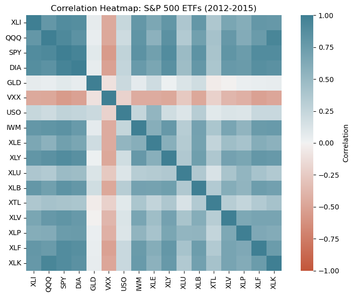
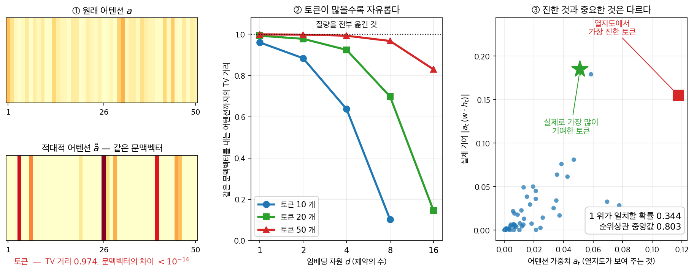
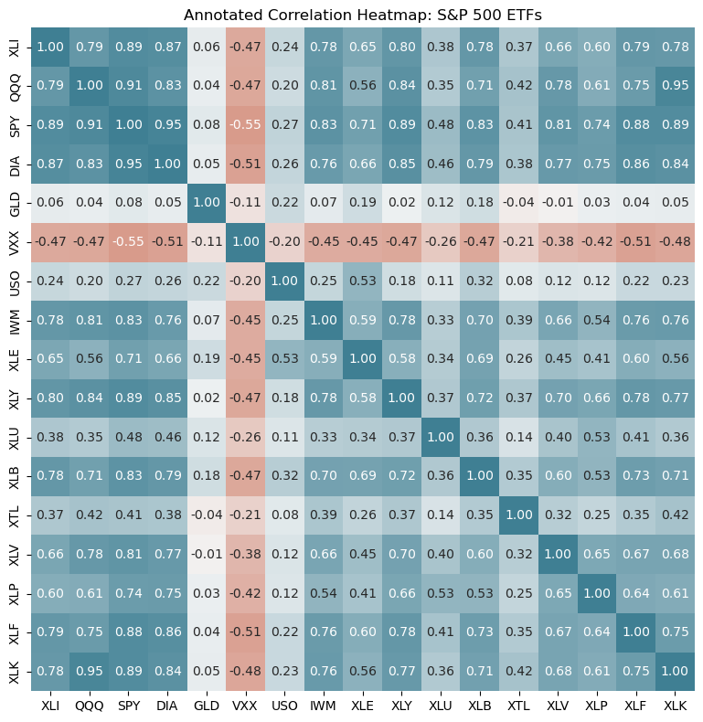
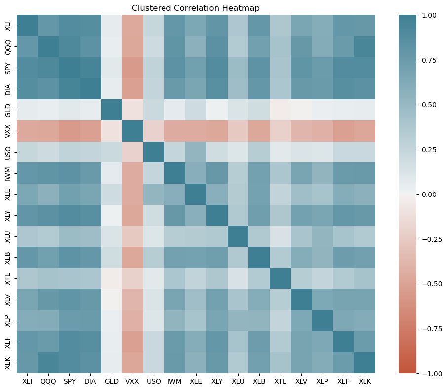
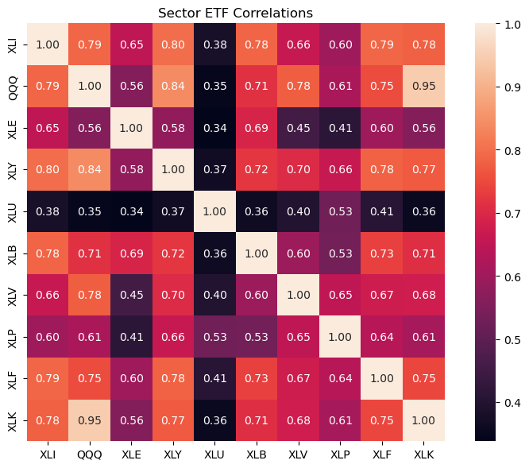
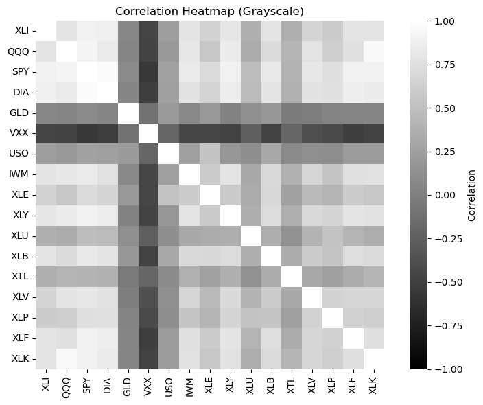

# 상관행렬의 열지도

## 개요

**열지도**는 행렬의 수치를 색의 강도로 나타내는 2차원 시각화이다. 상관행렬에서 열지도는 여러 변수에 걸친 연관 패턴을 한꺼번에 드러내므로 다변량 자료의 탐색적 분석에 없어서는 안 될 도구이다. 색이 관계의 강도와 방향을 한눈에 부호화한다. 다만 **어느 색이 어느 부호인지는 색지도가 정한다** — 이 쪽의 그림은 `diverging_palette(20, 220)` 이라 낮은 쪽(음)이 주황, 높은 쪽(양)이 청록으로, 흔히 쓰는 "음은 파랑, 양은 빨강"과 반대다(보기 1).

---

## 1. 상관행렬의 기본 열지도

### 금융 보기: S&P 500 상장지수펀드(ETF)

상장지수펀드(ETF)는 넓은 시장 구간을 추종한다. 섹터 ETF 사이의 상관을 살펴보면 보유 자산이 독립적으로 움직이는지 함께 움직이는지, 즉 분산투자 정도를 평가할 수 있다.

<div class="exbox" markdown>

**보기 1.** <span class="diff easy" title="쉬움"></span> 열지도 한 장에서 분산 효과를 읽기. ETF 일별 수익률의 상관행렬을 $[-1, 1]$ 에 못박은 발산형 색으로 그린다.

**(1)** 서로 다른 짝은 몇 개이고 그 가운데 음수는 몇 개인가. 음수 칸이 어디에 몰려 있는지 종목 이름으로 말하시오.

**(2)** "섹터 ETF 들이 함께 움직이므로 분산 효과가 작다"는 말을 수치로 바꾸시오. 수익률을 표준화해 분산을 모두 $1$ 로 맞춘 뒤 $p$ 종목을 등가중으로 담았을 때의 분산을 **닫힌 꼴로** 구하고, 자료로 확인하시오.

</div>

??? success "풀이"

    **(1) 세는 일은 그림이 아니라 행렬에서 한다.** $p = 17$ 이므로 서로 다른 짝은 $\binom{17}{2} = 136$ 개다. 그중 음수는 $18$ 개이고, **$16$ 개가 VXX 한 종목에 걸려 있다.** VXX 는 변동성 선물을 담는 ETF 라 주가가 떨어질 때 오른다. 나머지 둘은 GLD–XTL $(-0.042)$ 과 GLD–XLV $(-0.010)$ 로 사실상 $0$ 이다.

    그러므로 **"방어 섹터와 경기민감 섹터가 서로 반대로 움직인다"는 통념은 이 자료에서 맞지 않는다.** 유틸리티 XLU 와 경기소비재 XLY 의 상관은 $+0.3668$ 로 멀쩡한 양수다. 음의 칸을 만드는 것은 섹터의 성격이 아니라 **변동성 자체를 사는 상품**이다.

    **(2) 닫힌 꼴이 있다.** 표준화한 수익률 $Z_1, \ldots, Z_p$ 는 $\operatorname{Var}(Z_i) = 1$ 이고 $\operatorname{Cov}(Z_i, Z_j) = r_{ij}$ 다. 등가중 포트폴리오 $P = \frac1p \sum_i Z_i$ 의 분산은

    $$
    \operatorname{Var}(P)
    = \frac{1}{p^2}\left(\sum_{i} \operatorname{Var}(Z_i) + \sum_{i \ne j} \operatorname{Cov}(Z_i, Z_j)\right)
    = \frac{1}{p^2}\Big(p + p(p-1)\bar r\Big)
    = \frac{1}{p} + \left(1 - \frac{1}{p}\right)\bar r
    $$

    이다. 여기서 $\bar r$ 는 $\binom p2$ 개 짝의 평균 상관이다. **분모가 아니라 분자에 $\bar r$ 가 남는다는 것이 요점**이다. $p \to \infty$ 로 보내도

    $$
    \operatorname{Var}(P) \;\longrightarrow\; \bar r
    $$

    이므로 **종목을 아무리 늘려도 분산은 $\bar r$ 아래로 내려가지 않는다.** $\bar r = 0.4063$ 을 넣으면

    $$
    \operatorname{Var}(P) = \frac{1}{17} + \frac{16}{17}\times 0.4063 = 0.0588 + 0.3824 = 0.4413
    $$

    이고 표준편차 비는 $\sqrt{0.4413} = 0.6643$ 이다. 만약 $17$ 종목이 서로 독립이었다면 $1/17 = 0.0588$, 곧 $\sqrt{0.0588} = 0.2425$ 였을 것이다. 같은 분산을 독립 자산 몇 개로 낼 수 있는지 뒤집어 보면

    $$
    N_{\text{eff}} = \frac{1}{\operatorname{Var}(P)} = \frac{1}{0.4413} = 2.27
    $$

    이다. **$17$ 종목을 들고 있어도 독립 자산 $2.3$ 개 값어치다.** 이것이 "대부분의 칸에 색이 들어 있다"는 그림의 인상을 수로 바꾼 것이다.

    ```python
    import pandas as pd
    import numpy as np
    import seaborn as sns
    import matplotlib.pyplot as plt

    plt.rcParams["font.sans-serif"] = ["NanumGothic", "Apple SD Gothic Neo", "Malgun Gothic"]
    plt.rcParams["font.family"] = "sans-serif"
    plt.rcParams["axes.unicode_minus"] = False

    # 자료는 "Practical Statistics for Data Scientists" 저장소에서 바로 읽는다.
    SP500 = ("https://raw.githubusercontent.com/gedeck/"
             "practical-statistics-for-data-scientists/8a6d3bb6468e979c861d4b37215e1413702dfdfa/data/")
    sp500_sym = pd.read_csv(SP500 + 'sp500_sectors.csv')
    sp500_px = pd.read_csv(SP500 + 'sp500_data.csv.gz', index_col=0)

    # ETF 만 골라 2012년 7월 이후 구간을 쓴다.
    etfs = sp500_px.loc[sp500_px.index > '2012-07-01',
                        sp500_sym[sp500_sym['sector'] == 'etf']['symbol']]

    # 열이 종목, 행이 날짜이므로 corr() 이 종목 사이의 상관행렬을 준다.
    corr_matrix = etfs.corr()

    # vmin/vmax 를 -1 과 1 로 못박아야 색의 뜻이 그림마다 달라지지 않는다.
    # 발산형 색지도라 0 이 가운데 색에 놓인다.
    fig, ax = plt.subplots(figsize=(8, 6))
    sns.heatmap(corr_matrix,
                vmin=-1, vmax=1,
                cmap=sns.diverging_palette(20, 220, as_cmap=True),
                ax=ax,
                square=True,
                cbar_kws={'label': 'Correlation'})
    ax.set_title('Correlation Heatmap: S&P 500 ETFs (2012-2015)')
    plt.tight_layout()
    plt.show()

    # 색만 보고 넘어가지 않도록 수치를 찍는다.
    p = corr_matrix.shape[0]
    off = corr_matrix.values[np.triu_indices(p, 1)]
    print(f"ETF {p} 종목, 거래일 {len(etfs)} 일 "
          f"({etfs.index.min()} ~ {etfs.index.max()}), 서로 다른 짝 {len(off)} 개")
    print(f"상관 최소 {off.min():+.4f}  최대 {off.max():+.4f}  평균 {off.mean():+.4f}")
    print(f"음수인 짝 = {(off < 0).sum()} 개")
    from collections import Counter
    cnt = Counter()
    for i in range(p):
        for j in range(i + 1, p):
            if corr_matrix.values[i, j] < 0:
                cnt[corr_matrix.index[i]] += 1
                cnt[corr_matrix.columns[j]] += 1
    print(f"음수 짝에 낀 횟수 = {dict(cnt.most_common())}")
    print(f"유틸리티(XLU) 대 경기소비재(XLY) = {corr_matrix.loc['XLU', 'XLY']:+.4f}  "
          f"(방어 대 경기민감)")

    rbar = off.mean()
    print(f"\n등가중 포트폴리오 (수익률을 표준화해 분산을 1 로 맞춘 뒤)")
    print(f"  공식 1/p + (1-1/p) rbar = {1/p + (1 - 1/p) * rbar:.6f}")
    z = (etfs - etfs.mean()) / etfs.std()
    print(f"  실제로 만들어 재면       = {z.mean(axis=1).var(ddof=1):.6f}")
    print(f"  서로 독립이었다면 1/p    = {1/p:.6f}")
    print(f"  표준편차 비: 실제 {np.sqrt(1/p + (1 - 1/p) * rbar):.4f}  "
          f"독립이었다면 {np.sqrt(1/p):.4f}")
    print(f"  유효 독립 자산수 = {1 / (1/p + (1 - 1/p) * rbar):.2f} 개")
    ```

    출력:

    ```
    ETF 17 종목, 거래일 754 일 (2012-07-02 ~ 2015-07-01), 서로 다른 짝 136 개
    상관 최소 -0.5471  최대 +0.9537  평균 +0.4063
    음수인 짝 = 18 개
    음수 짝에 낀 횟수 = {'VXX': 16, 'GLD': 3, 'XTL': 2, 'XLV': 2, 'XLI': 1, 'QQQ': 1, 'SPY': 1, 'DIA': 1, 'USO': 1, 'IWM': 1, 'XLE': 1, 'XLY': 1, 'XLU': 1, 'XLB': 1, 'XLP': 1, 'XLF': 1, 'XLK': 1}
    유틸리티(XLU) 대 경기소비재(XLY) = +0.3668  (방어 대 경기민감)

    등가중 포트폴리오 (수익률을 표준화해 분산을 1 로 맞춘 뒤)
      공식 1/p + (1-1/p) rbar = 0.441257
      실제로 만들어 재면       = 0.441257
      서로 독립이었다면 1/p    = 0.058824
      표준편차 비: 실제 0.6643  독립이었다면 0.2425
      유효 독립 자산수 = 2.27 개
    ```

    

    **닫힌 꼴 $0.441257$ 과 실제로 포트폴리오를 만들어 잰 $0.441257$ 이 소수 여섯째 자리까지 같다.** 유도가 항등식이므로 당연하고, 어긋났다면 $\bar r$ 를 잘못 센 것이다.

    **색이 말해 주지 않는 것 셋.**

    - **색의 방향.** 이 그림의 색지도는 `diverging_palette(20, 220)` 이라 **낮은 쪽이 주황, 높은 쪽이 청록**이다. 상관 열지도에서 흔히 쓰는 "음은 파랑, 양은 빨강"과 **반대**다. 색막대를 읽지 않고 색만 보면 부호를 거꾸로 읽는다.
    - **표본크기.** 모든 칸이 $n = 754$ 로 같다는 보장은 그림 어디에도 없다. 결측이 있었다면 칸마다 $n$ 이 달랐을 것이고, 색은 그대로였을 것이다.
    - **비선형성과 이상치.** $r$ 는 직선 관계만 잰다. 수익률 자료는 꼬리가 두꺼워 며칠의 폭락이 칸 하나의 색을 바꿀 수 있는데, 그림은 그것을 보이지 않는다.

### 열지도 해석하기

열지도는 다음을 드러낸다.

- **양의 상관(이 그림에서는 청록):** 함께 오르내리는 섹터 ETF들(예: 성장 국면에서 기술과 통신 서비스가 자주 함께 움직인다)
- **음의 상관(이 그림에서는 주황):** 서로 갈라지는 경향이 있는 짝. 다만 이 자료에서 음수 칸 $18$ 개 가운데 $16$ 개가 **VXX 한 종목**에 걸려 있다. 방어 섹터 대 경기민감 섹터라는 흔한 설명은 여기서는 맞지 않는다 — XLU–XLY 가 $+0.3668$ 로 오히려 양이다(보기 1).
- **0에 가까운 상관(흰색):** 독립적인 움직임. 포트폴리오 분산에 유리하다
- **대각선(모두 1.0, 진한 빨강):** 각 ETF는 자기 자신과 완전히 상관된다

### 포트폴리오 관점의 함의

양의 상관이 높으면 분산 효과가 제한된다. 상관이 0.8인 두 ETF를 보유하면 거의 같이 움직이므로 무상관인 두 ETF보다 위험 감소 효과가 작다. 잘 분산된 포트폴리오는 낮거나 음인 상관을 목표로 한다.

<div class="aibox" markdown>

**AI로 보는 통계학 1.** 진한 칸을 설명으로 읽을 때

위 목록은 조심스럽게 적혀 있다. 청록은 「함께 오르내린다」, 주황은 「갈라지는 경향이
있다」 — **연관을 말할 뿐 누가 누구를 움직였다고 말하지 않는다.** 이 장이 처음부터
가르치는 절제다.

그런데 똑같이 생긴 열지도를 놓고 그 절제를 지키지 않는 분야가 있다. **어텐션 열지도**다.
신경망이 문장을 읽을 때 토큰마다 가중치 $a_t$ 를 매기는데, 그것을 색으로 칠한 그림이
「모형이 여기를 보았다」, 더 나아가 「모형이 이 단어 **때문에** 그렇게 판단했다」로
읽힌다.

제인과 월리스가 $2019$ 년에 그 읽기를 조사하고 논문 제목을 「어텐션은 설명이 아니다」로
달았다. 초록의 문장이 짧다 — **「학습된 어텐션 가중치는 기울기 기반 특징중요도와 상관이
없는 경우가 잦고, 서로 아주 다른 어텐션 분포가 그럼에도 같은 예측을 내는 경우를 찾아낼
수 있다.」** 그들의 그림 $1$ 이 바로 영화평 하나에 대한 **두 장의 열지도**다. 보기에
전혀 다른데 예측은 똑같이 $0.01$ 이었다.

왜 그런 일이 생기는지는 셈만으로 보인다. 아래 층으로 넘어가는 것은 문맥벡터

$$
c = \sum_{t=1}^{T} a_t\,h_t \;\in\; \mathbb R^{d}
$$

하나뿐이다. 제약은 $d$ 개인데 $a$ 의 자유도는 $T-1$ 개다. $T$ 가 $d$ 보다 크면
**같은 $c$ 를 내는 $a$ 가 무수히 많다.**



- **①** 토큰 $50$ 개에 $d = 8$ 로 두고, 관측된 어텐션 $a$ 와 **똑같은 문맥벡터**를 내면서
  질량을 최대한 옮긴 $\tilde a$ 를 선형계획으로 찾았다. 두 분포의 전변동거리가
  **$0.974$** 인데 문맥벡터의 차이는 $10^{-14}$ 보다 작다. 열지도 두 장이 전혀 다른데
  아래 층에 도착하는 것은 완전히 같은 수다. $\tilde a$ 가 쓰는 토큰이 **$9$ 개**인
  것도 우연이 아니다 — 제약이 $d+1 = 9$ 개이니 그만큼이면 맞출 수 있다.
- **②** 그 자유가 얼마나 되는지는 $T$ 와 $d$ 가 정한다. 토큰 $10$ 개에 $d = 8$ 이면
  거리가 $0.10$ 까지 떨어지지만, 토큰 $50$ 개에 $d = 8$ 이면 **$0.967$** 이다. 문장이
  길수록 열지도는 자유로워진다.
- **③** 설령 $a$ 가 유일하더라도 문제가 하나 더 있다. 열지도가 칠하는 것은 $a_t$ 인데
  실제 기여는 $a_t\,(w\cdot h_t)$ — **가중치에 값을 곱한 것**이다. 토큰 $50$ 개에서
  「열지도에서 가장 진한 토큰」이 「실제로 가장 많이 기여한 토큰」과 일치할 확률이
  **$0.344$** 다(우연이면 $0.020$). 둘의 순위상관 중앙값은 $0.803$ 으로 꽤 높은데도
  그렇다 — **대체로 맞지만 꼭대기에서 자주 어긋난다.**

이 쪽의 ETF 열지도로 돌아가 보면 차이가 분명하다. 거기서 $0.87$ 이라는 칸은 **잰 값**이다.
두 수익률 계열에서 공식 하나로 나오고, 다른 값으로 바꿔 쓸 자유가 없다. 어텐션 열지도의
칸은 그렇지 않다 — ① 이 보여 주듯 **모형을 전혀 바꾸지 않고도 다른 값으로 갈아 끼울 수
있다.** 상관계수는 자료의 성질이고 어텐션 가중치는 모형이 중간에 들고 있던 수 하나일
뿐이다.

그러니 이 쪽의 절제를 한 칸 더 밀고 가면 된다. 상관 열지도를 볼 때 우리는 **「연관이지
인과가 아니다」**라고 말한다. 어텐션 열지도에는 그보다 앞선 물음이 있다 — **이 그림이
유일한가.** 유일하지 않다면 인과는커녕 연관으로도 읽을 수 없다.

_확인한 곳 — Jain · Wallace, "Attention is not Explanation"(NAACL $2019$,
arXiv:$1902.10186$) — 초록의 「학습된 어텐션 가중치는 기울기 기반 특징중요도 측도와
상관이 없는 경우가 잦고, 그럼에도 같은 예측을 내는 아주 다른 어텐션 분포를 찾아낼 수
있다」와 「표준 어텐션 모듈은 유의미한 설명을 주지 않으며 그런 것처럼 다루어서는 안
된다」, 그리고 그림 $1$ 의 설명 — 부정적 영화평에 대한 관측 어텐션과 적대적으로 구성한
어텐션의 열지도 두 장이 「서로 꽤 다른데도 사실상 같은 예측($0.01$)을 낸다」는 것.
①–③ 의 수는 모두 직접 계산한 값이며, ① 의 거리는 선형계획으로 찾은 **하한**이다(참
최댓값은 그보다 크거나 같다)_

</div>

---

## 2. 값을 표시한 열지도

열지도 칸에 수치를 넣으면 해석에 도움이 된다.

<div class="exbox" markdown>

**보기 2.** <span class="diff easy" title="쉬움"></span> 숫자를 적으면 헤지와 분산을 가를 수 있다. 같은 행렬에 `annot=True` 로 값을 적어 넣는다.

**(1)** 표준화한 두 자산을 등가중으로 담았을 때 표준편차가 얼마로 줄어드는지 **닫힌 꼴로** 구하시오. 그 식으로 SPY–DIA, QQQ–XLK, SPY–GLD, SPY–VXX 를 견주시오.

**(2)** "GLD 는 주식과 상관이 낮으므로 헤지 수단이다"라는 흔한 말을 (1)의 식으로 따지시오. 상관 $0$ 과 상관 $-0.55$ 는 같은 일을 하는가.

</div>

??? success "풀이"

    **(1) 보기 1의 식에 $p = 2$ 를 넣으면 된다.** 표준화한 두 자산 $Z_1, Z_2$ 를 반씩 담으면

    $$
    \operatorname{Var}\!\left(\frac{Z_1 + Z_2}{2}\right)
    = \frac{1 + 1 + 2r}{4}
    = \frac{1 + r}{2},
    \qquad
    \frac{\operatorname{sd}(P)}{\operatorname{sd}(Z_i)} = \sqrt{\frac{1 + r}{2}}
    $$

    이다. $r = 1$ 이면 비가 $1$ 이라 아무것도 줄지 않고, $r = 0$ 이면 $1/\sqrt2 = 0.707$, $r = -1$ 이면 $0$ 이다. **$r$ 가 아니라 $\sqrt{(1+r)/2}$ 가 눈금이라는 점**이 중요하다. 이 함수는 $r$ 가 $1$ 근처일 때 아주 평평하다.

    | 짝 | $r$ | $\sqrt{(1+r)/2}$ | 표준편차 감소 |
    |---|---|---|---|
    | SPY–DIA | $+0.9537$ | $0.9884$ | $1.2\%$ |
    | QQQ–XLK | $+0.9451$ | $0.9862$ | $1.4\%$ |
    | SPY–QQQ | $+0.9090$ | $0.9770$ | $2.3\%$ |
    | **SPY–GLD** | $+0.0787$ | $0.7344$ | $\mathbf{26.6\%}$ |
    | **SPY–VXX** | $-0.5471$ | $0.4759$ | $\mathbf{52.4\%}$ |

    SPY 와 DIA 를 반씩 담는 것은 **위험을 $1.2\%$ 줄인다.** 두 종목을 들고 있다는 느낌만 줄 뿐 실질은 한 종목이다.

    **(2) 상관 $0$ 은 헤지가 아니라 분산이다.** GLD 는 주식형 $14$ 종목과 평균 $+0.0635$, 범위 $[-0.0422, +0.1886]$ 로 **거의 $0$ 이지 음수가 아니다.** 음수인 것은 둘뿐이고 그 값도 $-0.04$, $-0.01$ 이라 $0$ 과 구별되지 않는다. 반면 VXX 는 $14$ 종목 **모두**와 음수이고 평균이 $-0.4354$ 다.

    둘의 차이는 식에서 바로 읽힌다. $r = 0$ 은 $\sqrt{1/2} = 0.707$, 곧 **흔들림을 $29\%$ 깎아 줄 뿐 방향을 되돌리지는 않는다.** 주식이 떨어지는 날 GLD 는 평균적으로 가만히 있다. $r < 0$ 이라야 주식이 떨어질 때 올라 손실을 **상쇄**한다. **헤지는 음의 상관을 요구하고, 상관이 $0$ 인 자산은 분산 자산일 뿐이다.** 그림의 GLD 열이 거의 흰색인 것은 "헤지"가 아니라 "무관"이라고 읽어야 한다.

    ```python
    import pandas as pd
    import numpy as np
    import seaborn as sns
    import matplotlib.pyplot as plt

    plt.rcParams["font.sans-serif"] = ["NanumGothic", "Apple SD Gothic Neo", "Malgun Gothic"]
    plt.rcParams["font.family"] = "sans-serif"
    plt.rcParams["axes.unicode_minus"] = False

    # 앞과 같은 자료다.
    # 자료는 "Practical Statistics for Data Scientists" 저장소에서 바로 읽는다.
    SP500 = ("https://raw.githubusercontent.com/gedeck/"
             "practical-statistics-for-data-scientists/8a6d3bb6468e979c861d4b37215e1413702dfdfa/data/")
    sp500_sym = pd.read_csv(SP500 + 'sp500_sectors.csv')
    sp500_px = pd.read_csv(SP500 + 'sp500_data.csv.gz', index_col=0)
    etfs = sp500_px.loc[sp500_px.index > '2012-07-01',
                        sp500_sym[sp500_sym['sector'] == 'etf']['symbol']]

    corr_matrix = etfs.corr()

    fig, ax = plt.subplots(figsize=(10, 8))
    sns.heatmap(corr_matrix,
                vmin=-1, vmax=1,
                cmap=sns.diverging_palette(20, 220, as_cmap=True),
                annot=True,  # 칸마다 숫자를 적는다
                fmt='.2f',   # 소수점 두 자리
                ax=ax,
                square=True,
                cbar_kws={'label': 'Correlation'},
                cbar=False)  # 숫자를 적었으므로 색막대는 없어도 된다
    ax.set_title('Annotated Correlation Heatmap: S&P 500 ETFs')
    plt.tight_layout()
    plt.show()

    print(f"{'짝':>10s} {'r':>8s} {'sqrt((1+r)/2)':>15s} {'표준편차 감소':>13s}")
    for a, b in [('SPY', 'DIA'), ('QQQ', 'XLK'), ('SPY', 'QQQ'),
                 ('SPY', 'GLD'), ('SPY', 'VXX')]:
        r = corr_matrix.loc[a, b]
        ratio = np.sqrt((1 + r) / 2)
        print(f"{a + '-' + b:>10s} {r:+8.4f} {ratio:15.4f} {1 - ratio:12.1%}")

    gld = [c for c in corr_matrix.columns if c not in ('GLD', 'VXX', 'USO')]
    g = corr_matrix.loc['GLD', gld]
    print(f"\nGLD 대 주식형 {len(gld)} 종목: 최소 {g.min():+.4f}  최대 {g.max():+.4f}  "
          f"평균 {g.mean():+.4f}  음수 {int((g < 0).sum())} 개")
    v = corr_matrix.loc['VXX', gld]
    print(f"VXX 대 주식형 {len(gld)} 종목: 최소 {v.min():+.4f}  최대 {v.max():+.4f}  "
          f"평균 {v.mean():+.4f}  음수 {int((v < 0).sum())} 개")
    print(f"\n칸 수 {corr_matrix.shape[0]}x{corr_matrix.shape[1]} = {corr_matrix.size} 개")
    ```

    출력:

    ```
             짝        r   sqrt((1+r)/2)       표준편차 감소
       SPY-DIA  +0.9537          0.9884         1.2%
       QQQ-XLK  +0.9451          0.9862         1.4%
       SPY-QQQ  +0.9090          0.9770         2.3%
       SPY-GLD  +0.0787          0.7344        26.6%
       SPY-VXX  -0.5471          0.4759        52.4%

    GLD 대 주식형 14 종목: 최소 -0.0422  최대 +0.1886  평균 +0.0635  음수 2 개
    VXX 대 주식형 14 종목: 최소 -0.5471  최대 -0.2057  평균 -0.4354  음수 14 개

    칸 수 17x17 = 289 개
    ```

    

    표의 다섯 줄이 모두 닫힌 꼴 $\sqrt{(1+r)/2}$ 로 계산한 값이고, 그림에 적힌 소수 두 자리 값과 맞는다.

    **숫자를 적는 일의 대가.** 이 그림에는 $289$ 개의 수가 적혀 있다. 대각선 $17$ 개와 대칭으로 중복된 $136$ 개를 빼면 **쓸모 있는 수는 $136$ 개뿐이고 나머지 $153$ 개는 잉여**다. 종목이 $25$ 개만 되어도 $625$ 칸이라 글씨가 겹친다. 그때는 숫자를 지우고 색만 쓰거나, 보기 4처럼 볼 것을 추려야 한다.

---

## 3. 큰 상관행렬 다루기

변수가 많아 열지도가 빽빽하고 읽기 어려울 때에는 다음을 고려한다.

### 1. 군집화(재정렬)

계층적 군집화로 비슷한 변수를 묶는다.

<div class="exbox" markdown>

**보기 3.** <span class="diff easy" title="쉬움"></span> 제목이 "Clustered" 라고 해서 군집화된 것은 아니다. 아래 코드는 `linkage` 를 부르고 열지도를 그린다.

**(1)** 이 코드가 정말로 행과 열을 재정렬하는가. `linkage_matrix` 가 어디에 쓰이는지 따라가 보고, 그려진 축의 순서를 `corr_matrix` 의 열 순서와 맞대어 보시오.

**(2)** 블록 구조가 드러났는지를 그림 인상이 아니라 수치로 재려면 무엇을 보아야 하는가. 잣대를 하나 정하고 원래 순서와 제대로 군집화한 순서를 견주시오.

</div>

??? success "풀이"

    **(1) 재정렬하지 않는다.** `linkage_matrix` 는 둘째 줄에서 계산되고 **그 뒤로 한 번도 쓰이지 않는다.** `sns.heatmap` 에 넘어가는 것은 손대지 않은 `corr_matrix` 이므로 축 순서는 `etfs` 의 열 순서, 곧 자료 파일에 적힌 순서 그대로다. 아래 출력에서 그려진 축 순서와 `corr_matrix.columns` 가 **문자 하나까지 같다.** 그림 제목이 `Clustered Correlation Heatmap` 인 것과는 무관하다.

    그러므로 **이 그림은 보기 1의 그림과 칸 배치가 완전히 같다.** 두 그림을 겹쳐 보면 알 수 있고, 보기 1에서 VXX 가 여섯째 행이었던 것이 여기서도 여섯째 행이다.

    덤으로 `linkage(1 - corr_matrix, method='ward')` 는 `ClusterWarning` 을 낸다. `linkage` 의 첫 인자는 **관측 행렬이거나 압축된 거리벡터**여야 하는데 $17 \times 17$ 정사각 행렬을 주었기 때문이다. SciPy 는 이것을 "관측 $17$ 개, 변수 $17$ 개"로 받아 **$1-r$ 행렬의 행들 사이의 유클리드 거리**로 묶는다. 의도한 "$1-r$ 를 거리로 삼는다"와 다른 일이다. 올바로 하려면 `squareform` 으로 압축 거리벡터를 만들어 넘겨야 한다.

    **(2) 잣대 — 축에서 이웃한 두 종목의 평균 상관.** 블록이 대각선 둘레로 모였다는 말은 **축에서 가까운 종목끼리 상관이 높다**는 뜻이다. 그러므로

    $$
    \text{이웃 평균 } r = \frac{1}{p-1}\sum_{k=1}^{p-1} r_{\,o_k,\, o_{k+1}}
    $$

    를 재면 된다. 여기서 $o$ 는 축에 놓인 순서다. 순서가 무작위이면 이 값은 모든 짝의 평균 $\bar r = 0.4063$ 둘레에 머물고, 잘 묶였으면 그보다 뚜렷이 커야 한다.

    | 순서 | 이웃 평균 $r$ |
    |---|---|
    | 원래 (그림에 실제로 쓰인 것) | $0.4527$ |
    | `linkage(1-corr)` 의 잎 순서 | $0.5013$ |
    | 압축 거리 + `average` | $\mathbf{0.5555}$ |
    | 참고: 모든 짝의 평균 $\bar r$ | $0.4063$ |

    원래 순서의 $0.4527$ 이 $\bar r = 0.4063$ 보다 조금 큰 것은 자료 파일이 이미 SPY·DIA·QQQ 처럼 비슷한 것을 나란히 적어 두었기 때문이고, **군집화 덕분이 아니다.** 제대로 묶으면 $0.5555$ 까지 올라간다. 그 순서는

    ```
    VXX | GLD USO XTL XLU | XLE XLP XLV XLB IWM XLF QQQ XLK XLY XLI SPY DIA
    ```

    로, 변동성(VXX)이 혼자 떨어지고 금·원유·통신·유틸리티가 한 덩어리, 나머지 주식형이 큰 덩어리를 이룬다.

    ```python
    import pandas as pd
    import numpy as np
    import seaborn as sns
    import matplotlib.pyplot as plt
    from scipy.cluster.hierarchy import dendrogram, linkage
    from scipy.spatial.distance import squareform

    plt.rcParams["font.sans-serif"] = ["NanumGothic", "Apple SD Gothic Neo", "Malgun Gothic"]
    plt.rcParams["font.family"] = "sans-serif"
    plt.rcParams["axes.unicode_minus"] = False

    # 상관이 비슷한 종목끼리 이웃하도록 순서를 다시 매긴다. 1 - r 을 거리로
    # 삼으면 상관이 높을수록 가까운 것이 되어 군집화에 바로 쓸 수 있다.
    corr_matrix = etfs.corr()
    linkage_matrix = linkage(1 - corr_matrix, method='ward')

    fig, ax = plt.subplots(figsize=(10, 8))
    sns.heatmap(corr_matrix,
                cmap=sns.diverging_palette(20, 220, as_cmap=True),
                vmin=-1, vmax=1,
                ax=ax,
                square=True)
    ax.set_title('Clustered Correlation Heatmap')
    plt.tight_layout()
    plt.show()

    # 그려진 축의 순서를 자료의 순서와 맞대어 본다.
    drawn = [t.get_text() for t in ax.get_xticklabels()]
    print("그려진 축 순서 =", drawn)
    print("corr_matrix 열 =", list(corr_matrix.columns))
    print("둘이 같은가 :", drawn == list(corr_matrix.columns))
    print("linkage_matrix 를 쓴 곳이 있는가 : 없음 — 계산만 하고 버렸다")

    # 블록 구조를 재는 잣대: 축에서 이웃한 두 종목의 평균 상관
    nb = lambda o: np.mean([corr_matrix.values[o[i], o[i + 1]] for i in range(len(o) - 1)])
    p = len(corr_matrix)
    base = list(range(p))
    leaves_bad = dendrogram(linkage_matrix, no_plot=True)['leaves']

    # 올바른 방법: 1-r 을 압축 거리벡터로 넘긴다
    D = 1 - corr_matrix.values
    np.fill_diagonal(D, 0.0)
    leaves_ok = dendrogram(linkage(squareform(D, checks=False), method='average'),
                           no_plot=True)['leaves']

    print(f"\n{'순서':>26s} {'이웃 평균 r':>11s}")
    for lab, o in [("원래 (그림에 쓰인 것)", base),
                   ("linkage(1-corr) 의 잎", leaves_bad),
                   ("압축 거리 + average", leaves_ok)]:
        print(f"{lab:>26s} {nb(o):11.4f}")
    print(f"{'참고: 모든 짝의 평균 r':>26s} "
          f"{corr_matrix.values[np.triu_indices(p, 1)].mean():11.4f}")
    print("\n압축 거리 + average 순서:")
    print(" ", [corr_matrix.columns[i] for i in leaves_ok])
    ```

    출력:

    ```
    그려진 축 순서 = ['XLI', 'QQQ', 'SPY', 'DIA', 'GLD', 'VXX', 'USO', 'IWM', 'XLE', 'XLY', 'XLU', 'XLB', 'XTL', 'XLV', 'XLP', 'XLF', 'XLK']
    corr_matrix 열 = ['XLI', 'QQQ', 'SPY', 'DIA', 'GLD', 'VXX', 'USO', 'IWM', 'XLE', 'XLY', 'XLU', 'XLB', 'XTL', 'XLV', 'XLP', 'XLF', 'XLK']
    둘이 같은가 : True
    linkage_matrix 를 쓴 곳이 있는가 : 없음 — 계산만 하고 버렸다

                            순서     이웃 평균 r
                 원래 (그림에 쓰인 것)      0.4527
           linkage(1-corr) 의 잎      0.5013
               압축 거리 + average      0.5555
                참고: 모든 짝의 평균 r      0.4063

    압축 거리 + average 순서:
      ['VXX', 'GLD', 'USO', 'XTL', 'XLU', 'XLE', 'XLP', 'XLV', 'XLB', 'IWM', 'XLF', 'QQQ', 'XLK', 'XLY', 'XLI', 'SPY', 'DIA']
    ```

    

    그림의 축 이름을 왼쪽부터 읽으면 XLI, QQQ, SPY, DIA, GLD, VXX … 로 출력의 첫 줄과 그대로 맞는다. **제목이 말하는 일은 일어나지 않았다.**

    군집화 자체는 쓸모가 있다. 강하게 상관된 변수를 이웃하게 놓으면 대각선 둘레에 블록이 생기고, 잠재 요인·중복 변수·분산 기회가 눈에 들어온다. 다만 **그 일이 실제로 일어났는지는 그림 인상이 아니라 축 순서로 확인해야 한다.** 이 보기가 그 확인 절차다.

### 2. 부분집합 선택

관심 있는 변수의 부분집합만 고른다.

<div class="exbox" markdown>

**보기 4.** <span class="diff easy" title="쉬움"></span> 추리면서 색 눈금까지 바뀌었다. 업종 펀드 $10$ 개만 남겨 다시 그린다. 이번에는 `vmin`/`vmax` 를 주지 않았다.

**(1)** 색막대의 범위가 얼마가 되는가. 같은 $r = 0.38$ 이 보기 1과 이 그림에서 색막대의 어느 자리에 놓이는지 견주시오.

**(2)** $17$ 종목에서 $10$ 종목으로 줄이면 짝이 몇 개 사라지는가. 사라진 짝 가운데 음수는 몇 개인가. 이 그림으로 분산 효과를 판단해도 되는가.

</div>

??? success "풀이"

    **(1) 색막대가 자료에 맞춰 늘어난다.** `vmin`/`vmax` 를 주지 않으면 `heatmap` 이 자료의 최솟값과 최댓값을 양 끝에 놓는다. 이 부분집합의 최소는 XLE–XLU 의 $0.3379$ 이므로 색막대는 $[-1, 1]$ 이 아니라 $[0.3379,\, 1.0000]$ 이다. 같은 수가 두 그림에서 어디에 놓이는지 비로 적으면

    | $r$ | 보기 1 에서 (범위 $[-1,1]$) | 보기 4 에서 (범위 $[0.338,1]$) |
    |---|---|---|
    | $0.34$ | $0.670$ | $0.003$ |
    | $\mathbf{0.38}$ | $\mathbf{0.690}$ | $\mathbf{0.064}$ |
    | $0.53$ | $0.765$ | $0.290$ |
    | $0.95$ | $0.975$ | $0.924$ |

    **$r = 0.38$ 이 한쪽에서는 색막대의 위쪽 $69\%$, 다른 쪽에서는 아래쪽 $6\%$ 다.** 그래서 보기 1에서 중간쯤 짙은 칸이던 XLU 행이 여기서는 **가장 어두운 행**으로 보인다. 숫자는 그대로인데 색만 뒤바뀐 것이다. 게다가 색지도도 기본값 `rocket` 이라 **발산형이 아니라 순차형**이므로 $0$ 이 가운데에 놓인다는 보장도 없다.

    두 그림을 나란히 놓고 색으로 견주는 일은 **할 수 없다.** 색을 그림 사이에서 견주려면 `vmin`/`vmax` 를 못박아야 한다.

    **(2) 사라진 짝은 $91$ 개이고 그 안에 음수 $18$ 개가 모두 들어 있다.** $\binom{17}{2} = 136$ 에서 $\binom{10}{2} = 45$ 로 줄었고, 빠진 종목은 SPY, DIA, GLD, VXX, USO, IWM, XTL 이다. **VXX 와 GLD 가 빠지면서 음의 상관이 하나도 남지 않는다.** 남은 $45$ 짝의 최소가 $+0.3379$ 다.

    그러므로 **이 그림으로 분산 효과를 판단해서는 안 된다.** 보기 1의 식을 $q = 10$ 과 $\bar r = 0.6230$ 에 쓰면

    $$
    \operatorname{Var}(P) = \frac{1}{10} + \frac{9}{10}\times 0.6230 = 0.6607,
    \qquad N_{\text{eff}} = 1.51
    $$

    로 $17$ 종목일 때의 $2.27$ 보다도 나빠진다. 이것은 세상이 나빠져서가 아니라 **분산에 도움이 되는 종목만 골라 뺐기 때문**이다. 추려서 그린 열지도는 읽기 쉬워진 대신 **무엇을 뺐는지 전혀 보이지 않는다.** 뺀 목록을 그림 밖에 적어 두는 수밖에 없다.

    ```python
    plt.rcParams["font.sans-serif"] = ["NanumGothic", "Apple SD Gothic Neo", "Malgun Gothic"]
    plt.rcParams["font.family"] = "sans-serif"
    plt.rcParams["axes.unicode_minus"] = False

    # 종목이 많으면 열지도가 읽히지 않는다. 업종 펀드만 열 개로 좁힌다.
    sector_etfs = ['XLI', 'QQQ', 'XLE', 'XLY', 'XLU', 'XLB', 'XLV', 'XLP', 'XLF', 'XLK']
    subset_corr = corr_matrix.loc[sector_etfs, sector_etfs]

    fig, ax = plt.subplots(figsize=(8, 6))
    sns.heatmap(subset_corr, annot=True, fmt='.2f', ax=ax, square=True)
    ax.set_title('Sector ETF Correlations')
    plt.tight_layout()
    plt.show()

    # 색막대가 어디에서 어디까지인지 그림에서 직접 꺼내 본다.
    qm = ax.collections[0]
    lo, hi = qm.get_clim()
    print(f"색막대 범위: vmin = {lo:.4f},  vmax = {hi:.4f}   (못박지 않아 자료에 맞춰졌다)")
    print(f"색지도 = {qm.cmap.name}  (발산형이 아니라 순차형이라 0 이 가운데가 아니다)")
    print(f"\n{'r':>6s} {'보기 1 에서의 색 위치':>20s} {'보기 4 에서의 색 위치':>20s}")
    for r in (0.34, 0.38, 0.53, 0.95):
        print(f"{r:6.2f} {(r + 1) / 2:20.3f} {(r - lo) / (hi - lo):20.3f}")

    p = len(corr_matrix)
    full = corr_matrix.values[np.triu_indices(p, 1)]
    sub = subset_corr.values[np.triu_indices(len(sector_etfs), 1)]
    print(f"\n짝 {len(full)} -> {len(sub)},  사라진 짝 {len(full) - len(sub)} 개")
    print(f"빠진 종목 = {[c for c in corr_matrix.columns if c not in sector_etfs]}")
    print(f"음수 짝: 전체 {int((full < 0).sum())} 개  ->  부분집합 {int((sub < 0).sum())} 개")
    print(f"부분집합 상관 최소 {sub.min():+.4f}  최대 {sub.max():+.4f}  평균 {sub.mean():+.4f}")
    rb = sub.mean()
    q = len(sector_etfs)
    print(f"부분집합 등가중 분산 = 1/q + (1-1/q) rbar = {1/q + (1 - 1/q) * rb:.4f}  "
          f"(유효 독립 자산수 {1 / (1/q + (1 - 1/q) * rb):.2f} 개)")
    ```

    출력:

    ```
    색막대 범위: vmin = 0.3379,  vmax = 1.0000   (못박지 않아 자료에 맞춰졌다)
    색지도 = rocket  (발산형이 아니라 순차형이라 0 이 가운데가 아니다)

         r        보기 1 에서의 색 위치        보기 4 에서의 색 위치
      0.34                0.670                0.003
      0.38                0.690                0.064
      0.53                0.765                0.290
      0.95                0.975                0.924

    짝 136 -> 45,  사라진 짝 91 개
    빠진 종목 = ['SPY', 'DIA', 'GLD', 'VXX', 'USO', 'IWM', 'XTL']
    음수 짝: 전체 18 개  ->  부분집합 0 개
    부분집합 상관 최소 +0.3379  최대 +0.9451  평균 +0.6230
    부분집합 등가중 분산 = 1/q + (1-1/q) rbar = 0.6607  (유효 독립 자산수 1.51 개)
    ```

    

    그림의 색막대가 실제로 $0.34$ 쯤에서 시작해 $1.0$ 에서 끝나는 것을 눈으로 확인할 수 있고, 코드가 꺼낸 $0.3379$ 와 맞는다.

    **칸이 커져 읽기 쉬워진 것은 사실이다.** $289$ 칸이 $100$ 칸이 되었으니 글씨가 넉넉하다. 그 대가가 색 눈금의 이동과 음의 상관의 실종이고, 둘 다 그림 안에서는 보이지 않는다.

---

## 4. 회색조 열지도 (인쇄용)

흑백으로 출판하거나 인쇄 제약이 있을 때에는 회색조 색상표를 쓰고 시각적 단서를 더한다.

<div class="exbox" markdown>

**보기 5.** <span class="diff easy" title="쉬움"></span> 회색조가 잃는 것은 정확히 무엇인가. 같은 행렬을 `cmap='gray'` 로, 범위는 $[-1, 1]$ 에 못박아 그린다.

**(1)** $r$ 와 명도의 대응을 식으로 적고, $136$ 개 짝의 명도가 어떻게 흩어지는지 구하시오. 특히 $r \ge 0.60$ 인 짝들이 명도의 몇 할을 쓰는가.

**(2)** 발산형 색지도는 할 수 있는데 회색조는 못 하는 일이 하나 있다. 무엇이며 몇 개의 칸에서 문제가 되는가.

</div>

??? success "풀이"

    **(1) 대응은 선형이다.** `vmin = -1`, `vmax = 1` 이고 `gray` 는 명도가 선형으로 가는 색지도이므로

    $$
    g(r) = \frac{r - (-1)}{1 - (-1)} = \frac{r + 1}{2}
    $$

    이다. $r = -1 \to$ 검정 $(0)$, $r = 0 \to$ 중간회색 $(0.5)$, $r = +1 \to$ 흰색 $(1)$.

    $136$ 개 짝의 $r$ 가 $[-0.547, +0.954]$ 이므로 명도는 $[0.226, 0.977]$ 에 놓인다. 그런데 **고르게 퍼지지 않는다.** 사분위가 $r = +0.184,\, +0.459,\, +0.747$ 이므로 명도로는 $0.592,\, 0.729,\, 0.874$ 다.

    가장 아픈 곳은 윗쪽이다. $r \ge 0.60$ 인 짝이 $56$ 개인데, 이들의 명도는 $0.800$ 부터 $0.977$ 까지 **폭 $0.177$ 안에 몰려 있다.** 쓸 수 있는 명도 폭 $1$ 가운데 $18\%$ 다. 곧 **짝의 $41\%$ 가 명도의 $18\%$ 를 나누어 쓴다.** 그림에서 오른쪽 아래 주식형 덩어리가 모두 비슷한 밝은 회색으로 보이는 까닭이 이것이다.

    **(2) 부호를 읽을 수 없다.** 발산형 색지도는 **색상**으로 부호를, **채도**로 크기를 나누므로 두 정보가 섞이지 않는다. 회색조는 눈금이 명도 하나뿐이라 부호가 크기 안에 녹아 들어간다. $r = 0$ 이 $0.5$ 라는 사실은 **색막대를 읽어야만** 알 수 있고, 그림 안에는 "여기가 $0$ 이다"라는 표시가 없다.

    실제로 문제가 되는 칸은 $0$ 둘레다. $\lvert r \rvert < 0.1$ 인 짝이 $12$ 개이고 명도가 $0.479$ 부터 $0.539$ 까지로 **폭이 $0.06$** 이다. 이 열두 칸은 눈으로 부호를 가릴 수 없다. GLD 행이 그 대부분이다.

    처방은 둘이다. **값을 함께 적거나**(보기 2처럼 `annot=True`), **$\lvert r \rvert$ 를 명도로 그리고 부호는 따로 표시**한다. 뒤의 방법을 쓰면 명도 전체를 $\lvert r \rvert \in [0,1]$ 에 쓸 수 있어 해상도도 두 배가 된다.

    ```python
    import pandas as pd
    import numpy as np
    import seaborn as sns
    import matplotlib.pyplot as plt

    plt.rcParams["font.sans-serif"] = ["NanumGothic", "Apple SD Gothic Neo", "Malgun Gothic"]
    plt.rcParams["font.family"] = "sans-serif"
    plt.rcParams["axes.unicode_minus"] = False

    corr_matrix = etfs.corr()

    fig, ax = plt.subplots(figsize=(8, 6))
    sns.heatmap(corr_matrix,
                cmap='gray',  # 인쇄를 염두에 둔 회색조. 다만 부호를 읽기 어려워진다.
                vmin=-1, vmax=1,
                ax=ax,
                square=True,
                cbar_kws={'label': 'Correlation'})
    ax.set_title('Correlation Heatmap (Grayscale)')
    plt.tight_layout()
    plt.show()

    p = len(corr_matrix)
    off = corr_matrix.values[np.triu_indices(p, 1)]

    # 회색조 명도는 vmin=-1, vmax=1 이므로 g = (r+1)/2 로 선형이다.
    g = (off + 1) / 2
    print(f"r = -1 -> 명도 0.000 (검정),  r = 0 -> 명도 0.500 (중간회색),  "
          f"r = +1 -> 명도 1.000 (흰색)")
    print(f"실제 짝 {len(off)} 개의 명도: 최소 {g.min():.3f}  최대 {g.max():.3f}")
    qs = np.percentile(off, [25, 50, 75])
    print(f"r 의 사분위 {qs[0]:+.3f} {qs[1]:+.3f} {qs[2]:+.3f}  ->  "
          f"명도 {(qs[0]+1)/2:.3f} {(qs[1]+1)/2:.3f} {(qs[2]+1)/2:.3f}")
    print(f"명도 0.80 이상 (r >= 0.60) 인 짝 = {(g >= 0.80).sum()} / {len(off)}")
    print(f"그 짝들의 명도 폭 = {g[g >= 0.80].max() - g[g >= 0.80].min():.3f}  "
          f"(쓸 수 있는 폭 1.000 가운데)")
    print(f"\n부호가 헷갈리는 구간: |r| < 0.1 인 짝 = {(np.abs(off) < 0.1).sum()} 개, "
          f"명도 {(g[np.abs(off) < 0.1]).min():.3f} ~ {(g[np.abs(off) < 0.1]).max():.3f}")
    ```

    출력:

    ```
    r = -1 -> 명도 0.000 (검정),  r = 0 -> 명도 0.500 (중간회색),  r = +1 -> 명도 1.000 (흰색)
    실제 짝 136 개의 명도: 최소 0.226  최대 0.977
    r 의 사분위 +0.184 +0.459 +0.747  ->  명도 0.592 0.729 0.874
    명도 0.80 이상 (r >= 0.60) 인 짝 = 56 / 136
    그 짝들의 명도 폭 = 0.177  (쓸 수 있는 폭 1.000 가운데)

    부호가 헷갈리는 구간: |r| < 0.1 인 짝 = 12 개, 명도 0.479 ~ 0.539
    ```

    

    그림을 보면 VXX 행만 뚜렷이 검고 나머지는 모두 비슷한 밝은 회색이다. 계산한 $56/136$ 과 폭 $0.177$ 이 그 인상을 수로 적은 것이다.

    **회색조를 고르는 까닭은 따로 있다.** 색각 이상이 있는 독자나 흑백 인쇄를 생각하면 명도 하나로 읽히는 그림이 안전하다. 다만 그 대가가 위의 둘이므로, 회색조를 쓸 때는 **값을 적는 것이 선택이 아니라 필수**다.

---

## 5. 분산투자로 지울 수 없는 것이 평균 상관이다

포트폴리오 매니저가 상관 열지도에서 읽으려는 것은 하나다 — **이 묶음이 시장 전체의 충격에 얼마나 함께 흔들리는가.** 그 물음에는 닫힌 답이 있고, 보기 $1$ 의 $(2)$ 가 그것을 유도한다. 분산을 모두 $1$ 로 맞춘 자산 $p$ 개를 등가중으로 담고 모든 쌍의 상관이 $\bar\rho$ 라면

$$
\operatorname{Var}\!\left(\frac1p\sum_{i=1}^{p} X_i\right) = \frac{1 + (p-1)\bar\rho}{p} \;\xrightarrow[\;p\to\infty\;]{}\; \bar\rho
$$

이다. **종목을 아무리 늘려도 $\bar\rho$ 아래로는 내려가지 않는다.** 지워지는 것은 $(1-\bar\rho)/p$ 뿐이다.

| $\bar\rho$ | $p = 5$ | $p = 10$ | $p = 50$ |
|---:|---:|---:|---:|
| $0.8$ | $0.840$ | $0.820$ | $0.804$ |
| $0.5$ | $0.600$ | $0.550$ | $0.510$ |
| $0.1$ | $0.280$ | $0.190$ | $0.118$ |

열지도가 온통 짙은 색이면 $\bar\rho$ 가 크다는 뜻이고, 그러면 **종목 수를 늘리는 일이 거의 아무것도 하지 못한다** — $\bar\rho = 0.8$ 에서 다섯을 쉰으로 늘려도 분산이 $0.840$ 에서 $0.804$ 로 간다. 음의 상관이 섞인 칸이 있어야 $\bar\rho$ 자체가 내려간다. **헤지가 값진 까닭이 이 식에 있다.**

---

## 6. 열지도가 보여 주지 않는 것

- **쌍마다의 상관만 보인다.** 모형이 실제로 쓰는 것은 「여럿이 함께 있을 때의 기여」인데 열지도의 칸은 **주변 상관**이다. 둘이 얼마나 어긋나는지는 [상관 시각화](corr_viz.md)의 상자가 잰다 — 특징 $24{,}000$ 개에서 $\lvert r\rvert$ 과 실제 기여의 **순위상관이 $0.21$** 이다. 「$y$ 와의 상관이 낮으니 버린다」는 전처리가 거기서 무너진다.
- **색이 크기를 가린다.** 사람 눈은 색의 미세한 차이를 잘 못 가르고, 특히 약한 상관과 중간 상관을 혼동한다. [상관 타원 그림](correlation_ellipses.md)이 그 자리를 모양으로 바꾼다.
- **선형만 본다.** 칸에 들어가는 것은 피어슨 $r$ 이므로 곡선 의존은 $0$ 으로 찍힌다 — 10.1절 [Pearson 상관계수](../correlation/pearson.md) $\S 4$ 의 그림이 그것이다.
- **한 장면일 뿐이다.** 위 ETF 자료의 상관은 시장 국면에 따라 달라진다. 평온한 때에 재어 둔 $\bar\rho$ 로 위기 때의 분산을 셈하면 틀린다 — 충격이 올 때 상관이 함께 올라가기 때문이다.
- **이상점 하나가 칸을 바꾼다.** 극단적인 하루가 $r$ 을 크게 움직일 수 있으므로, 오염이 의심되면 10.1절 [Spearman 순위상관](../correlation/spearman.md)이나 순위 기반 측도로 함께 재어 본다.

그리고 **진한 칸을 설명으로 읽지 않는 것**이 마지막 한 가지다. $\S 1$ 의 상자가 똑같이 생긴 **어텐션 열지도**에서 그 읽기가 어떻게 무너지는지를 보인다 — 전변동거리가 $0.974$ 로 전혀 다른 두 장이 아래 층에 **완전히 같은 수**를 보낸다.

---

## 연습문제

<div class="drillbox" markdown>

**연습문제 1.** <span class="diff med" title="중간"></span>
변수 10개인 금융 자료의 상관 열지도에서 한쪽 모서리에 2×2 크기의 진한 빨강 블록이, 다른 곳에 3×3 크기의 진한 파랑 블록이 보인다. 이 패턴들이 변수 관계에 대해 무엇을 시사하며 포트폴리오 분산에 어떤 함의가 있는지 해석하라.

</div>

??? success "풀이"
    **진한 빨강 블록**은 강한 양의 상관($+1$에 가까움)을 갖는 변수 두 개의 군집을 나타낸다. 이 변수들은 함께 움직인다. 예를 들어 같은 섹터의 두 종목이 그렇다.

    **진한 파랑 블록**은 강한 음의 상관($-1$에 가까움)을 갖는 변수 세 개의 군집을 나타낸다. 이 변수들은 반대 방향으로 움직인다.

    **포트폴리오 분산**의 관점에서 음의 상관을 갖는 군집은 가치가 있다. 한쪽의 손실이 다른 쪽의 이익으로 상쇄되는 경향이 있어 이들을 결합하면 포트폴리오 위험이 줄어든다. 반면 양의 상관을 갖는 쌍은 함께 보유해도 분산 효과가 없다. 둘을 모두 갖는 것은 사실상 같은 위험 요인에 두 배로 베팅하는 셈이다.

<div class="drillbox" markdown>

**연습문제 2.** <span class="diff med" title="중간"></span>
계층적 군집화로 상관 열지도의 행과 열을 재정렬하면 기본(알파벳순) 정렬이 놓치는 구조가 드러나는 이유를 설명하라.

</div>

??? success "풀이"
    알파벳순으로 정렬하면 상관된 변수들이 행렬 곳곳에 흩어져 패턴을 알아보기 어렵다. **계층적 군집화**는 상관 프로필이 비슷한 변수를 서로 이웃하게 배치하여 대각선을 따라 눈에 보이는 **블록**을 만든다.

    재정렬 알고리즘은 모든 변수 쌍에 대해 거리 측도(예: $1 - |r|$)를 계산하고 덴드로그램을 만든다. 강하게 상관된 변수들이 나란히 놓이므로 양의 상관 군집은 연속된 빨강 블록으로, 음의 상관 군집은 대각선 밖의 파랑 블록으로 나타난다. 잠재 요인 구조, 중복 변수, 분산투자 기회가 즉시 드러난다.

<div class="drillbox" markdown>

**연습문제 3.** <span class="diff med" title="중간"></span>
대칭인 상관행렬의 열지도를 만들 때 보통 아래쪽(또는 위쪽) 삼각형만 표시한다. 그 이유를 설명하고, 전체 행렬을 보이는 편이 나은 상황을 하나 기술하라.

</div>

??? success "풀이"
    상관행렬은 대칭이므로($r_{ij} = r_{ji}$) 위쪽 삼각형과 아래쪽 삼각형이 같은 정보를 담는다. 한쪽 삼각형만 표시하면:

    - 시각적 중복이 사라진다.
    - 정보가 없는 대각선(항상 1.0)을 없앤다.
    - 그림이 더 깔끔하고 읽기 쉬워진다.

    삼각형마다 다른 정보를 표시할 때에는 **전체 행렬**이 나을 수 있다. 예를 들어 아래쪽 삼각형에 Pearson 상관을, 위쪽 삼각형에 Spearman 상관을 표시하면 두 측도를 직접 비교할 수 있다.

<div class="drillbox" markdown>

**연습문제 4.** <span class="diff hard" title="어려움"></span>
보기 1 의 닫힌 꼴 $\operatorname{Var}(P) = \frac1p + \left(1 - \frac1p\right)\bar r$ 는 분산투자 계산에만 쓰이는 것이 아니다. 열지도에 **그릴 수 없는 그림**을 가려내는 데도 쓰인다.

**(1)** 분산은 음이 될 수 없다는 사실만으로 평균 상관 $\bar r$ 의 하한을 구하시오. $p = 17$ 에서 그 값은 얼마인가. $136$ 개 짝이 모두 같은 값 $r = -0.1$ 인 상관 열지도는 몇 종목까지 그릴 수 있는가.

**(2)** 연습문제 1 의 설정에서 "진한 파랑 $3 \times 3$ 블록"이 세 변수가 서로 모두 $-0.9$ 쯤의 상관을 갖는다는 뜻이라고 하자. 그런 블록이 존재할 수 있는가. 대각선 둘레의 $k \times k$ 블록으로 일반화하시오.

**(3)** (1)의 제약은 **음수 칸의 개수**도 제한하는가. $p = 17$ 에서 $136$ 칸이 모두 음수인 상관행렬의 보기를 하나 만들고, 그 포트폴리오의 유효 독립 자산수를 구하시오.

</div>

??? success "풀이"
    **(1) 분산이 음이 아니라는 것만으로 하한이 나온다.** 표준화한 $p$ 자산을 등가중으로 담은 $P$ 는 확률변수이므로 $\operatorname{Var}(P) \ge 0$ 이다. 보기 1 의 식에 넣으면

    $$
    \frac{1}{p} + \left(1 - \frac1p\right)\bar r \;\ge\; 0
    \;\Longleftrightarrow\;
    \bar r \;\ge\; -\frac{1/p}{(p-1)/p} = -\frac{1}{p-1}
    $$

    이다. $p = 17$ 이면 $\bar r \ge -1/16 = -0.0625$. 이 자료의 $\bar r = 0.4063$ 은 하한에서 한참 위에 있다.

    모든 짝이 같은 값 $r$ 이면 $\bar r = r$ 이므로 조건은 $r \ge -1/(p-1)$ 이 된다. $r = -0.1$ 을 넣으면

    $$
    -0.1 \ge -\frac{1}{p-1}
    \;\Longleftrightarrow\;
    p - 1 \le 10
    \;\Longleftrightarrow\;
    p \le 11
    $$

    이다. **$11$ 종목까지는 그릴 수 있고 $12$ 종목부터는 못 그린다.** $p = 17$ 에서 모든 칸을 $-0.1$ 로 칠한 열지도를 보았다면 그것은 자료가 아니라 그림이 틀린 것이다.

    **(2) 존재할 수 없다.** 블록 안의 세 변수만 떼어 보면 $p = 3$ 인 상관행렬이고, (1)의 하한은 $-1/(3-1) = -0.5$ 다. $-0.9 < -0.5$ 이므로 **세 짝이 모두 $-0.9$ 인 일은 일어나지 않는다.** 일반적으로 $k \times k$ 블록의 평균 상관은

    $$
    \bar r_{\text{block}} \;\ge\; -\frac{1}{k-1}
    $$

    을 지켜야 하므로 블록이 커질수록 허용되는 음수의 깊이가 빠르게 얕아진다. $k = 2$ 는 $-1$ 까지, $k = 3$ 은 $-0.5$ 까지, $k = 5$ 는 $-0.25$ 까지, $k = 10$ 은 $-0.111$ 까지다. **강한 음의 상관은 짝으로만 가능하고 덩어리로는 불가능하다.** 그래서 이 자료에서도 음수 칸을 만드는 것이 VXX 라는 **한 줄**이지 블록이 아니었다(보기 1).

    **(3) 개수는 제한하지 않는다.** 제약은 $\bar r$ 라는 평균 하나에만 걸리므로, 모든 칸이 음수여도 **얕게** 음수이면 된다. $p = 17$ 에서 모든 짝을 $r = -0.05$ 로 둔 등상관 행렬을 보자. 고윳값이 $1 + 16r = 0.2 > 0$ 과 $1 - r = 1.05 > 0$ 이므로 양의 정부호인 진짜 상관행렬이고, $\bar r = -0.05 \ge -0.0625$ 를 지킨다. 그런데 $136$ 칸이 **모두** 음수다. 이때

    $$
    \operatorname{Var}(P) = \frac{1}{17} + \frac{16}{17}\times(-0.05) = 0.058824 - 0.047059 = 0.011765,
    \qquad
    N_{\text{eff}} = \frac{1}{0.011765} = 85
    $$

    로, $17$ 종목이 독립 자산 $85$ 개 값어치를 한다.

    정리하면 **열지도가 어겨서는 안 되는 것은 주황 칸의 개수가 아니라 주황의 깊이**다. 옅은 주황으로 가득한 열지도는 있을 수 있고 분산투자에는 꿈 같은 그림이지만, 깊은 주황 블록은 아예 존재하지 않는다. $\square$

<div class="drillbox" markdown>

**연습문제 5.** <span class="diff hard" title="어려움"></span>
보기 2 의 풀이는 $f(r) = \sqrt{(1+r)/2}$ 에 대해 "이 함수는 $r$ 가 $1$ 근처일 때 아주 평평하다"고 적었다. 이 설명을 따져 보자.

**(1)** $f'(r)$ 를 구하고 $r = 1$, $r = 0$, $r = -0.5471$ 에서 값을 적으시오. $[0, 1]$ 에서 $f'$ 가 몇 배나 변하는가. 이 수치만 보고 "아주 평평하다"고 할 수 있는가.

**(2)** $u = 1 - r$ 로 두고 $1 - f$ 를 $u$ 에 대해 전개하여 **"위험 감소율은 $1-r$ 의 사분의 일"** 이라는 어림법을 유도하시오. 오차의 주항도 적으시오.

**(3)** 보기 2 의 표 다섯 줄에 그 어림법을 적용해 실제 값과 견주시오. 어림법이 쓸 만한 구간은 어디까지인가. 보기 2 의 표에서 SPY–DIA 의 감소가 $1.2\%$ 밖에 안 되는 까닭은 $f$ 가 평평해서인가.

</div>

??? success "풀이"
    **(1) 도함수는 유계이고, 그것도 $r = 1$ 쪽에서 가장 작다.** $f(r) = \left(\frac{1+r}{2}\right)^{1/2}$ 이므로

    $$
    f'(r) = \frac12 \left(\frac{1+r}{2}\right)^{-1/2}\cdot\frac12
    = \frac14 \sqrt{\frac{2}{1+r}}
    $$

    이다. 값을 넣으면 $f'(1) = \frac14 = 0.2500$, $f'(0) = \frac{\sqrt2}{4} = 0.3536$, $f'(-0.5471) = \frac14\sqrt{2/0.4529} = 0.5253$ 이다.

    $[0, 1]$ 에서 $f'$ 는 $0.3536$ 에서 $0.2500$ 으로 **고작 $1.41$ 배 변한다.** $r = 1$ 에서도 기울기가 $0.25$ 로 멀쩡히 살아 있으므로 **"아주 평평하다"는 말은 도함수 이야기로는 과장이다.** 정말로 급한 곳은 반대쪽이다. $r \to -1$ 에서 $f' \to \infty$ 이고, 이 자료의 최솟값 $r = -0.5471$ 에서 이미 기울기가 $r = 1$ 의 두 배를 넘는다.

    **(2) 평평해서가 아니라 $1-f$ 가 $0$ 으로 가서 작은 것이다.** $u = 1 - r$ 로 두면 $\frac{1+r}{2} = 1 - \frac u2$ 이고, $\sqrt{1-x} = 1 - \frac x2 - \frac{x^2}{8} - \cdots$ 에 $x = u/2$ 를 넣으면

    $$
    f = 1 - \frac{u}{4} - \frac{u^2}{32} - \frac{u^3}{128} - \cdots
    \qquad\Longrightarrow\qquad
    1 - f = \frac{u}{4} + \frac{u^2}{32} + O(u^3)
    $$

    이다. 곧 **위험 감소율 $\approx \dfrac{1-r}{4}$** 이고, 오차의 주항은 $\dfrac{(1-r)^2}{32}$ 다. 이것이 (1)에서 구한 $f'(1) = 1/4$ 의 다른 얼굴이다.

    **(3) 표로 확인한다.**

    | 짝 | $r$ | 어림 $(1-r)/4$ | 실제 $1 - f(r)$ | 차 | 오차 주항 $(1-r)^2/32$ |
    |---|---|---|---|---|---|
    | SPY–DIA | $+0.9537$ | $0.01158$ | $0.01164$ | $0.00007$ | $0.00007$ |
    | QQQ–XLK | $+0.9451$ | $0.01372$ | $0.01382$ | $0.00010$ | $0.00009$ |
    | SPY–QQQ | $+0.9090$ | $0.02275$ | $0.02301$ | $0.00026$ | $0.00026$ |
    | SPY–GLD | $+0.0787$ | $0.23033$ | $0.26560$ | $0.03527$ | $0.02652$ |
    | SPY–VXX | $-0.5471$ | $0.38678$ | $0.52413$ | $0.13736$ | $0.07480$ |

    위의 세 줄에서는 어림과 실제가 소수 셋째 자리까지 같고, 차가 오차 주항 $(1-r)^2/32$ 와 유효숫자 한 자리까지 맞는다. **$r \ge 0.9$ 면 "$1-r$ 의 사분의 일"로 머릿속에서 계산해도 된다.** $r = 0.0787$ 부터는 $u$ 가 $1$ 에 가까워 전개가 더 이상 한 항으로 끝나지 않고, $r = -0.5471$ 에서는 어림이 $0.387$, 실제가 $0.524$ 로 $26\%$ 나 어긋난다.

    마지막 물음의 답은 **아니다.** SPY–DIA 의 감소가 $1.2\%$ 인 것은 $f$ 가 평평해서가 아니라 $1 - r = 0.0463$ 이 작고 그것이 다시 $4$ 로 나누어지기 때문이다. 기울기 $0.25$ 는 그대로 살아 있으므로, 만약 SPY–DIA 의 상관이 $0.9537$ 에서 $0.8537$ 로 $0.1$ 떨어진다면 감소율은 $1.2\%$ 에서 약 $1.2\% + 0.1/4 = 3.7\%$ 로 **세 배가 된다.** 실제로 $1 - \sqrt{1.8537/2} = 0.0373$ 이다. 높은 상관의 구간이 둔감한 것이 아니라, **그 구간에서는 애초에 줄일 것이 거의 없다.** $\square$

<div class="drillbox" markdown>

**연습문제 6.** <span class="diff hard" title="어려움"></span>
보기 4 는 같은 수 $r = 0.38$ 이 보기 1 에서는 색막대의 $0.690$ 자리, 보기 4 에서는 $0.064$ 자리에 놓인다는 것을 보였다. 이번에는 **색을 주고 수를 묻는** 반대 방향으로 가 보자. 보기 1 의 색막대는 $[-1, 1]$, 보기 4 의 색막대는 $[0.3379, 1]$ 이다.

**(1)** 두 그림의 색 위치 사상 $\pi_1(r)$ 과 $\pi_4(r)$ 를 적고, 보기 1 에서 $r = 0.38$ 인 칸과 **같은 색 위치**를 보기 4 에서 차지하는 $r$ 를 구하시오.

**(2)** 거꾸로, 보기 4 의 $r = 0.38$ 칸의 색을 보기 1 의 눈금으로 읽으면 몇으로 읽히는가. 부호까지 포함해 답하시오.

**(3)** $\pi_1(r) = \pi_4(r)$ 이 되는 $r$ 를 모두 구하시오. 두 사상의 차가 가장 큰 곳은 어디이며 그 값은 얼마인가. 이 결과가 "$r = 0.95$ 처럼 큰 값끼리는 두 그림을 견주어도 괜찮다"는 생각에 대해 말해 주는 것은 무엇인가.

</div>

??? success "풀이"
    **(1) 두 사상은 모두 일차함수다.** 색 위치는 $(r - v_{\min})/(v_{\max} - v_{\min})$ 이므로

    $$
    \pi_1(r) = \frac{r+1}{2},
    \qquad
    \pi_4(r) = \frac{r - 0.3379}{1 - 0.3379} = \frac{r - 0.3379}{0.6621}
    $$

    이다. 보기 1 에서 $r = 0.38$ 의 위치는 $\pi_1(0.38) = 0.690$ 이다. 보기 4 에서 같은 위치를 차지하는 $r$ 는 $\pi_4(r) = 0.690$ 을 풀면

    $$
    r = 0.3379 + 0.690 \times 0.6621 = 0.3379 + 0.4568 = 0.7947
    $$

    이다. **색막대의 같은 자리가 한 그림에서는 $0.38$, 다른 그림에서는 $0.79$ 다.** 두 자산을 반씩 담을 때의 위험 감소로 환산하면 $1 - \sqrt{1.38/2} = 16.9\%$ 와 $1 - \sqrt{1.7947/2} = 5.3\%$, 곧 사실상 다른 세상이다.

    **(2) $-0.87$ 로 읽힌다.** 보기 4 에서 $r = 0.38$ 의 위치는

    $$
    \pi_4(0.38) = \frac{0.38 - 0.3379}{0.6621} = \frac{0.0421}{0.6621} = 0.0636
    $$

    이고, 그 위치를 보기 1 의 눈금으로 되읽으면 $\pi_1^{-1}(0.0636) = 2 \times 0.0636 - 1 = -0.8728$ 이다. **실제로는 $+0.38$ 인 칸을 $-0.87$ 로, 부호까지 거꾸로 읽는다.** 보기 4 는 색지도마저 순차형 `rocket` 이라 "가운데가 $0$" 이라는 단서조차 없으므로 이 오독을 막아 줄 장치가 그림 안에 없다.

    **(3) 두 사상은 $r = 1$ 에서만 같다.** $\pi_1(r) = \pi_4(r)$ 를 풀면

    $$
    0.6621(r+1) = 2(r - 0.3379)
    \;\Longleftrightarrow\;
    0.6621 r + 0.6621 = 2r - 0.6758
    \;\Longleftrightarrow\;
    1.3379\,r = 1.3379
    $$

    이므로 $r = 1$ 이다. 두 색막대가 위쪽 끝 $v_{\max} = 1$ 만 공유하기 때문이고, 그 한 점을 빼면 모든 칸에서 어긋난다. 차 $\pi_1(r) - \pi_4(r)$ 는 $r$ 의 일차함수이므로 보기 4 에 실제로 나타나는 구간 $[0.3379, 1]$ 에서 최댓값은 왼쪽 끝에서 나오고

    $$
    \pi_1(0.3379) - \pi_4(0.3379) = 0.6690 - 0 = 0.6690
    $$

    이다. 색막대 길이의 **$67\%$** 다.

    마지막 물음: $r = 0.95$ 에서는 차가 $\pi_1(0.95) - \pi_4(0.95) = 0.9750 - 0.9245 = 0.0505$ 로 작으니 큰 값끼리는 괜찮아 보인다. 그러나 보기 2 와 연습문제 5 가 보인 대로 **$r = 0.95$ 부근은 애초에 수치가 거의 같은 구간**이어서 견줄 것이 없고, 정작 분산투자의 판단이 갈리는 $r = 0.3 \sim 0.5$ 구간에서 차가 최대가 된다. **눈금을 못박지 않은 열지도는 가장 중요한 구간에서 가장 크게 어긋난다.** $\square$

<div class="drillbox" markdown>

**연습문제 7.** <span class="diff hard" title="어려움"></span>
보기 5 의 풀이는 회색조의 처방으로 "$\lvert r \rvert$ 를 명도로 그리고 부호는 따로 표시하면 명도 전체를 $\lvert r \rvert \in [0, 1]$ 에 쓸 수 있어 해상도도 두 배가 된다"고 적었다. 보기 5 의 수치로 이 주장을 검사하자. 원래 눈금은 $g(r) = (r+1)/2$, 새 눈금은 $h(r) = \lvert r \rvert$ 이다. 보기 5 에서 $r$ 의 범위는 $[-0.5471, 0.9537]$, 명도의 범위는 $[0.226, 0.977]$ 이고, $r \ge 0.60$ 인 짝이 $56$ 개로 명도 폭 $0.177$ 을, $\lvert r \rvert < 0.1$ 인 짝이 $12$ 개로 명도 $0.479 \sim 0.539$ 를 쓴다.

**(1)** 두 눈금 사이의 관계를 $r > 0$ 인 칸에 대해 적고, "두 배"가 정확히 성립하는 것이 무엇인지 말하시오. $56$ 개 짝의 명도 폭이 새 눈금에서 얼마가 되는가.

**(2)** $\lvert r \rvert < 0.1$ 인 열두 칸의 명도 폭은 새 눈금에서 얼마가 되는가. 두 배인가. 아니라면 왜 그런가.

**(3)** $136$ 개 짝이 실제로 쓰는 명도 폭은 두 눈금에서 각각 얼마이며 비는 얼마인가. 세 답을 묶어 보기 5 의 주장을 한 문장으로 고쳐 쓰시오.

</div>

??? success "풀이"
    **(1) 양수 칸들 사이에서는 정확히 두 배다.** $r > 0$ 이면 $h(r) = r$ 이고 $g(r) = (r+1)/2$ 이므로 $h = 2g - 1$, 곧

    $$
    \frac{dh}{dr} = 1 = 2 \times \frac{dg}{dr}
    $$

    이다. 두 양수 칸의 명도 차는 어김없이 두 배가 된다. $r \ge 0.60$ 인 $56$ 짝은 $g \in [0.800, 0.977]$ 이었으므로 $r \in [0.600, 0.954]$ 이고, 새 눈금에서는

    $$
    h \in [0.600,\, 0.954],
    \qquad \text{폭} = 0.354 = 2 \times 0.177
    $$

    이다. **눈금 하나만 보면 주장은 맞다.** 다만 짝의 $41\%$ 가 여전히 명도의 $35\%$ 안에 몰려 있으므로 뭉침이 사라지는 것은 아니다.

    **(2) 두 배가 되지 않는다.** $g \in [0.479, 0.539]$ 는 $r \in [-0.042, +0.078]$ 를 뜻한다. 이 열두 칸은 **$0$ 의 양쪽에 걸쳐 있으므로** $\lvert r \rvert$ 를 취하는 순간 음수 쪽이 접혀 올라온다. $\lvert r \rvert$ 는 모두 $[0,\, 0.078]$ 안에 들어가므로 새 눈금에서의 폭은

    $$
    \text{폭} \le 0.078 \;<\; 0.120 = 2 \times 0.060
    $$

    이다. 실제로 $\lvert -0.010 \rvert = 0.010$ 인 GLD–XLV 가 있으니 폭은 $0.068$ 쯤이다. 두 배는커녕 $1.1$ 배 남짓이다. 접힘이 길이를 깎는 것은 당연하다. $r$ 와 $-r$ 가 같은 명도로 가므로 $0$ 둘레의 칸들은 서로 **더** 가까워진다. **보기 5 가 "문제가 되는 곳"으로 지목한 바로 그 열두 칸에서 두 배 주장이 깨진다.** 게다가 접힌 뒤에는 이 칸들이 모두 거의 검게 나오므로, 부호를 따로 표시하지 않으면 보기 5 가 지적한 "부호를 읽을 수 없다"는 문제가 그대로 남는다.

    **(3) 전체 폭은 두 배가 아니라 $1.26$ 배 늘어난다.** 원래 눈금에서 쓰는 폭은

    $$
    0.977 - 0.226 = 0.751
    $$

    이다. 새 눈금에서는 최대 $\lvert r \rvert$ 가 SPY–DIA 의 $0.9537$, 최소 $\lvert r \rvert$ 는 $0$ 과 $0.010$ 사이이므로 폭이 $0.944 \sim 0.954$, 비는

    $$
    \frac{0.944}{0.751} = 1.26
    \quad\text{에서}\quad
    \frac{0.954}{0.751} = 1.27
    $$

    사이다. 두 배가 되려면 자료의 $r$ 가 $[-1, 1]$ 을 꽉 채워야 하는데, 이 자료의 음수 쪽은 $-0.5471$ 에서 멈춘다. 게다가 명도 $[0, 0.226)$ 은 원래 눈금에서도 **아무 칸도 쓰지 않던 빈 구간**이었다. 곧 $\lvert r \rvert$ 로 바꾸어 얻는 것은 "쓰지 않던 어두운 쪽을 되찾는 것"이 아니라 양수 칸들을 늘려 펴는 것뿐이다.

    고쳐 쓰면 이렇다. **"$\lvert r \rvert$ 를 명도로 쓰면 같은 부호의 칸들 사이에서는 해상도가 정확히 두 배가 되지만, 전체 폭은 자료가 $-1$ 까지 뻗지 않는 만큼만(여기서는 $1.26$ 배) 늘고, 부호가 섞여 있는 $0$ 둘레에서는 오히려 칸들이 더 붙는다."** $\square$

<div class="drillbox" markdown>

**연습문제 8.** <span class="diff hard" title="어려움"></span>
보기 4 는 $17$ 종목에서 업종 펀드 $10$ 종목만 남기면 평균 상관이 $\bar r = 0.4063$ 에서 $0.6230$ 으로 뛰고 유효 독립 자산수가 $2.27$ 에서 $1.51$ 로 떨어진다는 것을 보였다. 그 차이가 어디에서 왔는지 쪼개 보자.

**(1)** $136 = 45 + 91$ 로 짝을 나누고, 평균이 가중평균으로 쪼개짐을 써서 **사라진 $91$ 짝의 평균 상관**을 구하시오.

**(2)** 보기 2 에 따르면 VXX 는 주식형 $14$ 종목과 평균 $-0.4354$, GLD 는 같은 $14$ 종목과 평균 $+0.0635$ 다. 이 $28$ 짝이 모두 (1)의 $91$ 짝 안에 들어 있음을 확인하고, $91$ 짝을 이 $28$ 짝과 나머지 $63$ 짝으로 다시 쪼개어 각각의 평균을 구하시오.

**(3)** (2)의 결과로 "추렸더니 분산 효과가 나빠졌다"를 한 문장으로 설명하시오. 만약 VXX 와 GLD 를 빼지 않고 업종 펀드 $10$ 개에 **더해** $12$ 종목으로 그렸다면 평균 상관은 올라갔겠는가 내려갔겠는가.

</div>

??? success "풀이"
    **(1) 사라진 $91$ 짝의 평균은 $0.2991$ 이다.** 평균은 합을 개수로 나눈 것이므로 합으로 바꾸어 계산한다. 전체는

    $$
    136 \times 0.4063 = 55.2568,
    \qquad
    \text{남은 } 45 \text{ 짝} : 45 \times 0.6230 = 28.0350
    $$

    이므로 사라진 짝들의 합은 $55.2568 - 28.0350 = 27.2218$ 이고

    $$
    \bar r_{\text{사라진}} = \frac{27.2218}{91} = 0.2991
    $$

    이다. 되짚어 확인하면

    $$
    \frac{45}{136}\times 0.6230 + \frac{91}{136}\times 0.2991
    = 0.3309 \times 0.6230 + 0.6691 \times 0.2991
    = 0.2061 + 0.2001 = 0.4063
    $$

    로 전체 평균이 복원된다. 곧 전체 평균 $0.4063$ 은 **남긴 짝의 $0.6230$ 과 버린 짝의 $0.2991$ 의 가중평균**이었고, 버린 쪽이 가중치의 삼분의 이를 차지하고 있었다.

    **(2) 떨어뜨린 것은 거의 전부 VXX·GLD 가 낀 $28$ 짝이다.** 보기 4 에서 빠진 종목은 SPY, DIA, GLD, VXX, USO, IWM, XTL 일곱이다. VXX 가 낀 짝과 GLD 가 낀 짝은 한쪽 끝이 빠진 종목이므로 모두 사라진 $91$ 짝에 들어간다(실제로 $91 = \binom72 + 7\times10 = 21 + 70$ 이다). 보기 2 의 "주식형 $14$ 종목"은 GLD·VXX·USO 를 뺀 나머지이므로 두 묶음은 서로 겹치지 않고, 합은

    $$
    14 \times (-0.4354) + 14 \times (+0.0635) = -6.0956 + 0.8890 = -5.2066,
    \qquad
    \text{평균} = \frac{-5.2066}{28} = -0.1860
    $$

    이다. 나머지 $63$ 짝은

    $$
    \frac{27.2218 - (-5.2066)}{63} = \frac{32.4284}{63} = 0.5147
    $$

    이다. 다시 묶어 보면 $\frac{28}{91}(-0.1860) + \frac{63}{91}(0.5147) = -0.0572 + 0.3563 = 0.2991$ 로 (1)과 맞는다.

    **(3) 평균이 뛴 것은 세상이 아니라 표본의 구성이 바뀐 탓이다.** 사라진 $91$ 짝 가운데 $63$ 짝의 평균 $0.5147$ 은 남긴 $45$ 짝의 $0.6230$ 과 그리 다르지 않다. 평균을 끌어내리고 있던 것은 **$28$ 짝, 곧 전체의 $21\%$ 에 불과한 VXX·GLD 줄**이고 그 평균이 $-0.1860$ 이다. 추리기가 한 일은 "읽기 쉽게 종목을 줄인 것"이 아니라 **평균을 끌어내리던 두 줄을 통째로 지운 것**이고, 그래서 $N_{\text{eff}}$ 가 $2.27$ 에서 $1.51$ 로 떨어졌다.

    거꾸로 업종 펀드 $10$ 개에 VXX 와 GLD 를 더해 $12$ 종목으로 그렸다면 평균은 **내려간다.** 새로 생기는 짝은 $\binom{12}{2} - \binom{10}{2} = 66 - 45 = 21$ 개이고, 그중 $20$ 개가 VXX·GLD 대 업종 펀드 짝이다. 이들은 위에서 본 $28$ 짝의 일부여서 평균이 $-0.19$ 쯤이므로, 기존 $45$ 짝의 $0.6230$ 과 섞이면 전체 평균은 $0.62$ 보다 뚜렷이 낮아진다. **같은 자료에서 종목을 둘 더해 열지도가 더 어두워지는 것이 아니라 포트폴리오가 실제로 좋아진다.** $\square$

<div class="drillbox" markdown>

**연습문제 9.** <span class="diff hard" title="어려움"></span>
보기 3 은 블록 구조를 재는 잣대로 **축에서 이웃한 두 종목의 평균 상관** $\frac{1}{p-1}\sum_{k=1}^{p-1} r_{o_k, o_{k+1}}$ 를 썼고, 원래 순서에서 $0.4527$, 제대로 군집화한 순서에서 $0.5555$, 모든 짝의 평균은 $\bar r = 0.4063$ 이었다. 원래 순서의 축은 XLI, QQQ, SPY, DIA, GLD, VXX, USO, IWM, … 이다.

**(1)** 무작위로 섞은 순서에서 이 잣대의 기댓값이 정확히 $\bar r$ 임을 보이시오.

**(2)** 원래 순서의 이웃 짝 가운데 QQQ–SPY $(+0.9090)$ 와 SPY–DIA $(+0.9537)$ 두 개를 떼어 내고, **나머지 $14$ 개 이웃 짝의 평균**을 구하시오. $\bar r$ 와 견주어 보기 3 풀이의 "자료 파일이 이미 비슷한 것을 나란히 적어 두었기 때문이고 군집화 덕분이 아니다"를 수치로 확정하시오.

**(3)** 이 잣대가 $136$ 개 짝 가운데 몇 개를 보는가. 같은 값을 주는 서로 다른 순서가 반드시 존재하는 이유를 하나 들고, 보기 3 의 $0.5555$ 가 최댓값이라고 말할 수 없는 까닭을 말하시오.

</div>

??? success "풀이"
    **(1) 이웃 짝 하나하나가 $136$ 개 짝 중 하나를 고르게 뽑은 것이 된다.** 순서 $o$ 를 $p!$ 개 순열에서 균등하게 뽑으면, 고정된 $k$ 에 대해 순서쌍 $(o_k, o_{k+1})$ 은 서로 다른 두 지표의 모든 순서쌍을 균등하게 취한다. 상관은 대칭이므로 짝 $\{i, j\}$ 하나가 뽑힐 확률은 어느 짝이든 $1/\binom p2$ 로 같고, 따라서

    $$
    \mathbb{E}\big[r_{o_k, o_{k+1}}\big] = \frac{1}{\binom p2}\sum_{i<j} r_{ij} = \bar r
    $$

    이다. $p-1$ 개 이웃 짝은 서로 독립이 아니지만 기댓값은 선형이므로

    $$
    \mathbb{E}\left[\frac{1}{p-1}\sum_{k=1}^{p-1} r_{o_k, o_{k+1}}\right]
    = \frac{1}{p-1}\sum_{k=1}^{p-1} \bar r = \bar r = 0.4063
    $$

    이다. **그래서 $\bar r$ 가 이 잣대의 기준선이 된다.** 어떤 순서가 $0.4063$ 을 넘으면 그만큼 "비슷한 것이 이웃해 있다"는 뜻이다.

    **(2) 두 짝을 떼면 평균이 $\bar r$ 아래로 내려간다.** $p - 1 = 16$ 개 이웃 짝의 합은 $16 \times 0.4527 = 7.2432$ 다. 여기서 두 짝을 빼면

    $$
    7.2432 - (0.9090 + 0.9537) = 7.2432 - 1.8627 = 5.3805,
    \qquad
    \frac{5.3805}{14} = 0.3843
    $$

    이다. **$0.3843 < 0.4063 = \bar r$** 이므로, 자료 파일의 순서는 SPY·DIA·QQQ 를 나란히 적어 둔 세 칸을 빼면 **무작위 순서보다도 못하다.** 실제로 그 바로 뒤가 DIA–GLD, GLD–VXX, VXX–USO 로 이어지는데, GLD 와 VXX 는 주식형과 각각 $+0.0635$, $-0.4354$ 쯤이어서 이웃 상관을 끌어내린다. 초과분을 수로 적으면 전체 초과 $16(0.4527 - 0.4063) = 0.742$ 에 대해 두 짝의 기여만 $(0.9090 - 0.4063) + (0.9537 - 0.4063) = 1.050$ 이고, 나머지 $14$ 짝의 기여는 $-0.308$ 이다. **즉 $0.4527$ 이라는 값은 두 칸이 혼자 만든 것이고 군집화와는 아무 관계가 없다.**

    **(3) $16$ 개, 곧 $11.8\%$ 만 본다.** $p - 1 = 16$ 이고 $\binom{17}{2} = 136$ 이므로 $16/136 = 0.118$ 이다. **열지도의 칸 $136$ 개 가운데 여덟 중 일곱은 이 잣대에 들어오지 않는다.** 대각선에 바로 붙은 칸들만 보는 잣대이기 때문이다.

    같은 값을 주는 순서는 반드시 있다. 순서를 뒤집은 $o^{R} = (o_p, \ldots, o_1)$ 의 이웃 짝 집합은 $o$ 의 것과 **완전히 같으므로** 잣대 값이 같다. 그러므로 적어도 $p!/2$ 쌍이 짝을 지어 같은 값을 갖고, 잣대만으로는 왼쪽에서 읽은 그림과 오른쪽에서 읽은 그림을 구별할 수 없다.

    끝으로 $0.5555$ 가 최댓값이라는 보장은 없다. 이 잣대를 최대화하는 일은 꼭짓점이 종목, 변의 가중치가 $r_{ij}$ 인 완전그래프에서 **가중치 합이 가장 큰 해밀턴 경로**를 찾는 문제이고, 계층적 군집화는 그 문제를 푸는 알고리즘이 아니다. 군집화는 덴드로그램의 잎 순서를 주는데 그 순서는 각 분기점에서 두 부분나무를 어느 쪽으로 돌려도 되므로 $2^{p-1}$ 가지나 되고, 그중 하나를 집은 것이 $0.5555$ 다. **잣대는 "군집화가 일어났는지"를 확인하는 데는 충분하지만 "가장 좋은 순서인지"를 말해 주지는 않는다.** $\square$

<div class="drillbox" markdown>

**연습문제 10.** <span class="diff hard" title="어려움"></span>
보기 1 은 $\bar r = 0.4063$ 인 $17$ 종목의 유효 독립 자산수를 $N_{\text{eff}} = 1/\operatorname{Var}(P) = 2.27$ 로 구했다. 이 수를 종목 수 $p$ 와 평균 상관 $\bar r$ 의 함수로 보고 끝까지 밀어 보자.

**(1)** $N_{\text{eff}}(p, \bar r)$ 를 적고 $p \to \infty$ 의 극한을 구하시오. $\bar r = 0.4063$ 에서 그 값은 얼마이고, $17$ 종목의 $2.27$ 은 그 상한의 몇 할인가.

**(2)** 같은 $\bar r = 0.4063$ 을 유지한 채 $N_{\text{eff}} \ge 2.40$ 을 얻으려면 종목이 몇 개 필요한가.

**(3)** 거꾸로 $p = 17$ 을 고정하고 $\bar r$ 를 낮추는 길을 보자. (1)의 상한 $2.4612$ 를 $17$ 종목으로 달성하려면 $\bar r$ 가 얼마여야 하는가. (2)와 (3)의 답을 견주어, 분산투자에서 종목을 늘리는 일과 상관을 낮추는 일 가운데 무엇이 더 급한지 말하시오. 보기 4 의 업종 펀드 $10$ 종목($\bar r = 0.6230$, $N_{\text{eff}} = 1.51$)에 대해서도 상한을 구해 같은 이야기가 되는지 확인하시오.

</div>

??? success "풀이"
    **(1) 상한은 $1/\bar r$ 이다.** 보기 1 의 식에서

    $$
    N_{\text{eff}}(p, \bar r) = \frac{1}{\dfrac1p + \left(1 - \dfrac1p\right)\bar r}
    \qquad\Longrightarrow\qquad
    \lim_{p\to\infty} N_{\text{eff}} = \frac{1}{\bar r}
    $$

    이다. $\bar r = 0.4063$ 이면 상한은 $1/0.4063 = 2.4612$ 다. $p = 17$ 에서는

    $$
    \operatorname{Var}(P) = \frac{1}{17} + \frac{16}{17}\times 0.4063 = 0.058824 + 0.382400 = 0.441224,
    \qquad N_{\text{eff}} = 2.2664
    $$

    이므로 상한의 $2.2664/2.4612 = 0.921$, 곧 **$92.1\%$ 를 이미 써 버렸다.** 종목을 무한히 늘려 남은 몫은 $N_{\text{eff}}$ 로 $0.195$ 개뿐이다.

    **(2) $58$ 종목이 필요하다.** $N_{\text{eff}} \ge 2.40$ 은 $\operatorname{Var}(P) \le 1/2.40 = 0.416667$ 이므로

    $$
    \frac1p + \left(1 - \frac1p\right)(0.4063) \le 0.416667
    \;\Longleftrightarrow\;
    \frac{1 - 0.4063}{p} \le 0.416667 - 0.4063 = 0.0103667
    $$

    에서

    $$
    p \ge \frac{0.5937}{0.0103667} = 57.3
    $$

    곧 $p = 58$ 이다. 확인하면 $\frac1{58} + \frac{57}{58}\times 0.4063 = 0.017241 + 0.399295 = 0.416536$ 으로 $N_{\text{eff}} = 2.4008 \ge 2.40$ 이다. **$17$ 종목에서 $58$ 종목으로, 종목을 $41$ 개 늘려 얻는 것이 독립 자산 $0.134$ 개다.**

    **(3) $\bar r$ 를 $0.037$ 만 낮추면 종목을 무한히 늘린 것과 같아진다.** $p = 17$ 에서 $N_{\text{eff}} = 2.4612$, 곧 $\operatorname{Var}(P) = 0.4063$ 이 되게 하는 $\bar r$ 는

    $$
    \frac1{17} + \frac{16}{17}\,\bar r = 0.4063
    \;\Longrightarrow\;
    \bar r = \frac{0.4063 - 0.058824}{16/17} = \frac{0.347476}{0.941176} = 0.3692
    $$

    이다. **평균 상관을 $0.4063$ 에서 $0.3692$ 로 $0.037$ 낮추는 것이, 같은 상관으로 종목을 $17$ 개에서 무한히 늘리는 것과 같은 값어치다.** 더 밀어 $\bar r = 0.35$ 로 만들면 $\frac1{17} + \frac{16}{17}(0.35) = 0.388235$, $N_{\text{eff}} = 2.5758$ 로 **종목 수로는 결코 닿을 수 없는 상한을 넘어선다.**

    업종 펀드 $10$ 종목도 같다. 상한은 $1/0.6230 = 1.6051$ 이고 실제가 $1/0.6607 = 1.5135$ 이므로 상한의 $94.3\%$ 를 이미 쓰고 있다. 업종 펀드를 $10$ 개에서 $100$ 개로 늘려도 $N_{\text{eff}}$ 는 $1.6$ 을 넘지 못한다.

    요점은 **$N_{\text{eff}}$ 의 천장을 정하는 것은 종목 수가 아니라 평균 상관**이라는 것이다. 열지도에서 중요한 것은 칸이 몇 개인가가 아니라 칸의 색이 평균적으로 얼마나 짙은가다. 연습문제 8 이 보인 대로 이 자료에서 $\bar r$ 를 끌어내리고 있던 것은 VXX·GLD 가 낀 $28$ 짝이었으니, 종목을 더 담는 것보다 **그런 줄을 지우지 않는 것**이 분산투자의 요령이다. $\square$

---

## 정리하며

열지도는 상관행렬을 패턴이 즉시 드러나는 시각적 형태로 바꾼다. 투자자에게는 분산 가능성을, 데이터 과학자에게는 다중공선성을 보여준다. 군집화나 부분집합 선택 기법과 결합하면 열지도는 다변량 탐색적 분석에서 가장 실용적인 도구 중 하나로 남는다.

다음 쪽 **[쌍 그림과 산점도 행렬](pairplots.md)**로 넘어가며 10장을 마무리한다. 열지도가 상관을 **수 하나로 눌러** 색으로 보여 준다면, 쌍 그림은 그 수가 어떤 산점도에서 나왔는지를 되돌려 보여 준다 — 같은 상관계수 뒤에 전혀 다른 그림이 숨을 수 있다.
