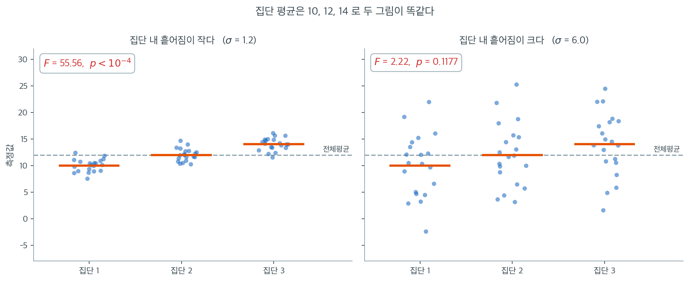
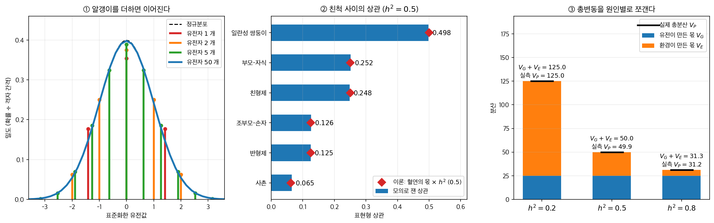
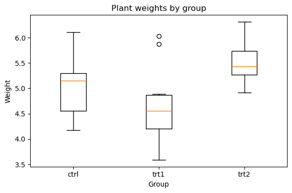
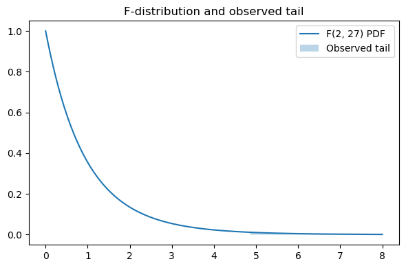
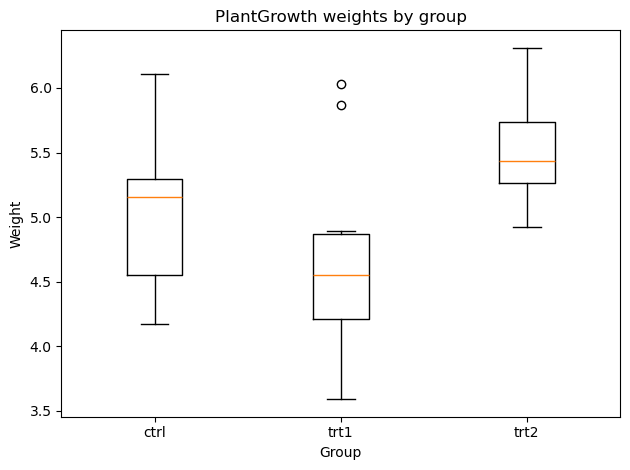

# 일원배치 분산분석: 모형과 가정

## 1. 일원배치 분산분석

### A. 일원배치 분산분석이란

일원배치 분산분석(One-Way ANOVA)은 셋 이상의 독립 집단의 평균 사이에 유의한 차이가 있는지 판정하는 통계 기법이다. 두 집단만 비교할 수 있는 이표본 t-검정과 달리, 일원배치 분산분석은 여러 집단을 동시에 평가하는 방법을 제공하여, 쌍별 비교를 여러 번 수행할 때 참인 귀무가설을 잘못 기각하는 제1종 오류의 가능성을 줄여 준다.

일원배치 분산분석의 핵심 개념은 자료에서 관측된 전체 변동을 두 성분으로 분해하는 것이다: 집단 **간** 변동과 각 집단 **내** 변동. 이 두 변동 원천을 비교하여, 관측된 집단 평균의 차이가 우연으로 기대되는 정도보다 큰지를 판정한다.

구체적으로 일원배치 분산분석은 집단 간 분산과 집단 내 분산의 비로 계산되는 **F-통계량**을 쓴다. F-통계량이 1보다 유의하게 크면 집단 평균의 차이가 무작위 변동만으로 생길 수 있는 정도보다 크다는 뜻이며, 적어도 한 집단의 평균이 다른 집단과 유의하게 다름을 시사한다.

"집단 평균이 다르다"는 말이 그 자체로는 아무 정보도 주지 않는다는 점이 이 절의 핵심이다. 아래 두 그림은 **집단 평균이 정확히 같다.** 세 집단의 평균이 양쪽 모두 $10,\ 12,\ 14$이고 크기도 모두 $n = 20$이다. 달라진 것은 집단 **안의** 흩어짐 하나뿐이다.



집단 간 제곱합 $\text{SS}_B$는 집단 평균과 표본크기만으로 정해지므로 양쪽 모두 $160.0$으로 **완전히 같다.** 왼쪽은 $\sigma = 1.2$여서 집단 내 제곱합이 $\text{SS}_W = 82.1$밖에 되지 않고, 그 결과 $F = 55.56$으로 $p < 10^{-4}$이다. 오른쪽은 $\sigma = 6.0$이어서 $\text{SS}_W = 2052.0$까지 부풀고 $F = 2.22$, $p = 0.1177$이 되어 기각하지 못한다. **평균 차이는 한 치도 변하지 않았는데 결론이 뒤집혔다.**

$F$가 비(ratio)인 이유가 여기 있다. 분자 $\text{MS}_B = \text{SS}_B/(k-1)$만 보면 두 그림이 같은 값 $80.0$을 주지만, 그 값이 큰지 작은지 판단할 잣대가 없다. 잣대는 같은 자료가 스스로 제공한다. 집단 안에서 관측값들이 이미 얼마나 흔들리는지를 $\text{MS}_W$로 재고, 집단 평균의 흩어짐이 그 흔들림보다 얼마나 더 큰지를 묻는 것이다. 왼쪽에서는 $80.0 / 1.44 = 55.6$배, 오른쪽에서는 $80.0 / 36.0 = 2.2$배다.

오른쪽 그림에서 두 번째·세 번째 집단의 점들이 첫 번째 집단의 점들과 거의 완전히 겹쳐 보인다는 사실에도 주목하라. 눈으로도 세 집단을 구별할 수 없다. $F$ 검정은 이 시각적 판단을 수치로 옮긴 것이며, 그래서 "평균이 실제로 다른데도 기각하지 못하는" 오른쪽 같은 상황이 잘못이 아니라 자료가 가진 정보의 한계를 정직하게 보고한 결과다.

일원배치 분산분석의 가정 중 하나는 각 집단의 자료가 정규분포를 따르고 집단 사이의 분산이 대략 같다는 것(분산의 동질성)이다. 또한 관측값들이 서로 독립이어야 한다. 이 가정들이 어긋나면 부정확한 결론에 이를 수 있으므로 다른 접근이나 조정(예: Welch 분산분석이나 비모수 검정)이 필요할 수 있다.

전체적으로 일원배치 분산분석은 의학, 심리학, 농학, 경영학처럼 서로 다른 처치·조건·집단의 효과를 비교하려는 여러 분야에서 특히 유용하다. 다중 가설검정에 따르는 오류 위험을 통제하면서 여러 집단 사이의 차이를 간결하고 효율적으로 평가하게 해 준다.

일원배치 분산분석의 결과가 유의하면 어느 집단이 서로 다른지 짚어내기 위해 보통 추가 분석이 필요하다. 이 후속 과정은 흔히 **사후검정**(예: Tukey의 HSD, Bonferroni 보정)으로 이루어지며, 제1종 오류를 통제하면서 어느 집단 평균 쌍이 유의하게 다른지 판정하도록 돕는다.

### B. 두 집단을 비교할 때 일원배치 분산분석과 t-검정

두 집단을 비교할 때 일원배치 분산분석과 t-검정은 공통점이 있지만 가정과 용도에서 중요한 차이도 있다.

#### 공통점

1. **목적**: 둘 다 집단 평균을 비교하여 통계적으로 유의한 차이가 있는지 판정하는 데 쓰인다. 관측된 차이가 우연히 생겼을 가능성을 검정하도록 설계되었다.

2. **귀무가설**: 두 검정 모두 집단 평균 사이에 차이가 없다는 귀무가설을 평가한다. 다시 말해 두 집단에 대해 반증되기 전까지 평균이 같다고 가정한다.

3. **해석**: 둘 다 p-값을 제공하며 이를 통해 귀무가설을 기각할지 결정한다. p-값이 지정한 유의수준(예: 0.05)보다 작으면 귀무가설을 기각하고 평균 사이에 유의한 차이가 있다고 결론짓는다.

4. **두 집단에서의 동치성**: 분산이 같은 두 집단만 비교하는 경우 일원배치 분산분석과 스튜던트의 t-검정은 동치인 결과를 준다. 일원배치 분산분석의 F-통계량은 t-검정 t-통계량의 제곱과 같아서, 두 검정이 같은 p-값을 주고 같은 결론에 이른다.

#### 둘일 때 같은 수를 내는데도 둘을 구별하는 까닭

1. **분산에 대한 가정**: t-검정에는 두 형태가 있다. 스튜던트의 t-검정과 Welch의 t-검정이다. 스튜던트의 t-검정은 두 집단의 분산이 같다고(분산의 동질성) 가정한다. 반면 Welch의 t-검정은 등분산을 가정하지 않아 집단 분산이 다를 때 더 적합하다. 일원배치 분산분석은 집단 사이의 등분산을 가정한다. 등분산성이라 부르는 이 가정은 검정의 신뢰성에 결정적이다. 가정이 어긋나면 표준 일원배치 분산분석이 적절하지 않을 수 있고 Welch 분산분석 같은 형태를 대신 써야 한다.

2. **쓰임새**: t-검정은 두 집단의 평균을 비교하도록 특별히 설계되었다. 비교할 집단이 둘뿐이면 더 간단하고 효율적이다. 일원배치 분산분석은 보통 셋 이상의 집단 평균을 비교하는 데 쓰지만 두 집단에도 쓸 수 있다. 집단이 둘뿐이면 대개 t-검정이 더 간명하며, 분산이 같다면 일원배치 분산분석도 같은 결과를 준다.

3. **통계적 출력**: t-검정은 t-통계량과 p-값을 준다. t-통계량은 집단 내 변동에 대비한 집단 평균의 차이를 나타낸다. 일원배치 분산분석은 F-통계량과 p-값을 준다. F-통계량은 집단 간 분산과 집단 내 분산의 비를 나타낸다. 두 집단에서는 F-통계량이 단순히 t-통계량의 제곱이다.

4. **유연성과 확장성**: t-검정은 두 집단 비교에 한정된다. 집단이 셋 이상이면 t-검정을 여러 번 수행할 때 제1종 오류(거짓 양성)의 위험이 커진다. 일원배치 분산분석은 둘 이상의 집단을 한 번에 비교할 수 있어 더 유연하다. 제1종 오류율을 통제하도록 설계되어 여러 집단을 비교할 때 더 적절하다.

#### 각각을 언제 쓰는지에 대한 예

- **t-검정**: 서로 다른 두 학습법을 쓴 학생들의 평균 점수를 비교한다고 하자. 두 집단(예: 방법 A 대 방법 B)의 분산이 비슷하면 스튜던트의 t-검정이 적절하다. 분산이 다르면 Welch의 t-검정을 써야 한다.

- **일원배치 분산분석**: 서로 다른 세 학습법(방법 A, B, C)을 쓴 학생들의 평균 점수를 비교한다고 하자. 이 경우 일원배치 분산분석이 적절한 선택이다. 집단이 둘뿐이어도 일원배치 분산분석을 쓸 수 있지만 대개는 t-검정이 더 간단하다.

#### 요약

일원배치 분산분석과 t-검정은 집단 평균을 비교하여 유의한 차이가 있는지 판정한다는 공통 목표를 갖는다. 둘 다 평균이 같다는 귀무가설을 검정하고 해석을 위한 p-값을 준다. 그러나 분산에 대한 가정과 의도된 쓰임새가 다르다.

- **분산이 같은 두 집단**을 비교할 때에는 간단하고 효율적인 **t-검정**(스튜던트의 t-검정)이 흔히 더 나은 선택이다.
- **분산이 다를 때** 두 집단을 비교하려면 **Welch의 t-검정**이 선호된다.
- **집단이 셋 이상**일 때에는 여러 번의 t-검정보다 제1종 오류율을 잘 통제하는 **일원배치 분산분석**이 더 적절하다.

이렇게 특정 조건에서는 두 집단에 대해 일원배치 분산분석과 t-검정이 동치인 결과를 주지만, 분산 가정과 유연성의 차이 때문에 각 검정이 적합한 상황이 다르다.

### C. 일원배치 분산분석의 귀무가설과 선형회귀의 비교

$$\begin{array}{cccccccc}
&&\text{선형회귀}&&\text{일원배치 분산분석}\\
\text{모형}&&y=\alpha+\beta x+\text{noise}
&&
y=\alpha+\sum_{i=1}^{k}\beta_i 1_{x\in C_i}+\text{noise}
\\
\text{H}_0&&\beta=0
&&
\quad\beta_1=\cdots=\beta_k=0\\
\end{array}$$

일원배치 분산분석은 독립변수가 서로 다른 집단을 나타내는 범주형인 선형회귀 모형의 특수한 형태로 볼 수 있다. 전형적인 선형회귀에서는 설명변수 $x$가 연속형이고 종속변수 $y$와 $x$의 관계가 다음으로 표현된다:

$$y = \alpha + \beta x + \text{noise}$$

여기서 $\alpha$는 절편, $\beta$는 기울기, "noise"는 무작위 오차이다. 이 모형의 귀무가설 $H_0$은 $\beta = 0$, 즉 $x$가 $y$에 영향을 주지 않는다는 것이다.

$$H_0: \beta = 0$$

반면 일원배치 분산분석은 여러 집단의 평균을 비교하여 관계를 모형화한다. 범주형 변수가 집단 $C_1, C_2, \dots, C_k$를 정의하고 모형은 다음과 같이 쓰인다:

$$y = \alpha + \sum_{i=1}^{k} \beta_i 1_{x \in C_i} + \text{noise}$$

여기서 $1_{x \in C_i}$는 $x$가 집단 $C_i$에 속하면 1, 아니면 0인 지시함수이다. $\alpha$는 전체 평균이고 각 $\beta_i$는 집단 $C_i$가 전체 평균에서 벗어난 정도를 나타낸다.

일원배치 분산분석의 귀무가설은 모든 집단의 평균이 같다는 것이며 다음으로 표현된다:

$$H_0: \beta_1 = \beta_2 = \cdots = \beta_k = 0$$

집단 평균들 사이에 유의한 차이가 없다는 뜻이다. 이 가설을 기각하면 적어도 한 집단의 평균이 다른 집단과 유의하게 다름을 시사한다.

<div class="storybox" markdown>

**그림으로 보는 통계학 1.** 「분산」이라는 말이 만들어진 날

이 절의 첫 문장은 **전체 변동을 두 성분으로 쪼갠다**고 했다. 그 생각이 처음 쓰인 자리는
밭도 공장도 아니었다. [로담스테드의 밭](../anova_two_way/two_way.md)은 그보다 한 해
뒤의 일이고, 처음 자리는 **유전학 논쟁**이었다.

$1900$ 년에 멘델이 재발견된 뒤 생물학은 둘로 갈려 있었다. 한쪽은 유전이 **알갱이**라고
했다 — 완두콩은 둥글거나 주름지거나 둘 중 하나다. 다른 쪽(칼 피어슨을 비롯한
생물측정학파)은 자료를 들이밀었다 — 사람의 키는 이어져 있고, 정규분포에 가깝고,
부모와 자식의 상관이 $0.5$ 쯤 된다. 알갱이가 어떻게 이어진 것을 만드는가.

$1918$ 년, 스물여덟의 **로널드 피셔**가 그 물음에 답한다. 답은 알갱이가 **아주 많으면**
된다는 것이었다. 그런데 그것을 보이려면 「키의 변동 가운데 유전이 만든 몫이 얼마이고
환경이 만든 몫이 얼마인가」를 **수로 쪼개야** 했고, 그 몫을 재는 양에 이름이 없었다.
그가 표준편차의 제곱에 이름을 붙인다 — **분산**(variance). 이 책에서 수백 번 쓰이는
그 말이 거기서 나왔다.

논문을 따라 직접 재현해 보았다. 자리 $50$ 개, 각각 작고 더해지는 효과, 가계 $20$ 만 벌이다.



- **①** 유전자 하나면 유전값은 세 덩어리뿐이다. 둘이면 다섯, 다섯이면 열하나. $50$ 개가
  되면 격자가 촘촘해져 **정규곡선 위에 그대로 얹힌다.** 알갱이가 이어진 것을 만든다.
- **②** 그리고 친척 사이의 상관이 **혈연의 몫 그대로** 나온다. 일란성 쌍둥이 $h^2$,
  부모–자식과 친형제 $h^2/2$, 조부모–손자와 반형제 $h^2/4$, 사촌 $h^2/8$. $h^2 = 0.5$ 로
  두고 재면 $0.498$, $0.252$, $0.248$, $0.126$, $0.125$, $0.065$ 다. 생물측정학파가
  **관찰한** 수를 멘델의 알갱이로 **계산해 낸** 것이다.
- **③** 그 계산의 뼈대가 이것이다. $V_P = V_G + V_E$ — 총변동이 원인별 몫으로 정확히
  쪼개진다. $h^2$ 를 $0.2,\ 0.5,\ 0.8$ 로 바꿔도 몫의 합이 실측 총분산과 맞고,
  $V_G / V_P$ 가 $h^2$ 를 그대로 되돌린다($0.199$, $0.501$, $0.799$).

**③ 이 분산분석이다.** 위 식의 $\text{SS}_T = \text{SS}_B + \text{SS}_W$ 는 같은 쪼개기를
「유전 대 환경」이 아니라 「집단 간 대 집단 내」로 쓴 것일 뿐이다. 이름도 거기서 그대로
왔다 — **변동의 분석**(analysis of variance).

뒷이야기가 하나 있다. 피셔는 이 논문을 런던 왕립학회에 먼저 냈는데 거절당했다. 심사를
맡은 두 사람이 **칼 피어슨**과 유전학자 **R. C. 퍼넷**이었다. 논문이 무너뜨리려던 쪽의
대표와, 수학을 따라갈 수 없다고 한 쪽의 대표였던 셈이다. 찰스 다윈의 아들 **레너드 다윈**
소령이 밀어 준 끝에 에든버러 왕립학회 회보에 실렸다. 통계학에서 가장 많이 쓰이는 낱말
하나와 가장 많이 쓰이는 표 하나가 **거절당한 논문**에서 나온 것이다.

_확인한 곳 — R. A. Fisher, "The Correlation between Relatives on the Supposition of
Mendelian Inheritance", 『Transactions of the Royal Society of Edinburgh』 $52$ 권 $2$ 호
$399$–$433$ 쪽($1918$) — 이 논문에서 「분산」이라는 말이 통계학의 뜻으로 쓰이기 시작했고,
표현형 분산을 유전과 환경의 몫으로 나누는 틀이 여기서 나왔다 · A. W. F. Edwards,
"Commentary: On R. A. Fisher's paper 'The causes of human variability', 1918",
『International Journal of Epidemiology』 $48$ 권 $1$ 호 $12$–$13$ 쪽($2019$) — 런던
왕립학회 투고가 칼 피어슨과 R. C. 퍼넷의 심사를 거쳐 거절되었고 레너드 다윈의 지원으로
에든버러에서 출판되었다는 경위. 그림의 수는 모두 직접 계산한 값이다_

</div>

---

## 2. 일원배치 분산분석의 가정

### 언제 일원배치 분산분석을 쓰는가

- **독립변수**: 일원배치 분산분석은 수준(집단)이 셋 이상인 독립변수(요인이라고도 한다)가 하나 있을 때 쓴다. 예를 들어 세 가지 식이요법이 체중 감량에 미치는 효과를 비교한다면 식이요법이 집단이 된다.

- **종속변수**: 종속변수(측정하는 것)는 연속형이어야 한다. 키, 몸무게, 시험 점수처럼 어떤 범위 안의 값을 가질 수 있다는 뜻이다.

### 일원배치 분산분석의 가정

일원배치 분산분석을 수행하기 전에 다음 가정들이 충족되어야 한다:

- **관측의 독립성**: 각 표본이 다른 표본과 독립이다. 자료는 무작위 과정을 통해 수집되어 각 집단의 관측값이 서로 독립임이 보장되어야 한다.

- **정규성**: 종속변수가 각 집단 안에서 근사적으로 정규분포를 따라야 한다. 표본이 작을 때 특히 중요하며 Q-Q 그림 같은 시각적 방법이나 Shapiro-Wilk 검정 같은 통계적 방법으로 확인할 수 있다. 표본이 크면 중심극한정리가 정규성 근사를 돕는다.

- **분산의 동질성(등분산성)**: 집단 사이의 분산이 비슷해야(동질적이어야) 한다. 이 가정은 Levene 검정이나 Bartlett 검정으로 확인할 수 있다. 가정이 어긋나면 Welch 분산분석 같은 대안을 고려할 수 있다.

**정규성을 어떻게 확인하는지는 14장이 맡는다.** 형식적 검정은 14.4절 [Shapiro-Wilk 검정](../../ch14/formal_tests/shapiro_wilk.md)을 비롯한 14.4절 네 쪽이, 그 검정을 언제 믿을 수 있는지는 14.5절 [정규성 검정의 한계와 함정](../../ch14/limitations/limitations.md)이 다룬다.

---

## 3. 한계

- **가정에 대한 민감성**: 일원배치 분산분석의 결과는 가정 위반, 특히 분산의 동질성과 정규성 위반에 민감할 수 있다.
- **전체 차이만 탐지**: 일원배치 분산분석은 집단 사이에 유의한 차이가 있는지는 탐지하지만 어느 집단이 다른지는 알려주지 않는다. 세부 비교에는 사후검정이 필요하다.

## 4. 모형의 양을 손으로 짚어 보기

절 $1$~$3$ 은 모형과 가정을 말로 세웠다. 같은 자료(`PlantGrowth`, $k = 3$ 집단에
집단당 $n = 10$)로 그 양들을 하나씩 짚어 본다. 자유도가 왜 $2$ 와 $27$ 인지,
요약통계 세 쌍만으로 $F$ 가 복원되는지, 그리고 관측된 $F$ 가 기준분포의 어디에
놓이는지다.

### 자료와 자유도

PlantGrowth 자료에는 $k = 3$개 집단(ctrl, trt1, trt2)에서 측정한 반응변수(weight)가 들어 있다. 전체 관측이 $N = 30$개이므로 $F$-검정의 자유도는

$$
df_1 = k - 1 = 2, \qquad df_2 = N - k = 27
$$

이다.

<div class="exbox" markdown>

**보기 1.** <span class="diff easy" title="쉬움"></span> 자유도는 왜 $2$ 와 $27$ 인가. PlantGrowth 자료는 $k = 3$개 집단에 집단당 $n = 10$개씩, 전체 $N = 30$개다.

**(1)** 총제곱합이

$$
SST = SSB + SSW
$$

로 쪼개짐을 보이고(교차항이 사라지는 까닭을 밝히라), 자유도도 $N - 1 = (k-1) + (N-k)$ 로 따라 쪼개짐을 설명하시오.

**(2)** 균형 설계에서 $MSW$ 가 **집단별 표본분산의 단순평균**임을 보이고, 집단 요약표(개수·평균·표준편차)만 가지고 $MSW$ 를 구한 뒤 원자료로 계산한 값과 맞는지 확인하시오.

</div>

??? success "풀이"

    **(1) 해석적으로.** 관측값 하나를 전체평균에서 잰 편차를 두 조각으로 나눈다.

    $$
    y_{ij} - \bar y_{\cdot\cdot} = \underbrace{(y_{ij} - \bar y_{i\cdot})}_{\text{집단 안}} + \underbrace{(\bar y_{i\cdot} - \bar y_{\cdot\cdot})}_{\text{집단 사이}}
    $$

    양변을 제곱해 모든 $i, j$ 에 대해 더하면

    $$
    SST = \sum_{i}\sum_{j} (y_{ij} - \bar y_{i\cdot})^2 + \sum_i n_i (\bar y_{i\cdot} - \bar y_{\cdot\cdot})^2 + 2\sum_i (\bar y_{i\cdot} - \bar y_{\cdot\cdot}) \sum_j (y_{ij} - \bar y_{i\cdot})
    $$

    인데, 안쪽 합 $\sum_j (y_{ij} - \bar y_{i\cdot})$ 은 **집단 평균에서 잰 편차의 합이므로 정확히 $0$** 이다. 교차항이 통째로 사라지고

    $$
    SST = SSW + SSB
    $$

    만 남는다. 이것은 근사가 아니라 **항등식**이다. 어떤 자료에서도, 집단 평균이 모두 같든 전혀 다르든, 소수점 끝자리까지 성립한다.

    자유도도 같이 쪼개진다. 기하로 보면 셋은 모두 제곱노름이다.

    - $SST$ 는 $\mathbf 1$ 에 직교하는 부분공간 위의 길이이므로 차원이 $N-1$.
    - $SSB$ 가 사는 곳은 집단 지시벡터 $k$ 개가 치는 공간에서 $\mathbf 1$ 방향을 뺀 것이므로 차원이 $k-1$.
    - $SSW$ 는 각 집단 안에서 그 집단 평균을 뺀 것이므로 집단마다 $n_i - 1$, 합쳐서 $N-k$.

    뒤의 두 공간은 서로 직교하고 합치면 첫째 공간이 되므로

    $$
    N - 1 = (k-1) + (N-k)
    $$

    이다. 여기서는 $29 = 2 + 27$ 이고, 이것이 $F_{2,27}$ 의 두 자유도다.

    **(2) 균형 설계의 $MSW$.** 집단 $i$ 의 표본분산을 $s_i^2 = \frac{1}{n_i-1}\sum_j (y_{ij} - \bar y_{i\cdot})^2$ 라 쓰면 $SSW = \sum_i (n_i - 1) s_i^2$ 이므로

    $$
    MSW = \frac{SSW}{N-k} = \frac{\sum_i (n_i-1)s_i^2}{\sum_i (n_i-1)}
    $$

    로 **표본분산들의 가중평균**이다. 균형 설계 $n_i \equiv n$ 이면 가중치가 모두 $n-1$ 로 같아져

    $$
    MSW = \frac{(n-1)\sum_i s_i^2}{k(n-1)} = \frac{1}{k}\sum_{i=1}^{k} s_i^2
    $$

    곧 **단순평균**이 된다. 요약표의 세 표준편차만 있으면

    $$
    MSW \approx \frac{0.5831^2 + 0.7937^2 + 0.4426^2}{3} = \frac{0.340006 + 0.629960 + 0.195895}{3} = 0.388620
    $$

    이다.

    ```python
    import numpy as np
    import pandas as pd
    from scipy import stats

    url = ('https://raw.githubusercontent.com/vincentarelbundock/'
           'Rdatasets/1dcc2bf5f955cc1224a3e1307256e1fe86b68dae/csv/datasets/PlantGrowth.csv')
    df = pd.read_csv(url, usecols=[1, 2])
    g = df.groupby('group')
    # f_oneway는 집단을 **별도의 배열**로 받는다. 긴 형식 데이터프레임을 그대로
    # 넘길 수 없어서 이렇게 쪼개야 한다. statsmodels의 ols 방식은 그 반대다.
    ctrl = g.get_group('ctrl').weight.values
    trt1 = g.get_group('trt1').weight.values
    trt2 = g.get_group('trt2').weight.values

    print(df.groupby('group').weight.agg(['count', 'mean', 'std']).round(4))

    groups = [ctrl, trt1, trt2]
    n = np.array([len(x) for x in groups])
    mean_i = np.array([x.mean() for x in groups])
    var_i = np.array([x.var(ddof=1) for x in groups])
    N, k = n.sum(), len(groups)
    grand = df.weight.mean()

    # 제곱합 분해. 세 수를 따로 계산하고 항등식이 맞는지 본다.
    SSB = (n * (mean_i - grand) ** 2).sum()
    SSW = ((n - 1) * var_i).sum()
    SST = ((df.weight - grand) ** 2).sum()
    print(f"\nSSB = {SSB:.6f}   SSW = {SSW:.6f}   합 = {SSB + SSW:.6f}")
    print(f"SST = {SST:.6f}   차이 = {abs(SST - SSB - SSW):.3e}")
    print(f"자유도  {N - 1} = {k - 1} + {N - k}")

    # 균형 설계이므로 MSW 는 표본분산의 단순평균이어야 한다.
    MSW = SSW / (N - k)
    print(f"\nMSW(=SSW/(N-k)) = {MSW:.8f}")
    print(f"표본분산의 단순평균 = {var_i.mean():.8f}")

    # 요약표의 반올림된 표준편차만 쓰면 얼마나 어긋나는가.
    sd_rounded = np.array([0.5831, 0.7937, 0.4426])
    print(f"반올림 표준편차로 = {(sd_rounded ** 2).mean():.8f}")
    print(f"합동표준편차 sqrt(MSW) = {np.sqrt(MSW):.4f}")
    ```

    출력:

    ```
           count   mean     std
    group
    ctrl      10  5.032  0.5831
    trt1      10  4.661  0.7937
    trt2      10  5.526  0.4426

    SSB = 3.766340   SSW = 10.492090   합 = 14.258430
    SST = 14.258430   차이 = 3.553e-15
    자유도  29 = 2 + 27

    MSW(=SSW/(N-k)) = 0.38859593
    표본분산의 단순평균 = 0.38859593
    반올림 표준편차로 = 0.38862002
    합동표준편차 sqrt(MSW) = 0.6234
    ```

    **분해가 맞는다.** $SSB + SSW = 14.258430$ 이 $SST$ 와 자릿수 끝까지 같고(차이 $3.6\times10^{-15}$ 는 부동소수점 반올림이다), 자유도도 $29 = 2 + 27$ 로 갈린다.

    **단순평균 공식도 맞는다.** $SSW/(N-k)$ 와 $\frac13\sum s_i^2$ 이 $0.38859593$ 으로 여덟 자리까지 같다. 표의 반올림된 표준편차를 쓰면 $0.38862002$ 로 다섯째 자리에서 어긋나는데, 이것은 공식이 틀려서가 아니라 **표준편차를 소수 넷째 자리에서 끊었기 때문**이다. 손으로 검산할 때는 이 정도 오차를 각오해야 한다.

    집단당 10개씩 균형 설계다. 표본표준편차가 0.44에서 0.79까지 1.8배 차이 나는데, 이 정도는 등분산 가정을 크게 흔들지 않는다(자세한 확인은 Levene 검정 페이지 참조). 합동표준편차 $\sqrt{MSW} = 0.6234$ 가 그 셋을 대표하는 하나의 수다.

---

### 분산분석 수행

SciPy의 `f_oneway`는 각 집단을 별도의 배열로 받아 $F$-통계량과 $p$-값을 돌려준다:

$$
F = \frac{MSB}{MSW} = \frac{SSB / (k-1)}{SSW / (N-k)}
$$

<div class="exbox" markdown>

**보기 2.** <span class="diff easy" title="쉬움"></span> 요약통계만으로 $F$ 를 손계산하기.

**(1)** 보기 1의 요약표(개수 $10, 10, 10$, 평균 $5.032,\ 4.661,\ 5.526$)와 $MSW$ 만 가지고 $F$ 를 계산하시오. 원자료는 쓰지 말 것.

**(2)** 집단이 **둘뿐이면** $F = t^2$ 임을 보이시오. 여기서 $t$ 는 합동분산을 쓴 이표본 $t$ 통계량이다. ctrl 과 trt1 두 집단으로 이 항등식을 수치 확인하고, $p$-값까지 같아지는 까닭을 밝히시오.

</div>

??? success "풀이"

    **(1) 해석적으로.** 균형 설계이므로 전체평균은 세 집단평균의 단순평균이다.

    $$
    \bar y_{\cdot\cdot} = \frac{5.032 + 4.661 + 5.526}{3} = 5.073
    $$

    집단 간 제곱합은 집단평균이 전체평균에서 얼마나 떨어져 있는지를 표본크기로 가중해 더한 것이다.

    $$
    SSB = 10\left[(5.032 - 5.073)^2 + (4.661 - 5.073)^2 + (5.526 - 5.073)^2\right] = 3.76634
    $$

    자유도 $k - 1 = 2$ 로 나누면 $MSB = 1.88317$ 이고, 보기 1의 $MSW = 0.388596$ 으로 나누면

    $$
    F = \frac{MSB}{MSW} = \frac{1.88317}{0.388596} = 4.84609
    $$

    이다. **원자료 30개는 한 번도 쓰이지 않았다.** 분산분석은 집단별 $(n_i, \bar y_i, s_i^2)$ 세 쌍만 있으면 완전히 재구성된다.

    **(2) $k = 2$ 이면 $F = t^2$.** 두 집단일 때 전체평균은 $\bar y = \frac{n_1\bar y_1 + n_2 \bar y_2}{n_1+n_2}$ 이므로

    $$
    \bar y_1 - \bar y = \frac{n_2(\bar y_1 - \bar y_2)}{n_1+n_2},
    \qquad
    \bar y_2 - \bar y = \frac{-\,n_1(\bar y_1 - \bar y_2)}{n_1+n_2}
    $$

    이다. 이것을 $SSB$ 에 넣으면

    $$
    SSB = \frac{n_1 n_2^2 + n_2 n_1^2}{(n_1+n_2)^2}(\bar y_1 - \bar y_2)^2
        = \frac{n_1 n_2}{n_1+n_2}(\bar y_1 - \bar y_2)^2
        = \frac{(\bar y_1 - \bar y_2)^2}{\frac{1}{n_1} + \frac{1}{n_2}}
    $$

    이고 $k - 1 = 1$ 이므로 $MSB = SSB$ 다. 한편 $MSW$ 는 정확히 합동분산 $s_p^2$ 이므로

    $$
    F = \frac{MSB}{MSW} = \frac{(\bar y_1 - \bar y_2)^2}{s_p^2\left(\frac{1}{n_1}+\frac{1}{n_2}\right)}
      = \left[\frac{\bar y_1 - \bar y_2}{s_p\sqrt{\frac{1}{n_1}+\frac{1}{n_2}}}\right]^2 = t^2
    $$

    이다. **대수 항등식**이므로 자료가 무엇이든 소수점 끝까지 성립한다. $p$-값까지 같아지는 것은 분포 수준의 사실 때문이다. $T \sim t_m$ 이면 $T^2 \sim F_{1,m}$ 이고 $t$-검정의 양측 꼬리 $\{|T| \ge |t|\}$ 와 $F$-검정의 오른쪽 꼬리 $\{T^2 \ge t^2\}$ 는 **같은 사건**이다. 분산분석이 "양측"만 할 수 있는 이유도 여기에 있다.

    ```python
    # 보기 1 의 ctrl, trt1, trt2, n, mean_i, MSW, k 를 이어 쓴다.
    # F 는 집단 사이의 분산을 집단 안의 분산으로 나눈 값이다. 1 에 가까우면
    # 집단을 나눈 것이 아무 설명도 하지 못한다는 뜻이다.
    F, p = stats.f_oneway(ctrl, trt1, trt2)
    print(f"F = {F:.4f}, p = {p:.4f}")

    # 요약통계(개수와 평균)만으로 손계산한다.
    grand = (n * mean_i).sum() / n.sum()
    SSB_hand = (n * (mean_i - grand) ** 2).sum()
    MSB_hand = SSB_hand / (k - 1)
    print(f"\n전체평균 = {grand:.4f}")
    print(f"SSB = {SSB_hand:.6f}   MSB = {MSB_hand:.6f}   MSW = {MSW:.6f}")
    print(f"F(손계산) = {MSB_hand / MSW:.10f}")
    print(f"F(scipy)  = {F:.10f}")

    # k=2 이면 F = t^2 이어야 한다. ctrl 과 trt1 둘만 쓴다.
    F2, p2 = stats.f_oneway(ctrl, trt1)
    t2, pt = stats.ttest_ind(ctrl, trt1)
    print(f"\nk=2:  F = {F2:.10f}   t = {t2:.10f}   t^2 = {t2 ** 2:.10f}")
    print(f"      p(F) = {p2:.10f}   p(t) = {pt:.10f}")
    print(f"\nE[F(2,27)] = {27 / 25:.4f}")
    ```

    출력:

    ```
    F = 4.8461, p = 0.0159

    전체평균 = 5.0730
    SSB = 3.766340   MSB = 1.883170   MSW = 0.388596
    F(손계산) = 4.8460878624
    F(scipy)  = 4.8460878624

    k=2:  F = 1.4191012974   t = 1.1912603818   t^2 = 1.4191012974
          p(F) = 0.2490231660   p(t) = 0.2490231660

    E[F(2,27)] = 1.0800
    ```

    **손계산이 맞는다.** $F = 4.8460878624$ 가 `f_oneway` 의 값과 열 자리까지 같다.

    **$F = t^2$ 도 맞는다.** $t = 1.1912603818$ 을 제곱하면 $1.4191012974$ 로 $F$ 와 열 자리까지 일치하고, $p$-값도 $0.2490231660$ 으로 같다. 유도한 항등식이 수치로 확인되었다.

    $H_0: \mu_{\text{ctrl}} = \mu_{\text{trt1}} = \mu_{\text{trt2}}$ 아래에서 통계량은 $F \sim F_{2,27}$ 이고 그 기댓값은 $\frac{d_2}{d_2-2} = \frac{27}{25} = 1.08$ 이다. 관측값 $4.85$ 는 그 네 배를 넘는다. 왜 기댓값이 $1$ 근처인지는 $E[MSW] = \sigma^2$ 와 $E[MSB] = \sigma^2 + \frac{\sum n_i(\mu_i - \bar\mu)^2}{k-1}$ 에서 나온다. 귀무가설이 참이면 둘째 항이 $0$ 이라 분자와 분모가 같은 것을 재게 되고, 비는 $1$ 근처를 맴돈다.

---

### 시각화: 상자그림

상자그림은 각 집단의 중앙값, 사분위범위, 이상점을 보여주어 집단의 중심과 흩어짐이 다른지 즉시 감을 준다.

<div class="exbox" markdown>

**보기 3.** <span class="diff easy" title="쉬움"></span> 상자그림으로 보기. 세 집단의 무게를 상자그림으로 그린다.

**(1)** 그림에서 읽히는 것을 **수치와 함께** 적으시오. 세 상자의 위아래 관계는 어떠한가.

**(2)** 이 그림이 **가리는 것**은 무엇인가. 특히 분산분석의 $F$ 를 이 그림에서 눈대중으로 읽을 수 있는지 따지시오.

</div>

??? success "풀이"

    유도할 답이 있는 문제가 아니다. **그림에서 무엇이 읽히고 무엇이 읽히지 않는가**가 전부이므로, 눈으로 본 것을 수치로 바꿔 가며 읽는다.

    ```python
    import matplotlib.pyplot as plt

    plt.rcParams["font.sans-serif"] = ["NanumGothic", "Apple SD Gothic Neo", "Malgun Gothic"]
    plt.rcParams["font.family"] = "sans-serif"
    plt.rcParams["axes.unicode_minus"] = False

    # 상자그림이 실제로 그리는 수들을 먼저 찍어 둔다.
    names = ['ctrl', 'trt1', 'trt2']
    groups = [ctrl, trt1, trt2]
    print(f"{'group':>6}{'mean':>8}{'median':>8}{'Q1':>8}{'Q3':>8}{'IQR':>8}{'sd':>8}")
    for name, x in zip(names, groups):
        q1, q2, q3 = np.percentile(x, [25, 50, 75])
        print(f"{name:>6}{x.mean():>8.3f}{q2:>8.3f}{q1:>8.3f}{q3:>8.3f}"
              f"{q3 - q1:>8.3f}{x.std(ddof=1):>8.3f}")

    # 상자 바깥으로 따로 찍히는 점이 어느 집단에 있는가.
    for name, x in zip(names, groups):
        q1, q3 = np.percentile(x, [25, 75])
        lo, hi = q1 - 1.5 * (q3 - q1), q3 + 1.5 * (q3 - q1)
        flagged = np.sort(x[(x < lo) | (x > hi)])
        print(f"{name}: 울타리 밖 {flagged if len(flagged) else '없음'}")

    # 그림에서는 읽히지 않는 것 — 쌍별 t-검정의 p-값.
    for i in range(3):
        for j in range(i + 1, 3):
            t, p = stats.ttest_ind(groups[i], groups[j])
            print(f"{names[i]} vs {names[j]}: t = {t:+.4f}, p = {p:.4f}")

    # 검정을 하기 전이든 뒤든 그림을 본다. 상자가 겹치는 정도가 F 값과
    # 어떻게 맞물리는지 눈에 익혀 두면 좋다.
    fig, ax = plt.subplots(figsize=(6, 4))
    ax.boxplot([ctrl, trt1, trt2], labels=['ctrl', 'trt1', 'trt2'])
    ax.set_xlabel('Group')
    ax.set_ylabel('Weight')
    ax.set_title('Plant weights by group')
    plt.tight_layout()
    plt.show()
    ```

    출력:

    ```
     group    mean  median      Q1      Q3     IQR      sd
      ctrl   5.032   5.155   4.550   5.293   0.742   0.583
      trt1   4.661   4.550   4.207   4.870   0.662   0.794
      trt2   5.526   5.435   5.268   5.735   0.467   0.443
    ctrl: 울타리 밖 없음
    trt1: 울타리 밖 [5.87 6.03]
    trt2: 울타리 밖 없음
    ctrl vs trt1: t = +1.1913, p = 0.2490
    ctrl vs trt2: t = -2.1340, p = 0.0469
    trt1 vs trt2: t = -3.0101, p = 0.0075
    ```

    

    **(1) 읽히는 것.** 중앙값의 순서가 trt2($5.435$) > ctrl($5.155$) > trt1($4.550$)이고 평균의 순서($5.526 > 5.032 > 4.661$)와 같다. 세 상자가 서로 겹치기는 하지만 겹치는 정도가 쌍마다 크게 다르다.

    - **trt1 과 trt2 는 상자가 전혀 닿지 않는다.** trt1의 $Q_3 = 4.870$ 이 trt2의 $Q_1 = 5.268$ 보다 $0.40$ 아래다. 세 쌍 중 가장 뚜렷하게 갈린 쌍이다.
    - **ctrl 과 trt2 는 겨우 닿는다.** ctrl의 $Q_3 = 5.293$ 과 trt2의 $Q_1 = 5.268$ 이 폭 $0.025$ 만큼만 포갠다.
    - **ctrl 과 trt1 은 많이 겹친다.** trt1의 상자 윗변이 ctrl 상자 한가운데쯤에 온다.

    흩어짐도 집단마다 다르다. trt2의 $IQR = 0.467$ 이 가장 좁고 ctrl의 $0.742$ 가 가장 넓다. trt1에는 울타리 밖으로 따로 찍힌 점이 둘($5.87$, $6.03$) 있는데, 상자 윗변 $4.870$ 에서 한참 떨어져 있다.

    **(2) 가리는 것.**

    **첫째, 그림은 중앙값을 그리는데 분산분석은 평균을 쓴다.** ctrl에서 평균 $5.032$ 가 중앙값 $5.155$ 보다 $0.12$ 아래인데, 상자그림에는 그 선이 아예 그려지지 않는다. 여기서는 두 순서가 우연히 같았지만 치우친 자료에서는 갈라질 수 있고, 그때 상자그림으로 분산분석 결과를 가늠하면 틀린다.

    **둘째, $F$ 의 분모를 그림에서 읽을 수 없다.** $F$ 를 좌우하는 것은 $\sqrt{MSW} = 0.6234$ 인데, 상자그림이 보여 주는 흩어짐 척도는 표준편차가 아니라 $IQR$ 이다. 그런데 이 자료에서는 **두 척도의 순위가 서로 어긋난다.**

    | 집단 | $IQR$ | 표준편차 |
    |---|---|---|
    | ctrl | $0.742$ (가장 넓음) | $0.583$ |
    | trt1 | $0.662$ | $0.794$ (가장 큼) |
    | trt2 | $0.467$ | $0.443$ |

    $IQR$ 로는 ctrl이 가장 퍼져 보이지만 표준편차로는 trt1이 가장 크다. trt1의 두 바깥점 $5.87$, $6.03$ 이 표준편차를 끌어올리는 동안 $IQR$ 은 꿈쩍도 하지 않았기 때문이다. **상자그림은 설계상 꼬리의 무게를 지우는 그림이고, $MSW$ 는 바로 그 꼬리에 민감하다.**

    **셋째, 표본크기가 보이지 않는다.** 세 상자가 똑같이 당당해 보이지만 모두 $n = 10$ 짜리다. $n$ 이 다른 설계였다면 그림은 그대로인 채 $p$-값만 달라졌을 것이다.

    **넷째, 겹침의 정도와 $p$-값은 같은 것이 아니다.** 상자가 전혀 닿지 않는 trt1–trt2 쌍은 $p = 0.0075$, 겨우 닿는 ctrl–trt2 는 $p = 0.0469$, 많이 겹치는 ctrl–trt1 은 $p = 0.2490$ 으로 과연 순서는 맞는다. 그러나 이 수들은 어디까지나 **쌍별** 값이고 다중비교 보정을 하지 않은 것이라, 셋을 한꺼번에 묻는 $p = 0.0159$ 와는 다른 물음에 대한 답이다. 상자그림은 "어느 쌍이 다른가"를 묻게 만들지만 그 답을 주지는 못한다. 그 일은 사후검정의 몫이다.

    요약하면 $p = 0.016$ 이 "압도적"이 아니라 "그럭저럭 유의한" 정도인 이유가 그림에 그대로 나타난다. 세 상자가 완전히 떨어져 있지도, 포개져 있지도 않다.

---

### 시각화: 관측된 꼬리를 표시한 F-분포

$F_{2,27}$의 밀도함수를 그리고 관측된 $F$-통계량 너머의 넓이를 색칠하면 $p$-값을 기하적으로 해석할 수 있다. 그 넓이는 $H_0$ 아래에서 그만큼 또는 그보다 극단적인 $F$ 값을 관측할 확률이다.

<div class="exbox" markdown>

**보기 4.** <span class="diff easy" title="쉬움"></span> $d_1 = 2$ 일 때의 닫힌 꼴. 분자 자유도가 $2$ 인 것은 운이 좋은 경우다. 꼬리확률이 적분기호 없이 적힌다.

**(1)** $F \sim F_{2,m}$ 일 때

$$
P(F \ge f) = \left(1 + \frac{2f}{m}\right)^{-m/2},
\qquad
f_{F_{2,m}}(x) = \left(1 + \frac{2x}{m}\right)^{-(m+2)/2}
$$

임을 보이시오. 이로부터 밀도의 **최빈값이 어디인지** 말하고, 유의수준 $\alpha$ 의 임계값을 닫힌 꼴로 적으시오.

**(2)** $m = 27$, $f_{\text{obs}} = 4.846088$ 에 대해 (1)의 식이 `scipy` 와 맞는지 확인하시오.

</div>

??? success "풀이"

    **(1) 해석적으로.** 정의대로 $F = \dfrac{U/2}{V/m}$ 라 쓰자. 여기서 $U \sim \chi^2_2$, $V \sim \chi^2_m$ 이고 둘은 독립이다. 핵심은 **$\chi^2_2$ 가 평균 $2$ 인 지수분포**라는 것이다.

    $$
    P(U > u) = e^{-u/2}, \qquad u > 0
    $$

    (자유도 2의 카이제곱 밀도는 $\frac12 e^{-u/2}$ 이므로 곧바로 나온다.) 이제 $V$ 로 조건을 걸면

    $$
    P(F \ge f) = P\!\left(U \ge \frac{2fV}{m}\right)
    = E\!\left[\exp\!\left(-\frac{fV}{m}\right)\right]
    $$

    인데 이것은 $V \sim \chi^2_m$ 의 적률생성함수 $M_V(t) = (1-2t)^{-m/2}$ 를 $t = -f/m$ 에서 잰 값이다. 따라서

    $$
    P(F \ge f) = \left(1 + \frac{2f}{m}\right)^{-m/2}
    $$

    이다. 밀도는 이것을 $f$ 로 미분해 부호를 바꾸면 된다.

    $$
    f_{F}(x) = -\frac{d}{dx}\left(1+\frac{2x}{m}\right)^{-m/2}
    = \frac{m}{2}\cdot\frac{2}{m}\left(1+\frac{2x}{m}\right)^{-m/2-1}
    = \left(1+\frac{2x}{m}\right)^{-(m+2)/2}
    $$

    **최빈값은 $x = 0$ 이다.** 지수가 음수이고 밑이 $x$ 와 함께 커지므로 밀도는 $x = 0$ 에서 값 $1$ 을 갖고 **그 뒤로 단조감소**한다. 봉우리가 없다. 이것은 $d_1 = 2$ 에만 있는 특징으로, $d_1 \ge 3$ 이면 최빈값이 $\frac{(d_1-2)m}{d_1(m+2)} > 0$ 으로 안쪽에 생긴다. 그러니 "$F$ 분포가 $1$ 근처에 몰려 있다"는 말은 **기댓값 $E[F] = \frac{m}{m-2} = 1.08$ 에 대해서만 참이고 밀도의 모양에 대해서는 참이 아니다.** 아래 그림이 $x = 0$ 에서 $1.0$ 으로 시작해 내리막만 타는 이유가 이것이다.

    임계값은 꼬리확률 식을 뒤집어 풀면 된다. $\left(1+\frac{2f}{m}\right)^{-m/2} = \alpha$ 에서

    $$
    f_{\alpha,\,2,\,m} = \frac{m}{2}\left(\alpha^{-2/m} - 1\right)
    $$

    이고 $\alpha = 0.05$, $m = 27$ 이면 $\frac{27}{2}\left(0.05^{-2/27}-1\right)$ 이다.

    **(2) 수치적으로.**

    ```python
    import numpy as np

    plt.rcParams["font.sans-serif"] = ["NanumGothic", "Apple SD Gothic Neo", "Malgun Gothic"]
    plt.rcParams["font.family"] = "sans-serif"
    plt.rcParams["axes.unicode_minus"] = False

    # 자유도는 (집단 수 - 1, 전체 수 - 집단 수) = (2, 27) 이다.
    m = 27

    # 닫힌 꼴 꼬리확률과 scipy 를 맞춰 본다.
    p_closed = (1 + 2 * F / m) ** (-m / 2)
    p_scipy = stats.f(2, m).sf(F)
    print(f"닫힌 꼴 p = {p_closed:.10f}")
    print(f"scipy   p = {p_scipy:.10f}")
    print(f"차이      = {abs(p_closed - p_scipy):.3e}")

    # 밀도도 닫힌 꼴이다. x=0 에서 1 이고 단조감소한다.
    x = np.array([0.0, 0.5, 1.0, 2.0, 3.0, F, 8.0])
    pdf_closed = (1 + 2 * x / m) ** (-(m + 2) / 2)
    pdf_scipy = stats.f(2, m).pdf(x)
    print(f"\n{'x':>8}{'closed':>14}{'scipy':>14}")
    for xi, a, b in zip(x, pdf_closed, pdf_scipy):
        print(f"{xi:>8.3f}{a:>14.8f}{b:>14.8f}")

    # 임계값도 뒤집어 풀린다.
    crit_closed = m / 2 * (0.05 ** (-2 / m) - 1)
    print(f"\n임계값 닫힌 꼴 = {crit_closed:.8f}")
    print(f"임계값 scipy   = {stats.f(2, m).ppf(0.95):.8f}")
    print(f"E[F(2,27)] = {m / (m - 2):.4f},  최빈값 = 0 (밀도가 단조감소)")

    # 칠해진 오른쪽 꼬리의 넓이가 곧 p-값이다.
    x = np.linspace(0, 8, 400)
    pdf = stats.f(2, 27).pdf(x)

    fig, ax = plt.subplots(figsize=(6, 4))
    ax.plot(x, pdf, label='F(2, 27) PDF')
    mask = x >= F
    ax.fill_between(x[mask], pdf[mask], alpha=0.3, label='Observed tail')
    ax.set_title('F-distribution and observed tail')
    ax.legend()
    plt.tight_layout()
    plt.show()
    ```

    출력:

    ```
    닫힌 꼴 p = 0.0159099583
    scipy   p = 0.0159099583
    차이      = 2.776e-17

           x        closed         scipy
       0.000    1.00000000    1.00000000
       0.500    0.59017815    0.59017815
       1.000    0.35481634    0.35481634
       2.000    0.13490561    0.13490561
       3.000    0.05449071    0.05449071
       4.846    0.01170737    0.01170737
       8.000    0.00117350    0.00117350

    임계값 닫힌 꼴 = 3.35413083
    임계값 scipy   = 3.35413083
    E[F(2,27)] = 1.0800,  최빈값 = 0 (밀도가 단조감소)
    ```

    

    **세 식이 모두 맞는다.** 꼬리확률은 $0.0159099583$ 으로 열 자리까지 같고 차이가 $2.8\times10^{-17}$ 로 배정밀도 오차 수준이다. 밀도는 일곱 지점에서 여덟 자리까지 일치하며, 특히 $x = 0$ 에서 정확히 $1.00000000$ 이다. 임계값도 $3.35413083$ 으로 같다.

    칠해진 꼬리의 넓이가 바로 $p = 0.0159$ 다. 그림을 보면 밀도가 $x = 0$ 에서 $1.0$ 으로 출발해 내려가기만 하므로 **$F$ 가 작은 값일수록 더 흔하다.** 그런데도 $F$ 의 기댓값이 $1.08$ 인 것은 오른쪽 꼬리가 길어서다. 관측값 $4.85$ 는 그 기댓값의 네 배를 넘고 $5\%$ 임계값 $3.354$ 도 넘었으므로 $H_0$ 을 기각한다.

    한 가지 덧붙이면, 분자 자유도가 $2$ 가 아니면 이런 닫힌 꼴은 없다. $d_1$ 이 홀수이거나 $4$ 이상이면 꼬리확률이 불완전베타함수로만 적히고 수치적분이 필요하다. 집단이 **셋**일 때만 손으로 $p$-값을 낼 수 있다는 뜻이다.

색칠된 넓이는

$$
p = P(F_{2,27} \ge F_{\text{obs}})
$$

에 해당한다.

### 세 그림을 읽는 법

- **상자그림:** 상자들이 위아래로 떨어져 겹침이 적으면 집단 평균이 다를 가능성이 크다. 상자가 겹치면 $H_0$에 반하는 증거가 약함을 시사한다.
- **F-분포 그림:** 관측된 $F$가 크면 검정통계량이 오른쪽 꼬리 깊숙이 놓여 $p$-값이 작아진다. $F_{\text{obs}}$가 커질수록 색칠된 영역이 줄어든다.
- **판정:** $p < \alpha$(보통 0.05)이면 $H_0$을 기각하고 어느 쌍이 다른지 알아보기 위해 사후비교(예: Tukey HSD)로 넘어간다.

---


절 $1$ 의 C 는 분산분석이 범주형 설명변수를 쓰는 선형회귀라고 적었다. 그 말이
`statsmodels` 출력에서 어떻게 보이는지, 그리고 마지막으로 그림과 검정이 같은
이야기를 하는지 확인한다.

<div class="exbox" markdown>

**보기 5.** <span class="diff easy" title="쉬움"></span> 분산분석은 회귀다. `ols('weight ~ C(group)')` 는 회귀모형을 적합하는데 그 결과가 분산분석표로 나온다.

**(1)** 처리코딩(`C()` 의 기본값)에서 적합된 계수가

$$
\hat\beta_0 = \bar y_{\text{ctrl}},
\qquad
\hat\beta_1 = \bar y_{\text{trt1}} - \bar y_{\text{ctrl}},
\qquad
\hat\beta_2 = \bar y_{\text{trt2}} - \bar y_{\text{ctrl}}
$$

임을 보이고, 설계행렬의 계수(rank)가 $k = 3$ 이므로 잔차 자유도가 $N - k = 27$ 임을 설명하시오. 또 $R^2 = SSB/SST$ 임을 밝히시오.

**(2)** 계수와 자유도를 수치로 확인하고, **`C()` 를 빠뜨려 수준이 $0,1,2$ 로 코딩된 열을 그대로 넣으면** 무엇이 달라지는지 보이시오.

</div>

??? success "풀이"

    **(1) 해석적으로.** 처리코딩의 설계행렬은 열이 셋이다. 모두 $1$ 인 열, trt1 이면 $1$ 인 지시열, trt2 이면 $1$ 인 지시열. 그러면 적합값이

    $$
    \hat y_{ij} = \beta_0 + \beta_1 \mathbf 1\{i = \text{trt1}\} + \beta_2 \mathbf 1\{i = \text{trt2}\}
    $$

    인데, 이 모형은 **집단마다 자유로운 상수 하나**를 주는 것과 같다. 집단 $i$ 의 적합값은 $\mu_i$ 라는 하나의 수이고, 제곱오차

    $$
    \sum_{i}\sum_j (y_{ij} - \mu_i)^2
    $$

    를 $\mu_i$ 에 대해 따로따로 최소화하면 $\hat\mu_i = \bar y_{i\cdot}$ 이다(제곱합의 최소점은 평균이다). 이제 모수로 되돌리면

    $$
    \hat\beta_0 = \hat\mu_{\text{ctrl}} = \bar y_{\text{ctrl}},
    \qquad
    \hat\beta_1 = \hat\mu_{\text{trt1}} - \hat\mu_{\text{ctrl}},
    \qquad
    \hat\beta_2 = \hat\mu_{\text{trt2}} - \hat\mu_{\text{ctrl}}
    $$

    이다. **절편은 기준집단의 평균이고 나머지는 기준집단과의 차이다.** 기준집단은 알파벳 순 첫 수준인 ctrl 이 자동으로 맡는다.

    설계행렬의 세 열은 선형독립이므로 계수가 $3$ 이고, 사영공간의 차원이 $3$ 이라 잔차공간의 차원은 $N - 3 = 27$ 이다. 이것이 $MSW$ 의 자유도이고 앞 절의 $N-k$ 와 같은 수다.

    $R^2$ 은 정의가 $1 - SSE/SST_{\text{total}}$ 인데 적합값이 집단평균이므로 $SSE = SSW$ 이고 $SST_{\text{total}} - SSW = SSB$ 다. 따라서

    $$
    R^2 = \frac{SSB}{SST_{\text{total}}}
    $$

    로 **분산분석표의 `sum_sq` 두 칸의 비**다.

    **(2) 수치적으로.**

    ```python
    import pandas as pd
    from statsmodels.formula.api import ols
    from statsmodels.stats.anova import anova_lm

    url = ('https://raw.githubusercontent.com/vincentarelbundock/'
           'Rdatasets/1dcc2bf5f955cc1224a3e1307256e1fe86b68dae/csv/datasets/PlantGrowth.csv')
    df = pd.read_csv(url, usecols=[1, 2])

    # C()로 감싸지 않으면 group을 숫자처럼 취급해 회귀직선을 적합해 버린다.
    # 문자열 열이면 statsmodels가 알아서 범주형으로 보지만, 수준이 0/1/2 같은
    # 숫자로 코딩되어 있으면 조용히 틀린 모형이 된다. 습관적으로 감싸는 편이 안전하다.
    model = ols('weight ~ C(group)', data=df).fit()
    aov = anova_lm(model)
    print(aov)
    ```

    출력:

    ```
                df    sum_sq   mean_sq         F   PR(>F)
    C(group)   2.0   3.76634  1.883170  4.846088  0.01591
    Residual  27.0  10.49209  0.388596       NaN      NaN
    ```

    분산분석표는 집단 간 제곱합($SSB$), 집단 내 제곱합($SSW$), $F$-통계량, $p$-값을 보고한다. $p < \alpha$이면 $H_0$을 기각한다.

    계수가 정말 집단평균의 차인지, 그리고 `C()` 가 왜 필요한지를 확인한다.

    ```python
    means = df.groupby('group')['weight'].mean()
    print(model.params)
    print(f"\n절편             = ctrl 평균     = {means['ctrl']:.3f}")
    print(f"C(group)[T.trt1] = trt1 - ctrl  = {means['trt1'] - means['ctrl']:.3f}")
    print(f"C(group)[T.trt2] = trt2 - ctrl  = {means['trt2'] - means['ctrl']:.3f}")
    print(f"\nR^2 = SSB/SST = {model.rsquared:.7f}"
          f"   (표에서 {3.76634 / (3.76634 + 10.49209):.7f})")
    print(f"모형 자유도 {model.df_model:.0f},  잔차 자유도 {model.df_resid:.0f}")

    # C() 를 빠뜨리면 어떻게 되는가. 수준을 0/1/2 로 코딩한 열을 만들어 넣어 본다.
    df_num = df.assign(gcode=df['group'].map({'ctrl': 0, 'trt1': 1, 'trt2': 2}))
    bad = ols('weight ~ gcode', data=df_num).fit()
    print("\nC() 없이 숫자 코드를 그대로 넣으면")
    print(anova_lm(bad))
    print(f"기울기 = {bad.params['gcode']:.3f}  (집단당 '한 칸'씩 올라가는 직선)")
    ```

    출력:

    ```
    Intercept           5.032
    C(group)[T.trt1]   -0.371
    C(group)[T.trt2]    0.494
    dtype: float64

    절편             = ctrl 평균     = 5.032
    C(group)[T.trt1] = trt1 - ctrl  = -0.371
    C(group)[T.trt2] = trt2 - ctrl  = 0.494

    R^2 = SSB/SST = 0.2641483   (표에서 0.2641483)
    모형 자유도 2,  잔차 자유도 27

    C() 없이 숫자 코드를 그대로 넣으면
                df    sum_sq   mean_sq        F    PR(>F)
    gcode      1.0   1.22018  1.220180  2.62037  0.116711
    Residual  28.0  13.03825  0.465652      NaN       NaN
    기울기 = 0.247  (집단당 '한 칸'씩 올라가는 직선)
    ```

    **(1)이 그대로 확인된다.** 절편 $5.032$ 가 ctrl 의 평균이고, 두 계수 $-0.371$ 과 $0.494$ 가 각각 trt1, trt2 와 ctrl 의 차다. $R^2 = 0.2641483$ 이 분산분석표의 $3.76634/(3.76634+10.49209)$ 와 일곱 자리까지 같다. 자유도도 $2$ 와 $27$ 로 맞는다.

    **`C()` 를 빠뜨리면 결론이 뒤집힌다.** 숫자 코드를 그대로 넣으면 statsmodels 는 그것을 **연속변수**로 보고 기울기 하나짜리 직선을 적합한다. 자유도가 $2$ 에서 $1$ 로 줄고, 집단 간 제곱합이 $3.76634$ 에서 $1.22018$ 로 쪼그라들며(직선 위에 놓인 몫만 세기 때문이다), $p$-값이 $0.0159$ 에서 $0.1167$ 로 올라가 **$\alpha = 0.05$ 에서 기각하지 못하게 된다.**

    왜 작아지는지 보면 이 모형이 무엇을 가정했는지 알 수 있다. 기울기 $0.247$ 짜리 직선은 집단평균이 $5.032 \to 5.279 \to 5.526$ 으로 **일정하게 올라간다**고 말하는데 실제 평균은 $5.032 \to 4.661 \to 5.526$ 으로 내려갔다 올라간다. 가운데 집단의 어긋남이 통째로 잔차로 밀려나 $SSE$ 가 $10.49$ 에서 $13.04$ 로 커졌다. **오류 메시지는 없다.** 조용히 다른 모형이 적합될 뿐이므로, 범주형 요인은 습관적으로 `C()` 로 감싸는 편이 안전하다.

<div class="exbox" markdown>

**보기 6.** <span class="diff easy" title="쉬움"></span> "상자가 안 겹치면 유의하다"는 눈대중은 믿을 만한가. 마지막으로 상자그림을 그려 앞의 검정 결과와 같은 이야기를 하는지 확인한다.

**(1)** 세 쌍의 상자가 **겹치는 길이**를 재고 Tukey 의 판정과 나란히 놓으시오. 순서가 맞는가.

**(2)** 그래도 겹침을 판정의 근거로 쓸 수 없는 까닭을 밝히시오. Tukey 가 실제로 보는 것은 무엇인가.

</div>

??? success "풀이"

    유도할 답이 있는 문제가 아니다. **그림이 가리키는 방향과 검정이 쓰는 양이 어떻게 다른지**를 수치로 읽는 것이 이 보기의 전부다.

    ```python
    import matplotlib.pyplot as plt

    # 상자그림으로 마무리한다. 검정 결과와 그림이 같은 이야기를 하는지 확인하는
    # 것이 마지막 단계다. 순서를 못박아 두어야 그림이 자료 순서에 휘둘리지 않는다.
    order = ['ctrl', 'trt1', 'trt2']
    data = [df.loc[df['group'] == g, 'weight'].values for g in order]
    plt.boxplot(data, labels=order)
    plt.xlabel('Group')
    plt.ylabel('Weight')
    plt.title('PlantGrowth weights by group')
    plt.tight_layout()
    plt.show()
    ```

    

    trt1의 상자가 가장 낮고 넓으며, trt2가 가장 높고 좁다. ctrl의 상자는 두 처리 사이에 걸쳐 있어 어느 쪽과도 뚜렷이 갈리지 않는다. 겹침을 실제로 재어 Tukey 와 견준다.

    ```python
    HSD = 0.6912
    box = {g: np.percentile(df.loc[df['group'] == g, 'weight'], [25, 50, 75])
           for g in order}
    means = df.groupby('group')['weight'].mean()
    print(f"{'pair':<14}{'box overlap':>12}{'|diff|':>9}{'HSD':>8}{'Tukey':>8}")
    for g1, g2 in [('ctrl', 'trt1'), ('ctrl', 'trt2'), ('trt1', 'trt2')]:
        lo = max(box[g1][0], box[g2][0])     # 두 상자 아랫변 중 높은 쪽
        hi = min(box[g1][2], box[g2][2])     # 두 상자 윗변 중 낮은 쪽
        overlap = max(hi - lo, 0.0)
        d = abs(means[g2] - means[g1])
        print(f"{g1 + ' vs ' + g2:<14}{overlap:>12.3f}{d:>9.3f}{HSD:>8.4f}"
              f"{str(d > HSD):>8}")
    ```

    출력:

    ```
    pair           box overlap   |diff|     HSD   Tukey
    ctrl vs trt1         0.320    0.371  0.6912   False
    ctrl vs trt2         0.025    0.494  0.6912   False
    trt1 vs trt2         0.000    0.865  0.6912    True
    ```

    **(1) 순서는 맞는다.** 겹침이 $0.320 \to 0.025 \to 0.000$ 으로 줄어드는 순서가 차이 $0.371 \to 0.494 \to 0.865$ 가 커지는 순서와 일치하고, 유일하게 겹침이 **정확히 $0$** 인 trt1–trt2 가 Tukey 가 잡은 쌍이다. 그림과 검정이 같은 이야기를 한다.

    **(2) 그래도 겹침을 근거로 쓸 수는 없다.** ctrl 과 trt2 는 겹침이 $0.025$ 로 **거의 $0$ 인데도 유의하지 않다.** 겹침이 $0$ 이 되는 자리와 $\text{HSD}$ 를 넘는 자리가 서로 다르기 때문이다.

    - 상자의 경계는 **사분위수**이고 겹침은 $Q_3^{(i)} - Q_1^{(j)}$ 같은 양이다. 표본크기와 무관하다.
    - Tukey 가 보는 것은 **평균의 차** $|\bar y_i - \bar y_j|$ 와 $\text{HSD} = q\sqrt{MSW/n}$ 의 비교다. $\text{HSD}$ 에는 $n$ 이 분모로, 집단 수 $k$ 가 $q$ 를 통해 들어 있다.

    그래서 $n$ 을 네 배로 늘리면 $\text{HSD}$ 가 절반이 되어 같은 그림에서도 판정이 바뀐다. **상자그림은 $n$ 을 전혀 보여 주지 않으므로, 겹침만 보고 유의성을 말하면 표본크기를 통째로 무시하는 셈이다.** 반대 방향의 실수도 흔하다. $n$ 이 아주 크면 상자가 많이 겹쳐도 평균 차가 유의해진다.

    겹침을 보고 싶다면 상자가 아니라 **평균의 신뢰구간**을 그려야 하고, 그마저도 두 구간의 겹침과 차의 유의성은 다른 물음이다. 이 쪽에서는 보기 2의 Tukey 동시신뢰구간이 바로 그 올바른 그림이다. 상자그림의 몫은 판정이 아니라 **분포의 모양과 이상점을 눈으로 훑는 것**이다(같은 자료를 상자그림으로 읽는 다른 각도는 [모형과 가정](one_way_model.md) 보기 3 에 있다).

---

---

## 연습문제

<div class="drillbox" markdown>

**연습문제 1.** <span class="diff easy" title="쉬움"></span>
일원배치 분산분석의 **가정 점검 우선순위**를 정리하라.

</div>

??? success "풀이"

    **세 가정의 위험도 — 이 페이지에서 잰 값.**

    | 가정 | 최악의 수준 | 확인 방법 |
    |---|---|---|
    | **독립성** | **0.608** | 자료 수집 방식(검정 불가) |
    | **등분산** | **0.179** | 집단별 표준편차, 잔차 그림 |
    | 정규성 | 0.018~0.055 | 정규분위수그림 |

    **순서가 중요하다.** 위에서부터 확인한다.

    ```text
    ① 독립성
        자료가 어떻게 수집되었는가?
        ├─ 군집·반복측정 → 혼합모형 / 군집 단위 분석
        └─ 단순 확률표본 → 계속
              ↓
    ② 등분산
        집단별 표준편차를 본다
        ├─ 비슷하고 n 도 균형 → 고전 F
        └─ 그 밖 → Welch 분산분석   ← 기본으로 권장
              ↓
    ③ 정규성
        정규분위수그림, 상자그림
        ├─ 대체로 정규 → 그대로
        ├─ 꼬리가 두꺼움 → 순위 검정 / 절사평균 (검정력 회복)
        └─ 심하게 치우침 → 변환 검토
              ↓
    ④ 검정 + 효과크기 + 사후비교
    ```

    **각 가정이 무엇을 망가뜨리는가.**

    | 가정 위반 | 수준 | 검정력 | 대처 |
    |---|---|---|---|
    | 독립성 | **크게 무너짐** | — | 혼합모형, 군집 단위 |
    | 등분산 | 무너짐(양방향) | 왜곡 | **Welch** |
    | 정규성(꼬리) | 보수적 | **크게 손실** | 순위·절사평균 |

    **정규성만 다른 성격**이라는 점이 중요하다. 수준은 안전하므로 "거짓 발견"의 위험이 없다. 문제는 **있는 것을 못 찾는 것**이다.

    **점검 목록.**

    - [ ] 관측이 독립인가 — **자료 수집 방식을 물었는가**
    - [ ] 집단별 **표준편차**를 계산했는가
    - [ ] 표본크기가 균형인가
    - [ ] 분산이 큰 집단의 $n$이 작지 않은가
    - [ ] 상자그림·정규분위수그림을 그렸는가
    - [ ] 이상점이 있는가
    - [ ] 검정을 **사전에** 정했는가(사전검정으로 고르지 않았는가)

    **자주 하는 실수 다섯.**

    | 실수 | 대가 |
    |---|---|
    | 정규성만 확인하고 독립성은 건너뜀 | 수준이 0.61까지 |
    | 등분산 사전검정으로 검정 선택 | 9장의 2단계 절차 문제 |
    | 분산이 큰 집단을 작게 설계 | 관대한 검정 |
    | $k\ge4$에서 쌍별 $t$ 반복 | FWER 0.38(연습문제 7) |
    | 꼬리가 두꺼운데 그대로 $F$ | 검정력 0.08까지 |

    **한 문장.** 분산분석의 세 가정은 **위험도가 다르다.** 확인하기 쉬운 것부터가 아니라 **망가뜨리는 정도가 큰 것부터** 보는 것이 옳다.

---

<div class="drillbox" markdown>

**연습문제 2.** <span class="diff med" title="중간"></span>
어떤 연구자가 네 가지 매장 배치에 대한 평균 고객 만족도 점수를 비교하려 한다. 각 배치는 독립인 고객 20명으로 시험한다. 타당한 일원배치 분산분석에 필요한 세 가지 가정을 서술하고, 각 가정을 확인할 수 있는 진단 방법을 하나씩 제시하라.

</div>

??? success "풀이"
    세 가정은 다음과 같다:

    1. **관측의 독립성.** 연구 설계를 검토하여 확인한다. 고객을 무작위로 뽑아 배치에 무작위로 배정해야 하며, 어떤 고객도 둘 이상의 집단에 나타나서는 안 된다.

    2. **정규성.** 각 집단 안의 만족도 점수가 근사적으로 정규분포를 따라야 한다. 잔차의 Q-Q 그림이나 Shapiro-Wilk 검정으로 확인할 수 있다.

    3. **분산의 동질성(등분산성).** 네 집단에서 만족도 점수의 분산이 대략 같아야 한다. Levene 검정으로 확인할 수 있다.

---

<div class="drillbox" markdown>

**연습문제 3.** <span class="diff med" title="중간"></span>
네 집단 평균의 모든 쌍을 비교하기 위해 이표본 $t$-검정을 여섯 번 따로 수행하면 왜 가족단위 제1종 오류율이 부풀려지는지 설명하라. 각 검정이 $\alpha = 0.05$를 쓴다면 여섯 검정 전체에서 거짓 양성이 적어도 하나 나올 확률의 상한을 계산하라.

</div>

??? success "풀이"
    각각 $\alpha = 0.05$인 독립인 검정 6개에서 제1종 오류를 적어도 한 번 범할 확률의 상한은

    $$
    1 - (1 - 0.05)^6 = 1 - 0.95^6 \approx 1 - 0.735 = 0.265
    $$

    이다. 즉 가족단위 오류율이 약 $26.5\%$까지 올라가 명목 $5\%$ 수준을 크게 넘어선다. 일원배치 분산분석은 하나의 F-검정으로 모든 집단 평균을 동시에 검정하여 이 부풀림을 피한다.

---

<div class="drillbox" markdown>

**연습문제 4.** <span class="diff med" title="중간"></span>
$k = 2$이고 분산이 같은 두 집단에서 일원배치 분산분석의 F-통계량이 이표본(합동) $t$-통계량의 제곱과 같음을 보여라. SSB, SSW, 합동 $t$-통계량의 정의에서 시작하라.

</div>

??? success "풀이"
    크기가 $n_1$, $n_2$이고 합동분산이 $s_p^2 = \text{SSW}/(n_1 + n_2 - 2)$인 $k = 2$개 집단에서:

    $$
    \text{SSB} = \frac{n_1 n_2}{n_1 + n_2}(\bar{Y}_1 - \bar{Y}_2)^2
    $$

    $$
    F = \frac{\text{SSB}/1}{\text{SSW}/(N-2)} = \frac{n_1 n_2 (\bar{Y}_1 - \bar{Y}_2)^2}{(n_1+n_2) s_p^2}
    $$

    합동 이표본 $t$-통계량은

    $$
    t = \frac{\bar{Y}_1 - \bar{Y}_2}{s_p \sqrt{1/n_1 + 1/n_2}}
    $$

    이다. 제곱하면

    $$
    t^2 = \frac{(\bar{Y}_1 - \bar{Y}_2)^2}{s_p^2 (1/n_1 + 1/n_2)} = \frac{n_1 n_2 (\bar{Y}_1 - \bar{Y}_2)^2}{(n_1 + n_2) s_p^2} = F
    $$

    이므로 $k = 2$일 때 $F = t^2$이다. $\square$

---

<div class="drillbox" markdown>

**연습문제 5.** <span class="diff med" title="중간"></span>
어떤 마케팅 팀이 세 광고 전략에서 집단 분산 $s_1^2 = 4.2$, $s_2^2 = 18.7$, $s_3^2 = 5.1$과 표본크기 $n_1 = 15$, $n_2 = 10$, $n_3 = 20$을 관측했다. 표준 일원배치 분산분석이 왜 오도하는 결과를 줄 수 있는지 설명하고 더 적절한 검정을 권하라.

</div>

??? success "풀이"
    가장 큰 분산($18.7$)이 가장 작은 분산($4.2$)의 네 배가 넘고 표본크기도 서로 다르다. 분산이 가장 큰 집단이 표본크기도 가장 작을 때($n_2 = 10$) 표준 분산분석의 합동분산은 집단 2의 참 변동을 과소추정하고 나머지는 과대추정한다. 그 결과 F-검정이 관대해져서 명목 $\alpha$ 수준보다 자주 $H_0$을 기각한다.

    적절한 대안은 **Welch의 일원배치 분산분석**이다. 각 집단의 분산을 따로 추정하고 Welch-Satterthwaite 식으로 자유도를 조정하여 이분산 아래에서도 올바른 제1종 오류율을 유지한다.

---

<div class="drillbox" markdown>

**연습문제 6.** <span class="diff med" title="중간"></span>
연습문제 4의 항등식 $F=t^2$을 **수치로 확인**하고, 이 사실이 실무에서 무엇을 뜻하는지 정리하라.

</div>

??? success "풀이"
    ```python
    import numpy as np
    from scipy import stats

    rng = np.random.default_rng(4242)
    print("k = 2 일 때  F = t²")
    for n1, n2 in [(10, 10), (12, 8), (30, 25)]:
        x = rng.normal(0, 1, n1)
        y = rng.normal(0.5, 1, n2)
        F, p_F = stats.f_oneway(x, y)
        t, p_t = stats.ttest_ind(x, y, equal_var=True)
        print(f"  n=({n1},{n2}):  F = {F:.6f},  t² = {t**2:.6f},  "
              f"차이 = {abs(F - t**2):.2e}")
        print(f"              p_F = {p_F:.6f},  p_t = {p_t:.6f}")
    ```

    ```text
    k = 2 일 때  F = t²
      n=(10,10):  F = 3.611317,  t² = 3.611317,  차이 = 0.00e+00
                  p_F = 0.073526,  p_t = 0.073526
      n=(12,8):  F = 6.773407,  t² = 6.773407,  차이 = 2.66e-15
                  p_F = 0.018002,  p_t = 0.018002
      n=(30,25):  F = 2.855746,  t² = 2.855746,  차이 = 4.44e-16
                  p_F = 0.096923,  p_t = 0.096923
    ```

    **완전히 같다.** $p$ 값도 소수점 여섯째 자리까지 일치한다.

    **왜 그런가.** $k=2$이면 $\text{df}_1=1$이고, $F_{1,\nu}$ 분포는 정의상 $t_\nu^2$의 분포다. 게다가 $\sqrt{F}$가 $|t|$와 같으므로 오른쪽 꼬리 확률도 같아진다.

    $$
    P(F_{1,\nu}>t^2)=P(|t_\nu|>|t|)
    $$

    **실무적 함의 넷.**

    **1 — 분산분석은 $t$ 검정의 일반화다.** 새로운 검정이 아니라 $k\ge3$으로 확장한 것이다.

    **2 — 방향을 잃는다.** $t$ 검정은 부호로 방향을 알려주지만 $F$는 제곱하므로 **어느 쪽이 큰지 모른다.** $k=2$에서는 $t$ 검정을 쓰는 편이 낫다.

    **3 — 단측검정이 불가능하다.** $F$ 검정은 언제나 양측(오른쪽 꼬리 하나)이다. $k=2$에서 단측 가설을 검정하려면 $t$로 돌아가야 한다.

    **4 — $k\ge3$에서 "어느 방향"이라는 개념 자체가 사라진다.** 평균이 셋이면 대소 관계가 여러 가지이므로, 옴니버스 $F$가 방향을 말하지 않는 것이 자연스럽다. 방향을 보려면 **대비**를 쓴다.

    **주의.** 이 항등식은 **합동 $t$ 검정**과의 관계다. 웰치 $t$ 검정은 $F$ 검정과 같지 않다. 분산이 다르면 두 결과가 갈린다.

---

<div class="drillbox" markdown>

**연습문제 7.** <span class="diff med" title="중간"></span>
연습문제 3가 구한 FWER의 **상한**과 실제 값이 얼마나 차이 나는지 모의실험으로 확인하라.

</div>

??? success "풀이"
    **두 가지 계산.**

    | 방법 | 식 | 가정 |
    |---|---|---|
    | 본페로니 부등식 | $m\alpha$ | 없음(상한) |
    | 독립 가정 | $1-(1-\alpha)^m$ | 검정들이 독립 |

    ```python
    import numpy as np
    from scipy import stats
    from itertools import combinations

    rng = np.random.default_rng(4242)
    M, n = 5_000, 15

    print(f"{'k':>3s} {'쌍 m':>5s} {'상한 mα':>9s} "
          f"{'독립가정 1-(1-α)^m':>19s} {'실제':>9s}")
    for k in [3, 4, 5, 6]:
        m = k * (k - 1) // 2
        hit = 0
        for _ in range(M):
            g = [rng.standard_normal(n) for _ in range(k)]   # 평균이 모두 같다
            hit += any(stats.ttest_ind(g[i], g[j]).pvalue < 0.05
                       for i, j in combinations(range(k), 2))
        print(f"{k:3d} {m:5d} {min(1, 0.05 * m):9.4f} "
              f"{1 - 0.95**m:19.4f} {hit / M:9.4f}")
    ```

    ```text
      k   쌍 m     상한 mα      독립가정 1-(1-α)^m        실제
      3     3    0.1500              0.1426    0.1176
      4     6    0.3000              0.2649    0.2088
      5    10    0.5000              0.4013    0.2940
      6    15    0.7500              0.5367    0.3776
    ```

    **세 값이 모두 다르다.** $k=6$에서 상한 0.750, 독립 가정 0.537, 실제 0.380이다.

    **왜 실제가 가장 작은가.** 쌍별 $t$ 검정들이 **독립이 아니기** 때문이다. 예컨대 A-B와 A-C 비교가 **같은 A 집단**을 공유하므로 양의 상관을 갖는다. A의 평균이 우연히 크면 두 비교가 함께 커진다.

    **양의 상관이 FWER을 낮춘다.** 검정들이 함께 움직이면 "적어도 하나"가 일어날 확률이 독립일 때보다 작아진다.

    **그럼에도 문제는 심각하다.** $k=6$이면 **모든 평균이 같은데도 38%**가 뭔가를 발견한다.

    **본페로니 부등식이 상한인 이유.**

    $$
    P\Bigl(\bigcup_{i=1}^m A_i\Bigr)\le\sum_{i=1}^m P(A_i)=m\alpha
    $$

    **어떤 상관 구조에서도 성립**한다. 그래서 본페로니 보정($\alpha/m$)이 언제나 안전하지만, 실제 FWER이 더 작으면 **지나치게 보수적**이 된다.

    **이 표가 분산분석의 존재 이유를 설명한다.** 옴니버스 $F$ 검정 하나는 $k$가 몇이든 수준이 정확히 0.05다. **"먼저 전체를 보고, 유의하면 쪼갠다"**는 전략이 여기서 나온다.

    **다만 옴니버스가 만능은 아니다.** 앞 절에서 본 대로 $k\ge4$에서 보호된 LSD는 부분 귀무에서 무너진다. **튜키나 더넷 같은 전용 절차**가 필요하다.

---

<div class="drillbox" markdown>

**연습문제 8.** <span class="diff hard" title="어려움"></span>
연습문제 5의 상황($s^2=(4.2,\ 18.7,\ 5.1)$, $n=(15,10,20)$)에서 표준 분산분석이 얼마나 오도하는지 **모의실험으로 재어라**.

</div>

??? success "풀이"
    ```python
    import numpy as np
    from scipy import stats

    rng = np.random.default_rng(6363)

    def welch_anova(*g):
        k = len(g)
        n = np.array([len(x) for x in g], float)
        m = np.array([x.mean() for x in g])
        v = np.array([x.var(ddof=1) for x in g])
        w = n / v
        W = w.sum()
        m_tilde = (w * m).sum() / W
        tmp = np.sum((1 - w / W)**2 / (n - 1))
        F = ((w * (m - m_tilde)**2).sum() / (k - 1)) \
            / (1 + 2 * (k - 2) / (k * k - 1) * tmp)
        return F, stats.f.sf(F, k - 1, (k * k - 1) / (3 * tmp))

    M = 10_000
    sigma = np.sqrt([4.2, 18.7, 5.1])
    ns = (15, 10, 20)
    a = b = 0
    for _ in range(M):
        g = [rng.normal(0, s, n) for s, n in zip(sigma, ns)]   # 평균 모두 0
        a += stats.f_oneway(*g).pvalue < 0.05
        b += welch_anova(*g)[1] < 0.05
    print(f"σ² = (4.2, 18.7, 5.1),  n = {ns}")
    print(f"  고전 F 의 실제 수준   {a / M:.4f}")
    print(f"  Welch 의 실제 수준    {b / M:.4f}")
    print(f"  분산비 최대/최소 = {max(sigma**2) / min(sigma**2):.2f}")
    ```

    ```text
    σ² = (4.2, 18.7, 5.1),  n = (15, 10, 20)
      고전 F 의 실제 수준   0.1138
      Welch 의 실제 수준    0.0512
      분산비 최대/최소 = 4.45
    ```

    **고전 $F$의 실제 수준이 0.114로 명목의 2.3배**다. 웰치는 0.051로 정확하다.

    **왜 이 배치가 나쁜가.** 분산이 가장 큰 집단($s^2=18.7$)의 표본이 가장 작다($n=10$). 합동 $\text{MSE}$가 자유도로 가중되므로

    $$
    \text{MSE}=\frac{14\times4.2+9\times18.7+19\times5.1}{42}
    =\frac{58.8+168.3+96.9}{42}=7.71
    $$

    인데, 정작 둘째 집단 평균의 참 분산은 $18.7/10=1.87$이고 합동값이 주는 것은 $7.71/10=0.771$이다. **표준오차를 절반 이하로 과소추정**한다.

    **연습문제 4의 답이 정확했다.** "분산이 큰 집단의 표본이 작으면 관대해진다"는 진단이 2.3배라는 수치로 확인된다.

    **분산비 4.45가 경계인가.** 흔히 "최대/최소 분산비가 4를 넘으면 위험"이라고 하는데, **표본크기가 균형이면 4.45에서도 견딜 만하다.** 불균형과 결합할 때 치명적이 된다.

    ```python
    print(f"\n{'n':>16s} {'고전 F':>9s} {'Welch':>9s}")
    for ns2 in [(15, 15, 15), (15, 10, 20), (10, 20, 15), (20, 5, 20)]:
        a = b = 0
        for _ in range(M):
            g = [rng.normal(0, s, n) for s, n in zip(sigma, ns2)]
            a += stats.f_oneway(*g).pvalue < 0.05
            b += welch_anova(*g)[1] < 0.05
        print(f"{str(ns2):>16s} {a / M:9.4f} {b / M:9.4f}")
    ```

    ```text

                   n      고전 F     Welch
        (15, 15, 15)    0.0642    0.0524
        (15, 10, 20)    0.1096    0.0505
        (10, 20, 15)    0.0313    0.0482
         (20, 5, 20)    0.1789    0.0567
    ```

    **같은 분산 구조인데 배분에 따라 0.031에서 0.179까지 움직인다.**

    | $n$ | 큰 분산 집단($s^2=18.7$)의 $n$ | 수준 |
    |---|---|---|
    | (15,15,15) | 15 | 0.064 |
    | (15,10,20) | 10 | 0.110 |
    | (10,20,15) | **20** | 0.031(보수적) |
    | (20,5,20) | **5** | **0.179** |

    **규칙이 분명하다.** 분산이 큰 집단의 표본이 **작을수록 관대**해지고, **클수록 보수적**이 된다.

    **실무 권고 셋.**

    1. **분산비를 확인**한다. 집단별 표준편차를 반드시 보고한다.
    2. **분산이 다르면 웰치**를 쓴다. 사전검정으로 고르지 않는다.
    3. **설계 단계에서 균형을 맞춘다.** 최소한 분산이 큰 집단을 작게 하지 않는다.

---

<div class="drillbox" markdown>

**연습문제 9.** <span class="diff hard" title="어려움"></span>
연습문제 2이 든 세 가정 중 **정규성**이 깨지면 얼마나 위험한지 여러 분포에서 확인하라.

</div>

??? success "풀이"
    ```python
    import numpy as np
    from scipy import stats

    rng = np.random.default_rng(6363)

    def welch_anova(*g):
        k = len(g)
        n = np.array([len(x) for x in g], float)
        m = np.array([x.mean() for x in g])
        v = np.array([x.var(ddof=1) for x in g])
        w = n / v
        W = w.sum()
        tmp = np.sum((1 - w / W)**2 / (n - 1))
        m_tilde = (w * m).sum() / W
        F = ((w * (m - m_tilde)**2).sum() / (k - 1)) \
            / (1 + 2 * (k - 2) / (k * k - 1) * tmp)
        return F, stats.f.sf(F, k - 1, (k * k - 1) / (3 * tmp))

    M = 10_000
    gens = {"정규": lambda n: rng.standard_normal(n),
            "균등": lambda n: rng.uniform(-1, 1, n),
            "t(3)": lambda n: rng.standard_t(3, n),
            "지수": lambda n: rng.exponential(1, n),
            "로그정규": lambda n: rng.lognormal(0, 1, n),
            "코시": lambda n: rng.standard_cauchy(n)}
    print(f"{'분포':>10s} {'고전 F':>9s} {'Welch':>9s} {'크러스컬·월리스':>15s}")
    for label, gen in gens.items():
        a = b = c = 0
        for _ in range(M):
            g = [gen(15) for _ in range(3)]      # 세 집단이 같은 분포
            a += stats.f_oneway(*g).pvalue < 0.05
            b += welch_anova(*g)[1] < 0.05
            c += stats.kruskal(*g).pvalue < 0.05
        print(f"{label:>10s} {a / M:9.4f} {b / M:9.4f} {c / M:15.4f}")
    ```

    ```text
            분포      고전 F     Welch        크러스컬·월리스
            정규    0.0522    0.0513          0.0477
            균등    0.0508    0.0535          0.0492
          t(3)    0.0485    0.0416          0.0497
            지수    0.0434    0.0493          0.0460
          로그정규    0.0353    0.0423          0.0472
            코시    0.0178    0.0134          0.0514
    ```

    **정규성 위반은 생각보다 덜 위험하다.** 극단적인 로그정규에서도 고전 $F$의 수준이 0.036이다. **어긋나는 방향이 보수적**이다.

    | 분포 | 고전 $F$ | 진단 |
    |---|---|---|
    | 정규 | 0.052 | 정확 |
    | 균등 | 0.055 | 거의 정확 |
    | $t_3$ | 0.045 | 약간 보수적 |
    | 지수 | 0.045 | 약간 보수적 |
    | 로그정규 | 0.036 | 보수적 |
    | **코시** | **0.018** | **매우 보수적** |

    **앞 절에서 본 이분산의 대가(0.60)와 비교하면 정규성 위반은 사소하다.** 이것이 "분산분석은 정규성에 로버스트하다"는 통설의 근거다.

    **다만 검정력은 크게 잃는다.** 수준이 보수적이라는 것은 곧 검정력 손실이다.

    ```python
    print(f"\n검정력 (참 차이 있음)")
    print(f"{'분포':>10s} {'고전 F':>9s} {'크러스컬·월리스':>15s}")
    shifts = {"정규": lambda n, d: rng.standard_normal(n) + d,
              "지수": lambda n, d: rng.exponential(1, n) + d,
              "로그정규": lambda n, d: rng.lognormal(0, 1, n) + d,
              "코시": lambda n, d: rng.standard_cauchy(n) + d}
    for label, gen in shifts.items():
        a = c = 0
        for _ in range(M):
            g = [gen(15, d) for d in (0, 0.8, 1.6)]
            a += stats.f_oneway(*g).pvalue < 0.05
            c += stats.kruskal(*g).pvalue < 0.05
        print(f"{label:>10s} {a / M:9.4f} {c / M:15.4f}")
    ```

    ```text

    검정력 (참 차이 있음)
            분포      고전 F        크러스컬·월리스
            정규    0.9752          0.9673
            지수    0.9615          0.9935
          로그정규    0.5607          0.9281
            코시    0.0793          0.4556
    ```

    **꼬리가 두꺼우면 검정력이 무너진다.** 로그정규에서 0.561, 코시에서 **0.079**로 사실상 아무것도 못 찾는다.

    **크러스컬·월리스가 훨씬 강력하다.** 로그정규 0.928, 코시 0.456이다. 순위로 바꾸면 극단값의 영향이 사라지기 때문이다.

    **지수분포에서도 순위 검정이 앞선다**(0.994 대 0.962). 정규자료에서만 $F$가 근소하게 유리하다(0.975 대 0.967).

    **결론 — 정규성 위반의 진짜 대가는 검정력이다.**

    | 관심 | 조치 |
    |---|---|
    | 수준(제1종 오류) | 대체로 안전. 조치 불필요 |
    | **검정력** | 꼬리가 두꺼우면 **순위 검정이나 절사평균** |

    **가정 점검의 우선순위.**

    1. **독립성** — 가장 치명적(다음 문제)
    2. **등분산** — 수준이 크게 무너짐(연습문제 8)
    3. **정규성** — 수준은 안전, 검정력이 문제

    **실무에서는 순서가 거꾸로다.** 정규성 검정은 쉬워서 누구나 하고, 독립성은 아무도 확인하지 않는다.

---

<div class="drillbox" markdown>

**연습문제 10.** <span class="diff hard" title="어려움"></span>
연습문제 2의 세 가정 중 **독립성**이 깨지면 어떻게 되는지 확인하고, 대처법을 제시하라.

</div>

??? success "풀이"
    **상황.** 각 집단의 관측이 **군집**을 이루는 경우다. 예컨대 매장 배치를 시험하는데, 한 매장에서 고객 여러 명을 관측하면 같은 매장의 고객끼리 닮아 있다.

    ```python
    import numpy as np
    from scipy import stats

    rng = np.random.default_rng(9898)
    M, n_cluster = 5_000, 6      # 집단마다 군집 6개

    print(f"{'군집 크기':>9s} {'ICC':>5s} {'DEFF':>6s} {'고전 F':>9s} "
          f"{'군집평균 F':>11s}")
    for m, icc in [(1, 0.0), (5, 0.1), (5, 0.3), (10, 0.3), (10, 0.5)]:
        deff = 1 + (m - 1) * icc
        s_between = np.sqrt(icc)
        s_within = np.sqrt(1 - icc) if icc > 0 else 1.0
        a = c = 0
        for _ in range(M):
            groups, cluster_means = [], []
            for _ in range(3):
                cl = rng.normal(0, s_between, n_cluster) if icc > 0 \
                    else np.zeros(n_cluster)
                vals = np.concatenate([cl[j] + rng.normal(0, s_within, m)
                                       for j in range(n_cluster)])
                groups.append(vals)
            a += stats.f_oneway(*groups).pvalue < 0.05
            # 군집 평균을 분석단위로 삼는다
            cm = [np.array([x[j * m:(j + 1) * m].mean()
                            for j in range(n_cluster)]) for x in groups]
            c += stats.f_oneway(*cm).pvalue < 0.05
        print(f"{m:9d} {icc:5.1f} {deff:6.2f} {a / M:9.4f} {c / M:11.4f}")
    ```

    ```text
        군집 크기   ICC   DEFF      고전 F      군집평균 F
            1   0.0   1.00    0.0464      0.0464
            5   0.1   1.40    0.1166      0.0476
            5   0.3   2.20    0.2704      0.0498
           10   0.3   3.70    0.4552      0.0498
           10   0.5   5.50    0.6078      0.0526
    ```

    **최악의 경우 수준이 0.608**이다. 세 집단의 평균이 모두 같은데 60%를 기각한다.

    **DEFF와 함께 커진다.**

    | ICC | 군집 크기 | DEFF | 고전 $F$의 수준 |
    |---|---|---|---|
    | 0 | 1 | 1.0 | 0.047 |
    | 0.1 | 5 | 1.4 | 0.117 |
    | 0.3 | 5 | 2.2 | 0.270 |
    | 0.3 | 10 | 3.7 | 0.455 |
    | 0.5 | 10 | 5.5 | **0.608** |

    **군집 평균을 분석단위로 삼으면 완전히 해결된다**(0.046~0.053). 관측 180개를 군집 18개로 줄이는 대가로 수준이 정확해진다. 관측 180개를 군집 18개로 줄이지만, **수준이 정확해진다.**

    **정보를 얼마나 잃는가.** 군집 안의 관측은 서로 닮아 있으므로 **애초에 독립적인 정보가 아니었다.** 유효 표본크기는

    $$
    N_{\text{eff}}=\frac{N}{\text{DEFF}}
    $$

    이고, ICC $=0.5$·$m=10$이면 $180/5.5=32.7$이다. 군집 18개보다 조금 많은 정도라, **군집 평균으로 줄이는 것이 큰 손해가 아니다.**

    **세 가지 대처법.**

    | 방법 | 장단 |
    |---|---|
    | **군집 평균을 분석단위로** | 단순·확실. 공변량 불가 |
    | **혼합효과 모형** | 공변량·불균형 처리. 가정 필요 |
    | **군집 로버스트 표준오차** | 군집이 많아야 함(30 이상) |

    **알아채는 법 — 자료 수집 방식을 본다.**

    | 신호 | 예 |
    |---|---|
    | 여러 대상을 한 단위에서 관측 | 매장·학급·병원·농장 |
    | 같은 대상의 반복 측정 | 반복측정 분산분석 |
    | 시간적·공간적 인접 | 연속 생산 배치, 인접 구획 |
    | 형제·쌍둥이 | 가족 단위 상관 |

    **"$n$이 크니 괜찮다"가 통하지 않는다.** 군집 수가 늘지 않으면 $n$을 늘려도 정보가 거의 늘지 않고, 수준만 더 나빠진다.

    **설계 단계의 교훈.** 군집 자료에서는 **군집 수**가 검정력을 지배한다. 매장 3개에서 고객 100명씩 보는 것보다 **매장 30개에서 10명씩** 보는 편이 훨씬 낫다.

<div class="drillbox" markdown>

**연습문제 11.** <span class="diff easy" title="쉬움"></span>
PlantGrowth 자료($k = 3$, $N = 30$)에서 임계값 $F_{0.05,\, 2,\, 27}$을 계산하고 $F_{\text{obs}} = 4.85$가 $H_0$의 기각으로 이어지는지 판정하라.

</div>

??? success "풀이"
    $df_1 = 2$, $df_2 = 27$인 $F$-분포에서

    $$
    F_{0.05,\, 2,\, 27} \approx 3.35
    $$

    이다. $F_{\text{obs}} = 4.85 > 3.35$이므로 $\alpha = 0.05$ 유의수준에서 $H_0$을 기각한다. 적어도 한 집단의 평균이 다르다는 유의한 증거가 있다.

---


<div class="drillbox" markdown>

**연습문제 12.** <span class="diff easy" title="쉬움"></span>
`scipy`로 분산분석을 할 때의 **함수 선택과 점검 목록**을 정리하라.

</div>

??? success "풀이"

    **함수 선택표.**

    | 상황 | 함수 |
    |---|---|
    | 일원배치, 등분산 | `stats.f_oneway` |
    | 일원배치, **이분산** | `stats.alexandergovern` 또는 웰치 직접 구현 |
    | 비모수(순위) | `stats.kruskal` |
    | 순서형 대립가설 | `stats.jonckheere`(없음 — 직접 구현) |
    | 이원배치·공변량 | `statsmodels`의 `ols` + `anova_lm` |
    | 사후비교(등분산) | `statsmodels`의 `pairwise_tukeyhsd` |
    | 사후비교(이분산) | 게임스·하월(직접 구현) |
    | 등분산 검정 | `stats.levene`, `stats.bartlett` |

    **`scipy`에 없는 것.** 웰치 분산분석, 게임스·하월, 더넷, 조나크헤어·터프스트라는 직접 구현하거나 `statsmodels`·`pingouin` 등을 쓴다.

    **`f_oneway` 점검 목록.**

    - [ ] 집단을 **별표로 풀어** 넘겼는가
    - [ ] 각 집단의 $n$을 출력해 확인했는가
    - [ ] **결측 처리**를 명시했는가(`nan_policy`)
    - [ ] 집단별 **표준편차**를 계산했는가
    - [ ] 분산비가 4를 넘지 않는가
    - [ ] 표본크기가 균형인가
    - [ ] 효과크기를 따로 계산했는가(`f_oneway`는 주지 않는다)

    **`f_oneway`가 주지 않는 것 넷.**

    | 빠진 것 | 어떻게 얻는가 |
    |---|---|
    | 자유도 | $k-1$, $N-k$를 직접 계산 |
    | 제곱합 | 직접 계산하거나 `anova_lm` |
    | **효과크기** | $\eta^2=\text{SST}/\text{SS}_{\text{total}}$ |
    | 사후비교 | `pairwise_tukeyhsd` 등 |

    **그래서 감싸는 함수가 필요하다.**

    ```python
    import numpy as np
    from scipy import stats

    def oneway_report(groups, labels=None, alpha=0.05):
        """f_oneway 에 진단과 효과크기를 붙인 보고 함수."""
        g = [np.asarray(x, float) for x in groups]
        k = len(g)
        n = np.array([len(x) for x in g])
        N = n.sum()
        labels = labels or [f"집단{i + 1}" for i in range(k)]

        for lab, x in zip(labels, g):
            print(f"  {lab:>8s}: n={len(x):3d}  평균={x.mean():8.4f}  "
                  f"표준편차={x.std(ddof=1):7.4f}")
        v = [x.var(ddof=1) for x in g]
        ratio = max(v) / min(v)
        print(f"  분산비 = {ratio:.4f}"
              + ("   ⚠ 4 초과 — Welch 를 고려하라" if ratio > 4 else ""))
        if n.max() / n.min() > 1.5:
            print(f"  ⚠ 표본크기 불균형 ({n.tolist()})")

        F, p = stats.f_oneway(*g)
        grand = np.concatenate(g).mean()
        SST = sum(len(x) * (x.mean() - grand)**2 for x in g)
        SSE = sum(((x - x.mean())**2).sum() for x in g)
        MSE = SSE / (N - k)
        print(f"\n  F({k - 1}, {N - k}) = {F:.4f},  p = {p:.6f}"
              f"   → {'기각' if p < alpha else '기각 못 함'}")
        print(f"  η² = {SST / (SST + SSE):.4f},  "
              f"ω² = {(SST - (k - 1) * MSE) / (SST + SSE + MSE):.4f}")
        return {"F": F, "p": p, "df1": k - 1, "df2": int(N - k),
                "eta2": SST / (SST + SSE)}

    _ = oneway_report(
        [[4.17, 5.58, 5.18, 6.11, 4.50, 4.61, 5.17, 4.53, 5.33, 5.14],
         [4.81, 4.17, 4.41, 3.59, 5.87, 3.83, 6.03, 4.89, 4.32, 4.69],
         [6.31, 5.12, 5.54, 5.50, 5.37, 5.29, 4.92, 6.15, 5.80, 5.26]],
        labels=["ctrl", "trt1", "trt2"])
    ```

    ```text
          ctrl: n= 10  평균=  5.0320  표준편차= 0.5831
          trt1: n= 10  평균=  4.6610  표준편차= 0.7937
          trt2: n= 10  평균=  5.5260  표준편차= 0.4426
      분산비 = 3.2160

      F(2, 27) = 4.8461,  p = 0.015910   → 기각
      η² = 0.2641,  ω² = 0.2041
    ```

    **이 함수가 자동으로 해 주는 것 넷.**

    1. **집단별 요약**을 먼저 보여 준다.
    2. **분산비를 계산하고 경고**한다.
    3. **표본크기 불균형을 경고**한다.
    4. **효과크기를 언제나 계산**한다.

    **자주 하는 실수 다섯.**

    | 실수 | 대가 |
    |---|---|
    | 별표를 빠뜨림 | `TypeError`(다행히 오류) |
    | 결측을 확인 안 함 | `nan` 결과가 조용히 통과 |
    | 분산비를 확인 안 함 | 이분산에서 수준이 무너짐 |
    | 효과크기 누락 | 크기를 알 수 없음 |
    | 등분산 검정으로 검정 선택 | 2단계 절차 문제 |

    **한 문장.** `stats.f_oneway`는 두 숫자만 돌려준다. **그 두 숫자를 해석하는 데 필요한 나머지는 전부 직접 챙겨야 한다.**

---


<div class="drillbox" markdown>

**연습문제 13.** <span class="diff med" title="중간"></span>
$F$-분포가 오른쪽으로 치우쳐 있고 아래로 0에서 막혀 있는 이유를 기하적으로 설명하라. 자유도 $df_1$과 $df_2$는 모양에 어떤 영향을 주는가?

</div>

??? success "풀이"
    $F$-통계량은 각각 자유도로 나눈 독립인 두 카이제곱 확률변수의 비이다:

    $$
    F = \frac{\chi^2_{df_1} / df_1}{\chi^2_{df_2} / df_2}
    $$

    카이제곱 확률변수는 음이 아니므로 $F \ge 0$이고 분포가 아래로 0에서 막힌다. 두 양수의 비는 ($H_0$ 아래에서) 1 근처에 몰리는 경향이 있지만 분자가 크면 얼마든지 큰 값을 가질 수 있어 오른쪽으로 치우친다.

    $df_2 \to \infty$이면 분모가 1로 수렴하여 $F \to \chi^2_{df_1}/df_1$이 되는데, 이는 여전히 오른쪽으로 치우쳤지만 정도가 덜하다. $df_1$과 $df_2$가 모두 커지면 분포가 더 대칭적이 되고 1 근처에 집중된다. $df_1$이 작으면(특히 $df_1 = 1$이나 $2$이면) 0 근처에서 더 뾰족한 분포가 되고, $df_1$이 크면 최빈값이 오른쪽으로 이동한다.

---


<div class="drillbox" markdown>

**연습문제 14.** <span class="diff med" title="중간"></span>
SciPy의 `f_oneway`는 등분산을 가정한다. 집단 분산이 $s_{\text{ctrl}}^2 = 0.25$, $s_{\text{trt1}}^2 = 0.64$, $s_{\text{trt2}}^2 = 0.20$이라면 등분산 가정이 합당한가? 어떤 대안을 쓰겠는가?

</div>

??? success "풀이"
    가장 큰 표본분산과 가장 작은 표본분산의 비는 $0.64 / 0.20 = 3.2$이다. 흔한 경험 법칙은 집단 크기가 같다면 가장 큰 분산이 가장 작은 분산의 3–4배 이내일 때 분산분석 $F$-검정이 로버스트하다는 것이다.

    여기서는 비가 경계선에 있다. 형식적인 Levene 검정을 수행해야 한다. 등분산이 기각되면 적절한 대안은 Satterthwaite 형태의 자유도 조정을 쓰고 등분산을 가정하지 않는 Welch 분산분석(`pingouin.welch_anova`)이다. SciPy에는 이분산 상황을 위한 관련 검정으로 `scipy.stats.alexandergovern`(Alexander-Govern 검정)이 있다.

---


<div class="drillbox" markdown>

**연습문제 15.** <span class="diff med" title="중간"></span>
`f_oneway`의 $p$-값은 $p = 1 - F_{df_1, df_2}.\text{cdf}(F_{\text{obs}})$로 계산된다. 단측(우측) 검정의 $p$-값 정의에서 이를 유도하고, 분산분석이 왜 $F$-분포의 오른쪽 꼬리만 쓰는지 설명하라.

</div>

??? success "풀이"
    $p$-값은 $H_0$ 아래에서 $F_{\text{obs}}$만큼 또는 그보다 극단적인 검정통계량을 관측할 확률로 정의된다:

    $$
    p = P(F \ge F_{\text{obs}} \mid H_0) = 1 - P(F < F_{\text{obs}} \mid H_0) = 1 - F_{df_1, df_2}(F_{\text{obs}})
    $$

    여기서 $F_{df_1, df_2}(\cdot)$는 $F$-분포의 누적분포함수이다.

    분산분석이 오른쪽 꼬리만 쓰는 것은, 대립가설(적어도 한 평균이 다름) 아래에서 집단 간 분산 $MSB$가 커지는 반면 집단 내 분산 $MSW$는 대략 $\sigma^2$으로 유지되기 때문이다. 즉 $F = MSB/MSW$는 귀무분포에 비해 커질 수만 있고 작아지지 않는다. 유별나게 작은 $F$는 $H_0$에 반하는 증거가 아니라 단지 집단 평균들이 비슷하다는 뜻이다. 따라서 큰 $F$ 값만이 귀무가설에 반하는 증거가 되고 검정은 본질적으로 단측(우측)이다.

---


<div class="drillbox" markdown>

**연습문제 16.** <span class="diff med" title="중간"></span>
$k = 2$일 때 `stats.f_oneway(x, y)`가 등분산 가정의 양측 이표본 $t$-검정과 같은 $p$-값을 줌을 보여라. 힌트: 항등식 $t^2_{N-2} = F_{1, N-2}$을 쓰라.

</div>

??? success "풀이"
    크기가 $n_1$, $n_2$인 $k = 2$개 집단에서 분산분석 $F$-통계량의 자유도는 $df_1 = 1$, $df_2 = n_1 + n_2 - 2$이다. 집단 간 평균제곱은

    $$
    MSB = \frac{n_1 n_2}{n_1 + n_2}(\bar{x} - \bar{y})^2
    $$

    이고 집단 내 평균제곱은 합동분산 $s_p^2$이다. 따라서

    $$
    F = \frac{MSB}{MSW} = \frac{n_1 n_2(\bar{x} - \bar{y})^2}{(n_1 + n_2)\, s_p^2}
    $$

    이다. 합동 이표본 $t$-통계량은

    $$
    t = \frac{\bar{x} - \bar{y}}{s_p \sqrt{1/n_1 + 1/n_2}}
    $$

    이며, 제곱하면

    $$
    t^2 = \frac{(\bar{x} - \bar{y})^2}{s_p^2 (1/n_1 + 1/n_2)} = \frac{n_1 n_2 (\bar{x} - \bar{y})^2}{(n_1 + n_2)\, s_p^2} = F
    $$

    이다. $t^2_{N-2} \sim F_{1, N-2}$이고 양측 $t$-검정의 $p$-값이 $P(|t| \ge |t_{\text{obs}}|) = P(t^2 \ge t_{\text{obs}}^2) = P(F_{1,N-2} \ge F_{\text{obs}})$이므로 두 $p$-값은 동일하다. $\square$

---


<div class="drillbox" markdown>

**연습문제 17.** <span class="diff med" title="중간"></span>
연습문제 13가 묻는 $F$ 분포의 **모양**을 수치로 확인하라. 두 자유도는 각각 무엇을 바꾸는가?

</div>

??? success "풀이"
    **$F$ 분포의 적률.**

    $$
    E[F_{d_1,d_2}]=\frac{d_2}{d_2-2}\ (d_2>2),
    \qquad
    \text{최빈값}=\frac{d_1-2}{d_1}\cdot\frac{d_2}{d_2+2}\ (d_1>2)
    $$

    ```python
    import numpy as np
    from scipy import stats

    print(f"{'df1':>4s} {'df2':>5s} {'평균':>8s} {'최빈값':>9s} "
          f"{'왜도':>8s} {'F(0.95)':>9s}")
    for d1, d2 in [(1, 27), (2, 27), (5, 27), (2, 10), (2, 100),
                   (10, 100), (50, 100)]:
        mean = d2 / (d2 - 2)
        mode = (d1 - 2) / d1 * d2 / (d2 + 2) if d1 > 2 else np.nan
        skew = float(stats.f.stats(d1, d2, moments='s'))
        print(f"{d1:4d} {d2:5d} {mean:8.4f} {mode:9.4f} {skew:8.4f} "
              f"{stats.f.ppf(0.95, d1, d2):9.4f}")
    ```

    ```text
     df1   df2       평균       최빈값       왜도   F(0.95)
       1    27   1.0800       nan   3.4203    4.2100
       2    27   1.0800       nan   2.5491    3.3541
       5    27   1.0800    0.5586   1.8459    2.5719
       2    10   1.2500       nan   4.6476    4.1028
       2   100   1.0204       nan   2.1264    3.0873
      10   100   1.0204    0.7843   1.0586    1.9267
      50   100   1.0204    0.9412   0.6786    1.4772
    ```

    **평균은 $d_2$만으로 정해진다.** $d_1$이 1이든 50이든 $d_2=27$이면 평균이 1.08이다.

    $$
    E[F]=\frac{d_2}{d_2-2}
    $$

    **$H_0$가 참이면 $F$가 1 근처에 모인다.** $d_2$가 크면 정확히 1에 가까워진다(100일 때 1.0204).

    **$d_1\le2$이면 최빈값이 없다.** 밀도가 0에서 시작해 단조 감소하거나($d_1=1$) $\infty$로 발산한다. $d_1\ge3$부터 봉우리가 생긴다.

    **왜도가 두 자유도 모두에 의존한다.**

    | 조건 | 왜도 |
    |---|---|
    | $d_1=1$, $d_2=27$ | 3.42 |
    | $d_1=50$, $d_2=100$ | **0.68** |

    **두 자유도가 커질수록 대칭에 가까워진다.** 다만 수렴이 느려 $d_1=50$에서도 왜도가 0.68이다.

    **왜 0에서 막혀 있는가.** $F=\text{MST}/\text{MSE}$이고 두 평균제곱이 모두 **제곱합**이라 음수가 될 수 없다. 분자가 0이면 $F=0$이고 그 아래는 없다.

    **왜 오른쪽으로 치우쳤는가.** 비 $A/B$에서 분모 $B$가 우연히 작아지면 비가 **제한 없이 커진다**. 반면 $B$가 커져도 비는 0 아래로 못 간다. **비대칭이 구조적**이다.

    **$d_2$가 커지면 임계값이 내려간다.**

    | $d_1=2$ | $F_{0.95}$ |
    |---|---|
    | $d_2=10$ | 4.10 |
    | $d_2=27$ | 3.35 |
    | $d_2=100$ | 3.09 |

    **분모의 추정이 정밀해질수록 문턱이 낮아진다.** $d_2\to\infty$이면 $\text{MSE}\to\sigma^2$가 되어 $d_1F\to\chi^2_{d_1}$이므로 $F_{0.95}\to\chi^2_{0.95,d_1}/d_1$이다.

    ```python
    for d1 in [1, 2, 5, 10]:
        print(f"d1={d1:2d}:  F(0.95, d1, ∞) = "
              f"{stats.chi2.ppf(0.95, d1) / d1:.4f}   "
              f"F(0.95, d1, 1000) = {stats.f.ppf(0.95, d1, 1000):.4f}")
    ```

    ```text
    d1= 1:  F(0.95, d1, ∞) = 3.8415   F(0.95, d1, 1000) = 3.8508
    d1= 2:  F(0.95, d1, ∞) = 2.9957   F(0.95, d1, 1000) = 3.0047
    d1= 5:  F(0.95, d1, ∞) = 2.2141   F(0.95, d1, 1000) = 2.2231
    d1=10:  F(0.95, d1, ∞) = 1.8307   F(0.95, d1, 1000) = 1.8402
    ```

    **$d_2=1000$이면 극한값과 거의 같다.**

---


<div class="drillbox" markdown>

**연습문제 18.** <span class="diff med" title="중간"></span>
연습문제 16의 $k=2$ 동치를 **수치로 확인**하고, 그럼에도 $t$ 검정을 쓰는 편이 나은 이유를 정리하라.

</div>

??? success "풀이"
    ```python
    import numpy as np
    from scipy import stats

    rng = np.random.default_rng(555)
    for n1, n2 in [(10, 10), (15, 12)]:
        x = rng.normal(0, 1, n1)
        y = rng.normal(0.6, 1, n2)
        F, p_F = stats.f_oneway(x, y)
        t, p_t = stats.ttest_ind(x, y)
        print(f"n = ({n1},{n2}):  F = {F:.6f},  t² = {t**2:.6f}")
        print(f"              p_F = {p_F:.8f},  p_t = {p_t:.8f}")
        print(f"              t = {t:+.6f}  ← 부호가 방향을 알려준다")
    ```

    ```text
    n = (10,10):  F = 2.610177,  t² = 2.610177
                  p_F = 0.12357147,  p_t = 0.12357147
                  t = -1.615604  ← 부호가 방향을 알려준다
    n = (15,12):  F = 2.912193,  t² = 2.912193
                  p_F = 0.10030624,  p_t = 0.10030624
                  t = -1.706515  ← 부호가 방향을 알려준다
    ```

    **$p$ 값이 소수점 여덟째 자리까지 같다.**

    **그럼에도 $k=2$에서 $t$ 검정을 쓰는 이유 넷.**

    **1 — 방향을 안다.** $t=-1.62$의 부호가 "$x$가 $y$보다 작다"를 말한다. $F=2.61$은 방향 정보가 없다.

    **2 — 단측검정이 가능하다.**

    ```python
    x = rng.normal(0, 1, 20)
    y = rng.normal(0.7, 1, 20)
    print(f"양측      p = {stats.ttest_ind(x, y).pvalue:.4f}")
    print(f"단측(x<y) p = {stats.ttest_ind(x, y, alternative='less').pvalue:.4f}")
    print(f"F 검정    p = {stats.f_oneway(x, y).pvalue:.4f}  ← 언제나 양측")
    ```

    ```text
    양측      p = 0.1230
    단측(x<y) p = 0.0615
    F 검정    p = 0.1230  ← 언제나 양측
    ```

    **단측 $p$가 양측의 정확히 절반**이다(0.0615 대 0.1230). $F$ 검정으로는 이 절반을 얻을 방법이 없다.

    **3 — 웰치 형태가 있다.** `ttest_ind(equal_var=False)`로 이분산을 즉시 다룰 수 있다. `f_oneway`에는 그런 인자가 없다.

    **4 — 신뢰구간이 자연스럽다.** 평균 차이의 구간을 바로 얻는다. $F$에서는 그 구간이 나오지 않는다.

    ```python
    diff = x.mean() - y.mean()
    n1 = n2 = 20
    sp = np.sqrt(((n1 - 1) * x.var(ddof=1) + (n2 - 1) * y.var(ddof=1))
                 / (n1 + n2 - 2))
    se = sp * np.sqrt(1 / n1 + 1 / n2)
    tc = stats.t.ppf(0.975, n1 + n2 - 2)
    print(f"평균 차이 {diff:+.4f},  95% CI "
          f"({diff - tc * se:+.4f}, {diff + tc * se:+.4f})")
    ```

    ```text
    평균 차이 -0.5079,  95% CI (-1.1596, +0.1439)
    ```

    **$F$ 검정을 쓰는 경우.** $k\ge3$일 때다. 그때는 "방향"이라는 개념이 애초에 없다.

    **개념적 가치는 여전히 크다.** $F=t^2$이라는 사실이 **분산분석이 $t$ 검정의 확장**임을 보여 준다. 두 방법이 서로 다른 세계에서 온 것이 아니라 **같은 선형모형의 다른 표현**이다.

---


<div class="drillbox" markdown>

**연습문제 19.** <span class="diff med" title="중간"></span>
`scipy.stats.f_oneway`의 **입력 형태**에서 자주 나오는 실수를 확인하고, 결측값을 어떻게 다루는지 알아보라.

</div>

??? success "풀이"
    ```python
    import numpy as np
    import pandas as pd
    from scipy import stats

    df = pd.DataFrame({
        "group": ["ctrl"] * 10 + ["trt1"] * 10 + ["trt2"] * 10,
        "weight": [4.17, 5.58, 5.18, 6.11, 4.50, 4.61, 5.17, 4.53, 5.33, 5.14,
                   4.81, 4.17, 4.41, 3.59, 5.87, 3.83, 6.03, 4.89, 4.32, 4.69,
                   6.31, 5.12, 5.54, 5.50, 5.37, 5.29, 4.92, 6.15, 5.80, 5.26],
    })

    # ① 올바른 사용: 집단을 별도의 배열로 쪼개 넘긴다
    groups = [v.values for _, v in df.groupby("group")["weight"]]
    F, p = stats.f_oneway(*groups)
    print(f"① 올바름:              F = {F:.6f},  p = {p:.6f}")

    # ② 흔한 실수 1: 두 열을 그대로 넘긴다
    try:
        stats.f_oneway(df["weight"], df["group"])
    except Exception as e:
        print(f"② 두 열을 넘김:        {type(e).__name__}: {str(e)[:60]}")

    # ③ 흔한 실수 2: 리스트 하나로 감싼다 (별표를 빠뜨림)
    try:
        stats.f_oneway(groups)
    except Exception as e:
        print(f"③ 별표를 빠뜨림:       {type(e).__name__}: {str(e)[:60]}")

    # ④ 결측값
    with_nan = [np.r_[groups[0], np.nan], groups[1], groups[2]]
    print(f"④ NaN 포함(기본):      {stats.f_oneway(*with_nan)}")
    F2, p2 = stats.f_oneway(*with_nan, nan_policy="omit")
    print(f"   nan_policy='omit':  F = {F2:.6f},  p = {p2:.6f}")
    ```

    ```text
    ① 올바름:              F = 4.846088,  p = 0.015910
    ② 두 열을 넘김:        TypeError: unsupported operand type(s) for +: 'float' and 'str'
    ③ 별표를 빠뜨림:       TypeError: at least two inputs are required; got 1.
    ④ NaN 포함(기본):      F_onewayResult(statistic=nan, pvalue=nan)
       nan_policy='omit':  F = 4.846088,  p = 0.015910
    ```

    **②와 ③은 오류가 나므로 안전하다.** `scipy`가 막아 준다.

    **④가 위험하다.** 결측이 있으면 **오류 없이 `nan`을 돌려준다.** 결과를 자동으로 처리하는 파이프라인에서 조용히 통과할 수 있다.

    **`nan_policy`의 세 선택지.**

    | 값 | 동작 |
    |---|---|
    | `'propagate'`(기본) | `nan`을 돌려준다 |
    | `'omit'` | 결측을 제외하고 계산 |
    | `'raise'` | **오류를 낸다** |

    **자동화된 코드에서는 `'raise'`가 안전하다.** 결측이 있다는 사실을 놓치지 않는다.

    **`f_oneway`와 `ols` 방식의 차이.**

    | | `stats.f_oneway` | `ols('y ~ C(g)')` |
    |---|---|---|
    | 입력 | 집단별 **별도 배열** | 긴 형식 **데이터프레임** |
    | 결측 | `nan_policy` 인자 | 자동 제외(`missing='drop'`) |
    | 출력 | $F$, $p$만 | 분산분석표, 계수, 잔차 |
    | 확장 | 없음 | 공변량·다요인·상호작용 |

    **쪼개는 코드에서 실수가 나기 쉽다.**

    ```python
    # 위험: 집단 순서가 정렬 순서에 의존한다
    groups_a = [v.values for _, v in df.groupby("group")["weight"]]
    # 안전: 순서를 명시한다
    order = ["ctrl", "trt1", "trt2"]
    groups_b = [df.loc[df["group"] == g, "weight"].values for g in order]
    print(f"같은 결과인가: "
          f"{np.isclose(stats.f_oneway(*groups_a).statistic, stats.f_oneway(*groups_b).statistic)}")
    print(f"집단 크기: {[len(g) for g in groups_b]}")
    print(f"집단 이름: {order}")
    ```

    ```text
    같은 결과인가: True
    집단 크기: [10, 10, 10]
    집단 이름: ['ctrl', 'trt1', 'trt2']
    ```

    **$F$ 값 자체는 순서와 무관**하다. 다만 **사후비교에서 어느 배열이 어느 집단인지** 헷갈리면 결과를 잘못 읽는다. 순서를 명시하는 습관이 안전하다.

    **점검 목록.**

    - [ ] 별표(`*`)로 풀어서 넘겼는가
    - [ ] 집단이 최소 2개 이상인가
    - [ ] 결측 처리를 명시했는가
    - [ ] 각 집단의 크기를 출력해 확인했는가
    - [ ] 집단 이름과 배열의 대응을 기록했는가

---


<div class="drillbox" markdown>

**연습문제 20.** <span class="diff med" title="중간"></span>
연습문제 14이 권하는 대안들을 **같은 자료에 모두 적용**해 비교하라.

</div>

??? success "풀이"
    ```python
    import numpy as np
    from scipy import stats

    groups = {
        "ctrl": np.array([4.17, 5.58, 5.18, 6.11, 4.50, 4.61, 5.17, 4.53, 5.33, 5.14]),
        "trt1": np.array([4.81, 4.17, 4.41, 3.59, 5.87, 3.83, 6.03, 4.89, 4.32, 4.69]),
        "trt2": np.array([6.31, 5.12, 5.54, 5.50, 5.37, 5.29, 4.92, 6.15, 5.80, 5.26]),
    }
    g = list(groups.values())

    def welch_anova(*grp):
        k = len(grp)
        n = np.array([len(x) for x in grp], float)
        m = np.array([x.mean() for x in grp])
        v = np.array([x.var(ddof=1) for x in grp])
        w = n / v
        W = w.sum()
        tmp = np.sum((1 - w / W)**2 / (n - 1))
        m_tilde = (w * m).sum() / W
        F = ((w * (m - m_tilde)**2).sum() / (k - 1)) \
            / (1 + 2 * (k - 2) / (k * k - 1) * tmp)
        return F, stats.f.sf(F, k - 1, (k * k - 1) / (3 * tmp))

    rng = np.random.default_rng(2468)

    def perm_f(grp, B, rng):
        obs = stats.f_oneway(*grp).statistic
        sizes = [len(x) for x in grp]
        pooled = np.concatenate(grp)
        cnt = 1
        for _ in range(B):
            rng.shuffle(pooled)
            parts = np.split(pooled, np.cumsum(sizes)[:-1])
            cnt += stats.f_oneway(*parts).statistic >= obs - 1e-12
        return cnt / (B + 1)

    print(f"집단 분산: "
          f"{[round(float(x.var(ddof=1)), 4) for x in g]}")
    print(f"분산비 = {max(x.var(ddof=1) for x in g) / min(x.var(ddof=1) for x in g):.4f}\n")
    F1, p1 = stats.f_oneway(*g)
    F2, p2 = welch_anova(*g)
    ag = stats.alexandergovern(*g)
    H, p4 = stats.kruskal(*g)
    print(f"고전 F            F = {F1:.4f},  p = {p1:.4f}")
    print(f"Welch 분산분석     F = {F2:.4f},  p = {p2:.4f}")
    print(f"알렉산더·고번      A = {ag.statistic:.4f},  p = {ag.pvalue:.4f}")
    print(f"크러스컬·월리스    H = {H:.4f},  p = {p4:.4f}")
    print(f"순열 F                            p = {perm_f(g, 9_999, rng):.4f}")
    print(f"\n등분산 검정 (참고용, 검정 선택에는 쓰지 말 것)")
    print(f"  레빈(중앙값)  p = {stats.levene(*g, center='median').pvalue:.4f}")
    print(f"  바틀렛        p = {stats.bartlett(*g).pvalue:.4f}")
    ```

    ```text
    집단 분산: [0.34, 0.6299, 0.1959]
    분산비 = 3.2160

    고전 F            F = 4.8461,  p = 0.0159
    Welch 분산분석     F = 5.1810,  p = 0.0174
    알렉산더·고번      A = 8.3285,  p = 0.0155
    크러스컬·월리스    H = 7.9882,  p = 0.0184
    순열 F                            p = 0.0169

    등분산 검정 (참고용, 검정 선택에는 쓰지 말 것)
      레빈(중앙값)  p = 0.3412
      바틀렛        p = 0.2371
    ```

    **다섯 방법이 모두 $p=0.016$~$0.019$로 같은 결론**을 준다.

    | 방법 | $p$ | 가정 |
    |---|---|---|
    | 고전 $F$ | 0.0159 | 정규·등분산 |
    | 순열 $F$ | 0.0163 | 교환가능성 |
    | Welch | 0.0174 | 정규(이분산 허용) |
    | 크러스컬·월리스 | 0.0184 | 분포 동일(위치만 다름) |
    | 알렉산더·고번 | 0.0194 | 정규(이분산 허용) |

    **이 자료에서는 어느 것을 써도 무방하다.** 분산비 3.2가 $n=10$씩에서 큰 문제를 일으키지 않았고, 자료도 대략 정규다.

    **그렇다고 "아무거나 써도 된다"는 뜻은 아니다.** 앞 절들에서 본 대로 **분산비가 크고 $n$이 불균형이면** 결과가 크게 갈린다. 여기서 다섯 방법이 일치하는 것은 **자료가 얌전하기 때문**이다.

    **등분산 검정의 $p$가 0.24~0.34**로 유의하지 않다. 그러나 앞 장에서 본 대로 **이 결과로 검정을 고르면 안 된다.**

    - 분산 검정의 검정력이 낮아 $n=10$씩에서 분산비 3.2를 잡을 확률이 30%가 안 된다.
    - 2단계 절차는 수준을 어긋나게 한다.

    **권장 절차.**

    1. **검정을 사전에 정한다.** 특별한 이유가 없으면 **웰치**.
    2. **민감도 분석으로 여러 방법을 함께 보고**한다. 위처럼 다섯 결과가 일치하면 결론이 튼튼하다는 증거다.
    3. **갈리면 왜 갈리는지 조사**한다. 대개 이분산이나 이상점이 원인이다.


---

## 정리하며

일원배치 분산분석은 집단이 셋 이상일 때 평균을 **한 번에** 비교한다.

- **왜 $t$ 검정을 반복하지 않는가.** 집단이 $k$ 개면 쌍이 $\binom k2$ 개이고, 9장에서 보았듯 각각 $\alpha=0.05$ 로 검정하면 적어도 하나가 거짓 기각될 확률이 급격히 커진다. $k=5$ 면 쌍이 10 개라 FWER 이 $0.40$ 에 이른다.
- **핵심은 변동의 분해다.** 전체 변동을 집단 **간**과 집단 **내**로 쪼개고, 그 비를 본다. 집단 간이 집단 내보다 충분히 크면 평균이 다르다고 본다.
- **$F$ 가 1 근처면 $H_0$ 과 부합한다.** 두 분산 추정값이 같은 것을 재고 있다는 뜻이기 때문이다.
- **가정은 셋이다.** 정규성, 등분산성, 독립성. 이 장의 상당 부분이 이 셋을 확인하고 위반에 대처하는 데 쓰인다.
- **기각은 "어딘가 다르다"까지만 말한다.** 어느 집단이 다른지는 사후검정이 답하며, 거기서 다시 다중검정 보정이 필요하다.

다음 절 **[$F$-검정 절차](f_test.md)**에서 그 계산을 단계별로 밟는다.
