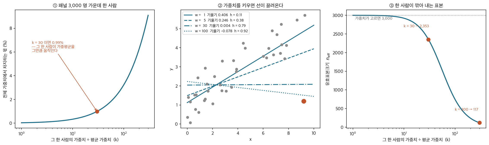
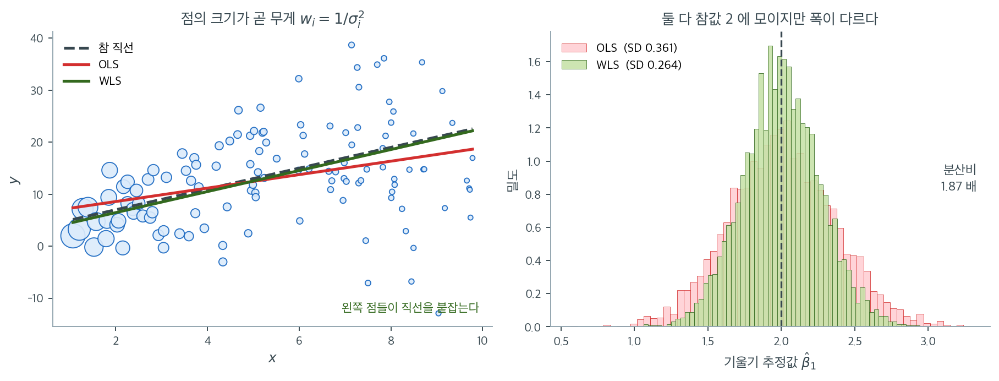

# 가중최소제곱

## 개요

가중치를 주는 일은 **「누구의 말을 몇 번 듣는가」**를 정하는 일이다. $w_i = 30$ 은 그 관측을 서른 번 적어 넣은 것과 같다. 여론조사에서 그 수가 커지면 어떻게 되는지는 셈만으로 나온다 — 패널이 $3{,}000$ 명이고 한 사람의 가중치가 평균의 $30$ 배이면 그가 쥔 몫이 $30/(2999+30) = 0.99\%$ 이고, **그 한 사람이 지지 후보를 바꾸는 것만으로 가중평균이 $1$ 백분율점 가까이 움직인다.** 아래 상자가 실제로 그런 일이 벌어진 조사를 따라간다.

이 쪽에서 가중치를 쓰는 까닭은 그 위험을 치르고도 얻는 것이 있기 때문이다. 같은 이분산 자료를 $4000$ 번 다시 뽑아 최소제곱과 가중최소제곱을 나란히 적합하면 두 추정값의 중심이 모두 참값 $2$ 에 놓인다($2.004$ 와 $2.000$). 갈리는 것은 폭이다 — 표준편차가 $0.361$ 과 $0.264$ 이고, 분산으로는 그 비의 제곱인 $(0.361/0.264)^2 = 1.87$ 배다. 같은 자료를 모아 놓고 한쪽이 정보의 절반 가까이를 버린 셈이다.

그런데 무게를 쓰는 쪽에 덫이 하나 있다. 가중치를 모두 $1000$ 배 해도 추정값은 한 자리도 바뀌지 않는데, 공식이 주는 표준오차는 $0.258867$ 에서 $0.008186$ 으로 작아진다. 표준오차가 $1/\sqrt w$ 로 줄기 때문이고 $\sqrt{1000} = 31.6$ 이니 $0.258867/31.6 = 0.0082$ 다.

그러니 가중치에서 뜻을 갖는 것은 **절대 크기가 아니라 비율**이고, 크기를 손으로 정한 가중치의 표준오차는 그만큼 믿을 수 없다. 무게를 무엇으로 정하고, 그 무게가 찍어 주는 표준오차는 어디까지 믿을 수 있는가.

_확인한 곳 — 이 쪽 「열아홉 살 한 사람이 전국 평균을 움직였다」 상자와 그 출처 줄_

이 페이지는 이분산에 대한 대책으로 가중최소제곱(WLS) 회귀를 보인다. 오차분산이 설명변수에 따라 선형으로 커지는 자료를 생성하고, OLS와 WLS를 모두 적합한 뒤 계수 추정값, 표준오차, 잔차그림을 비교하여 WLS가 비상수 분산을 어떻게 바로잡는지 보인다.

---

## 1. 수학적 배경

오차분산이 일정하지 않으면($\mathrm{Var}(\varepsilon_i) = \sigma_i^2$) OLS는 여전히 불편이지만 더 이상 효율적이지 않고 표준오차가 틀리게 된다. WLS는 가중된 잔차제곱합을 최소화하여 이에 대처한다.

$$
\hat{\boldsymbol{\beta}}_{\text{WLS}} = \arg\min_{\boldsymbol{\beta}} \sum_{i=1}^n w_i(y_i - \mathbf{x}_i^\top\boldsymbol{\beta})^2,
$$

여기서 $w_i = 1/\sigma_i^2$이다(분산이 큰 관측값이 작은 가중치를 받는다). 행렬 형태로는

$$
\hat{\boldsymbol{\beta}}_{\text{WLS}} = (\mathbf{X}^\top\mathbf{W}\mathbf{X})^{-1}\mathbf{X}^\top\mathbf{W}\mathbf{y},
$$

여기서 $\mathbf{W} = \mathrm{diag}(w_1, \ldots, w_n)$이다.

$\hat{\boldsymbol{\beta}}_{\text{WLS}}$의 공분산행렬은

$$
\mathrm{Var}(\hat{\boldsymbol{\beta}}_{\text{WLS}}) = (\mathbf{X}^\top\mathbf{W}\mathbf{X})^{-1}.
$$

WLS는 변환된 모형 $\sqrt{w_i}\,y_i = \sqrt{w_i}\,\mathbf{x}_i^\top\boldsymbol{\beta} + \sqrt{w_i}\,\varepsilon_i$에 OLS를 적용하는 것과 동등하다. 변환된 오차는 분산이 일정하다.

<div class="storybox" markdown>

**그림으로 보는 통계학 1.** 열아홉 살 한 사람이 전국 평균을 움직였다

위의 $\mathbf W$ 가 하는 일을 한 줄로 줄이면 **「누구의 말을 몇 번 듣는가」**다.
$w_i = 30$ 은 그 사람을 서른 번 적어 넣은 것과 같다. 그러면 무슨 일이 생기는지를
$2016$ 년 미국 대선 때 조사 하나가 보여 주었다.

$2016$ 년 $10$ 월 $12$ 일, 뉴욕타임스의 네이트 콘이 쓴 글의 제목은 이랬다 — **「열아홉 살
일리노이 남성 한 명이 어떻게 전국 여론조사 평균을 일그러뜨리고 있는가」.** 문제의 조사는
같은 사람들에게 되풀이해 묻는 패널 추적조사였고, 패널 $3{,}000$ 명 남짓 가운데
**일리노이에 사는 열아홉 살 흑인 트럼프 지지자 한 사람**이 조사 전체를 끌고 있었다.

까닭은 가중치였다. 그 조사는 넓은 인구집단이 아니라 **아주 좁은 하위집단**에 맞춰
가중했다. $18$–$21$ 세 남성이 표본의 $3.3\%$ 가 되도록 맞추는데, 한 번 돌릴 때 그 칸에
들어오는 사람이 열다섯 명 남짓이었다. 거기에 인종까지 겹치면 칸은 더 작아진다. 콘이
적은 수가 이것이다.

> **「어떤 조사에서 그는 평균 응답자보다 $30$ 배까지, 그리고 가중치가 가장 작은
> 응답자보다는 $300$ 배까지 무겁게 가중되었다.」**

그 수가 무엇을 뜻하는지는 가중평균의 산술만으로 나온다.



- **①** 패널이 $3{,}000$ 명이고 그 가운데 한 사람의 가중치가 평균의 $k$ 배라면, 그가 쥔
  몫은 $k/(2999 + k)$ 다. $k = 30$ 이면 **$0.99\%$** — 곧 그 한 사람이 지지 후보를
  바꾸는 것만으로 **가중평균이 $1$ 백분율점 가까이 움직인다.** 선거조사에서 $1$ 점은
  작은 수가 아니다.
- **②** 회귀에서는 같은 몫이 **지렛대**로 나타난다. 가중 영향행렬
  $\mathbf H = \mathbf X(\mathbf X^\top\mathbf W\mathbf X)^{-1}\mathbf X^\top\mathbf W$ 의
  대각원소가 그것이다. $n = 40$ 짜리 자료에서 선 밖의 한 점만 가중치를 키우면
  $h_{ii}$ 가 $0.11 \to 0.79\ (w = 30) \to 0.92\ (w = 100)$ 로 $1$ 에 다가가고, 기울기는
  $0.406$ 에서 $0.004$ 로 납작해졌다가 끝내 **부호가 뒤집힌다**($-0.078$). $h_{ii} = 1$
  은 「그 점이 적합선을 혼자 정한다」는 뜻이다.
- **③** 값은 분산으로도 치른다. 키시의 유효표본크기
  $n_\text{eff} = (\sum w_i)^2 / \sum w_i^2$ 로 재면, $3{,}000$ 명 가운데 **한 사람**만
  $30$ 배여도 $2{,}353$ 으로 떨어진다($21.6\%$ 손실). $100$ 배면 $739$, $300$ 배면
  $117$ 이다. 조사비를 $3{,}000$ 명어치 치르고 백 명어치 정밀도를 얻는 것이다.

이 쪽의 WLS 가 쓰는 가중치는 출처가 다르다. 우리는 아는 분산에서 $w_i = 1/\sigma_i^2$
으로 정하고, 조사는 모집단 비율에 맞추려고 정한다. 그러나 **산술은 똑같고, 따라서 위험도
똑같다.** 보기 1 **(2)** 가 묻는 「가중치를 모두 $c$ 배 해도 $\hat{\boldsymbol\beta}$ 는
그대로」와 나란히 두면 이렇게 읽힌다 — **고르게 키우는 것은 아무 일도 하지 않지만,
한쪽만 키우는 것은 전부를 바꾼다.**

이야기의 끝이 그 점을 분명히 한다. 그가 한 주 동안 응답하지 않자, 같은 조사에서
상대 후보가 앞섰다.

_확인한 곳 — 네이트 콘, "How One 19-Year-Old Illinois Man Is Distorting National Polling
Averages", 『뉴욕타임스』 업샷($2016$ 년 $10$ 월 $12$ 일)의 제목·필자·날짜. 인용한 문장
(「평균 응답자보다 $30$ 배까지, 가중치가 가장 작은 응답자보다는 $300$ 배까지」), 그 조사가
$18$–$21$ 세 남성을 표본의 $3.3\%$ 에 맞추는 좁은 하위집단 가중을 썼고 한 번 돌릴 때 그
칸에 열다섯 명 남짓이 들어왔다는 서술, 그리고 그가 응답을 멈춘 주에 같은 조사에서 상대
후보가 앞섰다는 서술은 그 글을 인용한 『슬레이트』 기사($2016$ 년 $10$ 월)에서 확인했다
— 뉴욕타임스 원문은 이 환경에서 받지 못해 재인용을 따랐다. 패널이 $3{,}000$ 명 남짓
이라는 것도 같은 보도들이 전하는 수다. 그림과 본문의 수는 모두 직접 계산한 값이다_

</div>

### OLS와 WLS 구현

<div class="exbox" markdown>

**보기 1.** <span class="diff easy" title="쉬움"></span> OLS와 WLS 구현

**(1)** WLS가 변환된 자료 $\tilde y_i = \sqrt{w_i}\, y_i$, $\tilde{\mathbf x}_i = \sqrt{w_i}\,\mathbf x_i$에 OLS를 돌린 것과 **같다**는 것을 보이고, 단순회귀의 WLS 기울기를 닫힌 꼴로 쓰시오.

**(2)** 가중치를 모두 $c$배 해도 $\hat{\boldsymbol\beta}_{\text{WLS}}$는 변하지 않지만 위에 적은 분산 공식 $(\mathbf X^\top \mathbf W \mathbf X)^{-1}$은 $1/c$배가 됨을 보이시오. 이것이 실무에서 뜻하는 바는 무엇인가. 코드로 확인하시오.

</div>

??? success "풀이"

    **(1) 해석적으로.** 가중제곱합을 그대로 다시 적는다. $w_i > 0$이므로 $w_i = (\sqrt{w_i})^2$이고

    $$
    \sum_i w_i\big(y_i - \mathbf x_i^\top \boldsymbol\beta\big)^2
    = \sum_i \big(\sqrt{w_i}\,y_i - \sqrt{w_i}\,\mathbf x_i^\top \boldsymbol\beta\big)^2
    = \lVert \tilde{\mathbf y} - \tilde{\mathbf X}\boldsymbol\beta \rVert^2
    $$

    이다. **목적함수가 글자 그대로 같으므로 최소점도 같다.** 정규방정식으로 봐도 $\tilde{\mathbf X}^\top \tilde{\mathbf X} = \mathbf X^\top \mathbf W \mathbf X$, $\tilde{\mathbf X}^\top \tilde{\mathbf y} = \mathbf X^\top \mathbf W \mathbf y$라 바로 확인된다. 왜 이 변환이 쓸모 있는가 하면, $w_i = 1/\sigma_i^2$일 때 변환된 오차가

    $$
    \operatorname{Var}(\sqrt{w_i}\,\varepsilon_i) = w_i \sigma_i^2 = 1
    $$

    로 **등분산이 되기 때문**이다. WLS는 새로운 이론이 아니라 자료를 등분산으로 만든 뒤의 OLS다.

    단순회귀의 닫힌 꼴은 OLS의 것에서 모든 합과 평균에 $w$를 끼워 넣은 모양이다. 가중평균을

    $$
    \bar x_w = \frac{\sum_i w_i x_i}{\sum_i w_i},
    \qquad
    \bar y_w = \frac{\sum_i w_i y_i}{\sum_i w_i}
    $$

    로 두면

    $$
    \hat\beta_1 = \frac{\sum_i w_i (x_i - \bar x_w)(y_i - \bar y_w)}{\sum_i w_i (x_i - \bar x_w)^2},
    \qquad
    \hat\beta_0 = \bar y_w - \hat\beta_1 \bar x_w
    $$

    이다. 중심을 산술평균이 아니라 **가중평균**으로 잡는다는 것이 핵심이다.

    **(2) 척도 불변성.** $\mathbf W \to c\mathbf W$를 넣으면

    $$
    (c\mathbf X^\top \mathbf W \mathbf X)^{-1}(c\mathbf X^\top \mathbf W \mathbf y)
    = \tfrac1c (\mathbf X^\top \mathbf W \mathbf X)^{-1} \cdot c\,\mathbf X^\top \mathbf W \mathbf y
    = \hat{\boldsymbol\beta}_{\text{WLS}}
    $$

    로 $c$가 깨끗이 상쇄된다. **추정값은 가중치의 절대 크기가 아니라 비율만 본다.** 그런데 분산 공식은 $(c\mathbf X^\top \mathbf W \mathbf X)^{-1} = \tfrac1c (\mathbf X^\top \mathbf W \mathbf X)^{-1}$로 $1/c$배가 된다.

    실무에서 이것은 **덫**이다. $\sigma_i$를 몰라 "$x$에 반비례하게" 같은 **모양만 맞는** 가중치를 쓰면 추정값은 제대로 나오지만 표준오차는 임의의 상수만큼 틀린다. $(\mathbf X^\top \mathbf W \mathbf X)^{-1}$이 분산이려면 $w_i$가 $1/\sigma_i^2$에 **비례**하는 것으로는 모자라고 **정확히 같아야** 한다. 비율만 아는 경우에는 가중잔차에서 척도를 다시 추정해 $\hat s^2 (\mathbf X^\top \mathbf W \mathbf X)^{-1}$을 써야 하며, `statsmodels.WLS`가 하는 일이 그것이다.

    ```python
    import numpy as np

    def ols_fit(X, y):
        """보통최소제곱. 모든 관측값에 같은 무게를 준다."""
        beta = np.linalg.lstsq(X, y, rcond=None)[0]
        return beta

    def wls_fit(X, y, w):
        """가중최소제곱. 관측값마다 다른 무게 w 를 준다.

        정규방정식의 X'X 와 X'y 사이에 가중행렬 W 가 끼어드는 것이 전부다.
        분산이 큰 관측값에 작은 무게를 주면 추정의 분산이 줄어든다.
        """
        W = np.diag(w)
        XtW = X.T @ W
        beta = np.linalg.solve(XtW @ X, XtW @ y)
        return beta
    ```

    아래 보기 2가 만드는 자료로 세 가지를 확인한다. 변환 동등성, 닫힌 꼴, 척도 불변성이다.

    ```python
    import numpy as np

    # 보기 2 가 쓸 자료를 먼저 만들어 둔다 (씨앗이 같으므로 같은 자료다).
    np.random.seed(42)
    n = 120
    x = np.random.uniform(1, 10, n)
    sigma = 0.5 + 1.5 * x
    y = 3.0 + 2.0 * x + np.random.normal(0, sigma)
    X = np.column_stack([np.ones(n), x])
    w = 1.0 / sigma ** 2

    # 1) sqrt(w) 변환 뒤의 OLS 와 같은가
    Xt = X * np.sqrt(w)[:, None]
    yt = y * np.sqrt(w)
    print("변환 뒤 OLS =", np.linalg.lstsq(Xt, yt, rcond=None)[0])
    print("wls_fit     =", wls_fit(X, y, w))

    # 2) 단순회귀의 닫힌 꼴
    xw = (w * x).sum() / w.sum()
    yw = (w * y).sum() / w.sum()
    b1 = (w * (x - xw) * (y - yw)).sum() / (w * (x - xw) ** 2).sum()
    print(f"\n닫힌 꼴 기울기 = {b1:.12f}")
    print(f"wls_fit 기울기 = {wls_fit(X, y, w)[1]:.12f}")

    # 3) 가중치를 1000 배 해도 추정값은 그대로, 분산 공식은 1/1000 배
    se = np.sqrt(np.diag(np.linalg.inv(X.T @ np.diag(w) @ X)))
    se_1000 = np.sqrt(np.diag(np.linalg.inv(X.T @ np.diag(1000 * w) @ X)))
    print(f"\nw 를 1000 배 한 추정값 = {wls_fit(X, y, 1000 * w)}")
    print(f"SE(기울기):  w 그대로 {se[1]:.6f},  1000w {se_1000[1]:.6f}")
    print(f"비 = {se[1] / se_1000[1]:.4f},  sqrt(1000) = {np.sqrt(1000):.4f}")
    ```

    출력:

    ```
    변환 뒤 OLS = [3.34999074 2.01054088]
    wls_fit     = [3.34999074 2.01054088]

    닫힌 꼴 기울기 = 2.010540878598
    wls_fit 기울기 = 2.010540878598

    w 를 1000 배 한 추정값 = [3.34999074 2.01054088]
    SE(기울기):  w 그대로 0.258867,  1000w 0.008186
    비 = 31.6228,  sqrt(1000) = 31.6228
    ```

    **세 가지가 모두 맞는다.** 변환 뒤의 OLS와 `wls_fit`이 같은 값을 주고, 닫힌 꼴이 소수점 열두째 자리까지 일치하며, 가중치를 $1000$배 해도 추정값은 한 자리도 바뀌지 않는다. 그런데 공식이 주는 표준오차는 $0.258867$에서 $0.008186$으로 **$\sqrt{1000} = 31.62$배 작아진다.** 자료도 추정값도 그대로인데 표준오차만 서른 배 작아졌다면 그 수가 거짓이라는 뜻이고, 거짓인 쪽은 가중치의 척도가 틀린 쪽이다.

### 이분산 자료 생성과 적합

<div class="exbox" markdown>

**보기 2.** <span class="diff easy" title="쉬움"></span> 이분산 자료로 견주기. $\sigma_i = 0.5 + 1.5x_i$인 자료를 만들고 $w_i = 1/\sigma_i^2$로 적합한다. "분산의 역수가 최적"이라는 말을 증명해 두자.

**(1)** 기울기의 **모든 선형불편추정량**은 $\sum_i a_i = 0$, $\sum_i a_i x_i = 1$을 만족하는 $a$로 $\tilde\beta_1 = \sum_i a_i y_i$라 적힌다. 코시–슈바르츠로

$$
\operatorname{Var}(\tilde\beta_1) = \sum_i a_i^2 \sigma_i^2 \;\ge\; \frac{1}{S_w},
\qquad S_w = \sum_i w_i (x_i - \bar x_w)^2
$$

임을 보이고, 등호가 $a_i = w_i(x_i - \bar x_w)/S_w$, 곧 **WLS일 때만** 성립함을 보이시오.

**(2)** 자료를 만들어 적합하고, 여러 가중치의 참 분산을 계산해 하한 $1/S_w$와 견주시오. **가중치를 잘못 주면 OLS보다 나빠질 수 있는가.**

</div>

??? success "풀이"

    **(1) 해석적으로.** $\tilde\beta_1 = \sum_i a_i y_i$가 불편이려면

    $$
    E[\tilde\beta_1] = \beta_0 \sum_i a_i + \beta_1 \sum_i a_i x_i = \beta_1
    $$

    이 모든 $(\beta_0, \beta_1)$에 대해 성립해야 하므로 두 제약 $\sum_i a_i = 0$과 $\sum_i a_i x_i = 1$이 나온다. 오차가 독립이므로 분산은 $\sum_i a_i^2 \sigma_i^2$이다.

    이제 둘째 제약을 첫째 제약으로 다듬는다. 어떤 상수 $\bar x_w$를 빼도 되므로

    $$
    1 = \sum_i a_i x_i = \sum_i a_i (x_i - \bar x_w)
    $$

    이다. 이 합을 두 조각으로 갈라 코시–슈바르츠를 적용한다.

    $$
    1 = \sum_i \big(a_i \sigma_i\big)\cdot\left(\frac{x_i - \bar x_w}{\sigma_i}\right)
    \;\le\;
    \sqrt{\sum_i a_i^2 \sigma_i^2} \cdot \sqrt{\sum_i \frac{(x_i - \bar x_w)^2}{\sigma_i^2}}
    $$

    오른쪽 둘째 근호 안이 $w_i = 1/\sigma_i^2$로 $\sum_i w_i (x_i - \bar x_w)^2 = S_w$다. 양변을 제곱해 옮기면

    $$
    \operatorname{Var}(\tilde\beta_1) = \sum_i a_i^2 \sigma_i^2 \;\ge\; \frac{1}{S_w}
    $$

    를 얻는다. 여기서 $\bar x_w$는 아직 아무 상수여도 좋았다. 부등식은 어느 $c$에 대해서도 $\operatorname{Var} \ge 1/S_w(c)$로 성립하므로 **가장 센 하한은 $S_w(c) = \sum_i w_i (x_i - c)^2$을 가장 작게 만드는 $c$에서 나온다.** 그 $c$가 바로 가중평균 $\bar x_w = \sum_i w_i x_i / \sum_i w_i$다($S_w(c)$를 $c$로 미분해 0으로 두면 나온다).

    등호는 두 벡터가 평행할 때, 곧 어떤 $\lambda$에 대해

    $$
    a_i \sigma_i = \lambda \cdot \frac{x_i - \bar x_w}{\sigma_i}
    \quad\Longleftrightarrow\quad
    a_i = \lambda\, w_i (x_i - \bar x_w)
    $$

    일 때다. 제약 $\sum_i a_i x_i = 1$에 넣으면 $\lambda \sum_i w_i (x_i - \bar x_w) x_i = \lambda S_w = 1$이므로 $\lambda = 1/S_w$이고

    $$
    a_i = \frac{w_i (x_i - \bar x_w)}{S_w}
    $$

    이다. 이것이 바로 보기 1의 닫힌 꼴 $\hat\beta_1 = \sum_i w_i(x_i - \bar x_w)(y_i - \bar y_w)/S_w$의 가중치다. **WLS가 최소분산 선형불편추정량이고, 그 분산이 정확히 $1/S_w$다.**

    등호 조건이 **유일**하다는 점에 주목하라. 가중치가 $1/\sigma_i^2$에 비례하지 않으면 등호가 깨지고 분산이 반드시 커진다. "분산이 큰 쪽에 작은 가중치를 주면 좋다"가 아니라 **"정확히 $1/\sigma_i^2$에 비례할 때만 최적"** 이다.

    **(2) 수치적으로.**

    ```python
    np.random.seed(42)
    n = 120
    x = np.random.uniform(1, 10, n)

    # 잡음의 크기가 x 에 따라 커진다. 전형적인 이분산 자료다.
    sigma = 0.5 + 1.5 * x
    y = 3.0 + 2.0 * x + np.random.normal(0, sigma)

    X = np.column_stack([np.ones(n), x])

    # 두 방법 모두 불편추정량이라 계수 자체는 비슷하게 나온다.
    beta_ols = ols_fit(X, y)

    # 분산의 역수를 무게로 쓰는 것이 최적이다. 여기서는 참 sigma 를 알고 있어
    # 그대로 썼지만, 실제로는 sigma 도 자료에서 추정해야 한다.
    w = 1.0 / sigma ** 2
    beta_wls = wls_fit(X, y, w)
    ```

    가중치를 바꿔 가며 참 분산을 계산한다. $\sigma_i$를 알고 있으므로 모의실험 없이 공식으로 끝난다.

    ```python
    import numpy as np

    def slope_var(v):
        """가중치 v 로 적합한 기울기의 참 분산과 그 선형가중치 a."""
        xv = (v * x).sum() / v.sum()
        S = (v * (x - xv) ** 2).sum()
        a = v * (x - xv) / S
        return (a ** 2 * sigma ** 2).sum(), a

    print(f"{'가중치':>22}{'Var':>11}{'SE':>10}{'sum a':>10}{'sum a*x':>10}")
    for lab, v in [("OLS (w = 1)", np.ones(n)),
                   ("WLS 최적 (1/sigma^2)", w),
                   ("1/sigma (덜 줌)", 1 / sigma),
                   ("1/sigma^4 (지나침)", 1 / sigma ** 4),
                   ("1/x (모양만 비슷)", 1 / x)]:
        V, a = slope_var(v)
        print(f"{lab:>22}{V:>11.6f}{np.sqrt(V):>10.6f}"
              f"{a.sum():>10.1e}{(a * x).sum():>10.4f}")

    xw = (w * x).sum() / w.sum()
    Sw = (w * (x - xw) ** 2).sum()
    print(f"\n하한 1/S_w = {1 / Sw:.6f}   (SE = {1 / np.sqrt(Sw):.6f})")
    ```

    출력:

    ```
                       가중치        Var        SE     sum a   sum a*x
               OLS (w = 1)   0.121722  0.348887   2.4e-17    1.0000
        WLS 최적 (1/sigma^2)   0.067012  0.258867  -4.5e-17    1.0000
             1/sigma (덜 줌)   0.080300  0.283372  -2.1e-16    1.0000
           1/sigma^4 (지나침)   0.195189  0.441802   3.3e-16    1.0000
              1/x (모양만 비슷)   0.077782  0.278894   5.2e-17    1.0000

    하한 1/S_w = 0.067012   (SE = 0.258867)
    ```

    **부등식이 다섯 줄 모두에서 지켜진다.** 어느 가중치든 두 제약 $\sum a_i = 0$($10^{-16}$ 수준)과 $\sum a_i x_i = 1$을 만족하므로 모두 불편이고, 분산은 전부 하한 $0.067012$ 이상이다. 그리고 **등호는 $w = 1/\sigma^2$ 한 줄에서만 성립한다.** 소수점 여섯째 자리까지 하한과 같다.

    **가중치를 지나치게 주면 OLS보다 나빠진다.** $1/\sigma^4$의 분산이 $0.1952$로 OLS의 $0.1217$보다 **$1.6$배 크다.** 정밀한 관측 몇 개에 발언권을 몰아주는 바람에, 사실상 그 몇 개로만 직선을 긋는 꼴이 된 것이다. "가중치를 주면 좋아진다"가 아니라 **"올바른 가중치를 주어야 좋아진다"**는 (1)의 등호 조건이 여기서 값을 치른다.

    반대로 $1/\sigma$나 $1/x$처럼 **방향만 맞는** 가중치는 $0.0803$, $0.0778$로 OLS의 $0.1217$보다는 좋고 최적의 $0.0670$보다는 나쁘다. 실무에서 $\sigma_i$를 정확히 알 길이 없으므로 대개 이 중간 어딘가에 머물게 되며, 그 사실이 WLS 대신 로버스트 표준오차를 쓰는 쪽을 택하게 만드는 이유 가운데 하나다.

### 표준오차 비교

<div class="exbox" markdown>

**보기 3.** <span class="diff easy" title="쉬움"></span> 표준오차의 차이

**(1)** 이분산 아래에서 OLS 추정량의 **참** 공분산행렬이

$$
\operatorname{Var}(\hat{\boldsymbol\beta}_{\text{OLS}}) = (\mathbf X^\top \mathbf X)^{-1}\mathbf X^\top \boldsymbol\Sigma \,\mathbf X (\mathbf X^\top \mathbf X)^{-1},
\qquad \boldsymbol\Sigma = \operatorname{diag}(\sigma_1^2, \ldots, \sigma_n^2)
$$

임을 보이고, OLS가 보고하는 $s^2 (\mathbf X^\top \mathbf X)^{-1}$과 어떻게 다른지 밝히시오. **보고값이 참값보다 큰지 작은지 미리 말할 수 있는가.**

**(2)** 세 가지 표준오차 — OLS 보고값, OLS 참값, WLS — 를 모두 계산하고 모의실험으로 어느 것이 옳은지 가리시오.

</div>

??? success "풀이"

    **(1) 해석적으로.** $\hat{\boldsymbol\beta}_{\text{OLS}} = (\mathbf X^\top \mathbf X)^{-1}\mathbf X^\top \mathbf y$에 $\mathbf y = \mathbf X \boldsymbol\beta + \boldsymbol\varepsilon$을 넣으면

    $$
    \hat{\boldsymbol\beta}_{\text{OLS}} = \boldsymbol\beta + \mathbf A \boldsymbol\varepsilon,
    \qquad \mathbf A = (\mathbf X^\top \mathbf X)^{-1}\mathbf X^\top
    $$

    이다. 선형변환의 공분산 법칙 $\operatorname{Var}(\mathbf A \boldsymbol\varepsilon) = \mathbf A \boldsymbol\Sigma \mathbf A^\top$를 그대로 적용하면

    $$
    \operatorname{Var}(\hat{\boldsymbol\beta}_{\text{OLS}})
    = (\mathbf X^\top \mathbf X)^{-1}\mathbf X^\top \boldsymbol\Sigma\, \mathbf X (\mathbf X^\top \mathbf X)^{-1}
    $$

    을 얻는다. 가운데에 $\boldsymbol\Sigma$가 끼인 모양이라 **샌드위치 공식**이라 부른다. $\boldsymbol\Sigma = \sigma^2 \mathbf I$이면 $\sigma^2$이 밖으로 나오고 양쪽의 $(\mathbf X^\top \mathbf X)^{-1}\mathbf X^\top \mathbf X$가 상쇄되어 익숙한 $\sigma^2 (\mathbf X^\top \mathbf X)^{-1}$로 돌아간다.

    OLS가 보고하는 것은 $s^2(\mathbf X^\top\mathbf X)^{-1}$인데, 이것은 **빵만 있고 속이 없는** 셈이다. $\boldsymbol\Sigma$가 $\sigma_i^2$마다 다른데 그것을 하나의 $s^2$으로 뭉갰기 때문이다.

    **어느 쪽으로 틀리는지는 미리 말할 수 없다.** 큰 $\sigma_i^2$이 지렛대가 큰 자리(설계행렬의 끝)에 몰리면 샌드위치의 속이 두꺼워져 참값이 보고값보다 커지고, 가운데에 몰리면 반대가 된다. **같은 자료에서도 계수마다 방향이 다를 수 있다**는 것을 (2)에서 보게 된다. 이것이 이 페이지가 "OLS 표준오차는 너무 클 수도 작을 수도 있다"고 적는 이유다.

    WLS의 분산 $(\mathbf X^\top \mathbf W \mathbf X)^{-1}$은 사정이 다르다. $\mathbf W = \boldsymbol\Sigma^{-1}$이면 샌드위치가 $(\mathbf X^\top \mathbf W \mathbf X)^{-1}\mathbf X^\top \mathbf W \boldsymbol\Sigma \mathbf W \mathbf X (\mathbf X^\top \mathbf W \mathbf X)^{-1} = (\mathbf X^\top \mathbf W \mathbf X)^{-1}$로 **저절로 접힌다.** 올바른 가중치를 쓰면 보고값이 곧 참값이다.

    **(2) 수치적으로.**

    ```python
    # 여기서 갈린다. OLS 의 표준오차 공식은 등분산을 전제하므로, 이분산
    # 자료에서는 그 값 자체를 믿을 수 없다.
    resid_ols = y - X @ beta_ols
    s2_ols = np.sum(resid_ols ** 2) / (n - 2)
    se_ols = np.sqrt(np.diag(s2_ols * np.linalg.inv(X.T @ X)))

    # WLS 의 표준오차는 이분산을 제대로 셈에 넣은 값이고, OLS 의 것보다 작다.
    # 같은 자료에서 더 정확한 결론을 얻는다는 뜻이다.
    W = np.diag(w)
    XtWX_inv = np.linalg.inv(X.T @ W @ X)
    se_wls = np.sqrt(np.diag(XtWX_inv))

    print(f"OLS:  intercept={beta_ols[0]:.3f} (SE={se_ols[0]:.3f}), "
          f"slope={beta_ols[1]:.3f} (SE={se_ols[1]:.3f})")
    print(f"WLS:  intercept={beta_wls[0]:.3f} (SE={se_wls[0]:.3f}), "
          f"slope={beta_wls[1]:.3f} (SE={se_wls[1]:.3f})")
    ```

    출력(참값은 절편 3.0, 기울기 2.0):

    ```text
    OLS:  intercept=4.083 (SE=1.851), slope=1.842 (SE=0.312)
    WLS:  intercept=3.350 (SE=0.841), slope=2.011 (SE=0.259)
    ```

    이제 샌드위치 공식으로 참값을 구하고 모의실험으로 판정한다.

    ```python
    import numpy as np

    XtX_inv = np.linalg.inv(X.T @ X)
    Sigma = np.diag(sigma ** 2)
    V_true = XtX_inv @ X.T @ Sigma @ X @ XtX_inv      # 샌드위치 공식
    se_true = np.sqrt(np.diag(V_true))

    print(f"{'':>12}{'절편':>12}{'기울기':>12}")
    print(f"{'OLS 보고':>12}{se_ols[0]:>12.4f}{se_ols[1]:>12.4f}")
    print(f"{'OLS 참값':>12}{se_true[0]:>12.4f}{se_true[1]:>12.4f}")
    print(f"{'WLS':>12}{se_wls[0]:>12.4f}{se_wls[1]:>12.4f}")

    # 같은 X 를 고정한 채 y 만 20000번 다시 뽑아 확인한다.
    r = np.random.default_rng(7)
    E = r.normal(0, 1, (20_000, n)) * sigma
    B_ols = (np.linalg.inv(X.T @ X) @ X.T @ E.T).T
    W = np.diag(w)
    B_wls = (np.linalg.inv(X.T @ W @ X) @ X.T @ W @ E.T).T
    print(f"{'모의 OLS':>12}{B_ols[:, 0].std(ddof=1):>12.4f}{B_ols[:, 1].std(ddof=1):>12.4f}")
    print(f"{'모의 WLS':>12}{B_wls[:, 0].std(ddof=1):>12.4f}{B_wls[:, 1].std(ddof=1):>12.4f}")
    ```

    출력:

    ```
                          절편         기울기
          OLS 보고      1.8509      0.3122
          OLS 참값      1.3636      0.3489
             WLS      0.8406      0.2589
          모의 OLS      1.3581      0.3478
          모의 WLS      0.8366      0.2574
    ```

    **샌드위치 공식이 맞는다.** 참값 $1.3636$과 $0.3489$를 모의실험이 $1.3581$과 $0.3478$로 재현한다(차이 $0.4\%$). WLS도 $0.8406$ 대 $0.8366$으로 맞는다. **보고된 OLS 표준오차만 어느 쪽과도 맞지 않는다.**

    **같은 자료에서 방향이 반대다.** 절편에서는 보고값 $1.8509$가 참값 $1.3636$보다 **$36\%$ 크고**, 기울기에서는 보고값 $0.3122$가 참값 $0.3489$보다 **$11\%$ 작다.** (1)에서 "미리 말할 수 없다"고 한 것의 가장 선명한 예다. 기울기만 보고 "이분산이면 표준오차가 과소평가된다"고 외운 사람은 절편에서 틀리게 된다.

    실질적으로 위험한 쪽은 기울기다. 참 표준오차가 $0.3489$인데 $0.3122$로 보고하면 $t$값이 $12\%$ 부풀고 신뢰구간이 그만큼 좁아진다. 절편의 과대평가는 보수적인 쪽이라 덜 위험하다.

    **WLS와 견주는 올바른 비교.** 이 페이지의 요지는 WLS가 더 효율적이라는 것인데, 그것을 보려면 WLS의 $0.2589$를 OLS **보고값** $0.3122$가 아니라 OLS **참값** $0.3489$와 견주어야 한다. 비는 $0.3489/0.2589 = 1.35$이고 분산으로는 $1.82$배다. 보기 2의 표가 준 $0.121722/0.067012 = 1.82$와 같은 수다. **OLS 보고값은 틀린 수이므로 어떤 비교에도 쓰면 안 된다.**

---

## 2. 무게가 하는 일



왼쪽은 위 보기와 같은 규칙($\sigma_i = 0.5 + 1.5x_i$)으로 뽑은 또 하나의 표본이며, 점의 넓이를 무게 $w_i = 1/\sigma_i^2$ 에 비례하게 그렸다. 무게의 차이가 얼마나 큰지 먼저 보자. $x = 1$ 인 관측의 무게는 $x = 10$ 인 관측의 **60배**다. 왼쪽 끝 점들은 잡음이 $\sigma \approx 2$ 로 작아 직선의 위치를 거의 못 박다시피 하고, 오른쪽 끝 점들은 $\sigma \approx 15.5$ 로 사방에 흩어져 있어 어디를 지나는 직선이든 허용한다. 그런데 OLS 는 이 둘에 똑같은 발언권을 준다. 이 표본에서 OLS 기울기는 $1.294$ 로 참값 $2$ 에서 크게 빗나갔고, 같은 자료에 무게만 준 WLS 는 $2.022$ 를 돌려주었다.

물론 한 번의 표본으로는 운이 좋았다 나빴다를 말할 수 없다. 오른쪽은 같은 실험을 4000번 되풀이한 결과다. 두 히스토그램의 중심이 모두 $2$ 에 놓인다. OLS 평균 $2.004$, WLS 평균 $2.000$ 으로 **둘 다 불편이다.** 이분산이 계수를 편향시키지는 않는다는 말이 여기서 확인된다. 갈리는 것은 폭이다. OLS 의 표준편차는 $0.361$, WLS 는 $0.264$ 로, 분산으로 보면 OLS 가 **1.87배** 크다. 같은 비용으로 같은 자료를 모았는데 한쪽이 1.87배 더 흔들린다는 뜻이고, 뒤집어 말하면 WLS 가 쓰는 정보를 OLS 는 절반 가까이 버리고 있다는 뜻이다.

이것이 "OLS 는 불편이지만 더 이상 BLUE 가 아니다"라는 문장의 그림판이다. 가우스–마르코프 정리가 약속한 최소분산은 등분산을 조건으로 한 약속이었고, 그 조건이 깨지자 더 분산이 작은 선형불편추정량 — 곧 WLS — 가 존재하게 되었다. 다만 이 그림은 **참 $\sigma_i$ 를 알고 있을 때**의 이상적인 이득이라는 점을 잊지 말아야 한다. 실제로는 $\sigma_i$ 를 잔차에서 추정해야 하고, 그 추정이 빗나가면 1.87배의 이득은 줄어들거나 사라진다.

---

## 3. 추정값은 멀쩡하고 표준오차가 틀린다

- **이분산 아래의 OLS**: OLS 추정값은 여전히 불편이지만, 등분산 가정 아래에서 계산한 표준오차는 틀리다. 잔차그림에는 $x$가 커질수록 흩어짐이 커지는 특징적인 "부채꼴"이 나타난다.
- **WLS 보정**: 각 관측값에 분산의 역수로 가중치를 주어, 정밀한 관측값($x$가 작은 쪽)에 더 큰 가중치를, 잡음이 큰 관측값($x$가 큰 쪽)에 더 작은 가중치를 준다. 가중 잔차그림에서는 분산이 안정된 모습이 보인다.
- **표준오차**: 이 예에서는 WLS 표준오차가 OLS보다 작아 더 검정력 있는 검정을 준다. 다만 일반적으로 이분산 아래에서 OLS 표준오차는 이분산의 패턴에 따라 너무 클 수도, 너무 작을 수도 있다는 점에 유의하라.
- **실무 주의**: 실제로는 참 분산함수 $\sigma_i^2$을 모른다. 흔한 접근은 제곱잔차를 설명변수에 회귀시킨 예비 회귀로 추정하거나, WLS 대신 이분산 일치(HC) 표준오차를 쓰는 것이다.

---

## 연습문제

<div class="drillbox" markdown>

**연습문제 1.** <span class="diff med" title="중간"></span> 반대 패턴, 곧 분산이 $x$에 따라 줄어드는 자료를 생성하라(예: $\sigma_i = 10 - 0.8x_i$). OLS와 WLS를 적합하라. 계수 정확도의 관점에서 WLS가 여전히 OLS보다 나은가?

</div>

??? success "풀이"

    ```python
    sigma_rev = 10 - 0.8 * x
    y_rev = 3.0 + 2.0 * x + np.random.normal(0, sigma_rev)
    w_rev = 1.0 / sigma_rev ** 2
    beta_ols_rev = ols_fit(X, y_rev)
    beta_wls_rev = wls_fit(X, y_rev, w_rev)
    ```

    그렇다. 이분산이 존재하는 한 방향과 무관하게 WLS가 OLS보다 낫다. WLS는 올바른 가중치를 쓰므로 이분산 오차로 일반화된 Gauss-Markov 정리 아래에서 최소분산 선형불편추정량(BLUE)이 된다. $\square$

<div class="drillbox" markdown>

**연습문제 2.** <span class="diff med" title="중간"></span> 모든 $i$에 대해 가중치가 같으면($w_i = c$) WLS가 OLS로 환원됨을 보여라. 이는 두 방법의 관계에 대해 무엇을 말해 주는가?

</div>

??? success "풀이"

    모든 $i$에 대해 $w_i = c$이면 $\mathbf{W} = c\mathbf{I}$이므로

    $$
    \hat{\boldsymbol{\beta}}_{\text{WLS}} = (\mathbf{X}^\top c\mathbf{I}\,\mathbf{X})^{-1}\mathbf{X}^\top c\mathbf{I}\,\mathbf{y} = (c\mathbf{X}^\top\mathbf{X})^{-1}c\mathbf{X}^\top\mathbf{y} = (\mathbf{X}^\top\mathbf{X})^{-1}\mathbf{X}^\top\mathbf{y} = \hat{\boldsymbol{\beta}}_{\text{OLS}}.
    $$

    OLS는 모든 관측값에 같은 가중치를 주는 WLS의 특수한 경우이며, 등분산 가정이 성립할 때 적절하다. $\square$

<div class="drillbox" markdown>

**연습문제 3.** <span class="diff med" title="중간"></span> 실제로는 $\sigma_i^2$을 모른다. 먼저 OLS를 적합하고, $\ln(e_i^2)$을 $x_i$에 회귀시켜 분산함수를 추정한 뒤, 추정된 가중치로 WLS를 적용하는 실행가능 WLS를 구현하라.

</div>

??? success "풀이"

    ```python
    resid_ols = y - X @ beta_ols
    log_resid_sq = np.log(resid_ols ** 2 + 1e-10)
    gamma = np.linalg.lstsq(X, log_resid_sq, rcond=None)[0]
    sigma_hat = np.sqrt(np.exp(X @ gamma))
    w_feas = 1.0 / sigma_hat ** 2
    beta_fwls = wls_fit(X, y, w_feas)
    ```

    실행가능 WLS는 알려진 가중치 대신 추정된 가중치를 쓴다. 추정량은 일치성과 점근적 효율성을 갖지만, 가중치를 아는 WLS에 비해 작은 표본에서는 효율이 떨어질 수 있다. $\square$

<div class="drillbox" markdown>

**연습문제 4.** <span class="diff med" title="중간"></span> 공분산 구조 $\boldsymbol{\Sigma} = \mathrm{diag}(\sigma_1^2, \ldots, \sigma_n^2)$을 알 때 $\hat{\boldsymbol{\beta}}_{\text{WLS}}$가 BLUE임을 증명하라.

</div>

??? success "풀이"

    일반화 Gauss-Markov 정리에 따르면 $\mathrm{Var}(\boldsymbol{\varepsilon}) = \boldsymbol{\Sigma}$일 때 $\boldsymbol{\beta}$의 BLUE는

    $$
    \hat{\boldsymbol{\beta}}_{\text{GLS}} = (\mathbf{X}^\top\boldsymbol{\Sigma}^{-1}\mathbf{X})^{-1}\mathbf{X}^\top\boldsymbol{\Sigma}^{-1}\mathbf{y}.
    $$

    $\boldsymbol{\Sigma}$가 대각행렬이면 $\boldsymbol{\Sigma}^{-1} = \mathrm{diag}(1/\sigma_1^2, \ldots, 1/\sigma_n^2) = \mathbf{W}$이다. 따라서 $\hat{\boldsymbol{\beta}}_{\text{GLS}} = \hat{\boldsymbol{\beta}}_{\text{WLS}}$이다. "최선"이란 모든 선형불편추정량 가운데 분산이 가장 작다는 뜻으로, 임의의 선형불편 $\tilde{\boldsymbol{\beta}}$와 임의의 방향 $\mathbf{a}$에 대해 $\mathrm{Var}(\mathbf{a}^\top\hat{\boldsymbol{\beta}}_{\text{WLS}}) \leq \mathrm{Var}(\mathbf{a}^\top\tilde{\boldsymbol{\beta}})$이다. $\square$

<div class="drillbox" markdown>

**연습문제 5.** <span class="diff med" title="중간"></span> WLS를 OLS + 이분산 일치(HC) 표준오차(White의 로버스트 표준오차)와 비교하라. 절충 관계는 무엇인가?

</div>

??? success "풀이"

    HC 표준오차는 계수 추정값은 그대로 두고 OLS의 표준오차만 교정한다.

    $$
    \widehat{\mathrm{Var}}_{\text{HC}}(\hat{\boldsymbol{\beta}}) = (\mathbf{X}^\top\mathbf{X})^{-1}\mathbf{X}^\top\hat{\boldsymbol{\Omega}}\mathbf{X}(\mathbf{X}^\top\mathbf{X})^{-1},
    $$

    여기서 $\hat{\boldsymbol{\Omega}} = \mathrm{diag}(e_1^2, \ldots, e_n^2)$이다(HC0 형태). 절충 관계는 이렇다. (1) HC 표준오차는 분산함수를 지정하지 않고도 임의의 이분산 아래에서 타당하지만 OLS 계수 자체는 비효율적이다. (2) WLS는 효율적인 추정을 주지만 올바른 가중함수를 지정해야 한다. (3) 분산 모형이 잘못 설정되면 WLS는 표준오차에 편향을 들여올 수 있는 반면, HC 표준오차는 여전히 로버스트하다. 실무에서 분산함수를 모를 때는 HC 표준오차가 선호된다. $\square$

<div class="drillbox" markdown>

**연습문제 6.** <span class="diff med" title="중간"></span>
보기 1(2)는 가중치를 모두 $c$배 하면 $\hat{\boldsymbol\beta}_{\text{WLS}}$는 그대로인데 분산 공식 $(\mathbf X^\top\mathbf W\mathbf X)^{-1}$은 $1/c$배가 되므로, 비율만 맞는 가중치를 쓸 때는 가중잔차에서 척도를 다시 추정해 $\hat s^2(\mathbf X^\top\mathbf W\mathbf X)^{-1}$을 써야 한다고 적었다. 그 보정이 정말로 덫을 메우는지 확인하자. $e_i = y_i - \mathbf x_i^\top\hat{\boldsymbol\beta}_{\text{WLS}}$로 두고 $p$를 모수의 수라 할 때

$$
\hat s^2 = \frac{1}{n-p}\sum_{i=1}^n w_i e_i^2
$$

이라 한다.

**(1)** $\mathbf W \to c\mathbf W$ 아래에서 $\hat s^2(\mathbf X^\top\mathbf W\mathbf X)^{-1}$이 **변하지 않음**을 보이시오.

**(2)** $w_i = 1/\sigma_i^2$일 때 $E[\hat s^2] = 1$임을 보이시오. 이것이 "올바른 가중치에서는 이 보정이 아무것도 망치지 않는다"는 말과 어떻게 이어지는가.

**(3)** 보기 1의 두 수치 — 기울기의 공식 표준오차가 $w$에서 $0.258867$, $1000w$에서 $0.008186$ — 로 (1)을 확인하시오.

</div>

??? success "풀이"

    **(1) 두 조각이 반대로 움직인다.** 보기 1(2)에서 $\hat{\boldsymbol\beta}_{\text{WLS}}$가 $c$에 불변이므로 잔차 $e_i$도 글자 그대로 같다. 그러면

    $$
    \hat s^2(c\mathbf W) = \frac{1}{n-p}\sum_i (c w_i) e_i^2 = c\,\hat s^2(\mathbf W)
    $$

    이고, 한편

    $$
    (\mathbf X^\top c\mathbf W\mathbf X)^{-1} = \tfrac1c (\mathbf X^\top \mathbf W\mathbf X)^{-1}
    $$

    이다. 두 배수가 $c \cdot \tfrac1c = 1$로 상쇄되므로 곱은 불변이다. $\square$

    보기 1(2)의 덫은 분산 공식이 $1/c$배로 혼자 움직인다는 것이었다. 보정인수 $\hat s^2$은 **같은 배수만큼 반대로** 움직이는 양이라 그 움직임을 정확히 지운다.

    **(2) 기댓값이 1이다.** 보기 1(1)의 변환 $\tilde{\mathbf y} = \sqrt{\mathbf w}\odot\mathbf y$, $\tilde{\mathbf X}$로 옮기면 WLS는 변환된 자료의 OLS이고, 가중잔차는 변환된 모형의 OLS 잔차다.

    $$
    \sqrt{w_i}\,e_i = \big[(\mathbf I - \tilde{\mathbf H})\tilde{\mathbf y}\big]_i,
    \qquad \tilde{\mathbf H} = \tilde{\mathbf X}(\tilde{\mathbf X}^\top\tilde{\mathbf X})^{-1}\tilde{\mathbf X}^\top
    $$

    이므로 $\sum_i w_i e_i^2 = \lVert (\mathbf I - \tilde{\mathbf H})\tilde{\mathbf y}\rVert^2$이다. $(\mathbf I - \tilde{\mathbf H})\tilde{\mathbf X}\boldsymbol\beta = \mathbf 0$이라 참값 부분은 사영에 죽고 오차만 남는다. 보기 1(1)에서 본 대로 $w_i = 1/\sigma_i^2$이면 $\operatorname{Var}(\tilde{\boldsymbol\varepsilon}) = \mathbf I$이므로

    $$
    E\big[\tilde{\boldsymbol\varepsilon}^\top(\mathbf I - \tilde{\mathbf H})\tilde{\boldsymbol\varepsilon}\big]
    = \operatorname{tr}\big((\mathbf I - \tilde{\mathbf H})\mathbf I\big) = n - p
    $$

    이고($\mathbf I - \tilde{\mathbf H}$는 대칭이고 멱등이라 대각합이 계수 $n-p$다), 따라서 $E[\hat s^2] = 1$이다. $\square$

    그래서 **보정판은 늘 써도 된다.** 참 가중치에서는 보정인수의 평균이 $1$이라 $(\mathbf X^\top\mathbf W\mathbf X)^{-1}$을 흔들지 않고(자유도 $n-p$만큼의 잡음을 더 감수하는 것이 대가의 전부다), 척도가 $c$배 틀어진 가중치에서는 $\hat s^2$의 평균이 $c$가 되어 틀어진 만큼을 자동으로 메운다. 이 페이지의 자료로 실제 계산하면 $\hat s^2 = 0.9774$로 $1$에 가깝다.

    **(3) 수치 확인.** 보기 1의 두 공식 표준오차의 비는

    $$
    \frac{0.258867}{0.008186} = 31.62 = \sqrt{1000}
    $$

    이다. 한편 (1)에서 $\hat s^2(1000\mathbf W) = 1000\,\hat s^2(\mathbf W)$이므로 $\hat s$의 비는 그 역수인 $\sqrt{1000}$배다. 곱 $\hat s \times \text{공식 SE}$는 양쪽에서

    $$
    0.98865 \times 0.258867 = 0.2559,
    \qquad
    31.2639 \times 0.008186 = 0.2559
    $$

    로 같다($\hat s^2(\mathbf W) = 0.9774$, $\hat s^2(1000\mathbf W) = 977.44$). 보기 1이 "서른 배 작아진 표준오차는 거짓"이라 한 그 거짓이 보정 한 번으로 사라진다.

<div class="drillbox" markdown>

**연습문제 7.** <span class="diff med" title="중간"></span>
보기 2의 표는 다섯 가중치의 참 분산을 나란히 놓았다. 그 표를 **가중의 세기**라는 한 숫자로 읽어 보자. $x=1$과 $x=10$에 놓인 두 관측이 받는 무게의 비

$$
\rho = \frac{w(1)}{w(10)}
$$

를 쓴다. 2절이 최적 가중치에 대해 센 "$60$배"가 바로 이 $\rho$다.

**(1)** $\sigma_i = 0.5 + 1.5x_i$에서 최적 가중치가 $w_i \propto (x_i + 1/3)^{-2}$ 꼴임을 보이고, OLS와 $1/\sigma^2$, $1/\sigma$, $1/x$의 $\rho$를 각각 구하시오. 표에서 $1/\sigma$의 $0.080300$과 $1/x$의 $0.077782$가 거의 같고 둘 다 OLS와 최적 사이에 끼는 까닭을 $\rho$로 설명하시오. 또 $1/x^2$의 성능을 예측하시오.

**(2)** $1/\sigma^4$의 $\rho$는 $7.75^4 \approx 3600$이다. 로그 척도에서 OLS의 $\rho = 1$과 $1/\sigma^4$의 $\rho \approx 3600$은 최적의 $\rho \approx 60$에서 거의 같은 거리인데도, 표에서는 $1/\sigma^4$의 $0.195189$가 OLS의 $0.121722$보다 훨씬 나쁘다. 가중을 **모자라게** 주는 쪽과 **지나치게** 주는 쪽의 손실이 왜 대칭이 아닌지 설명하시오. $w_i = \sigma_i^{-2\theta}$로 두고 $\theta\to\infty$로 보내 보라.

</div>

??? success "풀이"

    **(1) $\rho$로 표를 읽는다.** $\sigma_i = 0.5 + 1.5x_i = 1.5\,(x_i + 1/3)$이므로

    $$
    \frac{1}{\sigma_i^2} = \frac{1}{2.25}\,\big(x_i + \tfrac13\big)^{-2} \;\propto\; \big(x_i + \tfrac13\big)^{-2}
    $$

    이다. $\sigma(1) = 2$, $\sigma(10) = 15.5$이므로

    | 가중치 | $\rho$ | 표의 Var |
    |---|---|---|
    | OLS ($w=1$) | $1$ | $0.121722$ |
    | $1/\sigma$ | $15.5/2 = 7.75$ | $0.080300$ |
    | $1/x$ | $10$ | $0.077782$ |
    | $1/\sigma^2$ (최적) | $(15.5/2)^2 = 60.1$ | $0.067012$ |
    | $1/\sigma^4$ | $7.75^4 \approx 3607$ | $0.195189$ |

    이다. $1/\sigma$와 $1/x$는 $\rho$가 $7.75$와 $10$으로 **둘 다 $1$과 $60$ 사이**에 있다. 방향은 맞았으나 세기가 모자란 가중이므로 OLS보다는 좋고 최적보다는 나쁘다. 게다가 두 $\rho$가 서로 $30\%$ 안쪽으로 가까우니 분산도 $0.0803$과 $0.0778$로 $3\%$밖에 다르지 않다. 둘 가운데 $1/x$가 $\rho = 10$으로 $60$에 조금 더 가깝고, 실제로 조금 더 좋다. **"모양만 비슷"한 $1/x$가 왜 꽤 잘 들었는가**의 답이 이것이다. 모양이 아니라 세기가 비슷했다.

    $1/x^2$은 $\rho = 100$으로 로그 거리가 $\lvert\ln(100/60)\rvert = 0.51$이고, $1/x$의 $\lvert\ln(10/60)\rvert = 1.79$보다 훨씬 가깝다. 모양으로도 $(x+1/3)^{-2}$의 $x$가 큰 쪽 근사다. 거의 최적일 것이라고 예측할 수 있고, 실제로 보기 2의 `slope_var`에 `1 / x ** 2`를 넣으면 $0.067801$로 최적 $0.067012$와 $1.2\%$ 차이다.

    **(2) 손실은 한쪽으로 치우쳐 있다.** $\theta$ 눈금으로 보면 OLS가 $\theta = 0$, 최적이 $\theta = 1$, $1/\sigma^4$이 $\theta = 2$다. 두 끝의 사정이 전혀 다르다.

    $\theta$를 $0$ 쪽으로 내리는 손실은 **OLS로 막혀 있다.** $\theta = 0$에서도 $120$개를 모두 쓰고 $x$가 $(1,10)$ 전체에 퍼져 있으니 기울기를 재는 지렛대가 온전하다. 분산은 $0.1217$에서 멈춘다.

    $\theta$를 올리면 발언권이 $\sigma$가 작은 쪽으로 쏠린다. 유효표본수

    $$
    n_{\text{eff}} = \frac{\big(\sum_i w_i\big)^2}{\sum_i w_i^2}
    $$

    가 $\theta = 0$에서 $120$, $\theta = 1$에서 $45.1$, $\theta = 2$에서 $17.6$으로 줄어든다. 그런데 더 치명적인 것은 살아남는 관측이 모두 **$x$가 작은 쪽에 몰려 있다**는 사실이다. 기울기는 $x$의 퍼짐으로 재는 양이므로 퍼짐이 줄면 분산이 치솟는다. $\theta\to\infty$의 극한에서는 $\sigma$가 가장 작은 두 점만 남아 그 둘을 잇는 직선이 되고, 이 표본에서 그 두 점은 $x = 1.050$과 $x = 1.185$로 붙어 있어

    $$
    \frac{\sigma_{(1)}^2 + \sigma_{(2)}^2}{(x_{(2)} - x_{(1)})^2}
    = \frac{2.075^2 + 2.278^2}{0.1356^2} \approx 517
    $$

    곧 최적 $0.0670$의 약 $7700$배가 된다. 보기 2의 `slope_var`로 $\theta$를 훑으면 $\theta = 1.73$에서 분산이 OLS와 같아지고, 그보다 세게 주면 가중을 아예 쓰지 않는 편이 낫다.

    **실무 교훈.** 로그 척도의 거리로 두 쪽을 견주는 것은 틀렸다. $\sigma_i$를 모를 때는 **모자란 쪽으로 틀리는 편이 안전하다.** 3절의 "분산 모형이 틀리면 이득이 사라진다"는 경고에는 이렇게 방향이 있다. 가중을 덜 주면 최악이 OLS지만, 지나치게 주면 바닥이 없다.

<div class="drillbox" markdown>

**연습문제 8.** <span class="diff med" title="중간"></span>
가중치가 왜 분산의 역수인가

관측값마다 $\operatorname{Var}(\varepsilon_i) = \sigma_i^2$ 이라 하자.

**(a)** 각 식의 양변을 $\sigma_i$ 로 나누면 변환된 모형의 오차가 등분산이 됨을 보여라.

**(b)** 그 변환된 모형에 OLS 를 적용하는 것이 원래 모형에 가중치 $w_i = 1/\sigma_i^2$ 를 준
가중최소제곱과 같음을 보여라.

**(c)** $\sigma_i^2$ 를 모를 때 실무에서 무엇을 하는지 두 가지를 적어라.

</div>

??? success "풀이"

    **(a)** $y_i = \mathbf{x}_i^\top\boldsymbol\beta + \varepsilon_i$ 의 양변을 $\sigma_i$ 로
    나누면

    $$
    \frac{y_i}{\sigma_i} = \left(\frac{\mathbf{x}_i}{\sigma_i}\right)^\top\boldsymbol\beta
    + \frac{\varepsilon_i}{\sigma_i}
    $$

    이고 새 오차의 분산은 $\operatorname{Var}(\varepsilon_i)/\sigma_i^2 = 1$ 로 **모든 $i$ 에서
    같다.** 계수 $\boldsymbol\beta$ 는 그대로라는 점이 중요하다.

    **(b)** 변환된 모형의 잔차제곱합은

    $$
    \sum_i \left(\frac{y_i - \mathbf{x}_i^\top\boldsymbol\beta}{\sigma_i}\right)^2
    = \sum_i \frac{1}{\sigma_i^2}\,(y_i - \mathbf{x}_i^\top\boldsymbol\beta)^2
    $$

    로, 가중치 $w_i = 1/\sigma_i^2$ 를 준 가중잔차제곱합과 **같은 식**이다. 그러므로 두 절차의
    해가 같다. 가우스–마르코프 정리를 변환된 모형에 적용하면 이 추정량이 BLUE 다. **분산이 큰
    관측값은 정보가 적으므로 덜 믿는다**는 직관이 수식으로 확인된다.

    **(c)** 둘을 든다.

    1. **분산 구조를 모형화한다.** 제곱잔차를 설명변수에 회귀해 $\hat\sigma_i^2$ 를 얻고
       $w_i = 1/\hat\sigma_i^2$ 를 쓰는 **실현가능 일반화최소제곱(FGLS)**. 분산 모형이 틀리면
       오히려 나빠질 수 있다.
    2. **분산을 모형화하지 않는다.** 계수는 OLS 로 두고 **로버스트 표준오차**만 쓴다. 효율은
       잃지만 틀릴 위험이 없어 실무의 기본값이다. $\square$
<div class="drillbox" markdown>

**연습문제 9.** <span class="diff hard" title="어려움"></span>
보기 3은 OLS 보고 표준오차가 절편에서는 참값보다 $36\%$ 크고 기울기에서는 $11\%$ 작다는 것을 보이고 "어느 쪽으로 틀리는지 미리 말할 수 없다"고 했다. 그 부호를 **정확히 판정하는 기준**을 세우자.

$\hat\theta = \sum_i a_i y_i$를 OLS 추정량의 한 성분이라 하자(절편이면 $a_i$가 $(\mathbf X^\top\mathbf X)^{-1}\mathbf X^\top$의 첫 행, 기울기면 둘째 행이다). 보고 분산 안의 $s^2$은 $\bar\sigma^2 = n^{-1}\sum_i \sigma_i^2$으로 갈음한다(이 자료에서 $E[s^2] = 87.14$, $\bar\sigma^2 = 87.28$로 거의 같다).

**(1)** 참 분산에서 보고 분산을 뺀 것이

$$
\sum_i a_i^2\sigma_i^2 - \bar\sigma^2\sum_i a_i^2 = n\cdot\widehat{\operatorname{Cov}}\big(a_i^2,\ \sigma_i^2\big)
$$

임을 보이시오($\widehat{\operatorname{Cov}}$는 $n$개의 쌍 $(a_i^2, \sigma_i^2)$의 표본공분산). 곧 보고값이 참값을 **과소평가하는 것은 $a_i^2$과 $\sigma_i^2$이 양의 상관일 때뿐**이다.

**(2)** 기울기는 $a_i = (x_i - \bar x)/S_{xx}$다. 설계가 $\bar x$에 대해 대칭이고($x_i$들을 $\bar x \pm d$로 짝지을 수 있고) $\sigma^2(\cdot)$이 **볼록 증가**라면 (1)의 공분산이 양수, 곧 기울기의 보고 표준오차가 과소평가임을 보이시오. 이 페이지의 $\sigma_i^2 = (0.5+1.5x_i)^2$이 그 조건을 만족하는가.

**(3)** 대칭 조건을 빼면 (2)가 깨진다. $x = (0, 9, 10, 11)$, $\sigma^2 = (1,2,3,4)$에서 공분산이 음수임을 확인하고, 분산이 $x$에 대해 증가하는데도 과대평가가 되는 이 예를 한 줄로 설명하시오.

**(4)** 절편은 $a_i = 1/n - \bar x(x_i - \bar x)/S_{xx}$다. 보기 3의 자료($\bar x = 5.294$, $S_{xx}/n = 7.125$)에서 $a_i = 0$이 되는 $x$를 구하고, 절편에서 부호가 뒤집혀 **과대평가**가 되는 까닭을 밝히시오.

</div>

??? success "풀이"

    **(1) 표본공분산의 정의를 펼치면 끝난다.** 오차가 독립이므로 참 분산은 $\operatorname{Var}(\sum_i a_i y_i) = \sum_i a_i^2\sigma_i^2$이고, 보고 분산은 $s^2\sum_i a_i^2$을 $\bar\sigma^2 \sum_i a_i^2$으로 갈음한 것이다. 한편

    $$
    \widehat{\operatorname{Cov}}\big(a_i^2, \sigma_i^2\big)
    = \frac1n\sum_i a_i^2\sigma_i^2 - \Big(\frac1n\sum_i a_i^2\Big)\Big(\frac1n\sum_i \sigma_i^2\Big)
    = \frac1n\Big[\sum_i a_i^2\sigma_i^2 - \bar\sigma^2\sum_i a_i^2\Big]
    $$

    이므로 양변에 $n$을 곱하면 바로 주장이 된다. $\square$

    보기 3의 자료로 확인한다. $\bar\sigma^2$으로 갈음한 보고 표준오차는 기울기 $0.3195$, 절편 $1.8943$이다.

    - 기울기: $0.348887^2 - 0.319506^2 = 0.121722 - 0.102084 = 0.019638$이고 $120 \times (+1.636\times10^{-4}) = 0.019638$.
    - 절편: $1.363555^2 - 1.894305^2 = 1.85928 - 3.58839 = -1.72911$이고 $120 \times (-0.0144092) = -1.72911$.

    부호가 공분산의 부호와 정확히 같다. 이제 "지렛대가 큰 자리에 큰 분산이 몰리면"이라는 보기 3의 말이 **$a_i^2$과 $\sigma_i^2$의 표본공분산**이라는 한 숫자로 정확해졌다.

    **(2) 대칭 설계와 볼록성.** 기울기의 $a_i^2 = (x_i - \bar x)^2/S_{xx}^2$은 $\bar x$에서의 거리만으로 정해지므로 $\bar x$를 축으로 **대칭**이다. 설계가 대칭이라 관측을 $\bar x \pm d$의 짝으로 묶을 수 있으면, 한 짝 안에서 $a_i^2$은 $d^2/S_{xx}^2$으로 같고 $\sigma^2$의 합은 $\sigma^2(\bar x + d) + \sigma^2(\bar x - d)$다. 그러므로 공분산은 짝 단위로

    $$
    \widehat{\operatorname{Cov}}\big(a_i^2, \sigma_i^2\big)
    \;=\; \frac{1}{S_{xx}^2}\,\widehat{\operatorname{Cov}}_{\text{짝}}\Big(d^2,\ \tfrac12\big[\sigma^2(\bar x + d) + \sigma^2(\bar x - d)\big]\Big)
    $$

    로 다시 적힌다. $\sigma^2(\cdot)$이 볼록이면 $d \mapsto \sigma^2(\bar x+d)+\sigma^2(\bar x-d)$는 $d \ge 0$에서 증가하므로(볼록함수의 대칭 두 점 합은 벌어질수록 커진다), 두 양 $d^2$과 짝평균 $\sigma^2$이 모두 $d$의 증가함수다. 증가함수 둘의 표본공분산은 음이 될 수 없으므로(체비쇼프 합 부등식) 공분산은 $\ge 0$이고, $\sigma^2$이 진짜 볼록하면 $> 0$이다. $\square$

    이 페이지의 $\sigma^2(x) = (0.5+1.5x)^2$은 $x > -1/3$에서 증가하는 이차함수이므로 볼록 증가다. 설계는 $x \sim U(1,10)$이라 거의 대칭이다. 그래서 기울기는 과소평가 쪽이고, 다만 대칭성 때문에 공분산이 $1.636\times10^{-4}$로 작아 그 정도가 $16\%$($0.1217$ 대 $0.1021$, 표준오차로는 $11\%$)에 머문다.

    주목할 점은 이 논의에 **$\sigma^2$이 증가인지 감소인지가 들어가지 않는다**는 것이다. $\sigma^2$이 볼록이기만 하면 되므로 연습문제 1처럼 분산이 $x$에 따라 **줄어드는** 자료에서도 기울기의 보고 표준오차는 과소평가다. 대칭 설계에서 기울기가 보는 것은 $\sigma^2$의 기울기가 아니라 **양 끝에서의 크기**다.

    **(3) 대칭을 깨면 뒤집힌다.** $x = (0,9,10,11)$이면 $\bar x = 7.5$이고 $(x_i - \bar x)^2 = (56.25,\ 2.25,\ 6.25,\ 12.25)$다. $S_{xx}^2$을 공통으로 떼어 내고 계산하면

    $$
    \frac1n\sum_i (x_i-\bar x)^2\sigma_i^2 = \frac{56.25 + 4.5 + 18.75 + 49}{4} = 32.125,
    $$

    $$
    \Big(\frac1n\sum_i (x_i-\bar x)^2\Big)\Big(\frac1n\sum_i \sigma_i^2\Big) = 19.25 \times 2.5 = 48.125
    $$

    이므로 공분산은 $(32.125 - 48.125)/S_{xx}^2 = -16/S_{xx}^2 < 0$, 곧 **과대평가**다. 한 줄로 말하면, 지렛대가 압도적으로 큰 자리($x=0$, 혼자서 $S_{xx}$의 $73\%$를 낸다)에 분산이 가장 작은 관측이 놓였기 때문이다. $\sigma^2$이 $x$에 대해 증가하더라도 **설계가 한쪽으로 치우치면 가장 센 지렛대가 조용한 쪽에 놓일 수 있다.** 이것이 보기 3이 "미리 말할 수 없다"고 한 까닭이다.

    **(4) 절편은 뒤집힌다.** $a_i = 0$은

    $$
    \frac1n = \frac{\bar x (x_i - \bar x)}{S_{xx}}
    \quad\Longleftrightarrow\quad
    x_i = \bar x + \frac{S_{xx}}{n\,\bar x} = 5.294 + \frac{7.125}{5.294} = 6.640
    $$

    에서다. $a_i$는 $x_i$의 감소함수이고 $x = 6.640$에서 $0$을 지나므로, $a_i^2$은 그 자리에서 최소이고 양쪽으로 갈수록 커진다. 그런데 그 자리가 구간 $(1,10)$의 **오른쪽**에 있어 두 끝의 크기가 다르다. $n a_i$를 재면

    $$
    n a_i\big|_{x=1} = 1 + \frac{5.294 \times 4.294}{7.125} = 4.19,
    \qquad
    n a_i\big|_{x=10} = 1 - \frac{5.294 \times 4.706}{7.125} = -2.50
    $$

    이라 $a_i^2$은 $x$가 작은 끝에서 큰 끝보다 $(4.19/2.50)^2 = 2.8$배 크다. 그리고 $x$가 작은 끝은 $\sigma^2 = 4$로 가장 조용한 쪽, 큰 끝은 $\sigma^2 = 240$으로 가장 시끄러운 쪽이다. 지렛대와 분산이 **반대 방향**이므로 공분산이 음수($-0.0144$)이고 보고값이 과대평가다.

    해석은 이렇다. 절편은 $x = 0$에서의 값을 왼쪽으로 외삽하는 양이라 $x$가 작은 관측에 크게 기댄다. 그쪽이 바로 잡음이 가장 작은 쪽이므로, **OLS 절편은 등분산을 가정한 보고값보다 실제로 더 정확하다.** 기울기와 절편이 같은 자료에서 반대로 틀리는 이유가 여기 있다.

<div class="drillbox" markdown>

**연습문제 10.** <span class="diff hard" title="어려움"></span>
2절은 WLS의 분산이 OLS의 $1/1.87$이라고 셌다. 그 이득이 어디서 오는지 알려면 이득이 **정확히 0이 되는** 설계를 찾아 보는 것이 빠르다.

$x_i$가 서로 다른 두 값 $x_a \ne x_b$만 갖고, 가중치가 $x$의 함수여서 각 묶음 안에서 일정하다고 하자($w_i = w(x_i)$. 이분산이 $\sigma_i = \sigma(x_i)$ 꼴이면 자동이다).

**(1)** 이때 가중치가 **무엇이든** $\hat{\boldsymbol\beta}_{\text{WLS}} = \hat{\boldsymbol\beta}_{\text{OLS}}$임을 보이시오.

**(2)** $x = -1$에 $n/2$개($\sigma = 1$), $x = +1$에 $n/2$개($\sigma = \tau$)인 설계에서 OLS 기울기의 참 분산과 보기 2의 하한 $1/S_w$를 모두 계산해 둘이 같음을 확인하시오. $\tau$를 아무리 키워도 그런가?

**(3)** 이것이 2절의 $1.87$배에 대해 말해 주는 바는 무엇인가. 가중이 값을 하려면 설계에 무엇이 있어야 하는가.

</div>

??? success "풀이"

    **(1) 포화설계에서는 가중치가 들어갈 자리가 없다.** 설계점이 둘이고 모수가 둘이라 모형이 **포화**다. 어떤 $(m_a, m_b)$에 대해서도 $\hat y(x_a) = m_a$, $\hat y(x_b) = m_b$인 직선이 유일하게 있으므로, $\boldsymbol\beta$를 고르는 일은 $(m_a, m_b)$를 고르는 일과 같다. 가중제곱합은

    $$
    \sum_i w_i\big(y_i - \hat y(x_i)\big)^2
    = w_a \sum_{i \in a}(y_i - m_a)^2 + w_b \sum_{i \in b}(y_i - m_b)^2
    $$

    로 $m_a$와 $m_b$에 대해 **완전히 분리**된다. 각 항은 양수 $w_g$를 곱한 것뿐이므로 최소점이 $m_g = \bar y_g$(묶음의 산술평균)로 $w_g$와 무관하다. 따라서 적합선은 가중치에 상관없이 두 점 $(x_a, \bar y_a)$, $(x_b, \bar y_b)$를 잇는 직선이고

    $$
    \hat\beta_1 = \frac{\bar y_b - \bar y_a}{x_b - x_a},
    \qquad
    \hat\beta_0 = \bar y_a - \hat\beta_1 x_a
    $$

    이다. $w \equiv 1$도 특수한 경우이므로 OLS와 같다. $\square$

    연습문제 2가 "$w_i$가 모두 같으면 WLS $=$ OLS"를 보였는데, 포화설계에서는 **가중치가 모두 달라도** 같아진다.

    **(2) 하한이 OLS에서 이미 달성된다.** $\bar x = 0$, $S_{xx} = n$이므로 OLS 기울기의 선형가중치는 $a_i = x_i/n$이고

    $$
    \operatorname{Var}(\hat\beta_1^{\text{OLS}}) = \sum_i a_i^2\sigma_i^2
    = \frac{1}{n^2}\Big[\frac n2 \cdot 1 + \frac n2 \cdot \tau^2\Big]
    = \frac{1 + \tau^2}{2n}
    $$

    이다. 한편 $w_a = 1$, $w_b = 1/\tau^2$이므로

    $$
    \bar x_w = \frac{\frac n2(1)(-1) + \frac n2\big(\tfrac1{\tau^2}\big)(+1)}{\frac n2\big(1 + \tfrac1{\tau^2}\big)}
    = \frac{1 - \tau^2}{1 + \tau^2}
    $$

    이고, 두 설계점에서의 중심거리는

    $$
    x_a - \bar x_w = \frac{-2}{1+\tau^2},
    \qquad
    x_b - \bar x_w = \frac{2\tau^2}{1+\tau^2}
    $$

    이다. 그러면

    $$
    S_w = \frac n2\left[1 \cdot \frac{4}{(1+\tau^2)^2} + \frac{1}{\tau^2}\cdot\frac{4\tau^4}{(1+\tau^2)^2}\right]
    = \frac n2 \cdot \frac{4(1+\tau^2)}{(1+\tau^2)^2}
    = \frac{2n}{1+\tau^2}
    $$

    이므로 하한은 $1/S_w = (1+\tau^2)/(2n)$으로 OLS의 참 분산과 **정확히 같다.** $\square$

    $\tau$를 아무리 키워도 그렇다. 한쪽 묶음의 잡음이 $1000$배가 되어 가중치 비가 $10^6$이 되어도, OLS가 이미 BLUE다. 이분산의 **크기**가 아무리 커도 이득이 생기지 않는다.

    **(3) 이득은 "적합되지 않고 남는 자유도"에서 온다.** 포화설계에서는 각 설계점의 값이 그 묶음 안에서만 추정되고 묶음 안에서는 정밀도가 모두 같으니, 어느 관측을 더 믿을지 **고를 여지가 없다.** 가중의 이득은 "관측들의 분산이 다르다"는 사실만으로 생기지 않고, 같은 직선에 대해 서로 다른 정밀도의 증언이 **겹쳐 들어올 때** 비로소 생긴다.

    2절의 $1.87$배는 $x$가 $(1,10)$에 $120$개로 흩어져 있어 설계점 수($120$)가 모수 수($2$)보다 훨씬 많기 때문에 가능했다. 일반적으로 서로 다른 설계점이 모수보다 많아야, 곧 적합 뒤에 자유도가 남아야 가중이 값을 한다. 뒤집어 보면 자료를 설계점 두 개에 몰아 모으는 실험계획은 이분산을 걱정할 필요가 없는 대신 선형성을 검증할 길도 잃는다.

    한 가지 조건을 놓치지 말자. (1)은 **가중치가 묶음 안에서 일정할 때**의 이야기다. 분산이 $x$만의 함수가 아니어서 같은 $x_a$에 놓인 관측들끼리 정밀도가 다르면, WLS는 그 묶음의 가중평균 $\bar y_{w,a}$를 쓰므로 다시 OLS와 갈라지고 이득이 돌아온다.

<div class="drillbox" markdown>

**연습문제 11.** <span class="diff hard" title="어려움"></span>
3절은 "분산 모형을 모르면 잔차에서 추정해야 하고, 그 추정이 틀리면 이득이 사라진다"고 적었고 2절은 그 이득을 분산으로 $1.87$배라 셌다. 연습문제 3이 구현한 실행가능 WLS는 그 가운데 **얼마를 지키는가.**

설계 $\mathbf X$를 고정하고 $y$만 $4000$번 다시 뽑아, 기울기 추정값의 평균과 표준편차를 (가) OLS, (나) 참 가중치 WLS, (다) 연습문제 3의 방식으로 $\log e_i^2$을 $x_i$에 회귀시켜 가중치를 추정하는 실행가능 WLS에 대해 재시오.

이어서 손실을 둘로 가르시오. 연습문제 3이 쓰는 분산 모형 $\sigma^2(x) = e^{\gamma_0 + \gamma_1 x}$는 참값 $\sigma^2(x) = (0.5+1.5x)^2$과 **다른 꼴**이므로, 가중치를 잡음 없이 완벽하게 추정해도 최적에 못 미친다. 그 **천장**을 보기 2의 분산 공식으로 구해 모의실험 값과 견주고, 연습문제 7의 $\rho$로 왜 천장이 그 자리인지 설명하시오.

마지막으로, $\log$ 회귀의 절편이 $E[\log \chi^2_1] = -1.2704$만큼 치우치는 것이 추정값에 아무 해가 없는 까닭을 보기 1(2)로 설명하시오.

</div>

??? success "풀이"

    ```python
    import numpy as np

    np.random.seed(42)
    n = 120
    x = np.random.uniform(1, 10, n)
    sigma = 0.5 + 1.5 * x
    X = np.column_stack([np.ones(n), x])
    w = 1.0 / sigma ** 2

    A = np.linalg.inv(X.T @ X) @ X.T          # OLS 의 선형가중치. X 가 고정이라 한 번만 만든다.

    rng = np.random.default_rng(0)
    R = 4000
    out = np.empty((R, 3))
    for r in range(R):
        y = 3.0 + 2.0 * x + rng.normal(0, sigma)
        b_ols = A @ y

        # 연습문제 3 의 실행가능 WLS: 잔차에서 분산함수를 추정해 가중치를 만든다.
        e = y - X @ b_ols
        gamma = A @ np.log(e ** 2 + 1e-10)
        w_hat = np.exp(-X @ gamma)            # 1 / sigma_hat^2

        out[r] = [b_ols[1], wls_fit(X, y, w)[1], wls_fit(X, y, w_hat)[1]]

    v0 = out[:, 0].var(ddof=1)
    print(f"{'':>16}{'평균':>10}{'SD':>10}{'OLS 대비':>10}")
    for j, lab in enumerate(["OLS", "WLS (참 w)", "FWLS (추정 w)"]):
        print(f"{lab:>16}{out[:, j].mean():>10.4f}{out[:, j].std(ddof=1):>10.4f}"
              f"{v0 / out[:, j].var(ddof=1):>10.2f}")

    # 참 분산과, 지수 분산모형이 올릴 수 있는 천장을 공식으로 구한다.
    def true_var(v):
        xv = (v * x).sum() / v.sum()
        S = (v * (x - xv) ** 2).sum()
        return (((v * (x - xv) / S) ** 2) * sigma ** 2).sum()

    g = A @ np.log(sigma ** 2)                # 잡음 없이 log(sigma^2) 을 x 에 회귀
    w_exp = np.exp(-X @ g)
    V_ols, V_opt, V_exp = true_var(np.ones(n)), true_var(w), true_var(w_exp)
    print(f"\n{'공식 참값':>16}{'rho':>10}{'SD':>10}{'OLS 대비':>10}")
    print(f"{'참 w':>16}{((0.5 + 1.5 * 10) / (0.5 + 1.5 * 1)) ** 2:>10.1f}"
          f"{np.sqrt(V_opt):>10.4f}{V_ols / V_opt:>10.2f}")
    print(f"{'지수모형 천장':>16}{np.exp(9 * g[1]):>10.1f}"
          f"{np.sqrt(V_exp):>10.4f}{V_ols / V_exp:>10.2f}")
    ```

    출력:

    ```text
                            평균        SD    OLS 대비
                 OLS    1.9942    0.3547      1.00
           WLS (참 w)    1.9943    0.2608      1.85
         FWLS (추정 w)    1.9939    0.2722      1.70

               공식 참값       rho        SD    OLS 대비
                 참 w      60.1    0.2589      1.82
             지수모형 천장      38.7    0.2655      1.73
    ```

    **셋 다 불편이다.** 평균이 $1.9942$, $1.9943$, $1.9939$로 모두 참값 $2$에서 모의오차($0.2722/\sqrt{4000} = 0.0043$) 안쪽이다. FWLS는 가중치가 $y$에 의존하므로 더 이상 $y$의 선형함수가 아니고 따라서 불편성이 보장되지 않는데도, 이 표본크기에서는 편향이 잡힐 만큼 크지 않다.

    **이득은 대부분 지켜진다.** 모의실험의 표준편차는 OLS $0.3547$, WLS $0.2608$로 보기 3의 참값 $0.3489$와 $0.2589$를 $1\%$ 안쪽으로 재현한다. FWLS는 $0.2722$로, 분산비가 OLS 대비 $1.70$배다. 2절이 센 $1.87$배 가운데 $1.70$을 지킨 셈이고, 참 가중치에 대한 손해는 $(0.2722/0.2608)^2 = 1.09$, 곧 $9\%$다.

    **손실을 둘로 가른다.** 공식으로 구한 천장이 이 가름을 정확히 해 준다.

    - $1.82 \to 1.73$: **모형이 어긋나서** 잃는 몫이다. $\log\sigma^2(x) = 2\log(0.5+1.5x)$는 $x$의 선형함수가 아니므로, 잡음 없이 완벽하게 추정해도 지수모형이 줄 수 있는 최선은 $0.2655$($1.73$배)다.
    - $1.73 \to 1.70$: **가중치를 유한한 자료에서 추정해서** 잃는 몫이다. 놀랍도록 작다.

    왜 천장이 거기에 있는가는 연습문제 7의 $\rho$가 말해 준다. 지수모형의 최선은 $\rho = e^{9\hat\gamma_1} = 38.7$을 주는데, 이는 최적 $60.1$에 못 미치는 **모자란 가중**이다. 로그 거리로 $\lvert \ln(38.7/60.1)\rvert = 0.44$로 가까우니 손해가 $0.2589 \to 0.2655$, 곧 분산으로 $5\%$에 그친다. 모양은 틀렸지만 세기는 거의 맞은 것이다. 그리고 연습문제 7이 말한 대로 모자란 쪽으로 틀렸으므로 안전한 방향이다.

    **$-1.2704$는 왜 무해한가.** $e_i \approx \varepsilon_i = \sigma_i z_i$라면 $\log e_i^2 = \log\sigma_i^2 + \log z_i^2$이고 $E[\log z_i^2] = E[\log\chi^2_1] = -1.2704$다. 이 치우침은 $x_i$에 의존하지 않는 상수이므로 $\hat\gamma_1$에는 들어가지 않고 **$\hat\gamma_0$에만** 들어간다. 그러면 추정된 가중치가 모두 같은 상수 $e^{1.2704} = 3.56$배로 틀리는데, 보기 1(2)에서 본 대로 $\hat{\boldsymbol\beta}_{\text{WLS}}$는 가중치의 절대 크기가 아니라 **비율만** 보므로 추정값은 한 자리도 바뀌지 않는다.

    다만 바로 그 상수가 공식 표준오차 $(\mathbf X^\top\mathbf W\mathbf X)^{-1}$은 $3.56$배 어긋나게 만든다. 보기 1(2)의 덫이 실행가능 WLS에서는 **반드시** 작동한다는 뜻이고, 연습문제 6의 $\hat s^2$ 보정을 써야 하는 자리가 바로 여기다.

---

## 정리하며

가중최소제곱은 **분산 구조를 알 때** 이분산을 정면으로 다룬다.

$$
\hat{\boldsymbol\beta}_{\text{WLS}}=(\mathbf X^\top\mathbf W\mathbf X)^{-1}\mathbf X^\top\mathbf W\mathbf y,
\qquad w_i\propto\frac{1}{\sigma_i^2}
$$

- **정밀한 관측에 더 무게를 준다.** 5.12절의 역분산 가중과 같은 원리이며, 분산이 큰 관측의 영향을 줄인다.
- **가중치를 알아야 한다는 것이 실무의 걸림돌이다.** $\sigma_i^2$ 를 모르면 잔차에서 추정해야 하고(반복가중최소제곱), 그 추정이 틀리면 이득이 사라진다.
- **OLS 는 불편하지만 비효율적이다.** WLS 는 효율을 되찾으며, 가우스–마르코프의 최적성이 가중된 문제에서 회복된다.
- **로버스트 표준오차와 목적이 다르다.** HC3 은 계수를 그대로 두고 표준오차만 고치고, WLS 는 **추정값 자체를 바꾼다.** 분산 구조를 안다면 WLS 가 더 효율적이고, 모른다면 로버스트 표준오차가 안전하다.
- **잔차 그림으로 확인한다.** 가중 후 잔차의 퍼짐이 고르게 되었는지 보는 것이 성공 여부의 판단이다.

다음 절부터 **[진단](../diagnostics/residuals.md)**으로 넘어간다.
