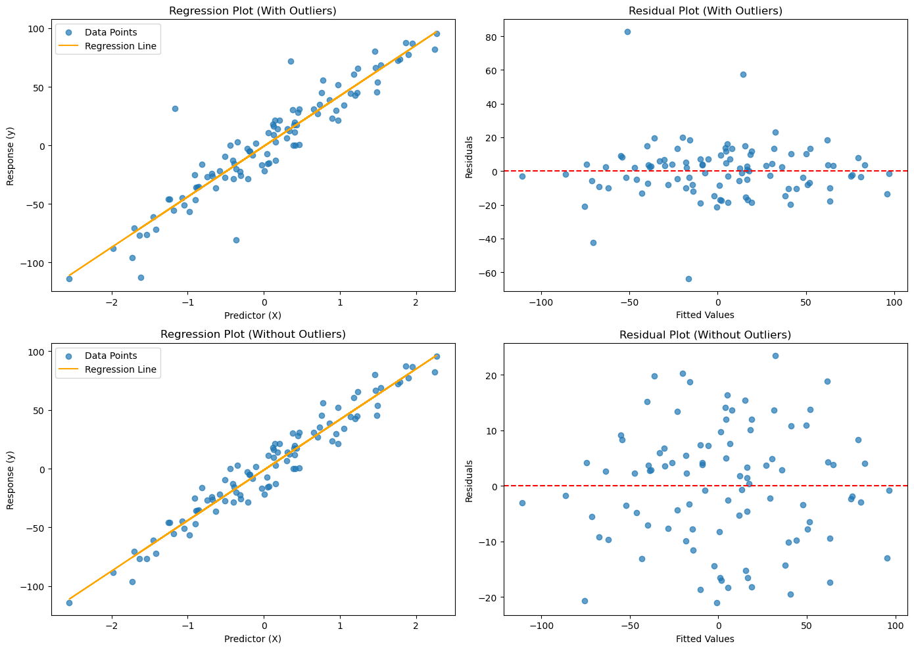
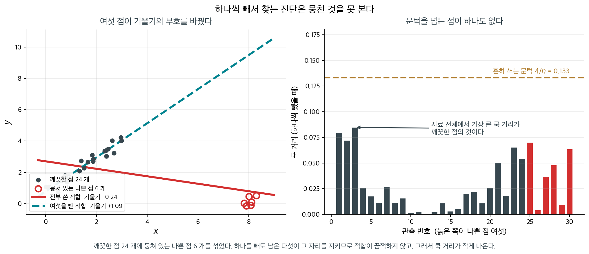
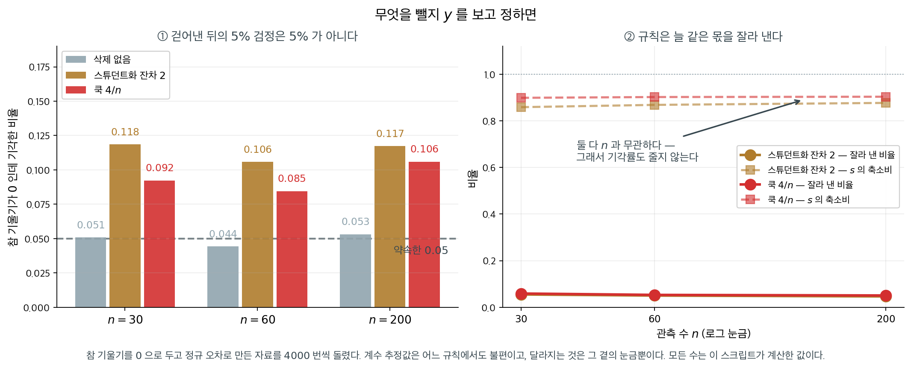

# 영향점과 지렛대

## 1. 이상점과 영향점 찾아내기

산점도에 눈에 띄는 점 몇 개가 있으면 「빼고 다시 돌릴까」가 늘 따라온다. 그 결정을 내리기 전에 그 점들이 적합을 얼마나 쥐고 있는지 재어 보아야 하고, 재는 자가 이 쪽의 주제다.

깨끗한 자료 $100$ 개의 $y$ 값 넷을 $+80$, $-80$, $+60$, $-60$ 만큼 흔들어 심어 보자. 기울기는 $42.6194$ 에서 $43.1512$ 로 $1.2\%$ 만 움직인다. 대신 $\hat\sigma$ 가 $10.7936$ 에서 $16.5534$ 로 $53\%$ 커지고 $R^2$ 이 $0.9417$ 에서 $0.8757$ 로 떨어진다. **무너진 것은 계수가 아니라 정밀도다** — 계수를 읽는 사람은 아무 이상을 못 느끼는데 그 곁의 구간이 $1.5$ 배로 벌어진다.

어느 관측이 적합을 쥐고 있는지는 **다시 적합하지 않고** 잴 수 있다. 쿡 거리가 그것이고, 그 점을 뺐을 때 **모든 적합값이 함께 얼마나 움직이는가**를 잰다. 흔히 쓰는 문턱이 $4/n$ 이다. $n = 100$ 이니 $0.04$ 이고, 심은 넷이 그 위로 올라오고 다섯째로 큰 값은 $0.0355$ 로 문턱 아래다. 넷을 정확히 집어낸 것이다.

집어낸 다음이 더 조심스럽다. 그 점들을 빼고 다시 적합하면 $R^2$ 과 $p$ 값이 좋아지는데, **그것은 모형이 나아진 증거가 아니다.** 잔차가 큰 점을 골라 뺐으니 오차제곱합이 줄어드는 것이 당연하고, 그렇게 얻은 $p$ 값은 더 이상 약속한 뜻을 갖지 않는다. 어느 관측이 적합을 쥐고 있는지를 재는 자는 무엇이고, 그 자가 눈을 감는 자리는 어디인가. 아래 상자 둘이 그 두 물음을 따라간다.

_확인한 곳 — 이 쪽 「하나씩 빼서는 못 찾는 것」·「걷어낸 뒤의 $p$ 값은 그 $p$ 값이 아니다」 상자와 그 출처 줄_

이상점과 영향점은 회귀 결과에 큰 영향을 줄 수 있다. 이들을 이해하는 일은 모형을 다듬는 데 필수적이다.

- **이상점**은 잔차가 유난히 큰 관측값으로, 모형의 예측에서 크게 벗어난다. 자료 기록 오류일 수도 있고 모형이 담지 못한 특수한 조건 때문일 수도 있다.
- **영향점**은 적합된 회귀모형에 지나치게 큰 영향을 주는 관측값이다. 이 점을 빼면 추정된 계수가 크게 달라진다.

---

## 2. Cook 거리

**Cook 거리**는 잔차(예측값이 실제값에서 얼마나 떨어져 있는가)와 지렛대(설명변수 값이 평균에서 얼마나 떨어져 있는가)를 결합하여 각 관측값이 회귀에 미치는 전반적 영향을 측정한다.

<div class="defn" markdown>

### 정의 1. Cook 거리 { .dfn }

각 관측값 $i$에 대해 Cook 거리 $D_i$는

$$
D_i = \frac{\sum_{j=1}^n (\hat{y}_{j} - \hat{y}_{j(i)})^2}{p \cdot s^2}
$$

여기서

- $\hat{y}_j$는 모든 자료를 써서 얻은 $j$번째 관측값의 예측값,
- $\hat{y}_{j(i)}$는 $i$번째 관측값을 뺀 뒤 얻은 $j$번째 관측값의 예측값,
- $p$는 절편을 포함한 추정 모수의 개수,
- $s^2$은 모형의 평균제곱오차이다.

</div>

!!! note "이 페이지의 $p$ 표기"
    이 절에서 $p$는 **절편을 포함한 모수의 개수**이다. 단순선형회귀에서는 $p = 2$(기울기 하나 + 절편)이다. 설명변수의 개수만 셀 때와 혼동하지 않도록 주의하라.

### s 제곱의 계산

잔차분산은 분모로 $n - p$를 써서 계산한다.

$$
s^2 = \frac{\sum_{i=1}^n (y_i - \hat{y}_i)^2}{n - p}
$$

이는 모수 $p$개를 추정하면서 잃은 자유도를 반영한다. 단순선형회귀($p = 2$)에서는 $n - 2$가 된다. 다중회귀에서는 추정한 모든 모수를 포함한 $p$를 써서 $n - p$를 쓴다.

### 큰 잔차와 높은 지렛대가 함께 있을 때

Cook 거리가 크다는 것은 그 관측값이 큰 잔차와 높은 지렛대를 함께 갖고 있어 적합값에 강한 영향을 준다는 뜻이다. 흔히 쓰는 문턱값은 다음과 같다.

- **$D_i > 4/n$**: 표본크기로 조정한 흔한 경험 법칙이다. $n$이 커지면 문턱값이 작아져 큰 자료에서 영향점을 더 쉽게 탐지한다.
- **$D_i > 1.0$**: 일부 문헌에서 쓰는 더 단순한 고정 문턱값이다.
- **시각적 점검**: Cook 거리 값을 그려 뚜렷이 튀는 관측값을 찾는다.

$4/n$ 문턱값은 실용적인 출발점으로 널리 쓰인다. 자료 크기에 따라 이상점 민감도를 조정해 주지만, 시각적 점검과 분야 지식으로 보완해야 한다.

### 구현: Cook 거리로 이상점 제거하기

<div class="exbox" markdown>

**보기 1.** <span class="diff easy" title="쉬움"></span> 이상치를 넣고 뺀 회귀 비교. 깨끗한 선형 자료에 $y$값만 $+80, -80, +60, -60$으로 넷을 흔들어 심는다.

**(1)** 관측 $i$의 $y$를 $\delta_i$만큼 바꾸면 단순회귀의 계수가 **정확히**

$$
\Delta\hat\beta_1 = \sum_i c_i \delta_i\ \ \Big(c_i = \tfrac{x_i-\bar x}{S_{xx}}\Big),
\qquad
\Delta\hat\beta_0 = \bar\delta - \bar x\,\Delta\hat\beta_1
$$

만큼 움직임을 보이시오. 교란을 **위아래로 짝지어** 넣으면 기울기가 거의 움직이지 않는 까닭도 밝히시오.

**(2)** 공식을 확인하고, Cook 거리가 심은 넷을 정확히 집어내는지, 그것을 빼면 무엇이 회복되는지 보시오.

</div>

??? success "풀이"

    **(1) 해석적으로.** OLS 추정량 $\hat{\boldsymbol\beta} = (X^\top X)^{-1}X^\top \mathbf y$는 $\mathbf y$의 **선형함수**다. 그러므로 $\mathbf y \to \mathbf y + \boldsymbol\delta$로 바꾸면

    $$
    \Delta\hat{\boldsymbol\beta} = (X^\top X)^{-1}X^\top \boldsymbol\delta
    $$

    로 변화량이 정확히 적힌다. 자료의 나머지 부분은 전혀 들어오지 않는다. 단순회귀에서 이것을 성분으로 풀어쓰면 [11.5절 보기 1](../assumptions/checking_normality.md)에서 본 $\hat\beta_1 = \sum_i c_i y_i$에서

    $$
    \Delta\hat\beta_1 = \sum_i c_i \delta_i,
    \qquad
    \Delta\hat\beta_0 = \overline{(y+\delta)} - (\hat\beta_1 + \Delta\hat\beta_1)\bar x - (\bar y - \hat\beta_1 \bar x) = \bar\delta - \bar x\,\Delta\hat\beta_1
    $$

    이다.

    **짝지어 넣으면 왜 기울기가 덜 움직이는가.** 크기가 같고 부호가 반대인 두 교란 $+a$(관측 $j$)와 $-a$(관측 $k$)를 생각하자. 그 몫은

    $$
    a\,c_j - a\,c_k = \frac{a\big[(x_j - \bar x) - (x_k - \bar x)\big]}{S_{xx}} = \frac{a\,(x_j - x_k)}{S_{xx}}
    $$

    로 **$\bar x$가 사라지고 두 $x$의 차이만 남는다.** 두 점의 $x$가 가까우면 기여가 거의 0이다. 절편 쪽에서는 $\bar\delta = 0$이 되어 더욱 그렇다.

    **그렇다고 해가 없는 것은 아니다.** 계수는 멀쩡해도 잔차제곱합은 반드시 커지고, 그러면 $\hat\sigma$가 부풀어 모든 표준오차와 구간이 함께 부푼다. **"기울기가 안 움직였으니 괜찮다"가 아니라 "추정의 정밀도를 잃었다"로 읽어야 한다.**

    ```python
    import numpy as np
    import pandas as pd
    import statsmodels.api as sm
    import matplotlib.pyplot as plt
    from sklearn.datasets import make_regression

    # 깨끗한 선형 자료를 먼저 만든다.
    np.random.seed(0)
    X, y = make_regression(n_samples=100, n_features=1, noise=10)
    data = pd.DataFrame({'X': X.flatten(), 'y': y})

    # 여기에 이상치 넷을 일부러 심는다. 위아래로 짝을 맞춰 넣었으므로
    # 기울기보다는 잔차의 퍼짐이 크게 흔들린다.
    data.loc[95, 'y'] += 80
    data.loc[96, 'y'] -= 80
    data.loc[97, 'y'] += 60
    data.loc[98, 'y'] -= 60

    # 이상치가 든 채로 적합한다.
    X_with_const = sm.add_constant(data['X'])
    model = sm.OLS(data['y'], X_with_const).fit()

    # Cook 의 거리는 그 관측값 하나를 뺐을 때 적합값 전체가 얼마나 움직이는지를
    # 잰다. 잔차가 크다고 다 영향점인 것은 아니다 — 지렛값도 함께 커야 한다.
    influence = model.get_influence()
    cooks_d, _ = influence.cooks_distance

    # 4/n 은 널리 쓰이는 어림 기준일 뿐 검정이 아니다.
    n = len(data)
    threshold = 4 / n
    outliers = np.where(cooks_d > threshold)[0]

    # 이상치가 있을 때와 없을 때를 나란히 그린다
    fig, axes = plt.subplots(2, 2, figsize=(14, 10))

    # 윗줄: 이상치가 든 자료. 회귀선과 잔차 그림을 나란히 본다.
    axes[0, 0].scatter(data['X'], data['y'], alpha=0.7, label='Data Points')
    axes[0, 0].plot(data['X'], model.fittedvalues, color='orange', label='Regression Line')
    axes[0, 0].set_title('Regression Plot (With Outliers)')
    axes[0, 0].set_xlabel('Predictor (X)')
    axes[0, 0].set_ylabel('Response (y)')
    axes[0, 0].legend()

    axes[0, 1].scatter(model.fittedvalues, model.resid, alpha=0.7)
    axes[0, 1].axhline(0, color='red', linestyle='--')
    axes[0, 1].set_title('Residual Plot (With Outliers)')
    axes[0, 1].set_xlabel('Fitted Values')
    axes[0, 1].set_ylabel('Residuals')

    # 아랫줄: 문턱을 넘은 관측값을 뺀 뒤 다시 적합한 결과다.
    # 두 줄을 견주는 것이 이 그림의 목적이지, 이상치를 지우라는 뜻이 아니다.
    # 지울지 말지는 그 값이 왜 생겼는지를 알아본 뒤에 정할 일이다.
    data_no_outliers = data.drop(index=outliers)
    X_with_const_no_outliers = sm.add_constant(data_no_outliers['X'])
    model_no_outliers = sm.OLS(data_no_outliers['y'], X_with_const_no_outliers).fit()

    axes[1, 0].scatter(data_no_outliers['X'], data_no_outliers['y'], alpha=0.7, label='Data Points')
    axes[1, 0].plot(data_no_outliers['X'], model_no_outliers.fittedvalues, color='orange', label='Regression Line')
    axes[1, 0].set_title('Regression Plot (Without Outliers)')
    axes[1, 0].set_xlabel('Predictor (X)')
    axes[1, 0].set_ylabel('Response (y)')
    axes[1, 0].legend()

    axes[1, 1].scatter(model_no_outliers.fittedvalues, model_no_outliers.resid, alpha=0.7)
    axes[1, 1].axhline(0, color='red', linestyle='--')
    axes[1, 1].set_title('Residual Plot (Without Outliers)')
    axes[1, 1].set_xlabel('Fitted Values')
    axes[1, 1].set_ylabel('Residuals')

    plt.tight_layout()
    plt.show()
    ```

    

    윗줄이 이상치가 든 자료, 아랫줄이 뺀 자료다. 왼쪽은 회귀 그림, 오른쪽은 잔차 그림이다. 이제 (1)의 공식과 맞춰 본다.

    ```python
    import numpy as np
    import pandas as pd
    import statsmodels.api as sm
    from sklearn.datasets import make_regression

    # 교란하기 전의 적합
    np.random.seed(0)
    X0, y0 = make_regression(n_samples=100, n_features=1, noise=10)
    clean = sm.OLS(y0, sm.add_constant(X0)).fit()

    x = data['X'].values
    xbar, Sxx = x.mean(), ((x - x.mean()) ** 2).sum()
    c = (x - xbar) / Sxx
    delta = np.zeros(len(x))
    delta[[95, 96, 97, 98]] = [80, -80, 60, -60]

    print(f"S_xx = {Sxx:.4f}")
    print(f"공식  d_beta1 = sum c_i delta_i = {(c * delta).sum():.12f}")
    print(f"실제        = {model.params.iloc[1] - clean.params[1]:.12f}")
    print(f"공식  d_beta0 = {delta.mean() - xbar * (c * delta).sum():.12f}")
    print(f"실제        = {model.params.iloc[0] - clean.params[0]:.12f}")

    # 짝을 이루면 x 의 차만 남는다
    print(f"\n두 쌍의 기여:  80(x95 - x96)/S_xx = "
          f"{80 * (x[95] - x[96]) / Sxx:+.4f},  60(x97 - x98)/S_xx = "
          f"{60 * (x[97] - x[98]) / Sxx:+.4f}")

    print(f"\n{'':>12}{'절편':>10}{'기울기':>10}{'sigma_hat':>12}{'R^2':>9}")
    for name, m in [('교란 전', clean), ('교란 후', model), ('제거 후', model_no_outliers)]:
        b0, b1 = np.asarray(m.params)
        print(f"{name:>12}{b0:>10.4f}{b1:>10.4f}"
              f"{np.sqrt(m.mse_resid):>12.4f}{m.rsquared:>9.4f}")

    print(f"\nCook 문턱 {threshold} 을 넘은 관측 = {list(outliers)}")
    print(f"다섯째로 큰 Cook 거리 = {np.sort(cooks_d)[-5]:.4f}")
    ```

    출력:

    ```
    S_xx = 101.5827
    공식  d_beta1 = sum c_i delta_i = 0.531814777033
    실제        = 0.531814777033
    공식  d_beta0 = -0.031806786446
    실제        = -0.031806786446

    두 쌍의 기여:  80(x95 - x96)/S_xx = -0.6319,  60(x97 - x98)/S_xx = +1.1637

                        절편       기울기   sigma_hat      R^2
            교란 전   -0.8142   42.6194     10.7936   0.9417
            교란 후   -0.8460   43.1512     16.5534   0.8757
            제거 후   -1.1852   43.0230     10.7420   0.9430

    Cook 문턱 0.04 을 넘은 관측 = [95, 96, 97, 98]
    다섯째로 큰 Cook 거리 = 0.0355
    ```

    **공식이 소수점 열두째 자리까지 맞는다.** 기울기 변화 $0.531814777033$, 절편 변화 $-0.031806786446$이 공식과 실제에서 같다. 선형성이므로 당연하지만, **"이 관측을 이만큼 바꾸면 계수가 얼마나 움직이나"를 재적합 없이 답할 수 있다**는 뜻이다.

    **짝지음이 실제로 들었다.** 두 쌍의 기여가 $-0.6319$와 $+1.1637$로 서로 어긋나 합이 $0.5318$이 되었다. 기울기 $42.62$에 견주면 $1.2\%$다. $320$만큼의 교란을 심었는데도 그 정도다.

    **대신 $\hat\sigma$가 무너졌다.** $10.79$에서 $16.55$로 **$53\%$ 커지고** $R^2$이 $0.9417$에서 $0.8757$로 떨어진다. (1)에서 말한 "계수는 멀쩡해도 정밀도를 잃는다"가 이 두 수다. 표준오차가 $1.53$배가 되었으니 신뢰구간도 그만큼 넓어진다.

    **Cook 거리가 심은 넷을 정확히 집어낸다.** 문턱 $4/n = 0.04$를 넘은 것이 $[95, 96, 97, 98]$ 넷뿐이고, 다섯째로 큰 Cook 거리는 $0.0355$로 문턱 아래다. 거짓 양성도 거짓 음성도 없다.

    **빼면 $\hat\sigma$가 돌아온다.** $16.55 \to 10.74$로 교란 전의 $10.79$와 사실상 같다. 기울기가 $43.02$로 교란 전의 $42.62$와 완전히 같지는 않은데, 이는 교란을 덜 지웠기 때문이 아니라 **멀쩡한 관측 넷을 함께 잃었기 때문**이다. 제거 뒤의 적합은 손대지 않은 $96$개에 대한 적합과 정확히 같고, 표본이 $100$개에서 $96$개로 줄었으니 추정값이 그만큼 흔들린다.

    **이 보기가 성공한 것은 심은 값을 우리가 알기 때문이다.** 실제 자료에서는 어느 점이 "심어진" 것인지 알 수 없다. 아래 상자가 그 점을 경고한다.

!!! warning "이상점을 함부로 버리지 말 것"
    위 코드는 방법을 보이기 위해 $D_i > 4/n$인 점을 모두 제거한다. 실무에서는 각 점을 개별적으로 조사해야 한다. 기록 오류라면 고치거나 빼는 것이 옳지만, 타당하지만 극단적인 관측값이라면 남겨 두고 로버스트 회귀를 쓰는 편이 낫다. 이상점을 기계적으로 지우면 잔차가 인위적으로 작아져 모형이 실제보다 좋아 보이게 된다.

---

<div class="storybox" markdown>

**그림으로 보는 통계학 1.** 하나씩 빼서는 못 찾는 것

정의 1 의 쿡 거리는 **한 점을 뺐을 때** 적합이 얼마나 움직이는지를 잰다. 「한 점을」이라는
말이 이 도구의 힘이자 한계다. 나쁜 점이 **하나**면 잘 찾아내고, **여럿이 뭉쳐 있으면**
못 찾는다.

까닭은 뻔한데 막상 당하면 보이지 않는다. 뭉친 점 여섯 가운데 하나를 빼도 **남은 다섯이
그 자리를 지킨다.** 적합이 꿈쩍하지 않으니 쿡 거리가 작게 나오고, 여섯이 서로를 가려
준다. 이것을 **가림**이라 한다.

<figure markdown>
  { width=980 }
  <figcaption markdown>참 기울기는 $+1$ 이다. 여섯 점이 **부호를 뒤집어** $-0.24$ 로 만들었는데, 쿡 거리는 문턱 $4/n = 0.133$ 을 넘는 점을 **하나도** 내놓지 못한다. 자료에서 직접 그렸다.</figcaption>
</figure>

오른쪽 그림이 이 상자의 요점이다. 세 가지를 차례로 읽어야 한다.

**하나.** 문턱을 넘은 점이 **$0$ 개**다. §$2$ 의 절차를 그대로 따르면 「영향점 없음」으로
판정하고 넘어가게 된다.

**둘.** 나쁜 점 여섯의 쿡 거리 최댓값이 $0.070$ 인데, **깨끗한 점의 최댓값이 $0.085$ 로
더 크다.** 자료 전체에서 가장 「영향점처럼 보이는」 점이 멀쩡한 점이다. 순위를 매겨
위에서부터 들여다보아도 엉뚱한 곳을 보게 된다.

**셋.** 그런데 여섯을 **함께** 빼면 기울기가 $-0.24$ 에서 $+1.09$ 로 돌아온다. 참값
$+1$ 에 거의 맞는다. 자료는 답을 갖고 있었는데 진단이 못 꺼낸 것이다.

**그러면 어떻게 하는가.** 모든 쌍·삼중조를 다 빼 보는 것은 $\binom{n}{k}$ 라 금방
불가능해진다. 실무가 쓰는 길은 셋이다.

- **그림을 먼저 본다.** 왼쪽 산점도에서는 뭉친 여섯이 한눈에 보인다. 수치 진단이 놓친
  것을 눈이 잡는 일이 드물지 않고, 특히 설명변수가 적을 때 그렇다.
- **적합부터 로버스트하게 한다.** 최소제곱 대신 큰 잔차의 영향을 줄이는 방법(LTS·LMS·
  M 추정)으로 먼저 선을 그으면, 그 선 기준의 잔차에서 여섯이 그대로 드러난다. 가림은
  **오염된 적합을 기준으로 잰 잔차**에서 생기는 일이므로, 기준을 바꾸면 풀린다.
- **얼마나 오염되어 있을 수 있는지를 미리 정한다.** 위 자료는 $30$ 개 중 $6$ 개, 곧
  $20\%$ 가 오염되어 있었다. 하나씩 빼는 진단이 암묵적으로 믿는 것은 **오염이 한 점
  뿐**이라는 가정이고, 그 가정을 적어 두면 언제 못 믿을지도 함께 알게 된다.

_확인한 곳 — 뭉친 이상점들이 하나씩 빼는 진단을 무력하게 만드는 현상을 가림(masking)이라 부르고, 로버스트 회귀가 필요해지는 표준적인 동기로 다루어진다 · 그림의 수치(전체 기울기 $-0.239$, 여섯을 뺀 기울기 $+1.090$, 쿡 거리 최댓값 $0.085$ 대 문턱 $0.133$)는 이 쪽에서 만든 자료로 직접 쟀다_

</div>

<div class="storybox" markdown>

**그림으로 보는 통계학 2.** 걷어낸 뒤의 $p$ 값은 그 $p$ 값이 아니다

바로 위 「구현」이 하는 일은 쿡 거리로 **이상점을 걸러 내고 다시 적합하는 것**이다. 그러고 나면 새 요약표가 나오고, 거기에도 $t$ 와 $p$ 가 적혀 있다. 그 수는 무엇인가.

눈여겨볼 것은 **걸러 내는 규칙이 $y$ 를 들여다본다**는 점이다. 쿡 거리도 스튜던트화 잔차도 잔차에서 나오고, 잔차는 $y$ 에서 나온다. 곧 「어느 관측을 쓸 것인가」가 결과를 보고 정해진다. 그러면 남은 자료는 더 이상 그냥 뽑은 표본이 아니다.

얼마나 어긋나는지는 **아무 일도 없는 자료**에 걸어 보면 바로 보인다. 참 기울기를 $0$ 으로 두고 오차를 정규로 만든 다음, 셋을 견주었다($4000$ 번, 유의수준 $5\%$).

| $n$ | 삭제 없음 | 스튜던트화 잔차 $2$ | 쿡 $4/n$ |
|---|---|---|---|
| $30$ | $0.051$ | $\mathbf{0.118}$ | $0.092$ |
| $60$ | $0.044$ | $\mathbf{0.106}$ | $0.085$ |
| $200$ | $0.053$ | $\mathbf{0.117}$ | $0.106$ |



**$5\%$ 로 약속한 검정이 $10$–$12\%$ 가 된다.** 참 기울기가 $0$ 인데 열 번에 한 번씩 「유의하다」가 나오는 것이다. 삭제 없이 돌린 쪽은 $0.051$, $0.044$, $0.053$ 으로 제자리에 있으니 모의실험이 잘못된 것도 아니다.

그러니 큰 잔차를 **지울 대상으로 보는 습관**이 두 번 해롭다. 이 쪽 뒤의 [회귀 진단 (주택)](regression_diagnostics_housing.md)에는 스튜던트화 잔차가 $24$ 인 점이 나오는데, 그 점이 바로 **그 분석의 발견**이다 — 규칙대로 지웠다면 가장 먼저 사라졌을 자리다.

까닭은 단순하다. 잘라 내는 것이 하필 **잔차가 큰 쪽**이므로 남은 자료의 $s$ 가 작아진다 — 위 설정에서 $0.86$–$0.90$ 배다. $t = \hat\beta_1 / \mathrm{SE}$ 에서 **분자는 그대로인데 분모만 줄어드니** $t$ 가 커진다. 계수 추정값 자체는 어느 규칙에서도 여전히 불편이다. 망가지는 것은 추정값이 아니라 **그 곁의 눈금**이다.

여기서 중요한 것은 오른쪽 판이다. $n = 30$ 에서 $200$ 으로 가도 기각률이 줄지 않는다. 규칙이 늘 **같은 비율**을 잘라 내기 때문이다 — 정규표본에서 $\lvert$스튜던트화 잔차$\rvert > 2$ 인 점은 언제나 $5\%$ 쯤이고, 실제로 잘라 낸 비율이 $0.055,\ 0.051,\ 0.047$ 이다. $s$ 의 축소비도 $0.859,\ 0.868,\ 0.877$ 로 거의 그대로다. 곧 **작은 표본의 사정이 아니라 규칙 자체의 성질**이고, 자료를 더 모아도 없어지지 않는다.

그러니 영향점을 빼지 말라는 말이 아니다. **뺐다는 사실을 모르는 눈금으로 뺀 뒤의 $p$ 값을 읽지 말라는 말**이다. 실무에서 할 수 있는 것은 두 가지다. 빼기 전과 뺀 뒤를 **둘 다 보고하는 것**, 그리고 둘이 갈리면 그 갈림 자체를 결과로 적는 것이다. 11.6절 [회귀 진단 (주택)](regression_diagnostics_housing.md)의 상자가 같은 이야기의 다른 쪽을 — **진단량은 빼라는 명령이 아니라 보라는 표시**라는 쪽을 — 다룬다.

</div>

## 3. 다중공선성은 앞 쪽이 맡는다

지렛대가 **한 관측값**이 적합에 끼치는 힘이라면, 다중공선성은 **설명변수들끼리**의 상관이 계수에 끼치는 힘이다. 둘은 서로 다른 축인데 진단에서 함께 보는 일이 많아 이 쪽에 묶여 있었다. 탐지(상관행렬·분산팽창인자·조건수), 결과, 대처(중복 제거·결합·정칙화·주성분)를 모두 바로 앞 쪽인 11.6절 [다중공선성과 분산팽창인자](multicollinearity.md)가 보기 일곱과 함께 다룬다. 조건수가 왜 그렇게 커지는지는 그 쪽의 「그림으로 보는 통계학 1」이 $1967$ 년 롱리 자료로 보인다.

아래 연습문제 8 이 쓰는 문턱 하나만 여기 적어 둔다. **VIF 가 $5$–$10$을 넘으면 문제가 되는 다중공선성을 시사한다.** 그 문턱이 상관의 말로는 얼마인지가 그 문항이다.

---

## 연습문제

<div class="drillbox" markdown>

**연습문제 1.** <span class="diff easy" title="쉬움"></span>
설명변수가 3개이고 관측값이 $n = 50$개인 회귀에서 어떤 관측값의 지렛대가 $h_{ii} = 0.18$이다. 표준 문턱값으로 이것이 높은 지렛대 점인지 판정하고, 높은 지렛대가 기하학적으로 무엇을 뜻하는지 설명하라.

</div>

??? success "풀이"
    절편을 포함한 모수의 개수는 $k = 3 + 1 = 4$이다. 높은 지렛대의 표준 문턱값은 $2k/n = 2 \times 4/50 = 0.16$이다. $h_{ii} = 0.18 > 0.16$이므로 이는 높은 지렛대 점이다.

    (문턱값 $2k/n$은 지렛대의 평균이 정확히 $k/n$이라는 사실에서 온다. $\sum_i h_{ii} = \text{tr}(H) = k$이기 때문이다. 곧 평균의 두 배를 기준으로 삼는 것이다.)

    기하학적으로 지렛대는 어떤 관측값의 설명변수 값이 설명변수 공간의 중심에서 얼마나 떨어져 있는지를 잰다. 지렛대가 높은 점은 $X$ 값들의 평균에서 멀리 떨어져 있어 회귀직선에 불균형하게 큰 영향을 준다. 회귀직선이 그런 점 쪽으로 "끌려간다".

<div class="drillbox" markdown>

**연습문제 2.** <span class="diff easy" title="쉬움"></span>
$n = 30$이고 설명변수가 2개인 회귀에서 17번 관측값의 Cook 거리가 $D_{17} = 0.95$이다. 문턱값 $D > 4/n$을 써서 그 영향을 평가하고, 이 관측값을 빼면 회귀가 어떻게 달라질지 기술하라.

</div>

??? success "풀이"
    문턱값은 $4/n = 4/30 = 0.133$이다. $D_{17} = 0.95 \gg 0.133$이므로 이 관측값은 매우 영향력이 크다. 더 단순한 고정 문턱값 $D > 1$에는 조금 못 미치지만 그에 가까운 값이다.

    17번 관측값을 빼면 추정된 회귀계수 $\hat{\beta}$가 상당히 달라진다. 변화의 방향과 크기는 그 관측값이 큰 잔차를 가져 직선을 자기 쪽으로 끌어당기고 있는지, 아니면 현재의 추세 위에 놓여 있는지에 달려 있다. 연구자는 이 점이 자료 오류인지, 다른 모집단에서 온 이상점인지, 타당하지만 극단적인 관측값인지 조사해야 한다.

<div class="drillbox" markdown>

**연습문제 3.** <span class="diff med" title="중간"></span>
지렛대($h_{ii}$), 스튜던트화 잔차($r_i$), Cook 거리($D_i$)의 관계를 설명하라. 어떤 관측값이 Cook 거리는 크면서 지렛대는 작을 수 있는가?

</div>

??? success "풀이"
    Cook 거리는 지렛대와 잔차 크기를 결합한다. 절편을 포함한 모수의 개수를 $k$라 하면

    $$
    D_i = \frac{r_i^2}{k} \cdot \frac{h_{ii}}{1 - h_{ii}}
    $$

    여기서 $r_i$는 내부 스튜던트화 잔차, $h_{ii}$는 지렛대이다.

    스튜던트화 잔차가 아주 크면(설명변수 공간의 중심 근처에 있는 뚜렷한 이상점) 지렛대가 중간 정도여도 $D_i$가 클 수 있다. 그러나 실무에서 정말로 큰 Cook 거리는 대개 최소한 중간 이상의 지렛대를 동반한다. $X$의 중심 근처에 있는 관측값은 잔차가 커도 회귀직선 전체를 움직이는 힘이 제한적이기 때문이다. 위 공식에서 $h_{ii} \to 0$이면 인자 $h_{ii}/(1-h_{ii}) \to 0$이 되어 $D_i$도 0으로 간다는 점이 이를 보여준다.

<div class="drillbox" markdown>

**연습문제 4.** <span class="diff med" title="중간"></span>
보기 1 의 출력에는 $S_{xx} = 101.5827$, $\Delta\hat\beta_1 = 0.531814777033$, $\Delta\hat\beta_0 = -0.031806786446$, 그리고 두 쌍의 기여 $-0.6319$와 $+1.1637$이 적혀 있다. 교란은 관측 $95, 96, 97, 98$의 $y$에 각각 $+80, -80, +60, -60$이었다. **자료를 보지 않고 이 수들만으로** 다음을 구하라.

**(1)** $\bar x$.

**(2)** $x_{95} - x_{96}$과 $x_{97} - x_{98}$.

**(3)** $S_{xx}$에서 $x$의 표준편차를 구하고, 둘째 쌍이 교란의 크기는 더 작은데도 기울기를 더 많이 움직인 까닭을 (2)의 수로 설명하라.

</div>

??? success "풀이"
    **(1)** 보기 1 의 공식 $\Delta\hat\beta_0 = \bar\delta - \bar x\,\Delta\hat\beta_1$에서 교란의 평균은

    $$
    \bar\delta = \frac{80 - 80 + 60 - 60}{100} = 0
    $$

    이므로 $\Delta\hat\beta_0 = -\bar x\,\Delta\hat\beta_1$이고

    $$
    \bar x = -\frac{\Delta\hat\beta_0}{\Delta\hat\beta_1} = \frac{0.031806786446}{0.531814777033} = 0.0598080
    $$

    이다. 두 변화량의 비 하나로 $\bar x$가 나오는 것은 절편이 $\bar y - \hat\beta_1\bar x$라는 단순회귀의 구조 때문이다.

    **(2)** 짝지은 두 교란의 기여는 보기 1 에서 본 대로 $\delta\,(x_j - x_k)/S_{xx}$이다. 첫 쌍($\delta = 80$, 관측 $95$와 $96$)에서

    $$
    \frac{80\,(x_{95} - x_{96})}{101.5827} = -0.6319
    \quad\Longrightarrow\quad
    x_{95} - x_{96} = \frac{-0.6319 \times 101.5827}{80} = -0.8024
    $$

    둘째 쌍($\delta = 60$, 관측 $97$과 $98$)에서

    $$
    \frac{60\,(x_{97} - x_{98})}{101.5827} = +1.1637
    \quad\Longrightarrow\quad
    x_{97} - x_{98} = \frac{1.1637 \times 101.5827}{60} = 1.9702
    $$

    검산으로 두 기여의 합 $-0.6319 + 1.1637 = 0.5318$이 $\Delta\hat\beta_1 = 0.53181$과 맞는다.

    **(3)** $x$의 표준편차는 $\sqrt{S_{xx}/n} = \sqrt{101.5827/100} = 1.0079$이다. 두 쌍의 $x$ 간격은 각각 표준편차의 $0.80$배와 $1.95$배다. 기여의 분자를 견주면

    $$
    80 \times 0.8024 = 64.2,
    \qquad
    60 \times 1.9702 = 118.2
    $$

    로 둘째 쌍이 거의 두 배다. 짝지은 교란에서 기울기를 움직이는 것은 **교란의 크기가 아니라 두 점의 $x$가 얼마나 떨어져 있는가**다. $x$가 같은 두 점에 $+a$와 $-a$를 넣으면 기울기는 한 치도 움직이지 않는다.

<div class="drillbox" markdown>

**연습문제 5.** <span class="diff med" title="중간"></span>
보기 1 의 표에서 기울기는 교란 전 $42.6194$, 제거 후 $43.0230$이었다. 풀이는 이 차이가 "멀쩡한 관측 넷을 함께 잃었기 때문"이라고 말한다. 이것을 수로 확인하자.

**(1)** 제거 후의 적합이 손대지 않은 $96$개 관측에 대한 적합과 **정확히** 같다고 말할 수 있는 근거가 출력의 어느 줄인가.

**(2)** 부분집합의 $S_{xx}$는 전체의 $S_{xx}$를 넘을 수 없음을 보이고, 이를 써서 제거 후 기울기의 표준오차의 **하한**을 $\hat\sigma = 10.7420$과 $S_{xx} = 101.5827$만으로 구하라. 차이 $43.0230 - 42.6194$는 그 하한의 몇 배인가.

**(3)** "빼면 $\hat\sigma$가 돌아온다"와 "빼면 기울기가 돌아온다" 가운데 어느 주장이 자료로 더 강하게 뒷받침되는가.

</div>

??? success "풀이"
    **(1)** 출력의 마지막에서 둘째 줄 "Cook 문턱 $0.04$ 을 넘은 관측 $= [95, 96, 97, 98]$"이다. 제거된 집합이 교란을 심은 집합과 글자 그대로 같고, 교란은 이 넷의 $y$만 바꾸었다. 그러므로 넷을 뺀 자료의 모든 값이 교란 전 자료에서 같은 넷을 뺀 것과 완전히 일치하고, OLS 는 남은 $96$개만 보므로 두 적합은 같은 수를 낸다. 거짓 양성이 하나라도 있었다면 이 말은 깨진다.

    **(2)** 부분집합 $S$에 대하여 표본평균이 제곱합을 최소로 한다는 성질에서

    $$
    \sum_{i \in S}(x_i - \bar x_S)^2 = \min_a \sum_{i \in S}(x_i - a)^2 \le \sum_{i \in S}(x_i - \bar x)^2 \le \sum_{i=1}^{100}(x_i - \bar x)^2 = 101.5827
    $$

    이다. 첫 부등호는 $a = \bar x$를 넣은 것이고, 둘째는 항이 음수가 아닌 것을 넷 더 더한 것이다. 따라서 단순회귀의 표준오차 $\mathrm{SE}(\hat\beta_1) = \hat\sigma/\sqrt{S_{xx}}$는

    $$
    \mathrm{SE}(\hat\beta_1) \ge \frac{10.7420}{\sqrt{101.5827}} = 1.0658
    $$

    로 아래가 막힌다. 한편 기울기의 차이는 $43.0230 - 42.6194 = 0.4036$이므로 하한의

    $$
    \frac{0.4036}{1.0658} = 0.379
    $$

    배, 곧 표준오차의 **절반도 되지 않는다**.

    **(3)** $\hat\sigma$는 $10.7936 \to 16.5534 \to 10.7420$으로 움직였다. 교란이 만든 변화 $+5.76$에 비해 회복 후의 차이 $-0.05$는 $1\%$ 이하이니, 이 회복은 눈금 위에서 뚜렷하다. 반면 기울기는 애초에 표준오차가 $1.07$쯤인 양이어서 $0.40$의 차이를 "돌아왔다/못 돌아왔다"로 가릴 분해능이 없다. 제거가 회복한 것은 **정밀도**이고, 기울기는 처음부터 크게 망가지지 않았으므로 회복을 말할 거리가 없는 것이다.

<div class="drillbox" markdown>

**연습문제 6.** <span class="diff med" title="중간"></span>
연습문제 3 의 공식 $D_i = \dfrac{r_i^2}{p}\cdot\dfrac{h_{ii}}{1 - h_{ii}}$에서($p$는 연습문제 3 의 $k$와 같은 것, 곧 절편을 포함한 모수의 개수다) 보기 1 과 같이 $n = 100$, $p = 2$이고 지렛값이 정확히 평균인 $h_{ii} = p/n = 0.02$인 관측값을 생각하자.

**(1)** $D_i = 4/n$이 되는 $\lvert r_i \rvert$와 $D_i = 1$이 되는 $\lvert r_i \rvert$를 각각 구하라.

**(2)** $e_i^2 \le \mathrm{RSS}$에서 $r_i^2 \le (n - p)/(1 - h_{ii})$를 보이고, $h_{ii} = 0.02$에서 $D_i$가 가질 수 있는 최댓값을 구하라.

**(3)** 두 문턱 가운데 어느 쪽이 중심 근처의 점에 대해 사실상 소용이 없는가.

</div>

??? success "풀이"
    **(1)** $h_{ii} = 0.02$, $p = 2$에서 공식의 인자는

    $$
    \frac{1}{p}\cdot\frac{h_{ii}}{1 - h_{ii}} = \frac{1}{2}\cdot\frac{0.02}{0.98} = 0.0102041
    $$

    이므로 $D_i = 0.0102041\,r_i^2$이다. 따라서

    $$
    D_i = \frac{4}{n} = 0.04 \ \Longrightarrow\ r_i^2 = 3.92,\ \lvert r_i \rvert = 1.9799,
    \qquad
    D_i = 1 \ \Longrightarrow\ r_i^2 = 98,\ \lvert r_i \rvert = 9.8995
    $$

    **(2)** 내부 스튜던트화 잔차의 정의와 $s^2 = \mathrm{RSS}/(n - p)$에서

    $$
    r_i^2 = \frac{e_i^2}{s^2(1 - h_{ii})} = \frac{(n - p)\,e_i^2}{\mathrm{RSS}\,(1 - h_{ii})} \le \frac{n - p}{1 - h_{ii}}
    $$

    이다. 마지막 부등호는 $e_i^2 \le \sum_j e_j^2 = \mathrm{RSS}$이고, 등호는 나머지 잔차가 모두 $0$일 때만 성립한다. $n = 100$, $p = 2$, $h_{ii} = 0.02$를 넣으면 $r_i^2 \le 98/0.98 = 100$이고

    $$
    D_i \le \frac{100}{2}\cdot\frac{0.02}{0.98} = 1.0204
    $$

    **(3)** $D_i > 1$은 $\lvert r_i \rvert > 9.90$을 요구하는데, 애초에 가능한 최댓값이 $1.0204$다. 즉 그 한 점의 잔차가 잔차제곱합을 거의 **전부** 차지해야 겨우 넘는다. 중심 근처의 점에 고정 문턱 $1$은 영원히 걸리지 않는다. 반면 $4/n$이 요구하는 $1.98$은 표준정규의 양쪽 $5\%$ 분위점 $1.96$과 사실상 같아서, 눈에 띄는 잔차를 실제로 집어낸다. 고정 문턱 $D_i > 1$은 잔차를 묻는 문턱이 아니라 **지렛값이 큰 점에만 작동하는 문턱**이다.

<div class="drillbox" markdown>

**연습문제 7.** <span class="diff hard" title="어려움"></span>
연습문제 6 을 일반화하자. 지렛값이 정확히 평균인 $h_{ii} = p/n$인 관측값을 생각한다.

**(1)** $D_i = \dfrac{r_i^2}{n - p}$임을 보이고, 문턱 $D_i > 4/n$이 $r_i^2 > 4(1 - p/n)$과 같은 말임을 보이라.

**(2)** $n \gg p$에서 이 기준이 무엇으로 수렴하는가. 정규 가정 아래 평균 지렛값을 가진 관측값 하나가 $4/n$에 걸릴 확률을 어림하고, 본문이 $4/n$을 "검정이 아니다"라고 한 까닭과 이어서 말하라.

**(3)** 보기 1 의 "다섯째로 큰 Cook 거리 $= 0.0355$"를, 그 점이 평균 지렛값을 가졌다고 보고 $\lvert r_i \rvert$로 옮기라. 본문은 "거짓 양성도 거짓 음성도 없다"고 했는데, 이 수는 그 판정에 대해 무엇을 덧붙이는가.

**(4)** $p = 2$에서 $\lvert r_i \rvert = 2$인 관측값이 $D_i = 1$에 닿으려면 지렛값이 얼마여야 하는가. 보기 1 의 $n = 100$에서 평균 지렛값의 몇 배인가.

</div>

??? success "풀이"
    **(1)** $h_{ii} = p/n$을 넣으면 $1 - h_{ii} = (n - p)/n$이므로

    $$
    D_i = \frac{r_i^2}{p}\cdot\frac{p/n}{(n - p)/n} = \frac{r_i^2}{p}\cdot\frac{p}{n - p} = \frac{r_i^2}{n - p}
    $$

    로 $p$가 약분되어 사라진다. 따라서

    $$
    D_i > \frac{4}{n}
    \iff
    r_i^2 > \frac{4(n - p)}{n} = 4\Big(1 - \frac{p}{n}\Big)
    $$

    **(2)** $n \gg p$면 우변이 $4$로 가므로 기준은 $\lvert r_i \rvert > 2$가 된다. 문턱이 $n$에 따라 작아지는 것은 **지렛값의 평균도 함께 작아지기 때문**이고, 잔차의 말로 옮겨 적으면 기준은 표본크기와 거의 무관한 "$\lvert r_i \rvert > 2$"다. 정규 가정에서

    $$
    P(\lvert r_i \rvert > 2) \approx 2\big(1 - \Phi(2)\big) = 0.0455
    $$

    이니, 어떤 $n$에서도 중심 근처 관측값의 약 $4.6\%$가 $4/n$을 넘는다. 자료가 완전히 깨끗해도 $n = 100$이면 네다섯 개가 걸린다는 뜻이다. 그래서 $4/n$을 넘은 점의 개수 자체는 아무 증거가 되지 못하고, 본문대로 "눈길을 주라는 신호"로만 읽어야 한다.

    **(3)** $n = 100$, $p = 2$에서 (1)을 뒤집으면 $r_i^2 = D_i\,(n - p) = 0.0355 \times 98 = 3.479$이므로 $\lvert r_i \rvert = 1.865$이다. 문턱에 해당하는 $1.980$의 $94\%$로, 바로 아래에 붙어 있다. 즉 이 보기에서 Cook 거리가 심은 넷을 정확히 집어낸 것은 사실이지만 **여유가 거의 없었다**. 교란의 크기를 조금만 줄이거나 다섯째 점이 조금만 더 튀었더라면 판정이 흐려진다. 넷과 다섯째가 $0.0355$ 대 $0.04$로 갈린 것은 깔끔한 분리라기보다 간신히 지나간 것이다.

    **(4)** $p = 2$, $\lvert r_i \rvert = 2$를 공식에 넣으면

    $$
    1 = \frac{4}{2}\cdot\frac{h_{ii}}{1 - h_{ii}}
    \iff
    \frac{h_{ii}}{1 - h_{ii}} = \frac{1}{2}
    \iff
    h_{ii} = \frac{1}{3}
    $$

    이다. 평균 지렛값은 $p/n = 0.02$이므로 $16.7$배다. 연습문제 1 의 문턱 $2p/n = 0.04$에 견주어도 $8$배가 넘는다. 흔한 크기의 잔차로 $D_i = 1$에 닿으려면 관측값 하나가 $X$ 공간에서 거의 혼자 떨어져 있어야 한다. 이것이 (3)과 연습문제 6 이 가리키는 같은 결론이다 — 두 문턱은 같은 것을 재는 두 눈금이 아니라, 서로 다른 종류의 점을 잡는 장치다.

<div class="drillbox" markdown>

**연습문제 8.** <span class="diff hard" title="어려움"></span>
본문은 "VIF 가 $5$–$10$을 넘으면 문제가 되는 다중공선성을 시사한다"고 했다. 이 문턱이 상관의 말로는 얼마인지 보자. 설명변수가 둘인 모형 $y = \beta_0 + \beta_1x_1 + \beta_2x_2 + \varepsilon$을 생각하고, $x_1$과 $x_2$의 표본상관을 $r$이라 한다.

**(1)** VIF 의 정의 $\mathrm{VIF}_j = 1/(1 - R_j^2)$($R_j^2$는 $x_j$를 나머지 설명변수에 회귀한 결정계수)에서 $\mathrm{VIF}_1 = \mathrm{VIF}_2 = 1/(1 - r^2)$임을 보이라.

**(2)** $\mathrm{VIF} = 5$와 $\mathrm{VIF} = 10$에 대응하는 $\lvert r \rvert$를 구하고, 계수의 표준오차가 무상관인 경우의 몇 배인지 적으라.

**(3)** $r = 0.99$이고, 같은 $\sigma$와 같은 $\sum_i (x_{i1} - \bar x_1)^2$ 아래 무상관이었다면 두 계수의 $t$값이 각각 $10$이었을 상황을 생각하자. 실제 $t$값은 얼마인가. 본문의 "모형 전체는 잘 맞는데도 개별 설명변수의 유의성이 가려질 수 있다"를 이 수로 설명하고, 본문의 처방 가운데 "중복된 설명변수 제거"와 "정칙화"가 각각 무엇을 해결하는지 말하라.

</div>

??? success "풀이"
    **(1)** 설명변수가 둘이므로 $x_1$에 대한 보조회귀의 설명변수는 $x_2$ 하나뿐이다. 단순회귀의 결정계수는 두 변수의 표본상관의 제곱이므로 $R_1^2 = r^2$이고, 대칭으로 $R_2^2 = r^2$이다. 따라서

    $$
    \mathrm{VIF}_1 = \mathrm{VIF}_2 = \frac{1}{1 - r^2}
    $$

    이 이름이 "분산팽창"인 까닭은 설명변수가 둘일 때 계수의 분산이

    $$
    \mathrm{Var}(\hat\beta_1) = \frac{\sigma^2}{\sum_i (x_{i1} - \bar x_1)^2\,(1 - r^2)}
    = \frac{\sigma^2}{\sum_i (x_{i1} - \bar x_1)^2}\cdot\mathrm{VIF}_1
    $$

    로, $r = 0$일 때의 분산에 정확히 VIF 가 곱해진 꼴이기 때문이다.

    **(2)** $1/(1 - r^2) = 5$에서 $r^2 = 0.8$, $\lvert r \rvert = 0.8944$. $1/(1 - r^2) = 10$에서 $r^2 = 0.9$, $\lvert r \rvert = 0.9487$. 표준오차는 분산의 제곱근이므로 $\sqrt{\mathrm{VIF}}$배, 곧 각각 $\sqrt{5} = 2.236$배와 $\sqrt{10} = 3.162$배다. 본문의 문턱대는 상관으로 옮기면 $0.89$에서 $0.95$ 사이라는 **아주 높은** 상관이다. 상관이 $0.7$ 정도면 $\mathrm{VIF} = 1/(1 - 0.49) = 1.96$으로 문턱에 한참 못 미친다. "상관이 좀 높다"와 "다중공선성이 문제다"는 꽤 다른 말이다.

    **(3)** $\mathrm{VIF} = 1/(1 - 0.99^2) = 1/0.0199 = 50.25$이므로 표준오차는 $\sqrt{50.25} = 7.089$배가 되고

    $$
    t = \frac{10}{7.089} = 1.411
    $$

    로 떨어진다. 양쪽 $p$값이 $0.16$쯤이니 어느 계수도 유의하지 않다. 그런데 두 변수가 거의 같은 변수이므로 $\hat\beta_1 + \hat\beta_2$ 방향, 곧 **둘을 합친 효과**는 여전히 정확하게 추정되고 적합값과 $R^2$, 모형 전체의 $F$ 검정은 멀쩡하다. 결정되지 않는 것은 $\hat\beta_1 - \hat\beta_2$ 방향, 곧 **합친 효과를 둘에게 어떻게 나눌지**다. 본문의 두 처방은 바로 여기에 대응한다. 중복된 설명변수를 지우는 것은 나눌 필요 자체를 없애는 일이고, 릿지는 $L_2$ 벌점으로 "둘에게 고르게 나눈다"는 규칙을 외부에서 넣어 주어 결정되지 않던 방향을 결정해 주는 일이다. 어느 쪽도 자료가 갖지 못한 정보를 만들어 내지는 못한다.

<div class="drillbox" markdown>

**연습문제 9.** <span class="diff hard" title="어려움"></span>
정의 1 은 Cook 거리를 적합값 전체의 이동으로 정의했고, 연습문제 3 은 같은 양을 $D_i = \dfrac{r_i^2}{p}\cdot\dfrac{h_{ii}}{1 - h_{ii}}$로 적었다. 이 쪽은 두 식을 모두 적어 놓고 잇지는 않았다. 이어 보자. $A = X^\top X$, $H = XA^{-1}X^\top$, $h_{ii} = \mathbf x_i^\top A^{-1}\mathbf x_i$, $e_i = y_i - \hat y_i$, $r_i = e_i/\big(s\sqrt{1 - h_{ii}}\big)$라 쓴다.

**(1)** 관측 $i$를 뺀 추정량이

$$
\hat{\boldsymbol\beta}_{(i)} = \hat{\boldsymbol\beta} - \frac{A^{-1}\mathbf x_i\,e_i}{1 - h_{ii}}
$$

임을 보이라. (힌트: $(A - \mathbf x_i\mathbf x_i^\top)^{-1} = A^{-1} + \dfrac{A^{-1}\mathbf x_i\mathbf x_i^\top A^{-1}}{1 - h_{ii}}$)

**(2)** 이를 정의 1 에 넣어 연습문제 3 의 공식을 얻으라.

**(3)** 정의 1 의 $s^2$이 **전체 자료**의 평균제곱오차인 것이 왜 중요한가. 대신 관측 $i$를 뺀 $s_{(i)}^2$을 쓰면 무엇이 되는가. 정리하며에 나온 DFFITS 와 이어 말하라.

</div>

??? success "풀이"
    **(1)** 관측 $i$를 빼면 $X_{(i)}^\top X_{(i)} = A - \mathbf x_i\mathbf x_i^\top$이고 $X_{(i)}^\top \mathbf y_{(i)} = X^\top\mathbf y - \mathbf x_i y_i$이다. 힌트의 항등식을 곱하면

    $$
    \hat{\boldsymbol\beta}_{(i)} = \left(A^{-1} + \frac{A^{-1}\mathbf x_i\mathbf x_i^\top A^{-1}}{1 - h_{ii}}\right)\big(X^\top\mathbf y - \mathbf x_i y_i\big)
    $$

    네 항으로 펼치고 $\mathbf x_i^\top A^{-1}X^\top\mathbf y = \mathbf x_i^\top\hat{\boldsymbol\beta} = \hat y_i$와 $\mathbf x_i^\top A^{-1}\mathbf x_i = h_{ii}$를 쓰면

    $$
    \hat{\boldsymbol\beta}_{(i)} = \hat{\boldsymbol\beta} + \frac{A^{-1}\mathbf x_i\,\hat y_i}{1 - h_{ii}} - A^{-1}\mathbf x_i y_i - \frac{A^{-1}\mathbf x_i\,h_{ii}y_i}{1 - h_{ii}}
    = \hat{\boldsymbol\beta} + A^{-1}\mathbf x_i\cdot\frac{\hat y_i - (1 - h_{ii})y_i - h_{ii}y_i}{1 - h_{ii}}
    $$

    이고 분자가

    $$
    \hat y_i - (1 - h_{ii})y_i - h_{ii}y_i = \hat y_i - y_i = -e_i
    $$

    로 정리된다. 곧 $\hat{\boldsymbol\beta}_{(i)} = \hat{\boldsymbol\beta} - A^{-1}\mathbf x_i e_i/(1 - h_{ii})$이다. 재적합 없이 $e_i$와 $h_{ii}$만으로 빼고 난 뒤의 계수를 알 수 있다는 뜻이다.

    **(2)** 정의 1 의 분자는 적합값 벡터의 이동의 제곱길이다. $\hat{\mathbf y} - \hat{\mathbf y}_{(i)} = X(\hat{\boldsymbol\beta} - \hat{\boldsymbol\beta}_{(i)})$이므로

    $$
    \sum_{j=1}^n (\hat y_j - \hat y_{j(i)})^2
    = \frac{e_i^2}{(1 - h_{ii})^2}\,\mathbf x_i^\top A^{-1}\,X^\top X\,A^{-1}\mathbf x_i
    = \frac{e_i^2}{(1 - h_{ii})^2}\,\mathbf x_i^\top A^{-1}\mathbf x_i
    = \frac{e_i^2\,h_{ii}}{(1 - h_{ii})^2}
    $$

    가운데 등호는 $A^{-1}(X^\top X)A^{-1} = A^{-1}$이기 때문이다. 이를 $p\,s^2$으로 나누고 $e_i^2/\big(s^2(1 - h_{ii})\big) = r_i^2$로 묶으면

    $$
    D_i = \frac{e_i^2}{p\,s^2}\cdot\frac{h_{ii}}{(1 - h_{ii})^2}
    = \frac{1}{p}\cdot\frac{e_i^2}{s^2(1 - h_{ii})}\cdot\frac{h_{ii}}{1 - h_{ii}}
    = \frac{r_i^2}{p}\cdot\frac{h_{ii}}{1 - h_{ii}}
    $$

    $\square$

    **(3)** 전체 자료의 $s^2$을 쓰므로 $r_i$가 **내부** 스튜던트화 잔차가 된다. 그러면 재는 잔차가 자기를 재는 눈금 안에 들어 있어서 연습문제 6 의 상한 $r_i^2 \le (n - p)/(1 - h_{ii})$가 생기고, 그 때문에 중심 근처 점의 $D_i$가 $1$을 넘기 어렵다. $s_{(i)}^2$을 쓰면 잔차와 눈금이 독립이 되어 외부 스튜던트화 잔차 $r_i^*$가 되고 상한이 사라진다($r_i^*$는 $t_{n-p-1}$ 분포를 따른다). 그 외부 잔차로 같은 조합을 만든 것이

    $$
    \mathrm{DFFITS}_i = r_i^*\sqrt{\frac{h_{ii}}{1 - h_{ii}}}
    $$

    이고, 따라서 $D_i$와 DFFITS 는 눈금만 다른 사실상 같은 양이다. $s^2$과 $s_{(i)}^2$의 차이를 무시하면 $D_i \approx \mathrm{DFFITS}_i^2/p$다. 정리하며가 DFFITS 를 "더 세밀하다"고 한 것은 이 눈금 차이와, 부호가 살아 있어 어느 쪽으로 끌려가는지까지 보인다는 뜻이다.

<div class="drillbox" markdown>

**연습문제 10.** <span class="diff hard" title="어려움"></span>
보기 1 은 크기 $\sum_i \delta_i^2 = 80^2 + 80^2 + 60^2 + 60^2 = 20000$의 교란을 넣고도 기울기를 $0.5318$밖에 움직이지 못했다. 같은 크기를 **$100$개 관측 어디에나** 나누어 넣을 수 있다면 기울기를 최대 얼마나 움직일 수 있는지 묻자.

**(1)** $\sum_i c_i^2 = 1/S_{xx}$를 보이고, 코시–슈바르츠 부등식으로 제약 $\sum_i \delta_i^2 = 20000$ 아래 $\lvert \Delta\hat\beta_1 \rvert$의 상한과 등호 조건을 구하라.

**(2)** $S_{xx} = 101.5827$을 넣어 상한을 수로 구하라. 교란 전 기울기 $42.6194$의 몇 퍼센트인가. 보기 1 의 교란은 최악의 몇 퍼센트를 달성했는가.

**(3)** 등호를 주는 $\boldsymbol\delta$에 대해 잔차 $\mathbf e$, $\hat\sigma$, 모든 $D_i$, 그리고 $R^2$는 어떻게 되는가. (힌트: 그 $\boldsymbol\delta$는 $X$의 열공간 안에 있다.) 보기 1 이 준 교훈과 견주어 한 줄로 정리하라.

</div>

??? success "풀이"
    **(1)** $c_i = (x_i - \bar x)/S_{xx}$이므로

    $$
    \sum_i c_i^2 = \frac{\sum_i (x_i - \bar x)^2}{S_{xx}^2} = \frac{S_{xx}}{S_{xx}^2} = \frac{1}{S_{xx}}
    $$

    이다. (이것은 $\mathrm{Var}(\hat\beta_1) = \sigma^2\sum_i c_i^2 = \sigma^2/S_{xx}$라는 낯익은 식과 같은 사실이다.) 코시–슈바르츠로

    $$
    \lvert \Delta\hat\beta_1 \rvert = \Big\lvert \sum_i c_i\delta_i \Big\rvert
    \le \sqrt{\sum_i c_i^2}\,\sqrt{\sum_i \delta_i^2}
    = \sqrt{\frac{20000}{S_{xx}}}
    $$

    이고 등호는 $\boldsymbol\delta$가 $\mathbf c$에 비례할 때, 곧 $\delta_i \propto x_i - \bar x$일 때다.

    **(2)**

    $$
    \sqrt{\frac{20000}{101.5827}} = \sqrt{196.884} = 14.0315
    $$

    교란 전 기울기 $42.6194$의 $32.9\%$다. 보기 1 이 실제로 얻은 $0.5318$은 그 $3.79\%$에 지나지 않는다(최악의 $26.4$분의 $1$). 등호를 주는 교란은 $\lambda = \sqrt{20000\,S_{xx}}$로 두어

    $$
    \delta_i = \lambda c_i = 14.0315\,(x_i - \bar x)
    $$

    곧 $x$가 큰 쪽은 올리고 작은 쪽은 내리는 **비틀기**다. 보기 1 의 교란은 네 점에만, 그것도 부호를 짝지어 넣었으니 $\mathbf c$ 방향과 거의 어긋났던 것이다.

    **(3)** $\delta_i = 14.0315(x_i - \bar x)$는 $\mathbf x$와 $\mathbf 1$의 선형결합이므로 $X$의 열공간 안에 있고, 따라서 $(I - H)\boldsymbol\delta = \mathbf 0$이다. 그러면 새 잔차는

    $$
    (I - H)(\mathbf y + \boldsymbol\delta) = (I - H)\mathbf y = \mathbf e
    $$

    로 **한 성분도 바뀌지 않는다.** 잔차가 그대로이니 $\mathrm{RSS}$도, $\hat\sigma = 10.7936$도 그대로다. $D_i$는 $e_i$와 $h_{ii}$만으로 정해지고 $h_{ii}$는 $X$만의 함수이므로 **모든 Cook 거리가 한 치도 움직이지 않는다.** 잔차의 값과 그 분포, QQ그림도 글자 그대로 같다(적합값은 $\delta_i$만큼 함께 옮겨 가므로 잔차–적합값 그림만 가로로 늘어난 모습이 된다). 한편 $\mathrm{TSS}$는 커지므로 $R^2 = 1 - \mathrm{RSS}/\mathrm{TSS}$는 오히려 **올라간다**(실제로 $0.9417 \to 0.9662$). 기울기는 $42.6194$에서 $56.6510$으로 $14.03$만큼 간다.

    한 줄로 정리하면 이렇다. 보기 1 의 교란은 계수를 거의 못 건드리면서 $\hat\sigma$를 $53\%$ 부풀렸고, 최악의 교란은 $\hat\sigma$와 잔차그림과 Cook 거리를 전혀 건드리지 않으면서 기울기를 $33\%$ 옮긴다. 진단통계량은 모두 잔차 공간에서 계산되므로 **열공간 방향의 오염에는 구조적으로 눈을 감는다.** 본문이 "시각적 점검과 분야 지식으로 보완해야 한다"고 한 까닭이 여기에 있다 — 어떤 Cook 거리도 이 교란을 알려 주지 못한다.

---

## 정리하며

**이상점과 영향점은 다르다.**

| | 무엇이 특이한가 | 결과에 미치는 영향 |
|---|---|---|
| 이상점 | $y$ 값 (큰 잔차) | 반드시 크지는 않음 |
| 지렛점 | $x$ 값 (큰 $h_{ii}$) | 반드시 크지는 않음 |
| **영향점** | 둘의 조합 | **크다** |

- **둘 다여야 위험하다.** $x$ 가 극단이지만 직선 위에 있으면 영향이 작고, 잔차가 크지만 $x$ 가 중심 근처면 역시 작다. **극단적인 $x$ 에서 크게 벗어난 점**이 계수를 끌고 간다.
- **쿡 거리가 그 둘을 합친 척도다.** 그 점을 뺐을 때 적합값 전체가 얼마나 움직이는지를 재며, $D_i>1$ 또는 $4/n$ 을 기준으로 삼는다.
- **모자값 $h_{ii}$ 가 지렛대를 잰다.** 합이 $p+1$ 이므로 평균이 $(p+1)/n$ 이고, 그 두세 배를 넘으면 주목한다.
- **DFFITS 와 DFBETAS 가 더 세밀하다.** 앞의 것은 예측값의 변화, 뒤의 것은 **개별 계수**의 변화를 본다.
- **찾았다고 지우지 않는다.** 원인을 확인하고, 지운 경우와 아닌 경우를 모두 보고하는 민감도 분석이 정직한 방법이다.

다음 절 **[다중회귀 진단](multi_reg_diag.md)**으로 넘어간다.
