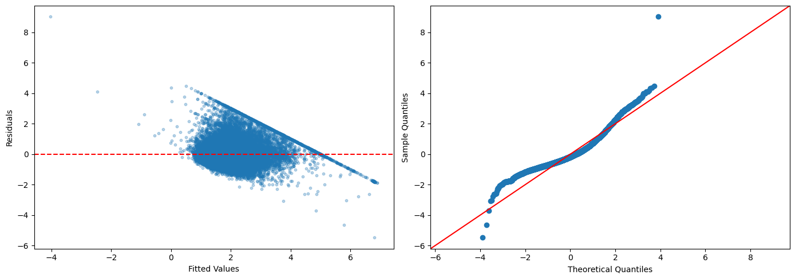
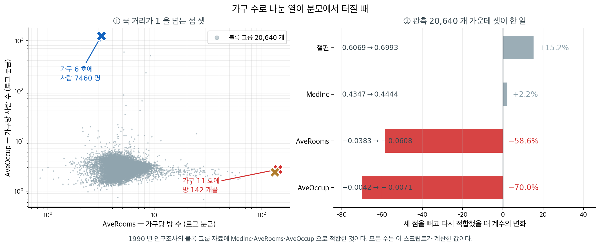
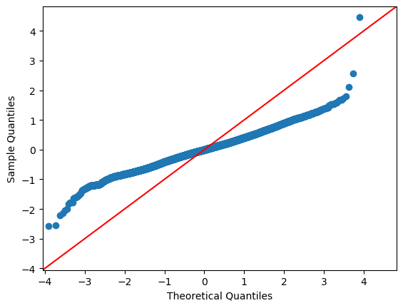

# 다중회귀 진단

## 개요

이 페이지는 다중선형회귀 진단을 종합적으로 따라가 본다. California Housing 자료로 모형을 적합하고, 분산팽창인자(VIF)로 다중공선성을 확인하고, 잔차 분석을 수행하고, Cook 거리로 영향점을 찾고, AIC와 BIC로 모형을 비교하며, 로그 변환·교호작용 항·다항회귀 같은 확장을 살펴본다.

---

## 1. 수학적 배경

### 분산팽창인자

설명변수 $j$에 대해 VIF는 다른 설명변수와의 상관 때문에 $\hat{\beta}_j$의 분산이 얼마나 부풀려졌는지를 잰다.

$$
\mathrm{VIF}_j = \frac{1}{1 - R_j^2},
$$

여기서 $R_j^2$는 $x_j$를 나머지 모든 설명변수에 회귀시켰을 때의 $R^2$이다. VIF가 5–10을 넘으면 문제가 되는 다중공선성을 나타낸다.

### 잔차 진단

관측값 $i$의 표준화 잔차는

$$
r_i = \frac{e_i}{s\sqrt{1 - h_{ii}}},
$$

여기서 $h_{ii}$는 모자행렬 $\mathbf{H} = \mathbf{X}(\mathbf{X}^\top\mathbf{X})^{-1}\mathbf{X}^\top$의 $i$번째 대각원소이다.

### Cook 거리

Cook 거리는 $i$번째 관측값이 모든 적합값에 미치는 영향을 잰다.

$$
D_i = \frac{r_i^2}{k} \cdot \frac{h_{ii}}{1 - h_{ii}},
$$

여기서 $k$는 모수의 개수이다. $D_i > 4/n$인 관측값을 영향점으로 본다.

### 정보기준

$$
\mathrm{AIC} = n \ln(\mathrm{RSS}/n) + 2k, \qquad \mathrm{BIC} = n \ln(\mathrm{RSS}/n) + k \ln(n).
$$

$n > e^2 \approx 7.4$이면 BIC가 AIC보다 모형 복잡도에 더 무거운 벌점을 준다.

!!! note "statsmodels의 AIC와 위 공식은 상수만큼 다르다"
    위 공식은 모형 비교에 영향을 주지 않는 상수 $n\ln(2\pi) + n$을 뺀 간이형이다. `results.aic`는 $-2\ln L + 2k$를 그대로 계산하므로 절댓값이 다르다. 모형들 사이의 **차이**는 같으므로 비교 결과는 동일하다.

### 적합과 VIF 계산

<div class="exbox" markdown>

**보기 1.** <span class="diff easy" title="쉬움"></span> VIF로 다중공선성 보기

**(1)** 설명변수들의 **표본상관행렬** $R$에 대해

$$
\mathrm{VIF}_j = \big(R^{-1}\big)_{jj}
$$

임을 보이시오. 곧 VIF 전체를 보조회귀 $p$번 없이 **역행렬 한 번으로** 얻을 수 있다.

**(2)** 세 설명변수의 상관행렬을 뒤집어 (1)을 확인하시오.

</div>

??? success "풀이"

    **(1) 해석적으로.** 설명변수를 중심화한 행렬을 $X_c$라 하면 상수항과 분리되어

    $$
    \operatorname{Var}(\hat{\boldsymbol\beta}_{\text{기울기}}) = \sigma^2 (X_c^\top X_c)^{-1}
    $$

    이다. 여기서 $X_c^\top X_c = (n-1)\,D R D$로 적힌다. $D = \operatorname{diag}(s_1, \ldots, s_p)$는 표준편차의 대각행렬이고 $R$은 상관행렬이다. 역을 취하면

    $$
    (X_c^\top X_c)^{-1} = \frac{1}{n-1}\,D^{-1}R^{-1}D^{-1}
    $$

    이므로 $j$번째 대각원소가

    $$
    \big[(X_c^\top X_c)^{-1}\big]_{jj} = \frac{(R^{-1})_{jj}}{(n-1)s_j^2} = \frac{(R^{-1})_{jj}}{S_{jj}}
    $$

    이다($S_{jj} = (n-1)s_j^2 = \sum_i (x_{ij}-\bar x_j)^2$). 한편 VIF의 정의가 주는 식은

    $$
    \operatorname{Var}(\hat\beta_j) = \frac{\sigma^2}{S_{jj}(1-R_j^2)} = \frac{\sigma^2}{S_{jj}}\,\mathrm{VIF}_j
    $$

    이므로 두 식을 맞대면

    $$
    \mathrm{VIF}_j = \frac{1}{1-R_j^2} = \big(R^{-1}\big)_{jj}
    $$

    를 얻는다.

    **쓸모가 둘이다.** 첫째, 계산이 싸다. $p$번의 보조회귀 대신 $p \times p$ 역행렬 하나면 된다. 둘째, **VIF가 설명변수들의 상관구조만으로 정해진다**는 것이 분명해진다. 반응변수 $y$는 이 식 어디에도 들어오지 않는다. 공선성이 "모형의 문제가 아니라 자료의 문제"라는 말의 정확한 내용이다.

    상관행렬이 단위행렬에 가까우면 $R^{-1}$도 단위행렬에 가까워 모든 VIF가 $1$ 근처가 되고, $R$이 특이에 가까워지면 $R^{-1}$의 대각이 폭발한다.

    **(2) 수치적으로.**

    ```python
    import numpy as np
    import pandas as pd
    import statsmodels.api as sm
    from statsmodels.api import OLS, add_constant
    from statsmodels.stats.outliers_influence import variance_inflation_factor
    from sklearn.datasets import fetch_california_housing

    housing = fetch_california_housing()
    df = pd.DataFrame(housing.data, columns=housing.feature_names)
    df['PRICE'] = housing.target

    # 설명변수 셋으로 시작한다. 뒤에서 변수를 늘려 가며 견줄 것이다.
    features = ['MedInc', 'AveRooms', 'AveOccup']
    X = add_constant(df[features])
    y = df['PRICE']

    model = OLS(y, X).fit()

    # 분산팽창인자(VIF)는 그 변수를 나머지 변수들로 회귀했을 때의 R^2 로
    # 정해진다. VIF = 1/(1-R^2) 이므로, 다른 변수들로 잘 설명될수록 커진다.
    # 보통 5 나 10 을 넘으면 다중공선성을 의심한다. 상수항은 셈에서 뺀다.
    vif_data = pd.DataFrame()
    vif_data['Feature'] = X.columns[1:]
    vif_data['VIF'] = [variance_inflation_factor(X.values, i)
                       for i in range(1, X.shape[1])]
    print(vif_data)
    ```

    출력:

    ```
        Feature       VIF
    0    MedInc  1.120166
    1  AveRooms  1.119797
    2  AveOccup  1.000488
    ```

    상관행렬을 뒤집어 (1)과 맞춘다.

    ```python
    import numpy as np

    R = df[features].corr().values
    print("상관행렬 R:")
    print(np.round(R, 4))
    print("\nR^-1 의 대각 =", np.round(np.diag(np.linalg.inv(R)), 6))
    print("variance_inflation_factor =",
          np.round([variance_inflation_factor(X.values, i) for i in range(1, X.shape[1])], 6))
    print(f"\n이 모형의 R^2 = {model.rsquared:.4f}")
    ```

    출력:

    ```
    상관행렬 R:
    [[ 1.      0.3269  0.0188]
     [ 0.3269  1.     -0.0049]
     [ 0.0188 -0.0049  1.    ]]

    R^-1 의 대각 = [1.120166 1.119797 1.000488]
    variance_inflation_factor = [1.120166 1.119797 1.000488]

    이 모형의 R^2 = 0.4808
    ```

    **$R^{-1}$의 대각이 VIF와 소수점 여섯째 자리까지 같다.** 보조회귀를 세 번 돌린 결과가 $3\times3$ 역행렬 하나에서 그대로 나온다.

    **세 VIF가 모두 $1.1$ 근처다.** 상관행렬을 보면 까닭이 분명하다. 가장 큰 비대각 원소가 MedInc–AveRooms의 $0.327$이고 나머지 둘은 $0.02$ 아래다. 소득이 높은 동네의 집이 방이 많다는 것은 자연스럽지만 그 상관이 강하지 않다.

    두 변수만 있었다면 VIF가 정확히 $1/(1-0.3269^2) = 1.1197$이었을 것이다. 실제 값이 MedInc에서 $1.1202$, AveRooms에서 $1.1198$로 **그 값보다 아주 조금 크다.** AveOccup이 끼어 각각 $0.0188$과 $-0.0049$만큼 보태기 때문인데, 보탬이 거의 없어 소수점 셋째 자리에서만 보인다. [11.6절 보기 3](multicollinearity.md)에서 Latitude·Longitude가 두 변수 공식 $6.897$에서 실제 $8.18$까지 간 것과 견주면 차이가 분명하다.

    이 모형의 $R^2$는 $0.4808$이다. 공선성이 없다는 것과 설명력이 좋다는 것은 **별개**이며, VIF 식에 $y$가 들어 있지 않다는 (1)의 관찰이 그것을 말해 준다.

### 잔차 분석

<div class="exbox" markdown>

**보기 2.** <span class="diff easy" title="쉬움"></span> 잔차 진단 그림. 이 자료의 반응변수 `PRICE`는 $5.00001$(50만 달러)에서 **잘려 있다.** 그보다 비싼 집이 모두 그 값으로 기록되어 있다.

**(1)** 잘린 관측에서는 $y_i = c$로 고정되므로 잔차가 $e_i = c - \hat y_i$다. 그러므로 잔차 그림에서 그 점들이 **기울기 정확히 $-1$인 직선** 위에 놓임을 보이시오. 그 직선의 절편은 무엇인가.

**(2)** 그림을 그려 확인하고, 잔차의 왜도·첨도를 재시오. 오른쪽 Q-Q 그림의 `line='45'`가 이 자료에 적절한가.

</div>

??? success "풀이"

    **(1) 해석적으로.** 잘린 값을 $c = 5.00001$이라 하자. 그 관측들에서는 $y_i = c$이므로

    $$
    e_i = y_i - \hat y_i = c - \hat y_i
    $$

    이다. 가로축이 $\hat y_i$, 세로축이 $e_i$인 그림에서 이것은

    $$
    e = -\hat y + c
    $$

    곧 **기울기 $-1$, 절편 $c = 5.00001$인 직선**이다. 근사가 아니라 항등식이고, 잘린 점이 몇 개든 전부 그 직선 위에 정확히 놓인다.

    **잔차 그림의 가장 눈에 띄는 무늬가 모형의 문제가 아니라 자료 기록 방식에서 온다는 뜻**이다. 적합값이 큰 쪽(오른쪽)에서는 그 직선이 0 아래로 내려가고, 적합값이 작은 쪽에서는 위로 올라간다. 모형이 저평가한 비싼 집일수록 잔차가 크게 양수가 되므로 **오른쪽 위로 뻗는 사선**이 생긴다.

    이 직선은 등분산성이나 선형성에 대해 아무것도 말해 주지 않는다. 그런데 그림만 보면 "오른쪽에서 분산이 커진다"거나 "곡선 추세가 있다"로 오독하기 쉽다. **진단 그림에서 무늬를 보면 먼저 자료의 기록 방식을 의심해야 하는 이유다.**

    **(2) 수치적으로.**

    ```python
    y_pred = model.predict(X)
    residuals = y - y_pred

    # 왼쪽은 등분산성, 오른쪽은 정규성을 본다. 이 자료는 집값이 50만 달러에서
    # 잘려 있어 잔차 그림 오른쪽에 뚜렷한 사선이 생긴다.
    import matplotlib.pyplot as plt
    fig, axes = plt.subplots(1, 2, figsize=(14, 5))
    axes[0].scatter(y_pred, residuals, alpha=0.3, s=10)
    axes[0].axhline(y=0, color='red', linestyle='--')
    axes[0].set_xlabel('Fitted Values')
    axes[0].set_ylabel('Residuals')

    # line='45' 는 기울기 1 의 기준선이다. 표준화하지 않은 잔차에 쓰면
    # 점들이 그 선에서 벗어나 보이므로, 척도까지 맞추려면 line='s' 를 쓴다.
    sm.qqplot(residuals, line='45', ax=axes[1])
    plt.tight_layout()
    plt.show()
    ```

    

    왼쪽이 잔차 대 적합값, 오른쪽이 Q-Q 그림이다. (1)이 말한 사선이 왼쪽 그림에 또렷하다. 수로 확인한다.

    ```python
    import numpy as np
    from scipy.stats import skew, kurtosis

    cap = y.max()
    capped = (y == cap)
    print(f"반응변수의 최댓값 = {cap}")
    print(f"그 값에 붙어 있는 관측 = {capped.sum()}건 ({capped.mean():.2%})")

    # 그 점들의 잔차는 적합값의 1차함수여야 한다
    band = residuals[capped]
    print(f"\n절단된 점들에서  잔차 + 적합값 의 범위 = "
          f"[{(band + y_pred[capped]).min():.5f}, {(band + y_pred[capped]).max():.5f}]")
    print(f"그 점들의 corr(적합값, 잔차) = {np.corrcoef(y_pred[capped], band)[0, 1]:+.10f}")
    slope = np.polyfit(y_pred[capped], band, 1)
    print(f"그 점들에 맞춘 직선: 기울기 {slope[0]:+.6f},  절편 {slope[1]:.5f}")

    print(f"\n잔차의 왜도 = {skew(residuals):.4f},  첨도 = {kurtosis(residuals, fisher=False):.4f}")
    print(f"잔차의 표준편차 = {residuals.std():.4f}  (qqplot 의 line='45' 가 가정하는 값은 1)")
    ```

    출력:

    ```
    반응변수의 최댓값 = 5.00001
    그 값에 붙어 있는 관측 = 965건 (4.68%)

    절단된 점들에서  잔차 + 적합값 의 범위 = [5.00001, 5.00001]
    그 점들의 corr(적합값, 잔차) = -1.0000000000
    그 점들에 맞춘 직선: 기울기 -1.000000,  절편 5.00001

    잔차의 왜도 = 1.2564,  첨도 = 5.9654
    잔차의 표준편차 = 0.8315  (qqplot 의 line='45' 가 가정하는 값은 1)
    ```

    **(1)이 정확히 맞는다.** $965$건($4.68\%$)이 $5.00001$에 붙어 있고, 그 점들에서 잔차와 적합값의 합이 **범위 없이 $5.00001$ 하나**다. 상관이 $-1.0000000000$이고 맞춘 직선의 기울기가 $-1.000000$, 절편이 $5.00001$이다. 근사가 아니라 항등식이니 당연한 결과이며, 그 당연함이 요점이다. **잔차 그림의 가장 눈에 띄는 무늬가 자료의 기록 방식에서 왔다.**

    **왜도 $1.2564$, 첨도 $5.9654$.** 정규분포의 $0$과 $3$에서 멀리 떨어져 있다. 오른쪽으로 치우치고 꼬리가 두껍다는 뜻인데, 절단 때문만은 아니다. 집값 자체가 오른쪽으로 치우친 양이라 로그를 취하지 않은 반응변수를 쓰면 잔차에 그대로 넘어온다.

    **`line='45'`는 이 자료에 맞지 않는다.** 그 선은 "표본의 분위수 = 표준정규의 분위수"를 뜻하므로 잔차의 표준편차가 $1$일 때만 기준이 된다. 실제 잔차의 표준편차는 $0.8315$이므로 **점들이 $45$도 선보다 눕게 그려지고**, 정규성에서 벗어난 것처럼 보인다. 척도까지 맞추려면 `line='s'`(표본 척도에 맞춘 직선)를 써야 한다. 이 그림에서 읽을 것은 선과의 거리가 아니라 **점들이 직선에서 체계적으로 휘는 모양**이다.

<div class="storybox" markdown>

**그림으로 보는 통계학 1.** 여섯 가구에 사는 칠천사백예순 명

$1$ 절의 쿡 거리는 $D_i > 4/n$ 인 점을 영향점으로 본다고 적었고, 연습문제 $6$ 은 이 모형에서 **또 다른 관례 문턱 $D_i > 1$ 을 넘는 점이 셋뿐**이라고 적어 두었다. 그 셋이 무엇인지는 적혀 있지 않다. 찾아보면 자료를 만든 방식이 통째로 드러난다.

이 자료는 $1990$ 년 미국 인구조사의 **블록 그룹** 단위다. 블록 그룹은 인구 $600$–$3000$ 명쯤 되는 가장 작은 공표 단위다. 그런데 설명변수 가운데 둘은 **분모가 가구 수인 비**다 — `AveRooms` 는 가구당 방 수, `AveOccup` 은 가구당 사람 수다. 분모가 작아지면 비가 터진다.

| 번호 | 쿡 거리 | 지렛값 $h$ | AveRooms | AveOccup | 인구 | 가구 |
|---|---|---|---|---|---|---|
| $1914$ | $7.108$ | $0.1673$ | $\mathbf{141.91}$ | $2.73$ | $30$ | $11$ |
| $19006$ | $6.987$ | $\mathbf{0.6911}$ | $3.17$ | $\mathbf{1243.33}$ | $7460$ | $6$ |
| $1979$ | $1.176$ | $0.1425$ | $\mathbf{132.53}$ | $2.40$ | $36$ | $15$ |

**$19006$ 번 구역에는 사람이 $7460$ 명 사는데 가구가 여섯이다.** 가구당 $1243$ 명이라는 수는 「평균 가구원 수」로 읽을 수 있는 수가 아니다. 사람들이 **가구를 이루고 살지 않는 자리**에서 나오는 값이고, 그 한 행의 지렛값이 $0.69$ 다 — 설계행렬의 대각합 $4$ 가운데 $0.69$ 를 혼자 쓴다. $1914$ 번과 $1979$ 번은 반대쪽이다. 가구 열한 호에 방이 $142$ 개꼴, 열다섯 호에 $133$ 개꼴. 자료를 만든 `scikit-learn` 의 설명도 이 열들을 두고 **「가구가 적고 빈집이 많은 구역 — 이를테면 휴양지 — 에서는 놀랄 만큼 큰 값이 나올 수 있다」**고 적어 두었다.



문제는 이 셋이 **결론을 쥐고 있다**는 것이다. 빼고 다시 적합하면

$$
\hat\beta_{\text{AveRooms}} : -0.0383 \to -0.0608 \ (-58.6\%),
\qquad
\hat\beta_{\text{AveOccup}} : -0.0042 \to -0.0071 \ (-70.0\%)
$$

다. 관측 $20{,}640$ 개 가운데 **셋**이 두 계수의 크기를 $60$–$70\%$ 깎고 있었다. MedInc 는 $+2.2\%$ 로 거의 움직이지 않는다 — 터진 것이 그 둘의 분모였기 때문이다.

그러니 연습문제 $6$ 의 「$D_i > 1$ 을 넘는 점이 셋뿐」은 **문턱이 느슨하다는 말이면서 동시에 그 셋이 유별나다는 말**이다. 보기 2 가 밝힌 $5.00001$ 절단이 꼬리를 두껍게 만들었다면, 꼭대기 셋을 만든 것은 **비의 분모**다. 그리고 이 셋은 지워야 할 기록 오류가 아니다. 가구가 여섯인 구역이 실제로 있고, 그런 구역에서는 「가구당」이라는 말이 뜻을 잃을 뿐이다. 고칠 자리는 자료가 아니라 **변수의 정의**다.

_확인한 곳 — 이 자료가 $1990$ 년 미국 인구조사의 블록 그룹(보통 인구 $600$–$3000$ 명) 단위라는 것, `AveRooms` 와 `AveOccup` 이 가구당 방 수와 가구당 사람 수라는 것, 그리고 「가구가 적고 빈집이 많은 구역, 이를테면 휴양지에서는 이 열들이 놀랄 만큼 큰 값을 가질 수 있다」는 주의가 `scikit-learn` 의 `fetch_california_housing` 설명문에 있다 — 같은 설명문이 원 출처로 페이스·배리, 「Sparse Spatial Autoregressions」, 『Statistics and Probability Letters』 $33$ 권($1997$) $291$–$297$ 쪽을 든다. **그 논문은 읽지 못했고, $19006$ 번 구역이 실제로 어떤 곳인지도 확인하지 못해 적지 않는다** · 표와 그림의 수는 모두 이 쪽이 쓰는 그 자료로 직접 계산한 값이다_

</div>

### AIC와 BIC를 이용한 모형선택

<div class="exbox" markdown>

**보기 3.** <span class="diff easy" title="쉬움"></span> AIC·BIC로 모형 고르기

**(1)** 포함관계인 두 모형에서 변수를 $q$개 더할 때

$$
\Delta\mathrm{AIC} = n\ln\frac{\mathrm{RSS}_2}{\mathrm{RSS}_1} + 2q,
\qquad
\Delta\mathrm{BIC} = n\ln\frac{\mathrm{RSS}_2}{\mathrm{RSS}_1} + q\ln n
$$

임을 보이고, $n$이 클 때 **AIC가 큰 모형을 고르는 조건이 $F > 2$, BIC는 $F > \ln n$** 임을 보이시오($F$는 추가한 $q$개에 대한 부분 F-통계량).

**(2)** 네 모형을 적합해 위 상자의 상수 $n\ln(2\pi)+n$을 확인하고, Model 3 → Model 4를 $F$로 읽으시오.

</div>

??? success "풀이"

    **(1) 해석적으로.** 간이형 $\mathrm{AIC} = n\ln(\mathrm{RSS}/n) + 2k$에서 두 모형의 차를 취하면 $-n\ln n$이 상쇄되어

    $$
    \Delta\mathrm{AIC} = n\ln\mathrm{RSS}_2 - n\ln\mathrm{RSS}_1 + 2(k_2 - k_1)
    = n\ln\frac{\mathrm{RSS}_2}{\mathrm{RSS}_1} + 2q
    $$

    가 된다. BIC는 벌점만 $k\ln n$으로 바뀌므로 $\Delta\mathrm{BIC} = n\ln(\mathrm{RSS}_2/\mathrm{RSS}_1) + q\ln n$이다. **위 상자가 말하는 상수 $n\ln(2\pi)+n$은 두 모형에서 같으므로 차에서 깨끗이 사라진다.** 그러니 `statsmodels`의 AIC를 쓰든 간이형을 쓰든 비교 결과가 같다.

    이제 $F$로 바꾼다. 추가한 $q$개에 대한 부분 F-통계량이

    $$
    F = \frac{(\mathrm{RSS}_1 - \mathrm{RSS}_2)/q}{\mathrm{RSS}_2/\nu},
    \qquad \nu = n - k_2
    $$

    이므로 $\mathrm{RSS}_1 = \mathrm{RSS}_2\big(1 + qF/\nu\big)$이고

    $$
    \frac{\mathrm{RSS}_2}{\mathrm{RSS}_1} = \frac{1}{1 + qF/\nu}
    \quad\Longrightarrow\quad
    \Delta\mathrm{AIC} = -n\ln\!\Big(1 + \frac{qF}{\nu}\Big) + 2q
    $$

    이다. $n$이 크면 $\nu \approx n$이고 $\ln(1+u) \approx u$이므로

    $$
    \Delta\mathrm{AIC} \approx -qF + 2q = q(2 - F)
    $$

    가 되어 **$F > 2$일 때 AIC가 내려간다.** BIC는 같은 계산에서 $\Delta\mathrm{BIC} \approx q(\ln n - F)$이므로 **$F > \ln n$** 이어야 한다.

    $q = 1$이면 $F = t^2$이므로 [11.5절 보기 5](../assumptions/checking_linearity.md)의 $\lvert t\rvert > \sqrt 2$, $\lvert t\rvert > \sqrt{\ln n}$과 같은 말이다. **$n$이 커질수록 BIC의 문턱만 올라간다**는 것이 두 기준의 결정적 차이다. $n = 20{,}640$에서 $\ln n = 9.93$이니 BIC는 AIC보다 거의 다섯 배 센 증거를 요구한다.

    **(2) 수치적으로.**

    ```python
    # 변수를 늘려 가며 네 모형을 견준다. R^2 는 변수를 더하면 반드시 오르므로
    # 모형 고르기에 쓸 수 없다. 벌점이 붙는 AIC·BIC 를 본다.
    # BIC 의 벌점이 더 무거우므로 대개 더 작은 모형을 고른다.
    feature_sets = {
        'Model 1': ['MedInc'],
        'Model 2': ['MedInc', 'AveRooms'],
        'Model 3': ['MedInc', 'AveRooms', 'AveOccup'],
        'Model 4': list(housing.feature_names),
    }

    for name, feats in feature_sets.items():
        X_temp = add_constant(df[feats])
        m = OLS(y, X_temp).fit()
        print(f"{name}: AIC={m.aic:.1f}, BIC={m.bic:.1f}, "
              f"R2={m.rsquared:.4f}")
    ```

    출력:

    ```text
    Model 1: AIC=51249.3, BIC=51265.2, R2=0.4734
    Model 2: AIC=51016.2, BIC=51040.1, R2=0.4794
    Model 3: AIC=50962.2, BIC=50994.0, R2=0.4808
    Model 4: AIC=45265.5, BIC=45337.0, R2=0.6062
    ```

    간이 공식과의 차이, 그리고 Model 3 → Model 4의 $F$를 확인한다.

    ```python
    import numpy as np
    from scipy.stats import f as fdist

    n = len(y)
    fits = {name: OLS(y, add_constant(df[feats])).fit()
            for name, feats in feature_sets.items()}

    # 간이 공식과 statsmodels 의 차이가 상수인가
    print(f"{'모형':>9}{'statsmodels AIC':>18}{'간이 공식':>14}{'차':>14}")
    for name, m in fits.items():
        simple = n * np.log(m.ssr / n) + 2 * len(m.params)
        print(f"{name:>9}{m.aic:>18.1f}{simple:>14.1f}{m.aic - simple:>14.4f}")
    print(f"n ln(2 pi) + n = {n * np.log(2 * np.pi) + n:.4f}")

    # Model 3 -> Model 4 를 F 로 읽는다
    m3, m4 = fits['Model 3'], fits['Model 4']
    dk = len(m4.params) - len(m3.params)
    F = ((m3.ssr - m4.ssr) / dk) / (m4.ssr / m4.df_resid)
    print(f"\n추가한 변수 {dk}개,  F = {F:.2f},  p = {fdist.sf(F, dk, m4.df_resid):.3g}")
    print(f"dAIC: 공식 {n * np.log(m4.ssr / m3.ssr) + 2 * dk:.4f},"
          f"  실제 {m4.aic - m3.aic:.4f}")
    print(f"dBIC: 공식 {n * np.log(m4.ssr / m3.ssr) + dk * np.log(n):.4f},"
          f"  실제 {m4.bic - m3.bic:.4f}")
    print(f"\n문턱:  AIC 는 F > 2,  BIC 는 F > ln n = {np.log(n):.4f}")
    ```

    출력:

    ```
           모형   statsmodels AIC         간이 공식             차
      Model 1           51249.3       -7324.4    58573.7827
      Model 2           51016.2       -7557.5    58573.7827
      Model 3           50962.2       -7611.5    58573.7827
      Model 4           45265.5      -13308.2    58573.7827
    n ln(2 pi) + n = 58573.7827

    추가한 변수 5개,  F = 1314.16,  p = 0
    dAIC: 공식 -5696.7080,  실제 -5696.7080
    dBIC: 공식 -5657.0331,  실제 -5657.0331

    문턱:  AIC 는 F > 2,  BIC 는 F > ln n = 9.9350
    ```

    **위 상자의 상수가 정확하다.** 네 모형 모두에서 `statsmodels`의 AIC와 간이 공식의 차가 $58573.7827$로 같고, 그것이 $n\ln(2\pi) + n$이다. 절댓값이 $51249$냐 $-7324$냐는 아무 뜻이 없고 **차이만 뜻이 있다.**

    **(1)의 두 공식이 소수점 넷째 자리까지 맞는다.** $\Delta\mathrm{AIC} = -5696.7080$, $\Delta\mathrm{BIC} = -5657.0331$이 공식과 실제에서 같다. 둘의 차이는 $q(\ln n - 2) = 5 \times 7.935 = 39.67$인데, 실제로 $-5657.03 - (-5696.71) = 39.67$이다.

    **$F = 1314$다.** 문턱이 $2$(AIC)든 $9.94$(BIC)든 비교가 되지 않는다. 다섯 변수를 더해 얻는 것이 그만큼 크므로 두 기준이 같은 답을 낸다. **두 기준이 갈리는 것은 $F$가 $2$와 $9.94$ 사이에 있을 때뿐**이며, 이 자료에서는 그런 애매함이 없다.

    $R^2$도 $0.48$에서 $0.61$로 오르지만, 변수를 더하면 $R^2$은 반드시 오르므로 그 상승 자체는 근거가 되지 못한다. **근거는 $F$가 문턱을 넘었다는 것**이고, AIC와 BIC는 그 문턱을 각각 어디에 둘지 정해 주는 장치다.

---

## 2. 해석

- **VIF**: 1에 가까우면 공선성이 거의 없다. VIF가 커지면 해당 계수의 표준오차가 부풀려져 유의성 검정을 믿을 수 없게 된다.
- **잔차–적합값**: 무작위로 흩어져 있으면 선형성과 상수분산 가정이 충족된다. 곡선이나 깔때기 같은 패턴은 모형 오설정이나 이분산을 시사한다.
- **Q-Q 그림**: 점들이 대각선을 따르면 잔차가 정규분포를 따른다. 꼬리에서 벗어나면 두껍거나 치우친 잔차 분포를 시사한다.
- **Cook 거리**: 이상점(큰 잔차)이면서 동시에 지렛대가 큰(설명변수 값이 특이한) 관측값은 Cook 거리가 크고 회귀 적합을 왜곡할 수 있다.
- **AIC/BIC**: 값이 작을수록 좋은 모형이다. AIC는 더 큰 모형을, BIC는 절약성을 선호하는 경향이 있다.

---

## 연습문제

<div class="drillbox" markdown>

**연습문제 1.** <span class="diff med" title="중간"></span> California Housing의 완전모형(8개 특성 전부)에서 각 설명변수의 VIF를 계산하라. 어느 설명변수가 높은 다중공선성을 보이는지 찾아라.

</div>

??? success "풀이"

    ```python
    X_full = add_constant(df[list(housing.feature_names)])
    for i, col in enumerate(X_full.columns):
        if col == 'const':
            continue          # VIF of the intercept is meaningless
        vif = variance_inflation_factor(X_full.values, i)
        print(f"{col}: VIF = {vif:.2f}")
    ```

    출력:

    ```text
    MedInc: VIF = 2.50
    HouseAge: VIF = 1.24
    AveRooms: VIF = 8.34
    AveBedrms: VIF = 6.99
    Population: VIF = 1.14
    AveOccup: VIF = 1.01
    Latitude: VIF = 9.30
    Longitude: VIF = 8.96
    ```

    VIF가 5를 넘는 것은 네 개이며 두 쌍으로 묶인다.

    - `AveRooms`(8.34)와 `AveBedrms`(6.99): 둘 다 방 수를 재므로 강하게 상관되어 있다.
    - `Latitude`(9.30)와 `Longitude`(8.96): 캘리포니아가 북서–남동으로 길게 뻗어 있어 두 좌표의 상관이 $r = -0.925$에 이른다.

    대책으로는 각 쌍에서 하나를 빼거나, 둘을 결합한 파생변수(예: 방당 침실 수, 위치 지표)를 만들거나, 정칙화를 쓰는 방법이 있다. 상수 열의 VIF는 의미가 없으므로 계산에서 제외해야 한다. $\square$

<div class="drillbox" markdown>

**연습문제 2.** <span class="diff med" title="중간"></span> 반응변수를 로그 변환한 $\ln(\text{PRICE})$로 모형을 적합하라. 잔차의 Q-Q 그림을 변환하지 않은 모형과 비교하고 어느 쪽이 정규성 가정을 더 잘 만족하는지 논하라.

</div>

??? success "풀이"

    ```python
    y_log = np.log(df['PRICE'])
    model_log = OLS(y_log, X).fit()
    sm.qqplot(model_log.resid, line='45')
    ```

    

    지렛값과 잔차를 함께 보면 어느 관측값이 영향력이 큰지 가려낼 수 있다.

    집값이 오른쪽으로 치우쳐 있으므로 로그 변환 모형의 잔차가 정규에 훨씬 가까워진다. 수치로 확인하면

    | 모형 | 잔차 왜도 | 잔차 첨도 | $R^2$ |
    |---|---|---|---|
    | PRICE | 1.256 | 5.965 | 0.4808 |
    | ln(PRICE) | 0.101 | 4.135 | 0.4430 |

    왜도가 $1.256$에서 $0.101$로 거의 사라져 Q-Q 그림에서 점들이 대각선에 훨씬 밀착한다. 첨도는 여전히 정규의 3보다 크지만 크게 개선되었다. 로그 변환이 큰 값을 압축하고 분산을 안정화하기 때문이다.

    다만 $R^2$가 0.481에서 0.443으로 떨어진 것을 두 모형의 우열로 읽어서는 안 된다. 반응변수의 척도가 달라졌으므로 두 $R^2$는 서로 비교할 수 있는 양이 아니다. $\square$

<div class="drillbox" markdown>

**연습문제 3.** <span class="diff med" title="중간"></span> 문턱값 $4/n$의 Cook 거리를 써서 설명변수 3개 모형에서 모든 영향점을 제거하라. $R^2$와 계수 추정값의 변화를 보고하라.

</div>

??? success "풀이"

    ```python
    influence = model.get_influence()
    cooks_d = influence.cooks_distance[0]
    mask = cooks_d < 4 / len(y)
    X_clean = X[mask]
    y_clean = y[mask]
    model_clean = OLS(y_clean, X_clean).fit()
    print(f"Original R2: {model.rsquared:.4f}")
    print(f"Cleaned R2:  {model_clean.rsquared:.4f}")
    ```

    출력:

    ```
    Original R2: 0.4808
    Cleaned R2:  0.5784
    ```

    영향점을 제거하니 $R^2$가 0.481에서 0.578로 오른다. 이 정도 변화는 결과를 보고할 때 반드시 함께 밝혀야 한다.

    20,640개 가운데 470개(2.3%)가 제거되고 $R^2$는 $0.4808$에서 $0.5784$로 오른다. 계수도 크게 달라진다.

    | 항 | 원래 | 제거 후 |
    |---|---|---|
    | const | 0.6069 | 1.2564 |
    | MedInc | 0.4347 | 0.5188 |
    | AveRooms | $-0.0383$ | $-0.1399$ |
    | AveOccup | $-0.0042$ | $-0.1590$ |

    `AveOccup`의 계수는 38배가 되고 `AveRooms`도 3.7배가 된다. 소수의 극단적인 관측값이 이 두 계수를 거의 0으로 끌어내리고 있었다는 뜻이다.

    !!! warning "$R^2$가 올랐다고 좋아진 모형이 아니다"
        잔차가 큰 점들을 골라 지웠으니 $R^2$가 오르는 것은 당연하다. 이는 모형이 나아졌다는 증거가 아니라 자료를 바꾼 결과일 뿐이다. 이 470개 점이 기록 오류인지, 절단된 최고가 구간에 속한 정당한 관측값인지 먼저 조사해야 한다. 실제로 이 자료의 `PRICE`는 5.00001에서 절단되어 있으므로 상당수가 후자일 가능성이 높다. $\square$

<div class="drillbox" markdown>

**연습문제 4.** <span class="diff med" title="중간"></span> 정규 가능도에서 AIC 공식 $n\ln(\mathrm{RSS}/n) + 2k$가 왜 $-2\ln L + 2k$와 (상수를 빼면) 동등한지 설명하라.

</div>

??? success "풀이"

    정규 모형에서 최대화된 로그가능도는

    $$
    \ln L = -\frac{n}{2}\ln(2\pi\hat{\sigma}^2) - \frac{n}{2},
    $$

    여기서 $\hat{\sigma}^2 = \mathrm{RSS}/n$이다. 따라서

    $$
    -2\ln L = n\ln(2\pi) + n\ln(\mathrm{RSS}/n) + n.
    $$

    $2k$를 더하면 $\mathrm{AIC} = n\ln(\mathrm{RSS}/n) + 2k + \text{상수}$가 된다. 상수 $n\ln(2\pi) + n$은 모형에 의존하지 않으므로 모형 비교에서는 버릴 수 있다. $\square$

<div class="drillbox" markdown>

**연습문제 5.** <span class="diff med" title="중간"></span> 모형에 교호작용 항 $\text{MedInc} \times \text{AveRooms}$와 이차항 $\text{MedInc}^2$을 추가하라. AIC로 이 추가가 모형을 개선하는지 판정하라.

</div>

??? success "풀이"

    ```python
    df['MedInc_x_AveRooms'] = df['MedInc'] * df['AveRooms']
    df['MedInc_sq'] = df['MedInc'] ** 2
    X_ext = add_constant(df[features + ['MedInc_x_AveRooms', 'MedInc_sq']])
    model_ext = OLS(y, X_ext).fit()
    print(f"Base AIC: {model.aic:.1f}")
    print(f"Extended AIC: {model_ext.aic:.1f}")
    ```

    출력:

    ```text
    Base AIC: 50962.2
    Extended AIC: 50767.5
    ```

    확장 모형의 AIC가 $194.7$ 낮으므로 추가된 두 항이 늘어난 복잡도를 충분히 정당화한다($R^2$도 $0.4808$에서 $0.4858$로 오른다). 교호작용은 소득의 효과가 방 수에 의존하는지를, 이차항은 소득이 집값에 미치는 수익체감을 포착한다. $\square$

<div class="drillbox" markdown>

**연습문제 6.** <span class="diff med" title="중간"></span> Cook 거리의 문턱 $4/n$ 이 어디서 오는지 따진다.

**(1)** $\operatorname{tr}\mathbf{H} = k$ 임을 보이고, 따라서 지렛값의 평균이 $k/n$ 임을 말하시오.

**(2)** 모든 지렛값이 그 평균 $k/n$ 과 같고 $\mathbb{E}[r_i^2] = 1$ 이라면 $\mathbb{E}[D_i] = 1/(n-k)$ 임을 보이시오. 곧 문턱 $4/n$ 은 "전형적인 Cook 거리의 네 배"라는 뜻이다. 또 지렛값이 평균에서 퍼져 있으면 Cook 거리의 평균이 $1/(n-k)$ 보다 작아질 수 없음을 보이시오.

**(3)** 설명변수 3개 모형($k = 4$, $n = 20{,}640$)에서 Cook 거리의 실제 평균은 $17.06/n$, 중앙값은 $0.151/n$ 이고, 또 다른 관례 문턱인 $D_i > 1$ 을 넘는 점은 세 개뿐이다. 이 세 수가 어떻게 어울리는지, 그리고 두 문턱 가운데 어느 것이 $n$ 이 큰 자료에 맞는 모양인지 설명하시오.

</div>

??? success "풀이"

    **(1)** 모자행렬이 $\mathbf{H} = \mathbf{X}(\mathbf{X}^\top\mathbf{X})^{-1}\mathbf{X}^\top$ 이므로 대각합의 순환성 $\operatorname{tr}(AB) = \operatorname{tr}(BA)$ 을 쓰면

    $$
    \operatorname{tr}\mathbf{H} = \operatorname{tr}\big(\mathbf{X}(\mathbf{X}^\top\mathbf{X})^{-1}\mathbf{X}^\top\big)
    = \operatorname{tr}\big((\mathbf{X}^\top\mathbf{X})^{-1}\mathbf{X}^\top\mathbf{X}\big)
    = \operatorname{tr}(\mathbf{I}_k) = k
    $$

    이다. 대각합이 대각원소의 합이므로 $\sum_i h_{ii} = k$ 이고 지렛값의 평균은 $k/n$ 이다. 보기 1 의 모형에서 실제로 $\sum_i h_{ii} = 4.000000$ 이고 평균은 $4/20640 = 1.938 \times 10^{-4}$ 이다.

    **(2)** $h_{ii} = k/n$ 을 Cook 거리에 넣으면

    $$
    \frac{h_{ii}}{1 - h_{ii}} = \frac{k/n}{1 - k/n} = \frac{k}{n-k}
    $$

    이므로

    $$
    \mathbb{E}[D_i] = \frac{\mathbb{E}[r_i^2]}{k}\cdot\frac{k}{n-k} = \frac{1}{n-k}
    $$

    이다. $n = 20{,}640$, $k = 4$ 에서 $1/(n-k) = 4.846 \times 10^{-5}$ 로 $1/n = 4.845 \times 10^{-5}$ 와 사실상 같다. **문턱 $4/n$ 은 전형적인 Cook 거리의 네 배 자리에 그어진 선**이다.

    지렛값이 퍼져 있는 일반적인 경우에는 $g(h) = h/(1-h)$ 가 $[0,1)$ 에서 볼록하므로 Jensen 부등식이

    $$
    \frac{1}{n}\sum_i g(h_{ii}) \ \ge\ g\!\left(\frac{1}{n}\sum_i h_{ii}\right) = g\!\left(\frac{k}{n}\right) = \frac{k}{n-k}
    $$

    를 주고, 양변을 $k$ 로 나누면 $\frac{1}{n}\sum_i \mathbb{E}[D_i] \ge \frac{1}{n-k}$ 를 얻는다. 등호는 모든 지렛값이 같을 때뿐이다. 이 모형에서 $\mathbb{E}[r_i^2] = 1$ 로 두고 지렛값만 실제 값을 넣어 좌변을 재면 $1.414/n$ 이다. **지렛값이 퍼져 있다는 사실만으로 평균이 이미 $1.41$ 배가 된다.**

    **(3)** 평균이 $17.06/n$, 중앙값이 $0.151/n$ 이다. 중앙값이 평균의 $1/113$ 이니 분포가 극단적으로 오른쪽으로 치우쳤다. (2)가 그 가운데 $1.41$ 배를 설명하고, 남은 $17.06/1.414 \approx 12$ 배는 **$r_i^2$ 이 큰 점과 $h_{ii}$ 가 큰 점이 겹쳐 있다**는 데서 온다. $r_i^2$ 의 평균은 $1.0019$ 로 $1$ 과 다르지 않으므로 잔차가 전반적으로 크기 때문이 아니라, 지렛대가 센 자리에서 하필 잔차가 크기 때문이다. 보기 2 가 밝힌 $5.00001$ 절단이 그 짝짓기를 만든다. 실제 최댓값은 $D_i = 7.108$ 로 평균의 $8600$ 배다.

    문턱 $D_i > 1$ 을 넘는 점이 세 개뿐인 것은 이것으로 설명된다. 한 점이 전체 적합에 미치는 영향은 $O(1/n)$ 이라 $n$ 이 커지면 모든 $D_i$ 가 작아지는데, $1$ 은 $n$ 과 무관한 상수다. $n = 20{,}640$ 에서 $1$ 은 전형적인 값의 $20{,}640$ 배이므로 사실상 아무것도 잡지 못한다. **$n$ 이 큰 자료에는 $n$ 과 함께 줄어드는 $4/n$ 쪽이 맞는 모양**이다. 다만 그 대가로 $4/n$ 은 **상대적** 기준이 된다. 자료의 꼬리가 두꺼우면 늘 일정 비율(여기서는 $2.28\%$)을 잡아내므로, "$4/n$ 을 넘었다"는 것은 가설검정의 결과가 아니라 **이 자료 안에서의 순위**로 읽어야 한다. $\square$

<div class="drillbox" markdown>

**연습문제 7.** <span class="diff med" title="중간"></span> 연습문제 3 의 경고 상자는 "잔차가 큰 점을 골라 지웠으니 $R^2$ 가 오르는 것은 당연하다"고 말한다. 이 말을 수로 가려 보자.

**(1)** 같은 개수($470$개)를 **무작위로** 지우고 다시 적합해 $R^2$ 를 재고, Cook 거리로 지운 경우와 견주시오. 씨앗은 `np.random.default_rng(0)` 으로 고정하라. 표본이 $2.28\%$ 줄어든 몫과 "잔차가 큰 점을 골랐다"는 몫이 각각 얼마인가.

**(2)** 지워진 $470$개 가운데 반응변수가 절단값 $5.00001$ 인 점의 비율을 재어 전체 비율 $4.68\%$ 와 견주시오. 연습문제 3 의 마지막 경고("상당수가 절단된 정당한 관측일 가능성이 높다")가 수로 뒷받침되는가.

</div>

??? success "풀이"

    ```python
    import numpy as np

    influence = model.get_influence()
    cooks_d = influence.cooks_distance[0]
    infl = cooks_d >= 4 / len(y)
    n_rem = int(infl.sum())

    # 같은 개수를 무작위로 지워 견준다. 씨앗을 고정한다.
    rng = np.random.default_rng(0)
    drop = rng.choice(len(y), size=n_rem, replace=False)
    keep = np.ones(len(y), dtype=bool)
    keep[drop] = False

    print(f"지운 개수 = {n_rem}건 ({n_rem / len(y):.2%})")
    print(f"원래                  R2 = {model.rsquared:.4f}")
    print(f"무작위 {n_rem}개 제거 후  R2 = {OLS(y[keep], X[keep]).fit().rsquared:.4f}")
    print(f"Cook  {n_rem}개 제거 후  R2 = {OLS(y[~infl], X[~infl]).fit().rsquared:.4f}")

    # 지워진 점 가운데 절단값에 붙어 있는 것의 비율
    cap = y.max()
    capped = (y.values == cap)
    print(f"\n전체에서 y = {cap} 인 비율       = {capped.mean():.2%}")
    print(f"지워진 {n_rem}개 가운데 그 비율 = {capped[infl].mean():.2%} "
          f"({capped[infl].sum()}건)")
    ```

    출력:

    ```text
    지운 개수 = 470건 (2.28%)
    원래                  R2 = 0.4808
    무작위 470개 제거 후  R2 = 0.4820
    Cook  470개 제거 후  R2 = 0.5784

    전체에서 y = 5.00001 인 비율       = 4.68%
    지워진 470개 가운데 그 비율 = 46.81% (220건)
    ```

    **(1) 표본이 줄어든 몫은 거의 없다.** 무작위로 $470$개를 지우면 $R^2$ 가 $0.4808$ 에서 $0.4820$ 으로 $+0.0012$ 움직인다. Cook 거리로 지우면 $0.5784$ 로 $+0.0976$ 움직인다. 전체 상승의

    $$
    \frac{0.0012}{0.0976} = 1.2\%
    $$

    만이 자료가 $2.28\%$ 작아진 데서 오고 **나머지 $98.8\%$ 는 어느 점을 지웠는지에서 온다.** 경고 상자의 말이 정확하다. 무작위 제거로도 $R^2$ 가 조금 오르는 것은 표본이 작아지면 같은 모수 개수로 맞출 수 있는 여지가 커지기 때문인데, 그 효과는 $0.001$ 규모다.

    **(2) 지워진 점의 절반이 절단된 관측이다.** $470$개 가운데 $220$개($46.81\%$)가 $y = 5.00001$ 에 붙어 있다. 전체에서 그 비율은 $4.68\%$ 이므로 정확히

    $$
    \frac{46.81}{4.68} = 10.0
    $$

    배로 몰려 있다. 보기 2 가 밝힌 대로 절단된 점의 잔차는 $e_i = 5.00001 - \hat y_i$ 이고 적합값이 보통 $2$ 근처이므로 잔차가 크게 양수가 된다. Cook 거리가 그것을 영향점으로 잡는 것은 당연하다.

    **그러나 이 점들은 기록 오류가 아니다.** 실제로 $50$만 달러보다 비싼 집들이고, 자료가 그렇게 기록되었을 뿐이다. 그것을 지우면 비싼 동네를 통째로 지우는 셈이고, 남은 자료에 맞춘 계수는 더 이상 캘리포니아 전체를 말하지 않는다. **Cook 거리는 "이 점이 적합을 많이 움직인다"만 말하고 "이 점을 버려야 한다"는 말은 하지 않는다.** 연습문제 3 의 경고가 수로 확인된 것이며, 바른 처방은 제거가 아니라 절단을 모형에 반영하는 것(토빗 회귀 등)이다. $\square$

<div class="drillbox" markdown>

**연습문제 8.** <span class="diff hard" title="어려움"></span> VIF 는 변수 하나의 성질이 아니라 모형 전체의 성질이다.

**(1)** 같은 자료에서 설명변수 집합이 $S \subseteq T$ 이고 $x_j$ 가 $S$ 에 있으면

$$
\mathrm{VIF}_j(S) \le \mathrm{VIF}_j(T)
$$

임을 보이시오. 곧 모형에 변수를 **더하면 기존 변수의 VIF 는 절대 내려가지 않는다.**

**(2)** 등호가 성립할 조건을 말하시오. 보기 1 에서 $\{\text{MedInc}, \text{AveRooms}\}$ 에 AveOccup 을 더해도 AveRooms 의 VIF 가 $1.1196$ 에서 $1.1198$ 로만 움직인 것을 그 조건으로 설명하시오.

**(3)** 이 쪽의 수들이 (1)을 어기지 않는지 확인하시오. Latitude 의 VIF 는 두 변수 $\{\text{Latitude}, \text{Longitude}\}$ 에서 $6.8968$, 11.6절 [다중공선성과 분산팽창인자](multicollinearity.md) 보기 3 의 다섯 변수 모형에서 $8.1845$, 연습문제 1 의 여덟 변수 모형에서 $9.2976$ 이다. AveRooms 의 VIF 는 $\{\text{MedInc}, \text{AveRooms}\}$ 에서 $1.1196$, 보기 1 의 세 변수에서 $1.1198$, AveBedrms 만 뺀 일곱 변수에서 $1.2589$, 여덟 변수에서 $8.3428$ 이다. 연습문제 1 이 권한 "각 쌍에서 하나를 빼기"가 왜 **반드시** 듣는 처방인지, 그리고 "교란을 통제하려고 변수를 더 넣는" 반대 방향이 왜 공선성에는 해가 되는지 (1)로 말하시오.

</div>

??? success "풀이"

    **(1)** $\mathrm{VIF}_j = 1/(1 - R_j^2)$ 은 $R_j^2$ 의 증가함수이므로 $R_j^2$ 만 비교하면 된다. 보조회귀의 결정계수를

    $$
    R_j^2(S) = 1 - \frac{\mathrm{RSS}_j(S)}{\mathrm{TSS}_j},
    \qquad \mathrm{TSS}_j = \sum_i (x_{ij} - \bar x_j)^2
    $$

    로 적자. **분모 $\mathrm{TSS}_j$ 는 설명변수 집합과 무관하다.** $x_j$ 자체의 흩어짐이기 때문이다. 분자를 본다. $S \subseteq T$ 이므로 $S$ 의 보조회귀에서 얻은 계수벡터에 $T \setminus S$ 의 자리마다 $0$ 을 채우면 $T$ 의 보조회귀에서 **허용되는** 계수벡터가 되고, 그때의 잔차제곱합은 $\mathrm{RSS}_j(S)$ 와 같다. 최소제곱은 허용되는 것들 가운데 최소를 고르므로

    $$
    \mathrm{RSS}_j(T) \le \mathrm{RSS}_j(S)
    $$

    이다. 따라서 $R_j^2(T) \ge R_j^2(S)$ 이고 $\mathrm{VIF}_j(T) \ge \mathrm{VIF}_j(S)$ 이다. $\square$

    **(2)** 등호는 $\mathrm{RSS}_j(T) = \mathrm{RSS}_j(S)$ 일 때, 곧 **더한 변수들이 "$x_j$ 를 $S$ 로 회귀한 잔차"와 모두 직교할 때**뿐이다. 표본 편상관계수로 말하면 $S$ 를 고정한 $x_j$ 와 새 변수 사이의 편상관이 정확히 $0$ 이어야 한다. 표본에서 정확한 $0$ 은 거의 일어나지 않으므로 VIF 는 거의 언제나 **조금은** 오른다.

    AveOccup 이 바로 그런 경우다. 보기 1 의 상관행렬에서 AveOccup 과 다른 두 변수의 상관이 $0.0188$ 과 $-0.0049$ 로 거의 $0$ 이었고, 그래서 AveRooms 의 VIF 가 $1.1196 \to 1.1198$ 로 소수점 넷째 자리에서만 올랐다. 보기 1 이 AveOccup 의 VIF 를 $1.000488$ 로 보고한 것과 같은 사실의 다른 쪽 얼굴이다.

    **(3) 두 사슬이 모두 (1)과 맞는다.** 집합의 포함관계가 사슬을 만든다.

    | 사슬 | 포함관계 | VIF |
    |---|---|---|
    | Latitude | $\{\text{Lat},\text{Lon}\} \subset$ 다섯 변수 $\subset$ 여덟 변수 | $6.8968 \le 8.1845 \le 9.2976$ |
    | AveRooms | $\{\text{MedInc},\text{AveRooms}\} \subset$ 세 변수 $\subset$ 일곱 변수 $\subset$ 여덟 변수 | $1.1196 \le 1.1198 \le 1.2589 \le 8.3428$ |

    둘째 줄의 일곱 변수는 여덟 변수에서 AveBedrms 만 뺀 것이고 세 변수 집합을 포함하므로 $1.1198$ 과 $8.3428$ 사이에 끼어야 하는데, 실제로 $1.2589$ 다.

    **"각 쌍에서 하나를 빼기"는 반드시 듣는다.** (1)의 대우가 바로 그것이다. 변수를 **빼면** 남은 모든 변수의 VIF 가 내려가거나 그대로이며, 절대 올라가지 않는다. 그래서 이 처방은 실패할 수 없다. 효과의 크기도 분명하다. AveBedrms 하나를 빼면 AveRooms 의 VIF 가 $8.3428$ 에서 $1.2589$ 로 떨어진다. 나머지 여섯 변수가 다 합쳐 $1.1198 \to 1.2589$ 만 보탰으므로 **AveRooms 의 공선성은 거의 전부 AveBedrms 한 변수가 만든 것**이다.

    반대 방향은 해가 된다. "교란변수를 통제하려고" 변수를 더 넣으면 (1)에 따라 기존 모든 VIF 가 올라간다. 공선성이 걱정일 때 변수를 더 넣어 해결하려는 시도는 원리적으로 불가능하다는 뜻이다. 편향을 줄이려고 통제변수를 넣는 것과 분산을 줄이려고 변수를 빼는 것이 **정면으로 맞서는 자리**다. 아래 정리하며가 말한 대로 공선성은 계수를 편향시키지 않고 불안정하게만 만들므로, 어느 쪽을 택할지는 그 계수를 해석할 것인지 예측만 할 것인지에 달려 있다. $\square$

<div class="drillbox" markdown>

**연습문제 9.** <span class="diff hard" title="어려움"></span> 보기 3 은 AIC 와 BIC 가 갈리는 것이 $2 < F < \ln n$ 일 때뿐이라고 했고, Model 3 $\to$ Model 4 의 $F = 1314$ 는 그 창에서 한참 멀었다. 그 창에 실제로 들어가는 자리를 찾아보자.

**(1)** Model 3(MedInc, AveRooms, AveOccup)에 남은 다섯 변수를 **하나씩** 더해 각각의 부분 $F$ 와 $\Delta$AIC, $\Delta$BIC 를 구하고, 전체 자료에서는 그 창에 들어가는 변수가 하나도 없음을 확인하시오.

**(2)** $F$ 는 대체로 자료 수에 비례해 커지므로 창은 **자료가 작을 때** 열린다. `np.random.default_rng(0).permutation` 으로 자료를 한 번 섞고 앞 $m$ 개만 쓰는 중첩 표본을 만들어, $m = 500, 1000, 2000, 4000, 6000, 8000, 20640$ 에서 Population 을 더할 때의 $F$, $\Delta$AIC, $\Delta$BIC 를 구하시오. 두 기준이 갈리는 $m$ 을 찾고, 보기 3 (1)의 어림식 $\Delta\mathrm{AIC} \approx 2 - F$, $\Delta\mathrm{BIC} \approx \ln m - F$ 와 맞는지 확인하시오.

</div>

??? success "풀이"

    ```python
    import numpy as np

    n = len(y)
    rest = [c for c in housing.feature_names if c not in features]
    fit3 = OLS(y, add_constant(df[features])).fit()

    # (1) 전체 자료에서 한 변수씩 더해 본다
    print(f"전체 자료 n = {n},  ln n = {np.log(n):.4f}")
    print(f"{'추가 변수':>11}{'F':>11}{'dAIC':>12}{'dBIC':>12}")
    for v in rest:
        fit4 = OLS(y, add_constant(df[features + [v]])).fit()
        F = (fit3.ssr - fit4.ssr) / (fit4.ssr / fit4.df_resid)
        print(f"{v:>11}{F:>11.4f}{fit4.aic - fit3.aic:>12.4f}{fit4.bic - fit3.bic:>12.4f}")

    # (2) 한 번 섞고 앞 m 개만 쓰는 중첩 표본에서 Population 을 더해 본다
    perm = np.random.default_rng(0).permutation(n)
    print(f"\n{'m':>6}{'F':>10}{'ln m':>9}{'dAIC':>10}{'dBIC':>10}   판정")
    for m in [500, 1000, 2000, 4000, 6000, 8000, 20640]:
        sub = df.iloc[perm[:m]]
        a = OLS(sub['PRICE'], add_constant(sub[features])).fit()
        b = OLS(sub['PRICE'], add_constant(sub[features + ['Population']])).fit()
        F = (a.ssr - b.ssr) / (b.ssr / b.df_resid)
        dA, dB = b.aic - a.aic, b.bic - a.bic
        verdict = '둘 다 추가' if dB < 0 else ('AIC 만 추가' if dA < 0 else '둘 다 제외')
        print(f"{m:>6}{F:>10.4f}{np.log(m):>9.4f}{dA:>10.4f}{dB:>10.4f}   {verdict}")
    ```

    출력:

    ```text
    전체 자료 n = 20640,  ln n = 9.9350
          추가 변수          F        dAIC        dBIC
       HouseAge  1395.6965  -1348.8491  -1340.9141
      AveBedrms  1242.8421  -1205.1445  -1197.2095
     Population    39.7420    -37.7134    -29.7784
       Latitude   252.7015   -249.2275   -241.2925
      Longitude    55.4200    -53.3591    -45.4241

         m         F     ln m      dAIC      dBIC   판정
       500    2.1255   6.2146   -0.1423    4.0723   AIC 만 추가
      1000    1.2198   6.9078    0.7748    5.6825   둘 다 제외
      2000    0.9141   7.6009    1.0839    6.6848   둘 다 제외
      4000    0.1764   8.2940    1.8233    8.1174   둘 다 제외
      6000    4.3060   8.6995   -2.3080    4.3915   AIC 만 추가
      8000   24.9002   8.9872  -22.8770  -15.8898   둘 다 추가
     20640   39.7420   9.9350  -37.7134  -29.7784   둘 다 추가
    ```

    **(1) 전체 자료에서는 창이 닫혀 있다.** 다섯 변수의 $F$ 가 $39.74$(Population)부터 $1395.70$(HouseAge)까지인데, 가장 작은 Population 도 $\ln n = 9.9350$ 의 네 배다. 그래서 다섯 모두 $\Delta$AIC 와 $\Delta$BIC 가 함께 음수이고 두 기준이 "더하라"로 일치한다. 효과가 커서가 아니라 **$n$ 이 커서** 그렇다. $F$ 는 효과의 크기에 자료 수를 곱한 양이므로, $n = 20{,}640$ 이면 작은 효과도 문턱을 쉽게 넘긴다.

    **(2) $m = 500$ 과 $m = 6000$ 에서 갈린다.**

    | $m$ | $F$ | $\ln m$ | $\Delta$AIC | $\Delta$BIC |
    |---|---|---|---|---|
    | $500$ | $2.1255$ | $6.2146$ | $-0.1423$ | $+4.0723$ |
    | $6000$ | $4.3060$ | $8.6995$ | $-2.3080$ | $+4.3915$ |

    두 줄에서 $2 < F < \ln m$ 이 성립하고, 그 결과 AIC 는 Population 을 넣으라 하고 BIC 는 빼라 한다. 나머지 줄은 창 밖이다. $m = 1000, 2000, 4000$ 에서는 $F < 2$ 라 두 기준이 함께 "빼라"이고, $m = 8000, 20640$ 에서는 $F > \ln m$ 이라 함께 "넣으라"다. **보기 3 이 말한 창이 실제로 그 폭만큼만 열린다.**

    어림식도 잘 맞는다. $m = 6000$ 에서 $2 - F = -2.3060$ 대 실제 $-2.3080$, $\ln m - F = 4.3935$ 대 실제 $4.3915$ 로 소수점 둘째 자리까지 같다. $m = 500$ 에서는 $2 - F = -0.1255$ 대 실제 $-0.1423$ 으로 조금 벌어지는데, 어림식이 $\ln(1 + F/\nu) \approx F/\nu$ 를 썼고 $\nu = 495$ 가 작아 그 생략항이 보이기 시작한 것이다.

    **한 가지 덤.** $F$ 가 $m$ 에 단조롭게 늘지 않는다. $m = 500$ 에서 $2.13$ 이던 것이 $m = 4000$ 에서 $0.18$ 로 떨어지고 $m = 8000$ 에서 $24.90$ 으로 튄다. "$F$ 는 $n$ 에 비례한다"는 말은 효과가 자료 전체에 고르게 퍼져 있을 때의 평균적인 이야기이고, Population 의 증거는 몇몇 관측에 몰려 있다. 그 점들이 표본에 들어오는 순간 $F$ 가 뛴다. **$n$ 이 큰 자료에서 $p$ 값과 정보기준이 거의 언제나 "유의"로 기울지만, 그 유의성이 몇 개의 관측에 매달려 있을 수 있다**는 것을 함께 기억해야 한다. $\square$

<div class="drillbox" markdown>

**연습문제 10.** <span class="diff hard" title="어려움"></span> 연습문제 2 는 $y$ 의 $R^2$ 와 $\ln y$ 의 $R^2$ 를 견줄 수 없다고 했다. AIC 는 어떤가.

**(1)** $z = \ln y$ 에 정규선형모형을 세우면 그 모형은 $y$ 의 밀도를 $f_Y(y) = f_Z(\ln y)/y$ 로 함의한다. 이를 써서 $y$ 의 척도에서 센 로그가능도가 $\ln L_Y = \ln L_Z - \sum_i \ln y_i$ 임을 보이고, 두 모형을 견줄 수 있는 AIC 가

$$
\mathrm{AIC}_Y = \mathrm{AIC}_Z + 2\sum_i \ln y_i
$$

임을 보이시오.

**(2)** 로그모형의 `statsmodels` AIC 는 $23235.52$, $\sum_i \ln y_i = 11805.23$ 이고, 보기 3 의 Model 3(PRICE)의 AIC 는 $50962.25$ 다. 보정한 AIC 를 구해 어느 모형이 이기는지 말하시오. $R^2$ 가 $0.4808$ 에서 $0.4430$ 으로 **내려갔는데도** 그 결론이 나오는 것을 어떻게 이해해야 하는가.

**(3)** (1)의 보정이 AIC 에서는 되는데 $R^2$ 에서는 안 되는 까닭을 말하시오. 참고로 로그모형의 적합값을 $\exp$ 로 되돌려 $y$ 척도에서 $R^2$ 를 재면 $0.0816$ 이고, 되돌린 적합값의 평균은 $1.9420$ 으로 $\bar y = 2.0686$ 과 다르다.

</div>

??? success "풀이"

    **(1)** $z = \ln y$ 는 $y > 0$ 에서 단조증가이고 $dz/dy = 1/y$ 이므로 변수변환 공식이

    $$
    f_Y(y) = f_Z(\ln y)\left\lvert \frac{dz}{dy} \right\rvert = \frac{f_Z(\ln y)}{y}
    $$

    를 준다. 관측이 독립이므로 로그를 취해 더하면

    $$
    \ln L_Y = \sum_i \ln f_Y(y_i) = \sum_i \big[\ln f_Z(z_i) - \ln y_i\big]
    = \ln L_Z - \sum_i \ln y_i
    $$

    이다. 모수의 개수 $k$ 는 두 모형에서 같으므로($k = 4$)

    $$
    \mathrm{AIC}_Y = -2\ln L_Y + 2k = \big(-2\ln L_Z + 2k\big) + 2\sum_i \ln y_i
    = \mathrm{AIC}_Z + 2\sum_i \ln y_i
    $$

    를 얻는다. 야코비안 $1/y$ 가 **모수에 의존하지 않는다**는 점이 중요하다. 그래서 최대가능도추정값은 그대로이고 가능도의 **높이만** 옮겨진다. $\square$

    **(2)** 보정한 값은

    $$
    \mathrm{AIC}_Y = 23235.52 + 2 \times 11805.23 = 23235.52 + 23610.46 = 46845.98
    $$

    이다. PRICE 모형의 $50962.25$ 보다 $4116.27$ 낮으므로 **로그모형이 크게 이긴다.**

    $R^2$ 가 내려간 것과 모순이 아니다. 두 양이 다른 것을 묻기 때문이다. AIC 는 "관측된 $y$ 에 더 높은 밀도를 주는 모형이 어느 쪽인가"를 묻는다. 보기 2 가 잰 잔차의 왜도 $1.2564$, 첨도 $5.9654$ 는 PRICE 모형이 가정한 정규 밀도가 자료와 맞지 않는다는 뜻이고, 로그모형은 $y$ 에 대해 오른쪽으로 치우친 밀도(로그정규)를 함의하므로 그 어긋남이 사라진다. 연습문제 2 의 왜도 $0.101$ 이 그 증거다. 반면 $R^2$ 는 "고른 척도에서 제곱오차가 얼마나 작은가"를 묻는다. 척도를 바꾸면 질문 자체가 바뀌므로 $0.4808 > 0.4430$ 은 로그모형이 나쁘다는 뜻이 아니다.

    차이 $4116$ 이 커 보이는 것은 $n = 20{,}640$ 때문이다. $\Delta\mathrm{AIC} = -2\,\Delta\ln L$ 이므로 관측 하나당 로그밀도 차이는 $4116.27/(2 \times 20640) = 0.0997$, 곧 $0.1$ 꼴이다. 한 관측에서는 $e^{0.1} = 1.10$ 배의 밀도 차이에 지나지 않지만 $n$ 이 쌓여 $4116$ 이 된다.

    **(3) AIC 는 가능도이고 $R^2$ 는 가능도가 아니다.** 변수변환 공식은 **같은 관측 자료에 대한 두 밀도** 사이의 정확한 등식이므로, 척도를 옮기는 보정이 정리로 보장된다. $R^2 = 1 - \mathrm{RSS}/\mathrm{TSS}$ 는 고른 척도에서의 제곱합 비율일 뿐이고, 한 척도의 제곱합을 다른 척도의 제곱합으로 옮기는 공식은 없다.

    순진한 수선책도 듣지 않는다. 로그모형의 적합값을 $\exp$ 로 되돌려 $y$ 척도에서 $R^2$ 를 재면 $0.0816$ 으로 두 값 모두보다 한참 낮다. 까닭은 Jensen 부등식이다. $\mathbb{E}[y \mid x] = e^{x^\top\beta}\,\mathbb{E}[e^\varepsilon] > e^{x^\top\beta}$ 이므로 $\exp(\hat z)$ 는 평균이 아니라 **중앙값**의 추정값이고 체계적으로 낮다. 되돌린 적합값의 평균이 $1.9420$ 으로 $\bar y = 2.0686$ 보다 $0.13$ 작은 것이 그 편의다. 잔차의 평균이 $0$ 이 아니게 되므로 $\mathrm{TSS} = \mathrm{ESS} + \mathrm{RSS}$ 분해도 깨지고 $R^2$ 는 평소의 뜻조차 잃는다.

    **가능도에 바탕을 둔 기준은 척도를 옮길 수 있고, 분산분해에 바탕을 둔 기준은 옮길 수 없다.** 반응변수를 변환한 모형들을 견주려면 AIC·BIC 에 야코비안 보정을 붙여 쓰는 것이 옳고, $R^2$ 로는 애초에 견줄 수 없다. $\square$

---

## 정리하며

다중회귀에서는 **공선성**이 새로 등장한다.

$$
\mathrm{VIF}_j=\frac{1}{1-R_j^2}
$$

- **VIF 는 분산이 몇 배 부풀었는지를 말한다.** $R_j^2$ 은 $x_j$ 를 나머지 설명변수로 회귀했을 때의 결정계수이며, $\mathrm{VIF}=10$ 이면 표준오차가 $\sqrt{10}\approx3.2$ 배다.
- **관례적 기준은 $\mathrm{VIF}>10$**(또는 보수적으로 5)이다. 절대적인 선은 아니다.
- **공선성은 계수를 편향시키지 않는다.** 불편성은 유지되며, **불안정해질 뿐**이다. 표준오차가 커지고 자료가 조금만 바뀌어도 추정값이 크게 움직인다.
- **예측에는 해가 없다.** 개별 계수를 해석하려 할 때만 문제가 되며, 1장의 예측 대 추론 구분이 여기서 실질적인 차이를 만든다.
- **처방.** 변수를 빼거나, 합치거나, 중심화하거나(교호작용·다항항의 경우), 18장의 능형회귀로 간다.

다음 절 **[주택 자료 회귀 진단](regression_diagnostics_housing.md)**에서 전체 흐름을 실제 자료로 밟는다.
