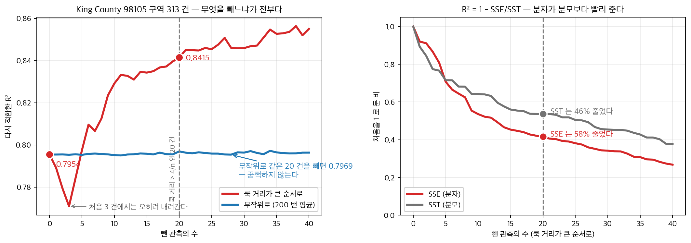
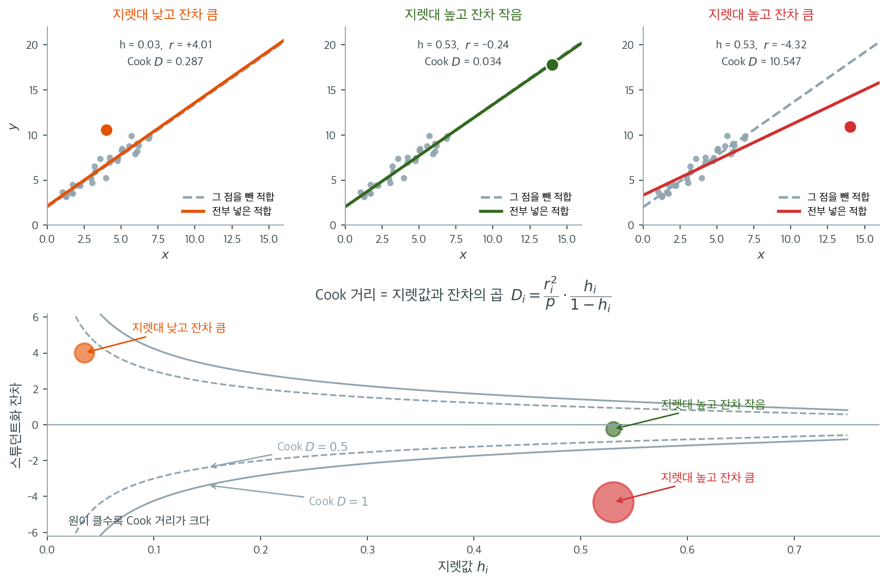
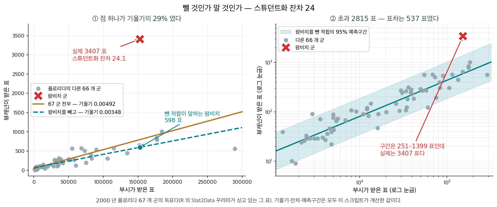

# 회귀 진단 (주택)

## 개요

스튜던트화 잔차와 쿡 거리와 모자값으로 진단량이 큰 관측을 찾아내면 「빼고 다시 적합」이 뒤따르고, 그 뒤에 적히는 수가 대개 $R^2$ 이다. 그 수가 올라가는 것은 거의 보장되어 있다는 점이 문제다.

King County 주택 자료에서 쿡 거리가 가장 큰 관측은 $D = 0.5608$, 스튜던트화 잔차 $4.9420$ 이다. 실제 가격이 $3{,}013{,}254$ 달러인데 모형은 한참 낮게 예측해 크게 빗나갔다. 문턱을 넘는 스무 건을 모두 빼고 다시 적합하면 $R^2$ 이 $0.7954$ 에서 $0.8415$ 로 오른다.

그 상승은 모형이 나아진 증거가 **아니다.** $R^2 = 1 - \mathrm{SSE}/\mathrm{SST}$ 인데 **잔차가 큰 점을 골라 뺐으므로** 분자가 분모보다 빠르게 줄고, 그러면 비가 작아져 $R^2$ 이 반드시 오른다. 자료를 고친 것이 아니라 채점 기준을 고친 셈이다. 뒤집어 말하면 $R^2$ 을 올리고 싶을 때 잔차가 큰 점부터 빼면 되므로, 그렇게 얻은 수는 아무것도 증명하지 못한다.

게다가 그 집은 기록 오류가 아니었다. 지역에서 가장 비싼 집이고, 그런 집이 실제로 존재한다는 것이 그 자료의 사실이다. 빼면 모형은 「그런 집이 없는 세상」의 모형이 된다. 기록 오류와 진짜 극단값을 가르는 일은 진단량이 아니라 자료 밖의 지식이 한다. 그러면 진단량이 큰 관측을 찾아낸 뒤에 무엇을 해야 하는가. 이 쪽은 네 그림이 각각 무엇을 잡아내는지 보이고 그 물음에 답한다.

<figure markdown>
  { width=940 }
  <figcaption markdown>**왼쪽의 파란 선이 대조군이다.** 같은 $20$ 건을 **무작위로** 빼면 $R^2$ 가 $0.7954$ 에서 $0.7969$ 로 꿈쩍하지 않는다. 그러니 $0.8415$ 라는 상승은 「$20$ 건을 뺀」 효과가 아니라 **「잔차가 큰 $20$ 건을 골라 뺀」** 효과다. 오른쪽이 그 셈이다 — $R^2 = 1 - \mathrm{SSE}/\mathrm{SST}$ 인데 분자가 $58\%$, 분모가 $46\%$ 줄었으니 비가 작아지고 $R^2$ 이 오른다. 자료를 고친 것이 아니라 **채점 기준을 고친** 셈이다. 다만 처음 세 건에서는 $R^2$ 가 오히려 내려가는데, 가장 비싼 집 하나가 $\mathrm{SSE}$ 뿐 아니라 $\mathrm{SST}$ 도 크게 쥐고 있기 때문이다 — 「반드시」가 아니라 「거의 언제나」인 까닭이다.</figcaption>
</figure> 아래 상자가 스튜던트화 잔차가 $24$ 까지 가는 관측 하나를 두고 같은 판단을 따라간다.

_확인한 곳 — 이 쪽 「뺄 것인가 말 것인가 — 스튜던트화 잔차 $24$」 상자와 그 출처 줄_

이 페이지는 King County 주택 자료를 이용해 회귀 진단의 전체 흐름을 보인다. 이상점 탐지를 위한 스튜던트화 잔차, 영향 분석을 위한 Cook 거리와 모자값, Breusch-Pagan 검정을 통한 이분산 검정, 부분잔차 그림, 그리고 영향점 제거가 모형 추정에 미치는 영향을 다룬다.

!!! note "자료에 대하여"
    `house_98105`는 King County 주택 매매 자료 가운데 우편번호 98105 지역만 걸러 낸 부분자료를 담은 pandas `DataFrame`이다. 아래 코드는 이 변수가 이미 만들어져 있다고 가정한다. 다른 자료로 바꾸어도 진단 절차 자체는 그대로 적용된다.

---

## 1. 수학적 배경

### 스튜던트화 잔차

관측값 $i$의 내부 스튜던트화 잔차는

$$
r_i = \frac{e_i}{s\sqrt{1 - h_{ii}}},
$$

여기서 $e_i = y_i - \hat{y}_i$는 원잔차이고 $h_{ii}$는 지렛대(모자행렬 $\mathbf{H} = \mathbf{X}(\mathbf{X}^\top\mathbf{X})^{-1}\mathbf{X}^\top$의 대각원소)이다. $|r_i| > 2.5$인 관측값은 잠재적 이상점이다.

### 모자값(지렛대)

지렛대 $h_{ii}$는 관측값 $i$가 설명변수 공간의 중심에서 얼마나 떨어져 있는지를 잰다. 지렛대가 크다는 것은 $\mathbf{x}_i$가 특이하다는 뜻이다. $h_{ii} > 2k/n$이거나 $h_{ii} > 3\bar{h}$($\bar{h} = k/n$)인 관측값을 높은 지렛대 점으로 본다.

### Cook 거리

Cook 거리는 잔차의 크기와 지렛대를 결합한다.

$$
D_i = \frac{1}{k}\,r_i^2\,\frac{h_{ii}}{1 - h_{ii}}.
$$

동등하게 $D_i$는 관측값 $i$를 뺐을 때 모든 적합값이 변하는 정도를 잰다. 흔한 문턱값은 $D_i > 4/n$이다.

### Breusch-Pagan 검정

이분산에 대한 Breusch-Pagan 검정은 제곱잔차를 설명변수에 회귀시킨다.

$$
e_i^2 = \gamma_0 + \gamma_1 x_{i1} + \cdots + \gamma_p x_{ip} + v_i.
$$

$H_0$(등분산) 아래에서 이 보조회귀의 검정통계량 $nR^2$은 $\chi^2_p$를 따른다.

---

## 2. 자료

King County(시애틀) 주택 매매 자료에서 우편번호 98105 지역만 골라 쓴다.

<div class="exbox" markdown>

**보기 1.** <span class="diff easy" title="쉬움"></span> 주택 자료 읽기

**(1)** `describe()` 표의 세 수 — 평균 $756{,}277$, 중앙값 $630{,}041$, 최댓값 $3{,}013{,}254$ — 만으로 가격 분포의 **치우침 방향**을 읽고, 변동계수를 계산하시오.

**(2)** 가격과 로그가격의 왜도를 재어 (1)을 확인하고, 이 자료에서 **이분산이 예상되는 까닭**을 말하시오.

</div>

??? success "풀이"

    **(1) 표만 보고 읽기.** 평균이 중앙값보다 $126{,}236$ 크다. 대칭분포에서는 두 값이 같으므로, **평균이 중앙값보다 크다는 것은 오른쪽 꼬리가 길다는 뜻**이다. 소수의 비싼 집이 평균을 끌어올린 것이다.

    그 꼬리가 얼마나 긴지는 최댓값이 말해 준다. $3{,}013{,}254 / 630{,}041 = 4.78$로 **최고가가 중앙값의 다섯 배 가까이**다. 왼쪽으로는 최솟값이 중앙값의 $0.19$배까지밖에 가지 못한다. 가격처럼 0 아래로 내려갈 수 없는 양은 아래로는 막혀 있고 위로는 열려 있어 늘 이런 모습이 된다.

    변동계수는

    $$
    \mathrm{CV} = \frac{s}{\bar x} = \frac{391{,}463}{756{,}277} = 0.518
    $$

    이다. **표준편차가 평균의 절반이 넘는다.**

    **(2) 왜 이분산이 예상되는가.** 변동계수가 큰 양극단 자료에서는 흔히 **흩어짐이 수준에 비례한다.** 비싼 집과 싼 집의 가격 오차가 같은 달러 단위로 흔들릴 이유가 없고, 보통 같은 **비율**로 흔들린다. $\operatorname{sd}(y \mid x) \propto E[y\mid x]$이면 $\operatorname{Var}(y\mid x) \propto \mu^2$이라 명백한 이분산이고, 그때 $\log y$의 분산은 델타 방법으로

    $$
    \operatorname{Var}(\log y) \approx \frac{\operatorname{Var}(y)}{\mu^2} = \text{상수}
    $$

    가 되어 안정된다. 그러니 **로그를 취했을 때 치우침이 줄어드는지** 보면 이 짐작이 맞는지 알 수 있다.

    ```python
    import pandas as pd

    # "Practical Statistics for Data Scientists" 저장소의 자료. 탭으로 구분되어 있다.
    url = ("https://raw.githubusercontent.com/gedeck/"
           "practical-statistics-for-data-scientists/8a6d3bb6468e979c861d4b37215e1413702dfdfa/data/house_sales.csv")
    house = pd.read_csv(url, sep='\t')
    house_98105 = house.loc[house['ZipCode'] == 98105, :]

    print(f"전체 {len(house)}건 중 98105 지역 {len(house_98105)}건")
    print(house_98105[['AdjSalePrice', 'SqFtTotLiving', 'Bedrooms']].describe().round(1).to_string())
    ```

    출력:

    ```
    전체 22687건 중 98105 지역 313건
           AdjSalePrice  SqFtTotLiving  Bedrooms
    count         313.0          313.0     313.0
    mean       756277.3         2069.9       3.4
    std        391463.3          905.4       1.1
    min        119748.0          490.0       1.0
    25%        521101.0         1410.0       3.0
    50%        630041.0         1850.0       3.0
    75%        851954.0         2570.0       4.0
    max       3013254.0         5570.0       9.0
    ```

    ```python
    import numpy as np
    from scipy.stats import skew

    price = house_98105['AdjSalePrice']
    print(f"평균 {price.mean():,.0f},  중앙값 {price.median():,.0f},  "
          f"차 {price.mean() - price.median():,.0f}")
    print(f"변동계수 = sd/mean = {price.std() / price.mean():.4f}")
    print(f"최대/최소 = {price.max() / price.min():.1f},  최대/중앙값 = {price.max() / price.median():.2f}")
    print(f"\n왜도:  가격 {skew(price):+.4f},  로그가격 {skew(np.log(price)):+.4f}")
    print(f"sd(log 가격) = {np.log(price).std():.4f}   (변동계수의 근사값)")
    ```

    출력:

    ```
    평균 756,277,  중앙값 630,041,  차 126,236
    변동계수 = sd/mean = 0.5176
    최대/최소 = 25.2,  최대/중앙값 = 4.78

    왜도:  가격 +2.2581,  로그가격 +0.6970
    sd(log 가격) = 0.4199   (변동계수의 근사값)
    ```

    **(1)의 읽기가 맞는다.** 왜도가 $+2.258$로 크게 양수다. 평균과 중앙값의 차이 하나로 부호를 맞췄고, 최대/중앙값 비 $4.78$이 꼬리의 길이를 가늠하게 해 주었다.

    **로그를 취하면 왜도가 $+2.258$에서 $+0.697$로 세 분의 일이 된다.** (2)의 짐작이 들어맞는다는 뜻이고, 이 자료가 **로그정규에 가깝다**는 신호다. $\operatorname{sd}(\log y) = 0.4199$가 변동계수 $0.5176$과 같은 자릿수인 것도 그 증거다(로그정규이면 $\mathrm{CV} = \sqrt{e^{\sigma^2}-1}$이고 $\sigma$가 작을 때 $\mathrm{CV} \approx \sigma$다. $\sigma = 0.42$에서 $\sqrt{e^{0.176}-1} = 0.438$로 어느 정도만 맞는데, $\sigma$가 이미 작지 않기 때문이다).

    **이 한 쪽이 보기 4를 미리 말해 준다.** 가격을 그대로 두고 회귀하면 이분산이 나올 것이고, 로그를 취하면 상당히 나아질 것이다. 보기 4에서 Breusch-Pagan 검정으로 그것을 확인한다. 가격이 $12$만에서 $301$만까지 $25$배 벌어진 자료에서는 영향점도 함께 나타나기 쉬우며, 그 이야기가 보기 2와 3이다.

### 기준 모형과 영향 진단

<div class="exbox" markdown>

**보기 2.** <span class="diff easy" title="쉬움"></span> 영향점 진단량 구하기

**(1)** 모자행렬 $H$가 멱등이라는 사실에서 $\sum_i h_{ii} = p$임을 보이시오. 그러므로 $h_{ii}$의 **평균이 $p/n$으로 고정**되어 있고, 문턱 $2p/n$이 "평균의 두 배"라는 뜻임을 밝히시오.

**(2)** 위에 적은 두 Cook 공식

$$
D_i = \frac{r_i^2}{p}\cdot\frac{h_{ii}}{1-h_{ii}}
\qquad\text{와}\qquad
D_i = \frac{e_i^2\, h_{ii}}{p\, s^2 (1-h_{ii})^2}
$$

가 같음을 보이고, 둘 다 `cooks_distance`와 맞는지 확인하시오. 가장 영향이 큰 집이 **잔차 때문인지 지렛대 때문인지**도 가르시오.

</div>

??? success "풀이"

    **(1) 해석적으로.** $H = X(X^\top X)^{-1}X^\top$은 대칭이고 $H^2 = H$다. 멱등행렬의 고윳값은 $0$ 아니면 $1$이고, $1$인 것의 개수가 계수와 같다. $X$가 완전계수 $p$이면 $\operatorname{rank}(H) = p$이므로

    $$
    \sum_{i=1}^n h_{ii} = \operatorname{tr}(H) = \operatorname{rank}(H) = p
    $$

    이다([A.3절 멱등행렬](../../ch00/linalg_regression/square_matrices/idempotent.md)). 대각합을 직접 계산해도 같다. $\operatorname{tr}(X(X^\top X)^{-1}X^\top) = \operatorname{tr}((X^\top X)^{-1}X^\top X) = \operatorname{tr}(I_p) = p$다.

    **그러므로 지렛값의 평균은 자료가 무엇이든 정확히 $p/n$이다.** 이 자료에서는 $6/313 = 0.01917$이다. 지렛값을 "크다/작다"로 말하려면 기준이 있어야 하는데, 그 기준이 자료에 의존하지 않는 $p/n$으로 공짜로 주어지는 셈이다. 흔한 문턱 $2p/n$은 **평균의 두 배**, $3p/n$은 세 배를 뜻한다.

    덧붙여 $0 \le h_{ii} \le 1$이고(멱등행렬의 대각원소), 상수항이 있으면 $h_{ii} \ge 1/n$이다. 단순회귀에서는 닫힌 꼴로

    $$
    h_{ii} = \frac{1}{n} + \frac{(x_i - \bar x)^2}{S_{xx}}
    $$

    이라 **$x$가 중심에서 멀수록 지렛값이 커진다**는 것이 그대로 보인다.

    **(2) 두 Cook 공식이 같음.** 내부 스튜던트화 잔차의 정의가

    $$
    r_i = \frac{e_i}{s\sqrt{1-h_{ii}}}
    \quad\Longrightarrow\quad
    r_i^2 = \frac{e_i^2}{s^2(1-h_{ii})}
    $$

    이므로 첫째 식에 넣으면

    $$
    \frac{r_i^2}{p}\cdot\frac{h_{ii}}{1-h_{ii}}
    = \frac{e_i^2}{p\,s^2(1-h_{ii})}\cdot\frac{h_{ii}}{1-h_{ii}}
    = \frac{e_i^2\,h_{ii}}{p\,s^2(1-h_{ii})^2}
    $$

    로 둘째 식이 된다. **같은 식을 다르게 묶은 것일 뿐**이며, 첫째 꼴이 더 유용하다. $D_i$가 **"벗어난 정도" $r_i^2/p$와 "외따로 떨어진 정도" $h_{ii}/(1-h_{ii})$의 곱**으로 갈리기 때문이다. 어느 하나만 커서는 $D_i$가 크지 않다는 것이 한눈에 보인다.

    ```python
    import numpy as np
    import pandas as pd
    import statsmodels.api as sm
    from statsmodels.stats.outliers_influence import OLSInfluence

    # assign(const=1) 이 절편 열을 만든다. statsmodels 의 OLS 는 절편을
    # 자동으로 넣지 않는다.
    predictors = ['SqFtTotLiving', 'SqFtLot', 'Bathrooms', 'Bedrooms', 'BldgGrade']
    X = house_98105[predictors].assign(const=1)
    y = house_98105['AdjSalePrice']

    results = sm.OLS(y, X).fit()
    influence = OLSInfluence(results)

    # 세 진단량을 함께 본다. 스튜던트화 잔차는 그 점이 얼마나 벗어났는지,
    # 지렛값은 설명변수 쪽에서 얼마나 외따로 있는지, Cook 거리는 그 둘을
    # 합쳐 결론을 얼마나 흔드는지를 잰다.
    studentized_resids = influence.resid_studentized_internal
    hat_values = influence.hat_matrix_diag
    cooks_dist, _ = influence.cooks_distance

    print(results.summary().tables[1])
    print(f"n = {len(y)}, 문턱 4/n = {4/len(y):.4f}")
    print(f"Cook 거리 최댓값 = {cooks_dist.max():.4f} (관측 {cooks_dist.argmax()})")
    print(f"문턱을 넘는 관측값 수 = {(cooks_dist > 4/len(y)).sum()}")
    ```

    출력:

    ```
    =================================================================================
                        coef    std err          t      P>|t|      [0.025      0.975]
    ---------------------------------------------------------------------------------
    SqFtTotLiving   209.6023     24.408      8.587      0.000     161.574     257.631
    SqFtLot          38.9333      5.330      7.305      0.000      28.445      49.421
    Bathrooms      2282.2641      2e+04      0.114      0.909    -3.7e+04    4.16e+04
    Bedrooms      -2.632e+04   1.29e+04     -2.043      0.042   -5.17e+04    -973.867
    BldgGrade        1.3e+05   1.52e+04      8.533      0.000       1e+05     1.6e+05
    const         -7.725e+05   9.83e+04     -7.861      0.000   -9.66e+05   -5.79e+05
    =================================================================================
    n = 313, 문턱 4/n = 0.0128
    Cook 거리 최댓값 = 0.5608 (관측 152)
    문턱을 넘는 관측값 수 = 20
    ```

    이제 (1)과 (2)를 수로 확인한다.

    ```python
    import numpy as np

    r = np.asarray(studentized_resids)
    h = np.asarray(hat_values)
    D = np.asarray(cooks_dist)
    e = np.asarray(results.resid)
    n, k = len(y), X.shape[1]
    s2 = results.mse_resid

    print(f"sum h_ii = {h.sum():.10f}   (p = {k} 여야 한다)")
    print(f"평균 h = {h.mean():.6f} = p/n,   문턱 2p/n = {2 * k / n:.6f}")
    print(f"지렛값이 문턱을 넘는 관측 = {(h > 2 * k / n).sum()}건")

    # 두 가지 Cook 공식이 모두 같은 값을 주는가
    D1 = r ** 2 / k * h / (1 - h)
    D2 = e ** 2 * h / (k * s2 * (1 - h) ** 2)
    print(f"\n|D1 - cooks| 최대 = {np.abs(D1 - D).max():.2e}")
    print(f"|D2 - cooks| 최대 = {np.abs(D2 - D).max():.2e}")

    # 가장 영향이 큰 집을 뜯어본다
    i = int(D.argmax())
    print(f"\n위치 {i}:  D = {D[i]:.4f},  r = {r[i]:.4f},  h = {h[i]:.4f}"
          f"  (평균 h 의 {h[i] / h.mean():.1f}배)")
    print(f"  실제 가격 {y.iloc[i]:,.0f},  적합값 {results.fittedvalues.iloc[i]:,.0f},"
          f"  잔차 {e[i]:,.0f}")
    print(f"  두 인자:  r^2/p = {r[i] ** 2 / k:.4f},"
          f"  h/(1-h) = {h[i] / (1 - h[i]):.4f},  곱 = {r[i] ** 2 / k * h[i] / (1 - h[i]):.4f}")
    ```

    출력:

    ```
    sum h_ii = 6.0000000000   (p = 6 여야 한다)
    평균 h = 0.019169 = p/n,   문턱 2p/n = 0.038339
    지렛값이 문턱을 넘는 관측 = 19건

    |D1 - cooks| 최대 = 5.55e-17
    |D2 - cooks| 최대 = 1.11e-16

    위치 152:  D = 0.5608,  r = 4.9420,  h = 0.1211  (평균 h 의 6.3배)
      실제 가격 3,013,254,  적합값 2,186,265,  잔차 826,989
      두 인자:  r^2/p = 4.0705,  h/(1-h) = 0.1378,  곱 = 0.5608
    ```

    **$\sum h_{ii} = 6.0000000000$으로 정확히 $p$다.** 평균이 $0.019169 = 6/313$이고 문턱 $2p/n = 0.038339$를 넘는 관측이 $19$건이다. 두 Cook 공식도 `cooks_distance`와 $10^{-16}$ 수준까지 같다.

    **$152$번은 잔차 쪽이 문제다.** 두 인자를 갈라 보면 $r^2/p = 4.07$, $h/(1-h) = 0.138$로 **곱의 거의 전부가 잔차에서 온다.** 실제로 보기 1에서 본 최고가 $3{,}013{,}254$달러짜리 집인데 모형은 $2{,}186{,}265$달러를 예측했다. $827$천 달러를 빗나간 것이고 스튜던트화 잔차로 $4.94$다.

    지렛값 $h = 0.1211$도 평균의 $6.3$배라 작지는 않다. $4{,}470$제곱피트에 건물등급 $11$로 설명변수 쪽에서도 바깥에 있기 때문이다. **$D_i$가 $0.56$까지 간 것은 두 가지가 함께 컸기 때문**이며, 어느 하나만으로는 그만큼 가지 못한다. 잔차가 그대로이고 지렛값만 평균 수준 $0.0192$였다면 $D = 4.07 \times 0.0196 = 0.080$에 그쳤을 것이다.

    계수도 함께 읽어 두자. 거주면적 1제곱피트당 $210$달러, 건물 등급 한 단계당 $13$만 달러다. 침실 수의 계수가 **음수**($-26{,}320$)인 것이 눈에 띄는데, 면적을 고정한 채 침실을 늘리면 방이 작아지므로 값이 떨어진다는 뜻이다. 다중회귀 계수를 "다른 변수를 고정한 채"로 읽어야 하는 이유다.

### 지렛대와 잔차 가운데 무엇이 문제인가

Cook 거리가 큰 관측값 20건을 찾았는데, 그 20건이 왜 문제인지를 이해하려면 세 진단량이 어떻게 맞물리는지 보아야 한다.



위 세 칸은 같은 자료에 특별한 점 하나씩만 다르게 붙여 본 것이다. 점선이 그 점을 빼고 적합한 직선, 실선이 그 점까지 넣고 적합한 직선이다.

**왼쪽: 지렛값이 작고 잔차가 크다.** 스튜던트화 잔차가 $+4.01$로 크지만 $x$가 자료의 한복판에 있어 지렛값이 $h = 0.03$뿐이다. 두 직선이 거의 겹친다. 예측을 크게 빗나간 점이지만 **회귀선을 움직이지는 못한다.** Cook 거리 $0.287$.

**가운데: 지렛값이 크고 잔차가 작다.** $x = 14$로 자료에서 멀찍이 떨어져 $h = 0.53$인데, 그 점이 마침 직선 위에 놓여 잔차가 $-0.24$에 불과하다. 두 직선이 완전히 포개진다. 지렛값이 크다는 것만으로는 해롭지 않을 뿐 아니라, 이런 점은 오히려 **기울기 추정을 안정시킨다.** Cook 거리 $0.034$로 세 경우 중 가장 작다.

**오른쪽: 둘 다 크다.** $h = 0.53$이고 잔차가 $-4.32$다. 두 직선이 눈에 띄게 갈라진다. 점 하나가 기울기를 끌어내린 것이다. Cook 거리가 $10.547$로 왼쪽의 $37$배, 가운데의 $312$배다.

아래 그림이 이 세 경우를 한 평면에 놓은 **영향력 그림**이다. 가로축이 지렛값, 세로축이 스튜던트화 잔차이며 회색 곡선이 Cook 거리의 등고선이다. 등고선이 오른쪽으로 갈수록 세로로 좁아진다는 점이 요점이다. 지렛값이 작은 왼쪽 영역에서는 잔차가 $\pm 4$쯤 되어야 $D = 0.5$에 닿지만, $h = 0.5$ 언저리에서는 잔차가 $\pm 1$만 되어도 같은 등고선을 넘는다. 공식 $D_i = \frac{r_i^2}{p}\cdot\frac{h_i}{1-h_i}$의 두 번째 인자가 $h \to 1$에서 폭발하기 때문이다.

그래서 진단은 **잔차 그림 하나로 끝나지 않는다.** 잔차만 보면 가운데 경우를 "아무 문제 없음"으로 넘기는 것까지는 맞지만, 오른쪽 경우가 왼쪽보다 훨씬 위험하다는 사실을 알 수 없다. 이 절 앞머리에서 본 $152$번 관측값의 Cook 거리 $0.5608$도 그 점이 얼마나 벗어났는지가 아니라 **벗어남과 지렛대의 곱**이 컸다는 뜻이다.

<div class="storybox" markdown>

**그림으로 보는 통계학 1.** 뺄 것인가 말 것인가 — 스튜던트화 잔차 $24$

위 세 칸은 만들어 낸 자료다. 진짜 자료에서 잔차가 그렇게 커졌을 때 **「뺄 것인가」가 나라의 물음이 된** 적이 있다.

$2000$ 년 미국 대통령 선거는 플로리다의 선거인단으로 갈렸고, 그 주에서 **부시가 이긴 표차는 $537$ 표**였다. 그런데 플로리다의 한 군, **팜비치**는 후보 이름이 쪽의 **좌우 양쪽에 번갈아** 적히고 가운데 구멍을 뚫게 되어 있는 이른바 「**나비 투표지**」를 썼다. 그 군에서 군소후보 **팻 뷰캐넌**이 받은 표가 유별나게 많았다.

플로리다 $67$ 개 군을 점 하나씩으로 놓고 뷰캐넌의 표를 부시의 표에 회귀해 보자. 이 쪽의 진단량이 팜비치에 대해 말하는 것은 이렇다.

| | 팜비치 | 나머지 $66$ 개 군의 최대 |
|---|---|---|
| 스튜던트화 잔차 | $\mathbf{24.08}$ | $3.28$ |
| 지렛값 $h$ | $0.0709$ | $0.2975$ |
| 쿡 거리 | $2.23$ | $1.981$ |

**지렛값은 크지 않다.** 팜비치는 $x$ 축에서 극단에 있지 않다 — 부시 표가 더 많은 군이 넷이나 있다. 이 점이 영향점인 것은 순전히 **잔차** 때문이고, 그래서 위 세 칸 가운데 **왼쪽**에 해당한다. 그런데도 쿡 거리가 $2.23$ 까지 간 것은 잔차가 $24$ 라는 말이 그만큼 세기 때문이다.



점 하나가 적합을 얼마나 끄는지는 왼쪽 판에 있다. $67$ 군 전부로 적합한 기울기가 $0.004917$ 인데 팜비치를 빼면 $0.003482$ 로, **기울기의 $29\%$ 가 그 한 점이었다.** 그리고 팜비치를 뺀 적합이 팜비치에 대해 내놓는 예측은 $598$ 표다. 실제는 $3407$ 표다.

오른쪽은 더 잘 맞는 모형으로 다시 본 것이다. 두 축을 모두 로그로 바꾸면 나머지 $66$ 군이 $R^2 = 0.866$ 으로 가지런해진다. 그 적합의 **$95\%$ 예측구간**은 팜비치에서 $251$–$1399$ 표인데, 실제는 구간 위쪽 끝의 $2.4$ 배인 $3407$ 표다. 적합값을 기준으로 한 초과는 $2815$ 표 — **표차 $537$ 의 다섯 배**다.

여기서 회귀가 말하는 것과 말하지 않는 것을 갈라야 한다. 이 그림이 말하는 것은 **「팜비치의 뷰캐넌 표가 다른 $66$ 개 군이 그리는 유형에서 크게 벗어난다」**까지다. 왜 벗어났는지, 그 표가 원래 누구에게 갈 표였는지, 투표지의 모양이 원인인지는 **이 자료에 들어 있지 않다.**

그래서 이 절의 매듭이 여기 있다. 진단량은 **빼라는 명령이 아니라 보라는 표시**다. 「쿡 거리가 크면 뺀다」는 규칙을 기계적으로 따랐다면 팜비치는 가장 먼저 지워졌을 것이고, 지워진 뒤의 자료는 아무 말썽 없이 깔끔했을 것이다. 앞의 [영향점과 지렛대](influence.md)가 영향점을 빼고 다시 적합해 본 것도 **그 점이 결론을 얼마나 지탱하고 있는지를 재기 위해서**이지 자료를 청소하기 위해서가 아니다. 같은 쪽의 상자 2 가 청소로 쓰면 어떻게 되는지를 수로 보인다 — 약속한 $5\%$ 가 $10$–$12\%$ 로 올라간다.

_확인한 곳 — $2000$ 년 플로리다 $67$ 개 군의 뷰캐넌 득표와 부시 득표, 그 주에서 부시가 $537$ 표 차로 이겼다는 것, 팜비치 군이 후보 이름을 쪽의 좌우 양쪽에 놓고 가운데를 뚫게 한 「나비 투표지」를 썼고 그것이 일부 유권자를 혼동시켜 다른 후보에게 가려던 표가 뷰캐넌에게 갔을 수 있다는 서술은 [R 의 `Stat2Data::PalmBeach` 자료 설명](https://vincentarelbundock.github.io/Rdatasets/doc/Stat2Data/PalmBeach.html)에서 읽었다. 그 설명이 밝힌 원자료 출처는 플로리다 주 선거국의 결과 보관소다. **그 뒤의 재검표와 소송이 어떻게 되었는지는 읽지 않았고, 여기에 적지 않는다** · 잔차·지렛값·쿡 거리·기울기·예측구간은 모두 그 $67$ 쌍으로 직접 계산한 값이다_

</div>

### 영향점 제거의 효과

<div class="exbox" markdown>

**보기 3.** <span class="diff easy" title="쉬움"></span> 영향점을 빼고 다시 적합

**(1)** 관측 $i$ 하나만 뺀 계수가 **다시 적합하지 않고도**

$$
\hat{\boldsymbol\beta}_{(i)} = \hat{\boldsymbol\beta} - \frac{(X^\top X)^{-1}\mathbf x_i\, e_i}{1 - h_{ii}}
$$

로 나옴을 셔먼–모리슨 공식으로 보이고, 이것이 Cook 거리의 원래 정의

$$
D_i = \frac{(\hat{\boldsymbol\beta} - \hat{\boldsymbol\beta}_{(i)})^\top X^\top X (\hat{\boldsymbol\beta} - \hat{\boldsymbol\beta}_{(i)})}{p\,s^2}
$$

와 맞물림을 확인하시오.

**(2)** $152$번을 실제로 빼서 공식과 맞추고, 문턱을 넘는 $20$건을 뺐을 때 $R^2$이 오르는 **까닭**을 밝히시오.

</div>

??? success "풀이"

    **(1) 해석적으로.** 관측 $i$를 빼면 $X_{(i)}^\top X_{(i)} = X^\top X - \mathbf x_i \mathbf x_i^\top$다. 셔먼–모리슨 공식

    $$
    (A - \mathbf u\mathbf v^\top)^{-1} = A^{-1} + \frac{A^{-1}\mathbf u \mathbf v^\top A^{-1}}{1 - \mathbf v^\top A^{-1}\mathbf u}
    $$

    에 $A = X^\top X$, $\mathbf u = \mathbf v = \mathbf x_i$를 넣는다. 분모의 $\mathbf x_i^\top (X^\top X)^{-1}\mathbf x_i$가 바로 지렛값 $h_{ii}$이므로

    $$
    (X_{(i)}^\top X_{(i)})^{-1} = (X^\top X)^{-1} + \frac{(X^\top X)^{-1}\mathbf x_i \mathbf x_i^\top (X^\top X)^{-1}}{1 - h_{ii}}
    $$

    이다. 한편 $X_{(i)}^\top \mathbf y_{(i)} = X^\top \mathbf y - \mathbf x_i y_i$다. 둘을 곱해 정리하면(중간에 $\mathbf x_i^\top \hat{\boldsymbol\beta} = \hat y_i$와 $y_i - \hat y_i = e_i$를 쓴다)

    $$
    \hat{\boldsymbol\beta}_{(i)} = \hat{\boldsymbol\beta} - \frac{(X^\top X)^{-1}\mathbf x_i\, e_i}{1-h_{ii}}
    $$

    를 얻는다. **$n$번의 재적합이 한 번의 적합으로 줄어든다.** 이것이 $n$개의 Cook 거리를 눈 깜짝할 사이에 계산할 수 있는 이유다.

    이제 이것을 Cook 거리의 정의에 넣는다. $\mathbf d = \hat{\boldsymbol\beta} - \hat{\boldsymbol\beta}_{(i)} = (X^\top X)^{-1}\mathbf x_i e_i/(1-h_{ii})$이므로

    $$
    \mathbf d^\top X^\top X\, \mathbf d
    = \frac{e_i^2}{(1-h_{ii})^2}\,\mathbf x_i^\top (X^\top X)^{-1}\mathbf x_i
    = \frac{e_i^2\, h_{ii}}{(1-h_{ii})^2}
    $$

    이고, $p s^2$으로 나누면 보기 2의 둘째 꼴 $D_i = e_i^2 h_{ii}/\big(p s^2 (1-h_{ii})^2\big)$가 그대로 나온다. **세 식이 하나다.** "계수가 얼마나 움직이는가", "잔차 × 지렛대", "적합값이 얼마나 움직이는가"가 같은 수를 다르게 쓴 것이다.

    **(2) 수치적으로.**

    ```python
    # 문턱을 넘는 관측값을 빼고 다시 적합해 계수가 얼마나 달라지는지 본다.
    # 크게 달라진다면 결론이 몇 채의 집에 기대고 있다는 뜻이다.
    threshold_cooks = 4 / len(y)
    mask_keep = cooks_dist < threshold_cooks

    X_filtered = X[mask_keep]
    y_filtered = y[mask_keep]
    results_filtered = sm.OLS(y_filtered, X_filtered).fit()

    # 계수를 견준다
    comparison = pd.DataFrame({
        'Original': results.params,
        'Filtered': results_filtered.params,
    })
    print(comparison.round(2).to_string())
    print(f"\n제거된 관측값: {(~mask_keep).sum()}건")
    print(f"R^2: {results.rsquared:.4f} -> {results_filtered.rsquared:.4f}")
    ```

    출력:

    ```
                    Original   Filtered
    SqFtTotLiving     209.60     201.83
    SqFtLot            38.93      42.59
    Bathrooms        2282.26    1664.95
    Bedrooms       -26320.27  -23734.89
    BldgGrade      130000.10  111175.45
    const         -772549.86 -644099.89

    제거된 관측값: 20건
    R^2: 0.7954 -> 0.8415
    ```

    이제 한 점만 빼는 공식을 확인한다.

    ```python
    import numpy as np

    h = np.asarray(influence.hat_matrix_diag)
    e = np.asarray(results.resid)
    D = np.asarray(cooks_dist)
    n, k = len(y), X.shape[1]
    s2 = results.mse_resid
    i = int(D.argmax())

    # 한 점만 빼는 공식 (셔먼-모리슨)
    XtXinv = np.linalg.inv(X.values.T @ X.values)
    beta_formula = results.params.values - XtXinv @ X.values[i] * e[i] / (1 - h[i])

    # 실제로 빼고 다시 적합
    keep_one = np.ones(n, dtype=bool)
    keep_one[i] = False
    beta_refit = sm.OLS(y[keep_one], X[keep_one]).fit().params.values

    print(f"{'':>14}{'공식':>16}{'실제 재적합':>16}")
    for name, a, b in zip(X.columns, beta_formula, beta_refit):
        print(f"{name:>14}{a:>16.4f}{b:>16.4f}")
    print(f"\n최대 상대오차 = {np.abs((beta_formula - beta_refit) / beta_refit).max():.2e}")

    # Cook 거리가 정말 그 변화의 크기인가
    d = results.params.values - beta_formula
    print(f"\n이차형식으로 계산한 D = {d @ (X.values.T @ X.values) @ d / (k * s2):.12f}")
    print(f"cooks_distance        = {D[i]:.12f}")

    # 20건을 뺐을 때 R^2 이 오른 까닭
    print(f"\nSSE: {results.ssr:.4g} -> {results_filtered.ssr:.4g}"
          f"  ({results_filtered.ssr / results.ssr:.1%})")
    print(f"SST: {results.centered_tss:.4g} -> {results_filtered.centered_tss:.4g}"
          f"  ({results_filtered.centered_tss / results.centered_tss:.1%})")
    ```

    출력:

    ```
                                공식          실제 재적합
     SqFtTotLiving        217.5874        217.5874
           SqFtLot         31.5277         31.5277
         Bathrooms       9031.4566       9031.4566
          Bedrooms     -28072.1958     -28072.1958
         BldgGrade     120524.2661     120524.2661
             const    -693113.5065    -693113.5065

    최대 상대오차 = 1.77e-14

    이차형식으로 계산한 D = 0.560788525781
    cooks_distance        = 0.560788525781

    SSE: 9.781e+12 -> 4.069e+12  (41.6%)
    SST: 4.781e+13 -> 2.568e+13  (53.7%)
    ```

    **공식이 재적합과 소수점 열넷째 자리까지 같다.** 여섯 계수가 모두 일치하고, 이차형식으로 계산한 $D$가 `cooks_distance`와 소수점 열두째 자리까지 같다. **(1)에서 보인 세 식이 하나라는 것이 수로 확인되었다.**

    $152$번 한 채를 빼는 것만으로 BldgGrade의 계수가 $130{,}000 \to 120{,}524$로 $7\%$ 움직인다. $313$채 가운데 한 채가 그만큼 한다.

    **$R^2$이 오른 까닭은 모형이 좋아져서가 아니다.** $20$건을 빼면 SSE가 원래의 $41.6\%$로 줄지만 SST는 $53.7\%$까지만 준다. $R^2 = 1 - \text{SSE}/\text{SST}$이므로 비의 비가 그대로 넘어온다.

    $$
    \frac{\text{SSE}_{\text{filtered}}}{\text{SST}_{\text{filtered}}}
    = \frac{0.416}{0.537}\cdot\frac{\text{SSE}}{\text{SST}}
    = 0.775 \times 0.2046 = 0.1586
    $$

    곧 $R^2$이 $1 - 0.2046 = 0.7954$에서 $1 - 0.1586 = 0.8414$로 바뀐 것이다. **SSE가 SST보다 빠르게 줄었기 때문**이고, 잔차가 큰 점을 골라 뺐으니 당연한 일이다. 어떤 자료에서든 큰 잔차를 가진 관측을 빼면 $R^2$이 오른다. **그러므로 이 상승은 "모형이 나아졌다"는 증거가 아니다.**

    계수가 이만큼 움직인다는 것 자체가 보고해야 할 사실이다. 그렇다고 $20$건을 그냥 버려서는 안 된다. Cook 거리가 큰 관측값은 자료 오류일 수도, 정말로 특이한 거래(예: 재건축 예정 부지)일 수도 있으므로 개별적으로 확인해야 한다. 보기 2에서 본 $152$번은 자료 오류가 아니라 **이 지역에서 가장 비싼 집**이었다. 버릴 것이 아니라 "모형이 최고가 구간을 과소예측한다"는 사실로 읽어야 하며, 그 쪽으로 가는 길이 보기 4의 로그 변환이다.

### 이분산 검정

<div class="exbox" markdown>

**보기 4.** <span class="diff easy" title="쉬움"></span> 등분산 검정

**(1)** 보조회귀를 직접 만들어 $\mathrm{LM} = nR^2$을 재현하고, 자유도가 왜 $5$인지 밝힌 뒤 p-값을 **$0.0000$이 아닌 수로** 적으시오.

**(2)** 보기 1에서 짐작한 대로 로그 변환이 이분산을 고치는지 확인하시오. 완전히 고쳐지는가.

</div>

??? success "풀이"

    **(1) 보조회귀와 자유도.** Breusch-Pagan은 제곱잔차를 설명변수에 회귀시킨다.

    $$
    e_i^2 = \gamma_0 + \gamma_1 x_{i1} + \cdots + \gamma_5 x_{i5} + v_i
    $$

    검정하는 귀무가설은 $\gamma_1 = \cdots = \gamma_5 = 0$이므로 **제약의 개수가 $5$**이고, 그것이 자유도다. 상수항 $\gamma_0$은 제약하지 않는다. 등분산 아래에서도 $E[e_i^2] = \sigma^2 > 0$이어야 하기 때문이다. 설계행렬 `X`에 `const` 열이 들어 있으므로 `het_breuschpagan`이 그것을 알아서 빼고 자유도를 $5$로 잡는다.

    `:.4f`로 찍으면 $0.0000$이 되어 "얼마나 작은지"를 잃는다. $\chi^2_5$에서 직접 계산하면 제대로 된 수가 나온다.

    **(2) 로그 변환.** 보기 1에서 가격이 로그정규에 가깝고 흩어짐이 수준에 비례할 것이라 짐작했다. 그 짐작이 맞다면 $\log y$를 반응으로 두었을 때 이분산이 크게 줄어야 한다.

    ```python
    from statsmodels.stats.diagnostic import het_breuschpagan

    # 집값 자료는 비싼 집일수록 오차도 커지는 것이 보통이라, 등분산 검정이
    # 기각되는 일이 흔하다. 그럴 때는 로그 변환이나 로버스트 표준오차로 간다.
    bp_stat, bp_pval, _, _ = het_breuschpagan(results.resid, X)
    print(f"Breusch-Pagan p-value: {bp_pval:.4f}")
    ```

    출력:

    ```
    Breusch-Pagan p-value: 0.0000
    ```

    ```python
    import numpy as np
    import statsmodels.api as sm
    from scipy.stats import chi2
    from statsmodels.stats.diagnostic import het_breuschpagan

    e = np.asarray(results.resid)
    n = len(y)

    aux = sm.OLS(e ** 2, X).fit()
    lm = n * aux.rsquared
    print(f"보조회귀 R^2 = {aux.rsquared:.6f}")
    print(f"LM = n R^2   = {lm:.6f}")
    print(f"statsmodels  = {het_breuschpagan(results.resid, X)[0]:.6f}")
    print(f"p = chi2(5).sf(LM) = {chi2.sf(lm, 5):.4e}   (0.0000 이 아니다)")

    # 로그 변환이 얼마나 고치는가
    res_log = sm.OLS(np.log(y), X).fit()
    lm_log, p_log, _, _ = het_breuschpagan(res_log.resid, X)
    print(f"\n로그 모형:  LM = {lm_log:.4f},  p = {p_log:.4f}")
    print(f"로그 모형의 R^2 = {res_log.rsquared:.4f}  (원 모형 {results.rsquared:.4f})")
    ```

    출력:

    ```
    보조회귀 R^2 = 0.199511
    LM = n R^2   = 62.446794
    statsmodels  = 62.446794
    p = chi2(5).sf(LM) = 3.7899e-12   (0.0000 이 아니다)

    로그 모형:  LM = 12.6167,  p = 0.0272
    로그 모형의 R^2 = 0.7651  (원 모형 0.7954)
    ```

    **$\mathrm{LM} = 62.447$이고 p-값은 $3.8 \times 10^{-12}$다.** 보조회귀를 직접 만들어 $n R^2 = 313 \times 0.19951$로 재현했고 `statsmodels`와 소수점 여섯째 자리까지 같다. $0.0000$보다 $3.8 \times 10^{-12}$라고 적는 편이 낫다. 제곱잔차의 $20\%$가 설명변수로 설명된다는 뜻이고, 이 정도면 OLS 표준오차를 그대로 믿을 수 없다.

    **로그 변환이 거의 고친다.** $\mathrm{LM}$이 $62.45$에서 $12.62$로 다섯 분의 일이 되고 p-값이 $3.8\times10^{-12}$에서 $0.0272$로 올라간다. 보기 1에서 왜도가 $2.258 \to 0.697$로 줄었던 것과 같은 개선이다.

    **그러나 완전히 고쳐지지는 않는다.** $p = 0.0272$는 $\alpha = 0.05$에서 여전히 기각이다. 로그는 "흩어짐이 수준에 **정확히** 비례한다"를 전제로 분산을 안정시키는데, 실제 자료가 그 전제를 꼭 맞게 따를 이유는 없다. 그러니 로그를 취한 뒤에도 **로버스트(HC) 표준오차를 함께 쓰는 것**이 안전하다.

    덧붙여 $R^2$이 $0.7954$에서 $0.7651$로 내려간 것은 **모형이 나빠졌다는 뜻이 아니다.** 반응변수가 달라졌으므로 두 $R^2$은 애초에 비교할 수 없는 수다. 분모인 SST가 달러의 제곱에서 로그의 제곱으로 바뀌었기 때문이다. **변환한 모형과 변환하지 않은 모형의 $R^2$을 견주는 것은 흔하지만 틀린 비교다.**

---

## 3. 네 그림이 각각 무엇을 잡아내는가

- **스튜던트화 잔차**: 값이 크면 모형이 그 관측값을 잘 예측하지 못한다는 뜻이다. 자료 입력 오류, 특이한 사례, 혹은 모형 오설정의 신호일 수 있다.
- **지렛대**: 지렛대가 큰 점이 반드시 해로운 것은 아니다. 잔차까지 클 때에만 영향점이 된다. 회귀 곡면 위에 놓인 높은 지렛대 점은 오히려 적합을 안정시킨다.
- **Cook 거리**: Cook 거리가 큰 점은 회귀 곡면 전체에 영향을 준다. 그 점들을 빼고 결과를 비교해 보면 결론이 몇몇 관측값에 민감한지 드러난다.
- **Breusch-Pagan 검정**: 유의한 결과($p < 0.05$)는 이분산을 나타내며 OLS 표준오차를 믿을 수 없음을 시사한다. 대책으로는 WLS, 로버스트 표준오차, 분산 안정화 변환이 있다.
- **부분잔차 그림**(CCPR 그림)은 다른 설명변수를 고려한 뒤 각 설명변수와 반응변수의 관계를 보여주어 잠재적 비선형성을 드러낸다.

---

## 연습문제

<div class="drillbox" markdown>

**연습문제 1.** <span class="diff med" title="중간"></span> (하나 빼기 분산 추정을 쓰는) 외부 스튜던트화 잔차를 계산하여 내부 스튜던트화 잔차와 비교하라. 어떤 관측값에서 차이가 가장 큰가?

</div>

??? success "풀이"

    ```python
    ext_resids = influence.resid_studentized_external
    int_resids = influence.resid_studentized_internal
    discrepancy = np.abs(ext_resids - int_resids)
    top_idx = np.argsort(discrepancy)[-5:]
    ```

    차이가 가장 큰 곳은 잔차가 크면서 $h_{ii}$도 큰 관측값이다. 외부 잔차는 관측값 $i$를 빼고 계산한 $s_{(i)}$를 쓰는데, 관측값 $i$가 잔차분산에 강한 영향을 줄수록 $s$와 $s_{(i)}$의 차이가 커지기 때문이다. $\square$

<div class="drillbox" markdown>

**연습문제 2.** <span class="diff med" title="중간"></span> 모든 모자값의 합이 $k$(모수의 개수)임을 증명하라. 이는 평균 지렛대에 대해 무엇을 뜻하는가?

</div>

??? success "풀이"

    모자행렬은 $\mathbf{H} = \mathbf{X}(\mathbf{X}^\top\mathbf{X})^{-1}\mathbf{X}^\top$이다. $\mathbf{H}$가 멱등($\mathbf{H}^2 = \mathbf{H}$)이고 대칭이므로

    $$
    \sum_{i=1}^n h_{ii} = \operatorname{tr}(\mathbf{H}) = \operatorname{tr}(\mathbf{X}(\mathbf{X}^\top\mathbf{X})^{-1}\mathbf{X}^\top) = \operatorname{tr}((\mathbf{X}^\top\mathbf{X})^{-1}\mathbf{X}^\top\mathbf{X}) = \operatorname{tr}(\mathbf{I}_k) = k.
    $$

    따라서 평균 지렛대는 $\bar{h} = k/n$이고, 문턱값 $3\bar{h} = 3k/n$은 평균의 세 배가 넘는 지렛대를 가진 점을 찾아낸다. $\square$

<div class="drillbox" markdown>

**연습문제 3.** <span class="diff med" title="중간"></span> $e_i^2$을 $\mathbf{X}$에 회귀시키고 $nR^2$을 계산하여 Breusch-Pagan 검정을 직접 구현하라. statsmodels 결과와 일치하는지 확인하라.

</div>

??? success "풀이"

    ```python
    resid_sq = results.resid ** 2
    aux_model = sm.OLS(resid_sq, X).fit()
    bp_stat_manual = len(y) * aux_model.rsquared
    from scipy import stats
    bp_pval_manual = 1 - stats.chi2.cdf(bp_stat_manual, X.shape[1] - 1)
    ```

    직접 계산한 값은 `het_breuschpagan`과 거의 일치한다(상수항 처리 같은 구현 세부에서 미세한 차이가 날 수 있다). 자유도는 상수를 제외한 설명변수의 개수이므로 `X.shape[1] - 1`을 쓴다. $\square$

<div class="drillbox" markdown>

**연습문제 4.** <span class="diff med" title="중간"></span> 영향점을 제거하면 계수 추정값이 달라진다. 그런 관측값을 제거하는 것이 적절한 경우와 남겨 두어야 하는 경우를 논하라.

</div>

??? success "풀이"

    영향점이 명백히 잘못된 값(자료 입력 실수, 측정 실패)이거나 다른 모집단에서 온 것이라면 제거가 적절하다. 특이하긴 하지만 정당한 자료점이라면 남겨야 한다. 이 경우 민감도 분석 자체가 유익한 정보를 준다. 결과가 크게 달라진다면 결론이 취약하다는 뜻이다. 제거의 대안으로는 영향점을 완전히 배제하지 않고 가중치를 낮추는 로버스트 회귀(예: Huber나 bisquare 가중)가 있다. $\square$

<div class="drillbox" markdown>

**연습문제 5.** <span class="diff med" title="중간"></span> 참 오차가 정규분포를 따르는데도 Q-Q 그림의 꼬리가 대각선에서 자주 벗어나는 이유를 설명하라. 표본크기는 이 현상에 어떤 영향을 주는가?

</div>

??? success "풀이"

    Q-Q 그림에서 극단의 순서통계량(가장 작은 잔차와 가장 큰 잔차)은 표집변동이 가장 크다. 오차가 정확히 정규여도 유한표본에서는 경험분포의 꼬리가 상당히 흔들린다. 관측값이 $n$개일 때 정규표본의 범위는 대략 $2\sqrt{2\ln n}\,\sigma$이지만 실제 범위는 크게 변동한다. $n$이 커지면 (큰 수의 법칙이 경험분위수를 안정시키므로) Q-Q 그림의 꼬리가 더 안정되고, 따라서 큰 표본의 Q-Q 그림이 꼬리 거동에 대해 더 믿을 만한 증거를 준다. $\square$

<div class="drillbox" markdown>

**연습문제 6.** <span class="diff med" title="중간"></span> 영향력 그림의 Cook 등고선을 식으로 다룬다. 모수의 개수는 보기 2 와 같이 $p$ 로 쓴다.

**(1)** $D_i = D_0$ 등고선을 $r$ 에 대해, 또 $h$ 에 대해 풀어 두 꼴

$$
r = \pm\sqrt{\frac{p D_0 (1-h)}{h}}
\qquad\text{와}\qquad
h = \frac{p D_0}{p D_0 + r^2}
$$

을 얻으시오.

**(2)** 본문은 영향력 그림을 두고 "지렛값이 작은 왼쪽 영역에서는 잔차가 $\pm 4$쯤 되어야 $D = 0.5$에 닿지만, $h = 0.5$ 언저리에서는 잔차가 $\pm 1$만 되어도 같은 등고선을 넘는다"고 적었다. 세 칸 그림은 단순회귀이므로 $p = 2$다. 두 주장이 각각 어떤 $h$ 에 해당하는지 구하시오.

**(3)** 왼쪽 칸에 적힌 세 수 $h = 0.03$, $r = 4.01$, $D = 0.287$ 은 서로 맞지 않는다. $h = 0.03$ 을 그대로 넣으면 $D$ 가 얼마가 되는지 계산하고, 세 수 가운데 반올림 때문에 어긋난 것을 가려내어 반올림 전 값을 되찾으시오.

**(4)** 주택 자료는 $p = 6$, $n = 313$, 문턱 $4/n = 0.01278$ 이다. 지렛값이 평균인 집($\bar h = 0.01917$)과 $152$ 번처럼 $h = 0.1211$ 인 집은 각각 $\lvert r \rvert$ 가 얼마부터 이 문턱을 넘는가. 보기 2 의 "문턱을 넘는 관측값 수 $= 20$"을 "이상점이 $20$ 건"으로 읽어도 되는지 말하시오.

</div>

??? success "풀이"

    **(1)** $D_i = \dfrac{r^2}{p}\cdot\dfrac{h}{1-h} = D_0$ 에서 $r^2 = \dfrac{p D_0 (1-h)}{h}$ 이므로 첫째 꼴이 나온다. 같은 식을 $h$ 로 풀면 $r^2 h = p D_0 (1-h)$, 곧 $h(r^2 + p D_0) = p D_0$ 이므로

    $$
    h = \frac{p D_0}{p D_0 + r^2}
    $$

    이다. 첫째 꼴은 $h \to 0$ 에서 발산하고 $h \to 1$ 에서 $0$ 으로 내려간다. **등고선이 오른쪽으로 갈수록 세로로 좁아진다**는 본문의 말이 바로 이것이다.

    **(2)** $p = 2$, $D_0 = 0.5$ 이면 $p D_0 = 1$ 이라 $h = 1/(1 + r^2)$ 로 아주 간단해진다.

    - $r = \pm 4$: $h = 1/17 = 0.0588$.
    - $r = \pm 1$: $h = 1/2 = 0.5$.

    둘째 것은 **정확히** 맞는다. 본문의 "$h = 0.5$ 언저리에서 $\pm 1$"은 어림이 아니라 등식이다. 첫째 것은 "지렛값이 작은 왼쪽 영역"이 $h \approx 0.06$ 아래를 뜻한다는 것을 알려 준다.

    **(3)** $h = 0.03$, $r = 4.01$ 을 그대로 넣으면

    $$
    D = \frac{4.01^2}{2}\cdot\frac{0.03}{0.97} = 8.0401 \times 0.030928 = 0.2486
    $$

    으로 적힌 $0.287$ 과 다르다. 세 수 가운데 **유효숫자가 가장 적은 것이 $h$** 다($0.03$ 은 두 자리뿐이다). 그러니 $h$ 를 (1)의 둘째 꼴로 역산한다.

    $$
    h = \frac{p D}{p D + r^2} = \frac{2 \times 0.287}{2 \times 0.287 + 4.01^2} = \frac{0.574}{16.654} = 0.0345
    $$

    $h = 0.0345$ 를 넣으면 $D = 8.0401 \times 0.0345/0.9655 = 0.287$ 로 맞는다. 가운데 칸과 오른쪽 칸도 같은 방식으로 맞춰 볼 수 있다($h = 0.53$, $r = -4.32$ 에서 $D = 10.52$ 인데 적힌 값은 $10.547$ 이다. $r$ 을 반올림 전 $-4.325$ 로 두면 $10.545$ 가 되어 들어맞는다).

    **(4)** $p D_0 = 6 \times 0.01278 = 0.07668$ 이므로 (1)의 첫째 꼴에 넣는다.

    $$
    \bar h = 0.01917: \quad \lvert r \rvert = \sqrt{0.07668 \times \frac{0.98083}{0.01917}} = \sqrt{3.923} = 1.98
    $$

    $$
    h = 0.1211: \quad \lvert r \rvert = \sqrt{0.07668 \times \frac{0.8789}{0.1211}} = \sqrt{0.5565} = 0.746
    $$

    **읽어도 안 된다.** 지렛값이 평균밖에 안 되는 집도 $\lvert r \rvert > 1.98$ 이면 $4/n$ 문턱을 넘고, $152$ 번만큼 지렛값이 있으면 $\lvert r \rvert > 0.75$ 로 족하다. 이상점 문턱 $\lvert r_i \rvert > 2.5$ 보다 훨씬 느슨하므로 $20$ 건 가운데 상당수는 잔차가 평범하고 지렛값이 큰 집이다. $D_i$ 는 "벗어난 점"을 세는 자가 아니라 **"결론을 흔드는 점"을 세는 자**다. $\square$

<div class="drillbox" markdown>

**연습문제 7.** <span class="diff med" title="중간"></span> 보기 2 는 $\sum_i h_{ii} = p$ 와 $0 \le h_{ii} \le 1$ 을 얻었다. 이 두 사실만으로 문턱의 성질을 알아본다.

**(1)** $c > 1$ 일 때 문턱 $c\,p/n$ 을 넘는 관측이 $n/c$ 개보다 적음을 보이시오. 주택 자료의 $2p/n$ 문턱에서 이 상한은 몇인가. 보기 2 가 실제로 센 $19$ 건과 견주시오.

**(2)** 그 상한이 거의 닿을 수 있음을 보이시오. 힌트: $p = 1$ 이고 설계행렬이 앞 $m$ 개 성분만 $1$ 이고 나머지는 $0$ 인 한 열일 때 지렛값을 구하라. $n = 313$ 에서 $2p/n$ 을 넘는 관측을 최대 몇 개까지 만들 수 있는가.

**(3)** 어떤 관측의 $h_{ii}$ 가 $1$ 이면 $e_i = 0$ 임을 보이고, 그때 $r_i$, $D_i$, 보기 3 의 삭제 공식이 모두 무너짐을 밝히시오. 이것이 진단량들이 숨겨 놓은 가정 $h_{ii} < 1$ 의 까닭이다.

</div>

??? success "풀이"

    **(1)** $S = \{i : h_{ii} > c\,p/n\}$ 이라 하자. 모든 $h_{ii} \ge 0$ 이므로

    $$
    p = \sum_{i=1}^n h_{ii} \;\ge\; \sum_{i \in S} h_{ii} \;>\; \lvert S \rvert \cdot \frac{c\,p}{n}
    $$

    이고, 양변을 $cp/n$ 으로 나누면 $\lvert S \rvert < n/c$ 다. 마르코프 부등식을 지렛값에 쓴 것과 같다. $c = 2$, $n = 313$ 이면 $\lvert S \rvert < 156.5$, 곧 많아야 $156$ 건이다.

    실제로는 $19$ 건이므로 **상한은 지독하게 느슨하다.** 총합 $p = 6$ 이 $313$ 개에 고르게 퍼지면 상한이 뜻이 있겠지만, 실제 자료에서는 대부분의 $h_{ii}$ 가 평균 아래에 모이고 몇 개만 크게 튄다. 그래서 문턱을 넘는 수가 상한의 $12\%$ 에 그친다.

    **(2)** 힌트의 설계에서 $\mathbf X^\top \mathbf X = \sum_j x_j^2 = m$ 이므로

    $$
    h_{ii} = \frac{x_i^2}{\sum_j x_j^2} = \begin{cases} 1/m, & i \le m \\ 0, & i > m\end{cases}
    $$

    이다(합이 $m \cdot (1/m) = 1 = p$ 로 맞는다). $1/m > 2/n$ 은 $m < n/2$ 와 같으므로 $n = 313$ 에서는 $m \le 156$ 일 때 $m$ 개 전부가 문턱을 넘는다. $m = 156$ 으로 두면 $1/156 = 0.006410 > 2/313 = 0.006390$ 이라 **$156$ 건**이 되어 (1)의 상한 $156.5$ 를 바닥까지 채운다. $m = 157$ 이면 $1/157 = 0.006369$ 로 문턱 아래가 되어 한 건도 걸리지 않는다. 문턱 $2p/n$ 은 **"평균의 두 배"일 뿐이고, 자료의 절반이 평균의 두 배일 수도 있다.**

    **(3)** $\mathbf H$ 가 대칭이고 멱등이므로 $h_{ii} = (\mathbf H^2)_{ii} = \sum_j h_{ij}^2$ 다. $h_{ii} = 1$ 이면

    $$
    1 = h_{ii}^2 + \sum_{j \ne i} h_{ij}^2 = 1 + \sum_{j \ne i} h_{ij}^2
    $$

    이라 $j \ne i$ 에 대해 $h_{ij} = 0$ 이다. 따라서 $\hat y_i = \sum_j h_{ij} y_j = y_i$ 이고 $e_i = 0$ 이다. 같은 결론을 $\operatorname{Var}(e_i) = \sigma^2 (1 - h_{ii}) = 0$ 에서도 얻는다. **$y_i$ 가 무엇이든 적합면이 그 점을 정확히 지난다.**

    그러면 세 진단량이 모두 뜻을 잃는다. $r_i = 0/(s \cdot 0)$ 과 $D_i = (0/p) \cdot (1/0)$ 은 $0/0$ 과 $0 \cdot \infty$ 꼴이고, 보기 3 의 삭제 공식은 분모 $1 - h_{ii} = 0$ 으로 나눈다. 우연이 아니다. 그런 점을 빼면 $\mathbf X_{(i)}^\top \mathbf X_{(i)}$ 가 특이해져 $\hat{\boldsymbol\beta}_{(i)}$ 가 **아예 존재하지 않는다.** 그 관측만 $1$ 인 가변수가 있을 때가 그런 경우다. 그 열의 계수는 그 한 점으로만 정해지므로, 점을 빼면 계수를 정할 길이 없다.

    **"이 점을 빼면 결론이 얼마나 달라지는가"를 물을 수 없는 점**이 있다는 뜻이고, 진단은 그런 점을 조용히 통과시킨다. $\square$

<div class="drillbox" markdown>

**연습문제 8.** <span class="diff hard" title="어려움"></span> 연습문제 1 은 외부 스튜던트화 잔차 $t_i = e_i/(s_{(i)}\sqrt{1-h_{ii}})$ 를 `statsmodels` 에서 받아 썼다. 여기서는 손으로 구한다.

**(1)** 보기 3 의 삭제 공식과 $\mathbf{He} = \mathbf 0$, $\mathbf H^2 = \mathbf H$ 만 써서

$$
\mathrm{SSE}_{(i)} = \mathrm{SSE} - \frac{e_i^2}{1 - h_{ii}}
$$

임을 보이시오.

**(2)** (1)에서 $t_i = r_i\sqrt{\dfrac{n-p-1}{n-p-r_i^2}}$ 와 $r_i^2 \le n-p$ 를 얻으시오. $152$ 번($r = 4.9420$, $n = 313$, $p = 6$)의 $t$ 를 구하고, 내부 스튜던트화 잔차가 결코 넘을 수 없는 상한도 적으시오.

**(3)** (2)의 식에는 $h_{ii}$ 가 들어 있지 않다. 연습문제 1 의 풀이는 "차이가 가장 큰 곳은 잔차가 크면서 $h_{ii}$ 도 큰 관측값"이라고 했는데, 이 문장을 (2)에 맞게 고치시오.

**(4)** 귀무가설 아래에서 $t_i \sim t_{n-p-1}$ 이다. 문턱 $\lvert r_i \rvert > 2.5$ 를 $313$ 개 관측에 다 적용하면 오차가 정규여도 평균 몇 건이 걸리는가. 가족별 오류율 $5\%$ 를 지키는 Bonferroni 문턱은 얼마이고, $152$ 번은 그것을 넘는가.

</div>

??? success "풀이"

    **(1)** 보기 3 의 $\hat{\boldsymbol\beta}_{(i)} = \hat{\boldsymbol\beta} - (\mathbf X^\top \mathbf X)^{-1}\mathbf x_i e_i/(1-h_{ii})$ 를 쓰면, 모든 $j$ 에 대해

    $$
    y_j - \mathbf x_j^\top \hat{\boldsymbol\beta}_{(i)} = e_j + \frac{\mathbf x_j^\top (\mathbf X^\top \mathbf X)^{-1}\mathbf x_i}{1-h_{ii}}\,e_i = e_j + \frac{h_{ji}}{1-h_{ii}}\,e_i
    $$

    이다($\mathbf x_j^\top (\mathbf X^\top \mathbf X)^{-1}\mathbf x_i = h_{ji}$ 는 모자행렬의 정의다). 먼저 $j = i$ 를 빼지 않고 **모두** 더한다.

    $$
    \sum_{j=1}^n \left(e_j + \frac{h_{ji}e_i}{1-h_{ii}}\right)^2
    = \mathrm{SSE} + \frac{2e_i}{1-h_{ii}}\sum_j h_{ji}e_j + \frac{e_i^2}{(1-h_{ii})^2}\sum_j h_{ji}^2
    $$

    여기서 $\sum_j h_{ji} e_j = (\mathbf{He})_i = 0$ 이다. $\mathbf{He} = \mathbf H(\mathbf I - \mathbf H)\mathbf y = (\mathbf H - \mathbf H^2)\mathbf y = \mathbf 0$ 이기 때문이다. 또 $\sum_j h_{ji}^2 = (\mathbf H^2)_{ii} = h_{ii}$ 다. 그러므로 위 합은 $\mathrm{SSE} + e_i^2 h_{ii}/(1-h_{ii})^2$ 다.

    이제 $j = i$ 항을 뺀다. 그 항은

    $$
    e_i + \frac{h_{ii}e_i}{1-h_{ii}} = \frac{e_i}{1-h_{ii}}
    $$

    이라 제곱이 $e_i^2/(1-h_{ii})^2$ 다. 따라서

    $$
    \mathrm{SSE}_{(i)} = \mathrm{SSE} + \frac{e_i^2 h_{ii}}{(1-h_{ii})^2} - \frac{e_i^2}{(1-h_{ii})^2}
    = \mathrm{SSE} - \frac{e_i^2(1-h_{ii})}{(1-h_{ii})^2}
    = \mathrm{SSE} - \frac{e_i^2}{1-h_{ii}}
    $$

    를 얻는다. 중간에 나온 $e_i/(1-h_{ii})$ 는 **관측 $i$ 를 빼고 적합한 뒤 그 점을 예측했을 때의 오차**(삭제 예측오차)다. 원잔차보다 $1/(1-h_{ii})$ 배 크고, 지렛값이 클수록 더 벌어진다.

    **(2)** $\mathrm{SSE} = (n-p)s^2$ 이고 $r_i^2 = e_i^2/\big(s^2(1-h_{ii})\big)$ 이므로 (1)은

    $$
    (n-p-1)s_{(i)}^2 = \mathrm{SSE}_{(i)} = (n-p)s^2 - s^2 r_i^2 = s^2\,(n-p-r_i^2)
    $$

    로 다시 쓰인다. $t_i = e_i/(s_{(i)}\sqrt{1-h_{ii}}) = r_i \cdot s/s_{(i)}$ 이므로

    $$
    t_i = r_i \sqrt{\frac{n-p-1}{n-p-r_i^2}}.
    $$

    $s_{(i)}^2 \ge 0$ 이므로 $r_i^2 \le n-p$ 다. **내부 스튜던트화 잔차에는 천장이 있다.** 이 자료에서는 $\lvert r_i \rvert \le \sqrt{307} = 17.52$ 다. 반면 $r_i^2 \to n-p$ 에서 분모가 $0$ 으로 가므로 $\lvert t_i \rvert \to \infty$ 다. 외부 잔차에는 천장이 없다.

    $152$ 번은

    $$
    t = 4.9420\sqrt{\frac{306}{307 - 24.4234}} = 4.9420\sqrt{1.08289} = 4.9420 \times 1.04062 = 5.1427
    $$

    이다. 내부 $4.94$ 가 외부로는 $5.14$ 가 된다. 자기 자신이 잔차분산을 부풀리고 있었으니 그것을 빼면 잔차가 더 커 보이는 것이다.

    **(3)** $t_i - r_i = r_i\left(\sqrt{\dfrac{n-p-1}{n-p-r_i^2}} - 1\right)$ 는 **$r_i$ 만의 함수**다. $u = r_i^2$ 라 하면 $u \mapsto u(n-p-1)/(n-p-u)$ 는 $[0,\,n-p)$ 에서 증가하므로 $\lvert t_i \rvert$ 는 $\lvert r_i \rvert$ 의 증가함수이고, 차이 $\lvert t_i \rvert - \lvert r_i \rvert$ 도 그렇다. 그러므로 고칠 문장은

    > 차이가 가장 큰 곳은 **내부 스튜던트화 잔차 $\lvert r_i \rvert$ 가 가장 큰** 관측값이다. 지렛값은 $r_i$ 의 분모를 통해서만 들어오며, $r_i$ 를 알고 나면 더 할 일이 없다.

    이다. 연습문제 1 이 뽑은 상위 다섯 개는 $\lvert t_i - r_i \rvert$ 로 고르든 $\lvert r_i \rvert$ 로 고르든 **같은 다섯 개**이며, 두 잔차는 이상점의 순위를 결코 바꾸지 않는다. 바뀌는 것은 순위가 아니라 **p-값**이다.

    **(4)** 자유도는 $n - p - 1 = 306$ 이다. 한 관측이 문턱에 걸릴 확률이 $P(\lvert t_{306}\rvert > 2.5) = 0.01294$ 이므로 기대 건수는

    $$
    313 \times 0.01294 = 4.05
    $$

    이다. **오차가 정확히 정규여도 평균 네 건이 걸린다.** 가족별 $5\%$ 를 지키려면 한 관측의 유의수준을 $0.05/313$ 으로 줄여야 하고, 그 문턱은 $t_{306}$ 의 $1 - 0.025/313$ 분위수인 $3.82$ 다. $152$ 번은 $t = 5.1427$ 로 이를 넘는다. 실제로 $P(t_{306} > 5.1427) = 2.42\times 10^{-7}$ 이라 Bonferroni 로 보정한 p-값이 $2 \times 313 \times 2.42\times10^{-7} = 1.5\times10^{-4}$ 다.

    문턱 $2.5$ 는 **한 점만 미리 정해 놓고 볼 때의** 문턱이다. $n$ 개를 모두 훑는 진단은 그 자체가 다중검정이므로, $2.5$ 를 넘은 몇 건을 "이상점을 찾았다"고 선언하기 전에 네 건쯤은 공짜로 나온다는 것을 기억해야 한다. $152$ 번은 그 보정을 하고도 남는다. $\square$

<div class="drillbox" markdown>

**연습문제 9.** <span class="diff hard" title="어려움"></span> 1절은 "$D_i$ 는 관측값 $i$ 를 뺐을 때 모든 적합값이 변하는 정도를 잰다"고 적었고 보기 3 은 그것이 "같은 수를 다르게 쓴 것"이라고만 했다. 그 셋째 꼴을 확인한다.

**(1)** $\hat{\mathbf y} = \mathbf X\hat{\boldsymbol\beta}$, $\hat{\mathbf y}_{(i)} = \mathbf X\hat{\boldsymbol\beta}_{(i)}$ 로 둘 때

$$
D_i = \frac{\lVert \hat{\mathbf y} - \hat{\mathbf y}_{(i)} \rVert^2}{p\,s^2}
$$

임을 보이시오.

**(2)** 적합값이 움직인 양 가운데 관측 $i$ 자신의 몫

$$
\frac{(\hat y_i - \hat y_{(i),i})^2}{\lVert \hat{\mathbf y} - \hat{\mathbf y}_{(i)} \rVert^2}
$$

이 **정확히 $h_{ii}$** 임을 보이시오.

**(3)** $152$ 번에서 (2)에 든 두 양을 달러로 구하시오. $\mathrm{SSE} = 9.781\times10^{12}$, $n = 313$, $p = 6$, $e = 826{,}989$, $h = 0.1211$, $D = 0.5608$ 을 쓴다.

**(4)** (2)로 지렛값을 한 문장으로 다시 말하고, $h_{ii} \to 1$ 과 $h_{ii} \to 0$ 에서 적합값의 움직임이 어디로 가는지 쓰시오.

</div>

??? success "풀이"

    **(1)** $\mathbf d = \hat{\boldsymbol\beta} - \hat{\boldsymbol\beta}_{(i)}$ 라 하면 $\hat{\mathbf y} - \hat{\mathbf y}_{(i)} = \mathbf X\mathbf d$ 이므로

    $$
    \lVert \mathbf X \mathbf d\rVert^2 = \mathbf d^\top \mathbf X^\top \mathbf X\, \mathbf d
    $$

    이고, 보기 3 이 이 이차형식을 $p s^2 D_i$ 로 계산해 두었다. 양변을 $ps^2$ 으로 나누면 끝이다. **Cook 거리는 계수 공간의 거리를 설계행렬이 재는 눈금으로 잰 것이고, 그것이 곧 적합값 공간의 유클리드 거리다.** 보기 3 의 코드가 이차형식으로 구한 $0.560788525781$ 이 바로 이 값이다.

    **(2)** $\mathbf d = (\mathbf X^\top \mathbf X)^{-1}\mathbf x_i e_i/(1-h_{ii})$ 이므로 $j$ 번째 적합값의 움직임은

    $$
    \hat y_j - \hat y_{(i),j} = \mathbf x_j^\top \mathbf d = \frac{h_{ji}\,e_i}{1 - h_{ii}}
    $$

    다. $j = i$ 로 두면 $\hat y_i - \hat y_{(i),i} = h_{ii}e_i/(1-h_{ii})$ 이고, 전체는 연습문제 8 에서 쓴 $\sum_j h_{ji}^2 = h_{ii}$ 로

    $$
    \lVert \hat{\mathbf y} - \hat{\mathbf y}_{(i)}\rVert^2 = \frac{e_i^2}{(1-h_{ii})^2}\sum_j h_{ji}^2 = \frac{e_i^2\,h_{ii}}{(1-h_{ii})^2}
    $$

    다(이것을 $ps^2$ 으로 나누면 보기 2 의 둘째 꼴이 그대로 나와 (1)과도 맞는다). 따라서 몫은

    $$
    \frac{h_{ii}^2 e_i^2/(1-h_{ii})^2}{e_i^2 h_{ii}/(1-h_{ii})^2} = h_{ii}
    $$

    다. $e_i$ 도 $s$ 도 사라지고 **지렛값만 남는다.**

    **(3)** 먼저 $s^2 = \mathrm{SSE}/(n-p) = 9.781\times10^{12}/307 = 3.186\times10^{10}$ 이라 $s = 178{,}494$ 달러다. 적합값이 움직인 전체 크기는 (1)에서

    $$
    \lVert \hat{\mathbf y} - \hat{\mathbf y}_{(i)}\rVert = s\sqrt{p D_i} = 178{,}494 \times \sqrt{6 \times 0.5608} = 178{,}494 \times 1.83434 = 327{,}418
    $$

    달러다. 그 가운데 $152$ 번 자신의 적합값이 움직인 양은

    $$
    \hat y_i - \hat y_{(i),i} = \frac{h\,e}{1-h} = \frac{0.1211 \times 826{,}989}{0.8789} = 113{,}947
    $$

    달러다. 제곱의 몫은 $(113{,}947/327{,}418)^2 = 0.1211$ 로 **$h$ 와 정확히 같다.** 뜻을 새기면 이렇다. 그 집을 빼고 적합하면 그 집의 예측값이 보기 2 의 $2{,}186{,}265$ 달러에서 $2{,}072{,}318$ 달러로 **내려간다.** 모형이 그 집에 끌려 올라가 있었다는 뜻이다. 그래서 실제 가격과의 차는 $3{,}013{,}254 - 2{,}072{,}318 = 940{,}936$ 달러로 벌어지고, 이것이 연습문제 8 에 나온 삭제 예측오차 $e_i/(1-h_{ii}) = 826{,}989/0.8789 = 940{,}936$ 과 같다.

    **(4)** $h_{ii}$ 는 **그 점을 뺐을 때 흔들리는 적합값 가운데 자기 자신이 차지하는 몫**이다. 지렛값의 두 얼굴이 이렇게 이어진다. $\mathbf x_i$ 가 외따로 떨어져 있을수록 그 점을 빼고 다시 적합해도 바뀌는 것은 그 점 근처뿐이다.

    - $h_{ii} \to 1$: 움직임이 전부 자기 자신에게 모이고 다른 관측의 적합값은 꿈쩍하지 않는다. 연습문제 7 (3)의 극단이며, 그런 점은 자기만 완벽히 맞히고 남의 예측은 바꾸지 못한다.
    - $h_{ii} \to 0$: 자기 몫이 $0$ 이라 움직임이 전부 **남의** 적합값으로 간다. 세 칸 그림의 왼쪽처럼 자료 한복판의 큰 잔차가 영향을 준다면 그 피해는 자기가 아니라 주변이 입는다.

    $152$ 번은 자기 몫이 $12\%$ 이고 나머지 $88\%$ 가 다른 $312$ 채에 퍼진다. **한 채의 가격이 틀린 것이 아니라 $312$ 채의 예측이 함께 흔들린 것**이고, 그래서 영향점은 이상점보다 무겁다. $\square$

<div class="drillbox" markdown>

**연습문제 10.** <span class="diff hard" title="어려움"></span> 보기 3 의 풀이는 "어떤 자료에서든 큰 잔차를 가진 관측을 빼면 $R^2$ 이 오른다"고 적었다. 이 말은 지나치다.

**(1)** 관측 $i$ 를 빼면 $\mathrm{SSE}_{(i)} = \mathrm{SSE} - A_i$, $A_i = e_i^2/(1-h_{ii})$ 이다(연습문제 8). 같은 방식으로

$$
\mathrm{SST}_{(i)} = \mathrm{SST} - B_i, \qquad B_i = \frac{n}{n-1}(y_i - \bar y)^2
$$

임을 보이고, $R^2$ 이 **내려가는** 필요충분조건이 $B_i/\mathrm{SST} > A_i/\mathrm{SSE}$ 임을 보이시오.

**(2)** 그 조건을 $\lvert y_i - \bar y \rvert / \lvert e_i \rvert$ 에 대한 부등식으로 고치고, 반례가 되려면 어떤 자료를 만들어야 하는지 말로 적으시오.

**(3)** 잔차가 가장 큰 관측을 뺐더니 $R^2$ 이 내려가는 자료를 만들어 수치로 확인하시오.

</div>

??? success "풀이"

    **(1)** $d = y_i - \bar y$ 라 하자. 관측 $i$ 를 뺀 평균은 $\bar y_{(i)} = (n\bar y - y_i)/(n-1) = \bar y - d/(n-1)$ 이므로

    $$
    \sum_{j \ne i}(y_j - \bar y_{(i)})^2 = \sum_{j\ne i}\left(y_j - \bar y + \frac{d}{n-1}\right)^2
    = (\mathrm{SST} - d^2) + \frac{2d}{n-1}\sum_{j \ne i}(y_j - \bar y) + \frac{d^2}{n-1}
    $$

    이다. 가운데 항의 합은 $-d$ 이므로 전체는 $\mathrm{SST} - d^2 - 2d^2/(n-1) + d^2/(n-1) = \mathrm{SST} - \frac{n}{n-1}d^2$ 가 된다.

    이제 $R^2_{(i)} < R^2$ 은 $\mathrm{SSE}_{(i)}/\mathrm{SST}_{(i)} > \mathrm{SSE}/\mathrm{SST}$ 와 같고, $\mathrm{SST}_{(i)} > 0$ 이므로 양변에 $\mathrm{SST}\cdot\mathrm{SST}_{(i)}$ 를 곱해

    $$
    \mathrm{SST}(\mathrm{SSE} - A_i) > \mathrm{SSE}(\mathrm{SST} - B_i)
    \iff \mathrm{SSE}\cdot B_i > \mathrm{SST}\cdot A_i
    \iff \frac{B_i}{\mathrm{SST}} > \frac{A_i}{\mathrm{SSE}}
    $$

    를 얻는다. **$R^2$ 의 오르내림은 잔차의 크기가 아니라 두 몫의 경쟁으로 정해진다.** 뺀 점이 SST 에서 차지한 몫이 SSE 에서 차지한 몫보다 크면 $R^2$ 은 내려간다.

    **(2)** $A_i$ 와 $B_i$ 를 풀어 넣고 $\mathrm{SST}/\mathrm{SSE} = 1/(1-R^2)$ 을 쓰면

    $$
    \frac{n}{n-1}\cdot\frac{(y_i-\bar y)^2}{\mathrm{SST}} > \frac{e_i^2}{(1-h_{ii})\mathrm{SSE}}
    \iff \frac{\lvert y_i - \bar y\rvert}{\lvert e_i \rvert} > \sqrt{\frac{n-1}{n\,(1-h_{ii})(1-R^2)}}
    $$

    이다. 오른쪽은 대략 $1/\sqrt{1-R^2}$ 이다. 그러므로 반례의 조건은 **그 점이 $\bar y$ 에서 자기 잔차의 $1/\sqrt{1-R^2}$ 배보다 더 멀리 떨어져 있어야 한다**는 것이다. 만드는 법은 두 가지를 겹치는 것이다.

    - 그 점을 $y$ 쪽에서 아주 바깥에 둔다. 그러면 SST 를 혼자 많이 차지한다. 설명변수 쪽에서 바깥에 두면($x$ 가 극단) 적합값이 따라가므로 자연히 그렇게 된다.
    - 그런데도 그 점의 잔차가 **최대이기는 하되 겨우 최대**여야 한다. 나머지 관측들이 비슷한 크기의 잔차를 고르게 나누어 가지면 $e_i^2/\mathrm{SSE}$ 가 $1/n$ 수준에 머문다.

    보기 3 의 $20$ 건은 정반대였다. 잔차가 SSE 를 압도했으므로 $A/\mathrm{SSE}$ 가 컸고, 그래서 $R^2$ 이 올랐다.

    **(3)** 위 처방을 그대로 코드로 옮긴다. 집 $39$ 채는 잔차를 $\pm 20$ 으로 고르게 깔고, 한 채만 $x = 60$ 에 멀찍이 세워 둔다.

    ```python
    import numpy as np
    import statsmodels.api as sm

    # 39 채는 잔차를 +-20 으로 고르게 깔아 SSE 를 한 점이 차지하지 못하게 하고,
    # 40 번째 집만 x 를 멀찍이(60) 두어 SST 를 혼자 많이 차지하게 한다.
    x = np.append(np.arange(1.0, 40.0), 60.0)
    y = 3 * x + 20 * np.where(np.arange(40) % 2 == 0, 1, -1)
    y[39] = 3 * 60 + 35                 # 이 집이 잔차 최댓값을 갖도록

    n = len(y)
    X = sm.add_constant(x)
    res = sm.OLS(y, X).fit()
    e = np.asarray(res.resid)
    h = res.get_influence().hat_matrix_diag

    i = int(np.abs(e).argmax())
    print(f"잔차가 가장 큰 집: i = {i},  x = {x[i]:.0f},  e = {e[i]:+.2f}"
          f"  (나머지 최대 |e| = {np.abs(np.delete(e, i)).max():.2f})")
    print(f"  h = {h[i]:.4f},  y_i - ybar = {y[i] - y.mean():+.2f}")

    SSE, SST = res.ssr, res.centered_tss
    A = e[i] ** 2 / (1 - h[i])
    B = n * (y[i] - y.mean()) ** 2 / (n - 1)
    print(f"\nA/SSE = {A / SSE:.4f},  B/SST = {B / SST:.4f}"
          f"   -> B/SST > A/SSE 이므로 R^2 이 내려간다")
    print(f"|y_i - ybar| / |e_i| = {abs(y[i] - y.mean()) / abs(e[i]):.3f}"
          f"  >  문턱 {((n - 1) / (n * (1 - h[i]) * (1 - res.rsquared))) ** 0.5:.3f}")

    keep = np.ones(n, dtype=bool)
    keep[i] = False
    res2 = sm.OLS(y[keep], X[keep]).fit()
    print(f"\nSSE: {SSE:.2f} -> {res2.ssr:.2f}   (공식 SSE - A = {SSE - A:.2f})")
    print(f"SST: {SST:.2f} -> {res2.centered_tss:.2f}   (공식 SST - B = {SST - B:.2f})")
    print(f"R^2: {res.rsquared:.4f} -> {res2.rsquared:.4f}")
    ```

    출력:

    ```text
    잔차가 가장 큰 집: i = 39,  x = 60,  e = +25.55  (나머지 최대 |e| = 24.89)
      h = 0.2590,  y_i - ybar = +150.62

    A/SSE = 0.0535,  B/SST = 0.2793   -> B/SST > A/SSE 이므로 R^2 이 내려간다
    |y_i - ybar| / |e_i| = 5.894  >  문턱 2.580

    SSE: 16471.06 -> 15589.74   (공식 SSE - A = 15589.74)
    SST: 83319.38 -> 60049.74   (공식 SST - B = 60049.74)
    R^2: 0.8023 -> 0.7404
    ```

    **잔차가 가장 큰 관측을 뺐는데 $R^2$ 이 $0.8023$ 에서 $0.7404$ 로 떨어졌다.** (1)의 두 공식도 실제 재적합과 소수점까지 맞는다. 반례의 핵심은 두 수에 있다. 최대 잔차 $25.55$ 는 두 번째 $24.89$ 와 간발의 차이라 SSE 의 $5.4\%$ 밖에 가져가지 못하는데, $y$ 쪽으로는 평균에서 $150.62$ 나 떨어져 있어 SST 의 $27.9\%$ 를 혼자 차지한다. (2)의 부등식으로도 $5.894 > 2.580$ 으로 넉넉히 성립한다.

    그러므로 보기 3 의 그 문장은 **"뺀 점이 SSE 에서 차지한 몫이 SST 에서 차지한 몫보다 클 때 $R^2$ 이 오른다"**로 고쳐야 한다. 실제 자료에서 그 조건이 거의 늘 성립하는 것은 사실이지만, 그것은 정리가 아니라 **관례**다. 어느 쪽이든 결론은 같다. $R^2$ 의 오르내림은 모형이 좋아졌는지에 대해 아무것도 말해 주지 않는다. $\square$

---

## 정리하며

실제 주택 자료로 **진단 전 과정**을 밟았다.

- **스튜던트화 잔차로 이상점을, 쿡 거리와 모자값으로 영향점을 찾는다.** 두 지표를 산점도로 함께 그리면 어느 점이 왜 위험한지가 보인다.
- **브로이시–페이건 검정이 이분산을 확인한다.** 주택 가격처럼 규모가 다양한 자료에서는 거의 언제나 기각되며, 그때 로그 변환이나 로버스트 표준오차로 간다.
- **부분잔차 그림이 개별 변수의 관계 모양을 드러낸다.** 전체 잔차 그림이 깨끗해 보여도 특정 변수와는 곡선 관계일 수 있다.
- **영향점을 뺀 전후를 비교한다.** 계수가 크게 달라지면 그 결론이 몇 개의 관측에 달려 있다는 뜻이며, **반드시 보고해야 할 사실**이다.
- **실제 자료는 언제나 가정을 어긴다.** 문제는 "가정이 성립하는가"가 아니라 **"위반의 정도가 결론을 바꾸는가"** 이며, 그 판단이 진단의 목적이다.

다음 절부터 **[성능 척도](../performance/r_squared.md)**로 넘어간다.
