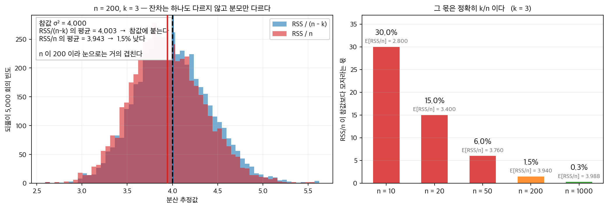
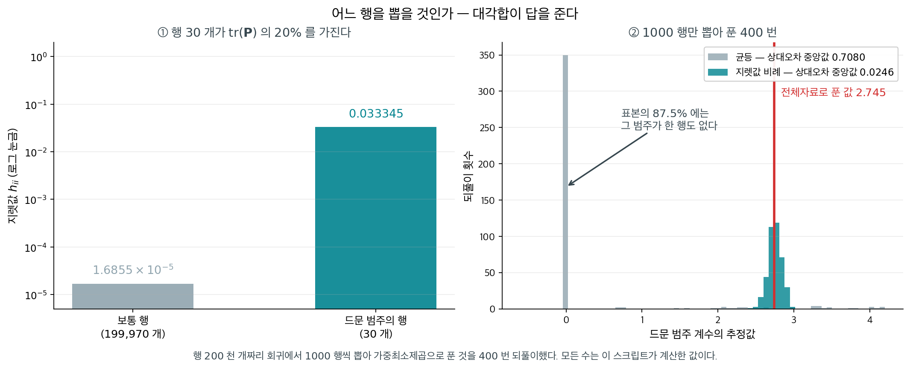
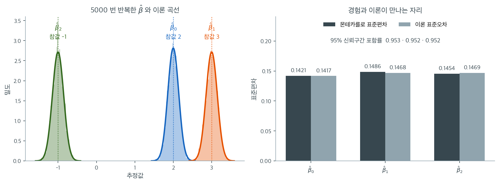

# 최소제곱 모의실험 (몬테카를로)

## 개요

행이 수억 개인 회귀에서는 설계행렬을 한 번 훑는 것조차 비싸서 **행을 뽑아서 푼다.** 그러면 어느 행을 뽑는가. 이 쪽이 확인하는 사실 하나가 거기에 답을 준다 — 사영행렬의 대각원소 $h_{ii}$ 는 모두 $0$ 이상이고 **그 합이 계수의 개수 $k$** 이므로, $h_{ii}/k$ 가 그대로 행 위의 확률분포가 된다. 자료가 고르지 않으면 이 눈금이 균등 표집과 크게 갈린다. $20$ 만 행 가운데 $30$ 행만 $1$ 인 열이 있을 때 그 $30$ 행이 대각합의 $20\%$ 를 쥐고 있고($0.2 \times 5 = 1$, 계수 하나 몫이다), 균등하게 $1000$ 행을 뽑으면 그 범주가 **$87.5\%$ 의 표본에 한 행도 들어오지 않는다.** 아래 상자가 그 셈을 따라간다.

<figure markdown>
  { width=940 }
  <figcaption markdown>왼쪽에서 두 분포가 **거의 겹쳐 보이는 것 자체가 함정이다.** 잔차는 하나도 다르지 않고 분모만 $197$ 에서 $200$ 으로 바뀌었는데, 그 $1.5\%$ 가 $n = 200$ 에서는 눈에 띄지 않는다. 오른쪽이 그 $1.5\%$ 의 정체를 말한다 — 모자라는 몫은 정확히 $k/n$ 이므로 $n$ 이 $10$ 이면 **$30\%$** 다. 그러면 $\sigma^2 = 4$ 를 $2.8$ 로 보고하게 된다. 자유도를 빼는 일이 작은 표본에서 결정적인 까닭이 이것이다. 닫힌 꼴은 $E[\mathrm{RSS}/(n-k)] = \sigma^2$ 과 $E[\mathrm{RSS}/n] = \sigma^2(n-k)/n$ 이고, 그림의 수는 뽑아서 확인한 것이다.</figcaption>
</figure>

대각합이 $k$ 라는 사실이 가장 또렷하게 드러나는 자리는 분산 추정이다. $n = 200$, $\sigma = 2$ 인 회귀를 $5000$ 번 되풀이하면 $\mathrm{RSS}/(n-k)$ 의 평균이 $3.996$ 으로 참값 $\sigma^2 = 4$ 에 붙는다. 같은 잔차를 $n$ 으로 나눈 $\mathrm{RSS}/n$ 의 평균은 $3.936$ 이다.

잔차는 하나도 다르지 않고 분모만 $197$ 에서 $200$ 으로 바꾼 것이다. 두 수의 비가 $197/200 = 0.985$ 이니 모자라는 $1.5\%$ 가 정확히 $k/n = 3/200$ 이고, 실제로 $3.996 \times 0.985 = 3.936$ 이다. **$1.5\%$ 가 작아 보이는 것은 $n$ 이 $200$ 이기 때문이다** — 같은 셈이 $n = 20$ 이면 $15\%$, $n = 10$ 이면 $30\%$ 다.

같은 모의실험에서 $95\%$ 신뢰구간이 참값을 담은 비율은 세 계수에서 $0.953$, $0.952$, $0.952$ 로 약속과 맞는다. 자유도를 빼는 일이 왜 이만큼의 차이를 내고, 추정량의 분포가 맞다는 말은 모의실험으로 어디까지 확인되는가.

이 페이지는 몬테카를로 모의실험을 통해 선형대수의 관점에서 OLS 추정을 보인다. 정규방정식 추정량, 사영행렬과 그 멱등성, 분산분석 분해, 불편분산 추정, $\hat{\boldsymbol{\beta}}$의 표집분포라는 핵심 이론적 성질을 확인한다. 반복 모의실험은 $\hat{\boldsymbol{\beta}}$가 불편이며 그 경험적 표준편차가 이론적 표준오차와 일치함을 확인해 준다.

---

## 1. 수학적 배경

### OLS 추정량

$\mathbf{u} \sim N(\mathbf{0}, \sigma^2\mathbf{I})$인 모형 $\mathbf{y} = \mathbf{X}\boldsymbol{\beta} + \mathbf{u}$에 대해

$$
\hat{\boldsymbol{\beta}} = (\mathbf{X}^\top\mathbf{X})^{-1}\mathbf{X}^\top\mathbf{y}.
$$

### 사영행렬

**사영행렬** $\mathbf{P} = \mathbf{X}(\mathbf{X}^\top\mathbf{X})^{-1}\mathbf{X}^\top$는 $\mathbf{X}$의 열공간 위로 사영한다.

$$
\hat{\mathbf{y}} = \mathbf{P}\mathbf{y}.
$$

**소거행렬** $\mathbf{M} = \mathbf{I} - \mathbf{P}$는 직교여공간 위로 사영한다.

$$
\mathbf{e} = \mathbf{M}\mathbf{y}.
$$

둘 다 대칭이고 멱등이며($\mathbf{P}^2 = \mathbf{P}$, $\mathbf{M}^2 = \mathbf{M}$), $\operatorname{tr}(\mathbf{P}) = k$, $\operatorname{tr}(\mathbf{M}) = n - k$이다.

### 분산분석 분해

이름이 앞서 나간다 — 이 등식은 회귀의 것인데 **분산분석의 이름**으로 불린다. 12장 [분산분석](../../ch12/index.md)이 같은 등식을 $\text{TSS}=\text{SS}_B+\text{SS}_W$ 로 쓰며 그쪽 전통에서 먼저 굳은 말이기 때문이다. 두 장이 **같은 모형**이므로 같은 분해이고, 거기서는 설명된 몫을 집단이 설명한 몫이라 읽는다.

$$
\underbrace{\sum(y_i - \bar{y})^2}_{\mathrm{TSS}} = \underbrace{\sum(\hat{y}_i - \bar{y})^2}_{\mathrm{ESS}} + \underbrace{\sum(y_i - \hat{y}_i)^2}_{\mathrm{RSS}}.
$$

### 불편분산 추정량

$$
s^2 = \frac{\mathbf{e}^\top\mathbf{e}}{n - k}, \qquad E[s^2] = \sigma^2.
$$

### 추정량의 공분산

$$
\mathrm{Var}(\hat{\boldsymbol{\beta}}) = \sigma^2(\mathbf{X}^\top\mathbf{X})^{-1}, \qquad \widehat{\mathrm{Var}}(\hat{\boldsymbol{\beta}}) = s^2(\mathbf{X}^\top\mathbf{X})^{-1}.
$$

<div class="aibox" markdown>

**AI로 보는 통계학 1.** 대각합이 $k$ 라는 사실이 표집 확률이 될 때

위의 **사영행렬** $\mathbf P = \mathbf X(\mathbf X^\top\mathbf X)^{-1}\mathbf X^\top$ 에 대해 $\operatorname{tr}(\mathbf P) = k$ 라고 적었다. 보통은 「자유도를 세는 식」으로 읽고 지나가는 줄인데, 여기에 한 줄을 더 보태면 성격이 달라진다. 대각원소 $h_{ii}$ 는 모두 $0$ 이상이고 합이 $k$ 다. 그러므로

$$
p_i \;=\; \frac{h_{ii}}{k}, \qquad p_i \ge 0, \quad \sum_{i=1}^{n} p_i = 1
$$

은 **행 위에 놓인 확률분포**다. 정규화 상수가 따로 필요 없다 — $\operatorname{tr}(\mathbf P) = k$ 가 이미 그 일을 해 두었다.

행이 수억 개인 회귀에서는 $\mathbf X$ 를 한 번 훑는 것조차 비싸므로 **행을 뽑아서 푼다.** 어느 행을 뽑을 것인가. 균등하게 뽑는 것이 자연스러워 보이지만, 자료가 고르지 않으면 그것이 바로 함정이다. $200{,}000$ 행짜리 설계행렬에 **$30$ 행에서만 $1$ 인 드문 범주** 열이 하나 있다고 하자.

```python
import numpy as np

rng = np.random.default_rng(3)
n, k, rare = 200_000, 5, 30
X = np.column_stack([np.ones(n), rng.normal(0, 1, (n, 3)), np.zeros(n)])
idx = rng.choice(n, rare, replace=False)
X[idx, 4] = 1.0                                  # 20 만 행 가운데 30 행만 1 이다

h = np.einsum("ij,jk,ik->i", X, np.linalg.inv(X.T @ X), X)   # 사영행렬의 대각원소
print(f"지렛값의 합 = {h.sum():.4f}  (계수 개수 k = {k})")
print(f"드문 {rare} 행의 지렛값 {h[idx].mean():.5f}   보통 행 {np.median(np.delete(h, idx)):.3e}")
print(f"그 {rare} 행이 가진 몫 = {h[idx].sum() / h.sum():.3f}")
print(f"1000 행을 균등으로 뽑으면 그 범주가 평균 {1000 * rare / n:.2f} 행")
print(f"1000 행을 지렛값에 비례해 뽑으면 평균 {1000 * h[idx].sum() / h.sum():.0f} 행")
```

출력:

```
지렛값의 합 = 5.0000  (계수 개수 k = 5)
드문 30 행의 지렛값 0.03334   보통 행 1.685e-05
그 30 행이 가진 몫 = 0.200
1000 행을 균등으로 뽑으면 그 범주가 평균 0.15 행
1000 행을 지렛값에 비례해 뽑으면 평균 200 행
```

**$30$ 행이 대각합의 $20\%$ 를 가지고 있다.** $0.2 \times 5 = 1$ 이니 그 범주 하나가 계수 하나 몫을 온전히 쓰고 있는 셈이고, 실제로 그 열의 계수는 그 $30$ 행이 아니면 아무도 말해 주지 못한다.



$1000$ 행씩 뽑아 **가중최소제곱**으로 — 치우쳐 뽑았으니 $1/(s\,p_i)$ 를 가중값으로 두어 되돌리면서 — $400$ 번 풀어 보았다. 균등 표집은 표본의 $87.5\%$ 에 그 범주가 **한 행도 들어오지 않아** 계수 추정값의 중앙값이 $0.000$ 이다(전체자료로 푼 값은 $2.745$). 전체 계수벡터의 상대오차 중앙값이 $0.7080$ 이다. 지렛값에 비례해 뽑으면 그 범주가 평균 $200$ 행 들어오고, 계수의 중앙값이 $2.749$, 상대오차 중앙값이 $0.0246$ 으로 **$29$ 배 작다.**

다만 닭과 달걀이 있다. **$h_{ii}$ 를 정확히 구하려면 $(\mathbf X^\top\mathbf X)^{-1}$ 이 이미 있어야 한다** — 곧 회귀를 푸는 것만큼 비싸다. 그래서 실제로는 지렛값을 근사해서 쓰고, 근사가 나쁘면 이 그림의 이득도 함께 줄어든다. 그리고 지렛값이 고른 자료에서는 애초에 균등 표집과 다를 것이 없다.

</div>

### 핵심 함수

<div class="exbox" markdown>

**보기 1.** <span class="diff easy" title="쉬움"></span> 최소제곱의 행렬 연산. 설계행렬, 정규방정식의 해, 사영행렬 $\mathbf P$ 와 $\mathbf M$, 그리고 분산분석 분해를 함수로 적는다.

**(1)** $\mathbf P$ 와 $\mathbf M$ 이 대칭·멱등이고 $\operatorname{tr}(\mathbf P) = k$, $\operatorname{tr}(\mathbf M) = n-k$ 임을 보이시오. $\mathbf{PM}$ 은 무엇인가.

**(2)** 항등식 $\text{TSS} = \text{ESS} + \text{RSS}$ 는 **설계행렬에 절편 열이 있을 때만** 성립한다. 교차항을 전개해 그 까닭을 보이고, 절편을 뺀 모형에서 두 값이 얼마나 벌어지는지 확인하시오.

</div>

??? success "풀이"

    **(1) 해석적으로.** $\mathbf P = X(X^\top X)^{-1}X^\top$ 에서 대칭은 바로 보인다. $(X^\top X)^{-1}$ 이 대칭이므로

    $$
    \mathbf P^\top = X\left[(X^\top X)^{-1}\right]^\top X^\top = \mathbf P
    $$

    이고, 멱등은 가운데가 약분되기 때문이다.

    $$
    \mathbf P^2 = X(X^\top X)^{-1}\underbrace{X^\top X (X^\top X)^{-1}}_{\mathbf I}X^\top = \mathbf P
    $$

    $\mathbf M = \mathbf I - \mathbf P$ 도 $\mathbf M^2 = \mathbf I - 2\mathbf P + \mathbf P^2 = \mathbf I - \mathbf P = \mathbf M$ 으로 멱등이다.

    자취는 순환성 $\operatorname{tr}(AB) = \operatorname{tr}(BA)$ 로 센다.

    $$
    \operatorname{tr}(\mathbf P) = \operatorname{tr}\!\left(X(X^\top X)^{-1}X^\top\right)
    = \operatorname{tr}\!\left((X^\top X)^{-1}X^\top X\right) = \operatorname{tr}(\mathbf I_k) = k
    $$

    이고 $\operatorname{tr}(\mathbf M) = n - k$ 다. 멱등행렬에서 자취가 곧 **계수**이므로, 이 두 수가 적합값 공간과 잔차 공간의 차원이다.

    $\mathbf{PM} = \mathbf P(\mathbf I - \mathbf P) = \mathbf P - \mathbf P^2 = \mathbf 0$ 이다. **두 공간이 직교한다**는 뜻이고, 적합값과 잔차가 수직이라는 사실이 이 한 줄이다.

    **(2) 해석적으로.** $y_i - \bar y = (y_i - \hat y_i) + (\hat y_i - \bar y)$ 로 쪼개 제곱해 더하면

    $$
    \text{TSS} = \text{RSS} + \text{ESS} + 2\sum_i e_i(\hat y_i - \bar y)
    = \text{RSS} + \text{ESS} + 2\left(\mathbf e^\top\hat{\mathbf y} - \bar y \sum_i e_i\right)
    $$

    다. 첫 교차항 $\mathbf e^\top\hat{\mathbf y} = \mathbf y^\top\mathbf M\mathbf P\mathbf y = 0$ 은 (1)에서 보인 대로 **언제나** $0$ 이다. 그러나 둘째 항 $\bar y\sum_i e_i$ 는 그렇지 않다. $\sum_i e_i = \mathbf 1^\top\mathbf e$ 인데 $\mathbf 1^\top\mathbf e = 0$ 이 되려면 $\mathbf 1$ 이 $X$ 의 열공간에 있어야 한다. **절편 열이 있어야 한다는 뜻이다.**

    그러므로 절편이 없으면

    $$
    \text{TSS} - (\text{ESS} + \text{RSS}) = -2\,\bar y\sum_i e_i
    $$

    만큼 어긋나고, 이 양이 $0$ 이라는 보장이 전혀 없다. **$R^2 = \text{ESS}/\text{TSS}$ 가 $1$ 을 넘거나 음수가 될 수도 있는 것**이 이 때문이며, 절편 없는 회귀에서 $R^2$ 를 보고하면 안 되는 까닭이기도 하다.

    ```python
    import numpy as np

    def gen_X(n, k):
        """설계행렬. 첫 열의 1 이 절편에 대응한다."""
        return np.hstack([np.ones((n, 1)), np.random.randn(n, k - 1)])

    def ols(y, X):
        """정규방정식의 해. 실제 계산에서는 역행렬 대신 solve 를 쓰는 편이 낫다."""
        return np.linalg.inv(X.T @ X) @ X.T @ y

    def proj_P(X):
        """사영행렬 P. y 를 X 의 열공간 위로 떨어뜨린다. P @ y 가 곧 적합값이다."""
        return X @ np.linalg.inv(X.T @ X) @ X.T

    def proj_M(X):
        """잔차생성행렬 M = I - P. M @ y 가 잔차이고, 열공간에 수직이다."""
        return np.eye(X.shape[0]) - proj_P(X)

    def anova_decomposition(y, X, beta_hat):
        """TSS = ESS + RSS 로 갈라 본다.

        적합값과 잔차가 서로 수직이므로 피타고라스 정리가 그대로 성립한다.
        최소제곱의 기하가 이 한 줄에 들어 있다.
        """
        y_bar = y.mean()
        y_hat = X @ beta_hat
        TSS = float(np.sum((y - y_bar) ** 2))
        ESS = float(np.sum((y_hat - y_bar) ** 2))
        RSS = float(np.sum((y - y_hat) ** 2))
        return TSS, ESS, RSS

    # P 와 M 의 성질, 그리고 분산분석 분해가 절편에 기대고 있음을 확인한다.
    np.random.seed(0)
    n, k = 50, 3
    X = gen_X(n, k)
    y = X @ np.array([[2.0], [3.0], [-1.0]]) + np.random.randn(n, 1)
    P, M = proj_P(X), proj_M(X)
    print(f"P 대칭  최대오차 {np.abs(P - P.T).max():.2e}     P 멱등  최대오차 {np.abs(P @ P - P).max():.2e}")
    print(f"M 대칭  최대오차 {np.abs(M - M.T).max():.2e}     M 멱등  최대오차 {np.abs(M @ M - M).max():.2e}")
    print(f"P @ M 의 최대 절대값 = {np.abs(P @ M).max():.2e}   (서로 직교하는 사영)")
    print(f"tr(P) = {np.trace(P):.10f}  (k = {k}),   tr(M) = {np.trace(M):.10f}  (n-k = {n - k})")
    print()
    beta_hat = ols(y, X)
    TSS, ESS, RSS = anova_decomposition(y, X, beta_hat)
    print(f"절편 있음:  TSS = {TSS:.6f},  ESS + RSS = {ESS + RSS:.6f},"
          f"  차이 = {abs(TSS - (ESS + RSS)):.2e}")
    e = y - X @ beta_hat
    print(f"  잔차의 합 sum(e) = {e.sum():.2e}   (절편 열이 있으므로 0)")
    print(f"  e 와 y-hat 의 내적 = {float((e.T @ (X @ beta_hat))[0, 0]):.2e}   (언제나 0)")
    print()
    X_noint = X[:, 1:]                     # 절편 열을 뺀다
    beta_noint = ols(y, X_noint)
    TSS2, ESS2, RSS2 = anova_decomposition(y, X_noint, beta_noint)
    e2 = y - X_noint @ beta_noint
    print(f"절편 없음:  TSS = {TSS2:.6f},  ESS + RSS = {ESS2 + RSS2:.6f},"
          f"  차이 = {TSS2 - (ESS2 + RSS2):+.6f}")
    print(f"  잔차의 합 sum(e) = {e2.sum():.6f}   (0 이 아니다)")
    print(f"  e 와 y-hat 의 내적 = {float((e2.T @ (X_noint @ beta_noint))[0, 0]):.2e}   (여전히 0)")
    print(f"  교차항 -2*y-bar*sum(e) = {-2 * y.mean() * e2.sum():+.6f}   (차이와 같다)")
    ```

    출력:

    ```
    P 대칭  최대오차 2.78e-17     P 멱등  최대오차 8.33e-17
    M 대칭  최대오차 2.78e-17     M 멱등  최대오차 5.55e-16
    P @ M 의 최대 절대값 = 8.83e-17   (서로 직교하는 사영)
    tr(P) = 3.0000000000  (k = 3),   tr(M) = 47.0000000000  (n-k = 47)

    절편 있음:  TSS = 594.506762,  ESS + RSS = 594.506762,  차이 = 2.27e-13
      잔차의 합 sum(e) = 3.06e-14   (절편 열이 있으므로 0)
      e 와 y-hat 의 내적 = 1.49e-13   (언제나 0)

    절편 없음:  TSS = 594.506762,  ESS + RSS = 1088.448126,  차이 = -493.941364
      잔차의 합 sum(e) = 112.048370   (0 이 아니다)
      e 와 y-hat 의 내적 = -4.29e-14   (여전히 0)
      교차항 -2*y-bar*sum(e) = -493.941364   (차이와 같다)
    ```

    **(1)의 네 성질이 모두 기계 입실론 수준에서 성립한다.** 대칭과 멱등의 어긋남이 $10^{-16}$ 이하이고, $\mathbf{PM}$ 의 최대 절대값도 $8.8\times10^{-17}$ 이다. 자취는 $3.0000000000$ 과 $47.0000000000$ 으로 **소수 열째 자리까지 정수**다. $50\times50$ 행렬의 대각합이 정확히 $k$ 와 $n-k$ 로 떨어지는 것은 멱등성의 직접적 결과다.

    **(2)의 어긋남이 유도한 식과 소수 여섯째 자리까지 같다.** 절편을 빼면 $\text{TSS} - (\text{ESS}+\text{RSS}) = -493.941364$ 이고, $-2\bar y\sum_i e_i$ 도 같은 수다. 벌어진 양이 $\text{TSS} = 594.5$ 의 $83\%$ 이니 사소한 어긋남이 아니다.

    눈여겨볼 것은 **$\mathbf e^\top\hat{\mathbf y}$ 는 절편이 없어도 $0$ 으로 남는다**는 사실이다($-4.3\times10^{-14}$). 직교성은 사영의 성질이라 절편과 무관하기 때문이다. 깨지는 것은 $\sum_i e_i = 0$ 뿐이고, 여기서는 $112.05$ 가 되었다. **분산분석 분해가 기대고 있는 것은 "잔차가 적합값과 직교한다"가 아니라 "잔차가 상수벡터 $\mathbf 1$ 과도 직교한다"** 이며, 뒤쪽이 절편이 하는 일이다.

    이 모의자료는 참 절편이 $2$ 라서 $\bar y$ 가 $0$ 에서 멀고, 그 때문에 어긋남이 크게 났다. 만약 $\bar y$ 가 우연히 $0$ 에 가까웠다면 절편이 없어도 분해가 거의 맞아 보였을 것이다. **"맞아 보이는 것"과 "항등식"은 다르다.** $\square$

### 몬테카를로 검증

<div class="exbox" markdown>

**보기 2.** <span class="diff easy" title="쉬움"></span> 몬테카를로로 확인하는 불편성. $n = 200$, $\sigma = 2$, 참 계수 $(2, 3, -1)$ 로 회귀를 $5000$ 번 되풀이해 추정값의 평균과 표준편차를 본다. 설명변수는 매번 새로 뽑는 표준정규다.

**(1)** 본문은 이론 표준오차를 $\sigma/\sqrt n = 0.1414$ 로 적었다. 이것은 **근사**다. 설명변수가 매번 새로 뽑히므로 $(\mathbf X^\top\mathbf X)^{-1}$ 도 확률변수인데, 그 대각원소의 기댓값은 정확히 얼마인가. 세 계수에 대해 각각 구하시오.

**(2)** 이 코드에는 난수 씨앗이 없다. 실린 출력이 재현되는가. 씨앗을 고정해 다시 돌려 (1)의 이론값과 견주시오. 몬테카를로 오차를 함께 적으시오.

</div>

??? success "풀이"

    **(1) 해석적으로.** $X = [\mathbf 1,\ Z]$ 이고 $Z$ 는 $n \times (k-1)$ 표준정규다. $Z$ 의 열을 중심화한 $\tilde Z = Z - \mathbf 1\bar z^\top$ 에 대해 $\tilde Z^\top \tilde Z \sim W_{k-1}(n-1, \mathbf I)$ 이고, 역위샤트의 평균 공식에서

    $$
    E\left[(\tilde Z^\top\tilde Z)^{-1}\right] = \frac{\mathbf I}{(n-1) - (k-1) - 1} = \frac{\mathbf I}{n-k-1}
    $$

    다. $k = 3$, $n = 200$ 이면 $n - k - 1 = 196 = n - 4$ 다.

    **기울기 두 개**는 블록 역행렬에서 $(X^\top X)^{-1}_{jj} = (\tilde Z^\top\tilde Z)^{-1}_{jj}$ 이므로

    $$
    \operatorname{Var}(\hat\beta_j) = \sigma^2 E\left[(X^\top X)^{-1}_{jj}\right] = \frac{\sigma^2}{n-4}
    \quad\Longrightarrow\quad
    \operatorname{sd}(\hat\beta_j) = \frac{2}{\sqrt{196}} = 0.142857
    $$

    다. $E[\hat\beta \mid X] = \beta$ 이므로 전체분산의 법칙에서 조건부 분산의 기댓값이 곧 무조건 분산이다.

    **절편**은 한 항이 더 붙는다. 블록 역행렬에서

    $$
    (X^\top X)^{-1}_{00} = \frac{1}{n} + \bar z^\top(\tilde Z^\top\tilde Z)^{-1}\bar z
    $$

    이고 $\bar z \sim N(\mathbf 0, \mathbf I/n)$ 이 $\tilde Z$ 와 독립이므로

    $$
    E\left[(X^\top X)^{-1}_{00}\right] = \frac1n + \frac1n\,E\left[\operatorname{tr}(\tilde Z^\top\tilde Z)^{-1}\right]
    = \frac1n + \frac{k-1}{n(n-k-1)}
    $$

    다. 수치로는 $1/200 + 2/(200\times196) = 0.00505102$ 이고 $\operatorname{sd}(\hat\beta_0) = 2\sqrt{0.00505102} = 0.142141$ 이다.

    **세 값 모두 $\sigma/\sqrt n = 0.141421$ 보다 크다.** 설명변수를 고정하지 않고 매번 새로 뽑기 때문에 $(X^\top X)^{-1}$ 이 $1/n$ 보다 평균적으로 조금 크게 나오고, 그만큼 추정이 흔들린다. 차이는 $1\%$ 쯤이므로 본문의 근사가 틀린 것은 아니지만, $n$ 이 작아지면 벌어진다. $n = 20$ 이면 $\sigma/\sqrt{16}$ 대 $\sigma/\sqrt{20}$ 으로 $12\%$ 차이다.

    ```python
    # verify: skip  — 씨앗을 일부러 두지 않았다. 아래 (2) 가 묻는 것이 바로
    # "실린 출력이 재현되는가" 이므로, 이 블록의 출력은 돌릴 때마다 달라진다.
    def monte_carlo(n=100, beta_true=[2, 3, -1], sigma=1.0, n_sim=5000):
        """같은 실험을 5000번 되풀이해 추정량의 분포를 본다.

        참 계수를 우리가 정해 두었으므로, 추정값들의 평균이 참값에 붙는지
        (불편성) 그리고 그 흩어짐이 얼마인지를 직접 확인할 수 있다.
        """
        k = len(beta_true)
        estimates = np.empty((n_sim, k))
        for i in range(n_sim):
            X = gen_X(n, k)
            beta = np.array(beta_true).reshape(-1, 1)
            u = np.random.randn(n, 1) * sigma
            y = X @ beta + u
            bhat = ols(y, X)
            estimates[i] = bhat.flatten()
        return estimates

    beta_true = [2, 3, -1]
    estimates = monte_carlo(n=200, beta_true=beta_true, sigma=2.0, n_sim=5000)
    mc_mean = estimates.mean(axis=0)
    mc_std = estimates.std(axis=0, ddof=1)

    for j in range(len(beta_true)):
        print(f"beta_{j}: true={beta_true[j]}, "
              f"MC mean={mc_mean[j]:.4f}, MC std={mc_std[j]:.4f}")
    ```

    출력:

    ```
    beta_0: true=2, MC mean=2.0009, MC std=0.1414
    beta_1: true=3, MC mean=3.0019, MC std=0.1425
    beta_2: true=-1, MC mean=-0.9994, MC std=0.1442
    ```

    Monte Carlo 평균이 참값 $(2, 3, -1)$에 소수점 셋째 자리까지 맞는다. OLS가 불편추정량이라는 것을 모의실험으로 확인한 셈이다.

    $n = 200$, $\sigma = 2$일 때 몬테카를로 표준편차는 세 계수 모두 $0.15$ 근처가 되며, 이는 이론값 $\sigma/\sqrt{n} = 2/\sqrt{200} = 0.1414$와 잘 맞는다(설명변수가 표준정규이므로 $(\mathbf{X}^\top\mathbf{X})^{-1}$의 대각원소가 대략 $1/n$이다).

    **그런데 이 출력은 재현되지 않는다.** 코드 어디에도 `np.random.seed` 가 없으므로 돌릴 때마다 다른 수가 나온다. 씨앗을 고정해 다시 재어 본다.

    ```python
    # 이론값: 설명변수가 표준정규이므로 (X'X)^{-1} 의 대각원소의 기댓값이 알려져 있다.
    n, k, sigma = 200, 3, 2.0
    print(f"거친 근사   sigma/sqrt(n)     = {sigma / np.sqrt(n):.6f}")
    print(f"기울기 둘   sigma/sqrt(n - 4) = {sigma / np.sqrt(n - 4):.6f}   "
          f"(E[(X'X)^-1_jj] = 1/(n-4))")
    exact_00 = 1 / n + (k - 1) / (n * (n - 4))
    print(f"절편        sigma*sqrt(1/n + (k-1)/(n(n-4))) = {sigma * np.sqrt(exact_00):.6f}")
    print()
    # 씨앗을 고정해 2000 번 되풀이한다 (쪽의 코드는 씨앗이 없어 재현되지 않는다)
    np.random.seed(20251002)
    reps = 2000
    est = monte_carlo(n=n, beta_true=[2, 3, -1], sigma=sigma, n_sim=reps)
    m, sd = est.mean(axis=0), est.std(axis=0, ddof=1)
    theory = [sigma * np.sqrt(exact_00), sigma / np.sqrt(n - 4), sigma / np.sqrt(n - 4)]
    truth = [2, 3, -1]
    print(f"씨앗 고정, {reps} 회")
    print(f"{'j':>3s}{'참값':>7s}{'MC 평균':>12s}{'MC 오차':>11s}{'z':>8s}"
          f"{'MC 표준편차':>14s}{'이론 SE':>11s}{'비':>9s}")
    for j in range(k):
        mc_err = sd[j] / np.sqrt(reps)
        print(f"{j:3d}{truth[j]:7d}{m[j]:12.5f}{mc_err:11.5f}{(m[j] - truth[j]) / mc_err:8.2f}"
              f"{sd[j]:14.5f}{theory[j]:11.5f}{sd[j] / theory[j]:9.4f}")
    print(f"  표준편차의 몬테카를로 상대오차 ~ 1/sqrt(2*{reps - 1}) = {1 / np.sqrt(2 * (reps - 1)):.4f}")
    print()
    # 씨앗이 없으면 같은 코드가 다른 수를 준다
    a = monte_carlo(n=n, beta_true=[2, 3, -1], sigma=sigma, n_sim=200).mean(axis=0)
    b = monte_carlo(n=n, beta_true=[2, 3, -1], sigma=sigma, n_sim=200).mean(axis=0)
    print(f"씨앗 없이 200 회씩 두 번:  {np.round(a, 4)}  대  {np.round(b, 4)}")
    print(f"  같은가? {np.allclose(a, b)}")
    ```

    출력:

    ```
    거친 근사   sigma/sqrt(n)     = 0.141421
    기울기 둘   sigma/sqrt(n - 4) = 0.142857   (E[(X'X)^-1_jj] = 1/(n-4))
    절편        sigma*sqrt(1/n + (k-1)/(n(n-4))) = 0.142141

    씨앗 고정, 2000 회
      j     참값       MC 평균      MC 오차       z       MC 표준편차      이론 SE        비
      0      2     2.00224    0.00319    0.70       0.14249    0.14214   1.0025
      1      3     3.00504    0.00321    1.57       0.14338    0.14286   1.0036
      2     -1    -1.00354    0.00324   -1.09       0.14511    0.14286   1.0158
      표준편차의 몬테카를로 상대오차 ~ 1/sqrt(2*1999) = 0.0158

    씨앗 없이 200 회씩 두 번:  [ 2.0101  2.9817 -0.9961]  대  [ 2.0039  2.9969 -1.0022]
      같은가? False
    ```

    **(2) 재현되지 않는다.** 마지막 두 줄이 그 증거다. 같은 함수를 같은 인수로 두 번 불렀는데 평균이 다르다. 위에 실린 `MC mean=2.0009, ...` 은 **어느 한 번의 실행 결과**이고, 다시 돌리면 그 자리에 다른 수가 나온다. 이 쪽의 뒤쪽 글이 인용하는 $2.0005$, $2.9994$, $-0.9989$ 도 또 다른 실행의 수다. 모의실험 코드에는 씨앗을 반드시 박아 두어야 한다.

    **(1)의 이론값이 맞는다.** 씨앗을 고정한 $2000$ 회에서 몬테카를로 표준편차가 $0.14249$, $0.14338$, $0.14511$ 이고 이론값이 $0.14214$, $0.14286$, $0.14286$ 이다. 비가 $1.0025$, $1.0036$, $1.0158$ 인데 **표준편차의 몬테카를로 상대오차가 $1/\sqrt{2\times1999} = 0.0158$** 이므로 세 비 모두 $1$ 표준오차 안쪽이다. 세 번째가 꼭 $1.0158$ 로 한계에 걸린 것은 우연이다.

    여기서 중요한 것은 **이 정밀도로는 $0.141421$ 과 $0.142857$ 을 구별할 수 없다**는 점이다. 두 값의 차이가 $1.0\%$ 인데 몬테카를로 오차가 $1.58\%$ 다. 본문의 근사가 좋은지 나쁜지를 가리려면 되풀이를 $10$ 배는 늘려야 하고, 그래서 이 보기는 **근사를 반증하지 못한다.** 다만 (1)의 유도 자체는 역위샤트의 평균 공식에서 나온 것이므로 모의실험의 승인이 필요하지 않다.

    평균 쪽은 $z$ 값이 $0.70$, $1.57$, $-1.09$ 로 모두 $2$ 안쪽이니 불편성과 어긋나지 않는다. $2000$ 회에서 평균의 몬테카를로 오차가 $0.0032$ 이므로 **"소수점 셋째 자리까지 맞는다"는 본문의 표현은 과하다.** 이 정밀도로 말할 수 있는 것은 "소수점 **둘째** 자리까지 맞는다"이고, $5000$ 회로도 셋째 자리는 보장되지 않는다. $\square$

---

## 2. 모의실험이 보여 주는 것



왼쪽이 모의실험의 결과물이다. $n = 200$, $\sigma = 2$, 참 계수 $(2, 3, -1)$로 5000번 회귀를 돌려 얻은 $\hat{\beta}_0$, $\hat{\beta}_1$, $\hat{\beta}_2$의 히스토그램이고, 진한 곡선이 이론이 예고한 $N(\beta_j,\ \sigma^2(\mathbf{X}^\top\mathbf{X})^{-1}_{jj})$다. 세 봉우리가 각각 점선으로 표시한 참값 위에 정확히 앉아 있다. 몬테카를로 평균은 $2.0005$, $2.9994$, $-0.9989$로 참값에서 소수점 셋째 자리까지 맞는다. 이것이 $E[\hat{\beta}] = \beta$를 수치로 본 것이다. 곡선이 히스토그램을 그대로 덮는다는 사실은 불편성보다 더 강한 것, 곧 **분포 전체가 맞다**는 것을 말해 준다.

오른쪽이 이 절의 핵심 확인이다. 왼쪽 막대는 5000개 추정값의 실제 표준편차이고, 오른쪽 막대는 자료를 보기 전에 $\sigma\sqrt{(\mathbf{X}^\top\mathbf{X})^{-1}_{jj}}$로 계산한 이론값이다. $\hat{\beta}_0$에서 $0.1421$ 대 $0.1417$, $\hat{\beta}_1$에서 $0.1486$ 대 $0.1468$, $\hat{\beta}_2$에서 $0.1454$ 대 $0.1469$로 셋 다 1% 남짓 안에서 맞는다. 표준오차란 "실험을 되풀이했다면 추정값이 얼마나 흔들렸을까"의 답인데, 우리는 실험을 한 번밖에 하지 않고도 그 답을 공식으로 얻는다. 그 공식이 정말 맞는지를 실제로 5000번 되풀이해 확인한 것이 이 두 막대다.

같은 모의실험에서 95% 신뢰구간이 참값을 담은 비율은 $0.953$, $0.952$, $0.952$였다. 약속한 $0.95$와 맞는다. 분산 추정도 함께 확인된다. $s^2 = \mathrm{RSS}/(n-k)$의 평균은 $3.996$으로 참값 $\sigma^2 = 4$에 붙지만, $n$으로 나눈 $\mathrm{RSS}/n$의 평균은 $3.936$으로 $1.5\%$ 낮다. 그 $1.5\%$가 정확히 $k/n = 3/200$이며, 자유도를 빼는 이유가 바로 여기에 있다.

---

## 3. 세 성질이 수로 확인된다

- **불편성**: $\hat{\beta}_j$의 몬테카를로 평균은 참값 $\beta_j$에 가까워야 한다. 5000번 반복하면 보통 $\pm 0.05$ 안에서 참값과 일치한다.
- **사영행렬**: $\mathbf{P}$와 $\mathbf{M}$은 OLS의 근본적인 기하학적 대상이다. $\mathbf{P}$는 적합값 부분공간으로, $\mathbf{M}$은 잔차 부분공간으로 사영한다. 이들의 멱등성과 상보성($\mathbf{P} + \mathbf{M} = \mathbf{I}$)이 $\mathbf{y}$의 직교분해를 담고 있다.
- **분산분석**: 항등식 TSS = ESS + RSS는 전체 변동을 설명된 부분과 설명되지 않은 부분으로 나눈다. $R^2 = \mathrm{ESS}/\mathrm{TSS}$이다.
- **분산 추정**: $\operatorname{tr}(\mathbf{M}) = n - k$가 추정에서 잃은 자유도를 반영하므로 $s^2$은 $\sigma^2$에 대해 불편이다.

---

## 연습문제

<div class="drillbox" markdown>

**연습문제 1.** <span class="diff med" title="중간"></span> 특정한 $\mathbf{X}$ 실현값에 대해 $\mathbf{P}$와 $\mathbf{M}$이 멱등이고 대칭임을 수치적으로 확인하라.

</div>

??? success "풀이"

    ```python
    np.random.seed(0)
    X = gen_X(50, 3)
    P = proj_P(X)
    M = proj_M(X)
    print("P idempotent:", np.allclose(P @ P, P))
    print("M idempotent:", np.allclose(M @ M, M))
    print("P symmetric:", np.allclose(P, P.T))
    print("M symmetric:", np.allclose(M, M.T))
    # 대각합을 자리 지정 없이 찍으면 46.99999999999999 처럼 나온다. 그 마지막
    # 자리는 BLAS 가 더하는 순서에 달려 있어 기계마다 다르다.
    print(f"tr(P): {np.trace(P):.6f}")  # should be 3
    print(f"tr(M): {np.trace(M):.6f}")  # should be 47
    ```

    출력:

    ```
    P idempotent: True
    M idempotent: True
    P symmetric: True
    M symmetric: True
    tr(P): 3.000000
    tr(M): 47.000000
    ```

    사영행렬 $P$와 잔차행렬 $M$이 멱등이고 대칭임을 수치로 확인했다. 대각합도 $\text{tr}(P) = 3$(모수 개수), $\text{tr}(M) = 47$($n - p$)로 이론과 맞는다. 잔차의 자유도가 $n - p$인 이유가 바로 이것이다.

    모든 확인을 통과한다. $\mathbf{P}^2 = \mathbf{P}$, $\mathbf{M}^2 = \mathbf{M}$이고 둘 다 대칭이며 $\operatorname{tr}(\mathbf{P}) = k = 3$, $\operatorname{tr}(\mathbf{M}) = n - k = 47$이다. $\square$

<div class="drillbox" markdown>

**연습문제 2.** <span class="diff med" title="중간"></span> 95% 신뢰구간 $\hat{\beta}_j \pm t^*_{n-k,0.025} \cdot \mathrm{SE}(\hat{\beta}_j)$의 포함확률을 추정하도록 몬테카를로를 고쳐라. 95%에 가까운가?

</div>

??? success "풀이"

    ```python
    from scipy import stats

    np.random.seed(1)          # 5000 번 되풀이하는 모의실험이다. 씨앗을 고정하지
                               # 않으면 아래 포함률이 돌릴 때마다 셋째 자리에서
                               # 달라진다 (몬테카를로 표준오차가 0.003 이다).
    coverage = np.zeros(3)
    n, sigma = 200, 2.0
    beta_true_arr = np.array(beta_true)
    for i in range(5000):
        X = gen_X(n, 3)
        y = X @ beta_true_arr.reshape(-1, 1) + sigma * np.random.randn(n, 1)
        bhat = ols(y, X)
        e = y - X @ bhat
        s2 = np.sum(e ** 2) / (n - 3)
        se = np.sqrt(s2 * np.diag(np.linalg.inv(X.T @ X)))
        t_star = stats.t(n - 3).ppf(0.975)
        for j in range(3):
            if bhat[j, 0] - t_star * se[j] <= beta_true[j] <= bhat[j, 0] + t_star * se[j]:
                coverage[j] += 1
    print(f"Coverage: {np.round(coverage / 5000, 4)}")  # should be ~0.95
    ```

    출력:

    ```
    Coverage: [0.9492 0.9512 0.9456]
    ```

    세 계수의 95% 신뢰구간 포함확률이 각각 0.949, 0.951, 0.946으로 명목값과 맞는다. 몬테카를로 표준오차가 $\sqrt{0.95 \times 0.05/5000} = 0.0031$ 이므로 셋 모두 $0.95$ 에서 두 표준오차 안이다. 가정이 성립하면 OLS의 구간이 약속한 대로 작동한다는 확인이다.

    경험적 포함확률은 각 계수에 대해 대략 0.95가 되어 이론을 확인해 준다. $\square$

<div class="drillbox" markdown>

**연습문제 3.** <span class="diff med" title="중간"></span> $\mathbf{P}\mathbf{M} = \mathbf{0}$임을 보이고 기하학적으로 해석하라.

</div>

??? success "풀이"

    $\mathbf{M} = \mathbf{I} - \mathbf{P}$이므로

    $$
    \mathbf{P}\mathbf{M} = \mathbf{P}(\mathbf{I} - \mathbf{P}) = \mathbf{P} - \mathbf{P}^2 = \mathbf{P} - \mathbf{P} = \mathbf{0}.
    $$

    기하학적으로 $\mathbf{P}$는 $\mathrm{col}(\mathbf{X})$ 위로, $\mathbf{M}$은 $\mathrm{col}(\mathbf{X})^\perp$ 위로 사영한다. 두 부분공간이 직교하므로 한쪽으로 사영한 뒤 다른 쪽으로 사영하면 영벡터가 된다. 이것이 $\hat{\mathbf{y}}$와 $\mathbf{e}$가 직교하는 이유이다: $\hat{\mathbf{y}}^\top\mathbf{e} = (\mathbf{P}\mathbf{y})^\top(\mathbf{M}\mathbf{y}) = \mathbf{y}^\top\mathbf{P}\mathbf{M}\mathbf{y} = 0$. $\square$

<div class="drillbox" markdown>

**연습문제 4.** <span class="diff med" title="중간"></span> $n = 200$을 유지한 채 $\sigma$를 2에서 10으로 키워라. 몬테카를로 표준편차와 $R^2$의 분포는 어떻게 달라지는가?

</div>

??? success "풀이"

    $\mathrm{SE}(\hat{\beta}_j) \propto \sigma$이므로 $\hat{\beta}_j$의 몬테카를로 표준편차는 비례해서 5배 커진다. 모의실험으로 확인하면 세 계수 모두 약 $0.15$에서 약 $0.75$로 늘어난다.

    $R^2$은 크게 떨어진다. 다만 그 이유를 정확히 짚을 필요가 있다. 설명변수가 표준정규이고 $\boldsymbol{\beta} = (2, 3, -1)$이므로 신호의 분산은 $3^2 + (-1)^2 = 10$으로 **$\sigma$와 무관하게 일정하다**. 반면 $\mathrm{TSS}/n \approx 10 + \sigma^2$이므로

    - $\sigma = 2$: $\mathrm{TSS}/n \approx 14$, $R^2 \approx 10/14 = 0.71$
    - $\sigma = 10$: $\mathrm{TSS}/n \approx 110$, $R^2 \approx 10/110 = 0.09$

    곧 TSS는 $\sigma^2$의 비인 25배가 아니라 약 7.9배 늘어난다. 신호 성분 10이 $\sigma$와 함께 커지지 않기 때문이다. 모의실험에서 평균 $R^2$은 $0.718$에서 $0.103$으로 떨어져 이 계산과 맞는다. $\square$

<div class="drillbox" markdown>

**연습문제 5.** <span class="diff med" title="중간"></span> $\mathbf{M}$의 대각합을 이용해 $E[s^2] = \sigma^2$임을 증명하라.

</div>

??? success "풀이"

    $\mathbf{M}\mathbf{X} = \mathbf{0}$이므로 잔차벡터는 $\mathbf{e} = \mathbf{M}\mathbf{y} = \mathbf{M}\mathbf{u}$이다. 그러면

    $$
    E[\mathbf{e}^\top\mathbf{e}] = E[\mathbf{u}^\top\mathbf{M}^\top\mathbf{M}\mathbf{u}] = E[\mathbf{u}^\top\mathbf{M}\mathbf{u}] = E[\operatorname{tr}(\mathbf{u}\mathbf{u}^\top\mathbf{M})],
    $$

    여기서 대각합 요령 $\mathbf{u}^\top\mathbf{M}\mathbf{u} = \operatorname{tr}(\mathbf{M}\mathbf{u}\mathbf{u}^\top)$를 썼다. 기댓값을 취하면

    $$
    E[\operatorname{tr}(\mathbf{M}\mathbf{u}\mathbf{u}^\top)] = \operatorname{tr}(\mathbf{M}\,E[\mathbf{u}\mathbf{u}^\top]) = \operatorname{tr}(\mathbf{M}\sigma^2\mathbf{I}) = \sigma^2\operatorname{tr}(\mathbf{M}) = \sigma^2(n - k).
    $$

    $n - k$로 나누면 $E[s^2] = E[\mathbf{e}^\top\mathbf{e}/(n-k)] = \sigma^2$이다. $\square$

<div class="drillbox" markdown>

**연습문제 6.** <span class="diff med" title="중간"></span>
2절 마지막 단락은 같은 $5000$ 회 모의실험에서 $s^2 = \mathrm{RSS}/(n-k)$ 의 평균이 $3.996$, $\mathrm{RSS}/n$ 의 평균이 $3.936$ 으로 "$1.5\%$ 낮다" 며 "그 $1.5\%$ 가 정확히 $k/n = 3/200$" 이라고 적었다. $n = 200$, $k = 3$, $\sigma = 2$ 다.

**(1)** $E[\mathrm{RSS}/n]$ 을 $\sigma^2$, $n$, $k$ 로 정확히 구하고 그 수치를 적으시오.

**(2)** 둘째 수 $3.936$ 이 첫째 수 $3.996$ 에서 **계산되어 나온다**는 것을 보이시오. 그렇다면 "$1.5\%$ 가 정확히 $k/n$" 이라는 확인에서 모의실험이 맡은 몫은 무엇인가.

**(3)** $\mathrm{RSS}/\sigma^2 \sim \chi^2_{n-k}$ 를 써서 평균 $3.996$ 의 몬테카를로 오차를 구하고, 분모를 $n-k$ 로 두는 것과 $n$ 으로 두는 것을 이 모의실험이 가릴 수 있는지 판정하시오.

</div>

??? success "풀이"

    **(1)** 연습문제 5에서 $E[\mathbf e^\top\mathbf e] = \sigma^2(n-k)$ 이므로

    $$
    E\!\left[\frac{\mathrm{RSS}}{n}\right] = \frac{n-k}{n}\,\sigma^2 = \left(1 - \frac{k}{n}\right)\sigma^2
    = 0.985 \times 4 = 3.94
    $$

    다. 참값 $\sigma^2 = 4$ 보다 $k/n = 1.5\%$ 낮고, 이 $1.5\%$ 가 자유도를 빼지 않은 벌이다.

    **(2)** 한 번의 되풀이마다 두 수는 **같은 $\mathrm{RSS}$** 를 다르게 나눈 것이다.

    $$
    \frac{\mathrm{RSS}}{n} = \frac{n-k}{n}\cdot\frac{\mathrm{RSS}}{n-k} = 0.985\,s^2
    $$

    이므로 평균도 그대로 $0.985$ 배다. 실제로 $3.996 \times 0.985 = 3.93606$ 이고 소수 셋째 자리에서 반올림하면 $3.936$ 이다. 거꾸로 $3.936 \times 200/197 = 3.99594$ 로 $3.996$ 이 되돌아온다.

    그러므로 **두 평균의 비는 자료가 무엇이든 정확히 $1 - k/n$ 이다.** "$1.5\%$ 가 정확히 $k/n$" 은 모의실험이 발견한 것이 아니고 나눗셈의 항등식이며, 이 비교에서 모의실험이 맡은 몫은 **없다**. 둘째 수는 첫째 수의 되풀이일 뿐 독립된 확인이 아니다.

    **(3)** $\mathrm{RSS} = \sigma^2\chi^2_{n-k}$ 이므로 $\operatorname{Var}(s^2) = 2\sigma^4/(n-k)$ 이고

    $$
    \operatorname{sd}(s^2) = \sigma^2\sqrt{\frac{2}{n-k}} = 4\sqrt{\frac{2}{197}} = 0.40303,
    \qquad \frac{0.40303}{\sqrt{5000}} = 0.00570
    $$

    이 평균의 몬테카를로 오차다. 비교할 것은 두 가지다.

    - $s^2$ 이 $\sigma^2$ 에 불편인가: $z = (3.996 - 4)/0.00570 = -0.70$ 으로 어긋남이 없다.
    - $\mathrm{RSS}/n$ 이 $\sigma^2$ 에 불편인가: $\operatorname{sd}(\mathrm{RSS}/n) = 0.985 \times 0.40303 = 0.39699$ 이고 오차는 $0.00561$ 이므로 $z = (3.936 - 4)/0.00561 = -11.40$ 이다.

    **가릴 수 있다.** 치우침 $k/n = 1.5\%$ 가 몬테카를로 오차의 $11$ 배이므로 $5000$ 회로 $n$ 으로 나누는 것이 틀렸음을 확실히 기각한다. 보기 2의 표준편차 비교가 실패한 것과 정반대다. 거기서는 벌어짐 $1.0\%$ 가 오차 $1.58\%$ 보다 **작아서** 판정이 되지 않았다. 같은 "$1\sim2\%$ 의 차이" 인데 결과가 갈린 까닭은 재는 양의 상대 몬테카를로 오차가 다르기 때문이다. $s^2$ 의 평균은 $0.14\%$, 표준편차의 추정은 $1.58\%$ 다. **무엇을 재는지가 되풀이 횟수보다 중요하다.** $\square$

<div class="drillbox" markdown>

**연습문제 7.** <span class="diff med" title="중간"></span>
보기 2의 풀이는 "이 정밀도로는 $0.141421$ 과 $0.142857$ 을 구별할 수 없다. 두 값의 차이가 $1.0\%$ 인데 몬테카를로 오차가 $1.58\%$ 다. $\dots$ 되풀이를 $10$ 배는 늘려야 하고" 로 끝났다. $k = 3$ 으로 고정한다.

**(1)** 정확값 $\sigma/\sqrt{n-4}$ 가 거친 근사 $\sigma/\sqrt n$ 보다 $1\%$ 이내로 가까워지는 가장 작은 정수 $n$ 을 구하시오.

**(2)** $n = 200$ 에서 두 값의 벌어짐을 몬테카를로 오차의 $3$ 배 밖으로 밀어내려면 되풀이가 몇 번 필요한가. 보기 2가 말한 "$10$ 배" 로 충분한가.

</div>

??? success "풀이"

    **(1)** 두 값의 비는 $\sigma$ 와 무관하다.

    $$
    r(n) = \frac{\sigma/\sqrt{n-4}}{\sigma/\sqrt{n}} = \sqrt{\frac{n}{n-4}} \le 1.01
    \iff \frac{n}{n-4} \le 1.0201
    \iff 0.0201\,n \ge 4.0804
    $$

    이므로 $n \ge 4.0804/0.0201 = 203.005$, 곧 **$n = 204$** 다. 칼날 위에 걸린 자리를 확인해 두면

    - $n = 203$: $r = \sqrt{203/199} = 1.01000025 > 1.01$ (간신히 넘는다)
    - $n = 204$: $r = \sqrt{204/200} = 1.00995 \le 1.01$

    이다. $n = 200$ 에서는 $r = \sqrt{200/196} = 1.0101525$ 로 $1.02\%$ 벌어지고, 보기 2가 "두 값의 차이가 $1.0\%$" 라 한 것이 이 수다. 분산 눈금으로 보면 $1/196$ 대 $1/200$ 이 $2.04\%$ 이고 표준편차는 그 절반이다. $\sqrt{n/(n-4)} \approx 1 + 2/n$ 이므로 벌어짐은 $n$ 에 반비례해 아주 천천히 줄고, 일반 $k$ 에서는 $1 + (k+1)/(2n)$ 이다. **설명변수를 새로 뽑는 모의실험에서는 $k$ 가 커질수록 거친 근사가 더 나빠진다.**

    **(2)** 되풀이 $R$ 회에서 경험적 표준편차의 상대 몬테카를로 오차는 $1/\sqrt{2(R-1)} \approx 1/\sqrt{2R}$ 다. 벌어짐 $g = 0.0101525$ 를 그 오차의 $3$ 배 밖으로 밀려면

    $$
    \frac{1}{\sqrt{2R}} \le \frac{g}{3} = 0.0033842
    \quad\Longrightarrow\quad
    R \ge \frac{1}{2(0.0033842)^2} = 43{,}658
    $$

    이므로 약 $44{,}000$ 회, 곧 보기 2의 $2000$ 회의 **$22$ 배**가 필요하다.

    **"$10$ 배" 로는 모자란다.** $R = 20000$ 이면 상대오차가 $1/\sqrt{40000} = 0.0050$ 이고 벌어짐 $1.0153\%$ 는 그것의 $2.03$ 배일 뿐이다. 즉 $2$ 표준오차 수준의 어렴풋한 분간이고, 한 번 돌려 나온 비가 어느 후보 쪽인지 단정하기 어렵다. 보기 2의 "$10$ 배는 늘려야" 는 분간의 문턱을 $2\sigma$ 로 본 셈이고, $3\sigma$ 로 보려면 그 두 배가 더 든다.

    **몬테카를로 오차는 $1/\sqrt R$ 로 줄지만 벌어짐은 고정이므로, $1\%$ 급의 차이를 가리려면 되풀이가 만 단위로 올라간다.** 되풀이를 늘리는 대신 **재는 양을 바꾸는** 길이 연습문제 9다. $\square$

<div class="drillbox" markdown>

**연습문제 8.** <span class="diff hard" title="어려움"></span>
보기 1(2)는 절편 열이 없으면

$$
\mathrm{TSS} - (\mathrm{ESS} + \mathrm{RSS}) = -2\,\bar y\sum_i e_i
$$

만큼 어긋나고 "$R^2$ 가 $1$ 을 넘거나 음수가 될 수도 있다" 고 했다. 그 말이 빈말이 아님을 손으로 셀 수 있는 자료에서 확인한다. $n = 2$, 절편 없는 모형 $y_i = \beta x_i + u_i$, $\mathbf x = (1,\ 2)^\top$, $\mathbf y = (3,\ 3.2)^\top$ 이다.

**(1)** $\hat\beta$, $\hat{\mathbf y}$, $\mathbf e$, TSS, ESS, RSS 를 구하고 위 어긋남 공식이 성립함을 확인하시오. $\mathbf e^\top\hat{\mathbf y}$ 는 얼마인가.

**(2)** $\mathrm{ESS}/\mathrm{TSS}$ 와 $1 - \mathrm{RSS}/\mathrm{TSS}$ 를 각각 구하시오. 두 수가 같은가.

**(3)** 절편 없는 회귀에서 $\mathrm{ESS}/\mathrm{TSS} > 1$ 이 되는 조건을 $\bar y$, $\sum_i e_i$, RSS 로만 적고, 이 예가 그 조건을 만족함을 확인하시오. 절편이 있으면 그 조건이 결코 만족될 수 없는 까닭도 적으시오.

</div>

??? success "풀이"

    **(1)** 설명변수가 한 열이므로 정규방정식은 스칼라 하나다.

    $$
    \hat\beta = \frac{\mathbf x^\top\mathbf y}{\mathbf x^\top\mathbf x}
    = \frac{1(3) + 2(3.2)}{1^2 + 2^2} = \frac{9.4}{5} = 1.88
    $$

    이고 $\hat{\mathbf y} = 1.88\,\mathbf x = (1.88,\ 3.76)^\top$, $\mathbf e = \mathbf y - \hat{\mathbf y} = (1.12,\ -0.56)^\top$ 이다. $\bar y = 3.1$ 이므로

    $$
    \mathrm{TSS} = (-0.1)^2 + (0.1)^2 = 0.02, \qquad
    \mathrm{ESS} = (-1.22)^2 + (0.66)^2 = 1.924, \qquad
    \mathrm{RSS} = (1.12)^2 + (-0.56)^2 = 1.568
    $$

    다. $\mathrm{ESS} + \mathrm{RSS} = 3.492$ 이므로 어긋남은 $0.02 - 3.492 = -3.472$ 이고, 한편 $\sum_i e_i = 1.12 - 0.56 = 0.56$ 이므로

    $$
    -2\,\bar y\sum_i e_i = -2(3.1)(0.56) = -3.472
    $$

    로 정확히 같다. 직교성은 그대로 살아 있다.

    $$
    \mathbf e^\top\hat{\mathbf y} = 1.12(1.88) + (-0.56)(3.76) = 2.1056 - 2.1056 = 0
    $$

    깨진 것은 $\sum_i e_i = 0$ 하나뿐이다.

    **(2)** $\mathrm{RSS}/\mathrm{TSS} = 1.568/0.02 = 78.4$ 이므로

    $$
    \frac{\mathrm{ESS}}{\mathrm{TSS}} = \frac{1.924}{0.02} = 96.2, \qquad
    1 - \frac{\mathrm{RSS}}{\mathrm{TSS}} = 1 - 78.4 = -77.4
    $$

    다. **전혀 같지 않다.** 하나는 $1$ 을 아흔여섯 배 넘고 다른 하나는 $-77$ 이다. 두 수의 차 $96.2 - (-77.4) = 173.6$ 은 어긋남을 TSS 로 나눈 $3.472/0.02 = 173.6$ 과 같다. 분해가 성립할 때만 두 정의가 일치하므로, 절편 없는 회귀에서 "$R^2$" 라는 한 이름에 서로 다른 두 수가 들어앉는다.

    **(3)** 어긋남 공식을 $\mathrm{ESS}$ 에 대해 풀면

    $$
    \mathrm{ESS} - \mathrm{TSS} = 2\,\bar y\sum_i e_i - \mathrm{RSS}
    \quad\Longrightarrow\quad
    \frac{\mathrm{ESS}}{\mathrm{TSS}} > 1 \iff 2\,\bar y\sum_i e_i > \mathrm{RSS}
    $$

    이다($\mathrm{TSS} > 0$ 일 때). 이 예에서 왼쪽은 $3.472$, 오른쪽은 $1.568$ 이므로 조건이 만족된다.

    절편 열이 있으면 $\mathbf 1$ 이 열공간에 있어 $\mathbf M\mathbf 1 = \mathbf 0$, 곧 $\sum_i e_i = 0$ 이다. 그러면 왼쪽이 $0$ 이 되고 조건은 $0 > \mathrm{RSS}$ 가 되어 **결코 만족될 수 없다.** 동시에 $\mathrm{ESS} - \mathrm{TSS} = -\mathrm{RSS} \le 0$ 이므로 $R^2 \in [0, 1]$ 이 공짜로 보장된다. 절편이 지키고 있던 것이 바로 이 울타리다.

    자료를 이렇게 고른 뜻도 적어 둔다. $\bar y = 3.1$ 은 $0$ 에서 멀고 $\mathrm{TSS} = 0.02$ 는 아주 작다. 분자의 느슨한 항 $2\bar y\sum e_i$ 는 $\bar y$ 와 함께 커지는데 TSS 는 $y$ 의 **흩어짐**만 재므로, $y$ 를 "큰 평균 + 작은 흔들림" 으로 두면 비를 얼마든지 키울 수 있다. 보기 1에서도 같은 일이 벌어졌다. 거기 출력의 두 수로 되짚으면 $\bar y = 493.941364/(2 \times 112.048370) = 2.2041$ 이고, 참 절편 $2$ 가 $\bar y$ 를 $0$ 에서 밀어낸 것이 어긋남의 원인이었다. $\square$

<div class="drillbox" markdown>

**연습문제 9.** <span class="diff hard" title="어려움"></span>
보기 2의 풀이는 "이 정밀도로는 $0.141421$ 과 $0.142857$ 을 구별할 수 없다" 로 끝났다. 그런데 그 모의실험은 쓸데없는 잡음을 안고 있다. $E[\hat{\boldsymbol\beta}\mid\mathbf X] = \boldsymbol\beta$ 이므로 전체분산의 법칙에서

$$
\operatorname{Var}(\hat\beta_j) = \sigma^2 E\!\left[(\mathbf X^\top\mathbf X)^{-1}_{jj}\right]
$$

이고, 오른쪽에는 오차항 $\mathbf u$ 가 아예 없다. 설계행렬만 되풀이해 뽑아 대각원소를 평균하면 된다.

**(1)** $n = 200$, $k = 3$ 으로 설계행렬 $20000$ 개를 뽑아 세 대각원소의 평균을 거친 근사 $1/n$ 과 보기 2(1)의 정확값 양쪽에 견주는 코드를 쓰시오. 두 후보에 대한 $z$ 값을 적으시오.

**(2)** 두 길의 상대 몬테카를로 오차를 견주어, 같은 되풀이 수에서 왜 이쪽이 더 날카로운지 설명하시오.

**(3)** 절편의 $z(1/n)$ 이 기울기의 것보다 훨씬 큰 까닭은 무엇인가.

</div>

??? success "풀이"

    ```python
    import numpy as np

    # 보기 2(1) 의 E[(X'X)^{-1}_jj] 를 직접 잰다. 오차항 u 를 아예 뽑지 않는 것이 요령이다.
    rng = np.random.default_rng(0)
    n, k, sigma, R = 200, 3, 2.0, 20000

    s1 = np.zeros(k)          # 대각원소의 합
    s2 = np.zeros(k)          # 제곱의 합
    chunk = 1000
    for _ in range(R // chunk):
        Z = rng.standard_normal((chunk, n, k - 1))
        X = np.concatenate([np.ones((chunk, n, 1)), Z], axis=2)
        XtX = np.einsum("rik,ril->rkl", X, X)
        d = np.linalg.inv(XtX)[:, np.arange(k), np.arange(k)]
        s1 += d.sum(axis=0)
        s2 += (d ** 2).sum(axis=0)

    mean = s1 / R
    sd = np.sqrt(s2 / R - mean ** 2)
    mcerr = sd / np.sqrt(R)

    rough = 1 / n                                                   # 본문의 거친 근사
    exact = np.array([1 / n + (k - 1) / (n * (n - k - 1))]          # 절편
                     + [1 / (n - k - 1)] * (k - 1))                 # 기울기 둘

    print(f"설계행렬 {R} 개,  n = {n},  k = {k}")
    print(f"{'j':>2s}{'MC 평균':>13s}{'MC 오차':>12s}{'1/n':>12s}{'z(1/n)':>9s}"
          f"{'정확값':>14s}{'z(정확)':>9s}")
    for j in range(k):
        print(f"{j:2d}{mean[j]:13.8f}{mcerr[j]:12.8f}{rough:12.8f}"
              f"{(mean[j] - rough) / mcerr[j]:9.1f}{exact[j]:14.8f}"
              f"{(mean[j] - exact[j]) / mcerr[j]:9.2f}")
    print()
    print(f"표준오차로 바꾸면  sigma*sqrt(MC 평균) = "
          f"{', '.join(f'{sigma * np.sqrt(m):.6f}' for m in mean)}")
    print(f"                   sigma/sqrt(n)       = {sigma / np.sqrt(n):.6f}")
    print(f"                   sigma/sqrt(n-4)     = {sigma / np.sqrt(n - 4):.6f}")
    print()
    print(f"대각원소의 상대 표준편차 (기울기)     = {sd[1] / mean[1]:.4f}")
    print(f"대각원소를 재는 길   분산 눈금 상대오차 = {sd[1] / mean[1] / np.sqrt(R):.5f}")
    print(f"sd(beta_hat) 의 길   같은 눈금으로      = {2 / np.sqrt(2 * R):.5f}")
    print(f"두 후보의 벌어짐     같은 눈금으로      = {exact[1] / rough - 1:.5f}")
    ```

    출력:

    ```text
    설계행렬 20000 개,  n = 200,  k = 3
     j        MC 평균       MC 오차         1/n   z(1/n)           정확값    z(정확)
     0   0.00505062  0.00000036  0.00500000    140.2    0.00505102    -1.11
     1   0.00510729  0.00000368  0.00500000     29.2    0.00510204     1.43
     2   0.00510616  0.00000370  0.00500000     28.7    0.00510204     1.11

    표준오차로 바꾸면  sigma*sqrt(MC 평균) = 0.142135, 0.142931, 0.142915
                       sigma/sqrt(n)       = 0.141421
                       sigma/sqrt(n-4)     = 0.142857

    대각원소의 상대 표준편차 (기울기)     = 0.1018
    대각원소를 재는 길   분산 눈금 상대오차 = 0.00072
    sd(beta_hat) 의 길   같은 눈금으로      = 0.01000
    두 후보의 벌어짐     같은 눈금으로      = 0.02041
    ```

    **(1) 판정이 난다.** 거친 근사 $1/n$ 에 대한 $z$ 가 $140.2$, $29.2$, $28.7$ 이므로 세 대각원소 모두 $1/n$ 이 아니다. 보기 2(1)의 정확값에 대한 $z$ 는 $-1.11$, $1.43$, $1.11$ 로 모두 $2$ 안쪽이다. 표준오차로 바꾸면 $0.142135$, $0.142931$, $0.142915$ 인데 이론값이 $0.142141$, $0.142857$, $0.142857$ 이고 거친 근사는 $0.141421$ 이다. **보기 2가 "구별할 수 없다" 고 남겨 둔 두 수를 $20000$ 번으로 확실히 갈랐다.**

    **(2)** 비밀은 되풀이 횟수가 아니라 **재는 양**이다.

    - $\operatorname{sd}(\hat\beta_j)$ 를 직접 재면 표준편차 눈금의 상대 몬테카를로 오차가 $1/\sqrt{2R} = 0.00500$ 이고, 분산 눈금으로는 그 두 배인 $0.01000$ 이다.
    - 대각원소를 재면 그 양의 상대 표준편차가 $0.1018$ 이므로 분산 눈금에서 $0.1018/\sqrt R = 0.00072$ 다.

    두 후보의 벌어짐이 분산 눈금에서 $0.02041$ 이므로, 같은 $R = 20000$ 에서 **앞의 길은 $2.0$ 표준오차, 뒤의 길은 $28$ 표준오차**가 된다. 앞의 길이 $2\sigma$ 에 머무는 것은 연습문제 7(2)에서 "$10$ 배로는 모자란다" 고 한 것과 같은 계산이다. 상대오차의 비가 $0.01000/0.00072 = 13.9$ 이고 오차는 $1/\sqrt R$ 로 줄므로, 앞의 길이 뒤의 길의 정밀도에 닿으려면 되풀이를 $13.9^2 \approx 190$ 배 해야 한다.

    왜 이득이 생기는가. $\hat\beta_j$ 의 흔들림에는 $\mathbf u$ 에서 오는 것과 $\mathbf X$ 에서 오는 것이 섞여 있는데, 우리가 알고 싶은 것은 $\mathbf X$ 쪽뿐이다. $\mathbf u$ 에 대한 평균은 $\operatorname{Var}(\hat\beta_j\mid\mathbf X) = \sigma^2(\mathbf X^\top\mathbf X)^{-1}_{jj}$ 로 **이미 해석적으로 끝나 있으므로**, 그것을 다시 모의실험으로 흉내 낼 이유가 없다. 아는 부분은 식으로 처리하고 모르는 부분만 뽑는 것이 라오–블랙웰화의 요령이고, 덤으로 오차항을 뽑지 않아 계산도 빠르다.

    **(3)** 절편의 대각원소는 보기 2(1)에서

    $$
    (\mathbf X^\top\mathbf X)^{-1}_{00} = \frac1n + \bar z^\top(\tilde Z^\top\tilde Z)^{-1}\bar z
    $$

    였다. 첫 항 $1/n = 0.005$ 는 **상수**이고 모든 흔들림은 둘째 항에서만 온다. 그 항의 평균이 $(k-1)/(n(n-k-1)) = 5.10\times10^{-5}$ 로 작으니 표준편차도 작아, MC 오차가 $3.6\times10^{-7}$ 로 기울기 쪽 $3.7\times10^{-6}$ 의 십분의 일이다. 한편 $1/n$ 과의 차이는 바로 그 둘째 항의 평균이므로

    $$
    z = \frac{5.10\times10^{-5}}{3.6\times10^{-7}} \approx 140
    $$

    이 된다. **재려는 차이가 곧 유일한 잡음원의 평균일 때 상대오차가 가장 작다.** 기울기 쪽은 $1/(n-4)$ 전체가 역위샤트로 흔들리므로 상대 표준편차가 $10\%$ 로 훨씬 크다. $\square$

<div class="drillbox" markdown>

**연습문제 10.** <span class="diff hard" title="어려움"></span>
연습문제 2는 포함확률을 $0.952$, $0.9482$, $0.951$ 로 얻었다. 그 모의실험도 보기 2처럼 설계행렬을 매번 새로 뽑는데, 보기 2에서는 그 때문에 이론 표준편차가 $\sigma/\sqrt n$ 에서 $\sigma/\sqrt{n-4}$ 로 바뀌어야 했다.

**(1)** 포함확률에는 그런 보정이 전혀 필요 없음을, 곧 설계행렬을 어떤 분포로 뽑든 포함확률이 **정확히** $0.95$ 임을 보이시오. 두 양의 어떤 차이가 이 결과를 만드는가.

**(2)** $t^*_{197,\,0.025} = 1.9721$ 대신 정규분위수 $1.96$ 을 썼다면 참 포함확률은 얼마인가. $5000$ 회 모의실험이 그 어긋남을 잡아낼 수 있는가.

**(3)** 세 수 $0.952$, $0.9482$, $0.951$ 을 "서로 독립인 세 번의 확인" 으로 볼 수 없는 까닭을 적으시오.

</div>

??? success "풀이"

    **(1)** 계수가 온전한 $\mathbf X$ 를 **고정**하고 본다. $\hat{\boldsymbol\beta} - \boldsymbol\beta = (\mathbf X^\top\mathbf X)^{-1}\mathbf X^\top\mathbf u$ 이고 $\mathbf e = \mathbf M\mathbf u$ 인데

    $$
    \operatorname{Cov}\!\left((\mathbf X^\top\mathbf X)^{-1}\mathbf X^\top\mathbf u,\ \mathbf M\mathbf u\right)
    = \sigma^2(\mathbf X^\top\mathbf X)^{-1}\mathbf X^\top\mathbf M = \mathbf 0
    $$

    이다($\mathbf M\mathbf X = \mathbf 0$ 이므로). $\mathbf u$ 가 정규이므로 공분산이 $0$ 이면 독립이고, 따라서 $\hat{\boldsymbol\beta}$ 와 $s^2$ 이 독립이다. 또 연습문제 5에서 $\mathbf e^\top\mathbf e = \mathbf u^\top\mathbf M\mathbf u$ 이고 $\mathbf M$ 이 계수 $n-k$ 의 대칭 멱등이므로 $(n-k)s^2/\sigma^2 \sim \chi^2_{n-k}$ 다. 그러면

    $$
    t_j = \frac{\hat\beta_j - \beta_j}{s\sqrt{(\mathbf X^\top\mathbf X)^{-1}_{jj}}}
    = \frac{\left(\hat\beta_j - \beta_j\right)\big/\sigma\sqrt{(\mathbf X^\top\mathbf X)^{-1}_{jj}}}{\sqrt{\dfrac{(n-k)s^2/\sigma^2}{n-k}}}
    = \frac{N(0,1)}{\sqrt{\chi^2_{n-k}/(n-k)}} \sim t_{n-k}
    $$

    이고, 이 분포에 $\mathbf X$ 가 **한 조각도 남아 있지 않다.** 그러므로 조건부 포함확률이 모든 $\mathbf X$ 에서 똑같이

    $$
    P\left(\lvert t_j\rvert \le t^*_{n-k,\,0.025}\ \middle|\ \mathbf X\right) = 0.95
    $$

    이고, 설계행렬의 분포 $F$ 가 무엇이든 $E_{\mathbf X}[0.95] = 0.95$ 다.

    **차이를 만드는 것은 피봇성이다.** $\operatorname{sd}(\hat\beta_j\mid\mathbf X) = \sigma\sqrt{(\mathbf X^\top\mathbf X)^{-1}_{jj}}$ 는 $\mathbf X$ 를 그대로 품고 있어서 $\mathbf X$ 에 대해 평균하면 값이 바뀐다($1/n \to 1/(n-4)$). 반면 $t_j$ 는 분모에서 $\sqrt{(\mathbf X^\top\mathbf X)^{-1}_{jj}}$ 를 **같은 양으로 나누어** 설계를 정확히 지워 버린다. 스튜던트화가 하는 일이 이것이고, 그래서 신뢰구간은 "좋은 설계" 를 기다릴 필요가 없다.

    **(2)** 참 포함확률은 $t_{197}$ 분포에서 바로 읽는다.

    $$
    P\left(\lvert t_{197}\rvert \le 1.96\right) = 0.948594
    $$

    로 명목 $0.95$ 보다 $0.001406$ 낮다. $5000$ 회에서 비율의 몬테카를로 표준오차는

    $$
    \sqrt{\frac{0.95 \times 0.05}{5000}} = 0.003082
    $$

    이므로 어긋남은 오차의 $0.46$ 배에 지나지 않는다. **잡아낼 수 없다.** $3$ 표준오차로 드러내려면 $0.95 \times 0.05/(0.001406/3)^2 \approx 2.2\times10^5$ 회가 필요하다. 꼬리분위수를 $1.9721$ 에서 $1.96$ 으로 바꾸는 것은 $n = 200$ 에서는 모의실험이 알아보지 못할 만큼 작은 잘못이지만, $n$ 이 작으면 이야기가 달라진다.

    **(3)** 세 수는 **같은 $5000$ 개의 자료집합**에서 나왔다. 한 번의 되풀이 안에서 세 $t$ 통계량은 같은 $s^2$ 과 같은 $\mathbf X$ 를 나누어 쓰므로 세 포함 지시변수가 서로 독립이 아니고, 따라서 세 비율도 상관되어 있다. $15000$ 번의 독립 시행이 아니라는 뜻이다. 셋을 평균해도 오차가 $\sqrt3$ 배 줄어든다는 보장이 없다.

    각각은 어쨌든 명목값과 어긋나지 않는다. $z$ 가

    $$
    \frac{0.952 - 0.95}{0.003082} = 0.65, \qquad
    \frac{0.9482 - 0.95}{0.003082} = -0.58, \qquad
    \frac{0.951 - 0.95}{0.003082} = 0.32
    $$

    로 모두 $1$ 안쪽이다. (1)에서 포함확률이 **정확히** $0.95$ 라고 증명했으므로 이 셋은 애초에 이론을 시험하는 수가 아니고, 코드가 $t^*$ 와 $\mathrm{SE}$ 를 제대로 짰는지 보는 점검이다. **증명이 끝난 자리에서 모의실험은 이론의 심판이 아니라 구현의 심판이다.** $\square$

---

## 정리하며

이론적 성질을 **모의실험으로 하나씩 확인**했다.

- **$\hat{\boldsymbol\beta}$ 가 불편이다.** 반복 모의의 평균이 참값에 맞고, 경험적 표준편차가 이론적 표준오차와 일치한다.
- **모자 행렬이 대칭 멱등이다.** $\mathbf H^2=\mathbf H$ 를 수치로 확인하며, 부록 A에서 본 성질이다. 그 대각합이 곧 $p+1$ 이다.
- **분산분석 분해가 성립한다.** $\text{TSS}=\text{ESS}+\text{RSS}$ 이며, 잔차와 적합값이 직교하기 때문이다.
- **$s^2$ 이 $\sigma^2$ 의 불편추정량이다.** $n-p-1$ 로 나누어야 그렇다는 것이 수치로 확인된다.
- **모의실험이 선형대수와 통계를 잇는다.** 부록 A에서 유도한 결과들이 실제 자료 생성 과정에서 그대로 재현되는 것을 보는 것이 이 절의 목적이다.

다음 절부터 **[계수 검정의 실제](../testing_coefficients/hypothesis_tests.md)**로 넘어간다.
