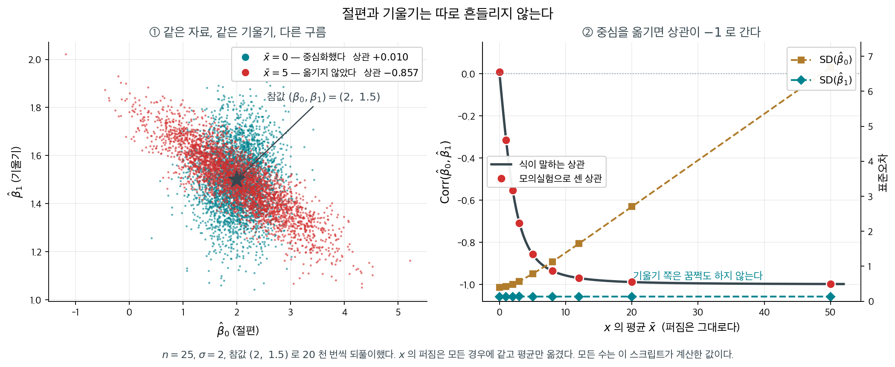
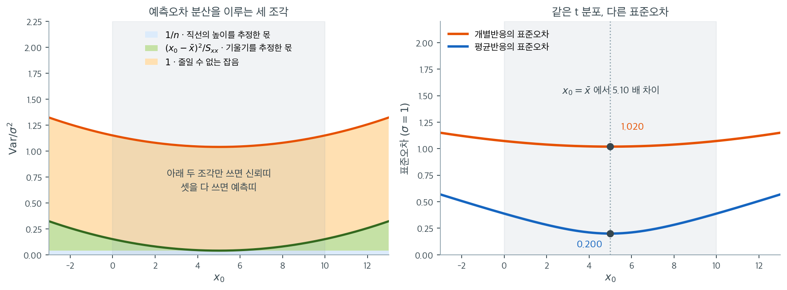

# 단순 OLS 추정량의 표집분포

## 개요

$n = 25$, $\sigma = 1$ 인 자료의 중심에서 평균반응의 표준오차는 $0.200$ 이고, 같은 자리에서 개별반응의 표준오차는 $1.020$ 으로 **$5.10$ 배**다. 두 수가 가리키는 중심은 똑같고 식도 근호 안에 $1$ 을 더하는 것 하나만 다르다. 자료 범위를 벗어난 자리에서는 앞의 것이 $0.507$ 로 두 배 반이 되는데 뒤의 것은 $1.121$ 로 거의 그대로여서, 비가 $2.21$ 배로 줄어든다. 같은 추정값을 놓고 왜 세 가지 표준오차가 나오고, 그 셋은 각각 무엇의 흔들림을 재는가.

단순선형회귀에서 핵심 추론 결과는 추정된 계수와 예측값의 **표집분포**를 아는 데 달려 있다. 고전적 가정 — 선형성, 독립성, 등분산성, 오차의 정규성 — 아래에서 이 분포들은 $t$ 분포에 기초한 우아한 닫힌 형태를 갖는다. 이 절은 세 가지 기본 양, 곧 기울기 추정량, 주어진 점에서의 기대반응, 개별 예측반응의 표집분포를 유도한다.

---

## 1. 기울기 추정량

### 정리 1. 기울기 추정량의 t 분포 { .thm }

정규오차 단순선형회귀 모형 아래에서

$$
\frac{\hat{\beta}_1 - \beta_1}{s\sqrt{\dfrac{1}{\sum_{i=1}^n(x_i - \bar{x})^2}}} \sim t_{n-2}
$$

이다.

??? proof "증명"

    **1단계: 모형 가정.** 단순선형회귀 모형을 생각하자.

    $$
    y_i = \beta_0 + \beta_1 x_i + \varepsilon_i
    $$

    여기서 $\varepsilon_i \overset{\text{i.i.d.}}{\sim} N(0, \sigma^2)$이다.

    **2단계: OLS 추정량.** $\beta_1$의 최소제곱 추정량은

    $$
    \hat{\beta}_1 = \frac{\sum_{i=1}^n (x_i - \bar{x})(y_i - \bar{y})}{\sum_{i=1}^n (x_i - \bar{x})^2}
    $$

    **3단계: $\hat{\beta}_1$의 분포.** $\hat{\beta}_1$은 정규분포를 따르는 $y_i$들의 선형결합이므로

    $$
    \hat{\beta}_1 \sim N\!\left(\beta_1,\; \frac{\sigma^2}{\sum_{i=1}^n (x_i - \bar{x})^2}\right)
    $$

    **4단계: $\sigma$를 알 때의 표준화.** 참 표준편차로 나누면 표준정규가 된다.

    $$
    \frac{\hat{\beta}_1 - \beta_1}{\sigma\sqrt{\dfrac{1}{\sum_{i=1}^n(x_i - \bar{x})^2}}} \sim N(0, 1)
    $$

    **5단계: $\sigma^2$의 추정.** $\sigma^2$을 모르므로 불편추정량을 쓴다.

    $$
    s^2 = \frac{\sum_{i=1}^n (y_i - \hat{y}_i)^2}{n - 2}
    $$

    **6단계: 대입.** $\sigma$를 $s$로 바꾸면

    $$
    \frac{\hat{\beta}_1 - \beta_1}{s\sqrt{\dfrac{1}{\sum_{i=1}^n(x_i - \bar{x})^2}}}
    $$

    **7단계: $t$ 분포 결과.** 분자는 정규이고, $s^2$은 자유도 $n - 2$의 척도조정된 카이제곱분포를 따르며, 둘은 독립이다. 표준정규를 독립인 카이제곱을 자유도로 나눈 것의 제곱근으로 나눈 것이 $t$ 분포라는 정의에 따라

    $$
    \frac{\hat{\beta}_1 - \beta_1}{s\sqrt{\dfrac{1}{\sum_{i=1}^n(x_i - \bar{x})^2}}} \sim t_{n-2} \qquad \square
    $$

### 구성 요소

정리의 식을 이루는 각 조각이 무엇을 재는지 따로 본다.

**추정된 기울기** $\hat{\beta}_1$: 기울기의 OLS 추정값으로, 표본에서 $x$가 한 단위 늘어날 때 관측되는 $y$의 변화를 나타낸다.

**참 기울기** $\beta_1$: 우리가 추정하려는 미지의 모수. 가설검정은 보통 $\beta_1 = 0$인지를 살핀다.

**잔차 표준편차** $s$: $x$와의 선형관계로 설명되지 않는 $y$의 변동을 잰다.

$$
s = \sqrt{\frac{\sum_{i=1}^n (y_i - \hat{y}_i)^2}{n - 2}}
$$

여기서 $\hat{y}_i$는 적합값이고, $n - 2$는 $\beta_0$과 $\beta_1$ 둘 다 추정한 것을 반영한다.

**$x$의 제곱합**: $SS_x = \sum_{i=1}^n (x_i - \bar{x})^2$은 설명변수 값들의 산포를 담으며 기울기 추정의 정밀도를 곧바로 결정한다.

**기울기의 표준오차**: 분모 $s \sqrt{1 / SS_x}$는 표집변동으로 인한 $\hat{\beta}_1$의 불확실성을 수량화하며, 잔차의 산포와 설명변수의 산포를 결합한다.

---

## 2. 주어진 점에서의 반응의 기댓값

### 정리 2. 평균반응 추정량의 t 분포 { .thm }

같은 모형에서 임의로 고정한 $x_0$에 대해

$$
\frac{(\hat{\beta}_0 + \hat{\beta}_1 x_0) - (\beta_0 + \beta_1 x_0)}{s\sqrt{\dfrac{1}{n} + \dfrac{(x_0 - \bar{x})^2}{\sum_{i=1}^n(x_i - \bar{x})^2}}} \sim t_{n-2}
$$

이다.

??? proof "증명"

    **1단계: 예측오차의 분해.** 추정된 평균반응과 참 평균반응의 차이는

    $$
    (\hat{\beta}_0 + \hat{\beta}_1 x_0) - (\beta_0 + \beta_1 x_0) = (\hat{\beta}_0 - \beta_0) + (\hat{\beta}_1 - \beta_1)x_0
    $$

    두 추정량이 모두 불편이므로 이 값의 평균은 0이다.

    **2단계: 분산 계산.** OLS의 분산·공분산 결과를 쓴다.

    - $\text{Var}(\hat{\beta}_0) = \sigma^2\!\left(\dfrac{1}{n} + \dfrac{\bar{x}^2}{SS_x}\right)$
    - $\text{Var}(\hat{\beta}_1) = \dfrac{\sigma^2}{SS_x}$
    - $\text{Cov}(\hat{\beta}_0, \hat{\beta}_1) = -\dfrac{\sigma^2 \bar{x}}{SS_x}$

    $\text{Var}(\hat{\beta}_0 + \hat{\beta}_1 x_0) = \text{Var}(\hat{\beta}_0) + x_0^2\,\text{Var}(\hat{\beta}_1) + 2x_0\,\text{Cov}(\hat{\beta}_0, \hat{\beta}_1)$으로 결합하면

    $$
    \text{Var}(\hat{\beta}_0 + \hat{\beta}_1 x_0) = \sigma^2\!\left(\frac{1}{n} + \frac{(x_0 - \bar{x})^2}{SS_x}\right)
    $$

    **3단계: 표준화.** $\sigma$를 알면

    $$
    \frac{(\hat{\beta}_0 + \hat{\beta}_1 x_0) - (\beta_0 + \beta_1 x_0)}{\sigma\sqrt{\dfrac{1}{n} + \dfrac{(x_0 - \bar{x})^2}{SS_x}}} \sim N(0, 1)
    $$

    **4단계: $\sigma$ 대신 $s$.** $\sigma$를 잔차 표준오차 $s$로 바꾸고 앞과 같은 $t$ 분포 논증을 적용하면

    $$
    \frac{(\hat{\beta}_0 + \hat{\beta}_1 x_0) - (\beta_0 + \beta_1 x_0)}{s\sqrt{\dfrac{1}{n} + \dfrac{(x_0 - \bar{x})^2}{SS_x}}} \sim t_{n-2} \qquad \square
    $$

### 구성 요소

분모가 왜 저 모양인지 조각별로 본다.

**예측된 평균반응** $\hat{\beta}_0 + \hat{\beta}_1 x_0$: 적합된 회귀직선에서 $x = x_0$일 때 $y$의 추정된 기댓값.

**참 평균반응** $\beta_0 + \beta_1 x_0$: $x = x_0$일 때 $y$의 미지의 모평균.

**평균 예측의 표준오차**: 분모는 두 개의 분산 성분으로 이루어진다.

- $\dfrac{1}{n}$: 절편과 기울기를 추정하는 데서 오는 변동.
- $\dfrac{(x_0 - \bar{x})^2}{\sum_{i=1}^n(x_i - \bar{x})^2}$: $x_0$이 $\bar{x}$에서 멀 때 추가되는 변동.

따라서 평균반응의 신뢰띠는 $\bar{x}$에서 가장 좁고 $x_0$이 자료의 중심에서 멀어질수록 넓어진다.

---

## 3. 주어진 점에서의 반응(예측)

### 정리 3. 개별 반응 예측오차의 t 분포 { .thm }

같은 모형에서 $x_0$에서의 새 관측값 $y_0 = \beta_0 + \beta_1 x_0 + \varepsilon$에 대해

$$
\frac{(\hat{\beta}_0 + \hat{\beta}_1 x_0) - (\beta_0 + \beta_1 x_0 + \varepsilon)}{s\sqrt{1 + \dfrac{1}{n} + \dfrac{(x_0 - \bar{x})^2}{\sum_{i=1}^n(x_i - \bar{x})^2}}} \sim t_{n-2}
$$

이다.

??? proof "증명"

    **1단계: 예측오차.** 예측오차를 정의하면

    $$
    \hat{y}_0 - y_0 = (\hat{\beta}_0 + \hat{\beta}_1 x_0) - (\beta_0 + \beta_1 x_0 + \varepsilon) = (\hat{\beta}_0 - \beta_0) + (\hat{\beta}_1 - \beta_1)x_0 - \varepsilon
    $$

    **2단계: 분산의 분해.** 오차 $\varepsilon$은 (훈련자료에 의존하는) 추정량 $\hat{\beta}_0$, $\hat{\beta}_1$과 독립이므로

    $$
    \text{Var}(\hat{y}_0 - y_0) = \underbrace{\sigma^2\!\left(\frac{1}{n} + \frac{(x_0 - \bar{x})^2}{SS_x}\right)}_{\text{추정의 불확실성}} + \underbrace{\sigma^2}_{\text{줄일 수 없는 잡음}} = \sigma^2\!\left(1 + \frac{1}{n} + \frac{(x_0 - \bar{x})^2}{SS_x}\right)
    $$

    **3단계: $\sigma$를 알 때의 표준화.** 예측오차는 평균이 0인 정규분포를 따른다.

    $$
    \frac{\hat{y}_0 - y_0}{\sigma\sqrt{1 + \dfrac{1}{n} + \dfrac{(x_0 - \bar{x})^2}{SS_x}}} \sim N(0, 1)
    $$

    **4단계: $\sigma$ 대신 $s$.** $\sigma$를 $s$로 바꾸면 $t$ 분포를 얻는다.

    $$
    \frac{(\hat{\beta}_0 + \hat{\beta}_1 x_0) - (\beta_0 + \beta_1 x_0 + \varepsilon)}{s\sqrt{1 + \dfrac{1}{n} + \dfrac{(x_0 - \bar{x})^2}{SS_x}}} \sim t_{n-2} \qquad \square
    $$

### 구성 요소

분모가 앞의 것과 어디서 달라지는지 조각별로 본다.

**예측된 반응** $\hat{y}_0 = \hat{\beta}_0 + \hat{\beta}_1 x_0$: $x_0$에서의 점 예측값.

**참 개별반응** $y_0 = \beta_0 + \beta_1 x_0 + \varepsilon$: 실제 관측값으로, 무작위 오차 $\varepsilon \sim N(0, \sigma^2)$만큼 평균반응과 다르다.

**개별 예측의 표준오차**: 분모는 세 개의 분산 성분을 포함한다.

- $1$: 회귀직선 주위에서 개별 관측값이 갖는 잔차 변동.
- $\dfrac{1}{n}$: 회귀계수를 추정하는 데서 오는 표집변동.
- $\dfrac{(x_0 - \bar{x})^2}{SS_x}$: $\bar{x}$에서 멀어지는 외삽으로 인한 추가 불확실성.

앞머리의 $1$이 평균반응의 경우와 결정적으로 다른 점이다. 이 항 때문에 개별 관측값에 대한 예측구간은 언제나 평균반응에 대한 신뢰구간보다 넓다.

---

**그림으로 보는 통계학 1.** 절편과 기울기는 따로 흔들리지 않는다

위 정리들은 $\hat\beta_1$ 과 $\hat\beta_0 + \hat\beta_1 x_0$ 의 분포를 **하나씩** 적는다. 그런데 두 추정량은 같은 자료에서 나온 것이라 서로 얽혀 있고, 그 얽힘이 닫힌 꼴로 나온다.

$$
\operatorname{Cov}(\hat\beta_0, \hat\beta_1) = -\,\frac{\bar x\,\sigma^2}{S_{xx}},
\qquad
\operatorname{Corr}(\hat\beta_0, \hat\beta_1) = \frac{-\bar x}{\sqrt{S_{xx}/n + \bar x^2}}
$$

**$\bar x$ 가 분자에 혼자 앉아 있다.** 자료의 모양을 하나도 바꾸지 않고 $x$ 를 통째로 옮기기만 해도 두 추정량의 관계가 달라진다는 뜻이다.

$n = 25$, $\sigma = 2$, 참값 $(\beta_0, \beta_1) = (2,\ 1.5)$ 로 $2$ 만 번씩 되풀이했다. $x$ 의 퍼짐은 모든 경우에 똑같이 두고 평균만 옮겼다.

| $\bar x$ | 모의실험의 상관 | 식 | $\mathrm{SD}(\hat\beta_0)$ | $\mathrm{SD}(\hat\beta_1)$ |
|---|---|---|---|---|
| $0$ | $+0.010$ | $0.000$ | $0.398$ | $0.133$ |
| $2$ | $-0.552$ | $-0.554$ | $0.481$ | $0.133$ |
| $5$ | $-0.857$ | $-0.857$ | $0.783$ | $0.134$ |
| $50$ | $-0.998$ | $-0.998$ | $6.679$ | $0.133$ |

왼쪽 판의 두 구름이 그 수를 그림으로 옮긴 것이다. 청록 구름($\bar x = 0$)은 둥글고, 붉은 구름($\bar x = 5$)은 왼쪽 위에서 오른쪽 아래로 길게 기울어 있다. **기울었다는 것은 이런 뜻이다** — 어떤 표본에서 기울기를 크게 추정하면 그 표본에서는 절편이 반드시 작게 나온다. 직선이 자료 뭉치를 지나가야 하는데 $x$ 가 $0$ 에서 멀리 있으면, 그 뭉치를 지렛대 삼아 직선이 **시소처럼** 움직이기 때문이다.

표의 마지막 두 열이 중요하다. $\bar x$ 를 $0$ 에서 $50$ 으로 옮기는 동안 **$\mathrm{SD}(\hat\beta_0)$ 은 $0.398$ 에서 $6.679$ 로 $17$ 배가 되는데 $\mathrm{SD}(\hat\beta_1)$ 은 $0.133$ 에서 꿈쩍도 하지 않는다.** 기울기는 중심을 어디에 두든 같은 정밀도로 추정된다 — $S_{xx}$ 가 평행이동에 변하지 않기 때문이다. 흔들리는 것은 절편뿐이고, 절편이 가리키는 「$x = 0$ 일 때의 $y$」 가 자료에서 멀어질수록 그 값은 외삽이 된다.

실무로 옮기면 셋이다. 첫째, **중심화한 $x$ 를 쓰면 절편이 「$\bar x$ 에서의 평균반응」이 되고** 그 표준오차가 가장 작아진다. 둘째, 교호작용이나 다항 항을 넣을 때 중심화를 권하는 까닭도 같다 — 곱항과 원래 항 사이에 똑같은 $-\bar x$ 짜리 상관이 생긴다. 셋째, 이 상관은 **예측구간의 모양**으로도 나타난다. 위 $2$ 절의 나비넥타이가 $\bar x$ 에서 가장 좁은 것이 바로 두 추정량이 거기서 서로를 상쇄하기 때문이다.

!!! note "같은 중심화, 다른 증상"
    11.10절 [statsmodels 로 회귀하기](../package_usage/statsmodels.md)의 상자에서는 중심화하지 않은 $x$ 가 **조건수 경고**를 켰다. 여기서는 같은 일이 **절편과 기울기의 상관**으로 나타난다. 둘은 같은 사실의 두 얼굴이다 — 상수 열과 $x$ 열이 거의 같은 방향을 가리킨다는 것.

_확인한 곳 — 표와 그림의 수는 모두 직접 모의실험해 얻은 값이고, 식과 나란히 놓아 소수 셋째 자리까지 맞는 것을 확인했다_

---

## 4. 요약 비교

| 대상 | 표준오차 | 분포 |
|:---|:---|:---|
| 기울기 $\hat{\beta}_1$ | $s\sqrt{\dfrac{1}{SS_x}}$ | $t_{n-2}$ |
| $x_0$에서의 평균반응 | $s\sqrt{\dfrac{1}{n} + \dfrac{(x_0-\bar{x})^2}{SS_x}}$ | $t_{n-2}$ |
| $x_0$에서의 개별반응 | $s\sqrt{1 + \dfrac{1}{n} + \dfrac{(x_0-\bar{x})^2}{SS_x}}$ | $t_{n-2}$ |

세 통계량은 모두 같은 $t_{n-2}$ 분포를 따르지만 표준오차가 다르다. 기울기 추정만 있는 경우에서 평균 예측, 개별 예측으로 갈수록 불확실성의 원천이 늘어남을 반영한다.

왼쪽 그림은 표의 마지막 행에 있는 제곱근 안의 세 항을 $x_0$의 함수로 쌓아 올린 것이다. $n = 25$, $x$가 $0$부터 $10$까지 고르게 퍼져 있어 $\bar{x} = 5$, $S_{xx} = 225.7$이고 $\sigma = 1$로 두었다. 맨 아래 파란 띠는 $1/n = 0.04$로 $x_0$에 상관없이 일정하다. 회귀직선의 **높이**를 표본으로 추정한 값이다. 그 위 초록 띠가 $(x_0 - \bar{x})^2/S_{xx}$로, $x_0 = \bar{x}$에서 정확히 0이고 바깥으로 갈수록 이차함수로 벌어진다. **기울기**를 추정한 값이며, 지렛대가 길수록 기울기의 작은 오차가 큰 높이 오차로 증폭되는 것이 이 항이다. 맨 위 주황 띠는 값이 언제나 $1$인 줄일 수 없는 잡음이다.

세 통계량이 갈리는 지점이 여기다. 기울기 검정은 파란 조각만 쓰고, 평균반응의 신뢰구간은 파랑과 초록을 쓰며, 개별반응의 예측구간은 셋을 다 쓴다. 그 차이가 얼마나 큰지 오른쪽에서 볼 수 있다. $x_0 = \bar{x}$에서 평균반응의 표준오차는 $\sigma/\sqrt{25} = 0.200$인 반면 개별반응은 $\sigma\sqrt{1 + 1/25} = 1.020$으로 **5.10배**다. 근호 안에 $1$을 더하는 것이 이만한 차이를 만든다.

반대로 자료 범위를 벗어나면 이야기가 달라진다. $x_0 = 12$(관측 범위의 오른쪽 끝에서 2만큼 밖)에서 기울기 조각은 $0.217$까지 커져 평균반응의 표준오차가 $0.507$로 $\bar{x}$에서의 두 배 반이 된다. 같은 자리에서 개별반응의 표준오차는 $1.121$로 거의 그대로다. 두 배 차이는 $5.10$배에서 $2.21$배로 줄어든다. 곧 **외삽은 신뢰띠를 빠르게 망가뜨리지만 예측띠는 상대적으로 덜 흔든다.** 예측띠는 원래부터 줄일 수 없는 잡음이 지배하고 있었기 때문이다. 회색으로 칠한 구간이 자료가 실제로 있는 범위이며, 그 바깥의 곡선들은 "모형이 계속 맞다면"이라는 가정 위에서만 뜻을 갖는다는 점도 잊지 말아야 한다.

---

## 연습문제

**연습문제 1.** 
고전적 가정 아래에서 단순선형회귀의 $\hat{\beta}_1$의 표집분포를 서술하라. 이 분포는 어떤 모수에 의존하는가?

??? success "풀이"
    고전적 가정($\varepsilon_i \sim N(0, \sigma^2)$, 독립) 아래에서

    $$
    \hat{\beta}_1 \sim N\left(\beta_1, \frac{\sigma^2}{\sum_{i=1}^n (x_i - \bar{x})^2}\right)
    $$

    이 분포는 참 기울기 $\beta_1$, 오차분산 $\sigma^2$, 설명변수 값들의 산포 $\sum(x_i - \bar{x})^2$에 의존한다. $X$의 산포가 클수록, 오차분산이 작을수록 추정이 정밀해진다.

**연습문제 2.** 
단순선형회귀에서 $\hat{\sigma}^2 = \text{SSE}/(n-2)$가 $\sigma^2$의 불편추정량인 반면 $\text{SSE}/n$은 편향되는 이유를 설명하라.

??? success "풀이"
    잔차 $e_i = Y_i - \hat{Y}_i$는 (정규방정식에서 오는) 두 개의 선형 제약을 받으므로 자유롭게 변할 수 있는 것은 $n - 2$개뿐이다. 따라서 $\text{SSE}/\sigma^2 \sim \chi^2_{n-2}$이고

    $$
    E\left[\frac{\text{SSE}}{\sigma^2}\right] = n - 2 \implies E[\text{SSE}] = (n-2)\sigma^2 \implies E\left[\frac{\text{SSE}}{n-2}\right] = \sigma^2
    $$

    대신 $n$으로 나누면 $E[\text{SSE}/n] = (n-2)\sigma^2/n < \sigma^2$이 되어 $\sigma^2$을 과소추정한다.

**연습문제 3.** 
어떤 연구자가 기울기를 높은 정밀도로 추정하려 한다. $\text{Var}(\hat{\beta}_1)$의 공식에 근거하여 표준오차를 줄이는 실용적인 전략 두 가지를 제시하라.

??? success "풀이"
    $\text{Var}(\hat{\beta}_1) = \sigma^2 / \sum(x_i - \bar{x})^2$에서

    1. **$X$ 값의 산포를 키운다.** $X$의 더 극단적인 값에서 자료를 모으면 $\sum(x_i - \bar{x})^2$이 커져 분산이 줄어든다. 실험 상황에서는 처치 수준을 촘촘하게 두지 말고 멀리 떨어뜨려 잡으라는 뜻이다.

    2. **표본크기 $n$을 늘린다.** 관측값이 많아지면 (새 관측값의 산포가 비슷하다면) $\sum(x_i - \bar{x})^2$이 커져 분산이 비례해서 줄어든다.

    세 번째 전략은 외부 변동원을 통제하여(공변량을 넣거나 측정 정밀도를 높여) $\sigma^2$을 줄이는 것인데, 이는 모형 자체를 바꾸는 일이다.

**연습문제 4.** 
본문은 $n = 25$, $x_0 = \bar{x}$에서 개별반응의 표준오차가 평균반응의 표준오차의 $5.10$배라고 했다. 일반적인 $n$에 대해 $x_0 = \bar{x}$에서 두 표준오차의 비를 $n$만의 식으로 나타내고, $n = 25$에서 본문의 수치가 나오는지 확인하라. 그리고 $n \to \infty$일 때 이 비가 어떻게 되는지, 그것이 뜻하는 바를 말하라.

??? success "풀이"
    요약표에서 $x_0 = \bar{x}$이면 $(x_0 - \bar{x})^2 / SS_x = 0$이므로 두 표준오차는

    $$
    \text{SE}_{\text{평균}} = s\sqrt{\frac{1}{n}}, \qquad \text{SE}_{\text{개별}} = s\sqrt{1 + \frac{1}{n}}
    $$

    이고 그 비는

    $$
    R(n) = \frac{\text{SE}_{\text{개별}}}{\text{SE}_{\text{평균}}} = \sqrt{\frac{1 + 1/n}{1/n}} = \sqrt{n + 1}
    $$

    $n = 25$이면 $R = \sqrt{26} = 5.0990$으로 본문의 $5.10$과 같다($1.020 / 0.200 = 5.10$).

    $n \to \infty$이면 $R(n) = \sqrt{n+1} \to \infty$이다. 평균반응의 표준오차는 $s/\sqrt{n} \to 0$으로 사라지지만 개별반응의 표준오차는 $s\sqrt{1 + 1/n} \to s$로 남기 때문이다.

    해석: 표본을 키우면 **회귀직선의 위치**는 얼마든지 정확히 알 수 있지만 **다음 한 관측값**은 끝까지 $\pm s$ 정도 틀린다. 자료를 더 모아서 지울 수 있는 불확실성과 그렇지 않은 불확실성이 갈리는 자리이고, 둘의 비가 발산한다는 것이 그 구분이 점근적으로 더 선명해진다는 뜻이다.

**연습문제 5.** 
평균반응의 표준오차는 $x_0 = \bar{x}$에서 최솟값을 갖는다. 이 최솟값의 정확히 두 배가 되는 $x_0$을 $n$, $SS_x$, $\bar{x}$로 나타내라. 이어서 본문 그림의 설정($n = 25$, $\bar{x} = 5$, $S_{xx} = 225.7$, $x$는 $0$부터 $10$까지)에서 그 $x_0$을 구하고, 그 위치가 자료 범위와 어떤 관계인지 말하라.

??? success "풀이"
    평균반응의 표준오차는 $s\sqrt{v(x_0)}$, $v(x_0) = \dfrac{1}{n} + \dfrac{(x_0 - \bar{x})^2}{SS_x}$이고 최솟값은 $x_0 = \bar{x}$에서 $s\sqrt{1/n}$이다. 두 배가 되려면 제곱근 안이 네 배여야 하므로

    $$
    \frac{1}{n} + \frac{(x_0 - \bar{x})^2}{SS_x} = \frac{4}{n} \implies \frac{(x_0 - \bar{x})^2}{SS_x} = \frac{3}{n}
    $$

    따라서

    $$
    x_0 = \bar{x} \pm \sqrt{\frac{3\,SS_x}{n}}
    $$

    수치를 넣으면 $\dfrac{3 \times 225.7}{25} = 27.084$이고 $\sqrt{27.084} = 5.2042$이므로

    $$
    x_0 = 5 \pm 5.204 = -0.204 \quad \text{또는} \quad 10.204
    $$

    자료는 $0 \le x \le 10$, 곧 중심에서 반폭 $5$까지만 있다. 두 배가 되는 지점은 $5.204$로 그 바깥이다.

    해석: **관측 범위 안에서는 평균반응의 신뢰띠가 아무리 넓어져도 중심에서의 두 배를 넘지 못한다.** 본문 그림에서 초록 띠가 이차함수로 벌어져 보여도 $1/n$에 비해 대단히 커지는 것은 자료를 벗어난 다음의 일이다. 신뢰띠가 정말로 못 쓰게 되는 것은 외삽을 할 때뿐이라는 점을 수치가 말해 준다.

**연습문제 6.** 
정리 1의 $t$ 통계량이 아예 정의되지 않는 두 가지 극단적인 설계를 생각한다.

(a) 모든 $x_i$가 같은 값인 경우.

(b) $n = 2$이고 $x_1 \ne x_2$인 경우.

각각에서 정리 1의 어느 조각이 무너지는지 밝히고, 두 조각이 서로 다른 조각임을 설명하라. 또 정리 1이 뜻을 갖기 위한 $n$과 설계의 최소 조건을 말하라.

??? success "풀이"
    **(a) 모든 $x_i = c$.** 이때 $\bar{x} = c$이고

    $$
    SS_x = \sum_{i=1}^n (x_i - \bar{x})^2 = 0
    $$

    $\hat{\beta}_1$의 분모가 $0$이므로 OLS 추정량 자체가 존재하지 않는다. 표준오차 $s\sqrt{1/SS_x}$도 발산한다. 자료가 $x$의 한 지점에만 있으면 기울기에 대한 정보가 전혀 없으니 당연하다. 참고로 $s$는 멀쩡하다. $n - 2$개의 자유도로 $\sigma^2$을 추정하는 데는 아무 문제가 없다.

    **(b) $n = 2$, $x_1 \ne x_2$.** 이번에는 $SS_x > 0$이므로 $\hat{\beta}_1 = (y_2 - y_1)/(x_2 - x_1)$이 잘 정의된다. 무너지는 것은 $\sigma^2$의 추정 쪽이다. 직선은 두 점을 정확히 지나므로 $\hat{y}_i = y_i$, 곧

    $$
    s^2 = \frac{\sum_{i=1}^2 (y_i - \hat{y}_i)^2}{n - 2} = \frac{0}{0}
    $$

    자유도가 $n - 2 = 0$이고 $t_0$ 분포는 존재하지 않는다.

    **두 조각의 구별.** (a)는 **분자 쪽 정보**, 곧 $\hat{\beta}_1$을 만들 수 있는 $x$의 산포가 없는 경우다. (b)는 **분모 쪽 정보**, 곧 잔차로 $\sigma^2$을 재는 자유도가 없는 경우다. 정리 1의 증명에서 (a)는 2단계·3단계를, (b)는 5단계·7단계를 깨뜨린다. 서로 독립적인 두 요구조건이다.

    **최소 조건.** $SS_x > 0$(서로 다른 $x$ 값이 적어도 둘)이고 $n \ge 3$이어야 한다. 두 조건은 어느 하나가 다른 하나를 함의하지 않는다. $n = 100$이어도 모든 $x_i$가 같으면 (a)에 걸리고, $x$가 서로 달라도 $n = 2$면 (b)에 걸린다.

**연습문제 7.** 
$d = \lvert x_0 - \bar{x} \rvert$라 하자. $d$가 커질 때 평균반응의 표준오차가 기울기의 표준오차만으로 결정됨을 보여라. 구체적으로

$$
\lim_{d \to \infty} \frac{\text{SE}(\hat{\beta}_0 + \hat{\beta}_1 x_0)}{d} = \text{SE}(\hat{\beta}_1)
$$

임을 보이고, 본문 그림의 설정($n = 25$, $S_{xx} = 225.7$, $s = 1$)에서 $x_0 = 12$일 때 근사 $d \cdot \text{SE}(\hat{\beta}_1)$이 참값 $0.507$에 얼마나 가까운지 수치로 비교하라. 또 이 근사의 상대오차가 $5\%$ 이내가 되는 $x_0$의 범위를 구하고, 그 결과를 해석하라.

??? success "풀이"
    **극한.** 요약표에서

    $$
    \frac{\text{SE}(\hat{\beta}_0 + \hat{\beta}_1 x_0)}{d} = \frac{s}{d}\sqrt{\frac{1}{n} + \frac{d^2}{SS_x}} = s\sqrt{\frac{1}{n d^2} + \frac{1}{SS_x}}
    $$

    $d \to \infty$이면 첫 항이 $0$으로 가므로

    $$
    \lim_{d \to \infty} \frac{\text{SE}(\hat{\beta}_0 + \hat{\beta}_1 x_0)}{d} = s\sqrt{\frac{1}{SS_x}} = \text{SE}(\hat{\beta}_1) \qquad \square
    $$

    곧 멀리서는 $\text{SE}(\hat{\beta}_0 + \hat{\beta}_1 x_0) \approx d \cdot \text{SE}(\hat{\beta}_1)$이다. 지렛대가 $d$인 자리에서 기울기 오차가 그대로 $d$배로 증폭된 것이 전부이고, 직선의 높이를 추정한 몫 $1/n$은 묻혀 버린다.

    **수치 비교.** $s = 1$, $SS_x = 225.7$이므로 $\text{SE}(\hat{\beta}_1) = 1/\sqrt{225.7} = 0.06656$이다. $x_0 = 12$이면 $d = 7$이고

    - 근사: $7 \times 0.06656 = 0.4659$
    - 참값: $\sqrt{0.04 + 49/225.7} = \sqrt{0.25712} = 0.5071$

    근사는 참값의 $0.4659/0.5071 = 0.919$, 곧 $8.1\%$ 과소평가다. 관측 범위 끝에서 $2$만큼 나간 자리에서도 아직 $1/n$ 조각이 무시할 만하지 않다.

    **$5\%$ 이내가 되는 범위.** 참값과 근사의 비는

    $$
    \frac{\text{참값}}{\text{근사}} = \frac{\sqrt{1/n + d^2/SS_x}}{d/\sqrt{SS_x}} = \sqrt{1 + \frac{SS_x}{n d^2}}
    $$

    이 값이 $1.05$ 이하여야 하므로

    $$
    1 + \frac{SS_x}{n d^2} \le 1.1025 \implies d^2 \ge \frac{SS_x}{0.1025\,n} = \frac{225.7}{2.5625} = 88.08
    $$

    따라서 $d \ge 9.385$, 곧 $x_0 \le -4.385$ 또는 $x_0 \ge 14.385$이다.

    해석: "평균반응의 불확실성은 사실 기울기의 불확실성이다"라는 그림은 **자료 범위($0 \le x \le 10$)의 두 배 가까이 밖으로 나가야** 비로소 $5\%$ 안에 들어온다. 그 영역의 예측은 본문이 말한 대로 "모형이 계속 맞다면"이라는 가정 위에서만 뜻을 갖는다. 곧 이 깔끔한 근사가 정확해지는 곳은 정확히 그 근사를 믿어서는 안 되는 곳이다.

**연습문제 8.** 
$R(x_0) = \dfrac{\text{SE}_{\text{개별}}(x_0)}{\text{SE}_{\text{평균}}(x_0)}$으로 두자. $R$가 $\lvert x_0 - \bar{x} \rvert$의 감소함수임을 보이고 $\lvert x_0 - \bar{x} \rvert \to \infty$에서의 극한을 구하라. 본문 그림의 설정($n = 25$, $\bar{x} = 5$, $S_{xx} = 225.7$)에서 $R(5) = 5.10$, $R(12) = 2.21$을 확인하고, $R(x_0) = 2$가 되는 $x_0$을 구하라. 끝으로 본문의 "외삽은 신뢰띠를 빠르게 망가뜨리지만 예측띠는 상대적으로 덜 흔든다"가 $R$의 단조성과 같은 말임을 설명하라.

??? success "풀이"
    **단조성과 극한.** $v(x_0) = \dfrac{1}{n} + \dfrac{(x_0 - \bar{x})^2}{SS_x}$로 두면 요약표에서

    $$
    R(x_0) = \frac{s\sqrt{1 + v(x_0)}}{s\sqrt{v(x_0)}} = \sqrt{\frac{1 + v}{v}} = \sqrt{1 + \frac{1}{v}}
    $$

    $v$는 $d = \lvert x_0 - \bar{x} \rvert$에 대해 $d^2/SS_x$만큼 늘어나므로 $d$의 증가함수이고, $1/v$는 $v$의 감소함수이므로 $R$는 $d$의 **감소**함수다. 또 $d \to \infty$이면 $v \to \infty$이므로

    $$
    \lim_{d \to \infty} R = \sqrt{1 + 0} = 1
    $$

    **수치 확인.** $x_0 = 5 = \bar{x}$이면 $v = 1/25 = 0.04$이고

    $$
    R = \sqrt{1 + 25} = \sqrt{26} = 5.099 \approx 5.10
    $$

    $x_0 = 12$이면 $v = 0.04 + 49/225.7 = 0.25712$이고

    $$
    R = \sqrt{1 + \frac{1}{0.25712}} = \sqrt{1 + 3.8892} = \sqrt{4.8892} = 2.211 \approx 2.21
    $$

    둘 다 본문의 값과 같다.

    **$R = 2$가 되는 자리.** $1 + 1/v = 4$에서 $v = 1/3$이므로

    $$
    \frac{(x_0 - \bar{x})^2}{SS_x} = \frac{1}{3} - \frac{1}{25} = 0.29333 \implies (x_0 - \bar{x})^2 = 0.29333 \times 225.7 = 66.21
    $$

    $\lvert x_0 - 5 \rvert = 8.137$이므로 $x_0 = -3.14$ 또는 $x_0 = 13.14$다.

    **해석.** $R$가 단조감소한다는 것은 분모가 분자보다 빠르게 커진다는 말이다. $d$가 커질 때 $\text{SE}_{\text{평균}} = s\sqrt{v}$는 $v$와 함께 한없이 커지는데 $\text{SE}_{\text{개별}} = s\sqrt{1 + v}$에는 언제나 상수 $1$이 깔려 있어 늘어나는 비율이 작다. 본문의 수치로는 $\bar{x}$에서 $x_0 = 12$로 가며 평균반응의 표준오차가 $0.200 \to 0.507$로 $2.54$배 되는 동안 개별반응은 $1.020 \to 1.121$로 $1.10$배밖에 되지 않았다. 외삽에서 신뢰띠가 상대적으로 크게 망가지고 예측띠가 덜 흔들린다는 본문의 말이 바로 $R$의 감소다. 극한 $R \to 1$은 아주 먼 외삽에서는 두 띠가 사실상 같아진다는 뜻이고, 그 지점에서는 "평균을 맞히는 일"과 "한 관측값을 맞히는 일"의 난이도 차이가 없어진다. 추정의 불확실성이 잡음을 압도해 버렸기 때문이다.

**연습문제 9.** 
정리 3의 예측오차는 $n$개의 훈련 관측값과 새 오차 $\varepsilon$까지 모두 $n + 1$개의 확률변수를 담고 있다. 그런데도 자유도는 $n - 1$이 아니라 $n - 2$다.

(a) 분자 $\hat{y}_0 - y_0$의 분포가 정리 3의 2단계에서 얻은 분산을 갖는 정규분포임을 쓰고, 이때 $\varepsilon$의 독립성이 어디에 쓰이는지 밝혀라.

(b) 분자와 $s$가 독립인 이유를 두 단계로 나누어 설명하라.

(c) 그 결과 자유도가 $n - 2$에 머무르는 까닭을 말하라.

??? success "풀이"
    **(a) 분자의 분포.** 2단계에서

    $$
    \hat{y}_0 - y_0 = (\hat{\beta}_0 - \beta_0) + (\hat{\beta}_1 - \beta_1)x_0 - \varepsilon
    $$

    앞의 두 항은 훈련자료의 $y_i$들의 선형결합이고 $\varepsilon$은 새 관측값의 오차이므로, 전체는 서로 독립인 정규확률변수들의 선형결합이고 따라서 정규다. 평균은 두 추정량이 불편이고 $E[\varepsilon] = 0$이므로 $0$이다. 분산은 $\varepsilon$이 $\hat{\beta}_0$, $\hat{\beta}_1$과 **독립**이기 때문에 공분산 항이 사라져 단순히 더해진다.

    $$
    \hat{y}_0 - y_0 \sim N\!\left(0,\; \sigma^2\!\left(1 + \frac{1}{n} + \frac{(x_0 - \bar{x})^2}{SS_x}\right)\right)
    $$

    $\varepsilon$이 훈련자료와 상관이 있었다면 $-2\,\text{Cov}\big(\hat{\beta}_0 + \hat{\beta}_1 x_0,\, \varepsilon\big)$이 남아 분산이 저 모양이 되지 않는다.

    **(b) 분자와 $s$의 독립.** 두 단계로 나뉜다.

    1. **훈련자료 안에서.** $s^2 = \sum (y_i - \hat{y}_i)^2 / (n-2)$는 잔차들의 함수다. 정규오차 OLS에서 적합값(따라서 $\hat{\beta}_0$, $\hat{\beta}_1$)과 잔차는 서로 독립이다. 그러므로 $(\hat{\beta}_0 - \beta_0) + (\hat{\beta}_1 - \beta_1)x_0$은 $s^2$과 독립이다. 정리 1의 7단계가 쓴 사실과 같은 것이다.

    2. **새 관측값 쪽.** $\varepsilon$은 훈련자료 전체와 독립이므로 특히 훈련 잔차들과 독립이고, 따라서 $s^2$과 독립이다.

    분자는 1의 부분과 $-\varepsilon$의 합이고 둘 다 $s^2$과 독립이며, 두 부분이 서로도 독립이므로 분자 전체가 $s^2$과 독립이다. 이것으로 $t$ 분포의 정의에 필요한 "정규 $\perp$ 카이제곱" 조건이 갖추어진다.

    **(c) 자유도.** $t$ 분포의 자유도는 분자가 아니라 **분모의 카이제곱 자유도**가 정한다. $s^2$은 오직 훈련자료의 잔차로만 계산되고 그 잔차는 정규방정식의 두 제약을 받으므로 변할 수 있는 것은 $n - 2$개, 곧 $(n-2)s^2/\sigma^2 \sim \chi^2_{n-2}$이다. 새 관측값은 모형을 다시 적합하는 데 쓰이지 않았으므로 $s^2$에 아무 기여도 하지 않는다. $\varepsilon$이 한 것은 분자의 분산에 $\sigma^2$을 더한 것, 곧 표준오차의 근호 안에 $1$을 넣은 것뿐이다.

    해석: $\varepsilon$은 **불확실성은 키우지만 정보는 주지 않는다.** 자유도는 "$\sigma^2$을 얼마나 잘 아는가"를 재는 눈금이고, 새 관측값은 그 질문에 아무 답도 하지 않으므로 눈금이 그대로인 것이다. 만약 새 점까지 넣어 다시 적합한다면 $s^2$의 자유도는 $n - 1$이 되겠지만, 그것은 이미 관측한 $y_0$을 쓰는 것이므로 예측 문제가 아니다.

**연습문제 10.** 
연습문제 3은 기울기의 표준오차를 줄이려면 $x$를 멀리 떨어뜨리라고 답했다. 이 조언을 끝까지 밀어 본다. 본문 그림의 설정은 $n = 25$개의 $x$가 $0$부터 $10$까지 고르게 놓여 $S_{xx} = 225.7$이었다. 대신 같은 $25$개를 양 끝에만 몰아 $x = 0$에 $13$개, $x = 10$에 $12$개 둔 설계를 생각하자. $\sigma$는 두 설계에서 같다고 본다.

(a) 새 설계의 $\bar{x}$와 $S_{xx}$를 구하고, 기울기의 표준오차가 몇 배로 줄어드는지 계산하라.

(b) $x_0 = 5$에서 평균반응의 표준오차를 두 설계에서 비교하라. (a)의 이득이 여기에도 그대로 나타나는가?

(c) (b)의 결과를 요약표의 두 분산 조각으로 설명하라.

(d) 그럼에도 양 끝 설계를 권하지 않을 통계적 이유를 하나 말하라.

??? success "풀이"
    **(a) 새 설계의 $S_{xx}$.**

    $$
    \bar{x} = \frac{13 \times 0 + 12 \times 10}{25} = \frac{120}{25} = 4.8
    $$

    $$
    S_{xx} = 13(0 - 4.8)^2 + 12(10 - 4.8)^2 = 13 \times 23.04 + 12 \times 27.04 = 299.52 + 324.48 = 624.0
    $$

    기울기의 표준오차는 $s/\sqrt{S_{xx}}$이므로 비는

    $$
    \frac{\sqrt{225.7}}{\sqrt{624.0}} = \sqrt{0.36170} = 0.6014
    $$

    곧 $0.601$배, 약 $40\%$ 줄어든다. $s = 1$이면 $0.0666 \to 0.0400$이다. 연습문제 3의 조언이 그대로 먹힌다.

    **(b) $x_0 = 5$에서의 평균반응.** 고른 설계에서는 $x_0 = \bar{x} = 5$이므로

    $$
    \text{SE} = s\sqrt{\frac{1}{25} + 0} = \sqrt{0.04} = 0.2000
    $$

    양 끝 설계에서는 $\bar{x} = 4.8$이므로 $(x_0 - \bar{x})^2 = 0.04$이고

    $$
    \text{SE} = s\sqrt{\frac{1}{25} + \frac{0.04}{624.0}} = \sqrt{0.04 + 0.0000641} = \sqrt{0.0400641} = 0.2002
    $$

    $0.2000$에서 $0.2002$로, 이득이 전혀 없다(오히려 $0.08\%$ 나쁘다). (a)의 $40\%$ 개선은 여기에 나타나지 않는다.

    **(c) 두 조각으로 본 설명.** 요약표의 평균반응 표준오차는

    $$
    s\sqrt{\underbrace{\frac{1}{n}}_{\text{높이}} + \underbrace{\frac{(x_0 - \bar{x})^2}{S_{xx}}}_{\text{기울기}}}
    $$

    설계를 바꿔서 줄인 것은 **기울기 조각**뿐이다. 그런데 $x_0$이 $\bar{x}$ 근처면 그 조각은 애초에 거의 $0$이고, 남는 것은 $1/n = 0.04$인 **높이 조각**인데 이것은 $n$에만 달렸으므로 $x$를 어떻게 배치해도 꿈쩍하지 않는다. 본문 그림의 말로 하면, 양 끝 설계가 얇게 만든 것은 초록 띠이고 중심에서 보이는 것은 파란 띠다.

    이득이 나타나는 곳은 지렛대가 긴 자리다. $x_0 = 12$에서는 $(12 - 4.8)^2 / 624.0 = 0.08308$이므로 $\text{SE} = \sqrt{0.12308} = 0.3508$인데, 고른 설계의 $0.5071$보다 $31\%$ 작다. 설계 개선의 값어치는 전부 바깥쪽에 있다.

    **(d) 권하지 않을 이유.** 서로 다른 $x$ 값이 둘뿐이면 **직선 가정을 검증할 수 없다.** 두 점을 지나는 직선은 언제나 하나 있으므로, 참 관계가 곡선이어도 자료는 어떤 모순도 보여 주지 않는다. 적합의 결여(lack of fit)를 재려면 셋 이상의 서로 다른 $x$ 수준이 필요하다. 요컨대 양 끝 설계는 "모형이 맞다"는 가정이 옳을 때 가장 효율적인 설계이면서 바로 그 가정을 검사할 능력을 모두 포기한 설계다. 중간 수준을 몇 개 남겨 두는 것이 이 효율을 조금 내주고 모형 진단을 사는 거래다.

---

## 정리하며

계수와 예측값의 **표집분포**가 모든 추론의 근거다.

$$
\frac{\hat\beta_1-\beta_1}{s/\sqrt{S_{xx}}}\sim t_{n-2}
$$

- **자유도가 $n-2$ 다.** 절편과 기울기 두 모수를 추정했으므로 둘을 잃는다. 다중회귀에서는 $n-p-1$ 이다.
- **$S_{xx}=\sum(x_i-\bar x)^2$ 이 분모에 있다.** **설명변수가 넓게 퍼져 있을수록 기울기가 정밀하게 추정된다**는 뜻이며, 실험 설계에서 $x$ 를 양 끝에 배치하는 이유다.
- **세 가지 분포를 구별해야 한다.** 계수의 분포, 주어진 점에서 **기대반응**의 분포, 그리고 **개별 예측값**의 분포. 마지막 것이 오차항의 분산만큼 더 넓다.
- **그래서 예측구간이 신뢰구간보다 넓다.** 평균을 맞히는 것과 다음 관측 하나를 맞히는 것은 다른 일이다.
- **정규성이 필요한 곳이 여기다.** $t$ 분포가 정확히 나오려면 오차가 정규여야 하며, 아니면 대표본 근사다.

다음 절 **[계수의 신뢰구간](ci_coeff.md)**으로 넘어간다.
