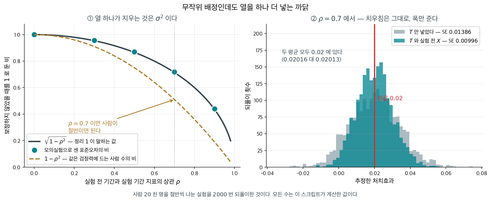
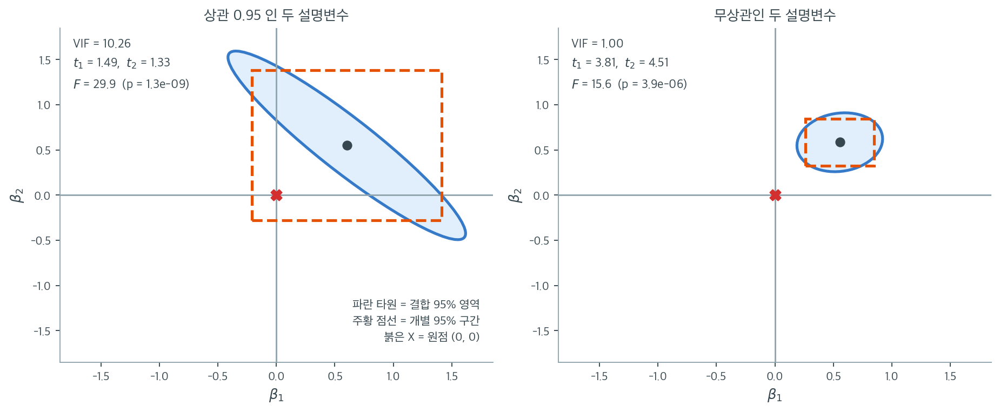

# 일반 OLS 추정량의 표집분포

## 개요

온라인 실험의 처치효과는 보통 두 군의 평균 차로 적지만, 그것은 **처치 지시변수 하나만 넣은 회귀의 기울기**와 같은 수다. 그렇게 보면 열을 하나 더 넣는 길이 열린다 — 실험이 시작되기 **전** 기간의 같은 지표다. 무작위 배정이라 처치와 무관하므로 계수는 평균적으로 꿈쩍하지 않고 **표준오차만 줄어든다.** 줄어드는 비가 $\sqrt{1-\rho^2}$ 여서 $\rho = 0.7$ 이면 표준오차가 $0.01413$ 에서 $0.01013$ 으로, 곧 $0.717$ 배가 된다($\sqrt{1-0.49} = 0.714$). 사람 수로 환산하면 $1-\rho^2 = 0.51$ 배다. 아래 상자가 그 셈을 따라간다.

그 표준오차가 어디서 오는지가 이 쪽의 주제다. 계수들의 공분산이 $\sigma^2(\mathbf X^\top\mathbf X)^{-1}$ 이므로 설명변수들이 서로 닮으면 그 역행렬이 커진다. $n = 60$, 참 계수가 둘 다 $0.6$ 인 자료에서 두 설명변수의 상관이 $0.95$ 이면 부풀림이 $1/(1-0.95^2) = 10.26$ 배이고 표준오차는 그 제곱근인 $3.2$ 배다. 그래서 $\mathrm{SE}$ 가 $0.404$ 와 $0.415$, $t_1 = 1.49$, $t_2 = 1.33$ 으로 **둘 다 유의하지 않다.**

그런데 두 계수가 동시에 $0$ 이라는 가설의 $F$ 검정은 $F = 29.9$ 로 압도적으로 기각된다. 회귀표의 $t$ 열만 읽으면 「쓸모 있는 변수가 없다」가 되고, 같은 자료가 「적어도 하나는 $0$ 이 아니다」라고 말한다. 설계에서 두 변수의 상관이 $0$ 이면 같은 실험에서 표준오차가 $0.146$ 과 $0.130$ 으로 줄고 $t$ 가 $3.81$ 과 $4.51$ 이 된다.

둘이 어긋난 쪽이 고장 난 것은 아니다. 자료는 $\beta_1 + \beta_2$ 가 얼마인지는 아주 잘 알고 그 합을 **어떻게 나눌지**는 거의 모르는데, $t$ 열은 나누는 쪽을 묻고 $F$ 는 합을 묻기 때문이다. 개별 계수의 $t$ 를 나란히 늘어놓고 읽는 일은 언제 허락되고 언제 거짓이 되는가.

_확인한 곳 — 이 쪽 「실험 전 기간을 열 하나로 넣으면」 상자와 그 출처 줄_

이 절은 단순선형회귀의 추론 결과를 행렬 표기를 써서 **다중선형회귀** 상황으로 확장한다. OLS 계수벡터 $\hat{\beta}$, 잔차분산 추정량 $s^2$, 개별 계수를 검정하는 $t$ 통계량의 표집분포를 유도한다.

---

## 1. 준비: 다중선형회귀 모형

행렬 형태의 모형을 생각하자.

$$
\mathbf{y} = \mathbf{X}\beta + \varepsilon
$$

여기서

- $\mathbf{y}$는 $N \times 1$ 반응벡터,
- $\mathbf{X}$는 $N \times (p+1)$ 설계행렬(절편 열을 포함한다),
- $\beta$는 $(p+1) \times 1$ 미지 계수벡터,
- $\varepsilon \sim N(\mathbf{0}, \sigma^2 I_N)$는 오차벡터이다.

OLS 추정량은

$$
\hat{\beta} = (\mathbf{X}^\top \mathbf{X})^{-1} \mathbf{X}^\top \mathbf{y}
$$

---

## 2. 베타 추정량의 표집분포

<div class="thmbox" markdown>

### 정리 1. 회귀계수 추정량의 표집분포 { .thm }

선형회귀 모형의 가정 아래에서

$$
\hat{\beta} \sim N\!\left(\beta,\; \sigma^2 (\mathbf{X}^\top \mathbf{X})^{-1}\right)
$$

곧 $\hat{\beta}$는 다음의 정규분포를 따른다.

- **평균**: $E(\hat{\beta}) = \beta$ (불편),
- **공분산**: $\text{Var}(\hat{\beta}) = \sigma^2 (\mathbf{X}^\top \mathbf{X})^{-1}$.

</div>

??? proof "증명"


    OLS 공식에 $\mathbf{y} = \mathbf{X}\beta + \varepsilon$을 대입하면

    $$
    \hat{\beta} = (\mathbf{X}^\top \mathbf{X})^{-1} \mathbf{X}^\top (\mathbf{X}\beta + \varepsilon) = \beta + (\mathbf{X}^\top \mathbf{X})^{-1} \mathbf{X}^\top \varepsilon
    $$

    **불편성**: $E(\varepsilon) = \mathbf{0}$이므로

    $$
    E(\hat{\beta}) = \beta + (\mathbf{X}^\top \mathbf{X})^{-1} \mathbf{X}^\top E(\varepsilon) = \beta
    $$

    **공분산**: $\mathbf{A} = (\mathbf{X}^\top \mathbf{X})^{-1} \mathbf{X}^\top$라 두면 $\hat{\beta} - \beta = \mathbf{A}\varepsilon$이고

    $$
    \text{Var}(\hat{\beta}) = \mathbf{A}\,\text{Var}(\varepsilon)\,\mathbf{A}^\top = \mathbf{A}(\sigma^2 I_N)\mathbf{A}^\top = \sigma^2 \mathbf{A}\mathbf{A}^\top
    $$

    $\mathbf{A}\mathbf{A}^\top$를 계산하면

    $$
    \mathbf{A}\mathbf{A}^\top = (\mathbf{X}^\top\mathbf{X})^{-1}\mathbf{X}^\top\mathbf{X}(\mathbf{X}^\top\mathbf{X})^{-1} = (\mathbf{X}^\top\mathbf{X})^{-1}
    $$

    따라서 $\text{Var}(\hat{\beta}) = \sigma^2(\mathbf{X}^\top\mathbf{X})^{-1}$이다.

    **정규성**: $\hat{\beta} - \beta = \mathbf{A}\varepsilon$은 다변량정규벡터 $\varepsilon$의 선형변환이므로 $\hat{\beta}$ 자체도 다변량정규이다. $\square$

### 함의

이 결과는 다중회귀의 모든 추론의 토대가 된다. 개별 계수의 신뢰구간, 결합 신뢰영역, 가설검정, 예측구간이 모두 이 분포 결과에서 따라 나온다.

<div class="aibox" markdown>

**AI로 보는 통계학 1.** 실험 전 기간을 열 하나로 넣으면

정리 1 의 공분산 $\sigma^2(\mathbf X^\top \mathbf X)^{-1}$ 에는 줄일 수 있는 자리가 둘뿐이다 — **$\sigma^2$ 과 $\mathbf X^\top \mathbf X$**. 뒤엣것을 키우는 길은 사람을 더 모으는 것이고, 앞엣것을 줄이는 길은 **설명되는 몫을 늘리는 것**이다. 온라인 실험을 돌리는 쪽에서 날마다 계산하는 것이 이 둘 사이의 거래다.

A/B 검정의 처치효과는 보통 두 군의 평균 차로 적지만, 그것은 **처치 지시변수 $T$ 하나만 넣은 회귀의 기울기**와 같은 수다. 여기에 열을 하나 더 넣는다 — **실험이 시작되기 전 기간의 같은 지표** $X$ 다. 무작위 배정이므로 $T$ 와 $X$ 는 무관하고, 그래서 **$T$ 의 계수는 평균적으로 꿈쩍도 하지 않는다.** 달라지는 것은 정리 1 의 $\sigma^2$ 뿐이다. $Y$ 와 $X$ 의 상관이 $\rho$ 이면

$$
\sigma^2_{Y \mid X} = \sigma^2_Y\,(1 - \rho^2)
\qquad\Longrightarrow\qquad
\frac{\mathrm{SE}_{\text{보정}}}{\mathrm{SE}_{\text{그냥}}} = \sqrt{1 - \rho^2}
$$

이고, 표준오차가 아니라 **사람 수**로 환산하면 $1 - \rho^2$ 배다. 사람이 날마다 비슷하게 행동할수록 $\rho$ 가 커지므로, 이 거래는 자료가 쌓인 쪽에 유리하다. 이 방법은 $2013$ 년 논문 이후 **CUPED** 라는 약칭으로 불린다.

```python
import numpy as np

# 사람 20,000 명을 절반씩 나눈 실험. rho 는 실험 전 기간과 실험 기간의 상관이다.
n, tau, rho = 20_000, 0.02, 0.7
rng = np.random.default_rng(21)
T = rng.permutation((np.arange(n) < n // 2).astype(float))
X = rng.normal(0, 1, n)                                   # 실험 전 기간의 지표
Y = 0.5 + tau * T + rho * X + np.sqrt(1 - rho**2) * rng.normal(0, 1, n)
for name, M in (("T 만", np.c_[np.ones(n), T]),
                ("T + X", np.c_[np.ones(n), T, X])):
    b = np.linalg.lstsq(M, Y, rcond=None)[0]
    e = Y - M @ b
    se = np.sqrt((e**2).sum() / (n - M.shape[1])
                 * np.diag(np.linalg.inv(M.T @ M)))
    print(f"{name:6s} 처치효과 {b[1]:+.5f}  SE {se[1]:.5f}  t {b[1]/se[1]:5.2f}")
```

출력:

```
T 만    처치효과 +0.00057  SE 0.01413  t  0.04
T + X  처치효과 +0.01325  SE 0.01013  t  1.31
```

한 번의 실험에서 두 추정값은 **서로 다르다.** 같은 것은 평균이지 한 번의 값이 아니고, 이번 표본에서 보정한 쪽이 참값 $0.02$ 에 더 가까운 것은 운이다. 체계적으로 달라지는 쪽은 **표준오차**다 — $0.01413$ 에서 $0.01013$ 으로 비가 $0.717$ 이고, 위 식이 말하는 $\sqrt{1 - 0.7^2} = 0.714$ 다.



되풀이해서 보면 식이 그대로 나온다. $\rho = 0.7$ 에서 표준오차가 $0.01386$ 에서 $0.00996$ 으로 줄어 비가 $0.719$ 인데, $\sqrt{1 - 0.7^2} = 0.714$ 다. 사람 수로는 $0.517$ 배 — **절반이면 된다.** $\rho = 0.9$ 면 $0.193$ 배다. 오른쪽 판이 중요한 쪽을 보여 준다. 두 히스토그램의 **중심이 같다.** 보정한 쪽의 평균이 $0.02013$, 보정하지 않은 쪽이 $0.02016$ 으로 둘 다 참값 $0.02$ 에 있다. 공짜로 얻은 것이 아니라, 정리 1 이 말하는 $\sigma^2$ 을 실제로 줄인 것이다.

다만 $X$ 는 **처치가 닿기 전의 값**이어야 한다. 처치의 영향을 받은 변수를 같은 자리에 넣으면 $\sigma^2$ 과 함께 $T$ 의 계수 자체가 바뀌어, 줄어든 표준오차가 엉뚱한 수를 더 정밀하게 재게 된다 — 11.3절 [회귀계수의 가설검정](../testing_coefficients/hypothesis_tests.md)의 상자가 같은 덫의 다른 얼굴이다.

_확인한 곳 — 실험 전 기간의 자료를 공변량으로 쓰는 방법을 제안한 논문의 서지(알렉스 덩·야 쉬·론 코하비·토비 워커, 「Improving the sensitivity of online controlled experiments by utilizing pre-experiment data」, Proceedings of the sixth ACM international conference on Web search and data mining, $2013$, $123$–$132$쪽, [DOI 10.1145/2433396.2433413](https://doi.org/10.1145/2433396.2433413))는 Crossref 의 서지 기록에서 확인했다. **논문 본문은 읽지 못했으므로 그 논문이 보고한 수치는 여기에 적지 않는다** · 약칭 **CUPED** 로 불린다는 것은 이 방법을 소개하는 여러 이차 자료가 한결같이 그렇게 부르는 것을 보았을 뿐, 논문 본문에서 확인하지는 못했다 · 위 식 $\sigma^2_{Y\mid X} = \sigma^2_Y(1-\rho^2)$ 과 표의 모든 수는 정리 1 에서 직접 유도하고 모의실험으로 확인한 값이다_

</div>

---

## 3. s 제곱의 표집분포

<div class="thmbox" markdown>

### 정리 2. 잔차분산 추정량의 표집분포 { .thm }

잔차분산 추정량

$$
s^2 = \frac{1}{N - p - 1} \sum_{i=1}^N (y^{(i)} - \hat{y}^{(i)})^2
$$

의 표집분포는 다음과 같다.

$$
\frac{(N - p - 1)\,s^2}{\sigma^2} \sim \chi^2_{N-p-1}
$$

동등하게

$$
s^2 \sim \sigma^2 \frac{\chi^2_{N-p-1}}{N - p - 1}
$$

</div>

??? proof "증명"


    **1단계: 잔차를 사영으로 표현.** 모자행렬 $\mathbf{P} = \mathbf{X}(\mathbf{X}^\top\mathbf{X})^{-1}\mathbf{X}^\top$와 잔차생성행렬 $\mathbf{M} = I_N - \mathbf{P}$를 정의하자. 잔차벡터는

    $$
    \mathbf{e} = \mathbf{y} - \mathbf{X}\hat{\beta} = (I_N - \mathbf{P})\mathbf{y} = \mathbf{M}\varepsilon
    $$

    마지막 등식에는 $\mathbf{M}\mathbf{X} = \mathbf{0}$을 썼다.

    **2단계: 잔차제곱합을 이차형식으로.**

    $$
    \text{RSS} = \mathbf{e}^\top\mathbf{e} = \varepsilon^\top \mathbf{M}^\top \mathbf{M}\,\varepsilon = \varepsilon^\top \mathbf{M}\,\varepsilon
    $$

    $\mathbf{M}$이 대칭이고 멱등($\mathbf{M}^2 = \mathbf{M}$)이기 때문이다.

    **3단계: 카이제곱분포.** $\varepsilon \sim N(\mathbf{0}, \sigma^2 I_N)$이고 $\mathbf{M}$이 계수 $\text{tr}(\mathbf{M}) = N - (p+1) = N - p - 1$인 대칭 멱등행렬이므로

    $$
    \frac{\varepsilon^\top \mathbf{M}\,\varepsilon}{\sigma^2} = \frac{\text{RSS}}{\sigma^2} \sim \chi^2_{N-p-1}
    $$

    **4단계: 결론.** 자유도로 나누면

    $$
    s^2 = \frac{\text{RSS}}{N - p - 1} \sim \sigma^2\frac{\chi^2_{N-p-1}}{N - p - 1} \qquad \square
    $$

### 주요 성질

**불편성**: $E(s^2) = \sigma^2$이므로 $s^2$은 오차분산의 불편추정량이다.

**자유도**: 자유도 $N - p - 1$은 관측값 $N$개에서 추정한 모수 $p + 1$개를 뺀 것을 반영한다.

**$\hat{\beta}$와의 독립성**: 정규성 가정 아래에서 $s^2$과 $\hat{\beta}$는 통계적으로 독립이다. 이 독립성은 $t$ 검정이 타당하기 위한 필수 조건이다.

---

## 4. 개별 회귀계수의 t 통계량

<div class="thmbox" markdown>

### 정리 3. 개별 회귀계수의 t 통계량 { .thm }

귀무가설 $H_0: \beta_j = 0$ 아래에서 검정통계량

$$
t_j = \frac{\hat{\beta}_j}{s\sqrt{v_j}} \sim t_{N-p-1}
$$

이다. 여기서 $v_j = \left((\mathbf{X}^\top\mathbf{X})^{-1}\right)_{jj}$는 $(\mathbf{X}^\top\mathbf{X})^{-1}$의 $j$번째 대각원소이다.

</div>

??? proof "증명"


    **1단계: $H_0$ 아래 $\hat{\beta}_j$의 분포.** $\hat{\beta}$의 표집분포에서 각 성분은

    $$
    \hat{\beta}_j \sim N(\beta_j, \sigma^2 v_j)
    $$

    $H_0: \beta_j = 0$ 아래에서는

    $$
    \frac{\hat{\beta}_j}{\sigma\sqrt{v_j}} \sim N(0, 1)
    $$

    **2단계: 분모의 독립 카이제곱.** $s^2$의 분포에서

    $$
    \frac{(N-p-1)s^2}{\sigma^2} \sim \chi^2_{N-p-1}
    $$

    이고 이는 $\hat{\beta}_j$와 독립이다($\hat{\beta}$는 $\mathbf{P}\varepsilon$에, $s^2$은 $\mathbf{M}\varepsilon$에 의존하며 $\mathbf{PM} = \mathbf{0}$이기 때문이다).

    **3단계: $t$ 비 만들기.** $t$ 분포의 정의에 따라

    $$
    t_j = \frac{\hat{\beta}_j / (\sigma\sqrt{v_j})}{\sqrt{s^2/\sigma^2}} = \frac{\hat{\beta}_j}{s\sqrt{v_j}} \sim t_{N-p-1} \qquad \square
    $$

### 다른 변수를 고려한 뒤에도 기여하는가

$t$ 통계량 $t_j$는 **다른 모든 설명변수를 고려한 뒤에도** $j$번째 설명변수가 모형에 기여하는지를 검정한다. 절댓값이 크면 $\beta_j \neq 0$이라는 증거, 곧 $j$번째 변수가 $y$에 통계적으로 유의한 부분효과를 갖는다는 증거가 된다.

분모 $s\sqrt{v_j}$가 $\hat{\beta}_j$의 **표준오차**이다.

$$
\text{SE}(\hat{\beta}_j) = s\sqrt{v_j}
$$

### 일반 신뢰구간

$\beta_j$에 대한 $(1 - \alpha)$ 신뢰구간은

$$
\hat{\beta}_j \pm t_{N-p-1}(1 - \alpha/2)\; s\sqrt{v_j}
$$

### 개별 구간이 놓치는 것



개별 $t$ 검정을 나란히 늘어놓으면 마치 계수들을 하나씩 따로 본 것처럼 느껴진다. 그러나 $(\mathbf{X}^\top\mathbf{X})^{-1}$의 비대각 원소가 0이 아닌 한 추정값들은 서로 얽혀 있고, 그 얽힘은 개별 구간에 전혀 나타나지 않는다. 위 그림이 그 어긋남이다. 두 패널 모두 $n = 60$, 참 계수 $\beta_1 = \beta_2 = 0.6$, $\sigma = 1$로 같고 다른 것은 두 설명변수의 상관뿐이다. 파란 타원이 $(\beta_1, \beta_2)$의 결합 95% 신뢰영역이고, 주황 점선 네모는 두 개별 95% 신뢰구간을 곱해 만든 직사각형이며, 붉은 X가 원점 $(0, 0)$이다.

왼쪽은 두 설명변수의 상관이 $0.95$인 경우다. VIF $= 1/(1-0.95^2) = 10.26$이므로 표준오차가 공선이 없을 때의 $\sqrt{10.26} \approx 3.2$배로 부풀어 $\mathrm{SE}$가 $0.404$와 $0.415$가 되었고, $t_1 = 1.49$, $t_2 = 1.33$으로 **둘 다 유의하지 않다.** 그런데 두 계수가 동시에 0이라는 결합가설의 $F$ 검정은 $F = 29.9$, $p = 1.3\times10^{-9}$로 압도적으로 기각된다. 그림이 그 모순을 풀어 준다. 붉은 X는 주황 네모 **안**에 있지만(각 계수를 따로 보면 0이 배제되지 않는다) 파란 타원 **밖**에 있다(두 계수가 동시에 0인 것은 배제된다). 타원이 오른쪽 아래로 길게 누운 것은 $\hat{\beta}_1$과 $\hat{\beta}_2$의 상관이 $-0.95$라는 뜻이다. 자료는 $\beta_1 + \beta_2$가 얼마인지는 아주 잘 알지만 그 합을 둘로 **어떻게 나눌지**는 거의 모른다.

오른쪽은 같은 실험을 상관 0인 설계로 한 것이다. VIF $= 1.00$이고 표준오차가 $0.146$, $0.130$으로 3분의 1 안팎까지 줄어 $t_1 = 3.81$, $t_2 = 4.51$이 되었다. 타원이 거의 원에 가깝고 네모와 포개져, 개별 구간을 보나 결합 영역을 보나 결론이 같다. **비대각 원소가 0일 때만 개별 구간을 나란히 읽어도 된다**는 것을 이 대비가 말해 준다. 그러므로 회귀표에서 모든 $t$가 작다는 이유로 "쓸모 있는 변수가 없다"고 결론짓기 전에, 전체 $F$ 검정과 설명변수들 사이의 상관을 반드시 함께 보아야 한다.

---

## 5. 문제: 선형회귀 출력 재현

<div class="probox" markdown>

**문제 1.** <span class="diff easy" title="쉬움"></span>

Advertising 자료를 써서 모형 $\text{Sales} \sim \text{TV} + \text{Radio} + \text{Newspaper}$의 주요 회귀 출력 — 계수, 표준오차, $t$ 통계량, $p$값, 신뢰구간 — 을 밑바닥부터 계산해 재현하라.

</div>

??? success "풀이"
    **구현**

    ```python
    import numpy as np
    import pandas as pd
    from scipy import stats

    # 광고비와 매출 자료를 읽는다
    dataset_url = (
        'https://raw.githubusercontent.com/justmarkham/'
        'scikit-learn-videos/8545c74961398def7724501648fd504dbf061b41/data/Advertising.csv'
    )
    advertising_data = pd.read_csv(dataset_url, usecols=[1, 2, 3, 4])

    # 훈련 70%, 시험 30% 로 나눈다
    total_observations = advertising_data.shape[0]
    test_set_ratio = 0.3
    train_count = int(total_observations * (1 - test_set_ratio))
    training_data = advertising_data.iloc[:train_count]

    # 반응벡터 y 와 설계행렬 X. 첫 열의 1 이 절편에 대응한다
    y = np.array(training_data.Sales).reshape(-1, 1)
    n = y.shape[0]
    X = np.concatenate(
        (np.ones((n, 1)), np.array(training_data.iloc[:, :-1])),
        axis=1
    )
    p_plus_1 = X.shape[1]  # number of parameters (including intercept)

    # 최소제곱해: beta_hat = (X'X)^-1 X'y
    beta_hat = np.linalg.inv(X.T @ X) @ X.T @ y

    # 적합값과 잔차 표준오차
    y_hat = X @ beta_hat
    s = np.sqrt(np.sum((y - y_hat) ** 2) / (n - p_plus_1))

    # 분산-공분산 행렬 (X'X)^-1. 계수의 표준오차가 여기 대각선에서 나온다
    cov_matrix = np.linalg.inv(X.T @ X)

    # 회귀 출력표를 찍는다
    print("=" * 100)
    print("\t\t    coef    std err \t     t      P>|t|"
          "     [0.025      0.975] ")
    print("-" * 100)

    variable_names = ["Intercept", "TV", "Radio", "Newspaper"]

    for name, j in zip(variable_names, range(p_plus_1)):
        coef = beta_hat[j, 0]
        v_j = cov_matrix[j, j]
        se = s * np.sqrt(v_j)
        t_stat = coef / se
        p_val = 2 * stats.t(n - p_plus_1).sf(np.abs(t_stat))
        ci_lower = coef - stats.t(n - p_plus_1).ppf(0.975) * se
        ci_upper = coef + stats.t(n - p_plus_1).ppf(0.975) * se
        print(f"{name:10}    {coef:10.4f} {se:10.3f} "
              f"{t_stat:10.3f} {p_val:10.3f} "
              f"{ci_lower:10.3f} {ci_upper:10.3f}")

    print("=" * 100)
    ```

    출력:

    ```
    ====================================================================================================
    		    coef    std err 	     t      P>|t|     [0.025      0.975] 
    ----------------------------------------------------------------------------------------------------
    Intercept         3.0451      0.391      7.782      0.000      2.271      3.819
    TV                0.0470      0.002     27.653      0.000      0.044      0.050
    Radio             0.1797      0.011     16.665      0.000      0.158      0.201
    Newspaper        -0.0030      0.007     -0.428      0.669     -0.017      0.011
    ====================================================================================================
    ```

    계수마다 추정값, 표준오차, $t$, p-값을 나란히 놓은 표다. $t = \hat\beta / \text{SE}(\hat\beta)$라는 정의를 표에서 직접 확인할 수 있다.

    출력(훈련자료 140개 관측값):

    ```text
                    coef    std err        t      P>|t|     [0.025      0.975]
    Intercept     3.0451      0.391      7.782      0.000      2.271      3.819
    TV            0.0470      0.002     27.653      0.000      0.044      0.050
    Radio         0.1797      0.011     16.665      0.000      0.158      0.201
    Newspaper    -0.0030      0.007     -0.428      0.669     -0.017      0.011
    ```

    이 값들은 `statsmodels`의 `sm.ols('Sales ~ TV + Radio + Newspaper', train_data).fit().summary()`가 내놓는 표와 정확히 일치한다.

    **출력 읽기**

    회귀표의 각 행은 다음을 담고 있다.

    - **coef**: OLS 추정값 $\hat{\beta}_j$.
    - **std err**: 표준오차 $s\sqrt{v_j}$. 여기서 $v_j = ((\mathbf{X}^\top\mathbf{X})^{-1})_{jj}$이다.
    - **t**: $t$ 통계량 $t_j = \hat{\beta}_j / (s\sqrt{v_j})$.
    - **P>|t|**: $t_{N-p-1}$에서 얻은 양측 $p$값.
    - **[0.025, 0.975]**: 95% 신뢰구간 $\hat{\beta}_j \pm t_{N-p-1}(0.975) \cdot s\sqrt{v_j}$.

    $p$값이 0.05보다 작으면, 동등하게 95% 신뢰구간이 0을 포함하지 않으면 그 설명변수는 유의수준 5%에서 통계적으로 유의하다. 위 표에서 Newspaper는 $p = 0.669$이고 신뢰구간 $(-0.017, 0.011)$이 0을 포함하므로 유의하지 않다.

!!! info "참고"

    - [Khan Academy: Using Least-Squares Regression Output](https://www.khanacademy.org/math/ap-statistics/bivariate-data-ap/least-squares-regression/v/using-least-squares-regression-output)
    - [Khan Academy: Interpreting Computer Regression Data](https://www.khanacademy.org/math/ap-statistics/bivariate-data-ap/assessing-fit-least-squares-regression/v/interpreting-computer-regression-data)

---

## 연습문제

<div class="drillbox" markdown>

**연습문제 1.** <span class="diff easy" title="쉬움"></span>
설명변수가 $p = 4$개이고 $n = 50$인 다중회귀에서 개별 계수의 $t$ 검정과 전체 유의성 $F$ 검정의 자유도를 유도하라.

</div>

??? success "풀이"

    - **개별 계수 $\beta_j$의 $t$ 검정:** $H_0: \beta_j = 0$ 아래에서 $t = \hat{\beta}_j / \text{SE}(\hat{\beta}_j) \sim t_{n-p-1} = t_{45}$이다.

    - **전체 유의성 $F$ 검정:** $H_0: \beta_1 = \beta_2 = \beta_3 = \beta_4 = 0$을 검정한다. $H_0$ 아래에서 $F = (\text{SSR}/p) / (\text{SSE}/(n-p-1)) \sim F_{p, n-p-1} = F_{4, 45}$이다.

<div class="drillbox" markdown>

**연습문제 2.** <span class="diff med" title="중간"></span>
어떤 회귀 출력에서 설명변수 $X_3$이 $\hat{\beta}_3 = 2.1$, $p = 0.04$였는데, 모형에 $X_4$를 넣으니 $\hat{\beta}_3$이 $0.3$으로 바뀌고 $p = 0.72$가 되었다. 이 현상을 설명하라.

</div>

??? success "풀이"
    **다중공선성** 또는 **교란**의 결과이다. $X_4$를 넣으면

    1. $X_3$과 $X_4$가 상관되어 있다면 $X_4$가 이전에 $X_3$이 설명하던 변동을 "흡수"한다. ($X_4$를 고정한) $X_3$의 부분효과는 ($X_4$를 무시한) 주변효과보다 훨씬 작다.

    2. 다중공선성 때문에 $\hat{\beta}_3$의 표준오차가 커지고(VIF가 커지고) $t$ 통계량이 더욱 작아진다.

    이는 계수 추정값과 그 유의성이 모형에 어떤 다른 설명변수가 들어 있는지에 달려 있음을 보여준다. 유의하던 것이 유의하지 않게 바뀌었다는 것은 $X_3$의 겉보기 효과가 부분적으로(또는 상당 부분) $X_4$와의 상관에서 비롯되었음을 시사한다.

<div class="drillbox" markdown>

**연습문제 3.** <span class="diff med" title="중간"></span>
전체 모형의 $F$ 검정이 유의하더라도 어떤 개별 설명변수의 $t$ 검정이 유의하리라는 보장은 없다. 그 이유를 설명하고 개념적인 예를 구성하라.

</div>

??? success "풀이"
    $F$ 검정은 결합가설 $H_0: \beta_1 = \cdots = \beta_p = 0$을 검정한다. 개별 $t$ 검정은 각 $\beta_j = 0$을 따로 검정한다. 설명변수들이 강하게 상관되어 있으면 둘은 어긋날 수 있다.

    **예:** 상관이 $r = 0.95$인 두 설명변수 $X_1$과 $X_2$가 모두 $Y$를 잘 예측한다고 하자. 둘이 함께 상당한 분산을 설명하므로 $F$ 검정은 유의하다. 그러나 개별적으로는 공유된 분산이 둘로 갈라지고 다중공선성으로 표준오차가 부풀려져($\text{VIF} = 1/(1-0.95^2) \approx 10.3$) 두 $t$ 검정 모두 유의하지 않을 수 있다. 어느 쪽도 상대를 넘어서는 기여를 별로 하지 못하지만, 함께 보면 분명히 중요하다.

<div class="drillbox" markdown>

**연습문제 4.** <span class="diff med" title="중간"></span>
문제 1의 회귀 출력표에서 표준오차는 소수 셋째 자리까지만 찍혀 있다. TV 행은 `std err` 가 $0.002$인데 신뢰구간은 $(0.044,\ 0.050)$이다.

(a) `coef` 와 `t` 열만 써서 TV와 Newspaper의 표준오차를 소수 다섯째 자리까지 되살려라.

(b) $t_{136}(0.975) = 1.9776$을 쓴다. (a)에서 되살린 표준오차로 TV의 95% 신뢰구간을 계산하고, 찍힌 값 $0.002$를 그대로 넣은 결과와 비교하라. 어느 쪽이 표의 $(0.044,\ 0.050)$과 맞는가.

(c) $v_{\text{News}} / v_{\text{TV}}$를 구하라. $s$를 모르는데도 이 비를 구할 수 있는 까닭을 밝히고, 반면 $v_j$ 자체는 이 표만으로 구할 수 없음을 설명하라.

</div>

??? success "풀이"
    **(a)** $t_j = \hat\beta_j / \mathrm{SE}(\hat\beta_j)$이므로 $\mathrm{SE}(\hat\beta_j) = \hat\beta_j / t_j$이다.

    $$
    \mathrm{SE}(\hat\beta_{\text{TV}}) = \frac{0.0470}{27.653} = 0.00170, \qquad
    \mathrm{SE}(\hat\beta_{\text{News}}) = \frac{-0.0030}{-0.428} = 0.00701
    $$

    더 정확히는 $0.0016996$과 $0.0070093$이다. 표의 $0.002$는 $0.0017$을 반올림한 것이므로 실제보다 약 18% 큰 값이다.

    **(b)** 되살린 표준오차로는

    $$
    0.0470 \pm 1.9776 \times 0.0016996 = 0.0470 \pm 0.00336 = (0.04364,\ 0.05036)
    $$

    이고 소수 셋째 자리로 반올림하면 $(0.044,\ 0.050)$으로 표와 **일치한다.** 찍힌 $0.002$를 그대로 쓰면

    $$
    0.0470 \pm 1.9776 \times 0.002 = 0.0470 \pm 0.00396 = (0.04304,\ 0.05096)
    $$

    곧 $(0.043,\ 0.051)$로 표와 **어긋난다.**

    **(c)** $s$는 모든 행에 공통이므로 표준오차의 비에서 $s$가 약분된다.

    $$
    \frac{\mathrm{SE}(\hat\beta_{\text{News}})}{\mathrm{SE}(\hat\beta_{\text{TV}})}
    = \frac{s\sqrt{v_{\text{News}}}}{s\sqrt{v_{\text{TV}}}}
    = \sqrt{\frac{v_{\text{News}}}{v_{\text{TV}}}}
    = \frac{0.0070093}{0.0016996} = 4.124
    $$

    따라서 $v_{\text{News}} / v_{\text{TV}} = 4.124^2 = 17.0$이다. 그러나 $v_j$ 하나만 떼어내려면 $\mathrm{SE}(\hat\beta_j) = s\sqrt{v_j}$에서 $s$를 알아야 하고, $s$(잔차 표준오차)는 이 표에 찍혀 있지 않다. 미지수가 둘인 식이 하나뿐이므로 비만 결정된다.

    해석: 표준오차의 셋째 자리 반올림은 신뢰구간의 끝자리를 바꿀 만큼 거칠다. 회귀표에서 구간을 손으로 다시 맞춰 볼 때는 반올림된 `std err` 가 아니라 $\hat\beta_j / t_j$로 표준오차를 되살리는 쪽이 안전하다.

<div class="drillbox" markdown>

**연습문제 5.** <span class="diff med" title="중간"></span>
문제 1의 표에서 Newspaper 행은 $\hat\beta = -0.0030$, $t = -0.428$, $p = 0.669$, 95% 신뢰구간 $(-0.017,\ 0.011)$이다. 자유도는 $N - p - 1 = 140 - 3 - 1 = 136$이고 $t_{136}(0.975) = 1.9776$이다.

(a) 신뢰구간이 0을 포함하는 것과 $\lvert t \rvert < t_{136}(0.975)$가 같은 말임을 보여라.

(b) 신뢰수준을 낮추면 구간이 좁아지다가 어느 순간 0을 밖으로 밀어낸다. 0을 배제하는 가장 큰 신뢰수준을 구하고, 그것이 $p$값과 어떤 관계인지 밝혀라.

(c) 그 수준에서 "구간이 0을 포함하지 않는다"가 유의성의 증거가 되지 못하는 까닭을 말하라.

</div>

??? success "풀이"
    **(a)** $(1-\alpha)$ 신뢰구간은 $\hat\beta_j \pm t_{136}(1-\alpha/2)\,\mathrm{SE}$이다. 이 구간이 0을 담는다는 것은

    $$
    \lvert \hat\beta_j \rvert \le t_{136}(1-\alpha/2)\,\mathrm{SE}
    \iff \left\lvert \frac{\hat\beta_j}{\mathrm{SE}} \right\rvert = \lvert t_j \rvert \le t_{136}(1-\alpha/2)
    $$

    와 같다. $\alpha = 0.05$에서 $\lvert t \rvert = 0.428 < 1.9776$이므로 0이 구간 안에 있고, 이는 $p = 0.669 > 0.05$와 같은 사실의 다른 표현이다. 실제로 $-0.0030 \pm 1.9776 \times 0.0070093 = (-0.0169,\ 0.0109)$로 표의 $(-0.017,\ 0.011)$이 나온다.

    **(b)** 구간이 0을 간신히 밖으로 내보내는 경계는 $t_{136}(1-\alpha/2) = \lvert t \rvert = 0.428$인 때다. 따라서

    $$
    1 - \frac{\alpha}{2} = P(T_{136} \le 0.428) = 1 - \frac{p}{2} = 1 - 0.3347 = 0.6653
    $$

    곧 $\alpha = 0.669 = p$이고 임계 신뢰수준은 $1 - p = 0.331$, 약 **33.1%** 이다. 일반적으로 **"0을 배제하는 가장 큰 신뢰수준 $=$ $1 - p$값"** 이다. $p$값을 신뢰구간 쪽 언어로 옮긴 것이 바로 이 수준이다.

    **(c)** 33.1% 신뢰구간은 참값을 담을 확률이 셋에 한 번뿐인 구간이다. 동등하게 유의수준 $\alpha = 0.669$의 검정이고, $H_0$가 참일 때도 세 번에 두 번은 기각한다. 자료를 보고 나서 $p$값에 맞춰 $\alpha$를 고른 것이므로 순환이며, 어떤 계수든 이렇게 하면 "0을 배제"할 수 있다. 결론은 바뀌지 않는다. Newspaper는 유의하지 않다.

<div class="drillbox" markdown>

**연습문제 6.** <span class="diff hard" title="어려움"></span>
그림의 주황 점선 네모는 두 개별 95% 신뢰구간을 곱해 만든 직사각형이다. 이것을 $(\beta_1, \beta_2)$에 대한 결합영역으로 읽으면 신뢰수준이 얼마인지 따진다. 계산을 깔끔하게 하려고 $\sigma$를 안다고 보고 구간을 정규분위수 $z_{0.975} = 1.96$으로 만든다고 하자.

(a) 오른쪽 패널처럼 $(\mathbf X^\top\mathbf X)^{-1}$의 비대각 원소가 0이어서 $\hat\beta_1$과 $\hat\beta_2$가 독립이면, 직사각형이 참점 $(\beta_1, \beta_2)$를 담을 확률은 얼마인가.

(b) 왼쪽 패널은 $\mathrm{corr}(\hat\beta_1, \hat\beta_2) = -0.95$다. 직사각형의 포함확률이 $\rho$의 **부호**에는 전혀 달려 있지 않음을 보여라. 또 $\lvert \rho \rvert \to 1$일 때 그 확률이 어디로 가는지 말하라.

(c) 두 계수에 대한 구간을 **동시에** 95% 로 보장하려면 Bonferroni 보정으로 각 구간을 몇 % 신뢰수준으로 만들어야 하는가. $t_{57}(0.975) = 2.0025$, $t_{57}(0.9875) = 2.3022$를 쓸 때 구간 길이는 몇 % 늘어나는가.

</div>

??? success "풀이"
    표준화한 변수를 $Z_j = (\hat\beta_j - \beta_j)/(\sigma\sqrt{v_j})$라 두자. 정리 1에서 $(Z_1, Z_2)$는 평균 $\mathbf 0$, 분산 1, 상관 $\rho$인 이변량정규이고, 직사각형이 참점을 담는 사건은

    $$
    \{\lvert Z_1 \rvert \le 1.96\} \cap \{\lvert Z_2 \rvert \le 1.96\}
    $$

    이다.

    **(a)** 독립이면 두 사건의 확률이 곱해지므로

    $$
    P = 0.95 \times 0.95 = 0.9025
    $$

    곧 네모는 95% 영역이 아니라 **약 90% 영역**이다. 파란 타원(결합 95%)과 바로 비교하면 안 되는 첫 번째 이유가 이것이다.

    **(b)** 사건이 $Z_2 \mapsto -Z_2$라는 뒤집기에 대해 불변하다는 점이 핵심이다. $\lvert -Z_2 \rvert = \lvert Z_2 \rvert$이므로 사건은 그대로이고, 한편 $(Z_1, -Z_2)$는 상관이 $-\rho$인 이변량정규다. 따라서

    $$
    P_\rho(\lvert Z_1 \rvert \le 1.96,\ \lvert Z_2 \rvert \le 1.96) = P_{-\rho}(\lvert Z_1 \rvert \le 1.96,\ \lvert Z_2 \rvert \le 1.96)
    $$

    이고 확률은 $\lvert \rho \rvert$에만 달려 있다. $\lvert \rho \rvert \to 1$이면 $Z_2 \approx \pm Z_1$이어서 두 사건이 같은 사건으로 붙고 확률은 $0.95$로 올라간다. 중간값을 수치로 보면 $\lvert \rho \rvert = 0.95$에서 $0.9354$, $\lvert \rho \rvert = 0.5$에서 $0.9093$으로 $0.9025$와 $0.95$ 사이를 메운다. 그러므로 직사각형의 실제 신뢰수준은 $0.9025$ 이상 $0.95$ 미만이고, 공선이 심할수록 $0.95$에 가까워진다. 포함확률은 그렇게 비슷해지는데도 **영역의 모양**은 전혀 달라서(네모는 축에 평행하고 타원은 기울어 있다) 붉은 X가 네모 안이면서 타원 밖인 일이 생긴다.

    **(c)** Bonferroni는 전체 오류확률 $0.05$를 둘로 쪼개 각 구간에 $\alpha/2 = 0.025$씩 준다. 곧 각 구간을 $97.5\%$ 신뢰수준으로 만들어야 하고, 양쪽꼬리 구간이므로 분위수는 $t_{57}(1 - 0.025/2) = t_{57}(0.9875) = 2.3022$를 쓴다. 길이는

    $$
    \frac{2.3022}{2.0025} = 1.150
    $$

    배, 곧 약 **15% 길어진다.** 이렇게 늘린 네모는 보수적인($\ge 95\%$) 결합영역이지만 여전히 축에 평행해서, 왼쪽 패널에서처럼 추정값들이 기울어 얽혀 있는 정보는 담지 못한다. 그 기울기를 담는 것이 타원이다.

<div class="drillbox" markdown>

**연습문제 7.** <span class="diff hard" title="어려움"></span>
그림의 왼쪽 패널에서 개별 $t$는 $t_1 = 1.49$, $t_2 = 1.33$으로 둘 다 작은데 결합 $F$는 크다. 이 어긋남을 식으로 확인한다. 절편과 두 설명변수만 있는 모형에서 $\hat\beta_{1:2} = (\hat\beta_1, \hat\beta_2)^\top$의 추정 공분산행렬을 $s^2 \mathbf V$($\mathbf V$는 $(\mathbf X^\top\mathbf X)^{-1}$의 해당 $2 \times 2$ 블록)라 하고, $H_0: \beta_1 = \beta_2 = 0$의 검정통계량을

$$
F = \frac{1}{2}\,\hat\beta_{1:2}^\top (s^2\mathbf V)^{-1} \hat\beta_{1:2}
$$

로 둔다.

(a) $\rho = \mathrm{corr}(\hat\beta_1, \hat\beta_2)$를 쓰면

$$
F = \frac{t_1^2 - 2\rho\, t_1 t_2 + t_2^2}{2\,(1 - \rho^2)}
$$

임을 보여라.

(b) 오른쪽 패널($\rho = 0$, $t_1 = 3.81$, $t_2 = 4.51$)의 $F$를 구하라.

(c) 왼쪽 패널($t_1 = 1.49$, $t_2 = 1.33$, $\rho = -0.95$)의 $F$를 (a)로 계산하라. 쪽 본문의 $F = 29.9$와 어긋나는데, 왜 이 계산이 입력값의 끝자리에 그렇게 민감한지 밝히고 $\rho$를 $-0.90$, $-0.96$으로 바꿔 보아 확인하라.

</div>

??? success "풀이"
    **(a)** $\mathbf D = \mathrm{diag}(\sqrt{v_1}, \sqrt{v_2})$, $\mathbf R = \begin{pmatrix} 1 & \rho \\ \rho & 1\end{pmatrix}$로 쓰면 $\mathbf V = \mathbf D \mathbf R \mathbf D$이다($\mathbf V$의 비대각 원소를 $v_{12}$라 할 때 $\rho = v_{12}/\sqrt{v_1 v_2}$이고, $\hat\beta$의 공분산이 $\sigma^2 \mathbf V$이므로 이 $\rho$가 바로 $\mathrm{corr}(\hat\beta_1, \hat\beta_2)$다). 역행렬을 넣으면

    $$
    \hat\beta_{1:2}^\top (s^2 \mathbf V)^{-1} \hat\beta_{1:2}
    = \frac{1}{s^2}\,\hat\beta_{1:2}^\top \mathbf D^{-1}\mathbf R^{-1}\mathbf D^{-1} \hat\beta_{1:2}
    = \mathbf t^\top \mathbf R^{-1} \mathbf t
    $$

    인데 $\mathbf D^{-1}\hat\beta_{1:2}/s$의 $j$번째 성분이 $\hat\beta_j/(s\sqrt{v_j}) = t_j$이기 때문이다. 이제

    $$
    \mathbf R^{-1} = \frac{1}{1-\rho^2}\begin{pmatrix} 1 & -\rho \\ -\rho & 1\end{pmatrix}
    \implies \mathbf t^\top \mathbf R^{-1}\mathbf t = \frac{t_1^2 - 2\rho t_1 t_2 + t_2^2}{1 - \rho^2}
    $$

    이고 제약 개수 $2$로 나누면 주장한 식이다. $\square$

    **(b)** $\rho = 0$이면 교차항이 사라져 $F = (t_1^2 + t_2^2)/2$이다.

    $$
    F = \frac{3.81^2 + 4.51^2}{2} = \frac{14.516 + 20.340}{2} = 17.43
    $$

    $F_{2, 57}$에서 $p = 1.2 \times 10^{-6}$이다. 개별 $t$도 둘 다 유의하므로 여기서는 어긋남이 없다.

    **(c)** $t_1^2 = 2.2201$, $t_2^2 = 1.7689$, $-2\rho t_1 t_2 = 2(0.95)(1.49)(1.33) = 3.7652$, $1 - \rho^2 = 0.0975$이므로

    $$
    F = \frac{2.2201 + 3.7652 + 1.7689}{2 \times 0.0975} = \frac{7.7542}{0.195} = 39.8
    $$

    $F_{2,57}$에서 $p = 1.5 \times 10^{-11}$이다. 개별로는 $t_j^2 \approx 2$($p \approx 0.14$)에 지나지 않는데 결합으로는 압도적으로 기각된다. 그 차이를 만드는 것이 교차항 $-2\rho t_1 t_2 = +3.77$이다. $\rho < 0$인데 두 추정값이 **같은 부호로 비슷한 크기**라는 것은, 두 계수가 모두 0이라면 매우 일어나기 어려운 일이다. 자료는 $\beta_1 + \beta_2$ 방향으로는 분산이 아주 작아서 그 합이 0이 아님을 분명히 말해 준다.

    왜 $29.9$와 다른가. 분모 $1-\rho^2 = 0.0975$가 작아서 $\rho$의 셋째 자리가 결과를 크게 흔든다.

    | $\rho$ | $-0.90$ | $-0.93$ | $-0.9335$ | $-0.95$ | $-0.96$ |
    |---|---|---|---|---|---|
    | $F$ | $19.9$ | $28.4$ | $29.9$ | $39.8$ | $49.7$ |

    $\rho = -0.90$에서 $-0.96$으로 $0.06$만 움직여도 $F$가 두 배 반이 된다. 본문의 $0.95$는 설계에서 정한 두 설명변수의 상관(그리고 그로부터 계산한 VIF $= 10.26$)이고, 한 번 뽑힌 그 표본에서 실현된 상관은 이와 조금 달라 $F = 29.9$에 맞는 값은 $\rho = -0.9335$다. $t_1, t_2$도 소수 둘로 반올림되어 있다. 표준오차를 부풀리는 바로 그 악조건($\mathbf X^\top\mathbf X$가 거의 특이하다는 것)이 표에서 읽은 값으로 유도량을 재계산하는 일까지 불안정하게 만든다.

<div class="drillbox" markdown>

**연습문제 8.** <span class="diff hard" title="어려움"></span>
정리 2의 "주요 성질" 마지막 항목은 $\hat\beta$와 $s^2$이 독립이라고만 말하고 넘어간다. 이를 증명한다. $\mathbf A = (\mathbf X^\top\mathbf X)^{-1}\mathbf X^\top$, $\mathbf M = I_N - \mathbf P$라 하자.

(a) $\mathrm{Cov}(\hat\beta - \beta,\ \mathbf e) = \mathbf 0$임을 보여라. 어디서 $\mathbf M$의 대칭성과 $\mathbf X^\top \mathbf M = \mathbf 0$을 쓰는지 밝혀라.

(b) 공분산이 0이라는 것만으로는 독립이 아니다. 독립을 얻기 위해 정규성이 쓰이는 자리를 정확히 지적하라.

(c) (a), (b)에서 $\hat\beta$와 $s^2$의 독립을 결론 내려라. 그리고 이 독립성이 정리 3의 증명에서 정확히 어디에 쓰이는지 한 줄로 적어라.

</div>

??? success "풀이"
    **(a)** 정리 1의 증명에서 $\hat\beta - \beta = \mathbf A \varepsilon$이고 정리 2의 증명에서 $\mathbf e = \mathbf M \varepsilon$이다. $\mathrm{Var}(\varepsilon) = \sigma^2 I_N$이므로

    $$
    \mathrm{Cov}(\mathbf A\varepsilon,\ \mathbf M\varepsilon) = \mathbf A\,\mathrm{Var}(\varepsilon)\,\mathbf M^\top = \sigma^2 \mathbf A \mathbf M^\top = \sigma^2 \mathbf A \mathbf M
    $$

    마지막 등식에 $\mathbf M^\top = \mathbf M$(대칭)을 썼다. 이제

    $$
    \mathbf A \mathbf M = (\mathbf X^\top\mathbf X)^{-1}\mathbf X^\top (I_N - \mathbf P)
    = (\mathbf X^\top\mathbf X)^{-1}\bigl(\mathbf X^\top - \mathbf X^\top \mathbf X (\mathbf X^\top\mathbf X)^{-1}\mathbf X^\top\bigr) = \mathbf 0
    $$

    곧 $\mathbf X^\top \mathbf M = \mathbf 0$이라는 사실이 그대로 쓰였다(정리 2의 증명에서 쓴 $\mathbf M \mathbf X = \mathbf 0$의 전치다). 따라서 $\mathrm{Cov}(\hat\beta - \beta, \mathbf e) = \mathbf 0$이다.

    **(b)** 공분산 0은 일반적으로 무상관만 뜻한다. 여기서는 $\varepsilon \sim N(\mathbf 0, \sigma^2 I_N)$이므로 쌓아 놓은 벡터

    $$
    \begin{pmatrix} \hat\beta - \beta \\ \mathbf e \end{pmatrix}
    = \begin{pmatrix} \mathbf A \\ \mathbf M \end{pmatrix}\varepsilon
    $$

    가 **하나의** 정규벡터 $\varepsilon$의 선형변환이므로 결합적으로 다변량정규다. 다변량정규에서는 블록 사이의 교차공분산이 0이면 블록들이 독립이다. 정규성이 쓰이는 자리는 바로 이 "무상관 $\Rightarrow$ 독립" 단계다. $\varepsilon$이 정규가 아니면 두 블록은 무상관이지만 종속일 수 있고, 그때 아래 $t$ 통계량의 분포는 정확히 $t$가 아니라 근사일 뿐이다.

    **(c)** $s^2 = \mathbf e^\top \mathbf e / (N-p-1)$은 $\mathbf e$만의 함수다. 독립인 두 확률벡터의 함수는 서로 독립이므로 $\hat\beta$와 $s^2$은 독립이고, 특히 각 성분 $\hat\beta_j$와 $s^2$이 독립이다. $\square$

    쓰이는 자리: 정리 3의 3단계에서 $t$ 분포의 정의를 쓰는 곳이다. $t_d$는 **독립인** 표준정규를 독립인 $\sqrt{\chi^2_d/d}$로 나눈 비로 정의되므로, 분자 $\hat\beta_j/(\sigma\sqrt{v_j})$와 분모 $s/\sigma$가 독립이어야 비가 $t_{N-p-1}$이 된다. 독립이 깨지면 분모가 분자의 크기를 "엿보게" 되어 꼬리가 달라지고 $p$값이 틀어진다.

<div class="drillbox" markdown>

**연습문제 9.** <span class="diff hard" title="어려움"></span>
정리 2는 $E(s^2) = \sigma^2$이라고 말한다. 그렇다면 표준오차 $\mathrm{SE}(\hat\beta_j) = s\sqrt{v_j}$도 참 표준편차 $\sigma\sqrt{v_j}$의 불편추정량일까.

(a) 옌센 부등식으로 $E(s) < \sigma$임을 보여라. 등호가 성립하지 않는 까닭까지 밝혀라.

(b) $d = N-p-1$, $W = d s^2/\sigma^2 \sim \chi^2_d$를 써서 $E(s) = c_d\,\sigma$, $c_d = \sqrt{2/d}\ \Gamma((d+1)/2)/\Gamma(d/2)$임을 보여라.

(c) 문제 1의 모형은 $d = 136$이다. 전개식 $c_d \approx 1 - 1/(4d)$로 평가하면 표준오차는 평균적으로 몇 %만큼 작게 나오는가. 그런데도 $\hat\beta_j \pm t_d(0.975)\,s\sqrt{v_j}$의 포함확률이 정확히 95%인 까닭을 설명하라.

</div>

??? success "풀이"
    **(a)** $s = \sqrt{s^2}$이고 $x \mapsto \sqrt{x}$는 $(0,\infty)$에서 **엄격히** 오목하다. 옌센 부등식에서

    $$
    E(s) = E\bigl(\sqrt{s^2}\bigr) \le \sqrt{E(s^2)} = \sqrt{\sigma^2} = \sigma
    $$

    엄격 오목한 함수에서 등호는 $s^2$이 상수일 때만 성립한다. 그런데 $\mathrm{Var}(s^2) = 2\sigma^4/d > 0$이므로($\chi^2_d$의 분산이 $2d$이므로) $s^2$은 상수가 아니고 따라서 $E(s) < \sigma$다.

    **(b)** $s = \sigma\sqrt{W/d}$이므로 $E(s) = (\sigma/\sqrt d)\,E(\sqrt W)$이다. $\chi^2_d$의 밀도로 적분하면

    $$
    E(\sqrt W) = \frac{1}{2^{d/2}\Gamma(d/2)}\int_0^\infty w^{1/2}\,w^{d/2 - 1}e^{-w/2}\,dw
    = \frac{2^{(d+1)/2}\,\Gamma\!\left(\frac{d+1}{2}\right)}{2^{d/2}\,\Gamma(d/2)}
    = \sqrt{2}\,\frac{\Gamma\!\left(\frac{d+1}{2}\right)}{\Gamma(d/2)}
    $$

    (치환 $w = 2u$로 감마적분 $\int_0^\infty u^{(d+1)/2-1}e^{-u}du = \Gamma((d+1)/2)$를 쓴다.) 따라서

    $$
    E(s) = \frac{\sigma}{\sqrt d}\,\sqrt 2\,\frac{\Gamma\!\left(\frac{d+1}{2}\right)}{\Gamma(d/2)} = c_d\,\sigma, \qquad c_d = \sqrt{\frac{2}{d}}\,\frac{\Gamma\!\left(\frac{d+1}{2}\right)}{\Gamma(d/2)}
    $$

    이고 (a)에 의해 $c_d < 1$이다. $\square$

    **(c)** $d = 136$에서

    $$
    c_{136} \approx 1 - \frac{1}{4 \times 136} = 1 - 0.00184 = 0.99816
    $$

    (정확한 값도 $0.998163$이다.) 곧 표준오차는 평균적으로 참 표준편차보다 약 **0.18%** 작다. 자유도가 작으면 편향이 커져 $d = 5$에서는 $c_5 = 0.9515$, 곧 5% 가까이 작아진다.

    그래도 신뢰구간은 정확하다. 구간의 타당성은 $s$가 불편이냐가 아니라 비

    $$
    \frac{\hat\beta_j - \beta_j}{s\sqrt{v_j}} \sim t_{d}
    $$

    의 분포가 정확히 알려져 있느냐에 달려 있다. $t_d$의 분위수는 이미 $s$의 요동(그리고 아래로 치우친 편향)을 모두 셈에 넣은 값이고, 그래서 $t_d$가 정규보다 꼬리가 두껍다. 분모가 평균적으로 조금 작다는 것은 구간이 조금 짧아지는 쪽으로 작용하지만, 그만큼 $t_d(0.975) > z_{0.975}$로 분위수가 커져 정확히 상쇄된다. 해석: 불편성은 추정량의 성질이고 포함확률은 비의 분포 성질이어서, 둘을 따로 보아야 한다.

<div class="drillbox" markdown>

**연습문제 10.** <span class="diff hard" title="어려움"></span>
문제 1의 표에서 Newspaper는 $t = -0.428$로 유의하지 않다. 이 변수를 모형에서 빼면 잔차 표준오차 $s$는 늘어날까 줄어들까. 변수 하나를 빼는 단일 제약에 대해 $F$ 검정통계량이 $t_j^2$과 같다는 사실, 곧

$$
\text{RSS}_r - \text{RSS}_f = \frac{\hat\beta_j^2}{v_j} = t_j^2\, s_f^2
$$

는 써도 좋다($f$는 전체모형, $r$은 $j$번째 변수를 뺀 모형, $d = N-p-1$).

(a) 위 식에서 $s_r^2 = s_f^2\,\dfrac{d + t_j^2}{d+1}$임을 보여라.

(b) 따라서 $s_r < s_f$가 되는 것은 $\lvert t_j \rvert < 1$일 때뿐임을 보여라.

(c) $d = 136$, $t = -0.428$을 넣어 $s_r^2/s_f^2$와 $s_r/s_f$를 계산하라. 이 문제에 나오는 두 임계값 $1$과 $1.9776$의 뜻 차이를 설명하고, $1 < \lvert t_j \rvert < 1.9776$인 변수는 어떻게 되는지 말하라.

</div>

??? success "풀이"
    **(a)** 전체모형은 모수가 $p+1$개이므로 $\text{RSS}_f = d\,s_f^2$이다. 변수 하나를 뺀 모형의 자유도는 $N - (p-1) - 1 = d + 1$이므로

    $$
    s_r^2 = \frac{\text{RSS}_r}{d+1} = \frac{\text{RSS}_f + t_j^2 s_f^2}{d+1} = \frac{d\,s_f^2 + t_j^2 s_f^2}{d+1} = s_f^2\,\frac{d + t_j^2}{d+1}
    $$

    **(b)** 비가 1보다 작다는 것은

    $$
    \frac{d + t_j^2}{d+1} < 1 \iff d + t_j^2 < d + 1 \iff t_j^2 < 1 \iff \lvert t_j \rvert < 1
    $$

    과 같다. 분자(RSS)는 변수를 빼면 반드시 늘지만 분모(자유도)도 1 늘기 때문에, 늘어난 RSS가 $s_f^2$ 한 몫보다 작으면 비는 오히려 줄어든다. $\square$

    **(c)** $t^2 = 0.428^2 = 0.1832$이므로

    $$
    \frac{s_r^2}{s_f^2} = \frac{136 + 0.1832}{137} = 0.99404, \qquad \frac{s_r}{s_f} = \sqrt{0.99404} = 0.99701
    $$

    Newspaper를 빼면 잔차 표준오차가 약 0.3% **줄어든다.** 두 임계값의 뜻은 이렇게 다르다.

    - $\lvert t_j \rvert > 1.9776 = t_{136}(0.975)$: 유의수준 5%에서 $\beta_j \neq 0$을 선언할 수 있는 기준.
    - $\lvert t_j \rvert > 1$: 그 변수를 **넣어 두는 것이 $s^2$을 줄여 주는** 기준. 조정된 결정계수가 $1 - s^2/s_y^2$ 꼴이므로, 이 기준은 "조정된 $R^2$가 올라가느냐"와 같은 말이다.

    $1 < \lvert t_j \rvert < 1.9776$인 변수는 두 기준이 갈리는 회색지대에 있다. 유의하지는 않지만 빼면 $s^2$이 커지고 조정된 $R^2$가 내려간다. 곧 "유의하지 않다"와 "모형에서 빼는 것이 낫다"는 같은 말이 아니다. Newspaper는 $\lvert t \rvert = 0.428$로 두 기준을 모두 넉넉히 못 넘으므로, 빼면 모형이 간단해지는 동시에 잔차 표준오차까지 조금 좋아진다.

---

## 정리하며

다중회귀의 추론을 **행렬 표기**로 일반화했다.

$$
\hat{\boldsymbol\beta}\sim N\bigl(\boldsymbol\beta,\;\sigma^2(\mathbf X^\top\mathbf X)^{-1}\bigr),
\qquad t_j=\frac{\hat\beta_j}{\mathrm{se}(\hat\beta_j)}\sim t_{n-p-1}
$$

- **$(\mathbf X^\top\mathbf X)^{-1}$ 의 대각원소가 각 계수의 분산을 준다.** 비대각 원소는 계수들 사이의 공분산이며, **$0$ 이 아니면 추정값들이 얽혀 있다.**
- **$s^2=\text{RSS}/(n-p-1)$ 이 $\sigma^2$ 의 불편추정량이다.** 자유도가 추정한 모수 수만큼 줄어든다.
- **개별 $t$ 검정은 "다른 변수를 모두 넣은 상태에서" 그 변수가 필요한가를 묻는다.** 그래서 변수들이 공선이면 **둘 다 개별적으로는 유의하지 않은데 함께 넣으면 $F$ 가 유의한** 일이 생긴다.
- **$F$ 검정과 $t$ 검정은 다른 물음이다.** $F$ 는 전체 모형, $t$ 는 개별 계수다.
- **다중검정 문제가 여기에도 있다.** 계수 $p$ 개를 각각 검정하면 9장의 논의가 그대로 적용된다.

다음 절 **[잔차제곱합 곡면 시각화](rss_surface_visualization.md)**로 넘어간다. 여기까지 계수마다 따로 세운 추론을 잠시 내려놓고, 최소제곱이 푸는 문제를 $(\beta_0, \beta_1)$ 평면 위의 곡면으로 본다.
