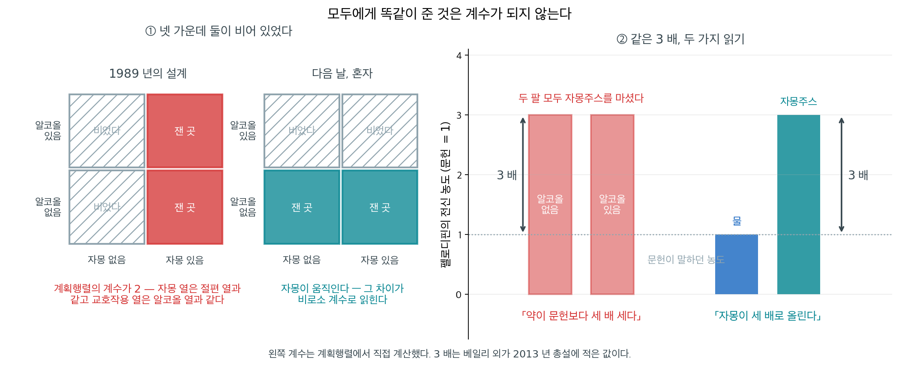
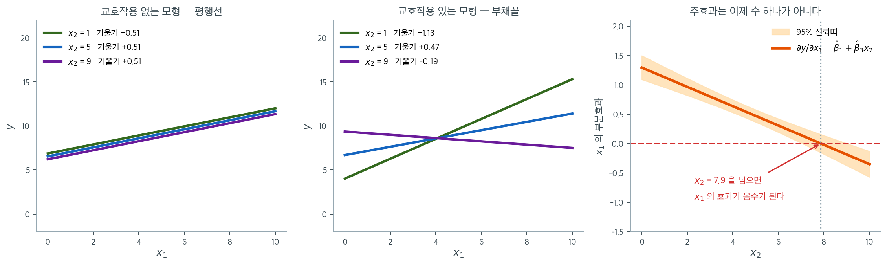

# 교호작용 항

## 1. 왜 교호작용 항을 쓰는가

현실의 많은 상황에서 한 변수가 결과에 미치는 효과는 일정하지 않고 다른 변수에 따라 달라진다. **교호작용 항**은 둘 이상의 독립변수가 종속변수에 미치는 이런 결합 효과를 모형화한다.

교호작용이 자연스럽게 나타나는 예:

- 운동과 식단이 체중 감량에 미치는 효과를 연구할 때, 운동의 영향은 특정 식단을 하는 사람에게서 더 클 수 있다.
- 매출 예측에서 마케팅 캠페인의 효과는 경기 상황이나 계절에 따라 달라질 수 있다.
- 금융에서 금리 변화가 자산 가격에 미치는 효과는 현재의 변동성 국면에 의존할 수 있다.

교호작용이 존재하는데도 모형화하지 않으면, 각 설명변수의 효과가 다른 설명변수의 값과 무관하게 동일하다고 가정하는 셈이므로 회귀 결과가 오도할 수 있다.

---

## 2. 수학적 정식화

두 변수 $X_1$과 $X_2$의 교호작용은 곱항으로 회귀모형에 추가된다.

$$
Y = \beta_0 + \beta_1 X_1 + \beta_2 X_2 + \beta_3 (X_1 \times X_2) + \epsilon
$$

여기서

- $Y$는 종속변수,
- $\beta_1$과 $\beta_2$는 $X_1$과 $X_2$의 **주효과**,
- $\beta_3$은 $X_1$과 $X_2$ 사이의 **교호작용 효과**,
- $\epsilon$은 오차항이다.

항 $X_1 \times X_2$가 교호작용을 포착한다. $X_1$이 $Y$에 미치는 부분효과는 더 이상 상수 $\beta_1$이 아니라 $\beta_1 + \beta_3 X_2$가 되어 $X_2$의 수준에 의존한다.

!!! note "주효과를 함께 넣기"
    교호작용 항을 포함할 때는 대응하는 두 주효과($X_1$과 $X_2$)도 일반적으로 모형에 남겨야 한다. 교호작용을 넣으면서 주효과를 빼면 계수가 편향되고 해석할 수 없게 된다.

<div class="storybox" markdown>

**그림으로 보는 통계학 1.** 비어 있던 칸

위 쪽지가 「주효과를 함께 넣으라」고 적는다. 그보다 먼저 물을 것이 하나 있다. **그 두 변수가 자료에서 실제로 움직이는가.** $\beta_3$ 은 $X_1$ 과 $X_2$ 가 **둘 다** 움직여야 자료에서 보인다. $2 \times 2$ 가운데 두 칸이 비면 계획행렬의 계수가 모자라고, 곱항은 추정되지 못한 채 다른 열에 섞여 들어간다.

$1989$ 년에 캐나다 온타리오의 **데이비드 베일리**가 그 상황에 놓였다. 그의 연구진은 혈압약 **펠로디핀**에 알코올이 영향을 주는지 보려 했다. 알코올을 주는 쪽과 주지 않는 쪽으로 가르는 설계인데, 문제가 하나 있었다 — 알코올 맛을 가려야 했다. 여러 가지를 시험한 끝에 **자몽주스**가 그 일을 해냈다. 그래서 모든 참가자가 자몽주스를 마셨다.

**자몽은 움직이지 않았다.** $2 \times 2$ 의 한 열만 채워진 것이다.



결과에서 알코올의 효과는 없었다. 그 대신 **두 집단 모두 펠로디핀 농도가 예상보다 세 배 높았다.** 왼쪽 판이 그 설계다. 자몽 열은 절편 열과 똑같고 곱항 열은 알코올 열과 똑같아서, 계획행렬의 계수가 $4$ 가 아니라 $2$ 다. 자몽의 효과는 계수가 될 자리가 없어 **「이 약이 문헌보다 세 배 세다」는, 모두에게 똑같은 어긋남**으로만 나타났다.

베일리는 다음 날 자기 몸으로 비는 칸을 채웠다. 하루는 물과, 하루는 자몽주스와 약을 먹고 그때마다 피를 뽑았다. 자몽주스를 마신 날 그는 어지러움을 느꼈다 — 혈압이 너무 내려간 것이다. **같은 $3$ 배가 이번에는 자몽의 효과로 읽혔다.** 오른쪽 판의 두 묶음이 그 차이다. 바뀐 것은 수가 아니라 **그 수가 놓인 칸**이다.

$1991$ 년 『Lancet』에 실린 논문의 첫 문장이 그 사정을 그대로 적는다 — 「알코올과 약의 상호작용에 관한 우리 연구의 **우연한 발견**은 감귤류 주스가 어떤 약의 생체이용률을 크게 높일 수 있다는 것이었다.」 뒤에 밝혀진 기전은 자몽의 푸라노쿠마린이 창자벽의 효소 CYP3A4 를 **되돌릴 수 없게** 망가뜨리는 것이고, 베일리 자신의 $2013$ 년 총설이 적기로 **자몽 한 개 또는 주스 $200$ mL 면** 그 일이 일어난다.

이 쪽의 교훈은 단순하다. **모든 참가자에게 똑같이 준 것은 계수가 되지 않는다.** 통제하려고 고정한 변수, 모두에게 같은 방식으로 제공한 처치, 자료 전체가 같은 기계로 측정된 사정 — 이런 것들은 모형에 넣어도 열이 상수가 되어 사라지고, 그 효과는 절편이나 다른 주효과에 얹힌다. 교호작용 항을 쓰기 전에 **네 칸이 다 채워져 있는지**부터 본다. 비어 있다면 그 항의 계수는 자료가 아니라 가정에서 나온다.

_확인한 곳 — 베일리·드레서·아널드 「Grapefruit–medication interactions: Forbidden fruit or avoidable consequences?」(『CMAJ』 제$185$ 권 $4$ 호, $2013$, $309$–$316$ 쪽, [doi:10.1503/cmaj.120951](https://doi.org/10.1503/cmaj.120951))의 공개 전문에서 「우리 연구진이 $20$ 여 년 전에 이 상호작용을 발견했다」, 「그만한 양의 자몽과 함께 먹은 펠로디핀의 평균 전신 농도는 물과 함께 먹었을 때의 세 배였다」, 「푸라노쿠마린이 CYP3A4 에 의해 반응성 중간체로 바뀌어 효소의 활성부위에 공유결합하여 비가역적으로 불활성화시킨다」, 「자몽 한 개 또는 주스 $200$ mL 면 임상적으로 의미 있는 농도 상승을 일으키기에 충분하다」를 직접 읽었다 · 알코올 맛을 가리려 자몽주스를 골랐다는 것, 농도가 예상의 세 배로 나왔다는 것, 베일리가 물과 자몽주스로 하루씩 자기 몸에 시험하고 어지러움을 느꼈다는 것, 그리고 $1991$ 년 『Lancet』 논문(제$337$ 권 $8736$ 호 $268$–$269$ 쪽)의 첫 문장 「A chance finding of our study on ethanol-drug interactions was that citrus fruit juices may greatly augment the bioavailability of some drugs」는 맥길대 과학사회연구소의 조 슈워츠가 쓴 [해설 「The Grapefruit-Drug Interaction」](https://www.mcgill.ca/oss/article/health/grapefruit-growers-dont-know-whether-laugh-or-cry)에서 읽었다. **『Lancet』 논문 본문은 읽지 못했다** · 계획행렬의 계수는 직접 계산한 값이다_

</div>

---

## 3. 교호작용 항의 해석

$\beta_3$의 부호와 크기가 교호작용의 성격을 정한다.

- **양의 교호작용 계수 ($\beta_3 > 0$)**: 두 설명변수가 함께 증가할 때 $Y$에 미치는 결합 효과가 각각의 효과를 더한 것보다 **크다**. 두 설명변수가 서로를 강화한다.

- **음의 교호작용 계수 ($\beta_3 < 0$)**: 두 설명변수의 결합 효과가 각각의 효과를 더한 것보다 **작다**. 한 설명변수가 다른 쪽의 효과를 억누른다.

- **교호작용이 0 ($\beta_3 = 0$)**: $X_1$이 $Y$에 미치는 효과가 $X_2$에 의존하지 않는다. 모형은 교호작용이 없는 가법모형으로 줄어든다.

교호작용 항이 통계적으로 유의하다는 것은 한 변수와 결과의 관계가 다른 변수에 따라 달라진다는 뜻이다.



$\beta_1 + \beta_3 X_2$라는 식이 그림으로는 무엇인지 보자. 참 모형이 $y = 2 + 1.5x_1 + 0.8x_2 - 0.18\,x_1x_2 + \varepsilon$인 자료 $400$개를 만들고 두 가지로 적합했다.

왼쪽은 교호작용 항을 빼고 적합한 가법모형이다. $x_2$를 $1, 5, 9$로 고정하고 $y$ 대 $x_1$을 그리면 **세 직선이 완벽하게 평행하다.** 기울기가 셋 다 $+0.51$이다. 가법모형은 구조상 그럴 수밖에 없다. $x_2$는 직선을 위아래로 옮기기만 할 뿐 기울기를 건드릴 수 없기 때문이다. 오른쪽은 곱항 $x_1x_2$를 넣은 모형이고, 같은 세 수준에서 직선들이 한 점에서 **부챗살처럼 벌어진다.** 기울기가 $x_2 = 1$에서 $+1.13$, $x_2 = 5$에서 $+0.47$, $x_2 = 9$에서 $-0.19$다. $x_2$가 낮을 때 $x_1$을 늘리면 $y$가 오르지만, $x_2$가 높으면 오히려 내려간다. 가법모형의 $+0.51$은 이 셋을 하나로 뭉갠 평균값이었던 셈이다.

추정된 계수는 $\hat\beta_1 = 1.295$, $\hat\beta_3 = -0.165$로 참값 $1.5$, $-0.18$에 가깝다. 여기서 **$\hat\beta_1 = 1.295$를 "$x_1$의 효과"라고 읽으면 안 된다**는 점이 결정적이다. 그것은 $x_2 = 0$일 때의 기울기일 뿐이며, $x_2$가 $0$을 취하지 않는 자료라면 아무 데도 해당하지 않는 수다. 교호작용 모형에서 주효과 계수는 "상대가 $0$인 지점의 기울기"라는 아주 좁은 뜻을 가진다.

그래서 오른쪽 세 번째 칸처럼 **부분효과 자체를 그리는 것**이 표준적인 보고 방식이다. 가로축이 $x_2$, 세로축이 $\partial y/\partial x_1 = \hat\beta_1 + \hat\beta_3 x_2$이고, 주황 띠가 그 추정의 95% 신뢰띠다. 직선이 $x_2 = 7.87$에서 $0$을 지나므로, 그 너머에서는 $x_1$을 늘리는 것이 오히려 해가 된다. 표에 적힌 계수 네 개로는 이 문턱을 곧바로 읽을 수 없지만 그림에서는 한눈에 보인다. 참고로 $R^2$은 가법모형 $0.169$에서 교호작용 모형 $0.306$으로 올랐다. 곱항 하나가 설명력의 절반 가까이를 더 가져온 것이다.

---

<div class="exbox" markdown>

**보기 1.** <span class="diff easy" title="쉬움"></span> 공부 시간, 수면, 성적. 공부 시간과 수면이 학생의 시험 성적에 미치는 효과를 연구한다고 하자. 교호작용 항이 없으면 모형은 학생이 얼마나 자든 공부 시간 추가의 이득이 동일하다고 가정한다.

공부 시간과 수면의 교호작용 항은 수면이 부족할 때 공부 시간 추가의 이득이 **줄어든다**는 사실을 드러낼 수 있다. 형식적으로 쓰면

</div>

??? success "풀이"
    $$
    \text{Score} = \beta_0 + \beta_1 \cdot \text{StudyHours} + \beta_2 \cdot \text{Sleep} + \beta_3 \cdot (\text{StudyHours} \times \text{Sleep}) + \epsilon
    $$

    $\beta_3 > 0$이면 잠을 더 잘수록 공부의 이득이 커진다. $\beta_3 < 0$이면 적게 자는 학생에게는 공부를 더 해도 수익체감이 나타난다.

<div class="exbox" markdown>

**보기 2.** <span class="diff easy" title="쉬움"></span> 교호작용 항. 아래 두 보기에서 쓸 자료를 읽는다. ISLR 교재의 Advertising(시장 200곳)과 Credit(400명)이다.

**(1)** Credit 자료에서 학생의 평균 잔액이 비학생보다 $396$ 달러 높은데 소득은 $2.3$ 밖에 높지 않다. 이 차이를 소득으로 설명할 수 있는가. 그리고 **학생이 몇 명인지** 세어 보기 4 의 추론에 무엇을 예고하는지 말하시오.

**(2)** Advertising 자료에서 곱항 `TV × Radio` 가 가질 수 있는 **값의 범위**를 요약표의 수로 계산하시오. 그것이 보기 3 의 계수를 읽을 때 왜 중요한가.

</div>

??? success "풀이"

    **유도할 식이 없는 보기다.** 자료를 읽어 들이는 것이 전부이므로, 요약표에서 읽히는 수와 아래에서 쓰일 수를 따라간다.

    두 보기에서 쓸 자료를 먼저 읽는다. ISLR 교재의 Advertising과 Credit이다.

    ```python
    import pandas as pd

    # Advertising: 광고비(TV, Radio, Newspaper)와 매출(Sales), 200개 시장
    advertising = pd.read_csv("https://www.statlearning.com/s/Advertising.csv",
                              index_col=0)
    advertising = advertising.rename(columns={"radio": "Radio",
                                              "newspaper": "Newspaper",
                                              "sales": "Sales"})

    # Credit: 신용카드 잔액(Balance)과 소득(Income), 학생 여부(Student), 400명
    credit = pd.read_csv("https://raw.githubusercontent.com/vincentarelbundock/"
                         "Rdatasets/1dcc2bf5f955cc1224a3e1307256e1fe86b68dae/csv/ISLR/Credit.csv", index_col=0)

    print(advertising[["TV", "Radio", "Sales"]].describe().round(2).to_string())
    print()
    print(credit.groupby("Student")[["Income", "Balance"]].mean().round(2).to_string())
    ```

    출력:

    ```
               TV   Radio   Sales
    count  200.00  200.00  200.00
    mean   147.04   23.26   14.02
    std     85.85   14.85    5.22
    min      0.70    0.00    1.60
    25%     74.38    9.98   10.38
    50%    149.75   22.90   12.90
    75%    218.82   36.52   17.40
    max    296.40   49.60   27.00

             Income  Balance
    Student                 
    No        44.99   480.37
    Yes       47.29   876.82
    ```

    요약표가 말하지 않는 두 가지를 더 센다.

    ```python
    print("Credit 의 학생 수:", credit['Student'].value_counts().to_dict())
    tab = credit.groupby("Student")[["Income", "Balance"]].agg(['count', 'mean', 'std'])
    print(tab.round(2).to_string())
    print(f"Income 의 범위: {credit['Income'].min():.2f} ~ {credit['Income'].max():.2f}")
    print(f"Balance 가 0 인 사람: {(credit['Balance'] == 0).sum()}명")
    print(f"TV x Radio 의 범위: {(advertising['TV'] * advertising['Radio']).min():.2f} ~ "
          f"{(advertising['TV'] * advertising['Radio']).max():.2f}")
    print(f"요약표의 최댓값으로 셈하면 296.40 x 49.60 = {296.40 * 49.60:.2f}")
    ```

    출력:

    ```
    Credit 의 학생 수: {'No': 360, 'Yes': 40}
            Income               Balance                
             count   mean    std   count    mean     std
    Student                                             
    No         360  44.99  34.91     360  480.37  439.41
    Yes         40  47.29  38.55      40  876.82  490.00
    Income 의 범위: 10.35 ~ 186.63
    Balance 가 0 인 사람: 90명
    TV x Radio 의 범위: 0.00 ~ 13540.41
    요약표의 최댓값으로 셈하면 296.40 x 49.60 = 14701.44
    ```

    **(1) 소득으로는 설명되지 않는다.** 학생의 평균 소득이 $47.29$, 비학생이 $44.99$ 로 차이가 $2.30$(천 달러)이다. 소득의 표준편차가 $35$ 쯤이니 **$0.07$ 표준편차**에 지나지 않는다. 그런데 잔액의 차이는 $396.45$ 달러로, 잔액 표준편차 $440$ 의 $0.9$ 배다. **소득 차이가 $0.07$ 표준편차인데 잔액 차이가 $0.9$ 표준편차**이니 소득은 범인이 아니다.

    보기 4 가 이것을 수로 확인해 준다. 소득을 통제하고 나면 학생 더미의 계수가 $477$ 달러로 **오히려 커진다.** 학생이 소득이 조금 더 높았으므로, 소득을 맞춰 놓으면 차이가 더 벌어지는 것이다.

    **학생은 40 명이다.** 전체 $400$ 명의 $10\%$ 다. 이것이 보기 4 의 결과를 미리 설명한다. 교호작용 계수는 "두 집단의 기울기 차이" 이므로 그 정밀도가 **적은 쪽 집단의 크기**에 묶인다. $40$ 명으로 추정한 기울기는 거칠 수밖에 없고, 따라서 교호작용의 $p$-값이 클 것이다. **표본이 $400$ 이라고 해서 교호작용을 잴 표본도 $400$ 인 것은 아니다.**

    한 가지 더 눈에 둘 것은 **잔액이 정확히 $0$ 인 사람이 $90$ 명**이라는 점이다. 전체의 $22.5\%$ 가 한 값에 몰려 있다. 카드를 쓰지 않는 사람들이고, 연속변수를 가정하는 회귀가 다루기 어려운 꼴이다. 왼쪽이 $0$ 에서 잘린 자료이므로 잔차의 정규성이 깨질 것을 예상할 수 있다.

    **(2) 곱항은 0 에서 13,540 까지 간다.** 요약표의 최댓값만으로 셈하면 $296.40 \times 49.60 = 14{,}701$ 이지만, 그것은 TV 와 Radio 가 **동시에** 최대인 시장이 있을 때의 상한이다. 실제 최댓값은 $13{,}540.41$ 로 그보다 조금 작다. 최솟값은 Radio 가 $0$ 인 시장이 있으므로 $0$ 이다.

    이것이 중요한 까닭은 **계수의 크기가 변수의 눈금에 반비례**하기 때문이다. 보기 3 에서 `TV:Radio` 의 계수가 $0.0011$ 로 나오는데, 그것을 "거의 $0$ 이니 효과가 없다" 고 읽으면 완전히 틀린다. 그 변수가 $10^4$ 규모로 움직이므로 기여가

    $$
    0.001086 \times 13{,}540 = 14.7
    $$

    까지 간다. 매출의 평균이 $14.02$, 표준편차가 $5.22$ 이니 **매출 전체 규모만큼의 기여**다.

    그러므로 계수의 절대값으로 효과를 견주어서는 안 된다. 견줄 것은 $t$ 값이거나, 변수를 표준화한 뒤의 계수이거나, "설명변수가 실제로 움직이는 범위에서 반응이 얼마 움직이는가" 다. Advertising 은 시장 $200$ 곳의 광고비와 매출, Credit 은 $400$ 명의 소득과 잔액이다.
<div class="exbox" markdown>

**보기 3.** <span class="diff easy" title="쉬움"></span> 마케팅 효과 (TV와 Radio). 매출을 TV·Radio 광고비와 그 곱항에 회귀한다.

**(1)** 적합 결과에서 TV 한 단위의 **부분효과**를 Radio 의 함수로 적고, Radio 가 $0$, 평균 $23.26$, 최댓값 $49.6$ 일 때의 값을 구하시오. 그 부분효과가 $0$ 이 되는 Radio 는 자료 안에 있는가.

**(2)** 곱항을 넣은 것이 통계적으로 정당한지 **중첩 $F$ 검정**으로 판정하고, 그 $F$ 가 표의 $t = 20.727$ 과 어떤 관계인지 확인하시오.

</div>

??? success "풀이"

    **(1) 부분효과는 상대의 함수다.** 모형이

    $$
    \text{Sales} = \beta_0 + \beta_1 \text{TV} + \beta_2 \text{Radio} + \beta_3\,\text{TV}\cdot\text{Radio} + \varepsilon
    $$

    이므로 TV 로 미분하면

    $$
    \frac{\partial \text{Sales}}{\partial \text{TV}} = \beta_1 + \beta_3\,\text{Radio}
    $$

    이다. 표의 값 $\hat\beta_1 = 0.0191$, $\hat\beta_3 = 0.001086$ 을 넣으면

    $$
    0.0191 + 0.001086\,\text{Radio}
    $$

    이고, Radio 가 $0$ 이면 $0.0191$, $23.26$ 이면 $0.0444$, $49.6$ 이면 $0.0730$ 이다. **라디오를 많이 쓰는 시장에서 TV 의 효과가 네 배 가까이 커진다.**

    부분효과가 $0$ 이 되는 곳은

    $$
    \text{Radio} = -\frac{\hat\beta_1}{\hat\beta_3} = -\frac{0.0191}{0.001086} = -17.6
    $$

    로 **음수**다. Radio 는 $0$ 이상이므로 자료 안에 그런 자리가 없고, 관측된 전 구간에서 TV 의 효과가 양수다. 앞 절의 그림에서는 부분효과가 자료 안의 $x_2 = 7.87$ 에서 부호를 바꾸었는데, 여기는 그렇지 않다. **교호작용의 부호가 주효과와 같으면 문턱이 자료 밖으로 밀려난다.**

    Radio 쪽도 같은 방식이다. $\partial \text{Sales}/\partial \text{Radio} = \hat\beta_2 + \hat\beta_3 \text{TV}$ 이므로 TV $= 0$ 에서 $0.0289$, 평균 $147.04$ 에서 $0.1886$, 최댓값 $296.4$ 에서 $0.3509$ 다. $12$ 배 차이다.

    **(2) 분자 자유도가 1 인 $F$ 는 $t^2$ 이다.** 곱항을 뺀 가법모형이 곱항을 넣은 모형에 중첩되므로

    $$
    F = \frac{\mathrm{RSS}_{\text{가법}} - \mathrm{RSS}_{\text{교호}}}{\mathrm{RSS}_{\text{교호}}/(n - 4)}
    \;\sim\; F_{1,\,196}
    $$

    이고, 검정하는 가설이 $H_0: \beta_3 = 0$ 으로 표의 $t$ 검정과 **같은 가설**이다. 그러므로

    $$
    F = t^2 = 20.727^2 = 429.6
    $$

    이어야 한다. 그만큼 큰 $F$ 는 어떤 유의수준으로도 기각된다.


    광고 분석의 고전적 예는 TV와 Radio 광고 지출이 매출에 미치는 영향이다. 주효과만 있는 모형은 각 매체가 독립적인 효과를 갖는다고 가정한다.

    $$
    \text{Sales} = \beta_0 + \beta_1 \cdot \text{TV} + \beta_2 \cdot \text{Radio} + \epsilon
    $$

    그러나 **상승효과**가 있을 수 있다. TV와 Radio에 함께 광고하면 각각의 효과를 더한 것보다 더 효과적일 수 있다. 교호작용 항이 이를 포착한다.

    $$
    \text{Sales} = \beta_0 + \beta_1 \cdot \text{TV} + \beta_2 \cdot \text{Radio} + \beta_3 \cdot (\text{TV} \times \text{Radio}) + \epsilon
    $$

    **해석**:

    - $\beta_3 > 0$이면 TV와 Radio 광고를 결합할 때 각 매체가 따로 주는 것을 넘어서는 상승효과가 매출에 생긴다.
    - $\beta_3 < 0$이면 효과가 체감한다. 두 매체에 동시에 많이 쓰는 것은 덜 효율적일 수 있다.

    이 모형은 statsmodels의 식(formula) 문법으로 편리하게 적합할 수 있다.

    ```python
    import statsmodels.formula.api as smf

    # 수식 문법. R 의 것을 그대로 따른다
    # 별표는 주효과와 교호작용을 한꺼번에 넣는다는 뜻이다
    model = smf.ols('Sales ~ TV * Radio', data=advertising).fit()
    # summary()는 실행 날짜와 시각을 함께 찍으므로 계수 표만 인쇄한다.
    print(model.summary().tables[1])
    print(f"R^2 = {model.rsquared:.4f}")
    ```

    출력:

    ```
    ==============================================================================
                     coef    std err          t      P>|t|      [0.025      0.975]
    ------------------------------------------------------------------------------
    Intercept      6.7502      0.248     27.233      0.000       6.261       7.239
    TV             0.0191      0.002     12.699      0.000       0.016       0.022
    Radio          0.0289      0.009      3.241      0.001       0.011       0.046
    TV:Radio       0.0011   5.24e-05     20.727      0.000       0.001       0.001
    ==============================================================================
    R^2 = 0.9678
    ```

    ```python
    b = model.params
    print("계수:", {k: round(v, 6) for k, v in b.items()})
    for r in [0, advertising['Radio'].mean(), 30, advertising['Radio'].max()]:
        print(f"  Radio={r:6.2f}: dSales/dTV = {b['TV'] + b['TV:Radio'] * r:.4f}")
    for t_ in [0, advertising['TV'].mean(), advertising['TV'].max()]:
        print(f"  TV={t_:7.2f}: dSales/dRadio = {b['Radio'] + b['TV:Radio'] * t_:.4f}")
    print(f"dSales/dTV = 0 이 되는 Radio = {-b['TV'] / b['TV:Radio']:.2f}"
          f"   (Radio 의 범위 {advertising['Radio'].min()} ~ {advertising['Radio'].max()})")

    additive = smf.ols('Sales ~ TV + Radio', data=advertising).fit()
    F = (additive.ssr - model.ssr) / (model.ssr / model.df_resid)
    t = model.tvalues['TV:Radio']
    print(f"가법모형 R^2 = {additive.rsquared:.4f},  교호작용 R^2 = {model.rsquared:.4f}")
    print(f"중첩 F = {F:.4f},  t^2 = {t ** 2:.4f},  p = {model.pvalues['TV:Radio']:.3e}")
    ```

    출력:

    ```
    계수: {'Intercept': 6.75022, 'TV': 0.019101, 'Radio': 0.02886, 'TV:Radio': 0.001086}
      Radio=  0.00: dSales/dTV = 0.0191
      Radio= 23.26: dSales/dTV = 0.0444
      Radio= 30.00: dSales/dTV = 0.0517
      Radio= 49.60: dSales/dTV = 0.0730
      TV=   0.00: dSales/dRadio = 0.0289
      TV= 147.04: dSales/dRadio = 0.1886
      TV= 296.40: dSales/dRadio = 0.3509
    dSales/dTV = 0 이 되는 Radio = -17.58   (Radio 의 범위 0.0 ~ 49.6)
    가법모형 R^2 = 0.8972,  교호작용 R^2 = 0.9678
    중첩 F = 429.5905,  t^2 = 429.5905,  p = 2.758e-51
    ```

    **(1)의 세 값이 그대로 나왔다.** $0.0191$, $0.0444$, $0.0730$ 이다. 부분효과가 $0$ 이 되는 Radio 는 $-17.58$ 로 자료 밖이다.

    **(2) $F$ 와 $t^2$ 이 소수 넷째 자리까지 같다.** $429.5905$ 다. $p$-값이 $2.8 \times 10^{-51}$ 이니 곱항이 필요하다는 데 의심의 여지가 없다. 가법모형의 $R^2$ $0.8972$ 가 $0.9678$ 로 올랐고, 남은 설명되지 않은 분산이 $0.1028$ 에서 $0.0322$ 로 **세 분의 일**이 되었다.

    교호작용 항 `TV:Radio` 의 계수가 $0.0011$ 이고 $t = 20.7$ 로 압도적으로 유의하다. TV 와 라디오 광고 사이에 상승효과가 있다는 뜻이다.

    크기를 가늠해 보자. 라디오에 $0$ 을 쓸 때 TV $1$ 단위의 효과는 $0.0191$ 이지만, 라디오에 $30$ 을 쓰면 $0.0191 + 0.001086 \times 30 = 0.0517$ 로 **$2.7$ 배**가 된다. **교호작용이 있으면 주효과를 단독으로 해석할 수 없다**는 말의 뜻이 이것이다.

    한 가지 더. 표에서 `TV:Radio` 의 계수 $0.0011$ 과 표준오차 $5.24 \times 10^{-5}$ 가 유별나게 작다. 곱항의 값이 $0$ 에서 $13{,}540$ 까지 가기 때문이다(보기 2). 계수의 **크기만 보고 효과가 작다고 읽으면 안 된다.** 계수는 변수의 눈금에 반비례하므로, 비교할 것은 계수가 아니라 $t$ 값이거나 "설명변수가 한 표준편차 움직일 때 반응이 얼마 움직이는가" 다.
!!! warning "`statsmodels.api`에는 소문자 `ols`가 없다"
    식 인터페이스는 `statsmodels.formula.api`(관례적으로 `smf`)에 있다. `statsmodels.api`(관례적으로 `sm`)에는 배열을 받는 대문자 `sm.OLS`만 있으므로 `sm.ols(...)`를 호출하면 `AttributeError`가 난다.

<div class="exbox" markdown>

**보기 4.** <span class="diff easy" title="쉬움"></span> 소득과 학생 여부의 교호작용. 신용카드 잔액을 소득, 학생 여부, 그리고 그 곱항에 회귀한다.

**(1)** 적합 결과를 **두 집단의 회귀직선 두 개**로 다시 쓰시오. 두 직선이 만나는 소득은 얼마이며 그 값이 자료 안에 있는가.

**(2)** (1)의 두 직선을 **집단별로 따로 적합**해도 같은 계수가 나와야 한다. 그것을 확인하고, 그렇다면 교호작용 모형을 쓰는 까닭이 무엇인지 말하시오. 교호작용의 $p$-값이 $0.249$ 로 큰 것도 설명하시오.

</div>

??? success "풀이"

    **(1) 두 직선으로 풀어 쓴다.** patsy 가 `No` 를 기준으로 삼았으므로 더미변수는 $S = \mathbf{1}(\text{학생})$ 이고

    $$
    \widehat{\text{Balance}} = \hat\beta_0 + \hat\beta_2 S + (\hat\beta_1 + \hat\beta_3 S)\cdot \text{Income}
    $$

    이다. $S = 0$ 과 $S = 1$ 을 넣으면

    $$
    \text{비학생: } \; 200.62 + 6.22\,\text{Income},
    \qquad
    \text{학생: } \; (200.62 + 476.68) + (6.22 - 2.00)\,\text{Income} = 677.30 + 4.22\,\text{Income}
    $$

    이다. **학생 쪽이 출발점은 $477$ 달러 높고 기울기는 $2.00$ 낮다.**

    두 직선이 만나는 곳은 $\hat\beta_2 + \hat\beta_3\,\text{Income} = 0$, 곧

    $$
    \text{Income} = -\frac{\hat\beta_2}{\hat\beta_3} = \frac{476.6758}{1.9992} = 238.4
    $$

    이다. 자료의 소득 최댓값이 $186.63$ 이므로 **자료 범위 밖**이다. 그러므로 관측된 소득 구간 전체에서 학생의 잔액이 비학생보다 높고, 교차는 외삽일 뿐이다.

    **(2) 같아야 한다.** 더미변수와 그 교호작용을 모두 넣은 모형의 설계행렬은

    $$
    [\,\mathbf{1},\; S,\; \text{Income},\; S \cdot \text{Income}\,]
    $$

    인데, 열을 다시 묶으면 $[\,\mathbf{1}_{\text{비학생}},\; \text{Income}_{\text{비학생}},\; \mathbf{1}_{\text{학생}},\; \text{Income}_{\text{학생}}\,]$ 과 **같은 열공간**을 친다(두 집단의 지시벡터와 그 안의 소득). 그리고 두 집단은 서로 겹치지 않으므로 잔차제곱합이

    $$
    \mathrm{RSS} = \mathrm{RSS}_{\text{비학생}} + \mathrm{RSS}_{\text{학생}}
    $$

    로 쪼개진다. 각 조각이 자기 집단의 계수만 포함하므로 **따로 최소화해도 같은 해**다. 그러므로 계수는 정확히 같아야 한다.

    **다른 것은 표준오차다.** 묶은 모형은 $\sigma^2$ 을 두 집단에서 **하나로** 추정하고($\mathrm{RSS}/(n-4)$), 따로 적합하면 각 집단에서 따로 추정한다. 두 집단의 잔차 퍼짐이 다르면 표준오차가 달라진다.

    **$p$-값이 큰 까닭.** 교호작용 계수 $\hat\beta_3$ 은 "두 기울기의 차이" 이므로 그 정밀도가 **적은 쪽 집단**에 묶여 있다. 학생이 몇 명뿐이면 학생 쪽 기울기가 부정확하고, 차이의 표준오차가 커진다. 보기 2 에서 학생이 몇 명이었는지 확인하면 답이 나온다.


    신용카드 잔액이 소득과 학생 여부에 어떻게 의존하는지 살피는 모형을 생각하자. **질적 변수**(학생: 예/아니오)가 연속변수(소득)와 교호작용할 수 있다.

    $$
    \text{Balance} = \beta_0 + \beta_1 \cdot \text{Income} + \beta_2 \cdot \text{Student} + \beta_3 \cdot (\text{Income} \times \text{Student}) + \epsilon
    $$

    여기서 Student는 1(예) 또는 0(아니오)으로 부호화한다.

    **해석**:

    - $\beta_1$: **학생이 아닌 사람**에게 Income이 Balance에 미치는 효과는 $\beta_1$이다.
    - $\beta_1 + \beta_3$: **학생**에게 Income이 Balance에 미치는 효과는 $\beta_1 + \beta_3$이다.
    - $\beta_3 \neq 0$이면 Income과 Balance의 관계가 **학생 여부에 따라 다르다**.

    이런 교호작용은 서로 다른 집단이 같은 설명변수에 다르게 반응하는지를 드러내며, 세분화와 표적 분석에 결정적인 통찰을 준다.

    ```python
    # 범주형 변수가 든 예
    # statsmodels 는 범주형을 알아서 가변수로 바꾼다
    model = smf.ols('Balance ~ Income + C(Student) + Income:C(Student)',
                    data=credit).fit()
    print(model.summary().tables[1])
    print(f"R^2 = {model.rsquared:.4f}")
    ```

    출력:

    ```
    ============================================================================================
                                   coef    std err          t      P>|t|      [0.025      0.975]
    --------------------------------------------------------------------------------------------
    Intercept                  200.6232     33.698      5.953      0.000     134.373     266.873
    C(Student)[T.Yes]          476.6758    104.351      4.568      0.000     271.524     681.827
    Income                       6.2182      0.592     10.502      0.000       5.054       7.382
    Income:C(Student)[T.Yes]    -1.9992      1.731     -1.155      0.249      -5.403       1.404
    ============================================================================================
    R^2 = 0.2799
    ```

    ```python
    import numpy as np

    pr = model.params
    print("비학생:", f"{pr['Intercept']:.4f} + {pr['Income']:.4f} * Income")
    print("학생  :", f"{pr['Intercept'] + pr['C(Student)[T.Yes]']:.4f} + "
                     f"{pr['Income'] + pr['Income:C(Student)[T.Yes]']:.4f} * Income")
    print(f"두 직선이 만나는 Income = {pr['C(Student)[T.Yes]'] / -pr['Income:C(Student)[T.Yes]']:.2f}"
          f"   (자료의 최댓값 {credit['Income'].max():.2f})")

    # 집단별로 따로 적합한다.
    no = smf.ols('Balance ~ Income', data=credit[credit['Student'] == 'No']).fit()
    yes = smf.ols('Balance ~ Income', data=credit[credit['Student'] == 'Yes']).fit()
    print(f"따로 적합 비학생: 절편 {no.params['Intercept']:.4f}  기울기 {no.params['Income']:.4f}  (n={int(no.nobs)})")
    print(f"따로 적합 학생  : 절편 {yes.params['Intercept']:.4f}  기울기 {yes.params['Income']:.4f}  (n={int(yes.nobs)})")
    print(f"계수의 최대 차이 = "
          f"{max(abs(no.params['Income'] - pr['Income']), abs(yes.params['Income'] - (pr['Income'] + pr['Income:C(Student)[T.Yes]']))):.2e}")
    print(f"잔차표준오차: 묶음 {np.sqrt(model.mse_resid):.2f},  "
          f"비학생 {np.sqrt(no.mse_resid):.2f},  학생 {np.sqrt(yes.mse_resid):.2f}")
    print(f"학생 기울기의 SE: 묶은 모형 쪽은 따로 적합의 {yes.bse['Income']:.4f} 과 다르다")
    print(f"교호작용 t = {model.tvalues['Income:C(Student)[T.Yes]']:.4f},  "
          f"p = {model.pvalues['Income:C(Student)[T.Yes]']:.4f}")
    print(f"교호작용 없는 모형 R^2 = {smf.ols('Balance ~ Income + C(Student)', data=credit).fit().rsquared:.4f},  "
          f"넣은 모형 {model.rsquared:.4f}")
    ```

    출력:

    ```
    비학생: 200.6232 + 6.2182 * Income
    학생  : 677.2990 + 4.2190 * Income
    두 직선이 만나는 Income = 238.44   (자료의 최댓값 186.63)
    따로 적합 비학생: 절편 200.6232  기울기 6.2182  (n=360)
    따로 적합 학생  : 절편 677.2990  기울기 4.2190  (n=40)
    계수의 최대 차이 = 1.78e-14
    잔차표준오차: 묶음 391.62,  비학생 382.59,  학생 468.27
    학생 기울기의 SE: 묶은 모형 쪽은 따로 적합의 1.9452 과 다르다
    교호작용 t = -1.1547,  p = 0.2489
    교호작용 없는 모형 R^2 = 0.2775,  넣은 모형 0.2799
    ```

    **(1)과 (2)가 모두 확인된다.** 두 직선이 $200.62 + 6.22\,\text{Income}$ 과 $677.30 + 4.22\,\text{Income}$ 이고, 집단별로 따로 적합한 계수가 **$10^{-14}$ 까지 같다.** 유도한 열공간 논증 그대로다. 교차점 $238.44$ 는 자료의 최댓값 $186.63$ 밖이다.

    **그러면 왜 묶어서 적합하는가.** 세 가지다.

    첫째, **차이를 검정할 수 있다.** 따로 적합하면 기울기 $6.22$ 와 $4.22$ 라는 두 수를 얻을 뿐이고, 그 차이가 유의한지는 별도 계산이 필요하다. 묶은 모형은 $\hat\beta_3$ 의 $t$ 값을 바로 준다.

    둘째, **$\sigma^2$ 을 한 번만 추정해 자유도를 아낀다.** 두 집단의 잔차표준오차가 $382.59$ 와 $468.27$ 로 비슷하므로 묶는 것이 정당하고, 그 결과 $391.62$ 를 $n - 4 = 396$ 자유도로 추정한다. 따로 적합하면 $358$ 과 $38$ 자유도로 나뉘어 후자가 아주 거칠다.

    셋째, **제약을 걸 수 있다.** 기울기는 같고 절편만 다르다는 모형(`Balance ~ Income + C(Student)`)을 쉽게 적합해 견줄 수 있다.

    **$p = 0.249$ 의 까닭은 학생이 40 명뿐**이라는 것이다. 전체 $400$ 명의 $10\%$ 다. 학생 쪽 기울기의 표준오차가 따로 적합할 때 $1.9452$ 이고, 비학생 쪽은 자료가 아홉 배 많아 훨씬 작다. 두 기울기의 차이를 재는 $\hat\beta_3$ 의 표준오차 $1.731$ 은 거의 전부 학생 쪽에서 온다. 참 차이가 $-2$ 쯤이라 해도 **표준오차가 $1.7$ 이면 $t$ 가 $1.2$ 밖에 안 된다.**

    그러므로 "$p = 0.249$ 이므로 교호작용이 없다" 는 결론은 성립하지 않는다. 옳은 말은 **"학생이 $40$ 명뿐이라 $2.00$ 짜리 차이를 가려낼 검정력이 없다"** 다. $R^2$ 가 $0.2775$ 에서 $0.2799$ 로 올랐으나 이 역시 모수를 하나 더해 반드시 오르는 양이다.

    주효과는 강하다. 학생이라는 것만으로 잔액이 평균 $477$ 달러 높고(`C(Student)[T.Yes]`), 소득이 $1$(천 달러) 늘 때마다 $6.22$ 달러 는다. 보기 2 에서 본 "학생 $877$ 달러 대 비학생 $480$ 달러" 라는 $397$ 달러 차이가, 소득을 통제한 뒤에는 **$477$ 달러로 오히려 커진다.** 학생의 소득이 조금 더 높았기 때문이다($47.29$ 대 $44.99$).

    `C(Student)[T.Yes]` 라는 이름은 patsy 가 No 를 기준으로 삼았다는 뜻이다. 기준 수준이 무엇인지 확인하지 않으면 계수의 부호를 거꾸로 읽게 된다.
이런 교호작용을 시각화하면 흔히 기울기가 다른 두 회귀직선(집단마다 하나씩)이 나타나며, Income이 Balance에 미치는 차별적 효과를 보여준다.

---

## 4. 고차 및 다원 교호작용

교호작용은 변수 쌍에만 국한되지 않는다. $X_1$, $X_2$, $X_3$ 사이의 **3원 교호작용**은 다음 형태이다.

$$
Y = \beta_0 + \beta_1 X_1 + \beta_2 X_2 + \beta_3 X_3 + \beta_4 X_1 X_2 + \beta_5 X_1 X_3 + \beta_6 X_2 X_3 + \beta_7 X_1 X_2 X_3 + \epsilon
$$

실무에서 3원 이상의 고차 교호작용은 해석하기 어려워 드물게만 쓴다. 대부분의 응용 연구는 2원 교호작용에 집중한다.

---

## 연습문제

<div class="drillbox" markdown>

**연습문제 1.** <span class="diff med" title="중간"></span>
모형 $Y = \beta_0 + \beta_1 X_1 + \beta_2 X_2 + \beta_3 X_1 X_2 + \varepsilon$에서 $X_1$이 $Y$에 미치는 효과가 $X_2$에 따라 어떻게 변하는지의 관점에서 $\beta_3$을 해석하라.

</div>

??? success "풀이"
    $X_1$이 $Y$에 미치는 부분효과는

    $$
    \frac{\partial E[Y]}{\partial X_1} = \beta_1 + \beta_3 X_2
    $$

    따라서 $\beta_3$은 $X_2$가 한 단위 늘어날 때 **$X_1$의 기울기가 변하는 양**을 나타낸다. $\beta_3 > 0$이면 $X_2$가 커질수록 $X_1$이 $Y$에 미치는 효과가 강해진다. $\beta_3 < 0$이면 약해진다. $\beta_3 = 0$이면 $X_2$와 무관하게 $X_1$의 효과가 동일하다(교호작용 없음).

<div class="drillbox" markdown>

**연습문제 2.** <span class="diff med" title="중간"></span>
연봉을 예측하는 모형에 경력, 학위(이진: 0 = 학위 없음, 1 = 학위 있음), 그리고 그 교호작용이 들어 있다. 추정된 식은 $\hat{Y} = 30000 + 2000 X_1 + 10000 X_2 + 1500 X_1 X_2$이다. 학위가 있는 사람과 없는 사람에 대해 회귀식을 따로 쓰고 그 차이를 해석하라.

</div>

??? success "풀이"
    **학위 없음** ($X_2 = 0$): $\hat{Y} = 30000 + 2000 X_1$. 경력 1년 추가마다 연봉이 \$2,000 오른다.

    **학위 있음** ($X_2 = 1$): $\hat{Y} = (30000 + 10000) + (2000 + 1500) X_1 = 40000 + 3500 X_1$. 경력 1년 추가마다 연봉이 \$3,500 오른다.

    교호작용 항(\$1,500)은 학위가 경력의 수익률을 연간 \$1,500만큼 키운다는 뜻이다. 학위 소지자는 출발점도 높고(\$40,000 대 \$30,000) 경력 1년당 얻는 것도 많다(\$3,500 대 \$2,000).

<div class="drillbox" markdown>

**연습문제 3.** <span class="diff med" title="중간"></span>
주효과($X_1$이나 $X_2$)를 빼면서 교호작용 항($X_1 X_2$)은 남겨 두는 것이 일반적으로 부적절한 이유를 설명하라. 이는 어떤 통계적 원칙을 어기는가?

</div>

??? success "풀이"
    이는 **위계 원칙**(주변성 원칙)을 어긴다. 교호작용 항을 포함한다면 그것을 이루는 모든 저차 항도 함께 있어야 한다는 원칙이다.

    교호작용을 남긴 채 주효과를 빼면 남은 항들의 해석이 달라진다. 예를 들어 $Y = \beta_0 + \beta_2 X_2 + \beta_3 X_1 X_2 + \varepsilon$에서 $X_1$을 빼면, 모형은 $X_2 = 0$일 때 $X_1$의 효과가 0이라고 강제하게 되는데 이는 강하고 대개 정당화되지 않는 제약이다. 또한 교호작용 계수가 $X_2$의 부호화 방식에 의존하게 되어 해석 가능성이 무너진다.

<div class="drillbox" markdown>

**연습문제 4.** <span class="diff med" title="중간"></span>
3 절의 그림에서 교호작용 모형은 $x_2 = 1, 5, 9$ 세 수준에서 기울기 $+1.13$, $+0.47$, $-0.19$ 를 주었다. 아래 (1)~(3)에서는 이 **세 수만** 쓴다.

**(1)** 앞의 두 수로 $\hat\beta_3$ 을 구하고, 남은 하나로 그 값이 맞는지 확인하시오. 세 점이 한 직선 위에 있어야 하는 까닭도 적으시오. 왼쪽 가법모형의 세 기울기가 모두 $+0.51$ 로 같았던 것은 어떤 뜻에서 이것의 극단인가.

**(2)** $\hat\beta_1$ 을 구하고 본문의 $1.295$ 와 맞는지 보시오.

**(3)** (1)(2)의 값으로 부분효과가 $0$ 이 되는 $x_2$ 를 계산하면 본문의 $7.87$ 과 다르다. 왜 다른지 설명하고, 소수 세 자리로 끊긴 계수가 그 문턱을 어느 구간까지만 좁혀 주는지 구하시오.

</div>

??? success "풀이"
    **(1) 기울기의 기울기가 $\hat\beta_3$ 이다.** 부분효과가 $\partial y/\partial x_1 = \hat\beta_1 + \hat\beta_3 x_2$ 이므로 $x_2$ 의 **일차함수**다. 그러므로 두 수준의 차이를 수준 차이로 나누면

    $$
    \hat\beta_3 = \frac{0.47 - 1.13}{5 - 1} = \frac{-0.66}{4} = -0.165
    $$

    이다. 남은 하나로 확인하면

    $$
    \frac{-0.19 - 0.47}{9 - 5} = \frac{-0.66}{4} = -0.165
    $$

    으로 같다. 두 차이가 같은 것이 우연이 아니다. 부분효과가 $x_2$ 의 일차함수이니 **등간격 수준에서는 기울기가 등차수열**이어야 하고, 따라서 세 점 $(1, 1.13)$, $(5, 0.47)$, $(9, -0.19)$ 는 반드시 한 직선 위에 있다. 본문의 $\hat\beta_3 = -0.165$ 와 일치한다.

    가법모형은 이 직선의 기울기를 $0$ 으로 묶어 놓은 경우다. $\hat\beta_3 = 0$ 이면 부분효과가 상수가 되므로 세 기울기가 모두 같아야 하고, 실제로 $+0.51$ 하나뿐이었다. **가법모형과 교호작용 모형의 차이는 "부분효과를 $x_2$ 의 상수함수로 볼 것인가 일차함수로 볼 것인가" 다.**

    **(2) $x_2 = 0$ 으로 외삽한 값이 $\hat\beta_1$ 이다.**

    $$
    \hat\beta_1 = 1.13 - \hat\beta_3 \cdot 1 = 1.13 + 0.165 = 1.295
    $$

    본문의 $\hat\beta_1 = 1.295$ 와 같다. 세 수준 가운데 어느 것에서 거꾸로 올라가도 같다. $x_2 = 5$ 에서 $0.47 + 0.165 \times 5 = 1.295$, $x_2 = 9$ 에서 $-0.19 + 0.165 \times 9 = 1.295$ 다.

    **(3) 반올림 때문이다.** 문턱은

    $$
    x_2^\ast = -\frac{\hat\beta_1}{\hat\beta_3} = \frac{1.295}{0.165} = 7.848
    $$

    로 본문의 $7.87$ 과 $0.02$ 쯤 어긋난다. 계산이 틀린 것이 아니라, 본문에 적힌 계수가 이미 소수 세 자리로 반올림된 수이기 때문이다. 나눗셈은 분모의 상대오차를 그대로 물려받는다. 실제로 $7.87$ 이 나오려면 $\hat\beta_3 = 1.295/7.87 = 0.16455$ 였어야 하는데, 이는 반올림하면 정확히 $0.165$ 가 되는 값이다.

    반올림이 허용하는 범위를 끝까지 좁혀 보면, $\hat\beta_1 \in [1.2945,\, 1.2955]$ 이고 $\lvert\hat\beta_3\rvert \in [0.1645,\, 0.1655]$ 이므로

    $$
    \frac{1.2945}{0.1655} = 7.822 \;\le\; x_2^\ast \;\le\; \frac{1.2955}{0.1645} = 7.875
    $$

    다. 본문의 $7.87$ 이 이 구간 안에 있으므로 모순이 없다. **표에 적힌 계수로 문턱을 계산할 때는 소수점 아래 한 자리까지만 믿어야 한다**는 것이 교훈이다. 비율 $-\hat\beta_1/\hat\beta_3$ 은 분모가 작을 때 특히 불안정해서, $\hat\beta_3$ 이 $0$ 에 가까운 모형에서는 문턱이 사실상 추정되지 않는다.

<div class="drillbox" markdown>

**연습문제 5.** <span class="diff med" title="중간"></span>
보기 3 의 적합은 $\widehat{\text{Sales}} = 6.7502 + 0.019101\,\text{TV} + 0.02886\,\text{Radio} + 0.001086\,\text{TV}\cdot\text{Radio}$ 였다. 이제 Radio 를 평균만큼 옮겨 $\text{Radio}_c = \text{Radio} - 23.26$ 으로 두고 같은 꼴의 모형 `Sales ~ TV * Radio_c` 를 적합한다.

**(1)** 새 모형의 네 계수를 모두 구하시오. 그 가운데 하나는 보기 3 (1)에서 이미 계산한 수다. 어느 것인가.

**(2)** 다음 다섯 가지가 바뀌는지 그대로인지 가르고 까닭을 적으시오. 적합값, $R^2 = 0.9678$, `TV:Radio` 의 $t = 20.727$, `Radio` 의 $t = 3.241$, `TV` 의 $t = 12.699$.

**(3)** (2)에서 바뀐다고 한 $t$ 값을 보기 3 의 표에 적힌 수만으로 계산할 수 있는가.

</div>

??? success "풀이"
    **(1) 치환해서 다시 묶는다.** $\text{Radio} = \text{Radio}_c + 23.26$ 을 넣으면

    $$
    \widehat{\text{Sales}} = 6.7502 + 0.019101\,\text{TV} + 0.02886(\text{Radio}_c + 23.26) + 0.001086\,\text{TV}(\text{Radio}_c + 23.26)
    $$

    이고, $\text{TV}$ 와 $\text{Radio}_c$ 의 차수별로 모으면

    $$
    \widehat{\text{Sales}} = \underbrace{(6.7502 + 0.02886 \times 23.26)}_{\gamma_0} + \underbrace{(0.019101 + 0.001086 \times 23.26)}_{\gamma_1}\text{TV} + \underbrace{0.02886}_{\gamma_2}\,\text{Radio}_c + \underbrace{0.001086}_{\gamma_3}\,\text{TV}\cdot\text{Radio}_c
    $$

    이다. 수를 넣으면 $0.02886 \times 23.26 = 0.6713$, $0.001086 \times 23.26 = 0.02526$ 이므로

    $$
    \gamma_0 = 7.4215, \qquad \gamma_1 = 0.04436, \qquad \gamma_2 = 0.02886, \qquad \gamma_3 = 0.001086
    $$

    이다. $\gamma_1 = 0.04436$ 이 보기 3 (1)에서 구한 "Radio 가 평균 $23.26$ 일 때 TV 의 부분효과 $0.0444$" 바로 그 수다. **중심화는 주효과 계수를 "상대가 $0$ 일 때의 기울기" 에서 "상대가 평균일 때의 기울기" 로 바꾸는 조작**이다. $\gamma_2$ 와 $\gamma_3$ 은 전혀 변하지 않았다.

    **(2) 적합값과 $R^2$ 과 두 $t$ 는 그대로, `TV` 의 $t$ 만 바뀐다.**

    적합값과 $R^2$ 이 그대로인 까닭은 설계행렬의 **열공간이 같기** 때문이다. 새 열들은

    $$
    [\,\mathbf 1,\; \text{TV},\; \text{Radio} - 23.26\cdot\mathbf 1,\; \text{TV}\cdot\text{Radio} - 23.26\,\text{TV}\,]
    $$

    로 모두 옛 열들의 일차결합이고, 변환행렬이 대각성분 $1$ 의 삼각행렬이라 가역이다. 가역변환은 같은 공간 위의 같은 사영을 뜻하므로 적합값, 잔차, $\mathrm{RSS}$, $R^2$, $\hat\sigma$ 가 모두 같다.

    `TV:Radio` 와 `Radio` 의 $t$ 가 그대로인 까닭은 더 단순하다. $\gamma_3 = \beta_3$, $\gamma_2 = \beta_2$ 가 **같은 모수**이므로 추정량도 표준오차도 같고 따라서 $t$ 도 $20.727$, $3.241$ 그대로다.

    바뀌는 것은 `TV` 의 $t$ 다. $\gamma_1 = \beta_1 + 23.26\,\beta_3$ 은 $\beta_1$ 과 다른 모수이고, 점추정값이 $0.0191 \to 0.04436$ 으로 $2.3$ 배가 되었다. 절편의 $t$ 도 같은 이유로 바뀐다.

    **(3) 표만으로는 안 된다.** 분산을 전개하면

    $$
    \mathrm{Var}(\hat\gamma_1) = \mathrm{Var}(\hat\beta_1) + 23.26^2\,\mathrm{Var}(\hat\beta_3) + 2 \times 23.26\,\mathrm{Cov}(\hat\beta_1, \hat\beta_3)
    $$

    인데 표는 앞의 두 항만 주고 **공분산을 주지 않는다.** 코시–슈바르츠로 $\lvert\mathrm{Cov}\rvert \le 0.002 \times 5.24\times 10^{-5}$ 를 넣어 양 끝을 잡으면 $\mathrm{SE}(\hat\gamma_1)$ 이 $0.00078$ 에서 $0.00322$ 사이, 곧

    $$
    13.8 \;\le\; t \;\le\; 56.8
    $$

    이라는 넓은 구간밖에 얻지 못한다. 공분산이 $0$ 이라고 가정하면 $t = 0.04436/0.002342 = 18.9$ 가 되지만 그 가정에 근거가 없다.

    **그래도 방향은 안다.** 부분효과 $\hat\beta_1 + c\,\hat\beta_3$ 의 분산은 $c$ 에 대한 이차함수(위로 열린 포물선)이고 그 최소는 자료의 중심 근처에서 일어난다. Radio 는 $0$ 에서 $49.6$ 까지 퍼져 있고 평균이 $23.26$ 이므로, 평균에서의 부분효과가 $\text{Radio} = 0$ 이라는 자료의 끝에서보다 더 정확히 추정된다. 그래서 $\hat\beta_1$ 과 $\hat\beta_3$ 의 공분산은 음수이고 새 $t$ 는 $12.699$ 보다 크다. **주효과의 $t$ 값은 "상대를 어디에 두고 재는가" 에 따라 달라지는 수**이므로, 교호작용 모형에서 주효과의 유의성만 보고 변수를 버리거나 남기는 것은 위험하다.

<div class="drillbox" markdown>

**연습문제 6.** <span class="diff hard" title="어려움"></span>
연습문제 3 은 주효과를 빼고 교호작용만 남기는 것이 왜 나쁜지를 원칙으로 답했다. 이번에는 그 원칙을 보기 3 의 자료로 구체화한다. 두 모형을 두자. $\text{R}$ 은 Radio 를 줄여 쓴 것이다.

$$
\text{A}: \; [\,\mathbf 1,\; \text{TV},\; \text{R},\; \text{TV}\cdot\text{R}\,],
\qquad
\text{B}: \; [\,\mathbf 1,\; \text{R},\; \text{TV}\cdot\text{R}\,]
$$

B 는 A 에서 TV 주효과 열만 뺀 것이다. 두 모형 각각에 Radio 를 $\text{R}_c = \text{R} - 23.26$ 으로 바꾸어 넣는다.

**(1)** A 에서는 이 치환이 적합값과 $R^2$ 을 바꾸지 않음을 열공간으로 보이시오.

**(2)** B 에서는 같은 치환이 열공간을 바꾼다는 것을 보이시오. 바뀌지 않으려면 자료가 어떤 모양이어야 하는가.

**(3)** B 를 쓰면 자료에 어떤 제약을 강요하게 되는지 한 문장으로 적고, 보기 2 의 요약표에서 읽히는 어떤 수치가 그 제약을 특히 나쁘게 만드는지 말하시오.

</div>

??? success "풀이"
    **(1) 가역변환이므로 같은 공간이다.** 새 열들을 옛 열로 쓰면

    $$
    \mathbf 1 = \mathbf 1, \qquad \text{TV} = \text{TV}, \qquad \text{R}_c = \text{R} - 23.26\cdot \mathbf 1, \qquad \text{TV}\cdot\text{R}_c = \text{TV}\cdot\text{R} - 23.26\,\text{TV}
    $$

    이므로 $X_{\text{new}} = X_{\text{old}} T$ 꼴이고

    $$
    T = \begin{pmatrix} 1 & 0 & -23.26 & 0 \\ 0 & 1 & 0 & -23.26 \\ 0 & 0 & 1 & 0 \\ 0 & 0 & 0 & 1 \end{pmatrix}
    $$

    이다. $\det T = 1 \ne 0$ 이므로 가역이고, 따라서 $\mathrm{col}(X_{\text{new}}) = \mathrm{col}(X_{\text{old}})$ 다. 최소제곱 적합값은 반응벡터를 열공간에 사영한 것이므로 같고, $\mathrm{RSS}$ 와 $R^2$ 도 같다. 계수만 $\hat\gamma = T^{-1}\hat\beta$ 로 다시 표시된다(연습문제 5 가 바로 이 계산이었다). $\square$

    **(2) B 에서는 네 번째 열이 없어서 닫히지 않는다.** B 의 새 열은

    $$
    \mathbf 1, \qquad \text{R} - 23.26\cdot\mathbf 1, \qquad \text{TV}\cdot\text{R} - 23.26\,\text{TV}
    $$

    인데, 마지막 열에 $\text{TV}$ 가 홀로 끼어 있다. 이것이 $\mathrm{span}\{\mathbf 1, \text{R}, \text{TV}\cdot\text{R}\}$ 안에 있으려면 $\text{TV}$ 자체가 그 생성공간에 들어가야 한다. 즉 상수 $a, b, d$ 가 있어 모든 시장 $i$ 에서

    $$
    \text{TV}_i = a + b\,\text{R}_i + d\,\text{TV}_i \text{R}_i
    \quad\Longleftrightarrow\quad
    \text{TV}_i (1 - d\,\text{R}_i) = a + b\,\text{R}_i
    $$

    가 성립해야 한다. 오른쪽은 $\text{R}_i$ 만의 함수이므로, 이 식은 $d\,\text{R}_i \ne 1$ 인 시장에서 $\text{TV}_i$ 가 $\text{R}_i$ 만의 함수로 **완전히 결정된다**는 뜻이다. 특히 Radio 값이 같고 TV 값이 다른 두 시장이 하나라도 있으면, 그 공통값 $r$ 에서 두 식을 빼서 $d\,r = 1$ 을 얻고, 그런 쌍이 서로 다른 두 Radio 값에서 나타나면 $d = 1/r = 1/r'$ 이라는 모순이 생긴다. 광고비 자료에서 TV 지출이 Radio 지출의 결정론적 함수일 이유가 없으므로 포함관계는 깨지고, **열공간이 달라져 적합값과 $R^2$ 까지 달라진다.**

    요약하면, 위계 원칙을 지킨 A 는 설명변수의 **원점을 어디에 두어도 같은 모형**이고, B 는 원점을 옮기면 다른 모형이 된다. 모형이 "Radio 를 재는 눈금의 $0$ 을 어디로 잡았는가" 에 의존한다는 것은 그 자체로 결함이다.

    **(3) 강요되는 제약.** B 에서 TV 의 부분효과는

    $$
    \frac{\partial \text{Sales}}{\partial \text{TV}} = \beta_3 \text{R}
    $$

    이므로, B 는 **"Radio 광고비가 $0$ 인 시장에서는 TV 광고의 효과가 정확히 $0$ 이다"** 를 자료에 강요한다. 중심화한 B 는 같은 말을 $\text{R} = 23.26$ 에서 강요하므로, 두 모형은 서로 양립하지 않는 주장을 한다.

    보기 2 의 요약표에서 **Radio 의 최솟값이 $0.00$** 이라는 점이 결정적이다. 제약이 걸리는 자리가 자료 밖의 외삽 지점이 아니라 **실제로 관측된 시장**이다. 보기 3 에서 그 지점의 추정값은 $\hat\beta_1 = 0.0191$ 로 $t = 12.7$ 이니 $0$ 과 거리가 멀었다. 즉 B 는 자료가 분명히 거부하는 제약을 공짜로 가정하는 모형이다.

<div class="drillbox" markdown>

**연습문제 7.** <span class="diff hard" title="어려움"></span>
보기 4 의 표는 비학생의 기울기 $\hat\beta_1 = 6.2182$ (표준오차 $0.592$) 와 기울기 차이 $\hat\beta_3 = -1.9992$ (표준오차 $1.731$) 를 준다. 그런데 정작 궁금한 수인 **학생의 기울기** $\hat\beta_1 + \hat\beta_3 = 4.2190$ 의 표준오차는 표에 없다.

**(1)** 보기 4 의 풀이에 나온 "설계행렬이 집단별로 쪼개진다" 는 사실을 써서 $\mathrm{Cov}(\hat\beta_1,\, \hat\beta_1 + \hat\beta_3) = 0$ 임을 설명하고, 거기서 $\mathrm{Var}(\hat\beta_1 + \hat\beta_3) = \mathrm{Var}(\hat\beta_3) - \mathrm{Var}(\hat\beta_1)$ 을 끌어내시오. 수를 넣어 표준오차를 구하시오.

**(2)** (1)의 값을 보기 4 의 출력에 있는 따로 적합 결과(학생 기울기의 표준오차 $1.9452$, 잔차표준오차 묶음 $391.62$ 대 학생 $468.27$)로 교차검증하시오.

**(3)** 학생 기울기의 $95\%$ 신뢰구간을 구하고($t_{0.975,\,396} = 1.966$), "교호작용이 유의하지 않다" 와 "학생에게는 소득의 효과가 유의하지 않다" 가 어떻게 다른 말인지 설명하시오.

</div>

??? success "풀이"
    **(1) 두 집단의 기울기는 서로 독립이다.** 보기 4 에서 설계행렬의 열을 다시 묶으면 $[\,\mathbf 1_{\text{비학생}},\, \text{Income}_{\text{비학생}},\, \mathbf 1_{\text{학생}},\, \text{Income}_{\text{학생}}\,]$ 이 되고, 두 집단의 행이 겹치지 않으므로 $X^\top X$ 가 **블록대각**이다. 그러면 $\mathrm{Var}(\hat\theta) = \sigma^2 (X^\top X)^{-1}$ 도 블록대각이므로, 비학생 쪽 모수와 학생 쪽 모수의 추정량은 **공분산이 $0$** 이다.

    이 좌표에서 $a = \hat\beta_1$ 은 비학생의 기울기, $b = \hat\beta_1 + \hat\beta_3$ 은 학생의 기울기이므로 $\mathrm{Cov}(a, b) = 0$ 이다. 그리고 $\hat\beta_3 = b - a$ 이니

    $$
    \mathrm{Var}(\hat\beta_3) = \mathrm{Var}(b) + \mathrm{Var}(a)
    \quad\Longrightarrow\quad
    \mathrm{Var}(b) = \mathrm{Var}(\hat\beta_3) - \mathrm{Var}(\hat\beta_1)
    $$

    이다. 수를 넣으면

    $$
    \mathrm{Var}(b) = 1.731^2 - 0.592^2 = 2.9964 - 0.3505 = 2.6459,
    \qquad
    \mathrm{SE}(b) = \sqrt{2.6459} = 1.6266
    $$

    이다. 표에 없는 수를 표에 있는 두 수로 복원했다. 덧붙이면 이 관계는 $\mathrm{SE}(\hat\beta_3) > \mathrm{SE}(\hat\beta_1)$ 이 **항상** 성립해야 함을 뜻한다. 표의 $1.731 > 0.592$ 가 그 확인이다.

    **(2) 잔차표준오차의 비만큼 다르다.** 따로 적합한 모형과 묶은 모형은 학생 기울기에 대해 **같은 기하**를 쓴다(블록대각이므로 학생 블록의 $(X_{\text{학생}}^\top X_{\text{학생}})^{-1}$ 이 그대로 쓰인다). 다른 것은 $\sigma$ 를 무엇으로 추정했는가뿐이다. 따로 적합은 $\hat\sigma = 468.27$, 묶은 모형은 $\hat\sigma = 391.62$ 를 쓰므로

    $$
    \mathrm{SE}_{\text{묶음}}(b) = 1.9452 \times \frac{391.62}{468.27} = 1.9452 \times 0.8363 = 1.6268
    $$

    이다. (1)의 $1.6266$ 과 소수 세 자리까지 같다. 두 경로가 만나므로 (1)의 논증이 옳다.

    **(3) 학생 기울기는 유의하다.**

    $$
    4.2190 \pm 1.966 \times 1.6266 = 4.2190 \pm 3.1980
    \quad\Longrightarrow\quad
    (1.021,\; 7.417)
    $$

    구간이 $0$ 을 담지 않는다. $t = 4.2190/1.6266 = 2.594$, $p = 0.0098$ 이다. 따로 적합한 결과로 구간을 만들어도($t_{0.975,\,38} = 2.024$, 표준오차 $1.9452$) $4.2190 \pm 3.937 = (0.281,\; 8.157)$ 로 역시 $0$ 을 담지 않는다.

    그러므로 두 진술은 전혀 다른 가설에 관한 것이다. $p = 0.249$ 는 $H_0: \beta_3 = 0$, 곧 **"두 집단의 기울기가 같다"** 를 기각하지 못한다는 말이다. 반면 지금 구한 $p = 0.0098$ 은 $H_0: \beta_1 + \beta_3 = 0$, 곧 **"학생에게 소득의 효과가 없다"** 를 기각한다. 학생에게도 소득이 늘면 잔액이 분명히 늘고($1$ 천 달러당 $1.02$ 에서 $7.42$ 달러 사이), 다만 그 증가율이 비학생의 $6.22$ 와 다르다고 할 근거가 부족한 것이다. **교호작용의 $p$-값은 집단별 효과의 유의성에 대해 아무 말도 하지 않는다.**

<div class="drillbox" markdown>

**연습문제 8.** <span class="diff hard" title="어려움"></span>
중첩 $F$ 검정은 $R^2$ 만으로도 쓸 수 있다. 전체모형의 모수가 $p$ 개, 제약이 $q$ 개일 때

$$
F = \frac{(R^2_{\text{전체}} - R^2_{\text{축소}})/q}{(1 - R^2_{\text{전체}})/(n - p)}
$$

이다.

**(1)** $\mathrm{RSS} = (1 - R^2)\,\mathrm{TSS}$ 를 써서 이 식을 보기 3 (2)의 $F$ 정의에서 유도하시오. 두 모형이 같은 $\mathrm{TSS}$ 를 가져야 하는 까닭도 적으시오.

**(2)** 보기 3 의 두 $R^2$($0.8972 \to 0.9678$, $n = 200$, $p = 4$, $q = 1$)로 $F$ 를 계산하고 보기 3 의 $429.5905$ 와 견주시오. 어긋나는 몫을 $R^2$ 이 소수 넷째 자리까지만 적혀 있다는 사실로 설명하고, 그 반올림이 허용하는 $F$ 의 구간을 구하시오.

**(3)** 보기 4 의 두 $R^2$($0.2775 \to 0.2799$, $n = 400$, $p = 4$)로 같은 셈을 하고 $t^2 = (-1.1547)^2$ 과 견주시오. 왜 이쪽의 상대오차가 훨씬 큰가. 그리고 "$\Delta R^2$ 가 $0.0024$ 밖에 안 되므로 교호작용은 쓸데없다" 는 말이 왜 성립하지 않는지, 같은 $\Delta R^2$ 이 유의해지는 표본크기를 구해 보이시오.

</div>

??? success "풀이"
    **(1) $\mathrm{TSS}$ 가 약분된다.** 보기 3 (2)의 정의에서 출발해 $\mathrm{RSS} = (1 - R^2)\mathrm{TSS}$ 를 넣으면

    $$
    F = \frac{(\mathrm{RSS}_{\text{축소}} - \mathrm{RSS}_{\text{전체}})/q}{\mathrm{RSS}_{\text{전체}}/(n - p)}
    = \frac{\bigl[(1 - R^2_{\text{축소}}) - (1 - R^2_{\text{전체}})\bigr]\mathrm{TSS}/q}{(1 - R^2_{\text{전체}})\mathrm{TSS}/(n - p)}
    = \frac{(R^2_{\text{전체}} - R^2_{\text{축소}})/q}{(1 - R^2_{\text{전체}})/(n - p)}
    $$

    이다. $\mathrm{TSS} = \sum (y_i - \bar y)^2$ 이 분자와 분모에서 **같아야** 약분된다. 두 모형이 같은 반응변수를 쓰고 둘 다 절편을 포함하면 $\mathrm{TSS}$ 는 자료만의 함수라 같다. 반응을 변환하거나(가령 $\log y$) 절편을 빼면 $\mathrm{TSS}$ 가 달라져 이 공식이 무너진다. $\square$

    **(2) 넷째 자리 반올림이 전부다.** 수를 넣으면

    $$
    F = \frac{0.9678 - 0.8972}{(1 - 0.9678)/196} = \frac{0.0706}{0.0322/196} = \frac{0.0706}{0.00016429} = 429.74
    $$

    이고 보기 3 의 $429.5905$ 와 $0.03\%$ 차이다. $\Delta R^2 = 0.0706$ 은 두 반올림의 차이이므로 참값이 $[0.0705,\, 0.0707]$ 안에 있고, 그러면

    $$
    \frac{0.0705}{0.00016429} = 429.13 \;\le\; F \;\le\; \frac{0.0707}{0.00016429} = 430.35
    $$

    다. $429.59$ 가 이 구간 안이므로 모순이 없다.

    **(3) 작은 차를 반올림된 수로 빼면 상대오차가 커진다.**

    $$
    F = \frac{0.2799 - 0.2775}{(1 - 0.2799)/396} = \frac{0.0024}{0.7201/396} = \frac{0.0024}{0.0018184} = 1.320
    $$

    이고 $t^2 = (-1.1547)^2 = 1.333$ 이다. 이번에는 $1\%$ 어긋난다. 까닭은 분자다. $\Delta R^2$ 의 절대오차는 양쪽 모두 $\pm 0.0001$ 인데, 보기 3 에서는 그것이 $0.0706$ 의 $0.14\%$ 이고 보기 4 에서는 $0.0024$ 의 $4\%$ 다. 그 $4\%$ 가 그대로 $F$ 로 넘어가 $[1.265,\, 1.375]$ 라는 구간을 만들고, $1.333$ 이 그 안에 있다. **반올림된 $R^2$ 의 차로 작은 효과를 검정하면 안 된다.** 그럴 때는 출력에 있는 $t$ 를 그대로 쓴다.

    마지막 물음. $\Delta R^2$ 은 홀로는 아무것도 뜻하지 않는다. 공식이 말해 주듯 비교 대상은 $(1 - R^2_{\text{전체}})/(n - p)$, 곧 **남은 설명되지 않은 분산을 자유도로 나눈 양**이다. 같은 $\Delta R^2 = 0.0024$ 와 $1 - R^2 = 0.7201$ 을 유지한 채 표본만 늘려 $F \ge 3.84$ 를 만들려면

    $$
    n - 4 \ge \frac{3.84 \times 0.7201}{0.0024} = 1152 \quad\Longrightarrow\quad n \ge 1156
    $$

    이다. 표본이 $1{,}160$ 쯤 되면 똑같은 $\Delta R^2$ 이 유의해진다. 그러므로 "$\Delta R^2$ 가 작다" 는 관찰은 교호작용을 버릴 근거가 아니다. 거꾸로 표본이 아주 크면 실질적으로 무의미하게 작은 $\Delta R^2$ 도 유의해지므로, 유의성과 실질적 크기는 늘 따로 보아야 한다.

<div class="drillbox" markdown>

**연습문제 9.** <span class="diff hard" title="어려움"></span>
3 절의 모의자료에서 가법모형은 $x_2$ 의 세 수준에서 모두 기울기 $+0.51$ 을 주었고, 교호작용 모형은 $\hat\beta_1 = 1.295$, $\hat\beta_3 = -0.165$ 를 주었다. 본문은 $+0.51$ 을 "세 기울기를 하나로 뭉갠 평균값" 이라고 불렀다. 그 말을 정확하게 고쳐 쓰자. $z = x_1 x_2$ 라 둔다.

**(1)** 긴 회귀($y$ 를 $1, x_1, x_2, z$ 에 회귀)와 짧은 회귀($y$ 를 $1, x_1, x_2$ 에만 회귀) 사이의 생략변수 공식 $\tilde\beta_1 = \hat\beta_1 + \hat\beta_3\,\hat\delta_1$ 을 적고, $\hat\delta_1$ 이 어느 회귀의 어느 계수인지 말하시오.

**(2)** $x_1$ 과 $x_2$ 가 서로 독립이면 모집단에서 $\delta_1 = E[x_2]$ 임을 보이시오.

**(3)** $0.51 = 1.295 - 0.165\,\hat\delta_1$ 에서 $\hat\delta_1$ 을 구하시오. 그림을 그릴 때 고른 세 수준 $1, 5, 9$ 와 $x_2 = 5$ 에서의 기울기 $+0.47$ 에 비추어 이 값이 무엇을 말해 주는가. 본문의 "평균값" 이라는 표현을 어떻게 고쳐야 하는가.

</div>

??? success "풀이"
    **(1) 짧은 회귀의 계수는 긴 회귀의 계수에 보조회귀의 계수를 실은 것이다.** 긴 모형이

    $$
    y = \hat\beta_0 + \hat\beta_1 x_1 + \hat\beta_2 x_2 + \hat\beta_3 z + \hat e
    $$

    일 때, 생략된 $z$ 를 남은 설명변수에 회귀한 **보조회귀**

    $$
    z = \hat\delta_0 + \hat\delta_1 x_1 + \hat\delta_2 x_2 + \hat u
    $$

    를 위 식에 대입하면

    $$
    y = (\hat\beta_0 + \hat\beta_3\hat\delta_0) + (\hat\beta_1 + \hat\beta_3\hat\delta_1)x_1 + (\hat\beta_2 + \hat\beta_3\hat\delta_2)x_2 + (\hat\beta_3 \hat u + \hat e)
    $$

    가 된다. $\hat u$ 는 $1, x_1, x_2$ 와 표본에서 직교하고 $\hat e$ 도 그렇다. 그러므로 이 식 자체가 짧은 회귀의 최소제곱분해이고

    $$
    \tilde\beta_1 = \hat\beta_1 + \hat\beta_3\,\hat\delta_1
    $$

    이다. 즉 $\hat\delta_1$ 은 **곱항 $z = x_1x_2$ 를 $1, x_1, x_2$ 에 회귀했을 때의 $x_1$ 계수**다.

    **(2) 독립이면 보조회귀의 기울기가 상대의 평균이다.** $\mu_1 = E[x_1]$, $\mu_2 = E[x_2]$ 라 두고 항등식

    $$
    x_1 x_2 = \mu_2 x_1 + \mu_1 x_2 - \mu_1\mu_2 + (x_1 - \mu_1)(x_2 - \mu_2)
    $$

    를 쓴다. 마지막 항을 $w$ 라 하면 독립성에서 $E[w] = E[x_1-\mu_1]E[x_2-\mu_2] = 0$ 이고

    $$
    \mathrm{Cov}(w, x_1) = E\bigl[(x_1-\mu_1)^2\bigr]E[x_2 - \mu_2] = 0,
    \qquad
    \mathrm{Cov}(w, x_2) = E[x_1 - \mu_1]\,E\bigl[(x_2-\mu_2)^2\bigr] = 0
    $$

    이다. 그러므로 $w$ 는 $1, x_1, x_2$ 와 직교하고, $z$ 를 $1, x_1, x_2$ 에 사영한 것이 $\mu_2 x_1 + \mu_1 x_2 - \mu_1\mu_2$ 로 정확히 결정된다. 계수를 읽으면 $\delta_1 = \mu_2 = E[x_2]$ 다. $\square$

    따라서 $x_1 \perp x_2$ 일 때 가법모형의 기울기는

    $$
    \tilde\beta_1 = \beta_1 + \beta_3 E[x_2]
    $$

    곧 **$x_2$ 를 그 평균에 두고 잰 부분효과**다.

    **(3) 보조회귀의 계수가 $4.76$ 이다.**

    $$
    \hat\delta_1 = \frac{1.295 - 0.51}{0.165} = \frac{0.785}{0.165} = 4.758
    $$

    이다. (2)에 따르면 $x_1$ 과 $x_2$ 가 거의 상관이 없는 모의자료에서 이 값은 $x_2$ 의 표본평균에 가깝다. 그림의 세 수준을 $1, 5, 9$ 로 고른 것은 $x_2$ 가 $0$ 에서 $10$ 쯤에 퍼져 있고 중심이 $5$ 근처라는 뜻이니, $4.758$ 은 바로 그 중심이다. 확인해 보면 $x_2 = 5$ 에서의 부분효과가 $1.295 - 0.165 \times 5 = 0.47$ 로 가법모형의 $0.51$ 과 거의 같다. 수준을 등간격으로 세 개 고른 덕에 세 기울기의 산술평균 $(1.13 + 0.47 - 0.19)/3 = 0.47$ 도 같은 수가 되었다.

    그러므로 본문의 "평균값" 은 **"세 기울기의 평균" 이 아니라 "$x_2$ 를 평균에 두고 잰 부분효과"** 로 고쳐야 한다. 둘이 같아 보인 것은 부분효과가 $x_2$ 의 일차함수이고 고른 세 수준이 평균을 중심으로 대칭이었기 때문이다. 수준을 $1, 2, 9$ 처럼 비대칭으로 골랐다면 산술평균은 $0.51$ 과 달라진다. 가법모형의 기울기를 결정하는 것은 임의로 고른 수준이 아니라 **자료 안 $x_2$ 의 분포**다.

    해석은 이렇게 바뀐다. $+0.51$ 은 틀린 수가 아니지만 $x_2 \approx 4.76$ 인 관측값에만 들어맞는 수다. 실제 부분효과는 $x_2 = 1$ 에서 $+1.13$, $x_2 = 9$ 에서 $-0.19$ 로 부호까지 바뀌므로, 가법모형은 "평균적으로 맞고 어디서나 틀린" 답을 준다.

<div class="drillbox" markdown>

**연습문제 10.** <span class="diff hard" title="어려움"></span>
보기 4 에서 $\hat\beta_3 = -1.9992$, 표준오차 $1.731$, $p = 0.249$ 였고 학생은 $40$ 명, 비학생은 $360$ 명이었다. 연습문제 7 에서 분산이

$$
\mathrm{Var}(\hat\beta_3) = \underbrace{0.592^2}_{\text{비학생}} + \underbrace{1.6266^2}_{\text{학생}} = 0.3505 + 2.6459
$$

로 쪼개졌다. 이제 학생 쪽 분산이 학생 수에 반비례하고($\sigma$ 와 학생 소득의 퍼짐은 그대로), 비학생은 $360$ 명 그대로라고 하자. 유의수준은 $5\%$, 임계값은 $1.96$ 으로 둔다.

**(1)** 추정값이 $-2.00$ 그대로 다시 나온다고 할 때, 그것이 유의해지려면 학생이 몇 명이어야 하는가.

**(2)** 학생을 아무리 늘려도 $\lvert t \rvert$ 가 넘을 수 없는 상한이 있다. 그 상한을 구하고 뜻을 적으시오.

**(3)** 학생을 $40$ 명으로 둔 채라면 얼마나 큰 기울기 차이여야 유의해지는가. 그때 학생의 기울기는 어떤 값이어야 하는가.

**(4)** (1)의 답은 "추정값이 그대로 다시 나온다면" 이라는 가정에 기댄 수다. 참값이 $-2.00$ 일 때 검정력 $80\%$ 를 원하면($\lvert\beta_3\rvert/\mathrm{SE} \approx 2.80$ 이 필요) 학생이 몇 명이어야 하는가. 그 수를 전체 표본 $400$ 과 견주어 한 줄 해석을 붙이시오.

</div>

??? success "풀이"
    **(1) 학생 쪽 분산만 줄일 수 있다.** 학생이 $m$ 명이면 가정에 따라 학생 쪽 분산은 $2.6459 \times (40/m)$ 이고 비학생 쪽 $0.3505$ 는 고정이다. $\lvert t \rvert \ge 1.96$ 은

    $$
    \mathrm{SE}(\hat\beta_3) \le \frac{2.00}{1.96} = 1.0204
    \quad\Longleftrightarrow\quad
    0.3505 + 2.6459\cdot\frac{40}{m} \le 1.0204^2 = 1.0412
    $$

    를 뜻한다. 정리하면

    $$
    \frac{40}{m} \le \frac{1.0412 - 0.3505}{2.6459} = \frac{0.6907}{2.6459} = 0.2610
    \quad\Longrightarrow\quad
    m \ge \frac{40}{0.2610} = 153.2
    $$

    이므로 **학생이 $154$ 명** 쯤 되어야 한다. 지금의 거의 **네 배**다. 표본 $400$ 명이 적어서가 아니라 학생이 $40$ 명이어서 검정이 무력했던 것이다.

    **(2) 상한은 $3.38$ 이다.** $m \to \infty$ 로 보내도 분산은 비학생 쪽 $0.3505$ 아래로 내려가지 못한다. 그러므로

    $$
    \mathrm{SE}(\hat\beta_3) \;>\; \sqrt{0.3505} = 0.592
    \quad\Longrightarrow\quad
    \lvert t \rvert \;<\; \frac{2.00}{0.592} = 3.38
    $$

    이다. 학생을 백만 명 모아도 $\lvert t \rvert$ 는 $3.38$ 을 넘지 못한다($p$ 의 하한은 $0.0008$ 쯤이다). **교호작용은 두 집단의 기울기 차이이므로 그 정밀도가 두 집단 모두에 묶인다.** 작은 쪽을 키우면 큰 쪽이 새 병목이 된다. 비학생 $360$ 명이 만드는 이 바닥을 더 낮추려면 비학생도 함께 늘려야 한다.

    **(3) $3.39$ 가 필요하다.** 표준오차를 $1.731$ 로 둔 채라면

    $$
    \lvert\hat\beta_3\rvert \ge 1.96 \times 1.731 = 3.39
    $$

    여야 한다. 관측된 $2.00$ 보다 $70\%$ 큰 차이다. 비학생 기울기 $6.2182$ 를 기준으로 하면 학생의 기울기가 $6.2182 - 3.39 = 2.83$ 이하이거나 $6.2182 + 3.39 = 9.61$ 이상이어야 유의해진다. 실제 학생 기울기 $4.22$ 는 그 사이에 편안히 들어 있다.

    **(4) $663$ 명이 필요하다.** 검정력 $80\%$ 는 $\lvert\beta_3\rvert/\mathrm{SE} \approx 2.80$ 을 요구하므로

    $$
    \mathrm{SE} \le \frac{2.00}{2.80} = 0.7143
    \quad\Longrightarrow\quad
    0.3505 + 2.6459\cdot\frac{40}{m} \le 0.7143^2 = 0.5102
    $$

    이고

    $$
    \frac{40}{m} \le \frac{0.5102 - 0.3505}{2.6459} = 0.06037
    \quad\Longrightarrow\quad
    m \ge 662.6
    $$

    이므로 **학생이 $663$ 명** 이어야 한다. (1)의 $154$ 명은 "추정값이 정확히 다시 나오면 간신히 유의" 한 설계, 곧 검정력이 $50\%$ 인 설계였다. 믿을 만한 검정을 원하면 네 배가 더 든다.

    **$663$ 명은 Credit 자료 전체 $400$ 명보다 많다.** 이 크기의 기울기 차이를 가려내려면 지금 자료 전체보다 많은 학생을 따로 모아야 한다는 뜻이고, 그래서 보기 4 의 $p = 0.249$ 는 "교호작용이 없다" 가 아니라 **"이 표본으로는 애초에 답할 수 없는 질문이었다"** 로 읽어야 한다. 소수집단이 끼어 있는 교호작용을 검정할 때는 자료를 모으기 전에 이 셈을 해 두어야 한다.

---

## 정리하며

교호작용 항은 한 설명변수의 효과가 다른 설명변수의 수준에 의존하도록 허용함으로써 다중회귀의 틀을 확장한다. 현실의 여러 관계를 정확히 모형화하는 데 필수적이며, 이론이나 분야 지식이 설명변수의 효과가 순수하게 가법적이지 않다고 시사할 때는 반드시 검정해 보아야 한다.

다음 쪽 **[다항회귀](polynomial_regression.md)**로 넘어간다. 교호작용이 **변수끼리의** 곱을 넣었다면, 다항회귀는 **자기 자신과의** 곱을 넣는다. 둘 다 모형을 선형으로 두면서 꼴을 휘게 하는 길이다.
