# 단순선형회귀

<div class="leadbox" markdown>

**들어가는 이야기** — 종목마다 적혀 있는 베타 한 수

금융 정보 서비스는 종목마다 **베타**를 한 수로 적어 둔다. 시장이 $1\%$ 오를 때 이 종목이 몇 퍼센트 오르는지를 재는 수이고, 그것이 이 쪽에서 $\hat\beta_1$ 이라 부르는 **기울기** 그대로다. 수 하나로 적혀 있으니 고정된 성질처럼 보이는데, $100$ 일로 재면 $95\%$ 구간이 대략 $(0.95,\ 1.45)$ 로 값의 $5$ 분의 $1$ 이 폭이다. 참 베타가 $1.20$ 인 종목에서도 추정값이 $1.0$ 아래로 내려가는 일이 $6.2\%$ 라 「시장보다 덜 움직이는 종목」으로 읽히게 된다. 점구름에 그은 직선 하나가 그런 결정에 쓰인다.

그 직선이 무엇인지부터 세워야 한다. 이 쪽의 자료는 남성 $247$ 명의 키와 몸무게다. 키는 평균 $177.75$ cm 에 표준편차 $7.18$ cm 이므로 「평균보다 $3$ 표준편차 큰 사람」은 $177.75 + 3 \times 7.18 = 199.3$ cm 다. 몸무게의 표준편차는 $10.51$ kg 이고, 두 표준편차의 비 $10.51/7.18 = 1.46$ 을 기울기로 삼아 평균점을 지나게 그은 직선을 **SD 직선**이라 한다. 그 직선은 $199.3$ cm 인 사람에게 $78.14 + 1.46 \times 21.55 = 109.7$ kg 을 준다. 최소제곱 회귀직선은 그 기울기에 상관 $r = 0.5347$ 을 **한 번 더 곱해** $0.78$ 이고, 같은 사람에게 $95.0$ kg 을 준다. 두 예측의 차이가 $14.7$ kg 이다.

표준단위로 보면 셈이 한 줄이다 — 키에서 $3$ 표준편차 극단인 사람의 예측 몸무게가 $3 \times 0.5347 = 1.60$ 표준편차 극단에 지나지 않는다. 두 직선은 중심 $(177.75,\ 78.14)$ 을 똑같이 지나고 기울기만 다른데 끝에서 그만큼 갈린다. 어느 쪽이 더 잘 맞는지는 재어 보면 된다 — 잔차제곱합을 $S_{yy}$ 로 나눈 값이 회귀직선은 $0.714$, SD 직선은 $0.931$ 로 **SD 직선이 $1.30$ 배 나쁘다.**

다만 이것이 「키 큰 사람은 생각보다 가볍다」는 뜻은 아니다. 평균 쪽으로 되돌아오는 것은 **예측값**이고, 그 사람들의 실제 몸무게는 여전히 평균보다 한참 무겁다. 점구름에 직선 하나를 긋는다고 할 때 그 직선은 무엇을 가장 작게 하는 직선이고, 왜 평균 쪽으로 되돌아오는가. 아래 상자 둘이 그 뒷이야기를 따라간다 — 하나는 스물넉 점에 그은 가장 유명한 직선이고, 다른 하나는 베타를 수가 아니라 추정값으로 읽는 법이다.

_확인한 곳 — 이 쪽 「스물넉 점에 그은 두 직선」·「베타는 수가 아니라 추정값이다」 상자와 그 출처 줄_

</div>

단순선형회귀는 하나의 독립변수 $X$와 종속변수 $Y$의 관계를 직선으로 모형화한다.

$$
Y = \beta_0 + \beta_1 X + \varepsilon
$$

여기서

- $Y$는 종속변수(우리가 예측하려는 결과)이다.
- $X$는 독립변수(설명변수)이다.
- $\beta_0$은 회귀직선의 $y$ 절편이다.
- $\beta_1$은 회귀직선의 기울기이다($X$가 한 단위 변할 때 $Y$가 변하는 양).
- $\varepsilon$은 오차항으로, 관측값과 예측값의 차이를 설명한다.

**핵심 가정**:

- **선형성**: 모형은 $X$와 $Y$ 사이에 선형 관계가 있다고 가정한다.
- **결정론적 부분과 확률적 부분**: 모형의 결정론적 부분은 $\beta_0 + \beta_1 X$이고, $\varepsilon$은 확률적(무작위) 부분으로 $X$가 설명하지 못하는 $Y$의 변동을 나타낸다.

---

## 1. 관계의 시각화: 키와 몸무게

회귀에 대한 기하적 직관을 쌓기 위해 구체적인 예 — 남성의 키와 몸무게의 관계 — 로 시작한다.

### 산점도

산점도는 전반적인 패턴을 드러낸다. 키가 큰 사람일수록 몸무게가 더 나가는 경향이 있으며, 이는 양의 연관을 시사한다.

<div class="exbox" markdown>

**보기 1.** <span class="diff easy" title="쉬움"></span> 키와 몸무게의 산점도. openintro 의 `bdims` 자료에서 남성 247명의 키와 몸무게를 뽑아 산점도를 그린다.

**(1)** 산점도에서 읽히는 관계의 **방향과 세기**를 말하고, 상관계수로 그것을 수치화하시오. 산점도가 **보여 주지 못하는 것**은 무엇인가.

**(2)** 그림의 축이름은 `Height (cm)`, `Weight (kg)`이다. 표본평균과 범위를 보고 이 **단위가 자료와 맞는지** 확인하시오. 만약 축이름이 `inches`, `pounds`였다면 무엇이 모순인가. 단위를 잘못 적으면 뒤에서 구할 기울기 $\hat\beta_1$의 해석이 어떻게 달라지는가.

</div>

??? success "풀이"

    유도할 식이 있는 문제가 아니다. **그림에서 무엇이 읽히고 무엇이 읽히지 않는가**가 이 보기의 전부이므로, 눈으로 본 것을 수치로 바꿔 가며 읽는다.

    ```python
    import matplotlib.pyplot as plt
    import numpy as np
    import pandas as pd

    plt.rcParams["font.sans-serif"] = ["NanumGothic", "Apple SD Gothic Neo", "Malgun Gothic"]
    plt.rcParams["font.family"] = "sans-serif"
    plt.rcParams["axes.unicode_minus"] = False

    # 인터넷에서 자료를 읽는다
    # openintro의 bdims 자료: 성인 507명의 신체 치수.
    # hgt(cm), wgt(kg), sex(1 = 남성, 0 = 여성) 열을 쓴다.
    data_url = ("https://raw.githubusercontent.com/vincentarelbundock/Rdatasets/"
                "1dcc2bf5f955cc1224a3e1307256e1fe86b68dae/csv/openintro/bdims.csv")
    dataframe = pd.read_csv(data_url).rename(columns={"hgt": "Height", "wgt": "Weight"})
    dataframe["Gender"] = dataframe["sex"].map({1: "Male", 0: "Female"})

    # 남성 자료만 골라 앞의 300행만 쓴다
    male_height_weight_data = dataframe[dataframe.Gender == "Male"].loc[:300, ["Height", "Weight"]]

    # 키와 몸무게의 평균
    mean_height = male_height_weight_data.Height.mean()
    mean_weight = male_height_weight_data.Weight.mean()

    # 키와 몸무게의 표준편차
    std_height = male_height_weight_data.Height.std()
    std_weight = male_height_weight_data.Weight.std()

    # 키와 몸무게의 상관
    height_weight_corr = male_height_weight_data.corr().loc["Height", "Weight"]

    print(f"표본크기 n = {len(male_height_weight_data)}")
    print(f"키     평균 {mean_height:7.2f}  표준편차 {std_height:5.2f}  "
          f"범위 [{male_height_weight_data.Height.min():.1f}, {male_height_weight_data.Height.max():.1f}]")
    print(f"몸무게 평균 {mean_weight:7.2f}  표준편차 {std_weight:5.2f}  "
          f"범위 [{male_height_weight_data.Weight.min():.1f}, {male_height_weight_data.Weight.max():.1f}]")
    print(f"상관 r = {height_weight_corr:.4f},  r^2 = {height_weight_corr ** 2:.4f}")

    # 키와 몸무게의 산점도
    fig, ax = plt.subplots(figsize=(6, 6))
    ax.plot(male_height_weight_data.Height, male_height_weight_data.Weight, '.k', label='Data Points')

    ax.set_xlabel('Height (cm)', fontsize=15)
    ax.set_ylabel('Weight (kg)', fontsize=15)
    ax.spines['top'].set_visible(False)
    ax.spines['right'].set_visible(False)
    ax.legend()
    plt.show()
    ```

    출력:

    ```
    표본크기 n = 247
    키     평균  177.75  표준편차  7.18  범위 [157.2, 198.1]
    몸무게 평균   78.14  표준편차 10.51  범위 [53.9, 116.4]
    상관 r = 0.5347,  r^2 = 0.2859
    ```

    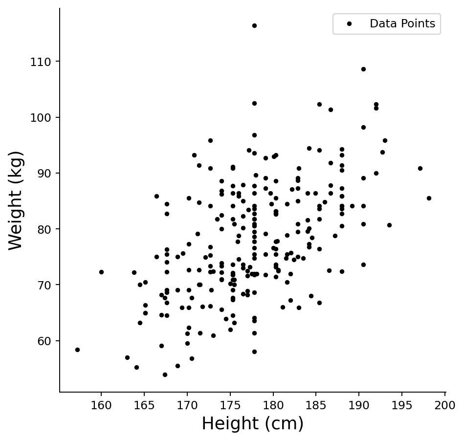

    **(1) 방향은 양, 세기는 중간이다.** 점구름이 왼쪽 아래에서 오른쪽 위로 기울어 있으니 방향은 양이고, 수치로는 $r = 0.5347$이다. 세기를 과장하지 않으려면 $r$ 대신 $r^2 = 0.2859$를 보는 것이 낫다. 키를 알면 몸무게의 변동 가운데 **29% 가량만** 설명되고 나머지 71% 는 그대로 남는다. 그래서 같은 키에서 몸무게가 $20\text{–}30$씩 벌어지는 것이 전혀 이상한 일이 아니다. $r = 0.53$ 을 "꽤 센 관계"로 읽으면 안 된다.

    **산점도가 보여 주지 못하는 것은 세 가지다.** 첫째, **겹친 점을 셀 수 없다.** 키가 $0.1$ 단위로 기록되어 있어 같은 자리에 여러 사람이 찍히는데 그림에서는 한 점으로 보인다. 둘째, **조건부 퍼짐이 일정한지** 눈으로는 가늠되지 않는다. 등분산 가정을 확인하려면 잔차 대 적합값 그림이 필요하고, 그것이 이 장 뒤쪽 진단의 몫이다. 셋째, **직선이 적절한 요약인지**를 산점도만으로는 판정할 수 없다. 여기서는 직선이 무리가 없어 보이지만 이는 눈대중이다.

    **(2) 단위가 맞는다.** `bdims` 의 `hgt` 는 **센티미터**이고 `wgt` 는 **킬로그램**이며, 평균 $177.75$와 $78.14$가 성인 남성의 값으로 자연스럽다.

    **인치·파운드였다면 두 군데가 한꺼번에 무너진다.** 키 평균 $177.75$를 인치로 읽으면 $177.75 \times 2.54 = 451.5\,\text{cm}$, 곧 **$4.5\,\text{m}$**가 되어 말이 되지 않는다. 몸무게 $78.14$를 파운드로 읽으면 $78.14 \times 0.4536 = 35.4\,\text{kg}$으로, 평균 키가 $4.5\,\text{m}$인 사람이 $35\,\text{kg}$이라는 뜻이 된다. **두 축을 따로 보아도 틀리고 함께 보면 더 틀린다.** 자료를 받자마자 평균과 범위를 상식과 맞추어 보는 습관이 이런 것을 걸러 낸다.

    이 확인이 사소해 보이지만 회귀에서는 치명적이다. 기울기는 **단위가 있는 양**이어서, 뒤에서 구할 $\hat\beta_1 = 0.7826$은 "키 $1\,\text{cm}$마다 몸무게 $0.78\,\text{kg}$"이라는 뜻이다. 같은 숫자를 "인치마다 파운드"로 읽으면 $\text{kg}/\text{cm}$ 로는 $0.7826 \times 0.4536/2.54 = 0.1398$ 에 해당해 **실제의 $1/5.6$** 이 된다. **단위를 잃은 기울기는 해석할 수 없다.**

<div class="storybox" markdown>

**그림으로 보는 통계학 1.** 스물넉 점에 그은 두 직선

<figure markdown>
  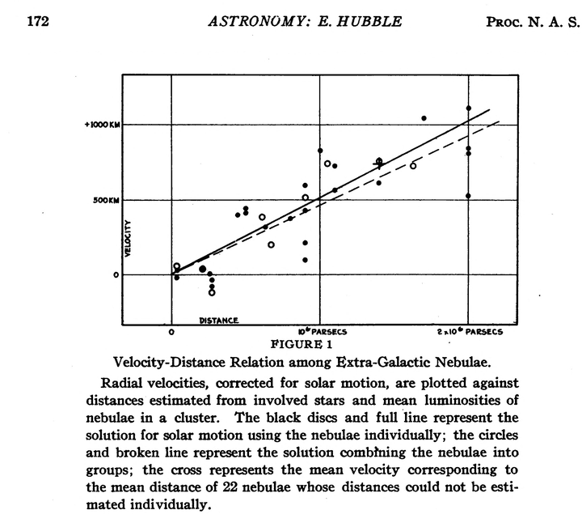{ width=560 }
  <figcaption markdown>허블 「외부은하 성운의 거리와 시선속도 사이의 관계」(『미국 학술원 회보』 제$15$ 권, $1929$) $172$ 쪽. 머리글 왼쪽 끝에 쪽 번호 $172$ 가 있다. 가로가 거리(파섹), 세로가 속도(초당 킬로미터)다. 검은 점과 **실선**은 은하를 하나씩 쓴 풀이, 빈 동그라미와 **점선**은 아홉 무리로 묶은 풀이다. *(Internet Archive · 저작권 없음)*</figcaption>
</figure>

「직선이다」라는 말은 세 가지와 같은 말이다 — 식이 $ax+b$ 꼴이다, 도함수가 상수다, 그리고 **두 점을 어떻게 잡아도 평균변화율이 같다.** 세 번째가 자료를 가진 사람의 말이다. 보기 1 처럼 점을 찍어 놓고 「직선인가」를 묻는 일은 세 번째를 묻는 일이다.

사진은 그 물음이 던져진 가장 유명한 자리다. 점 하나가 은하 하나이고, 가로가 그 은하까지의 거리, 세로가 그것이 멀어지는 속도다. 글은 이렇게 적는다 — 「표의 자료는 거리와 속도 사이의 **선형 상관**을 보인다.」 그래서 속도가 거리에 곧바로 비례한다고 놓고 풀어 기울기 $K$ 를 두 번 구한다. 은하 스물넷을 하나씩 쓰면 $K=+465\pm50$, 아홉 무리로 묶으면 $+513\pm60$ 이고, 「어림수로」 $K=500$ 을 고른다. 단위는 **백만 파섹당 초속 킬로미터**다.

세 번째 뜻으로 읽으면 $K$ 는 **어느 두 점을 잡아도 같아야 할 평균변화율**이고, 그림의 흩어짐이 그 「같아야 함」이 얼마나 참인지를 보여 준다. 바로 앞 쪽에서 글은 잔차의 평균을 $150$ 과 $110$ 이라 적는데, 가장 멀리 있는 점의 속도가 초속 $1000$ 킬로미터 남짓이니 **열에 하나 남짓씩 어긋나는 셈**이다. 그 흩어짐을 안고도 직선을 긋는 것이 이 그림이 한 일이다.

글에 적힌 셈을 두 군데 따라가 보았다. 거리를 못 잰 스물두 개의 평균이 「거리 $1.4$ 에 속도 $745$」인데 $745\div1.4=532$ 로, 글이 적은 $530$ 이 나온다. 그리고 다른 은하 하나의 속도 $3910$ 을 $K=500$ 으로 나누면 $7.82$ 로, 글이 적은 $7.8$ 백만 파섹이 된다. 두 곳 모두 **나눗셈 한 번**이고, 평균변화율이 하나라는 말이 허락하는 전부가 그것이다.

기울기 자체에도 읽을 것이 있다. $K$ 의 단위가 속도를 거리로 나눈 것이므로 **그 역수는 시간의 차원**을 갖는다. $K=500$ 을 넣어 이 쪽에서 계산해 보면 약 $20$ 억 년이 나온다. 글은 이 수를 적지 않는다 — 기울기를 구한 데서 멈춘다.

그리고 마지막 문단에서 스스로 못을 박는다 — 「여기서 찾은 선형 관계는 거리의 좁은 범위를 나타내는 **첫 번째 근사**임을 강조해 둔다.」 앞서 두 풀이의 차이가 주로 처녀자리 성단의 네 은하 때문이며 더 먼 천체의 새 자료가 있어야 한다고 적어 둔 뒤에 붙인 말이다. 과연 그 뒤로 기울기는 여러 번 다시 매겨졌지만 **직선이라는 꼴은 남았다.** 꼴과 기울기의 값은 다른 것이다 — 보기 1 에서 $r=0.53$ 을 「꽤 센 관계」로 읽지 말라고 한 것도 같은 조심이다. 점구름이 직선을 따른다는 말과 그 직선이 자료를 잘 설명한다는 말은 같지 않다.

_확인한 곳 — [Internet Archive 「A Relation between Distance and Radial Velocity among Extra-Galactic Nebulae」($1929$)](https://archive.org/details/hubble736874) 의 전문 스캔. **사진에서 직접 읽은 것**은 머리글의 쪽 번호 $172$ 와 「ASTRONOMY: E. HUBBLE」, 그림 $1$ 의 두 축 눈금(가로 $0$·$10^{6}$ 파섹·$2\times10^{6}$ 파섹, 세로 $0$·$500$ km·$+1000$ km), 그리고 그 아래 설명문(검은 점·실선 $=$ 은하를 하나씩, 빈 동그라미·점선 $=$ 아홉 무리, 십자 $=$ 거리를 못 잰 스물두 개의 평균)까지다 · **나머지는 같은 스캔의 본문에서 읽었다** — 「선형 상관」·은하 스물넷과 아홉 무리·$K=+465\pm50$ 과 $+513\pm60$·어림수 $K=500$·두 풀이의 차이가 처녀자리 네 은하 때문이라는 대목은 인쇄 $170$ 쪽, 잔차 평균 $150$·$110$ 은 $171$ 쪽, 「$745$ km/sec · 거리 $1.4\times10^{6}$ 파섹 · $K$ 의 값 $530$」은 인쇄 $172$ 쪽의 **그림 아래 본문**, 「$3910$ 을 $K=500$ 으로 나누어 $7.8\times10^{6}$ 파섹」과 마지막 문단의 「첫 번째 근사」는 $173$ 쪽이다 · **수는 이 쪽에서 직접 계산했다** — $745/1.4=532$, $3910/500=7.82$, $465$ 와 $513$ 의 차이 $10.3\%$, 그리고 $1$ 파섹 $=3.0857\times10^{13}$ km 로 $1/K=6.17\times10^{16}$ 초 $=19.6$ 억 년을 얻었다 · 기울기가 뒤에 여러 번 다시 매겨졌다는 것은 [Wikipedia 「Hubble's law」](https://en.wikipedia.org/wiki/Hubble%27s_law) 의 「Measured values」 대목으로 확인했다_

</div>

### 평균점

**평균점** $(\bar{x}, \bar{y})$는 산점도의 중심이다. 모든 회귀직선은 이 점을 지난다.

<div class="exbox" markdown>

**보기 2.** <span class="diff easy" title="쉬움"></span> 평균점 표시하기. 산점도에 평균점 $(\bar x, \bar y)$를 찍는다.

**(1)** 최소제곱직선 $y = a + bx$가 **반드시** 평균점을 지남을 정규방정식에서 보이시오. 그 역, 곧 "평균점을 지나는 직선은 모두 최소제곱직선"도 성립하는가.

**(2)** 그 등식 $\bar y = a + b\bar x$가 자료에서 실제로 성립하는지 확인하고, 잔차의 합이 무엇이 되는지 수치로 재어 보시오.

</div>

??? success "풀이"

    **(1) 해석적으로.** 손실 $l = \frac1n \sum_i (a + bx_i - y_i)^2$을 $a$로 편미분하면

    $$
    \frac{\partial l}{\partial a} = \frac{2}{n}\sum_{i=1}^n (a + bx_i - y_i)
    $$

    이고, 이를 $0$으로 두면 $\sum_i (a + bx_i - y_i) = 0$, 곧 $na + nb\bar x - n\bar y = 0$이다. 양변을 $n$으로 나누면

    $$
    \bar y = a + b\bar x
    $$

    이다. **절편에 대한 정규방정식이 바로 "평균점을 지난다"는 문장이다.** 기울기가 무엇으로 정해지든 상관없다. $b$가 정해진 뒤 $a = \bar y - b\bar x$로 맞추어지는 구조이기 때문이다. 같은 식을 잔차 $e_i = y_i - (a + bx_i)$로 다시 쓰면 $\sum_i e_i = 0$이므로, **"평균점을 지난다"와 "잔차의 합이 0 이다"는 같은 말이다.**

    **역은 성립하지 않는다.** 위 유도는 두 정규방정식 가운데 **첫째만** 썼다. $a$ 방향의 조건은 절편 하나만 묶으므로, 기울기 $b$를 아무것으로 잡고 $a = \bar y - b\bar x$로 두면 그 직선은 평균점을 지나고 잔차합도 $0$이다. 최소제곱직선이 되려면 **둘째 정규방정식**($\partial l/\partial b = 0$, 곧 $\sum_i e_i x_i = 0$)까지 만족해야 한다. 평균점을 지나는 직선은 1-모수 다발을 이루고, 그 가운데 **하나**만 최소제곱직선이다.

    **(2) 수치적으로.** 아래에서 기울기는 3절에서 유도할 닫힌 꼴 $b = r\,\sigma_y/\sigma_x$를 미리 쓴다.

    ```python
    import matplotlib.pyplot as plt
    import numpy as np
    import pandas as pd

    plt.rcParams["font.sans-serif"] = ["NanumGothic", "Apple SD Gothic Neo", "Malgun Gothic"]
    plt.rcParams["font.family"] = "sans-serif"
    plt.rcParams["axes.unicode_minus"] = False

    # openintro의 bdims 자료: 성인 507명의 신체 치수.
    # hgt(cm), wgt(kg), sex(1 = 남성, 0 = 여성) 열을 쓴다.
    data_url = ("https://raw.githubusercontent.com/vincentarelbundock/Rdatasets/"
                "1dcc2bf5f955cc1224a3e1307256e1fe86b68dae/csv/openintro/bdims.csv")
    dataframe = pd.read_csv(data_url).rename(columns={"hgt": "Height", "wgt": "Weight"})
    dataframe["Gender"] = dataframe["sex"].map({1: "Male", 0: "Female"})

    male_height_weight_data = dataframe[dataframe.Gender == "Male"].loc[:300, ["Height", "Weight"]]

    mean_height = male_height_weight_data.Height.mean()
    mean_weight = male_height_weight_data.Weight.mean()
    std_height = male_height_weight_data.Height.std()
    std_weight = male_height_weight_data.Weight.std()
    height_weight_corr = male_height_weight_data.corr().loc["Height", "Weight"]

    # 최소제곱 해(3절에서 유도한다)
    slope = height_weight_corr * std_weight / std_height
    intercept = mean_weight - slope * mean_height
    print(f"평균점 (x-bar, y-bar) = ({mean_height:.4f}, {mean_weight:.4f})")
    print(f"기울기 b = {slope:.6f},  절편 a = {intercept:.6f}")
    print(f"x-bar 에서의 예측값 a + b*x-bar = {intercept + slope * mean_height:.6f}")
    print(f"y-bar 와의 차이              = {intercept + slope * mean_height - mean_weight:.2e}")

    residuals = male_height_weight_data.Weight - (intercept + slope * male_height_weight_data.Height)
    print(f"잔차의 합 = {residuals.sum():.2e},  잔차의 평균 = {residuals.mean():.2e}")

    # 기울기가 무엇이든 절편을 맞추면 평균점을 지나고 잔차합이 0 이 된다
    for name, b in [("SD 직선", std_weight / std_height), ("기울기 0", 0.0), ("기울기 3", 3.0)]:
        a = mean_weight - b * mean_height
        print(f"{name:8s}: 평균점을 지나게 절편을 맞추면 a = {a:10.4f}, "
              f"잔차합 = {(male_height_weight_data.Weight - (a + b * male_height_weight_data.Height)).sum():.2e}")

    fig, ax = plt.subplots(figsize=(6, 6))
    ax.plot(male_height_weight_data.Height, male_height_weight_data.Weight, '.k', label='Data Points')
    ax.plot([mean_height], [mean_weight], 'ro', markersize=15, label="Point of Averages")

    ax.set_xlabel('Height (cm)', fontsize=15)
    ax.set_ylabel('Weight (kg)', fontsize=15)
    ax.spines['top'].set_visible(False)
    ax.spines['right'].set_visible(False)
    ax.legend()
    plt.show()
    ```

    출력:

    ```
    평균점 (x-bar, y-bar) = (177.7453, 78.1445)
    기울기 b = 0.782568,  절편 a = -60.953364
    x-bar 에서의 예측값 a + b*x-bar = 78.144534
    y-bar 와의 차이              = 0.00e+00
    잔차의 합 = 4.66e-12,  잔차의 평균 = 1.89e-14
    SD 직선   : 평균점을 지나게 절편을 맞추면 a =  -181.9771, 잔차합 = 8.81e-12
    기울기 0   : 평균점을 지나게 절편을 맞추면 a =    78.1445, 잔차합 = -2.27e-13
    기울기 3   : 평균점을 지나게 절편을 맞추면 a =  -455.0915, 잔차합 = -8.98e-12
    ```

    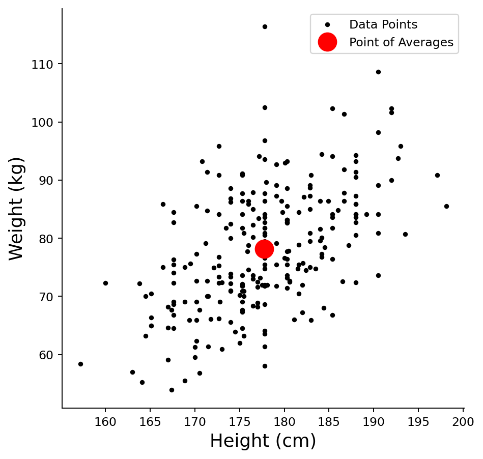

    $\bar x = 177.7453$에서의 예측값이 $78.144534$로 $\bar y$와 자릿수까지 같고, 차이는 $0$으로 떨어진다. 잔차의 합도 $4.66 \times 10^{-12}$이니 **부동소수점 반올림 말고는 정확히 $0$이다.** $247$개 잔차의 크기가 평균 $7$쯤 되는데 그 합이 $10^{-12}$라는 것은 대수적 항등식이 성립한다는 뜻이다.

    마지막 세 줄이 **(1)의 역이 깨지는 모습**이다. 기울기를 $s_y/s_x = 1.4635$로 잡아도, $0$으로 잡아도, 터무니없는 $3$으로 잡아도 절편을 $\bar y - b\bar x$로 맞추면 잔차합이 모두 $0$이다. **잔차합이 0 이라는 것은 최소제곱의 증거가 되지 못한다.** 기울기가 최소제곱인지는 잔차가 $x$와 직교하는가, 곧 $\sum_i e_i x_i = 0$인가로만 가려진다. $\square$

### 표준편차 띠

**2 SD 띠**는 구간 $[\bar{x} - 2\sigma_x,\; \bar{x} + 2\sigma_x]$ 또는 $[\bar{y} - 2\sigma_y,\; \bar{y} + 2\sigma_y]$를 표시한다. (정규성 아래에서) 자료의 약 95%가 이 띠 안에 들어온다.

#### 2 SD x-띠(키)

<div class="exbox" markdown>

**보기 3.** <span class="diff easy" title="쉬움"></span> 키의 2 SD 띠. 산점도에 $[\bar x - 2s_x,\ \bar x + 2s_x]$를 세로 점선으로 긋는다.

**(1)** 이 띠 안에 들어오는 자료의 비율에 대해 **체비셰프 부등식**이 주는 하한과 **정규근사**가 주는 값은 각각 얼마인가. 둘 중 어느 쪽이 가정을 더 많이 쓰는가.

**(2)** 실제 자료에서 그 비율을 세어 두 예측과 견주시오. 어긋난다면 몬테카를로 오차로 설명되는 크기인가.

</div>

??? success "풀이"

    **(1) 해석적으로.** 체비셰프 부등식은 분포에 **아무 가정도 두지 않고**

    $$
    P\left(\lvert X - \mu \rvert \ge k\sigma\right) \le \frac{1}{k^2}
    $$

    을 준다. $k = 2$이면 띠 밖이 $1/4$ 이하이므로 띠 안은

    $$
    P\left(\lvert X - \mu \rvert < 2\sigma\right) \ge 1 - \frac{1}{4} = 0.75
    $$

    이다. **부등호라는 점이 중요하다.** 체비셰프는 "적어도 75%"만 말하고 그 이상은 말하지 않는다.

    정규근사는 $X \sim N(\mu, \sigma^2)$를 **가정하고** 등식을 준다.

    $$
    P\left(\lvert X - \mu \rvert < 2\sigma\right) = \Phi(2) - \Phi(-2) = 2\Phi(2) - 1 = 0.9545
    $$

    가정을 더 많이 쓰는 쪽은 정규근사다. 그 대가로 하한이 아니라 값을 얻는다. 둘의 거리가 $0.75$ 대 $0.9545$로 크다는 것은 **체비셰프가 매우 느슨한 한계**라는 뜻이다. 정규에 가까운 자료에서 체비셰프를 쓰면 손해가 크다. 그 느슨함이 값인 것은 분포를 전혀 모를 때뿐이다.

    **(2) 수치적으로.**

    ```python
    import matplotlib.pyplot as plt
    import numpy as np
    import pandas as pd
    from scipy import stats

    plt.rcParams["font.sans-serif"] = ["NanumGothic", "Apple SD Gothic Neo", "Malgun Gothic"]
    plt.rcParams["font.family"] = "sans-serif"
    plt.rcParams["axes.unicode_minus"] = False

    def add_vertical_reference_line(axis, x_position, y_min, y_max, line_style, line_color='k', line_label=None):
        """주어진 축에 세로 기준선을 긋는다."""
        axis.plot([x_position, x_position], [y_min, y_max], linestyle=line_style, color=line_color, label=line_label)

    # openintro의 bdims 자료: 성인 507명의 신체 치수.
    # hgt(cm), wgt(kg), sex(1 = 남성, 0 = 여성) 열을 쓴다.
    data_url = ("https://raw.githubusercontent.com/vincentarelbundock/Rdatasets/"
                "1dcc2bf5f955cc1224a3e1307256e1fe86b68dae/csv/openintro/bdims.csv")
    data = pd.read_csv(data_url).rename(columns={"hgt": "Height", "wgt": "Weight"})
    data["Gender"] = data["sex"].map({1: "Male", 0: "Female"})

    male_height_weight_data = data[data.Gender == "Male"].loc[:300, ["Height", "Weight"]]

    mean_height = male_height_weight_data.Height.mean()
    mean_weight = male_height_weight_data.Weight.mean()
    std_dev_height = male_height_weight_data.Height.std()
    std_dev_weight = male_height_weight_data.Weight.std()
    height_weight_corr = male_height_weight_data.corr().loc["Height", "Weight"]

    # 띠 안에 실제로 몇 명이 들어오는지 센다
    heights = male_height_weight_data.Height
    band_low, band_high = mean_height - 2 * std_dev_height, mean_height + 2 * std_dev_height
    inside = ((heights >= band_low) & (heights <= band_high)).sum()
    n = len(heights)
    print(f"2 SD 띠 = [{band_low:.4f}, {band_high:.4f}],  폭 = {band_high - band_low:.4f}")
    print(f"띠 안 {inside} / {n} = {inside / n:.4f}")
    print(f"  아래로 벗어남 {(heights < band_low).sum()}명,  위로 벗어남 {(heights > band_high).sum()}명")
    print(f"체비셰프 하한 1 - 1/2^2 = {1 - 1 / 4:.4f}")
    print(f"정규 근사     Phi(2)-Phi(-2) = {stats.norm.cdf(2) - stats.norm.cdf(-2):.4f}")
    print(f"  이항 표준오차 = {np.sqrt(0.9545 * 0.0455 / n):.4f}")
    print(f"키의 왜도 {heights.skew():.4f},  초과첨도 {heights.kurt():.4f}")

    fig, axis = plt.subplots(figsize=(6, 6))
    axis.plot(male_height_weight_data.Height, male_height_weight_data.Weight, '.k', label="Data Points")
    axis.plot([mean_height], [mean_weight], 'ro', markersize=15, label="Point of Averages")

    add_vertical_reference_line(axis, mean_height - 2 * std_dev_height,
        male_height_weight_data.Weight.min(), male_height_weight_data.Weight.max(),
        '--', 'k', "2 SD Band - Height")
    add_vertical_reference_line(axis, mean_height + 2 * std_dev_height,
        male_height_weight_data.Weight.min(), male_height_weight_data.Weight.max(),
        '--', 'k')

    axis.set_xlabel('Height (cm)', fontsize=15)
    axis.set_ylabel('Weight (kg)', fontsize=15)
    axis.spines['top'].set_visible(False)
    axis.spines['right'].set_visible(False)
    axis.legend()
    plt.show()
    ```

    출력:

    ```
    2 SD 띠 = [163.3781, 192.1126],  폭 = 28.7345
    띠 안 239 / 247 = 0.9676
      아래로 벗어남 3명,  위로 벗어남 5명
    체비셰프 하한 1 - 1/2^2 = 0.7500
    정규 근사     Phi(2)-Phi(-2) = 0.9545
      이항 표준오차 = 0.0133
    키의 왜도 0.1042,  초과첨도 -0.1143
    ```

    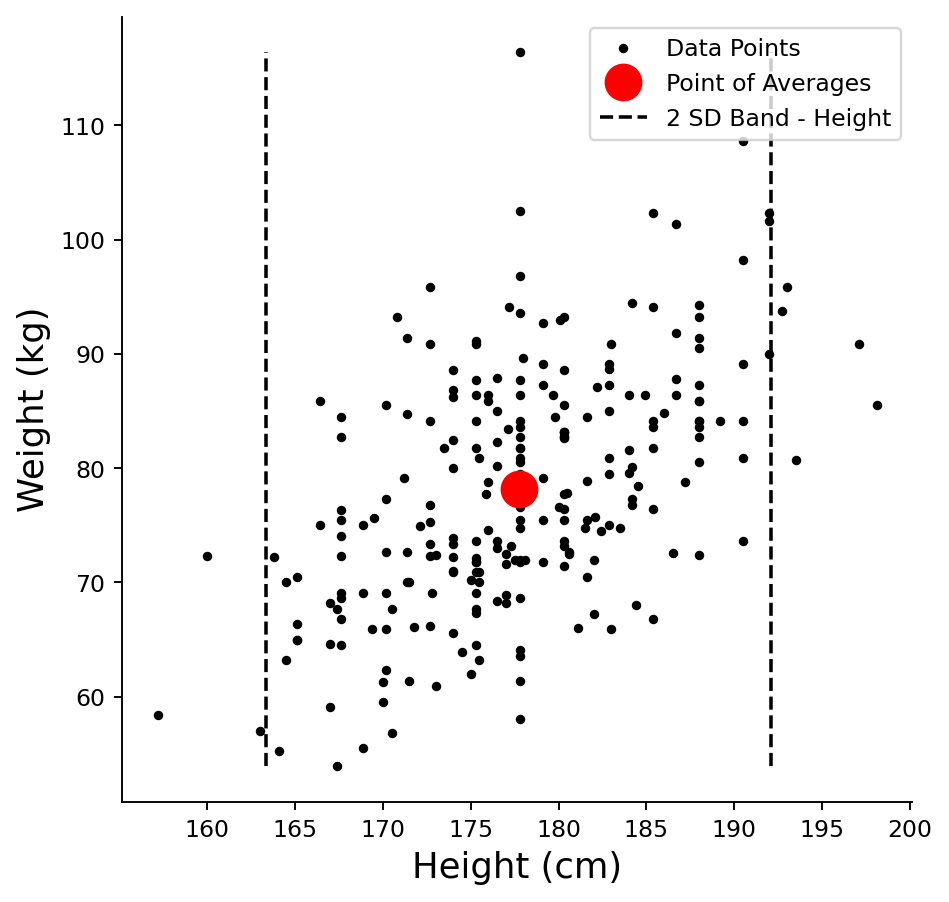

    띠는 $[163.38,\ 192.11]\,\text{cm}$로 폭이 $4s_x = 28.73\,\text{cm}$다. 이 안에 $239$명이 들어와 비율이 $239/247 = 0.9676$이다.

    **체비셰프는 맞지만 쓸모가 없다.** 하한 $0.75$는 물론 지켜졌으나, 실제 비율이 하한보다 $0.22$ 나 높으니 이 자료에 체비셰프를 쓰면 띠 밖에 $62$명까지 있을 수 있다고 말하는 셈이 된다. 실제로는 $8$명이다.

    **정규근사는 거의 맞는다.** $0.9545$ 대 $0.9676$으로 차이가 $0.0131$인데, 이항 표준오차가

    $$
    \sqrt{\frac{0.9545 \times 0.0455}{247}} = 0.0133
    $$

    이므로 차이는 **표준오차 한 개 분량**이다. $z = 0.0131/0.0133 = 0.99$이니 표본추출 변동으로 완전히 설명된다. 정규성을 의심할 근거가 아니다. 왜도 $0.1042$, 초과첨도 $-0.1143$도 둘 다 $0$에 가까워 성인 남성 키가 정규에 가깝다는 통상의 관찰과 맞는다.

    한 가지는 분명히 해 두어야 한다. 여기서 쓴 $\bar x$와 $s_x$는 **모수가 아니라 추정값**이다. $0.9545$는 $\mu$와 $\sigma$를 알 때의 값이고, 띠를 같은 자료로 추정해 그으면 띠가 자료에 맞춰 당겨지므로 포함 비율이 체계적으로 **약간 높아진다.** 참 정규자료를 $20$만 번 뽑아 재면 $\bar x \pm 2s$ 안의 평균 비율이 $n = 20$에서 $0.9637$, $n = 50$에서 $0.9578$, $n = 247$에서 $0.9552$다. $n = 247$에서 치우침이 $0.0007$이라 위 비교를 흔들지 않지만, 표본이 작을 때는 이 구별이 중요해진다. $\square$

#### 2 SD y-띠(몸무게)

<div class="exbox" markdown>

**보기 4.** <span class="diff easy" title="쉬움"></span> 몸무게의 2 SD 띠. 같은 산점도에 $[\bar y - 2s_y,\ \bar y + 2s_y]$를 가로 점선으로 긋는다.

**(1)** 몸무게의 왜도는 $0.293$으로 키의 $0.104$보다 크다. 그렇다면 띠 안의 비율이 정규근사 $0.9545$에서 **키보다 더 멀어질** 것이라 기대해야 하는가.

**(2)** 세어 확인하고, 띠 밖으로 벗어난 사람들을 위아래로 나누어 보시오. 왜도는 포함 비율과 꼬리의 모양 가운데 어디에 나타나는가.

</div>

??? success "풀이"

    **(1) 그렇게 기대할 근거가 없다.** 포함 비율 $P(\lvert Y - \mu \rvert < 2\sigma)$는 두 꼬리 질량의 **합**만 본다. 왜도는 그 합을 한쪽에서 늘리고 다른 쪽에서 줄이는 쪽으로 작용하므로 합에는 거의 남지 않고 **상쇄된다.** 포함 비율에 직접 영향을 주는 것은 왜도가 아니라 **첨도**, 곧 꼬리의 무게다. 몸무게의 초과첨도는 $0.178$로 $0$에서 멀지 않다.

    게다가 $n = 247$에서 포함 비율의 표준오차는 $\sqrt{0.9545 \times 0.0455/247} = 0.0133$이다. **참 포함 비율이 정확히 $0.9545$라 해도 관측값은 $0.93$에서 $0.98$ 사이를 넘나든다.** 두 변수의 비율 차이를 왜도 탓으로 돌리기 전에 이 폭을 먼저 떠올려야 한다.

    **(2) 수치적으로.**

    ```python
    import matplotlib.pyplot as plt
    import numpy as np
    import pandas as pd
    from scipy import stats

    plt.rcParams["font.sans-serif"] = ["NanumGothic", "Apple SD Gothic Neo", "Malgun Gothic"]
    plt.rcParams["font.family"] = "sans-serif"
    plt.rcParams["axes.unicode_minus"] = False

    def add_horizontal_reference_line(axis, y_position, x_min, x_max, line_style, line_color='k', line_label=None):
        """주어진 축에 가로 기준선을 긋는다."""
        axis.plot([x_min, x_max], [y_position, y_position], linestyle=line_style, color=line_color, label=line_label)

    # openintro의 bdims 자료: 성인 507명의 신체 치수.
    # hgt(cm), wgt(kg), sex(1 = 남성, 0 = 여성) 열을 쓴다.
    data_url = ("https://raw.githubusercontent.com/vincentarelbundock/Rdatasets/"
                "1dcc2bf5f955cc1224a3e1307256e1fe86b68dae/csv/openintro/bdims.csv")
    data = pd.read_csv(data_url).rename(columns={"hgt": "Height", "wgt": "Weight"})
    data["Gender"] = data["sex"].map({1: "Male", 0: "Female"})

    male_height_weight_data = data[data.Gender == "Male"].loc[:300, ["Height", "Weight"]]

    mean_height = male_height_weight_data.Height.mean()
    mean_weight = male_height_weight_data.Weight.mean()
    std_dev_height = male_height_weight_data.Height.std()
    std_dev_weight = male_height_weight_data.Weight.std()
    height_weight_corr = male_height_weight_data.corr().loc["Height", "Weight"]

    # 띠 밖으로 벗어난 사람들을 위아래로 나누어 본다
    weights = male_height_weight_data.Weight
    band_low, band_high = mean_weight - 2 * std_dev_weight, mean_weight + 2 * std_dev_weight
    inside = ((weights >= band_low) & (weights <= band_high)).sum()
    n = len(weights)
    print(f"2 SD 띠 = [{band_low:.4f}, {band_high:.4f}],  폭 = {band_high - band_low:.4f}")
    print(f"띠 안 {inside} / {n} = {inside / n:.4f}   (정규 근사 {stats.norm.cdf(2) - stats.norm.cdf(-2):.4f})")
    print(f"  아래로 벗어남 {(weights < band_low).sum()}명,  위로 벗어남 {(weights > band_high).sum()}명")
    print(f"  아래 꼬리 값 {sorted(weights[weights < band_low].round(1))}")
    print(f"  위쪽 꼬리 값 {sorted(weights[weights > band_high].round(1))}")
    print(f"  경계까지의 거리:  아래 {band_low - weights.min():.2f},  위 {weights.max() - band_high:.2f}")
    print(f"몸무게 왜도 {weights.skew():.4f},  평균 {mean_weight:.2f} 대 중앙값 {weights.median():.2f}")
    print(f"키     왜도 {male_height_weight_data.Height.skew():.4f}")
    print(f"이항 표준오차 {np.sqrt(0.9545 * 0.0455 / n):.4f}")

    fig, axis = plt.subplots(figsize=(6, 6))
    axis.plot(male_height_weight_data.Height, male_height_weight_data.Weight, '.k', label="Data Points")
    axis.plot([mean_height], [mean_weight], 'ro', markersize=15, label="Point of Averages")

    add_horizontal_reference_line(axis, mean_weight - 2 * std_dev_weight,
        male_height_weight_data.Height.min(), male_height_weight_data.Height.max(),
        '--', 'k', "2 SD Band - Weight")
    add_horizontal_reference_line(axis, mean_weight + 2 * std_dev_weight,
        male_height_weight_data.Height.min(), male_height_weight_data.Height.max(),
        '--', 'k')

    axis.set_xlabel('Height (cm)', fontsize=15)
    axis.set_ylabel('Weight (kg)', fontsize=15)
    axis.spines['top'].set_visible(False)
    axis.spines['right'].set_visible(False)
    axis.legend()
    plt.show()
    ```

    출력:

    ```
    2 SD 띠 = [57.1188, 99.1703],  폭 = 42.0516
    띠 안 235 / 247 = 0.9514   (정규 근사 0.9545)
      아래로 벗어남 5명,  위로 벗어남 7명
      아래 꼬리 값 [53.9, 55.2, 55.5, 56.8, 57.0]
      위쪽 꼬리 값 [101.4, 101.6, 102.3, 102.3, 102.5, 108.6, 116.4]
      경계까지의 거리:  아래 3.22,  위 17.23
    몸무게 왜도 0.2930,  평균 78.14 대 중앙값 77.30
    키     왜도 0.1042
    이항 표준오차 0.0133
    ```

    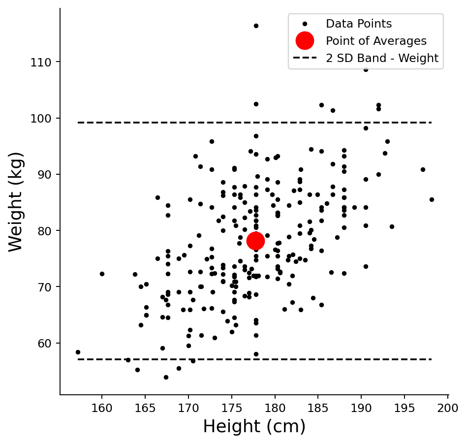

    **기대와 반대로 몸무게가 더 가깝다.** 비율이 $0.9514$로 정규근사 $0.9545$에서 $0.0031$밖에 떨어져 있지 않다. 표준오차의 $0.23$배다. 키는 $0.9676$으로 $0.0131$ 떨어져 있었으니 표준오차의 $0.99$배였다. 두 값 모두 **표준오차 안쪽**이므로 "어느 쪽이 더 정규에 가깝다"고 결론 낼 근거는 어디에도 없다. 왜도가 큰 변수가 오히려 근사값에 더 붙은 것은 우연이다. $n = 247$로는 이 둘을 구별할 수 없다.

    **왜도는 개수가 아니라 거리에 나타난다.** 띠 밖 $12$명이 아래 $5$명, 위 $7$명으로 갈리는데 이 $5 : 7$ 자체는 정규에서도 흔히 나온다(각 꼬리의 기대값이 $247 \times 0.02275 = 5.6$명이다). 정작 눈에 띄는 것은 **벗어난 거리**다. 아래쪽 최솟값 $53.9$는 경계 $57.12$에서 $3.22$만 아래인데, 위쪽 최댓값 $116.4$는 경계 $99.17$에서 $17.23$ 위다. **다섯 배 넘게 멀다.** 평균 $78.14$가 중앙값 $77.30$보다 큰 것도 같은 비대칭의 다른 얼굴이다.

    그러니 **포함 비율만 세는 것으로는 비대칭을 못 잡는다.** 몸무게처럼 아래로는 생리적 하한에 막히고 위로는 열려 있는 양은 오른쪽 꼬리가 길어지는 것이 자연스럽다. 2 SD 띠는 대칭 구간이므로 그 비대칭을 구조적으로 보여 줄 수 없고, 이를 보려면 히스토그램이나 정규 Q-Q 그림이 필요하다. $\square$

### SD 직선

**SD 직선**은 평균점을 지나며 기울기가 $\pm \sigma_y / \sigma_x$인 직선이다. 두 변수 모두에서 평균으로부터 같은 표준편차 배수만큼 떨어진 점들을 잇는다. 상관이 양수이면 양의 SD 직선이, 음수이면 음의 SD 직선이 의미를 갖는다.

#### 양의 SD 직선

양의 SD 직선은 기울기가 $+\sigma_y / \sigma_x$이다. 키가 $\sigma_x$만큼 늘어날 때마다 몸무게가 $\sigma_y$만큼 늘어난다.

<div class="exbox" markdown>

**보기 5.** <span class="diff easy" title="쉬움"></span> 양의 SD 직선. 평균점을 지나며 기울기가 $+s_y/s_x$인 직선과 SD 삼각형을 그린다.

**(1)** SD 직선의 기울기가 $s_y/s_x$라는 것을 **표준단위로 쓴 정의**에서 유도하시오.

**(2)** 평균점을 지나고 기울기가 $b$인 직선의 잔차제곱합이

$$
\text{RSS}(b) = S_{yy} - 2b\,S_{xy} + b^2 S_{xx}
$$

임을 보이고, 여기에 $b = s_y/s_x$를 넣어 $\text{RSS}(\text{SD 직선}) = 2(1-r)\,S_{yy}$를 얻으시오. 최소제곱직선의 $\text{RSS} = (1-r^2)S_{yy}$와 견주면 두 값의 비는 얼마인가. 자료에서 확인하시오.

</div>

??? success "풀이"

    **(1) 해석적으로.** SD 직선의 정의는 "두 변수에서 평균으로부터 같은 표준편차 배수만큼 떨어진 점들의 자취"다. 표준단위로 쓰면 바로

    $$
    \frac{y - \bar y}{s_y} = \frac{x - \bar x}{s_x}
    $$

    이고, $y$에 대해 풀면

    $$
    y = \bar y + \frac{s_y}{s_x}\,(x - \bar x)
    $$

    이다. 기울기가 $s_y/s_x$이고 평균점을 지난다. **상관계수가 전혀 들어오지 않는다는 점이 핵심이다.** SD 직선은 $x$와 $y$가 **함께 움직이는지**는 보지 않고 각 변수의 퍼짐만 쓴다. 이 자료에서는 $s_y/s_x = 10.5129/7.1836 = 1.4635$다.

    **(2) 해석적으로.** 절편이 $a = \bar y - b\bar x$이므로 잔차는 $e_i = (y_i - \bar y) - b(x_i - \bar x)$다. 제곱해 더하면 교차항이 $S_{xy}$로 모인다.

    $$
    \text{RSS}(b) = \sum_i \left[(y_i - \bar y) - b(x_i - \bar x)\right]^2 = S_{yy} - 2b\,S_{xy} + b^2 S_{xx}
    $$

    여기서 $S_{xx} = (n-1)s_x^2$, $S_{yy} = (n-1)s_y^2$, $S_{xy} = (n-1)\,r\,s_x s_y$다. $b = s_y/s_x$를 넣으면

    $$
    \text{RSS}\!\left(\frac{s_y}{s_x}\right)
    = (n-1)\left[s_y^2 - 2\,\frac{s_y}{s_x}\,r\,s_x s_y + \frac{s_y^2}{s_x^2}\,s_x^2\right]
    = (n-1)\,s_y^2\,\bigl(2 - 2r\bigr)
    = 2(1-r)\,S_{yy}
    $$

    이다. 같은 식에 $b = r\,s_y/s_x$를 넣으면 최소제곱의 값이 나온다.

    $$
    \text{RSS}\!\left(r\frac{s_y}{s_x}\right) = (n-1)s_y^2\left[1 - 2r^2 + r^2\right] = (1-r^2)\,S_{yy}
    $$

    따라서 두 값의 비는 $r$만으로 정해진다.

    $$
    \frac{\text{RSS}(\text{SD})}{\text{RSS}(\text{OLS})} = \frac{2(1-r)}{1-r^2} = \frac{2(1-r)}{(1-r)(1+r)} = \frac{2}{1+r}
    $$

    $r \to 1$이면 비가 $1$로 가서 두 직선이 겹치고, $r = 0$이면 $2$가 되어 SD 직선이 최소제곱직선보다 **두 배** 나쁘다. 이 자료는 $r = 0.5347$이므로 $2/1.5347 = 1.3032$가 예상값이다.

    ```python
    import matplotlib.pyplot as plt
    import pandas as pd

    plt.rcParams["font.sans-serif"] = ["NanumGothic", "Apple SD Gothic Neo", "Malgun Gothic"]
    plt.rcParams["font.family"] = "sans-serif"
    plt.rcParams["axes.unicode_minus"] = False

    # openintro의 bdims 자료: 성인 507명의 신체 치수.
    # hgt(cm), wgt(kg), sex(1 = 남성, 0 = 여성) 열을 쓴다.
    data_url = ("https://raw.githubusercontent.com/vincentarelbundock/Rdatasets/"
                "1dcc2bf5f955cc1224a3e1307256e1fe86b68dae/csv/openintro/bdims.csv")
    data = pd.read_csv(data_url).rename(columns={"hgt": "Height", "wgt": "Weight"})
    data["Gender"] = data["sex"].map({1: "Male", 0: "Female"})

    male_height_weight_data = data[data.Gender == "Male"].loc[:300, ["Height", "Weight"]]

    mean_height = male_height_weight_data.Height.mean()
    mean_weight = male_height_weight_data.Weight.mean()
    std_dev_height = male_height_weight_data.Height.std()
    std_dev_weight = male_height_weight_data.Weight.std()
    correlation = male_height_weight_data.corr().loc["Height", "Weight"]

    # 평균점을 지나고 기울기가 b 인 직선의 잔차제곱합
    def residual_sum_of_squares(b):
        intercept = mean_weight - b * mean_height
        return ((male_height_weight_data.Weight
                 - (intercept + b * male_height_weight_data.Height)) ** 2).sum()

    sd_slope = std_dev_weight / std_dev_height
    ols_slope = correlation * std_dev_weight / std_dev_height
    total = residual_sum_of_squares(0.0)          # 평균만 쓰는 직선의 RSS = Syy

    print(f"r = {correlation:.6f}")
    print(f"SD 직선 기울기 s_y/s_x   = {sd_slope:.6f}")
    print(f"최소제곱 기울기 r s_y/s_x = {ols_slope:.6f}")
    print()
    print(f"{'직선':12s}{'기울기':>10s}{'RSS':>14s}{'RSS/Syy':>12s}{'이론값':>12s}")
    for name, b, theory in [("평균만", 0.0, 1.0),
                            ("최소제곱", ols_slope, 1 - correlation ** 2),
                            ("SD 직선", sd_slope, 2 * (1 - correlation))]:
        print(f"{name:12s}{b:10.4f}{residual_sum_of_squares(b):14.4f}"
              f"{residual_sum_of_squares(b) / total:12.6f}{theory:12.6f}")
    print()
    print(f"RSS(SD)/RSS(OLS) = {residual_sum_of_squares(sd_slope) / residual_sum_of_squares(ols_slope):.6f}")
    print(f"2/(1+r)          = {2 / (1 + correlation):.6f}")

    fig, axis = plt.subplots(figsize=(8, 8))
    axis.plot(male_height_weight_data.Height, male_height_weight_data.Weight, '.k', label="Data Points")
    axis.plot([mean_height], [mean_weight], 'ro', markersize=15, label="Point of Averages")

    # 양의 SD 직선. 평균에서 ±3 표준편차까지 그린다
    axis.plot(
        [mean_height - 3 * std_dev_height, mean_height + 3 * std_dev_height],
        [mean_weight - 3 * std_dev_weight, mean_weight + 3 * std_dev_weight],
        linestyle="--", color='k', label="Positive SD Line"
    )

    # SD 삼각형을 표시한다
    axis.plot([mean_height, mean_height + std_dev_height], [mean_weight, mean_weight], '-r')
    axis.plot([mean_height + std_dev_height, mean_height + std_dev_height],
              [mean_weight, mean_weight + std_dev_weight], '-r')
    axis.plot([mean_height, mean_height + std_dev_height],
              [mean_weight, mean_weight + std_dev_weight], '-r')

    axis.annotate("$\\sigma_x$",
        [mean_height + 0.4 * std_dev_height, mean_weight - 0.3 * std_dev_weight],
        fontsize=35, color="red")
    axis.annotate("$\\sigma_y$",
        [mean_height + 1.1 * std_dev_height, mean_weight + 0.3 * std_dev_weight],
        fontsize=35, color="red")

    axis.set_xlabel('Height (cm)', fontsize=15)
    axis.set_ylabel('Weight (kg)', fontsize=15)
    axis.spines['top'].set_visible(False)
    axis.spines['right'].set_visible(False)
    axis.legend(fontsize=15)
    plt.show()
    ```

    출력:

    ```
    r = 0.534742
    SD 직선 기울기 s_y/s_x   = 1.463451
    최소제곱 기울기 r s_y/s_x = 0.782568

    직선                 기울기           RSS     RSS/Syy         이론값
    평균만             0.0000    27188.1301    1.000000    1.000000
    최소제곱            0.7826    19413.7185    0.714051    0.714051
    SD 직선           1.4635    25299.0036    0.930516    0.930516

    RSS(SD)/RSS(OLS) = 1.303151
    2/(1+r)          = 1.303151
    ```

    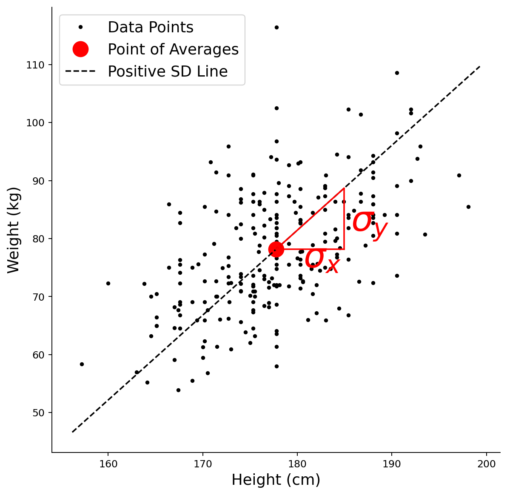

    **세 줄 모두 유도한 값과 소수 여섯째 자리까지 맞는다.** 최소제곱의 $\text{RSS}/S_{yy}$가 $0.714051$이고 $1 - r^2 = 0.714051$이다. SD 직선은 $0.930516$이고 $2(1-r) = 0.930516$이다. 비는 $1.303151$로 $2/(1+r) = 1.303151$과 같다.

    **SD 직선은 최소제곱직선이 아니다.** 그림에서 삼각형의 세로변이 온전히 $\sigma_y$인데, 점구름의 기울기와 견주면 점선이 분명히 과하게 서 있다. 수치로는 잔차제곱합이 $30.3\%$ 더 크다. 그래도 **평균만 쓰는 수평선보다는 낫다**($0.9305 < 1$). 이 자료에 한해서는 $r$이 양수라 SD 직선이 그럭저럭 쓸 만한 방향을 가리키기 때문이다.

    유도한 비 $2/(1+r)$이 **$r$에만 의존한다**는 것도 되새길 만하다. 단위를 바꾸거나 자료를 늘려도 이 비는 바뀌지 않는다. $r$이 $1$에 가까울수록 SD 직선이 최소제곱직선에 가까워지고, $r$이 $0$에 가까우면 손실이 두 배까지 벌어진다. $\square$

#### 음의 SD 직선

음의 SD 직선은 기울기가 $-\sigma_y / \sigma_x$이다. 키가 $\sigma_x$만큼 늘어날 때마다 몸무게가 $\sigma_y$만큼 *줄어든다*.

<div class="exbox" markdown>

**보기 6.** <span class="diff easy" title="쉬움"></span> 음의 SD 직선. 같은 자료에 기울기 $-s_y/s_x$인 직선을 그린다.

**(1)** 보기 5의 식 $\text{RSS}(b) = S_{yy} - 2bS_{xy} + b^2S_{xx}$에 $b = -s_y/s_x$를 넣어 $\text{RSS}(\text{음의 SD 직선}) = 2(1+r)\,S_{yy}$임을 보이시오. 이 값이 **평균만 쓰는 수평선의 $\text{RSS} = S_{yy}$보다 커지는** $r$의 범위는 어디인가.

**(2)** 이 자료의 상관은 $r = +0.5347$인데도 음의 SD 직선을 그리고 있다. 그림이 자료와 어긋나 있는가. 음의 SD 직선이 뜻을 갖는 자료는 어떤 자료인지 말하고, 세 직선의 잔차제곱합을 재어 확인하시오.

</div>

??? success "풀이"

    **(1) 해석적으로.** $b = -s_y/s_x$를 넣으면 교차항의 부호만 뒤집힌다.

    $$
    \text{RSS}\!\left(-\frac{s_y}{s_x}\right)
    = (n-1)\left[s_y^2 + 2\,\frac{s_y}{s_x}\,r\,s_x s_y + \frac{s_y^2}{s_x^2}\,s_x^2\right]
    = (n-1)\,s_y^2\,(2 + 2r)
    = 2(1+r)\,S_{yy}
    $$

    보기 5의 $2(1-r)S_{yy}$에서 $r \to -r$로 바뀐 꼴이다. 이 값이 $S_{yy}$보다 큰 조건은

    $$
    2(1+r) > 1 \quad \Longleftrightarrow \quad r > -\tfrac12
    $$

    이다. **상관이 $-1/2$보다 크기만 하면 음의 SD 직선은 평균만 쓰는 것보다 나쁘다.** 특히 $r \ge 0$인 자료에서는 $2(1+r) \ge 2$이므로 **적어도 두 배** 나쁘다. 그럴 수밖에 없다. 기울기가 자료의 추세와 반대 방향이면 직선이 점들로부터 멀어지는 쪽으로 일하기 때문이다.

    **(2) 어긋나 있다.** 이 자료는 $r = +0.5347$이므로 음의 SD 직선은 자료의 추세와 **반대로** 기울어 있고, 어떤 뜻에서도 이 자료를 요약하지 못한다. 그림은 "기울기의 부호만 바꾸면 이런 직선이 된다"를 보이는 **그림 연습**이며, 자료를 설명하는 직선으로 읽으면 안 된다.

    음의 SD 직선이 뜻을 갖는 것은 $r < 0$인 자료, 곧 한 변수가 커질 때 다른 변수가 작아지는 자료다. 같은 자료로 그런 상황을 만들려면 키의 부호를 뒤집으면 된다. $x \mapsto -x$로 바꾸면 $s_x$는 그대로이고 $S_{xy}$만 부호가 바뀌므로 $r \mapsto -r$이 되고, 그 자료의 최소제곱 기울기는 $-0.7826$이 되어 **음의 SD 직선과 같은 쪽**을 가리킨다.

    ```python
    import matplotlib.pyplot as plt
    import pandas as pd

    plt.rcParams["font.sans-serif"] = ["NanumGothic", "Apple SD Gothic Neo", "Malgun Gothic"]
    plt.rcParams["font.family"] = "sans-serif"
    plt.rcParams["axes.unicode_minus"] = False

    # openintro의 bdims 자료: 성인 507명의 신체 치수.
    # hgt(cm), wgt(kg), sex(1 = 남성, 0 = 여성) 열을 쓴다.
    data_url = ("https://raw.githubusercontent.com/vincentarelbundock/Rdatasets/"
                "1dcc2bf5f955cc1224a3e1307256e1fe86b68dae/csv/openintro/bdims.csv")
    data = pd.read_csv(data_url).rename(columns={"hgt": "Height", "wgt": "Weight"})
    data["Gender"] = data["sex"].map({1: "Male", 0: "Female"})

    male_height_weight_data = data[data.Gender == "Male"].loc[:300, ["Height", "Weight"]]

    mean_height = male_height_weight_data.Height.mean()
    mean_weight = male_height_weight_data.Weight.mean()
    std_dev_height = male_height_weight_data.Height.std()
    std_dev_weight = male_height_weight_data.Weight.std()
    correlation = male_height_weight_data.corr().loc["Height", "Weight"]

    def residual_sum_of_squares(b):
        intercept = mean_weight - b * mean_height
        return ((male_height_weight_data.Weight
                 - (intercept + b * male_height_weight_data.Height)) ** 2).sum()

    sd_slope = std_dev_weight / std_dev_height
    total = residual_sum_of_squares(0.0)

    print(f"이 자료의 상관 r = {correlation:+.4f}  (양수다)")
    print(f"{'직선':14s}{'기울기':>10s}{'RSS/Syy':>12s}{'이론값':>12s}")
    for name, b, theory in [("양의 SD 직선", sd_slope, 2 * (1 - correlation)),
                            ("평균만", 0.0, 1.0),
                            ("음의 SD 직선", -sd_slope, 2 * (1 + correlation))]:
        print(f"{name:14s}{b:10.4f}{residual_sum_of_squares(b) / total:12.6f}{theory:12.6f}")

    # 키의 부호를 뒤집으면 상관도 부호가 바뀐다
    flipped = male_height_weight_data.assign(Height=-male_height_weight_data.Height)
    print(f"\n키를 -키 로 바꾸면 r = {flipped.corr().loc['Height', 'Weight']:+.4f}")
    print(f"  그 자료의 최소제곱 기울기 = "
          f"{flipped.corr().loc['Height', 'Weight'] * std_dev_weight / std_dev_height:+.4f}")

    fig, axis = plt.subplots(figsize=(8, 8))
    axis.plot(male_height_weight_data.Height, male_height_weight_data.Weight, '.k', label="Data Points")
    axis.plot([mean_height], [mean_weight], 'ro', markersize=15, label="Point of Averages")

    # 음의 SD 직선
    axis.plot(
        [mean_height - 3 * std_dev_height, mean_height + 3 * std_dev_height],
        [mean_weight + 3 * std_dev_weight, mean_weight - 3 * std_dev_weight],
        linestyle="--", color='k', label="Negative SD Line"
    )

    axis.plot([mean_height, mean_height + std_dev_height], [mean_weight, mean_weight], '-r')
    axis.plot([mean_height + std_dev_height, mean_height + std_dev_height],
              [mean_weight, mean_weight - std_dev_weight], '-r')
    axis.plot([mean_height, mean_height + std_dev_height],
              [mean_weight, mean_weight - std_dev_weight], '-r')

    axis.annotate("$\\sigma_x$",
        [mean_height + 0.3 * std_dev_height, mean_weight + 0.2 * std_dev_weight],
        fontsize=35, color="red")
    axis.annotate("$\\sigma_y$",
        [mean_height + 1.1 * std_dev_height, mean_weight - 0.5 * std_dev_weight],
        fontsize=35, color="red")

    axis.set_xlabel('Height (cm)', fontsize=15)
    axis.set_ylabel('Weight (kg)', fontsize=15)
    axis.spines['top'].set_visible(False)
    axis.spines['right'].set_visible(False)
    axis.legend(fontsize=15)
    plt.show()
    ```

    출력:

    ```
    이 자료의 상관 r = +0.5347  (양수다)
    직선                   기울기     RSS/Syy         이론값
    양의 SD 직선          1.4635    0.930516    0.930516
    평균만               0.0000    1.000000    1.000000
    음의 SD 직선         -1.4635    3.069484    3.069484

    키를 -키 로 바꾸면 r = -0.5347
      그 자료의 최소제곱 기울기 = -0.7826
    ```

    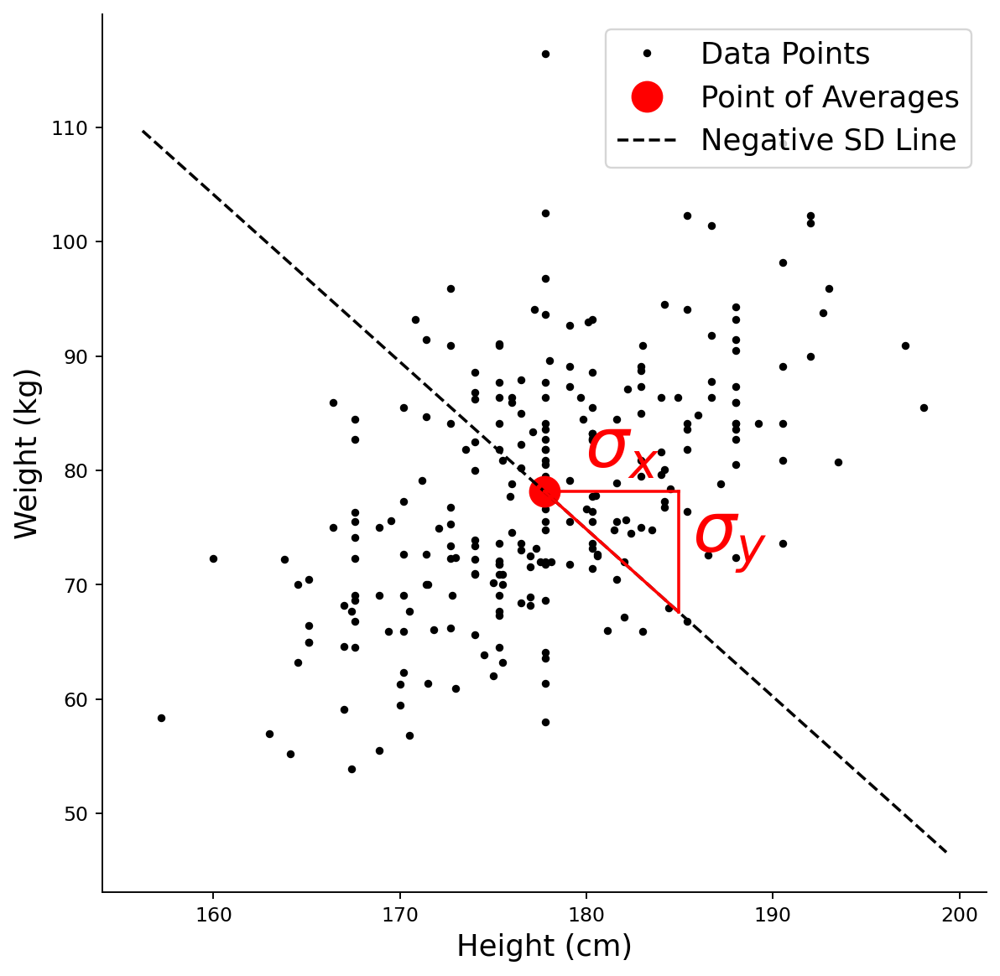

    세 번째 줄의 $3.069484$가 유도한 $2(1+r) = 2 \times 1.534742 = 3.069484$와 맞는다. **음의 SD 직선은 평균만 쓰는 수평선보다 세 배 넘게 나쁘다.** 키를 전혀 쓰지 않는 것이 이 직선을 쓰는 것보다 나은 셈이다. 세 줄을 함께 읽으면 순서가 분명하다.

    $$
    \underbrace{0.714}_{\text{최소제곱}} \;<\; \underbrace{0.931}_{\text{양의 SD}} \;<\; \underbrace{1.000}_{\text{평균만}} \;<\; \underbrace{3.069}_{\text{음의 SD}}
    $$

    **그림이 보여 주지 못하는 것**은 이 순서다. 점선 하나만 그려 놓으면 "기울기의 부호가 바뀐 SD 직선"으로 보일 뿐, 그것이 이 자료에 대해 얼마나 나쁜지는 눈에 들어오지 않는다. 숫자로 재야 비로소 보인다. $\square$

### 회귀직선과 SD 직선

**회귀직선**의 기울기는 $r \cdot \sigma_y / \sigma_x$로, SD 직선의 기울기에 상관계수 $r$를 곱한 것이다. $|r| \leq 1$이므로 회귀직선은 항상 SD 직선보다 완만하거나 같다. 이 완만해짐이 곧 **회귀 효과**이며, 예측값이 평균 쪽으로 되돌아간다는 뜻이다.

<div class="exbox" markdown>

**보기 7.** <span class="diff easy" title="쉬움"></span> 회귀직선과 SD 직선. 같은 평균점에서 두 직선을 함께 그리고 회귀 삼각형의 세로변이 $r\sigma_y$임을 표시한다.

**(1)** 두 기울기의 **비**가 $r$임을 보이고, $x = \bar x + k s_x$에서 두 직선의 예측값 차이가 $k\,s_y(1-r)$임을 유도하시오. 이 차이가 $x$에서 멀어질수록 어떻게 되는가.

**(2)** $k = 1, 2, 3$에서 두 예측값과 그 차이를 계산해 유도한 식과 맞는지 확인하시오. 표준단위로 보면 "평균으로의 회귀"는 몇 SD 되돌아오는 것인가.

</div>

??? success "풀이"

    **(1) 해석적으로.** 두 직선 모두 평균점을 지나므로 비교는 기울기만으로 끝난다.

    $$
    \frac{\text{회귀직선 기울기}}{\text{SD 직선 기울기}} = \frac{r\,s_y/s_x}{s_y/s_x} = r
    $$

    $\lvert r \rvert \le 1$이므로 회귀직선은 **언제나 SD 직선보다 완만하거나 같다.** 등호는 $\lvert r \rvert = 1$일 때만이고, 그때는 모든 점이 한 직선 위에 있다.

    $x_0 = \bar x + k s_x$에서 두 예측값은 각각

    $$
    \hat y_{\text{SD}} = \bar y + \frac{s_y}{s_x}(k s_x) = \bar y + k s_y, \qquad
    \hat y_{\text{회귀}} = \bar y + r\frac{s_y}{s_x}(k s_x) = \bar y + k r s_y
    $$

    이므로 차이는

    $$
    \hat y_{\text{SD}} - \hat y_{\text{회귀}} = k s_y (1 - r)
    $$

    이다. **차이가 $k$에 비례한다.** 평균점에서는 $k = 0$이라 차이가 $0$이고, 멀어질수록 **선형으로** 벌어진다. $r$이 $1$에서 멀수록 벌어지는 속도가 빠르다. 그러므로 SD 직선을 예측에 쓰면 **극단에서 가장 크게 틀린다.**

    표준단위로 쓰면 이 사실이 한 줄로 줄어든다.

    $$
    z_{\hat y} = r\,z_x
    $$

    $x$가 평균보다 $k$ SD 크면 예측값은 평균보다 $kr$ SD 크다. $\lvert r \rvert < 1$이므로 $\lvert kr \rvert < \lvert k \rvert$, 곧 **예측값은 언제나 $x$보다 평균에 가깝다.** 이것이 평균으로의 회귀다.

    **(2) 수치적으로.**

    ```python
    import matplotlib.pyplot as plt
    import numpy as np
    import pandas as pd

    plt.rcParams["font.sans-serif"] = ["NanumGothic", "Apple SD Gothic Neo", "Malgun Gothic"]
    plt.rcParams["font.family"] = "sans-serif"
    plt.rcParams["axes.unicode_minus"] = False

    # openintro의 bdims 자료: 성인 507명의 신체 치수.
    # hgt(cm), wgt(kg), sex(1 = 남성, 0 = 여성) 열을 쓴다.
    data_url = ("https://raw.githubusercontent.com/vincentarelbundock/Rdatasets/"
                "1dcc2bf5f955cc1224a3e1307256e1fe86b68dae/csv/openintro/bdims.csv")
    data = pd.read_csv(data_url).rename(columns={"hgt": "Height", "wgt": "Weight"})
    data["Gender"] = data["sex"].map({1: "Male", 0: "Female"})

    male_data = data[data.Gender == "Male"].loc[:300, ["Height", "Weight"]]

    mean_height = male_data.Height.mean()
    mean_weight = male_data.Weight.mean()
    std_dev_height = male_data.Height.std()
    std_dev_weight = male_data.Weight.std()
    correlation_coefficient = male_data[["Height", "Weight"]].corr().loc["Height", "Weight"]

    sd_slope = std_dev_weight / std_dev_height
    reg_slope = correlation_coefficient * std_dev_weight / std_dev_height
    print(f"SD 직선 기울기   = {sd_slope:.6f}")
    print(f"회귀직선 기울기  = {reg_slope:.6f}")
    print(f"비 = {reg_slope / sd_slope:.6f},   r = {correlation_coefficient:.6f}")
    print()
    print(f"{'k':>4s}{'x = x-bar + k s_x':>20s}{'SD 직선':>12s}{'회귀직선':>12s}{'차이':>10s}{'k s_y (1-r)':>14s}")
    for k in (1, 2, 3):
        x0 = mean_height + k * std_dev_height
        y_sd = mean_weight + sd_slope * (x0 - mean_height)
        y_reg = mean_weight + reg_slope * (x0 - mean_height)
        print(f"{k:4d}{x0:20.4f}{y_sd:12.4f}{y_reg:12.4f}{y_sd - y_reg:10.4f}"
              f"{k * std_dev_weight * (1 - correlation_coefficient):14.4f}")
    print()
    for k in (1, 2, 3):
        print(f"키가 평균보다 {k} SD 큰 사람의 예측 몸무게는 평균보다 "
              f"{k * correlation_coefficient:.4f} SD 크다")

    # 회귀 예측값
    x_values = np.array(male_data.Height)
    y_pred = mean_weight + correlation_coefficient * (std_dev_weight / std_dev_height) * (x_values - mean_height)

    fig, axis = plt.subplots(figsize=(8, 8))
    axis.plot(male_data.Height, male_data.Weight, '.k', label="Data Points")
    axis.plot([mean_height], [mean_weight], 'ro', markersize=15, label="Point of Averages")
    axis.plot(x_values, y_pred, 'b', label="Regression Line")

    # 회귀 삼각형을 표시한다. SD 직선보다 기울기가 완만하다
    axis.plot([mean_height, mean_height + std_dev_height], [mean_weight, mean_weight], '-b')
    axis.plot([mean_height + std_dev_height, mean_height + std_dev_height],
              [mean_weight, mean_weight + correlation_coefficient * std_dev_weight], '-b')
    axis.plot([mean_height, mean_height + std_dev_height],
              [mean_weight, mean_weight + correlation_coefficient * std_dev_weight], '-b')

    axis.annotate("$\\sigma_x$",
        [mean_height + 0.4 * std_dev_height, mean_weight - 0.3 * std_dev_weight],
        fontsize=35, color="b")
    axis.annotate("$r\\ \\sigma_y$",
        [mean_height + 1.1 * std_dev_height, mean_weight + 0.3 * std_dev_weight],
        fontsize=35, color="b")

    axis.set_xlabel('Height (cm)', fontsize=15)
    axis.set_ylabel('Weight (kg)', fontsize=15)
    axis.spines['top'].set_visible(False)
    axis.spines['right'].set_visible(False)
    axis.legend(fontsize=15)
    plt.show()
    ```

    출력:

    ```
    SD 직선 기울기   = 1.463451
    회귀직선 기울기  = 0.782568
    비 = 0.534742,   r = 0.534742

       k   x = x-bar + k s_x       SD 직선        회귀직선        차이   k s_y (1-r)
       1            184.9290     88.6574     83.7662    4.8912        4.8912
       2            192.1126     99.1703     89.3879    9.7824        9.7824
       3            199.2962    109.6832     95.0096   14.6736       14.6736

    키가 평균보다 1 SD 큰 사람의 예측 몸무게는 평균보다 0.5347 SD 크다
    키가 평균보다 2 SD 큰 사람의 예측 몸무게는 평균보다 1.0695 SD 크다
    키가 평균보다 3 SD 큰 사람의 예측 몸무게는 평균보다 1.6042 SD 크다
    ```

    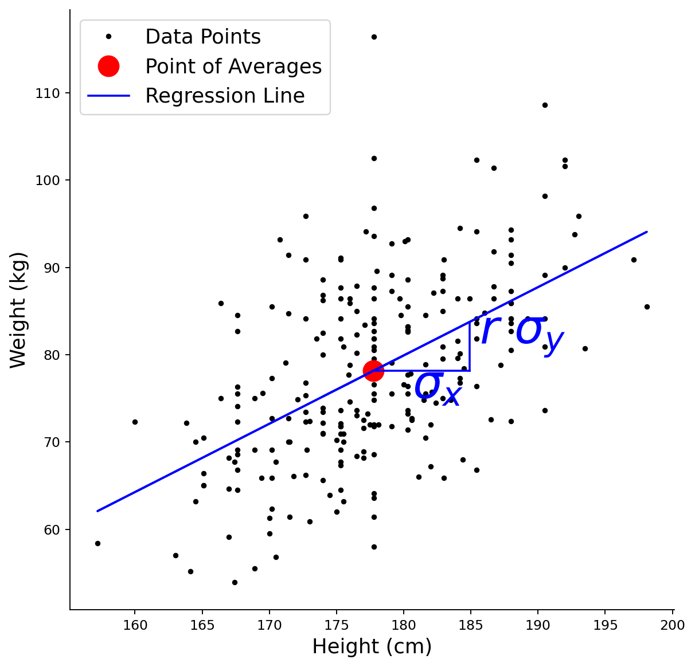

    **기울기의 비가 $0.534742$로 $r$과 소수 여섯째 자리까지 같다.** 차이 열과 $k s_y(1-r)$ 열도 $k = 1, 2, 3$에서 각각 $4.8912$, $9.7824$, $14.6736$으로 완전히 일치한다. $k$가 하나 늘 때마다 차이가 $4.8912 = s_y(1-r)$씩 **같은 양으로** 늘어난다. 선형이라는 유도가 수치로 확인된다.

    그림에서 읽을 것은 **삼각형의 세로변**이다. 보기 5의 빨간 삼각형은 세로가 $\sigma_y$였는데 여기 파란 삼각형은 $r\sigma_y$로 줄어 있다. 줄어든 양이 정확히 $(1-r)\sigma_y = 4.89\,\text{kg}$이고, 그것이 위 표 첫 줄의 차이다.

    해석의 요점은 이렇다. 키가 평균보다 $3$ SD, 곧 $199.3\,\text{cm}$인 사람에게 SD 직선은 $109.7\,\text{kg}$을 주고 회귀직선은 $95.0\,\text{kg}$을 준다. **$14.7\,\text{kg}$ 차이다.** 표준단위로 보면 키에서 $3$ SD 극단인 사람의 예측 몸무게가 $1.60$ SD 극단에 지나지 않는다. $3$에서 $1.6$으로 **절반 가까이 되돌아온 것**이 평균으로의 회귀이며, 되돌아오는 비율이 바로 $r = 0.53$이다.

    한 가지 혼동을 미리 막아 두자. 평균으로의 회귀는 **몸무게의 퍼짐이 실제로 줄어든다는 뜻이 아니다.** 키가 $199\,\text{cm}$인 사람들의 몸무게도 여전히 넓게 흩어져 있다. 줄어든 것은 그 분포의 **중심**이고, 흩어짐은 조건부 표준편차 $s_y\sqrt{1-r^2} = 10.51 \times 0.8450 = 8.88\,\text{kg}$로 남는다. 예측구간이 좁아지지 않는 까닭이 이것이며, A.4절과 이 장의 예측띠가 같은 이야기를 한다. $\square$

---

## 2. 두 개의 회귀직선

어느 변수를 예측하느냐에 따라 서로 다른 두 개의 회귀직선이 있다.

- **$Y$를 $X$에 회귀**(키로 몸무게 예측): $y = \alpha + \beta x$
- **$X$를 $Y$에 회귀**(몸무게로 키 예측): $x = \alpha' + \beta' y$

두 직선은 $|r| = 1$(완전상관)일 때만 일치한다. 그렇지 않으면 평균점 주위로 벌어지는 "V" 모양을 이룬다.

### 두 회귀직선을 함께 그리기

<div class="exbox" markdown>

**보기 8.** <span class="diff easy" title="쉬움"></span> 두 회귀직선을 함께 그리기. $Y$를 $X$에 회귀시킨 직선(파랑)과 $X$를 $Y$에 회귀시킨 직선(빨강)을 한 그림에 놓는다.

**(1)** $Y$의 $X$에 대한 회귀 기울기 $b = r\,s_y/s_x$와 $X$의 $Y$에 대한 회귀 기울기 $b' = r\,s_x/s_y$에 대해 **$bb' = r^2$** 임을 보이시오. 두 직선을 $(x, y)$ 평면에서 함께 볼 때 SD 직선의 기울기가 **두 기울기의 기하평균**임을 보이고, 두 직선이 겹치는 조건을 구하시오.

**(2)** $y = \bar y + s_y$에서 키를 읽는 **두 가지 잘못된/올바른 방법**을 비교하시오. $X|Y$ 직선으로 읽은 값과 $Y|X$ 직선을 거꾸로 풀어 읽은 값의 비는 얼마인가.

</div>

??? success "풀이"

    **(1) 해석적으로.** 곱은 바로 나온다.

    $$
    b\,b' = \left(r\frac{s_y}{s_x}\right)\left(r\frac{s_x}{s_y}\right) = r^2
    $$

    $s_x, s_y$가 모두 약분되므로 **곱은 단위가 없고 $r^2$ 하나로 정해진다.** 이것이 "두 회귀가 대칭이 아니다"를 가장 간결하게 말하는 식이다. 대칭이라면 $b' = 1/b$, 곧 $bb' = 1$이어야 하는데 $r^2 \le 1$이기 때문이다.

    $(x, y)$ 평면에서 두 직선을 함께 보려면 $X|Y$ 직선도 $y$에 대해 풀어야 한다. $x = \bar x + b'(y - \bar y)$를 뒤집으면

    $$
    y = \bar y + \frac{1}{b'}(x - \bar x), \qquad \frac{1}{b'} = \frac{s_y}{r\,s_x}
    $$

    이다. 이제 두 기울기 $b = r\,s_y/s_x$와 $1/b' = s_y/(r s_x)$의 기하평균을 재면

    $$
    \sqrt{b \cdot \frac{1}{b'}} = \sqrt{r\frac{s_y}{s_x} \cdot \frac{s_y}{r\,s_x}} = \frac{s_y}{s_x}
    $$

    로 **SD 직선의 기울기**다. $r$이 깨끗이 약분된다. 그래서 그림에서 SD 직선은 늘 두 회귀직선 **사이**에 놓인다. 더 정확히는 로그 기울기 축에서 정확히 가운데다.

    겹치는 조건은 $b = 1/b'$, 곧 $bb' = 1$이므로 $r^2 = 1$이다. $\lvert r \rvert = 1$일 때만 두 직선이 하나가 되고, 그때 모든 점이 그 직선 위에 놓인다. $\lvert r \rvert < 1$이면 두 직선은 평균점에서만 만나고 "V" 모양으로 벌어진다.

    **(2) 해석적으로.** $y_0 = \bar y + s_y$에서 올바른 길은 **$X|Y$ 직선**을 쓰는 것이다.

    $$
    \hat x_{X|Y} = \bar x + b'(y_0 - \bar y) = \bar x + r\,s_x
    $$

    잘못된 길은 $Y|X$ 직선 $y = \bar y + b(x - \bar x)$를 $x$에 대해 푸는 것이다.

    $$
    x_{\text{거꾸로}} = \bar x + \frac{y_0 - \bar y}{b} = \bar x + \frac{s_x}{r}
    $$

    평균에서의 편차를 비교하면

    $$
    \frac{s_x/r}{r\,s_x} = \frac{1}{r^2}
    $$

    이다. **거꾸로 읽은 편차가 $1/r^2$ 배로 과장된다.** $r$이 작을수록 과장이 심해진다. $Y|X$ 직선은 "$x$가 주어졌을 때 $y$의 평균"을 주는 함수이고, 그것을 뒤집으면 "$y$가 주어졌을 때 $x$의 평균"이 아니라 전혀 다른 양이 된다.

    ```python
    import matplotlib.pyplot as plt
    import numpy as np
    import pandas as pd

    plt.rcParams["font.sans-serif"] = ["NanumGothic", "Apple SD Gothic Neo", "Malgun Gothic"]
    plt.rcParams["font.family"] = "sans-serif"
    plt.rcParams["axes.unicode_minus"] = False

    # openintro의 bdims 자료: 성인 507명의 신체 치수.
    # hgt(cm), wgt(kg), sex(1 = 남성, 0 = 여성) 열을 쓴다.
    data_url = ("https://raw.githubusercontent.com/vincentarelbundock/Rdatasets/"
                "1dcc2bf5f955cc1224a3e1307256e1fe86b68dae/csv/openintro/bdims.csv")
    data = pd.read_csv(data_url).rename(columns={"hgt": "Height", "wgt": "Weight"})
    data["Gender"] = data["sex"].map({1: "Male", 0: "Female"})

    male_height_weight_data = data[data.Gender == "Male"].loc[:300, ["Height", "Weight"]]

    mean_height = male_height_weight_data.Height.mean()
    mean_weight = male_height_weight_data.Weight.mean()
    std_dev_height = male_height_weight_data.Height.std()
    std_dev_weight = male_height_weight_data.Weight.std()
    correlation_coefficient = male_height_weight_data.corr().loc["Height", "Weight"]

    slope_y_on_x = correlation_coefficient * std_dev_weight / std_dev_height   # dy/dx
    slope_x_on_y = correlation_coefficient * std_dev_height / std_dev_weight   # dx/dy
    print(f"Y 를 X 에 회귀:  dy/dx = {slope_y_on_x:.6f}")
    print(f"X 를 Y 에 회귀:  dx/dy = {slope_x_on_y:.6f}")
    print(f"두 기울기의 곱       = {slope_y_on_x * slope_x_on_y:.6f}   (r^2 = {correlation_coefficient ** 2:.6f})")
    print()
    print(f"(x, y) 평면에서 본 기울기:  Y|X = {slope_y_on_x:.6f},  X|Y = {1 / slope_x_on_y:.6f}")
    print(f"  두 기울기의 기하평균 = {np.sqrt(slope_y_on_x / slope_x_on_y):.6f}")
    print(f"  SD 직선 기울기       = {std_dev_weight / std_dev_height:.6f}")
    print()
    # y = y-bar + s_y 에서 x 를 읽는 두 가지 방법
    y0 = mean_weight + std_dev_weight
    print(f"y = y-bar + s_y = {y0:.4f} 에서 x 를 읽으면")
    print(f"  X|Y 회귀직선:          {mean_height + correlation_coefficient * std_dev_height:.4f}")
    print(f"  Y|X 회귀직선을 거꾸로: {mean_height + std_dev_height / correlation_coefficient:.4f}")
    print(f"  평균에서의 편차 비 = {1 / correlation_coefficient ** 2:.4f}  ( = 1/r^2 )")

    # Y 를 X 에 회귀
    heights = np.array(male_height_weight_data.Height)
    predicted_weights = mean_weight + correlation_coefficient * (std_dev_weight / std_dev_height) * (heights - mean_height)

    # X 를 Y 에 회귀. 두 직선은 서로 다르다
    weights = np.array(male_height_weight_data.Weight)
    predicted_heights = mean_height + correlation_coefficient * (std_dev_height / std_dev_weight) * (weights - mean_weight)

    fig, axis = plt.subplots(figsize=(8, 8))
    axis.plot([mean_height], [mean_weight], 'ro', markersize=15, label="Point of Averages")
    axis.plot(male_height_weight_data.Height, male_height_weight_data.Weight, '.k', label="Data Points")

    # Y 의 X 에 대한 회귀직선(파랑)
    axis.plot(heights, predicted_weights, '-b', label="y = alpha + beta * x")
    axis.plot([mean_height, mean_height + std_dev_height], [mean_weight, mean_weight], '-b')
    axis.plot([mean_height + std_dev_height, mean_height + std_dev_height],
              [mean_weight, mean_weight + correlation_coefficient * std_dev_weight], '-b')
    axis.plot([mean_height, mean_height + std_dev_height],
              [mean_weight, mean_weight + correlation_coefficient * std_dev_weight], '-b')

    axis.annotate("$\\sigma_x$",
        [mean_height + 0.4 * std_dev_height, mean_weight - 0.3 * std_dev_weight],
        fontsize=35, color="b")
    axis.annotate("$r\\ \\sigma_y$",
        [mean_height + 1.1 * std_dev_height, mean_weight + 0.3 * std_dev_weight],
        fontsize=35, color="b")

    # X 의 Y 에 대한 회귀직선(빨강)
    axis.plot(predicted_heights, weights, '-r', label="x = alpha + beta * y")
    axis.plot([mean_height, mean_height], [mean_weight, mean_weight + std_dev_weight], '-r')
    axis.plot([mean_height, mean_height + correlation_coefficient * std_dev_height],
              [mean_weight + std_dev_weight, mean_weight + std_dev_weight], '-r')
    axis.plot([mean_height, mean_height + correlation_coefficient * std_dev_height],
              [mean_weight, mean_weight + std_dev_weight], '-r')

    axis.annotate("$\\sigma_y$",
        [mean_height - 0.3 * std_dev_height, mean_weight + 0.4 * std_dev_weight],
        fontsize=35, color="r")
    axis.annotate("$r\\ \\sigma_x$",
        [mean_height + 0.1 * std_dev_height, mean_weight + 1.2 * std_dev_weight],
        fontsize=35, color="r")

    axis.set_xlabel('Height (cm)', fontsize=15)
    axis.set_ylabel('Weight (kg)', fontsize=15)
    axis.legend(fontsize=15)
    axis.spines['top'].set_visible(False)
    axis.spines['right'].set_visible(False)
    plt.show()
    ```

    출력:

    ```
    Y 를 X 에 회귀:  dy/dx = 0.782568
    X 를 Y 에 회귀:  dx/dy = 0.365398
    두 기울기의 곱       = 0.285949   (r^2 = 0.285949)

    (x, y) 평면에서 본 기울기:  Y|X = 0.782568,  X|Y = 2.736744
      두 기울기의 기하평균 = 1.463451
      SD 직선 기울기       = 1.463451

    y = y-bar + s_y = 88.6574 에서 x 를 읽으면
      X|Y 회귀직선:          181.5867
      Y|X 회귀직선을 거꾸로: 191.1792
      평균에서의 편차 비 = 3.4971  ( = 1/r^2 )
    ```

    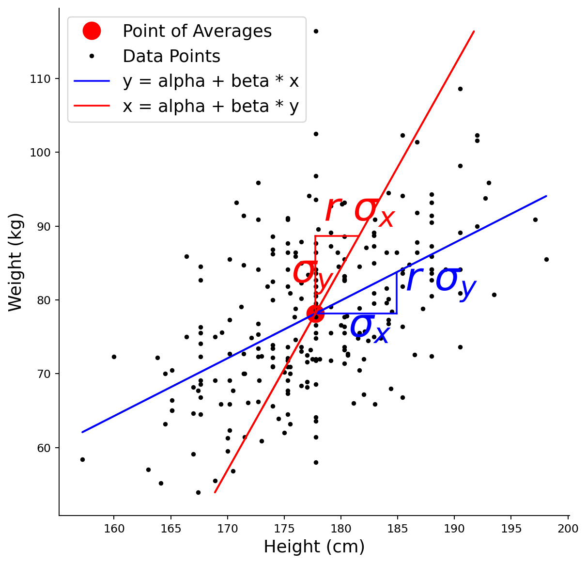

    **곱이 $0.285949$로 $r^2$과 소수 여섯째 자리까지 같다.** 대칭이라면 $1$이어야 할 값이 $0.29$에 지나지 않으니, 이 자료에서 두 회귀는 **전혀 대칭이 아니다.**

    기하평균도 $1.463451$로 SD 직선의 기울기와 정확히 같다. 그림에서 파란 직선($0.7826$)과 빨간 직선($2.7367$)이 평균점에서 만나 벌어지는 모습이 "V"이고, SD 직선은 늘 그 안쪽을 지난다. 두 삼각형이 이 비대칭의 정체를 보여 준다. **파란 삼각형은 가로가 $\sigma_x$인데 세로가 $r\sigma_y$로 줄었고, 빨간 삼각형은 세로가 $\sigma_y$인데 가로가 $r\sigma_x$로 줄었다.** 각자 자기 쪽 예측값을 평균으로 끌어당기는 것이다.

    **(2)의 두 값이 $9.59\,\text{cm}$ 벌어진다.** 몸무게 $88.66\,\text{kg}$인 사람의 평균 키를 묻는다면 답은 $181.59\,\text{cm}$다. 같은 질문에 $Y|X$ 직선을 거꾸로 풀어 답하면 $191.18\,\text{cm}$가 나오는데, 이는 표본 최댓값 $198.1$에 가까운 극단값이다. 평균에서의 편차로 재면 $3.84$ 대 $13.43$으로 비가 $3.4971 = 1/r^2$이다.

    그러므로 **회귀직선은 역함수로 쓸 수 없다.** 두 방향 각각에 직선이 따로 있고, 묻는 방향에 맞는 직선을 써야 한다. 이 혼동은 실무에서 흔하다. 보기 9와 10 이 각 직선이 실제로 무엇의 평균인지를 띠로 확인한다. $\square$

### 세로 띠로 본 Y의 X에 대한 회귀

(키 값을 고정한) 좁은 세로 띠를 골라 그 안의 평균 몸무게를 살펴보면, 회귀직선이 조건부 평균을 예측한다는 사실이 드러난다.

<div class="exbox" markdown>

**보기 9.** <span class="diff easy" title="쉬움"></span> 세로 띠로 본 Y의 X에 대한 회귀. 평균보다 $1$ SD 큰 키 자리에 좁은 세로 띠 $[\bar x + 0.9 s_x,\ \bar x + 1.1 s_x]$를 긋고 그 안의 몸무게를 본다.

**(1)** 회귀직선이 $x = \bar x + s_x$에서 예측하는 몸무게를 $\bar y$, $r$, $s_y$로 쓰고 수치를 구하시오. 그 자리의 몸무게가 흩어지는 폭, 곧 **조건부 표준편차**는 얼마로 예측되는가.

**(2)** 띠 안의 실제 평균 몸무게를 재어 (1)의 예측과 견주시오. 어긋난 양을 **평균의 표준오차** 단위로 재면 얼마인가.

</div>

??? success "풀이"

    **(1) 해석적으로.** 표준화된 회귀식 $z_{\hat y} = r z_x$에서 $z_x = 1$이므로 $z_{\hat y} = r$이고

    $$
    \hat y\big|_{x = \bar x + s_x} = \bar y + r\,s_y = 78.1445 + 0.5347 \times 10.5129 = 83.7662
    $$

    이다. 조건부 평균은 평균보다 $r s_y = 5.62\,\text{kg}$ 높다.

    흩어짐은 **줄지 않는다.** 조건부 표준편차는 $x$에 의존하지 않고

    $$
    s_{y \mid x} = s_y\sqrt{1 - r^2} = 10.5129 \times \sqrt{0.714051} = 8.8836
    $$

    이다. 전체 $s_y = 10.5129$에서 $15.5\%$만 줄었다. $r^2 = 0.286$밖에 설명하지 못하니 당연한 일이다. **띠를 좁혀도 그 안의 몸무게는 거의 그대로 흩어져 있다.**

    따라서 띠 안 $m$명의 평균 몸무게는 예측값 주위로 표준오차 $s_{y\mid x}/\sqrt{m}$만큼 흔들린다. 띠가 좁으면 $m$이 작아 이 흔들림이 크다.

    **(2) 수치적으로.**

    ```python
    import matplotlib.pyplot as plt
    import numpy as np
    import pandas as pd

    plt.rcParams["font.sans-serif"] = ["NanumGothic", "Apple SD Gothic Neo", "Malgun Gothic"]
    plt.rcParams["font.family"] = "sans-serif"
    plt.rcParams["axes.unicode_minus"] = False

    # openintro의 bdims 자료: 성인 507명의 신체 치수.
    # hgt(cm), wgt(kg), sex(1 = 남성, 0 = 여성) 열을 쓴다.
    data_url = ("https://raw.githubusercontent.com/vincentarelbundock/Rdatasets/"
                "1dcc2bf5f955cc1224a3e1307256e1fe86b68dae/csv/openintro/bdims.csv")
    data = pd.read_csv(data_url).rename(columns={"hgt": "Height", "wgt": "Weight"})
    data["Gender"] = data["sex"].map({1: "Male", 0: "Female"})

    male_data = data[data.Gender == "Male"].loc[:300, ["Height", "Weight"]]

    mean_height = male_data.Height.mean()
    mean_weight = male_data.Weight.mean()
    std_dev_height = male_data.Height.std()
    std_dev_weight = male_data.Weight.std()
    correlation_coefficient = male_data[["Height", "Weight"]].corr().loc["Height", "Weight"]

    # 세로 띠 안의 몸무게를 모은다
    strip_low = mean_height + 0.9 * std_dev_height
    strip_high = mean_height + 1.1 * std_dev_height
    in_strip = male_data[(male_data.Height >= strip_low) & (male_data.Height <= strip_high)]
    predicted = mean_weight + correlation_coefficient * std_dev_weight   # x = x-bar + s_x 에서의 예측
    conditional_sd = std_dev_weight * np.sqrt(1 - correlation_coefficient ** 2)
    standard_error = conditional_sd / np.sqrt(len(in_strip))

    print(f"세로 띠 = [{strip_low:.4f}, {strip_high:.4f}]  (x-bar + 0.9 s_x ~ x-bar + 1.1 s_x)")
    print(f"띠 안 사람 수 = {len(in_strip)}")
    print(f"회귀직선의 예측  y-bar + r s_y = {predicted:.4f}")
    print(f"띠 안 실제 평균 몸무게         = {in_strip.Weight.mean():.4f}")
    print(f"차이 = {in_strip.Weight.mean() - predicted:+.4f}")
    print()
    print(f"조건부 표준편차 s_y sqrt(1-r^2) = {conditional_sd:.4f}")
    print(f"띠 안 몸무게의 실제 표준편차    = {in_strip.Weight.std():.4f}")
    print(f"평균의 표준오차 = {standard_error:.4f}")
    print(f"차이 / 표준오차 = {(in_strip.Weight.mean() - predicted) / standard_error:+.4f}")

    x_values = np.array(male_data.Height)
    y_pred = mean_weight + correlation_coefficient * (std_dev_weight / std_dev_height) * (x_values - mean_height)

    fig, axis = plt.subplots(figsize=(8, 8))
    axis.plot(male_data.Height, male_data.Weight, '.k', label="Data Points")

    # 평균에서 1 표준편차쯤 떨어진 자리의 세로 띠
    axis.plot(
        [mean_height + 0.9 * std_dev_height, mean_height + 0.9 * std_dev_height],
        [male_data.Weight.min(), male_data.Weight.max()], '--b')
    axis.plot(
        [mean_height + 1.1 * std_dev_height, mean_height + 1.1 * std_dev_height],
        [male_data.Weight.min(), male_data.Weight.max()], '--b')

    axis.plot([mean_height], [mean_weight], 'ro', markersize=15, label="Point of Averages")
    axis.plot(x_values, y_pred, 'b', label="Regression Line")

    axis.plot([mean_height, mean_height + std_dev_height], [mean_weight, mean_weight], '-b')
    axis.plot([mean_height + std_dev_height, mean_height + std_dev_height],
              [mean_weight, mean_weight + correlation_coefficient * std_dev_weight], '-b')
    axis.plot([mean_height, mean_height + std_dev_height],
              [mean_weight, mean_weight + correlation_coefficient * std_dev_weight], '-b')

    axis.annotate("$\\sigma_x$",
        [mean_height + 0.4 * std_dev_height, mean_weight - 0.3 * std_dev_weight],
        fontsize=35, color="b")
    axis.annotate("$r\\ \\sigma_y$",
        [mean_height + 1.1 * std_dev_height, mean_weight + 0.3 * std_dev_weight],
        fontsize=35, color="b")

    axis.set_xlabel('Height (cm)', fontsize=15)
    axis.set_ylabel('Weight (kg)', fontsize=15)
    axis.spines['top'].set_visible(False)
    axis.spines['right'].set_visible(False)
    axis.legend(fontsize=15)
    plt.show()
    ```

    출력:

    ```
    세로 띠 = [184.2106, 185.6473]  (x-bar + 0.9 s_x ~ x-bar + 1.1 s_x)
    띠 안 사람 수 = 10
    회귀직선의 예측  y-bar + r s_y = 83.7662
    띠 안 실제 평균 몸무게         = 82.1900
    차이 = -1.5762

    조건부 표준편차 s_y sqrt(1-r^2) = 8.8836
    띠 안 몸무게의 실제 표준편차    = 10.8314
    평균의 표준오차 = 2.8092
    차이 / 표준오차 = -0.5611
    ```

    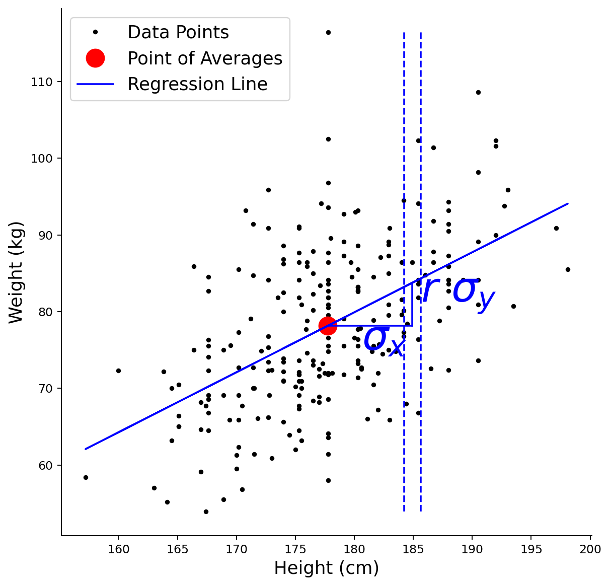

    **예측 $83.77$ 대 실제 $82.19$로 차이가 $-1.58\,\text{kg}$이다.** 표준오차가 $2.81$이므로 $z = -0.56$, 곧 **표준오차 반 개 분량**이다. 표본추출 변동으로 완전히 설명되는 크기이며 회귀직선이 조건부 평균을 맞히지 못한다는 증거가 아니다.

    여기서 눈여겨볼 것은 **띠 안에 열 명밖에 없다는 사실**이다. $247$명 가운데 $0.2 s_x = 1.44\,\text{cm}$ 폭의 띠에 들어온 사람이 $10$명이다. 조건부 표준편차가 $8.88$이니 $10$명의 평균은 $2.81$의 표준오차를 갖고, 이는 조건부 평균이 평균보다 높은 양 $r s_y = 5.62$의 **절반**이다. 그러므로 띠 하나만 보고 회귀직선을 확인하는 일은 애초에 정밀하지 못하다. 띠를 넓히면 $m$이 늘어 표준오차가 줄지만 "한 점에서의 조건부 평균"이라는 뜻이 흐려진다. **이 맞바꿈이 조건부 평균을 자료에서 직접 재려 할 때 늘 따라온다.**

    띠 안 몸무게의 실제 표준편차 $10.83$이 조건부 예측 $8.88$보다 크다는 것도 읽어 둘 만하다. $10$개로 잰 표준편차의 상대 표준오차가 대략 $1/\sqrt{2(m-1)} = 24\%$이므로 이 차이($22\%$) 역시 유의하지 않다. **표본이 열이면 표준편차도 평균만큼이나 믿을 수 없다.**

    그림이 정작 **보여 주지 못하는 것**은 이 모든 수치다. 세로 점선 두 줄과 직선만으로는 "띠 안 평균이 직선 위에 있는가"를 눈으로 가늠할 수 없고, 띠 안 평균이 점으로 찍혀 있지도 않다. 그 점을 찍고 오차막대를 붙이는 것이 이 그림을 완성하는 길이다. $\square$

### 가로 띠로 본 X의 Y에 대한 회귀

마찬가지로 몸무게 값을 고정한 가로 띠는 키의 조건부 평균을 보여준다.

<div class="exbox" markdown>

**보기 10.** <span class="diff easy" title="쉬움"></span> 가로 띠로 본 X의 Y에 대한 회귀. 평균보다 $1$ SD 큰 몸무게 자리에 가로 띠 $[\bar y + 0.9 s_y,\ \bar y + 1.1 s_y]$를 긋고 그 안의 키를 본다.

**(1)** 이 띠 안의 평균 키를 $X|Y$ 회귀직선이 예측하는 값과, $Y|X$ 직선을 $x$에 대해 거꾸로 풀어 얻은 값을 각각 쓰시오. 어느 쪽이 맞는 예측이어야 하는가.

**(2)** 두 값을 실제 평균 키와 견주시오. 틀린 쪽은 표준오차 몇 개만큼 벗어나는가. 보기 8에서 보인 $1/r^2$ 과장이 자료에서 실제로 드러나는가.

</div>

??? success "풀이"

    **(1) 해석적으로.** 띠는 $y$를 고정한다. 그러므로 묻는 것은 $E[X \mid Y = y_0]$이고, 이를 주는 직선은 **$X$를 $Y$에 회귀시킨 직선**이다. $y_0 = \bar y + s_y$에서

    $$
    \hat x_{X|Y} = \bar x + r\,s_x = 177.7453 + 0.5347 \times 7.1836 = 181.5867
    $$

    이다. $Y|X$ 직선을 거꾸로 푼 값은 보기 8에서 보았듯

    $$
    x_{\text{거꾸로}} = \bar x + \frac{s_x}{r} = 177.7453 + \frac{7.1836}{0.5347} = 191.1792
    $$

    이다. 맞는 예측은 앞의 것이다. 조건부 표준편차는 이제 $x$ 쪽을 재므로

    $$
    s_{x\mid y} = s_x\sqrt{1 - r^2} = 7.1836 \times 0.8450 = 6.0703
    $$

    이고, 띠 안 $m$명의 평균 키의 표준오차는 $6.0703/\sqrt{m}$이다.

    **(2) 수치적으로.**

    ```python
    import matplotlib.pyplot as plt
    import numpy as np
    import pandas as pd

    plt.rcParams["font.sans-serif"] = ["NanumGothic", "Apple SD Gothic Neo", "Malgun Gothic"]
    plt.rcParams["font.family"] = "sans-serif"
    plt.rcParams["axes.unicode_minus"] = False

    # openintro의 bdims 자료: 성인 507명의 신체 치수.
    # hgt(cm), wgt(kg), sex(1 = 남성, 0 = 여성) 열을 쓴다.
    data_url = ("https://raw.githubusercontent.com/vincentarelbundock/Rdatasets/"
                "1dcc2bf5f955cc1224a3e1307256e1fe86b68dae/csv/openintro/bdims.csv")
    data = pd.read_csv(data_url).rename(columns={"hgt": "Height", "wgt": "Weight"})
    data["Gender"] = data["sex"].map({1: "Male", 0: "Female"})

    male_height_weight_data = data[data.Gender == "Male"].loc[:300, ["Height", "Weight"]]

    mean_height = male_height_weight_data.Height.mean()
    mean_weight = male_height_weight_data.Weight.mean()
    std_dev_height = male_height_weight_data.Height.std()
    std_dev_weight = male_height_weight_data.Weight.std()
    correlation_coefficient = male_height_weight_data.corr().loc["Height", "Weight"]

    # 가로 띠 안의 키를 모은다
    strip_low = mean_weight + 0.9 * std_dev_weight
    strip_high = mean_weight + 1.1 * std_dev_weight
    in_strip = male_height_weight_data[(male_height_weight_data.Weight >= strip_low)
                                       & (male_height_weight_data.Weight <= strip_high)]
    pred_x_on_y = mean_height + correlation_coefficient * std_dev_height       # 옳은 직선
    pred_inverted = mean_height + std_dev_height / correlation_coefficient     # Y|X 를 거꾸로 푼 값
    conditional_sd = std_dev_height * np.sqrt(1 - correlation_coefficient ** 2)
    standard_error = conditional_sd / np.sqrt(len(in_strip))

    print(f"가로 띠 = [{strip_low:.4f}, {strip_high:.4f}]  (y-bar + 0.9 s_y ~ y-bar + 1.1 s_y)")
    print(f"띠 안 사람 수 = {len(in_strip)}")
    print(f"띠 안 실제 평균 키 = {in_strip.Height.mean():.4f}")
    print()
    print(f"X|Y 회귀직선의 예측  x-bar + r s_x = {pred_x_on_y:.4f}"
          f"   차이 {in_strip.Height.mean() - pred_x_on_y:+.4f}"
          f"  ({(in_strip.Height.mean() - pred_x_on_y) / standard_error:+.2f} SE)")
    print(f"Y|X 직선을 거꾸로 푼 값 x-bar + s_x/r = {pred_inverted:.4f}"
          f"   차이 {in_strip.Height.mean() - pred_inverted:+.4f}"
          f"  ({(in_strip.Height.mean() - pred_inverted) / standard_error:+.2f} SE)")
    print()
    print(f"조건부 표준편차 s_x sqrt(1-r^2) = {conditional_sd:.4f}")
    print(f"평균의 표준오차 = {standard_error:.4f}")

    heights = np.array(male_height_weight_data.Height)
    predicted_weights = mean_weight + correlation_coefficient * (std_dev_weight / std_dev_height) * (heights - mean_height)
    weights = np.array(male_height_weight_data.Weight)
    predicted_heights = mean_height + correlation_coefficient * (std_dev_height / std_dev_weight) * (weights - mean_weight)

    fig, axis = plt.subplots(figsize=(8, 8))
    axis.plot([mean_height], [mean_weight], 'ro', markersize=15, label="Point of Averages")
    axis.plot(male_height_weight_data.Height, male_height_weight_data.Weight, '.k', label="Data Points")

    # 몸무게가 평균보다 1 표준편차쯤 큰 자리의 가로 띠
    axis.plot(
        [male_height_weight_data.Height.min(), male_height_weight_data.Height.max()],
        [mean_weight + 0.9 * std_dev_weight, mean_weight + 0.9 * std_dev_weight], '--r')
    axis.plot(
        [male_height_weight_data.Height.min(), male_height_weight_data.Height.max()],
        [mean_weight + 1.1 * std_dev_weight, mean_weight + 1.1 * std_dev_weight], '--r')

    axis.plot(predicted_heights, weights, '-r', label="x = alpha + beta * y")
    axis.plot([mean_height, mean_height], [mean_weight, mean_weight + std_dev_weight], '-r')
    axis.plot([mean_height, mean_height + correlation_coefficient * std_dev_height],
              [mean_weight + std_dev_weight, mean_weight + std_dev_weight], '-r')
    axis.plot([mean_height, mean_height + correlation_coefficient * std_dev_height],
              [mean_weight, mean_weight + std_dev_weight], '-r')

    axis.annotate("$\\sigma_y$",
        [mean_height - 0.3 * std_dev_height, mean_weight + 0.4 * std_dev_weight],
        fontsize=35, color="r")
    axis.annotate("$r\\ \\sigma_x$",
        [mean_height + 0.1 * std_dev_height, mean_weight + 1.2 * std_dev_weight],
        fontsize=35, color="r")

    axis.set_xlabel('Height (cm)', fontsize=15)
    axis.set_ylabel('Weight (kg)', fontsize=15)
    axis.legend(fontsize=15)
    axis.spines['top'].set_visible(False)
    axis.spines['right'].set_visible(False)
    plt.show()
    ```

    출력:

    ```
    가로 띠 = [87.6061, 89.7087]  (y-bar + 0.9 s_y ~ y-bar + 1.1 s_y)
    띠 안 사람 수 = 11
    띠 안 실제 평균 키 = 180.3636

    X|Y 회귀직선의 예측  x-bar + r s_x = 181.5867   차이 -1.2231  (-0.67 SE)
    Y|X 직선을 거꾸로 푼 값 x-bar + s_x/r = 191.1792   차이 -10.8155  (-5.91 SE)

    조건부 표준편차 s_x sqrt(1-r^2) = 6.0703
    평균의 표준오차 = 1.8303
    ```

    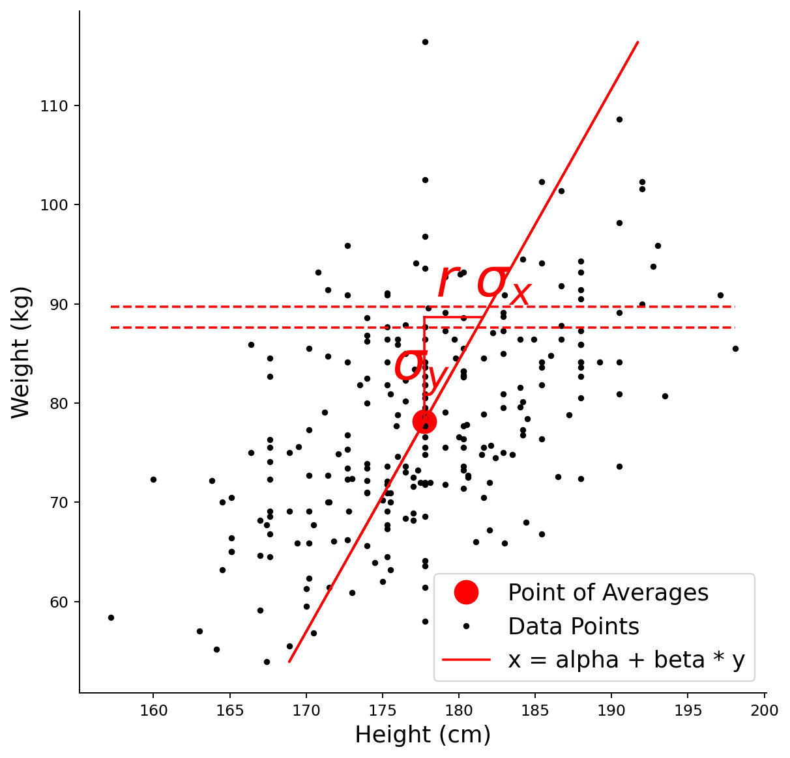

    **옳은 직선은 $0.67$ SE 안에 들어오고, 거꾸로 푼 값은 $5.91$ SE 벗어난다.** 띠 안 열한 명의 평균 키가 $180.36\,\text{cm}$인데 $X|Y$ 직선은 $181.59$를 주어 $1.22\,\text{cm}$ 차이이고, 이는 표준오차 $1.83$의 $0.67$배다. 거꾸로 푼 $191.18$은 $10.82\,\text{cm}$나 높고 표준오차로 재면 $5.91$배다. 자료에 $191.18\,\text{cm}$ 넘는 사람이 $247$명 중 여덟 명뿐이니, 몸무게가 평균보다 $1$ SD 큰 사람의 **평균** 키로 이 값을 내놓는 것은 애초에 말이 되지 않는다.

    **보기 8의 $1/r^2$ 과장이 자료에서 그대로 드러난다.** 평균에서의 편차로 재면 $3.84$ 대 $13.43$으로 $3.50$배이고, $1/r^2 = 3.4971$이다. 과장의 크기가 $r$ 하나로 예언된 셈이다.

    이 보기와 보기 9 를 나란히 놓으면 **두 직선이 각각 무엇의 평균인지**가 분명해진다. 세로 띠는 $x$를 고정하므로 파란 직선이 맞고, 가로 띠는 $y$를 고정하므로 빨간 직선이 맞다. 빨간 삼각형이 세로 $\sigma_y$에 가로 $r\sigma_x$인 것이 바로 "몸무게가 $1$ SD 크면 키는 $r$ SD 크다"를 그린 것이다.

    다만 **띠로 확인하는 일의 한계**도 같이 봐야 한다. 띠 안이 $10$명, $11$명이라 표준오차가 각각 $2.81$, $1.83$으로 크다. 이 정밀도로는 "옳은 직선이 맞는다"까지만 말할 수 있고 "얼마나 정확히 맞는다"는 말할 수 없다. 반면 **틀린 직선은 $5.91$ SE 밖이라 이 정밀도로도 확실히 걸러진다.** 느슨한 자료로도 큰 오류는 잡힌다는 것이 이 확인의 값이다. $\square$

---

## 3. 닫힌 형태의 해

[참고: Khan Academy — Calculating the Equation of a Regression Line](https://www.khanacademy.org/math/ap-statistics/bivariate-data-ap/least-squares-regression/v/calculating-the-equation-of-a-regression-line)

### L2 손실

목표는 평균제곱오차를 최소화하는 모수 $\alpha$와 $\beta$를 찾는 것이다.

$$
l = \frac{1}{n} \sum_{i=1}^n (\alpha + \beta x_i - y_i)^2
$$

### 정규방정식

편미분을 0으로 두면

$$
\begin{array}{lll}
\displaystyle \frac{\partial l}{\partial \alpha} = \frac{2}{n} \sum_{i=1}^n \left((\alpha + \beta x_i) - y_i\right) = 0
& \Rightarrow &
2\alpha + 2\beta \bar{x} - 2\bar{y} = 0 \\[6pt]
\displaystyle \frac{\partial l}{\partial \beta} = \frac{2}{n} \sum_{i=1}^n \left((\alpha + \beta x_i) - y_i\right) x_i = 0
& \Rightarrow &
2\alpha \bar{x} + 2\beta \overline{x^2} - 2\overline{xy} = 0
\end{array}
$$

### 해

정규방정식을 풀면

$$
\begin{array}{lll}
\beta
&=&
\displaystyle \frac{\overline{xy} - \bar{x}\bar{y}}{\overline{x^2} - (\bar{x})^2}
= \frac{\text{Cov}(X,Y)}{\text{Var}(X)}
= \frac{\rho \sqrt{\text{Var}(X)} \sqrt{\text{Var}(Y)}}{\text{Var}(X)}
= \frac{\rho \sqrt{\text{Var}(Y)}}{\sqrt{\text{Var}(X)}}
= \rho \frac{\sigma_y}{\sigma_x} \\[8pt]
\alpha &=& \displaystyle -\rho \frac{\sigma_y}{\sigma_x} \bar{x} + \bar{y}
\end{array}
$$

### 회귀직선의 식

다시 대입하면

$$
\begin{array}{lll}
y &=& \alpha + \beta x \\[4pt]
  &=& \displaystyle -\rho \frac{\sigma_y}{\sigma_x}\bar{x} + \bar{y} + \rho \frac{\sigma_y}{\sigma_x} x \\[4pt]
  &=& \displaystyle \rho \frac{\sigma_y}{\sigma_x}(x - \bar{x}) + \bar{y}
\end{array}
$$

표준화된 형태로 쓰면

$$
\frac{\hat y - \bar{y}}{\sigma_y} = \rho\,\frac{x - \bar{x}}{\sigma_x}
$$

이 우아한 결과가 말하는 바는 이렇다. **표준단위로 잰 $y$ 의 예측값은 표준단위로 잰 $x$ 의 관측값에 $\rho$ 를 곱한 것과 같다.**

**왼쪽이 $y$ 가 아니라 $\hat y$ 라는 것이 중요하다.** 이 식은 자료가 만족하는 관계가 아니라 **직선이 내놓는 예측**에 관한 것이다. $|\rho| < 1$ 이므로 오른쪽이 왼쪽보다 늘 크고, 곧 **$x$ 가 평균에서 $k$ SD 떨어져 있으면 예측값은 $\rho k$ SD 밖에 떨어지지 않는다.** 그 되돌아옴이 **평균으로의 회귀**다. $\S 1$ 이 이미 그것을 수로 보였다 — 키가 평균보다 $3$ SD 큰 사람의 예측 몸무게가 $1.6042$ SD 에 지나지 않았던 자리이고, 그 $3 \to 1.6042$ 의 비가 바로 $\rho = 0.5347$ 이다.

관측된 $y$ 는 그렇게 되돌아오지 않는다. 되돌아오는 것은 **예측**뿐이고, 실제 값은 그 예측 둘레에 잔차만큼 흩어진다.

---

## 4. 응용: 금융에서의 선형회귀

금융에서는 개별 자산의 수익률과 시장 기준지수 수익률의 관계를 모형화하는 데 단순선형회귀를 널리 쓴다. 이 맥락에서 기울기 계수 $\beta$는 **시장 베타**로, 체계적 위험의 측도이다.

<div class="storybox" markdown>

**그림으로 보는 통계학 2.** 베타는 수가 아니라 추정값이다

바로 위 문장에서 기울기 하나가 **이름을 얻었다.** 이 쪽에서 내내 $\hat\beta_1$ 이라 부르던 수가 금융에서는 그냥 「베타」이고, 종목마다 한 수로 적혀 돌아다닌다. 그런데 $1$–$3$ 절이 줄곧 말한 것이 하나 있다 — **그 수는 추정값이고 표준오차가 붙는다.** 단순회귀의 표준오차 식을 수익률의 말로 옮기면 이렇다.

$$
\mathrm{SE}(\hat\beta) \;=\; \frac{\sigma_\varepsilon}{\sigma_m \sqrt{n}}
$$

$\sigma_m$ 은 시장 수익률의 일간 표준편차, $\sigma_\varepsilon$ 은 그 종목의 고유 잡음, $n$ 은 적합에 쓴 날 수다. 아래 보기 $11$ 은 $n = 100$ 으로 적합한다. 얼마나 되는지 수를 넣어 보자 — 시장 $\sigma_m = 1.2\%$, 고유 잡음 $\sigma_\varepsilon = 1.5\%$, 참 베타 $1.20$ 으로 둔다(그 조합이 주는 회귀의 $R^2$ 이 $0.48$ 이다).

| 적합에 쓴 날 수 | 모의실험으로 잰 흩어짐 | 식이 말하는 SE | $95\%$ 구간의 폭 |
|---|---|---|---|
| $60$ | $0.1618$ | $0.1614$ | $\pm 0.32$ |
| $\mathbf{100}$ | $\mathbf{0.1280}$ | $\mathbf{0.1250}$ | $\mathbf{\pm 0.25}$ |
| $250$ | $0.0802$ | $0.0791$ | $\pm 0.16$ |
| $500$ | $0.0560$ | $0.0559$ | $\pm 0.11$ |
| $1250$ | $0.0352$ | $0.0354$ | $\pm 0.07$ |

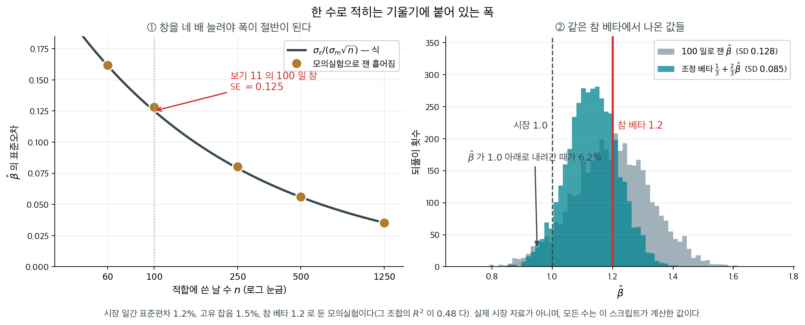

**$100$ 일로 잰 베타 $1.20$ 의 $95\%$ 구간은 대략 $(0.95,\ 1.45)$ 다.** 값의 $5$ 분의 $1$ 이 폭이다. 오른쪽 판이 같은 참 베타에서 나온 추정값들인데, **$6.2\%$ 는 $1.0$ 아래로 내려간다** — 시장보다 덜 움직이는 종목으로 읽히는 것이다. 참 베타는 조금도 변하지 않았는데 그렇다. 폭을 절반으로 줄이려면 날 수를 네 배로 늘려야 하고($n$ 이 분모에서 제곱근으로 들어가니까), 그러면 **오래된 날들이 지금의 그 회사와 같은 회사인가**라는 다른 물음이 생긴다.

이 사정은 오래전에 수로 확인되었다. $1971$ 년에 **마셜 블룸**이 『Journal of Finance』에 베타 추정값이 다음 기간에 $1$ 쪽으로 되돌아가는 경향을 보고했고, 네 해 뒤 같은 학술지에 그 「회귀 경향」을 따로 다룬 글을 실었다. 그래서 업계에는 추정한 베타를 $1$ 쪽으로 당겨 적는 관행이 생겼다 — **조정 베타** $\tfrac13 + \tfrac23\hat\beta$ 다. 위 그림의 청록 분포가 그것을 씌운 결과로, 흩어짐이 $0.128$ 에서 $0.085$ 로 준다. 대신 평균이 $1.132$ 로 참값 $1.20$ 보다 $0.068$ 낮다. **치우침을 받고 폭을 산 것**이고, 이 쪽에서 계속 보게 될 거래가 여기에도 있다.

다만 조정 베타의 $\tfrac23$ 을 위 표의 표준오차만으로 설명할 수는 없다. 블룸이 잰 것은 **참 베타 자체가 시간이 지나며 $1$ 쪽으로 움직이는 경향**이고, 측정의 흔들림은 그 위에 얹힌다. 이 상자가 보인 것은 둘 가운데 **아래쪽 한 겹**이다 — 참 베타가 못처럼 고정되어 있어도 $100$ 일짜리 베타는 이만큼 춤춘다.

_확인한 곳 — 마셜 E. 블룸의 「On the Assessment of Risk」(『The Journal of Finance』 $26$ 권 $1$ 호, $1971$ 년 $3$ 월, $1$–$10$ 쪽)와 「Betas and Their Regression Tendencies」(같은 학술지 $30$ 권 $3$ 호, $1975$ 년 $6$ 월, $785$–$795$ 쪽)의 서지는 [Crossref 의 기록](https://doi.org/10.1111/j.1540-6261.1971.tb00584.x)에서 확인했다 · 그 글들이 베타 추정값의 $1$ 로의 회귀 경향을 보고했고 거기서 $\tfrac13 + \tfrac23\hat\beta$ 꼴의 조정 베타가 나와 금융정보 서비스에서 쓰인다는 것은 그 방법을 소개하는 이차 자료들에서 읽었다. **두 논문의 본문은 읽지 못했고, 어느 회사가 어떤 식을 쓰는지도 확인하지 못해 적지 않는다** · 위 표와 그림의 수는 모두 가정한 값으로 직접 모의실험해 얻은 것이고 **실제 시장 자료가 아니다**_

</div>

### AAPL 대 SPY 일간 수익률

<div class="exbox" markdown>

**보기 11.** <span class="diff easy" title="쉬움"></span> AAPL의 베타. SPY 일간 수익률을 $x$, AAPL 일간 수익률을 $y$로 두고 $100$일로 적합한 뒤 다음 $100$일에 그 직선을 그린다.

**(1)** `LinearRegression`이 돌려주는 `coef_`가 $S_{xy}/S_{xx}$와 같음을 정규방정식에서 확인하고, 그것이 금융에서 말하는 **시장 베타** $\beta = \operatorname{Cov}(R_a, R_m)/\operatorname{Var}(R_m)$의 표본꼴임을 보이시오. 손으로 계산한 값과 `sklearn`의 값이 실제로 같은지 확인하시오.

**(2)** 코드는 훈련자료로 **한 번만** 적합하고 시험 칸에도 그 직선을 그린다. 시험 칸의 직선을 "시험자료에 적합한 직선"으로 읽으면 무엇을 놓치는가.

</div>

??? success "풀이"

    **(1) 해석적으로.** `LinearRegression`은 절편이 있는 최소제곱을 푼다. 3절의 둘째 정규방정식 $\sum_i (a + bx_i - y_i)x_i = 0$에 첫째 정규방정식 $a = \bar y - b\bar x$를 넣으면

    $$
    \sum_i \bigl[(y_i - \bar y) - b(x_i - \bar x)\bigr](x_i - \bar x) = 0
    \quad \Longrightarrow \quad
    \hat b = \frac{S_{xy}}{S_{xx}}
    $$

    이다. 여기서 $S_{xy} = \sum_i (x_i - \bar x)(y_i - \bar y)$, $S_{xx} = \sum_i (x_i - \bar x)^2$다. 분자와 분모를 각각 $n-1$로 나누면 표본공분산과 표본분산이므로

    $$
    \hat b = \frac{\widehat{\operatorname{Cov}}(x, y)}{\widehat{\operatorname{Var}}(x)} = r\,\frac{s_y}{s_x}
    $$

    이다. $x$를 시장수익률, $y$를 종목수익률로 두면 이것이 **시장 베타의 표본추정량**이다. 모집단 꼴 $\beta = \operatorname{Cov}(R_a, R_m)/\operatorname{Var}(R_m)$에서 모적률을 표본적률로 바꾼 것일 뿐이며, 절편 $\hat a$가 금융에서 말하는 **알파**다.

    `sklearn`이 정말 이 값을 주는지는 네트워크 없이도 확인할 수 있다. 보기 1의 자료를 그대로 쓴다.

    ```python
    import numpy as np
    import pandas as pd
    from sklearn.linear_model import LinearRegression

    # 수식이 맞는지만 보는 확인이므로 자료는 아무것이나 좋다. 보기 1 의 bdims 를 쓴다.
    data_url = ("https://raw.githubusercontent.com/vincentarelbundock/Rdatasets/"
                "1dcc2bf5f955cc1224a3e1307256e1fe86b68dae/csv/openintro/bdims.csv")
    data = pd.read_csv(data_url).rename(columns={"hgt": "Height", "wgt": "Weight"})
    male = data[data.sex == 1].loc[:300, ["Height", "Weight"]]
    x = male.Height.to_numpy()
    y = male.Weight.to_numpy()

    model = LinearRegression().fit(x.reshape(-1, 1), y)
    Sxx = ((x - x.mean()) ** 2).sum()
    Sxy = ((x - x.mean()) * (y - y.mean())).sum()

    print(f"sklearn  coef_      = {model.coef_[0]:.10f}")
    print(f"S_xy / S_xx         = {Sxy / Sxx:.10f}")
    print(f"r * s_y / s_x       = {np.corrcoef(x, y)[0, 1] * y.std(ddof=1) / x.std(ddof=1):.10f}")
    print(f"sklearn  intercept_ = {model.intercept_:.10f}")
    print(f"y-bar - b * x-bar   = {y.mean() - (Sxy / Sxx) * x.mean():.10f}")
    ```

    출력:

    ```
    sklearn  coef_      = 0.7825684506
    S_xy / S_xx         = 0.7825684506
    r * s_y / s_x       = 0.7825684506
    sklearn  intercept_ = -60.9533641420
    y-bar - b * x-bar   = -60.9533641420
    ```

    **세 식이 소수 열째 자리까지 같다.** 실제 차이는 $8.9 \times 10^{-16}$으로 부동소수점 한계다. 절편도 $\bar y - \hat b\bar x$와 같다. 그러므로 아래 블록이 찍는 `Slope (Beta)`는 `SPY` 와 `AAPL` 수익률로 계산한 $S_{xy}/S_{xx}$이고, `Intercept (Alpha)`는 $\bar y - \hat\beta\bar x$다.

    **(2) 시험 칸의 직선은 시험자료를 쓰지 않았다.** `model.fit`은 훈련자료에서 한 번만 호출되고, 시험 칸에서는 `model.predict(x_test)`로 **같은 계수**를 그대로 쓴다. 이것을 "시험자료에 적합한 직선"으로 읽으면 두 가지를 놓친다.

    첫째, **시험 칸의 잔차는 진짜 예측오차다.** 훈련 칸의 잔차는 그 자료로 최소화한 값이므로 낙관적으로 작고, 시험 칸의 잔차에는 그런 혜택이 없다. 두 칸의 잔차 퍼짐을 견주는 것이 이 그림의 요점이며, 같은 자료에 다시 적합한 직선을 그려 버리면 그 비교가 사라진다.

    둘째, **베타는 기간마다 변한다.** 시험 칸에서 점구름의 기울기가 직선과 눈에 띄게 다르면 그것은 모형이 나쁘다는 뜻이 아니라 **그 100일 동안 종목의 체계적 위험이 달라졌다**는 뜻일 수 있다. 시험자료에 다시 적합해 버리면 이 변화가 계수에 흡수되어 보이지 않는다.

    !!! note "이 블록의 출력을 싣지 못한 사정"
        기간을 $2020$-$01$-$02$부터 $2023$-$12$-$30$까지로 고정하고 `auto_adjust=False`를 주었으므로 내려받은 자료 자체는 언제 실행해도 같고, **추정된 베타와 알파도 재현된다.** 다만 이 책을 쓰는 환경에서는 `yfinance` 가 요청 한도(`YFRateLimitError`)에 걸려 출력을 확보하지 못했다. 그래서 고정된 출력과 그림을 싣지 않았다. (1)에서 확인한 대로 찍히는 값은 $S_{xy}/S_{xx}$와 $\bar y - \hat\beta\bar x$이므로, 직접 실행해 얻은 두 수를 그 식으로 읽으면 된다.

        처음 코드는 `period='max'`였는데, 그러면 마지막 $200$일이 실행하는 날마다 달라져 결과가 매번 바뀐다. 모의실험에서 난수 씨앗을 고정하는 것과 같은 이유로 **외부 자료에서는 기간을 고정한다.**

    ```python
    # 출력 없음: yfinance 요청 한도에 걸려 확보하지 못했다. 바로 위 쪽지를 볼 것.
    # verify: noexec — 같은 까닭이다. 내려받지 못하면 빈 배열로 적합해 멈춘다.
    from sklearn.linear_model import LinearRegression
    import yfinance as yf
    import matplotlib.pyplot as plt
    import pandas as pd

    tickers = ["SPY", "AAPL"]

    # 기간을 고정한다. period='max'로 두면 실행하는 날마다 마지막 200일이
    # 달라져 결과가 바뀐다. auto_adjust=False로 두는 이유는 조정종가가
    # 배당·분할이 생길 때마다 과거까지 소급해 바뀌기 때문이다.
    START, END = "2020-01-02", "2023-12-30"
    spy_data = yf.Ticker(tickers[0]).history(start=START, end=END, auto_adjust=False)
    aapl_data = yf.Ticker(tickers[1]).history(start=START, end=END, auto_adjust=False)

    spy_data[tickers[0]] = spy_data['Close'].pct_change()
    aapl_data[tickers[1]] = aapl_data['Close'].pct_change()

    daily_returns = pd.merge(spy_data[[tickers[0]]], aapl_data[[tickers[1]]],
                             left_index=True, right_index=True).dropna()

    # 훈련·시험 나누기
    x_train = daily_returns.iloc[-200:-100, 0:1].values
    y_train = daily_returns.iloc[-200:-100, 1].values
    x_test = daily_returns.iloc[-100:, 0:1].values
    y_test = daily_returns.iloc[-100:, 1].values

    print(f"x_train shape: {x_train.shape}")
    print(f"y_train shape: {y_train.shape}")
    print(f"x_test shape: {x_test.shape}")
    print(f"y_test shape: {y_test.shape}\n")

    model = LinearRegression()
    model.fit(x_train, y_train)

    print('Slope (Beta) of regression line:', f"{model.coef_[0]:.4f}")
    print('Intercept (Alpha) of regression line:', f"{model.intercept_:.4f}")

    fig, axes = plt.subplots(1, 2, figsize=(12, 3))

    for ax, x, y, title in zip(axes, (x_train, x_test), (y_train, y_test), ("Training Data", "Testing Data")):
        y_pred = model.predict(x)
        ax.plot(x, y, "o", label="Actual Data")
        ax.plot(x, y_pred, "--r", alpha=0.3, label="Linear Regression")
        ax.set_title(title)
        ax.set_xlabel(tickers[0] + " Daily Return", loc='right')
        ax.set_ylabel(tickers[1] + " Daily Return", loc='top')
        ax.legend()
        ax.spines['top'].set_visible(False)
        ax.spines['right'].set_visible(False)
        ax.spines['bottom'].set_position('zero')
        ax.spines['left'].set_position('zero')

    plt.tight_layout()
    plt.show()
    ```

    이 블록은 네트워크가 있어야 돌고, 돌면 `x_train shape: (100, 1)` 꼴의 모양 네 줄에 이어 베타와 알파 두 줄을 찍는다. 종목·기간을 바꾸면 당연히 두 수도 달라지므로, 여기서 눈여겨볼 것은 특정 수치가 아니라 **훈련으로 적합하고 시험에서 검사한다**는 절차다. $\square$

### WMT 대 SPY 일간 수익률

이 보기는 산점도와 회귀직선 옆에 두 수익률 계열의 주변분포를 보여주는 결합 히스토그램을 함께 그린다.

<div class="exbox" markdown>

**보기 12.** <span class="diff easy" title="쉬움"></span> WMT의 베타. 산점도와 회귀직선 옆에 두 수익률 계열의 **주변 히스토그램**을 함께 놓는다.

**(1)** 두 주변 히스토그램만 보고 베타를 알 수 있는가. 주변분포를 **그대로 두고** 베타를 바꿀 수 있는지 따지고, 바꿀 수 있다면 그 범위를 $s_x, s_y$로 쓰시오. 자료로 확인하시오.

**(2)** 이 블록은 `period='max'`와 `how='inner'`를 쓴다. 두 가지가 각각 재현성에 어떤 영향을 주는가.

</div>

??? success "풀이"

    **(1) 알 수 없다.** 베타는 $\hat\beta = r\,s_y/s_x$이고, 주변 히스토그램은 $s_x$와 $s_y$만 알려 준다. **빠진 것은 $r$ 이며, $r$ 은 주변분포에 들어 있지 않다.** 결합분포에만 있는 정보다.

    바꿀 수 있는 범위는 바로 나온다. $\lvert r \rvert \le 1$이므로

    $$
    -\frac{s_y}{s_x} \;\le\; \hat\beta \;\le\; \frac{s_y}{s_x}
    $$

    이고, **양 끝은 SD 직선의 기울기**(보기 5, 6)다. 두 주변 히스토그램이 정해 주는 것은 이 구간뿐이고, 그 안의 어디에 $\hat\beta$가 놓이는지는 **짝을 어떻게 지었는가**가 정한다.

    실제로 짝만 바꿔 보면 된다. $x$ 값들의 다중집합과 $y$ 값들의 다중집합을 고정하고 짝만 다시 맺으면 두 히스토그램은 한 화소도 변하지 않지만 $r$은 크게 변한다. 네트워크 없이 확인할 수 있으므로 보기 1의 자료로 한다.

    ```python
    import numpy as np
    import pandas as pd
    from sklearn.linear_model import LinearRegression

    # 주변분포는 그대로 두고 짝만 바꾼다. 자료는 보기 1 의 bdims 를 쓴다.
    data_url = ("https://raw.githubusercontent.com/vincentarelbundock/Rdatasets/"
                "1dcc2bf5f955cc1224a3e1307256e1fe86b68dae/csv/openintro/bdims.csv")
    data = pd.read_csv(data_url).rename(columns={"hgt": "Height", "wgt": "Weight"})
    male = data[data.sex == 1].loc[:300, ["Height", "Weight"]]
    x_sorted = np.sort(male.Height.to_numpy())
    y_sorted = np.sort(male.Weight.to_numpy())

    def fit(x, y):
        m = LinearRegression().fit(x.reshape(-1, 1), y)
        return np.corrcoef(x, y)[0, 1], m.coef_[0]

    rng = np.random.default_rng(0)
    pairings = [
        ("원래 짝",        male.Height.to_numpy(), male.Weight.to_numpy()),
        ("큰 것끼리",      x_sorted,               y_sorted),
        ("큰 것과 작은 것", x_sorted,               y_sorted[::-1]),
        ("무작위로 섞어",   x_sorted,               rng.permutation(y_sorted)),
    ]
    sx, sy = x_sorted.std(ddof=1), y_sorted.std(ddof=1)
    print(f"주변분포는 네 경우 모두 같다:  s_x = {sx:.4f},  s_y = {sy:.4f}")
    print(f"s_y / s_x = {sy / sx:.4f}  (베타가 가질 수 있는 값의 한계)")
    print()
    print(f"{'짝 짓는 방식':18s}{'r':>10s}{'beta':>10s}{'r s_y/s_x':>12s}")
    for name, xv, yv in pairings:
        r, b = fit(xv, yv)
        print(f"{name:18s}{r:10.4f}{b:10.4f}{r * sy / sx:12.4f}")
    ```

    출력:

    ```
    주변분포는 네 경우 모두 같다:  s_x = 7.1836,  s_y = 10.5129
    s_y / s_x = 1.4635  (베타가 가질 수 있는 값의 한계)

    짝 짓는 방식                    r      beta   r s_y/s_x
    원래 짝                  0.5347    0.7826      0.7826
    큰 것끼리                 0.9914    1.4508      1.4508
    큰 것과 작은 것            -0.9891   -1.4475     -1.4475
    무작위로 섞어               0.0012    0.0017      0.0017
    ```

    **같은 두 히스토그램에서 베타가 $-1.4475$ 부터 $+1.4508$ 까지 나온다.** 네 경우 모두 $s_x = 7.1836$, $s_y = 10.5129$로 똑같다. 그런데도 $r$이 $-0.9891$에서 $+0.9914$까지 움직이고 베타가 그에 비례해 따라간다. 각 줄에서 `beta` 열과 `r s_y/s_x` 열이 소수 넷째 자리까지 같으니 공식도 함께 확인된다.

    양 끝이 $\pm 1.4635$에 **살짝 못 미친다**는 것도 읽어 둘 만하다. 크기 순으로 짝지어도 $r = 0.9914$에서 멈추는데, 이는 두 주변분포의 모양이 서로 선형변환 관계가 아니기 때문이다. $r = 1$이 되려면 $y$의 분위수가 $x$의 분위수의 **정확히 선형함수**여야 한다. 그러므로 $\pm s_y/s_x$는 도달 가능한 한계가 아니라 **느슨한 상한**이다.

    금융에서 이 점이 중요하다. **"수익률의 변동성이 시장과 비슷하다"는 말은 베타에 대해 거의 아무것도 말해 주지 않는다.** 변동성은 $s_y$이고 베타는 $r s_y/s_x$다. 변동성이 큰 종목의 베타가 작을 수도 있고(시장과 무관하게 흔들리는 경우), 변동성이 작아도 베타가 $1$에 가까울 수 있다. 분산 분해 $s_y^2 = \hat\beta^2 s_x^2 + s_{y\mid x}^2$ 에서 앞항이 **체계적 위험**, 뒷항이 **고유 위험**이며, 주변 히스토그램은 이 둘의 합만 보여 주고 나눠 주지는 않는다. 산점도가 필요한 까닭이다.

    **(2) 두 가지가 서로 다른 방식으로 재현을 깨뜨린다.** `period='max'`는 **끝점**을 실행하는 날로 잡는다. 그래서 돌릴 때마다 자료가 길어지고 베타도 조금씩 움직인다. `how='inner'`는 두 계열의 **날짜 교집합**만 남기므로 시작점을 늦게 상장된 쪽이 정하는데, 이 시작점 자체는 고정된다. 곧 **재현을 깨는 쪽은 `period='max'` 이고, `how='inner'` 는 표본의 범위를 결정할 뿐이다.**

    고치는 길은 보기 11 과 같다. `start`, `end`를 못 박고 `auto_adjust=False`를 주는 것이다. 조정종가는 배당·분할이 생길 때마다 과거 값까지 소급해 바뀌므로, 날짜를 고정해도 조정종가를 쓰면 수익률이 달라진다.

    !!! note "이 블록의 출력을 싣지 못한 사정"
        이 블록은 `yfinance`로 **실행 시점의** 시장 자료를 내려받는다. 기간이 고정되어 있지 않으므로 추정된 베타도 실행할 때마다 달라지며, 그래서 고정된 출력이나 그림을 싣지 않았다. 더하여 이 책을 쓰는 환경에서는 `yfinance`가 요청 한도(`YFRateLimitError`)에 걸려 아예 내려받지 못했다. 직접 실행해 얻은 값으로 읽으면 되고, (1)에서 본 대로 **두 히스토그램이 아니라 산점도**가 베타를 결정한다는 점만 가져가면 된다. $\square$

    ```python
    # 출력 없음: period='max' 라 실행할 때마다 자료가 달라진다. 더하여 이 책의
    #   환경에서는 yfinance 요청 한도에 걸려 아예 내려받지 못했다. 위 쪽지를 볼 것.
    # verify: noexec — 같은 까닭이다. 내려받지 못하면 빈 배열로 적합해 멈춘다.
    import yfinance as yf
    import numpy as np
    import matplotlib.pyplot as plt
    from sklearn.linear_model import LinearRegression

    ticker_wmt = "WMT"
    ticker_spy = "SPY"

    wmt_data = yf.Ticker(ticker_wmt).history(period='max')
    spy_data = yf.Ticker(ticker_spy).history(period='max')

    wmt_data[ticker_wmt] = wmt_data['Close'].pct_change()
    spy_data[ticker_spy] = spy_data['Close'].pct_change()

    daily_returns = wmt_data[[ticker_wmt]].join(spy_data[[ticker_spy]], how='inner').dropna()

    spy_returns = daily_returns[ticker_spy].to_numpy().reshape(-1, 1)
    wmt_returns = daily_returns[ticker_wmt].to_numpy()

    model = LinearRegression()
    model.fit(spy_returns, wmt_returns)
    regression_line = model.predict(spy_returns)

    fig, axes = plt.subplots(2, 2, figsize=(8, 8))

    # SPY 수익률 히스토그램
    axes[0, 0].hist(spy_returns, density=True, bins=50, color='skyblue', edgecolor='black')
    axes[0, 0].set_xlim(-0.2, 0.2)
    axes[0, 0].set_xticks([-0.2, -0.1, 0, 0.1, 0.2])
    axes[0, 0].set_title(f"{ticker_spy} Daily Returns Histogram")

    axes[0, 1].axis('off')

    # 산점도와 회귀직선
    axes[1, 0].plot(spy_returns, wmt_returns, '.', color='purple', label='Data Points')
    axes[1, 0].plot(spy_returns, regression_line, 'r-', label='Regression Line')
    axes[1, 0].set_xlabel(f"{ticker_spy} Daily Returns")
    axes[1, 0].set_ylabel(f"{ticker_wmt} Daily Returns")
    axes[1, 0].set_xlim(-0.2, 0.2)
    axes[1, 0].set_ylim(-0.2, 0.2)
    axes[1, 0].set_xticks([-0.2, -0.1, 0, 0.1, 0.2])
    axes[1, 0].set_yticks([-0.2, -0.1, 0, 0.1, 0.2])
    axes[1, 0].legend()

    # WMT 수익률 히스토그램(가로)
    axes[1, 1].hist(wmt_returns, density=True, bins=50, orientation='horizontal',
                    color='lightgreen', edgecolor='black')
    axes[1, 1].set_ylim(-0.2, 0.2)
    axes[1, 1].set_yticks([-0.2, -0.1, 0, 0.1, 0.2])
    axes[1, 1].set_title(f"{ticker_wmt} Daily Returns Histogram")

    plt.tight_layout()
    plt.show()
    ```

    왼쪽 아래 칸이 산점도이고 위와 오른쪽이 각 계열의 주변 히스토그램이다. 오른쪽 위 칸은 `axis('off')`로 비워 두었다. 그림을 읽을 때는 **세 칸이 같은 축 범위를 쓴다**는 점에 주의해야 한다. 두 히스토그램은 $[-0.2, 0.2]$로 잘려 있어 그 밖의 극단적인 날들이 보이지 않는다.

---

## 연습문제

<div class="drillbox" markdown>

**연습문제 1.** <span class="diff easy" title="쉬움"></span>
어떤 집단에서 뽑은 남성 100명의 키와 몸무게에 대한 통계 정보:

- **키**: 평균 = 173 cm, 표준편차 = 6 cm
- **몸무게**: 평균 = 70 kg, 표준편차 = 7 kg
- **키와 몸무게의 상관**: 0.59

표본크기가 크므로 $t$ 분포 대신 정규분포를 쓴다.

**(a)** 키가 179 cm인 남성의 예측 몸무게는 얼마인가?

**(b)** 위에서 얻은 예측 몸무게가 어떤 남성의 몸무게라고 하자. 이 남성의 예측 키는 얼마인가?

**(c)** 키가 179 cm일 때 평균 예측 몸무게에 대한 95% 신뢰구간은 얼마인가?

**(d)** 키가 179 cm일 때 예측 몸무게에 대한 95% 예측구간은 얼마인가?

</div>

??? success "풀이"

    **(a)** 키 179 cm에 대한 몸무게 예측:

    $179 = 173 + 6$이므로 $X = \mu_X + \sigma_X$, 곧 표준단위로 $z_x = 1$이다. 표준화된 회귀식 $z_{\hat{y}} = r z_x$에서

    $$
    X = \mu_X + \sigma_X \quad \rightarrow \quad \hat{Y} = \mu_Y + r\sigma_Y = 70 + 0.59 \times 7 = 74.13
    $$

    **(b)** 몸무게 74.13 kg에 대한 키 예측:

    이제 $z_y = r = 0.59$이므로 $X$를 $Y$에 회귀시키면 $z_{\hat{x}} = r z_y = r^2$이다.

    $$
    Y = \mu_Y + r\sigma_Y \quad \rightarrow \quad \hat{X} = \mu_X + r^2\sigma_X = 173 + 0.59^2 \times 6 = 175.09
    $$

    출발점인 179 cm로 돌아오지 못하고 평균 쪽으로 되돌아온다는 점에 주목하라. 이것이 회귀 효과이다.

    **(c)** 평균 예측 몸무게에 대한 95% 신뢰구간:

    먼저 잔차 표준편차(회귀의 표준오차)를 구한다.

    $$
    s_{Y \mid X} = \sigma_Y \sqrt{1 - r^2} = 7\sqrt{1 - 0.59^2} = 7 \times 0.8074 = 5.6518
    $$

    지렛대 항은 $\sum (X_i - \bar{X})^2 = (n-1)\sigma_X^2 = 99 \times 36 = 3564$이고 $(X - \bar{X})^2 = 36$이므로

    $$
    h = \frac{1}{n} + \frac{(X - \bar{X})^2}{\sum (X_i - \bar{X})^2} = \frac{1}{100} + \frac{36}{3564} = 0.020101
    $$

    $$
    SE(\hat{Y}) = s_{Y \mid X} \sqrt{h} = 5.6518 \times 0.14178 = 0.8013
    $$

    $$
    \hat{Y} \pm z_{0.025} \cdot SE(\hat{Y}) = 74.13 \pm 1.96 \times 0.8013 = (72.56, \; 75.70)
    $$

    **(d)** 예측 몸무게에 대한 95% 예측구간:

    개별 관측값을 예측할 때는 오차항의 분산 $s_{Y \mid X}^2$이 추가로 더해진다.

    $$
    SE_{\text{예측}} = s_{Y \mid X} \sqrt{1 + h} = 5.6518 \times \sqrt{1.020101} = 5.7083
    $$

    $$
    \hat{Y} \pm z_{0.025} \cdot SE_{\text{예측}} = 74.13 \pm 1.96 \times 5.7083 = (62.94, \; 85.32)
    $$

    예측구간이 신뢰구간보다 훨씬 넓다는 점에 주목하라. 폭의 비는 $\sqrt{(1+h)/h} = \sqrt{1.0201/0.0201} \approx 7.1$배이다. 평균을 추정하는 일과 개별 관측값을 예측하는 일은 정밀도가 전혀 다르다. $\square$

<div class="drillbox" markdown>

**연습문제 2.** <span class="diff med" title="중간"></span>
주택 자료를 써서 다음을 하라.

**(a)** $x = \text{df.median_income}$, $y = \text{df.median_house_value}$로 회귀직선을 그려라.

**(b)** `median_income`이 8일 때 `median_house_value`의 회귀 예측값을 계산하라.

```python
import os
import tarfile
import urllib.request   # urllib 만 가져오면 urllib.request 가 없다
from sklearn import metrics
from sklearn.linear_model import LinearRegression

DOWNLOAD_ROOT = "https://raw.githubusercontent.com/ageron/handson-ml2/7b7e23e7267356f8355580877eff98c43cda1bd0/"
HOUSING_PATH = os.path.join("datasets", "housing")
HOUSING_URL = DOWNLOAD_ROOT + "datasets/housing/housing.tgz"

def fetch_housing_data(housing_url=HOUSING_URL, housing_path=HOUSING_PATH):
    if not os.path.isdir(housing_path):
        os.makedirs(housing_path)
    tgz_path = os.path.join(housing_path, "housing.tgz")
    urllib.request.urlretrieve(housing_url, tgz_path)
    housing_tgz = tarfile.open(tgz_path)
    housing_tgz.extractall(path=housing_path)
    housing_tgz.close()

def load_housing_data(housing_path=HOUSING_PATH):
    csv_path = os.path.join(housing_path, "housing.csv")
    return pd.read_csv(csv_path)

def main():
    fetch_housing_data()
    pass

if __name__ == "__main__":
    main()
```

</div>

??? success "풀이"

    ```python
    import os
    import tarfile
    import urllib.request   # urllib 만 가져오면 urllib.request 가 없다
    import numpy as np
    import pandas as pd
    import matplotlib.pyplot as plt
    from sklearn.linear_model import LinearRegression

    DOWNLOAD_ROOT = "https://raw.githubusercontent.com/ageron/handson-ml2/7b7e23e7267356f8355580877eff98c43cda1bd0/"
    HOUSING_PATH = os.path.join("datasets", "housing")
    HOUSING_URL = DOWNLOAD_ROOT + "datasets/housing/housing.tgz"

    def fetch_housing_data(housing_url=HOUSING_URL, housing_path=HOUSING_PATH):
        if not os.path.isdir(housing_path):
            os.makedirs(housing_path)
        tgz_path = os.path.join(housing_path, "housing.tgz")
        urllib.request.urlretrieve(housing_url, tgz_path)
        housing_tgz = tarfile.open(tgz_path)
        housing_tgz.extractall(path=housing_path)
        housing_tgz.close()

    def load_housing_data(housing_path=HOUSING_PATH):
        csv_path = os.path.join(housing_path, "housing.csv")
        return pd.read_csv(csv_path)

    def main():
        fetch_housing_data()

        print("(a)")
        df = load_housing_data()
        x = np.array(df.median_income).reshape((-1, 1))
        y = np.array(df.median_house_value)
        model = LinearRegression()
        model.fit(x, y)
        y_pred = model.predict(x)
        fig, ax = plt.subplots(figsize=(15, 4))
        ax.plot(x, y, ',')
        ax.plot(x, y_pred, '--r')
        plt.show()

        print("(b)")
        print(model.predict([[8]])[0])

    if __name__ == "__main__":
        main()
    ```

    출력:

    ```
    (a)
    (b)
    379436.37031843845
    ```

    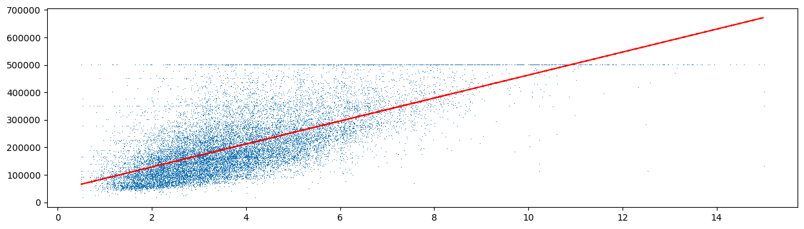

    **(a)** 점 2 만여 개를 `','` 로 찍고 그 위에 적합된 직선을 겹쳐 그렸다.

    **(b) $379{,}436$ 은 예측값이다.** 적합된 직선이 `median_house_value = 45085.58 + 41793.85 * median_income` 이므로

    $$
    45085.58 + 41793.85 \times 8 = 379{,}436.38
    $$

    이고, 이것이 `model.predict([[8]])` 이 찍은 수다. **잔차제곱합이 아니다.** 잔차제곱합은 2 만여 가구의 제곱합이라 $10^{12}$ 자릿수이며 위 코드는 그것을 계산하지도 않는다. 최소제곱이 최소화하는 것이 잔차제곱합이라는 사실과, 이 자리에서 찍힌 수가 무엇인가는 별개다.

    **절단에 유의하라.** 이 자료의 `median_house_value` 는 $500{,}001$ 에서 잘려 있고(전체의 $4.7\%$ 가 이 값이다), 그래서 고소득 구간에서 직선이 체계적으로 어긋난다. $x = 8$ 은 그 구간에 가까우므로 위 예측값도 그만큼 낮게 끌려 있다.

<div class="drillbox" markdown>

**연습문제 3.** <span class="diff med" title="중간"></span>
보기 5와 6은 평균점을 지나고 기울기가 $b$인 직선의 잔차제곱합이 $\text{RSS}(b) = S_{yy} - 2b\,S_{xy} + b^2 S_{xx}$이며, $b = +s_y/s_x$와 $b = -s_y/s_x$에서 각각 $2(1-r)\,S_{yy}$와 $2(1+r)\,S_{yy}$가 됨을 보였다.

**(a)** **양의** SD 직선이 평균만 쓰는 수평선보다 **나쁜** $r$의 범위를 구하고, 보기 6이 음의 SD 직선에 대해 얻은 범위 $r > -1/2$와 견주시오.

**(b)** 두 SD 직선의 잔차제곱합을 더하면 $r$가 사라짐을 보이고, 이로부터 "**어떤 자료에서든 두 SD 직선 가운데 적어도 하나는 평균만 쓰는 것보다 두 배 이상 나쁘다**"를 이끌어 내시오. 등호는 언제 성립하는가.

**(c)** 이 자료의 $r = 0.5347$은 (a)의 경계에서 얼마나 떨어져 있는가. $r$가 정확히 $1/2$이면 양의 SD 직선과 수평선의 잔차제곱합이 같아지는데, 그렇다고 두 직선이 자료를 똑같이 요약한다고 말할 수 있는가.

</div>

??? success "풀이"

    **(a) $r < 1/2$에서 나쁘다.** $\text{RSS}(\text{양의 SD})/S_{yy} = 2(1-r)$이고 수평선의 값은 $1$이므로

    $$
    2(1-r) > 1 \quad \Longleftrightarrow \quad r < \tfrac12
    $$

    이다. 음의 SD 직선 쪽은 $2(1+r) > 1 \iff r > -1/2$였으니 **두 조건이 원점에 대해 대칭**이다. 당연하다. $x \mapsto -x$로 바꾸면 $r \mapsto -r$이고 두 SD 직선의 역할이 맞바뀌기 때문이다.

    여기서 걸러야 할 오해가 있다. "상관이 양수이면 양의 SD 직선이 쓸 만하다"는 생각은 틀렸다. $r = 0.3$인 자료에서도 $2(1-0.3) = 1.4$이므로 SD 직선은 **키를 전혀 쓰지 않는 것보다 $40\%$ 나쁘다.** 양수인 것으로는 모자라고 $1/2$를 넘어야 한다.

    **(b) 합이 $4S_{yy}$다.**

    $$
    2(1-r)\,S_{yy} + 2(1+r)\,S_{yy} = 4\,S_{yy}
    $$

    $r$가 깨끗이 지워진다. 두 값의 산술평균이 $2S_{yy}$이므로 **큰 쪽은 적어도 $2S_{yy}$**다.

    $$
    \max\bigl\{2(1-r),\ 2(1+r)\bigr\} \ge 2 > 1
    $$

    곧 어떤 자료에서든 두 SD 직선 가운데 하나는 평균만 쓰는 수평선보다 두 배 이상 나쁘다. 등호는 두 값이 같을 때, 곧 $r = 0$일 때뿐이고 그때는 **둘 다** 정확히 두 배다. 뒤집어 말하면 $\lvert r \rvert \le 1/2$인 자료에서는 $2(1-\lvert r\rvert) \ge 1$이므로 두 SD 직선이 **모두** 수평선보다 나쁘다.

    **(c) 경계에서 $0.0347$ 떨어져 있다.** $0.534742 - 0.5 = 0.034742$다. 보기 5의 $\text{RSS}/S_{yy} = 0.930516$이 $1$에 바짝 붙어 있던 까닭이 이것이다. 이 자료는 양의 SD 직선이 수평선을 **간신히** 이기는 쪽에 놓여 있고, 상관이 $0.035$만 작았다면 순서가 뒤집힌다.

    **그렇다고 두 직선이 같은 요약은 아니다.** $r = 1/2$에서 잔차제곱합이 같다는 것은 **제곱합이라는 하나의 수가 같다**는 말일 뿐이다. 기울기는 $s_y/s_x$ 대 $0$으로 전혀 다르고, 두 직선의 예측값은 $x = \bar x$ 말고는 모든 자리에서 다르다. $x = \bar x + 3s_x$에서 SD 직선은 $\bar y + 3s_y$를, 수평선은 $\bar y$를 주어 $3s_y$만큼 벌어진다. **틀리는 양이 같을 뿐 틀리는 자리가 다르다.** SD 직선은 중앙에서 잘 맞고 극단에서 크게 틀리며, 수평선은 어디서나 고르게 틀린다. 잔차제곱합은 이 차이를 하나의 수로 뭉개므로, 같은 값이 나왔다고 두 직선이 같다고 읽으면 안 된다. $\square$

<div class="drillbox" markdown>

**연습문제 4.** <span class="diff med" title="중간"></span>
보기 1은 "단위를 잃은 기울기는 해석할 수 없다"고 했다. 무엇이 단위에 매여 있고 무엇이 그렇지 않은지 가려 보자.

**(a)** 키를 인치로, 몸무게를 파운드로 바꾼다. 곧 $x' = x/2.54$, $y' = y/0.45359237$로 두고 같은 자료에 최소제곱을 다시 맞춘다. $r$, 기울기 $\hat b$, 절편 $\hat a$, $\text{RSS}$, $\text{RSS}/S_{yy}$가 각각 몇 배가 되는지 유도하시오.

**(b)** 이번에는 단위를 그대로 두고 **원점만** 옮겨 키를 $x'' = x - 170$(센티미터 초과분)으로 잰다. 기울기와 절편은 어떻게 되는가. 두 변환을 견주어 "기울기는 무엇에 의존하고 절편은 무엇에 의존하는가"를 한 줄로 정리하시오.

**(c)** 세 경우를 모두 적합해 (a), (b)를 확인하시오. 보기 2가 보고한 절편 $\hat a = -60.9534$는 무엇의 예측값인가. $x''$로 잰 절편과 견주면 어느 쪽이 해석할 수 있는 수인가.

</div>

??? success "풀이"

    **(a) 유도.** $c_x = 2.54$, $c_y = 0.45359237$로 두면 $x' = x/c_x$, $y' = y/c_y$다. 표준편차는 같은 인수로 줄어들고($s_{x'} = s_x/c_x$, $s_{y'} = s_y/c_y$) 상관은 척도불변이므로 $r' = r$이다. 따라서

    $$
    \hat b' = r\,\frac{s_{y'}}{s_{x'}} = r\,\frac{s_y}{s_x}\cdot\frac{c_x}{c_y} = \hat b\,\frac{c_x}{c_y}
    $$

    이고 $c_x/c_y = 2.54/0.45359237 = 5.599741$이므로 $0.782568 \times 5.599741 = 4.382181$(파운드/인치)이다. 절편은

    $$
    \hat a' = \bar y' - \hat b'\,\bar x'
    = \frac{\bar y}{c_y} - \hat b\,\frac{c_x}{c_y}\cdot\frac{\bar x}{c_x}
    = \frac{\bar y - \hat b\,\bar x}{c_y} = \frac{\hat a}{c_y}
    $$

    로 $1/c_y = 2.204623$배다. $x$ 쪽 인수가 약분되어 사라지는 것이 요점이다. 잔차는 $e_i' = e_i/c_y$이므로 $\text{RSS}$는 $1/c_y^2 = 4.860361$배이고, $S_{yy}$도 똑같이 $1/c_y^2$배이므로 **비 $\text{RSS}/S_{yy}$는 불변**이다. 정리하면

    | 양 | 배수 |
    |---|---|
    | $r$ | $1$ |
    | $\hat b$ | $c_x/c_y$ |
    | $\hat a$ | $1/c_y$ |
    | $\text{RSS}$ | $1/c_y^2$ |
    | $\text{RSS}/S_{yy}$ | $1$ |

    **$x$ 쪽 단위는 $r$, $\text{RSS}$, $R^2$에 아예 들어오지 않는다.** 들어오는 것은 기울기와 절편뿐이다.

    **(b) 원점을 옮기면 기울기는 그대로, 절편만 움직인다.** $x'' = x - 170$이면 $s_{x''} = s_x$이고 $\bar x'' = \bar x - 170$이므로 $\hat b'' = r\,s_y/s_x = \hat b$다. 적합값도 하나하나 그대로이므로 잔차와 $\text{RSS}$도 변하지 않는다. 바뀌는 것은 절편뿐이다.

    $$
    \hat a'' = \bar y - \hat b\,(\bar x - 170) = \hat a + 170\,\hat b = -60.9534 + 170 \times 0.782568 = 72.0833
    $$

    한 줄로 정리하면 **기울기는 두 변수의 단위에만 의존하고 $x$의 원점에는 의존하지 않는다. 절편은 단위와 $x$의 원점에 모두 의존한다.** 그래서 기울기보다 절편이 더 위태롭다. 기울기는 "$\text{kg}/\text{cm}$"라고 적어 두면 뜻이 복원되지만, 절편은 단위만으로는 복원되지 않고 **$x = 0$이 어디인가**까지 알아야 뜻이 정해진다.

    **(c) 수치적으로.**

    ```python
    import numpy as np
    import pandas as pd

    # openintro의 bdims 자료: 성인 507명의 신체 치수.
    # hgt(cm), wgt(kg), sex(1 = 남성, 0 = 여성) 열을 쓴다.
    data_url = ("https://raw.githubusercontent.com/vincentarelbundock/Rdatasets/"
                "1dcc2bf5f955cc1224a3e1307256e1fe86b68dae/csv/openintro/bdims.csv")
    data = pd.read_csv(data_url).rename(columns={"hgt": "Height", "wgt": "Weight"})
    male = data[data.sex == 1].loc[:300, ["Height", "Weight"]]

    CM_PER_INCH = 2.54
    KG_PER_POUND = 0.45359237

    height_cm = male.Height.to_numpy()
    weight_kg = male.Weight.to_numpy()

    def fit(x, y):
        """최소제곱 해와 잔차제곱합. 기울기는 r s_y/s_x 꼴로 구한다."""
        r = np.corrcoef(x, y)[0, 1]
        slope = r * y.std(ddof=1) / x.std(ddof=1)
        intercept = y.mean() - slope * x.mean()
        rss = ((y - (intercept + slope * x)) ** 2).sum()
        syy = ((y - y.mean()) ** 2).sum()
        return r, slope, intercept, rss, rss / syy

    cases = [("cm, kg (원래)", height_cm, weight_kg),
             ("inch, pound", height_cm / CM_PER_INCH, weight_kg / KG_PER_POUND),
             ("cm - 170, kg", height_cm - 170.0, weight_kg)]

    print(f"{'자료':>14s}{'r':>11s}{'기울기':>11s}{'절편':>12s}{'RSS':>14s}{'RSS/Syy':>11s}")
    out = {}
    for name, x, y in cases:
        out[name] = fit(x, y)
        r, slope, intercept, rss, ratio = out[name]
        print(f"{name:>14s}{r:11.6f}{slope:11.6f}{intercept:12.4f}{rss:14.4f}{ratio:11.6f}")

    base = out["cm, kg (원래)"]
    imperial = out["inch, pound"]
    shifted = out["cm - 170, kg"]

    print()
    print("(a) 단위만 바꾸면")
    print(f"  기울기의 비 = {imperial[1] / base[1]:.6f},   2.54/0.45359237 = {CM_PER_INCH / KG_PER_POUND:.6f}")
    print(f"  절편의 비   = {imperial[2] / base[2]:.6f},   1/0.45359237    = {1 / KG_PER_POUND:.6f}")
    print(f"  RSS 의 비   = {imperial[3] / base[3]:.6f},   (1/0.45359237)^2 = {(1 / KG_PER_POUND) ** 2:.6f}")
    print(f"  r 의 차이 = {imperial[0] - base[0]:.2e},  RSS/Syy 의 차이 = {imperial[4] - base[4]:.2e}")

    print()
    print("(b) 원점만 옮기면")
    print(f"  기울기의 차이 = {shifted[1] - base[1]:.2e},  RSS 의 차이 = {shifted[3] - base[3]:.2e}")
    print(f"  절편은 {base[2]:.4f} -> {shifted[2]:.4f}")
    print(f"  a + 170 b = {base[2] + 170 * base[1]:.4f}")
    print(f"  키 170 cm 에서의 예측 몸무게 = {base[2] + base[1] * 170:.4f} kg")
    print(f"  키   0 cm 에서의 예측 몸무게 = {base[2]:.4f} kg   (자료 범위 [{height_cm.min():.1f}, {height_cm.max():.1f}] 밖)")
    ```

    출력:

    ```text
                자료          r        기울기          절편           RSS    RSS/Syy
       cm, kg (원래)   0.534742   0.782568    -60.9534    19413.7185   0.714051
       inch, pound   0.534742   4.382181   -134.3792    94357.6787   0.714051
      cm - 170, kg   0.534742   0.782568     72.0833    19413.7185   0.714051

    (a) 단위만 바꾸면
      기울기의 비 = 5.599741,   2.54/0.45359237 = 5.599741
      절편의 비   = 2.204623,   1/0.45359237    = 2.204623
      RSS 의 비   = 4.860361,   (1/0.45359237)^2 = 4.860361
      r 의 차이 = 2.22e-16,  RSS/Syy 의 차이 = 1.11e-16

    (b) 원점만 옮기면
      기울기의 차이 = 0.00e+00,  RSS 의 차이 = -3.64e-12
      절편은 -60.9534 -> 72.0833
      a + 170 b = 72.0833
      키 170 cm 에서의 예측 몸무게 = 72.0833 kg
      키   0 cm 에서의 예측 몸무게 = -60.9534 kg   (자료 범위 [157.2, 198.1] 밖)
    ```

    **유도한 배수가 모두 맞는다.** 기울기의 비 $5.599741$, 절편의 비 $2.204623$, $\text{RSS}$의 비 $4.860361$이 각각 $c_x/c_y$, $1/c_y$, $1/c_y^2$와 소수 여섯째 자리까지 같다. $r$와 $\text{RSS}/S_{yy}$의 차이는 $10^{-16}$으로 부동소수점 한계다. 원점을 옮긴 쪽은 기울기의 차이가 정확히 $0$이고 $\text{RSS}$의 차이가 $-3.64 \times 10^{-12}$이니 역시 반올림뿐이다.

    **$-60.9534$는 "키가 $0\,\text{cm}$인 사람의 예측 몸무게"다.** 자료의 키 범위는 $[157.2,\ 198.1]$이고 $\bar x/s_x = 177.7453/7.1836 = 24.74$이므로 $x = 0$은 평균에서 $24.7$ SD 떨어진 자리다. 음수 몸무게가 나오는 것은 모형이 틀렸다는 뜻이 아니라 **그 자리를 묻지 말아야 한다**는 뜻이다. 반면 $x''$로 재면 절편이 $72.0833$으로 "키 $170\,\text{cm}$인 사람의 예측 몸무게"가 되어 자료 범위 안의 수가 되고, 그대로 해석할 수 있다.

    그래서 실무에서 $x$를 중심화하거나 뜻 있는 기준점에서 재는 것이 흔하다. **중심화는 적합을 전혀 바꾸지 않고 절편의 뜻만 바꾼다.** 보기 2가 보인 "모든 최소제곱직선은 평균점을 지난다"가 같은 이야기의 다른 얼굴이다. $x$를 $\bar x$에서 재면 절편이 바로 $\bar y$가 된다. $\square$

<div class="drillbox" markdown>

**연습문제 5.** <span class="diff med" title="중간"></span>
연습문제 1의 **(a)** 와 **(b)** 를 번갈아 되풀이한다. 키 $179\,\text{cm}$에서 몸무게 $74.13\,\text{kg}$을 얻고, 그 몸무게에서 키 $175.09\,\text{cm}$를 얻고, 그 키에서 다시 몸무게를 얻는 식이다. 자료는 그대로 $\mu_x = 173$, $\sigma_x = 6$, $\mu_y = 70$, $\sigma_y = 7$, $r = 0.59$를 쓴다.

**(a)** $k$번 왕복한 뒤의 예측 키를 $\mu_x$, $\sigma_x$, $r$, $k$로 쓰고 $k = 0, 1, 2, 3, 4$의 값을 적으시오.

**(b)** 평균에서의 편차가 처음 편차 $6\,\text{cm}$의 $10\%$ 아래로 내려오는 최소의 $k$를 구하시오.

**(c)** 이 수열은 평균점으로 수렴한다. 그렇다면 "회귀 효과 때문에 되풀이하면 모두 평균 키가 된다"는 결론이 따라오는가. 따라오지 않는다면 이 되풀이가 자료에 대해 **무엇을 말하고 무엇을 말하지 않는지** 밝히시오. $\lvert r \rvert = 1$이면 어떻게 되는가.

</div>

??? success "풀이"

    **(a) 왕복 한 번이 $r^2$을 곱하는 일이다.** 표준단위로 쓰면 한 방향의 예측이 $z \mapsto r z$다(3절). 키에서 몸무게로 갔다가 몸무게에서 키로 돌아오는 것은 이 사상을 두 번 쓰는 것이므로 $z \mapsto r^2 z$다. 출발점이 $z_x^{(0)} = (179-173)/6 = 1$이므로

    $$
    z_x^{(k)} = r^{2k}, \qquad \hat x^{(k)} = \mu_x + \sigma_x\,r^{2k} = 173 + 6\,(0.59)^{2k}
    $$

    이고, 중간에 지나는 몸무게는 $\hat y^{(k)} = \mu_y + \sigma_y r^{2k+1} = 70 + 7\,(0.59)^{2k+1}$이다. 값을 적으면

    | $k$ | $r^{2k}$ | 예측 키 $\hat x^{(k)}$ | 다음 예측 몸무게 $\hat y^{(k)}$ |
    |---|---|---|---|
    | $0$ | $1$ | $179.0000$ | $74.1300$ |
    | $1$ | $0.3481$ | $175.0886$ | $71.4377$ |
    | $2$ | $0.121174$ | $173.7270$ | $70.5004$ |
    | $3$ | $0.042181$ | $173.2531$ | $70.1742$ |
    | $4$ | $0.014683$ | $173.0881$ | $70.0606$ |

    $k = 1$의 $175.0886$이 연습문제 1 **(b)** 의 $175.09$다.

    **(b) $k = 3$이다.** 편차가 $6\,r^{2k}$이므로 조건은 $6\,r^{2k} < 0.6$, 곧 $r^{2k} < 0.1$이다.

    $$
    2k \ln 0.59 < \ln 0.1 \quad \Longrightarrow \quad k > \frac{\ln 0.1}{2\ln 0.59} = \frac{-2.302585}{-1.055266} = 2.1820
    $$

    따라서 $k = 3$이다. 직접 확인해도 $r^4 = 0.121174 > 0.1$이고 $r^6 = 0.042181 < 0.1$이다. $k = 3$에서 예측 키가 $173.2531$이니 편차가 $0.2531\,\text{cm}$, 곧 처음의 $4.2\%$다.

    **(c) 따라오지 않는다.** 되풀이의 각 단계는 **서로 다른 질문에 대한 답**이다. 첫 단계는 "키가 $179$인 사람들의 평균 몸무게는?"이고, 둘째 단계는 "몸무게가 $74.13$인 사람들의 평균 키는?"이다. 둘째 단계의 입력은 **관측값이 아니라 첫 단계가 내놓은 평균**이다. 평균의 평균을 또 평균하는 연산이므로 중심으로 모이는 것이 당연하고, 수렴하는 것은 수열이지 사람이 아니다.

    자료는 한 번도 바뀌지 않았다. 키 분포의 표준편차는 처음부터 끝까지 $6\,\text{cm}$이고 몸무게의 표준편차는 $7\,\text{kg}$이다. 조건부 평균이 평균 쪽으로 당겨진다는 사실과 분포가 좁아진다는 주장은 전혀 다른 말이며, 보기 7이 조건부 표준편차 $\sigma_y\sqrt{1-r^2}$로 같은 구별을 한다. 이 되풀이가 말하는 것은 "조건부 평균을 다시 조건으로 삼아 묻기를 되풀이하면 $r^2$씩 수축한다"뿐이고, "집단의 퍼짐이 줄어든다"는 말은 아니다. **추정값을 관측값처럼 되먹이면 안 된다**는 경고로 읽는 것이 맞다.

    **$\lvert r \rvert = 1$이면 제자리다.** $r^{2k} = 1$이므로 $\hat x^{(k)} = 179$가 영원히 유지된다. $179 \to$ 예측 몸무게 $\to$ 정확히 $179$로 돌아온다. 왕복이 항등사상이 되는 것은 두 회귀직선이 하나로 겹치는 때뿐이며(보기 8), 되돌아오는 양 $1 - r^2$가 바로 두 직선이 벌어진 정도다. 보기 8의 $bb' = r^2$이 이 수축률을 그대로 적은 식이다. $\square$

<div class="drillbox" markdown>

**연습문제 6.** <span class="diff med" title="중간"></span>
보기 9의 세로 띠 $[\bar x + 0.9 s_x,\ \bar x + 1.1 s_x]$ 안에는 $10$명밖에 없어 평균의 표준오차가 $2.81\,\text{kg}$이었다. 보기 9는 "띠를 넓히면 $m$이 늘어 표준오차가 줄지만 한 점에서의 조건부 평균이라는 뜻이 흐려진다"고 적었다. 그 맞바꿈을 수로 재어 보자.

반폭 $w \in \{0.1,\ 0.2,\ 0.4,\ 0.8,\ 1.6\}$에 대해 띠 $[\bar x + (1-w)s_x,\ \bar x + (1+w)s_x]$를 잡고, 표준오차는 늘 $s_{y\mid x}/\sqrt m = s_y\sqrt{1-r^2}/\sqrt m$으로 잰다.

**(a)** 각 띠에서 사람 수 $m$, 띠 안 키의 평균, 띠 안 몸무게의 평균, 표준오차를 구하고, 띠 안 몸무게의 평균을 **두 예측값**과 견주시오. 하나는 고정된 자리 $\bar x + s_x$에서의 예측이고, 다른 하나는 **띠 안 키의 평균**에서의 예측이다.

**(b)** $w$를 키우면 표준오차는 줄지만 첫째 비교의 $z$는 커진다. 그 치우침이 어디서 오는지 밝히고 수로 분해하시오. 둘째 비교에서는 왜 치우침이 남지 않는가.

**(c)** 띠를 넓혀 조건부 평균을 더 정밀하게 재려는 전략은 어디까지 쓸 수 있는가.

</div>

??? success "풀이"

    **(a) 수치적으로.**

    ```python
    import numpy as np
    import pandas as pd

    # openintro의 bdims 자료: 성인 507명의 신체 치수.
    # hgt(cm), wgt(kg), sex(1 = 남성, 0 = 여성) 열을 쓴다.
    data_url = ("https://raw.githubusercontent.com/vincentarelbundock/Rdatasets/"
                "1dcc2bf5f955cc1224a3e1307256e1fe86b68dae/csv/openintro/bdims.csv")
    data = pd.read_csv(data_url).rename(columns={"hgt": "Height", "wgt": "Weight"})
    data["Gender"] = data["sex"].map({1: "Male", 0: "Female"})
    male_data = data[data.Gender == "Male"].loc[:300, ["Height", "Weight"]]

    mean_height = male_data.Height.mean()
    mean_weight = male_data.Weight.mean()
    std_dev_height = male_data.Height.std()
    std_dev_weight = male_data.Weight.std()
    r = male_data[["Height", "Weight"]].corr().loc["Height", "Weight"]

    slope = r * std_dev_weight / std_dev_height
    conditional_sd = std_dev_weight * np.sqrt(1 - r ** 2)

    def predict(x):
        """회귀직선의 예측값."""
        return mean_weight + slope * (x - mean_height)

    print(f"목표 자리 x = x-bar + s_x = {mean_height + std_dev_height:.4f}")
    print(f"그 자리의 회귀 예측       = {predict(mean_height + std_dev_height):.4f}")
    print(f"조건부 표준편차           = {conditional_sd:.4f}")
    print()
    header = (f"{'반폭':>6s}{'m':>5s}{'띠 안 x 평균':>13s}{'띠 안 y 평균':>13s}"
              f"{'SE':>8s}{'z(고정점)':>11s}{'z(띠 평균)':>11s}")
    print(header)
    for half_width in (0.1, 0.2, 0.4, 0.8, 1.6):
        low = mean_height + (1 - half_width) * std_dev_height
        high = mean_height + (1 + half_width) * std_dev_height
        strip = male_data[(male_data.Height >= low) & (male_data.Height <= high)]
        m = len(strip)
        standard_error = conditional_sd / np.sqrt(m)
        z_fixed = (strip.Weight.mean() - predict(mean_height + std_dev_height)) / standard_error
        z_strip = (strip.Weight.mean() - predict(strip.Height.mean())) / standard_error
        print(f"{half_width:6.1f}{m:5d}{strip.Height.mean():13.4f}{strip.Weight.mean():13.4f}"
              f"{standard_error:8.4f}{z_fixed:11.2f}{z_strip:11.2f}")
    ```

    출력:

    ```text
    목표 자리 x = x-bar + s_x = 184.9290
    그 자리의 회귀 예측       = 83.7662
    조건부 표준편차           = 8.8836

        반폭    m     띠 안 x 평균     띠 안 y 평균      SE     z(고정점)    z(띠 평균)
       0.1   10     185.1600      82.1900  2.8092      -0.56      -0.63
       0.2   19     184.7316      81.9895  2.0380      -0.87      -0.80
       0.4   37     184.4162      82.6000  1.4604      -0.80      -0.52
       0.8   87     184.1195      82.2575  0.9524      -1.58      -0.92
       1.6  181     180.6801      80.5597  0.6603      -4.86       0.18
    ```

    첫 줄 $w = 0.1$이 보기 9의 띠이고 $m = 10$, 평균 $82.1900$, 표준오차 $2.8092$, $z = -0.56$으로 그대로 재현된다.

    **(b) 치우침은 띠 안 키의 평균이 목표 자리에서 벗어난 데서 온다.** $m$은 $10$에서 $181$로 $18$배 늘고 표준오차는 $2.8092$에서 $0.6603$으로 $4.25$배 줄었다. 그런데 띠 안 키의 평균은 $185.1600$에서 $180.6801$로 **$4.48\,\text{cm}$ 내려왔다.** 목표 자리 $\bar x + s_x = 184.9290$에서 $-4.2489$ 벗어난 것이다. 키 분포가 평균 근처에서 밀도가 높으므로, 구간을 평균 쪽과 바깥쪽으로 똑같이 넓혀도 **평균 쪽에서 들어오는 사람이 더 많다.**

    회귀직선은 선형이므로 띠 안 몸무게 평균의 기댓값은 **띠 안 키의 평균에서의 예측값**이고 고정된 $\bar x + s_x$에서의 예측값이 아니다. 그래서 첫째 비교에는 다음 치우침이 섞인다.

    $$
    \hat b\,\bigl(\bar x_{\text{띠}} - (\bar x + s_x)\bigr)
    = 0.782568 \times (180.6801 - 184.9290) = -3.3250\ \text{kg}
    $$

    표준오차 $0.6603$으로 나누면 $-5.04$다. 실제 $z$가 $-4.86$이고 둘째 비교의 $z$가 $+0.18$이니 $-5.04 + 0.18 = -4.86$으로 **정확히 쪼개진다.** 곧 $w = 1.6$에서 보이는 $4.86$ SE의 어긋남은 회귀직선이 틀렸다는 증거가 아니라 **전부 치우침**이다.

    둘째 비교에는 이 항이 없다. 같은 띠의 키 평균에서 예측값을 읽으므로 $\hat b\,(\bar x_{\text{띠}} - \bar x_{\text{띠}}) = 0$이기 때문이다. $z$가 $w$에 따라 $-0.63$, $-0.80$, $-0.52$, $-0.92$, $+0.18$로 **커지지 않고 떠다닌다.**

    **(c) 금세 치우침에 지배된다.** 표준오차는 $1/\sqrt m$으로 줄고 치우침은 띠 폭에 거의 비례해 자란다. 띠를 두 배 넓히면 $m$은 대략 두 배가 되어 표준오차가 $1/\sqrt2$로 줄지만 치우침은 두 배가 되므로, 치우침 대 표준오차의 비는 $2\sqrt2 = 2.83$배 나빠진다. 표에서도 $w$가 $0.8$에서 $1.6$으로 가는 동안 표준오차는 $0.9524 \to 0.6603$로 조금 줄었을 뿐인데 치우침은 $z$를 $-1.58$에서 $-4.86$으로 밀어 버렸다.

    그러므로 띠를 넓히는 길은 막혀 있다. 바른 길은 **띠 안 $x$의 평균에서 예측값을 읽는 것**, 더 나아가 띠를 버리고 직선을 자료 전체에 맞추는 것이다. 최소제곱이 하는 일이 바로 모든 $x$를 한꺼번에 쓰면서 각 $x$를 제 자리에서 쓰는 것이며, 보기 9가 "띠 하나만 보고 회귀직선을 확인하는 일은 애초에 정밀하지 못하다"고 한 까닭이 이것이다. $\square$

<div class="drillbox" markdown>

**연습문제 7.** <span class="diff hard" title="어려움"></span>
보기 9는 조건부 표준편차를 $s_{y\mid x} = s_y\sqrt{1-r^2} = 8.8836$으로 썼고, 보기 5는 최소제곱직선의 잔차제곱합을 $\text{RSS} = (1-r^2)S_{yy} = 19413.7185$로 구했다. 그런데 회귀의 표준오차는 보통 $\hat\sigma = \sqrt{\text{RSS}/(n-2)}$로 정의한다. 두 수는 같지 않다.

**(a)** $\hat\sigma = s_y\sqrt{1-r^2}\,\sqrt{\dfrac{n-1}{n-2}}$임을 보이고, 이 자료($n = 247$)에서 두 값을 소수 넷째 자리까지 구하시오.

**(b)** 왜 $n-2$로 나누는가. 두 수 가운데 어느 쪽이 $\sigma$를 체계적으로 작게 재는가.

**(c)** 보기 9의 $z = -0.5611$을 $\hat\sigma$로 다시 계산하면 얼마가 되는가. 두 선택이 실제로 갈리는 것은 어떤 상황인가. $n = 10$과 $n = 4$에서 비를 구해 답하고, $n = 2$에서 무슨 일이 일어나는지도 적으시오.

</div>

??? success "풀이"

    **(a) 유도.** $S_{yy} = (n-1)s_y^2$이므로 보기 5의 $\text{RSS} = (1-r^2)S_{yy}$는 $\text{RSS} = (1-r^2)(n-1)s_y^2$이다. 따라서

    $$
    \hat\sigma = \sqrt{\frac{\text{RSS}}{n-2}} = \sqrt{\frac{(1-r^2)(n-1)s_y^2}{n-2}}
    = s_y\sqrt{1-r^2}\,\sqrt{\frac{n-1}{n-2}}
    $$

    이다. **두 수는 자유도 인수 하나만큼 다르다.** $n = 247$이면

    $$
    \sqrt{\frac{246}{245}} = 1.0020387, \qquad
    s_y\sqrt{1-r^2} = 8.8836, \qquad \hat\sigma = 8.8836 \times 1.0020387 = 8.9017
    $$

    이다. 보기 5의 $\text{RSS}$로 직접 재어도 $\sqrt{19413.7185/245} = 8.9017$이고 $\sqrt{19413.7185/246} = 8.8836$이니, $s_y\sqrt{1-r^2}$는 사실 $\sqrt{\text{RSS}/(n-1)}$이다.

    **(b) 추정한 모수가 둘이기 때문이다.** 잔차 $e_i = y_i - \hat a - \hat b x_i$는 두 개의 정규방정식 $\sum_i e_i = 0$과 $\sum_i e_i x_i = 0$을 만족한다(보기 2). 제약이 둘이므로 $n$개의 잔차가 실제로 가진 자유도는 $n-2$이고, 오차가 독립 등분산이면

    $$
    E[\text{RSS}] = (n-2)\,\sigma^2
    $$

    이다. 그래서 $\text{RSS}/(n-2)$가 $\sigma^2$의 불편추정량이다. 반면 $s_y^2(1-r^2) = \text{RSS}/(n-1)$은 기댓값이 $\frac{n-2}{n-1}\sigma^2$로 **작다.** 곧 $s_y\sqrt{1-r^2}$가 $\sigma$를 체계적으로 **과소평가**한다. 표본분산에서 $n$ 대신 $n-1$로 나누는 것과 같은 교정이며, 다만 자료로 맞춘 모수가 하나(평균)가 아니라 둘(절편·기울기)이라 $1$ 대신 $2$를 뺀다.

    **(c) $n = 247$에서는 아무 차이가 없다.** 표준오차가 $8.8836/\sqrt{10} = 2.8092$에서 $8.9017/\sqrt{10} = 2.8150$으로 바뀌므로

    $$
    z = \frac{-1.5762}{2.8150} = -0.5599
    $$

    이다. $-0.5611$에서 $0.2\%$ 움직인 셈이고 결론은 그대로다. $\sqrt{(n-1)/(n-2)} \to 1$이기 때문이다.

    갈리는 것은 $n$이 작을 때다.

    | $n$ | $\sqrt{(n-1)/(n-2)}$ | 차이 |
    |---|---|---|
    | $247$ | $1.0020$ | $0.2\%$ |
    | $10$ | $1.0607$ | $6.1\%$ |
    | $4$ | $1.2247$ | $22.5\%$ |

    $n = 4$에서 $22\%$를 잘못 재면 신뢰구간의 폭이 그만큼 좁아져 **포함 확률이 명목값에 못 미친다.** 게다가 $n$이 작으면 정규분위수 대신 $t$ 분위수를 써야 하고 그 자유도도 $n-2$이므로, **$n-2$라는 수가 분모와 분포 양쪽에 함께 들어온다.** 둘 가운데 하나만 고치면 어긋난다.

    극단으로 보내 보면 규약의 뜻이 분명해진다. $n = 2$이면 두 점을 직선이 정확히 지나므로 $\text{RSS} = 0$이고 $r^2 = 1$이다. $s_y\sqrt{1-r^2}$는 태연히 $0$을 돌려주어 "퍼짐이 없다"고 말하지만, $\hat\sigma$는 $0/0$이 되어 **잴 수 없다**고 말한다. 두 점으로 직선을 그었으니 흩어짐에 대해 아는 바가 없는 것이 맞다. $0$이 아니라 미정이라고 답하는 쪽이 옳고, 그것이 $n-2$로 나누는 규약의 값이다. $\square$

<div class="drillbox" markdown>

**연습문제 8.** <span class="diff hard" title="어려움"></span>
보기 12는 주변분포를 고정한 채 짝만 다시 맺으면 $r$가 크게 변한다는 것을 보였고, 무작위로 섞은 한 번의 결과가 $r = 0.0012$였다.

**(a)** 짝을 무작위로 다시 맺었을 때 $r$의 기댓값이 $0$이고 표준편차가 $1/\sqrt{n-1}$임을 쓰고, $n = 247$에서의 값을 구하시오. 이 분포가 근사적으로 정규라면 $\mathbb E\lvert r \rvert$는 얼마인가.

**(b)** $20000$번 섞어 (a)를 확인하시오.

**(c)** 보기 12의 $r = 0.0012$를 "짝을 섞으면 $r$가 $0$이 된다"의 증거로 읽어도 되는가. 섞기 분포에서 이 값이 얼마나 특별한지 재고, 관측된 $r = 0.5347$에 대한 순열검정의 결론도 함께 적으시오.

</div>

??? success "풀이"

    **(a) 해석적으로.** $u_i = (x_i - \bar x)/\sqrt{S_{xx}}$, $v_i = (y_i - \bar y)/\sqrt{S_{yy}}$로 두면 $\sum_i u_i = \sum_i v_i = 0$, $\sum_i u_i^2 = \sum_i v_i^2 = 1$이고 상관은 $r = \sum_i u_i v_i$다. 짝을 무작위순열 $\pi$로 다시 맺으면 $r_\pi = \sum_i u_i v_{\pi(i)}$이고

    $$
    E[r_\pi] = \sum_i u_i \cdot \frac{1}{n}\sum_j v_j = 0,
    \qquad
    \operatorname{Var}(r_\pi) = \frac{1}{n-1}
    $$

    이다. 분산은 무작위순열 아래 $E[v_{\pi(i)}v_{\pi(j)}]$를 $i = j$와 $i \ne j$로 나누어 계산하면 나온다. 따라서 표준편차는

    $$
    \frac{1}{\sqrt{n-1}} = \frac{1}{\sqrt{246}} = 0.063758
    $$

    이다. $r_\pi$가 근사적으로 $N(0,\ 1/(n-1))$이면 반접힌 정규의 평균 공식에서

    $$
    E\lvert r_\pi \rvert \approx \sqrt{\frac{2}{\pi}}\cdot\frac{1}{\sqrt{n-1}} = 0.7979 \times 0.063758 = 0.050871
    $$

    이다. **섞기 분포의 전형적인 크기는 $0$이 아니라 $0.05$다.**

    **(b) 수치적으로.**

    ```python
    import numpy as np
    import pandas as pd

    # openintro의 bdims 자료: 성인 507명의 신체 치수.
    data_url = ("https://raw.githubusercontent.com/vincentarelbundock/Rdatasets/"
                "1dcc2bf5f955cc1224a3e1307256e1fe86b68dae/csv/openintro/bdims.csv")
    data = pd.read_csv(data_url).rename(columns={"hgt": "Height", "wgt": "Weight"})
    male = data[data.sex == 1].loc[:300, ["Height", "Weight"]]

    x = male.Height.to_numpy()
    y = male.Weight.to_numpy()
    n = len(x)
    r_observed = np.corrcoef(x, y)[0, 1]

    # 짝만 무작위로 다시 맺는다. 주변분포는 한 화소도 바뀌지 않는다.
    rng = np.random.default_rng(0)
    n_shuffle = 20000
    x_centered = (x - x.mean()) / np.sqrt(((x - x.mean()) ** 2).sum())
    y_centered = (y - y.mean()) / np.sqrt(((y - y.mean()) ** 2).sum())
    r_null = np.array([x_centered @ rng.permutation(y_centered) for _ in range(n_shuffle)])

    print(f"n = {n},  관측된 r = {r_observed:.6f}")
    print()
    print(f"섞기 분포:  평균 {r_null.mean():+.6f},  표준편차 {r_null.std(ddof=1):.6f}")
    print(f"            이론값  0,          1/sqrt(n-1) = {1 / np.sqrt(n - 1):.6f}")
    print(f"            E|r| = {np.abs(r_null).mean():.6f},"
          f"  이론값 sqrt(2/pi)/sqrt(n-1) = {np.sqrt(2 / np.pi) / np.sqrt(n - 1):.6f}")
    print()
    print(f"관측값은 섞기 분포에서 {r_observed / r_null.std(ddof=1):.2f} SD 떨어져 있다")
    print(f"|r_섞기| >= |r_관측| 인 횟수 = {(np.abs(r_null) >= abs(r_observed)).sum()} / {n_shuffle}")
    print()
    # 보기 12 가 한 번 섞어 얻은 값
    r_once = 0.0012
    print(f"보기 12 의 한 번 섞기 값 r = {r_once}")
    print(f"  |r_섞기| <= {r_once} 인 비율 = {(np.abs(r_null) <= r_once).mean():.4f}")
    print(f"  |r_섞기| 의 중앙값         = {np.median(np.abs(r_null)):.6f}")
    print(f"  |r_섞기| 의 95 분위        = {np.quantile(np.abs(r_null), 0.95):.6f}")
    ```

    출력:

    ```text
    n = 247,  관측된 r = 0.534742

    섞기 분포:  평균 -0.000045,  표준편차 0.063388
                이론값  0,          1/sqrt(n-1) = 0.063758
                E|r| = 0.050830,  이론값 sqrt(2/pi)/sqrt(n-1) = 0.050871

    관측값은 섞기 분포에서 8.44 SD 떨어져 있다
    |r_섞기| >= |r_관측| 인 횟수 = 0 / 20000

    보기 12 의 한 번 섞기 값 r = 0.0012
      |r_섞기| <= 0.0012 인 비율 = 0.0124
      |r_섞기| 의 중앙값         = 0.043425
      |r_섞기| 의 95 분위        = 0.122844
    ```

    표준편차가 $0.063388$로 이론값 $0.063758$과 $0.6\%$ 안에서 맞는다. $20000$번으로 표준편차를 재는 몬테카를로 오차가 $\sigma/\sqrt{2B} = 0.0638/\sqrt{40000} = 0.00032$이므로 차이 $0.00037$은 그 한 배 남짓이다. $E\lvert r\rvert$도 $0.050830$ 대 $0.050871$로 맞는다.

    **(c) 증거로 읽으면 안 된다.** $0.0012$는 **한 번 뽑은 값**이다. 섞기 분포의 표준편차가 $0.0638$이고 $\lvert r \rvert$의 중앙값이 $0.0434$, $95$ 분위가 $0.1228$이니, 섞어서 나오는 $r$는 보통 이 정도 크기다. $\lvert r_\pi \rvert \le 0.0012$가 될 확률은 $0.0124$로 **$80$번에 한 번쯤**이므로, 보기 12가 얻은 값은 오히려 운 좋게 작았던 쪽이다. 씨앗을 바꾸면 $0.0012$ 자리에 $0.08$이 들어올 수도 있다.

    섞기가 보장하는 것은 "$r$가 $0$이 된다"가 아니라 "$r$의 **기댓값**이 $0$이고 흔들림이 $1/\sqrt{n-1}$로 작다"다. 보기 12의 결론 — 주변분포를 고정해도 베타가 $-1.4475$에서 $+1.4508$까지 움직인다 — 은 그대로 옳다. 다만 넷째 줄의 $0.0017$을 "짝을 섞으면 베타가 정확히 $0$"으로 읽는 것은 과하고, 바르게는 "$\pm 1.4635 \times 0.0638 = \pm 0.093$쯤 흔들리며 $0$을 중심으로 놓인다"다.

    **관측값 쪽은 반대로 분명하다.** $0.534742/0.063388 = 8.44$로 섞기 분포에서 $8$ SD 넘게 떨어져 있고, $20000$번 가운데 $\lvert r_\pi \rvert$가 관측값에 이른 적이 한 번도 없다. 순열검정의 $p$ 값은 $(0+1)/(20000+1) < 10^{-4}$다. 키와 몸무게의 연관이 짝짓기의 우연으로 설명될 가능성은 없다.

    그래도 마지막 한 줄은 덧붙여야 한다. 이것은 **$r \ne 0$**이라는 말일 뿐이고 **$r$가 크다**는 말이 아니다. 보기 1이 짚은 대로 $r^2 = 0.2859$이므로 몸무게 변동의 $71\%$는 여전히 설명되지 않는다. $n$이 크면 작은 $r$도 $8$ SD를 넘길 수 있다. **유의함과 큼은 다른 문제다.** $\square$

<div class="drillbox" markdown>

**연습문제 9.** <span class="diff hard" title="어려움"></span>
연습문제 1의 **(c)** 와 **(d)** 는 같은 자리 $x = 179$에서 신뢰구간 폭 $2z\,s_{Y\mid X}\sqrt h$와 예측구간 폭 $2z\,s_{Y\mid X}\sqrt{1+h}$를 얻었고, 지렛대는

$$
h = \frac{1}{n} + \frac{(x-\bar x)^2}{\sum_i (x_i - \bar x)^2}
$$

였다. 자료는 그대로 $n = 100$, $\bar x = 173$, $\sigma_x = 6$, $\sum_i (x_i - \bar x)^2 = 3564$, $s_{Y\mid X} = 5.6518$을 쓴다.

**(a)** 두 폭의 비를 $h$ 하나로 쓰고 $x = 179$와 $x = \bar x$에서의 값을 구하시오. 비가 가장 큰 자리는 어디인가.

**(b)** 이 비가 $2$가 되는 $x$를 구하시오. 그 자리는 평균에서 몇 $\sigma_x$ 떨어져 있는가.

**(c)** $\bar x \pm 3\sigma_x$ 안에서 비의 최솟값을 구하시오. $n \to \infty$에서 두 구간은 각각 어떻게 되는가. 이로부터 "자료를 더 모으면 예측이 정확해진다"는 말을 어떻게 고쳐 써야 하는가.

</div>

??? success "풀이"

    **(a) 비는 $h$만의 함수다.** 공통인수 $2z\,s_{Y\mid X}$가 약분되므로

    $$
    \frac{\text{예측구간의 폭}}{\text{신뢰구간의 폭}} = \sqrt{\frac{1+h}{h}} = \sqrt{1 + \frac{1}{h}}
    $$

    이고, 이는 $h$에 대해 **단조감소**다. $x = 179$에서

    $$
    h = \frac{1}{100} + \frac{36}{3564} = 0.01 + 0.010101 = 0.020101,
    \qquad \sqrt{1 + \frac{1}{h}} = \sqrt{50.7488} = 7.1238
    $$

    로 연습문제 1이 적은 $\approx 7.1$과 맞는다. $x = \bar x$에서는 $h$가 최솟값 $1/n = 0.01$을 가지므로 비가 **최댓값** $\sqrt{101} = 10.0499$다. 비가 가장 큰 자리는 평균점이다. $h$는 $x$가 멀어질수록 커지고 비는 $h$에 대해 줄어드니, **평균점에서 두 구간의 폭 차이가 가장 벌어지고 멀어질수록 가까워진다.**

    **(b) $h = 1/3$에서 비가 $2$다.** $\sqrt{1 + 1/h} = 2$에서 $1/h = 3$이므로 $h = 1/3$이다. 이를 풀면

    $$
    (x - 173)^2 = 3564\left(\frac13 - \frac{1}{100}\right) = 3564 \times 0.3233333 = 1152.36
    $$

    $$
    x - 173 = \pm\sqrt{1152.36} = \pm 33.9464
    \quad \Longrightarrow \quad x = 139.05 \ \text{또는}\ 206.95
    $$

    표준단위로는 $33.9464/6 = 5.6577\,\sigma_x$다. 키가 $1.39\,\text{m}$나 $2.07\,\text{m}$인 자리이고, $100$명 표본에 그런 사람이 있을 리 없다. **두 구간의 폭이 두 배 안으로 가까워지는 자리는 자료 범위를 한참 벗어난 곳이다.** 거기서는 애초에 외삽이므로 어느 구간도 믿을 수 없다.

    **(c) $\pm 3\sigma_x$ 안에서 최솟값은 $3.3030$이다.** $h$가 $\lvert x - \bar x\rvert$에 대해 증가하므로 비의 최솟값은 가장 먼 자리 $x = 173 \pm 18$에서 나온다.

    $$
    h = 0.01 + \frac{324}{3564} = 0.100909,
    \qquad \sqrt{1 + \frac{1}{h}} = \sqrt{10.9100} = 3.3030
    $$

    곧 **쓸 만한 범위 안에서는 예측구간이 늘 신뢰구간의 세 배 이상 넓다.**

    $n \to \infty$이면 $h \to 0$이므로 신뢰구간의 폭은 $0$으로 줄지만 예측구간의 폭은

    $$
    2z\,s_{Y\mid X}\sqrt{1 + 0} = 2 \times 1.96 \times 5.6518 = 22.15\ \text{kg}
    $$

    으로 남고 비는 $\infty$로 간다. 신뢰구간은 $\sqrt{h} \sim 1/\sqrt n$으로 줄어드는데 예측구간에는 $1$이라는 바닥이 있기 때문이다.

    그러므로 고쳐 쓸 말은 이것이다. 자료를 더 모아 정확해지는 것은 **회귀직선의 위치**이고 **개별 관측값의 예측**이 아니다. 후자의 한계는 $s_{Y\mid X} = \sigma_Y\sqrt{1-r^2}$, 곧 $X$가 설명하지 못하는 몫이 정하며 **표본크기와 무관하다.** 보기 7이 "예측구간이 좁아지지 않는 까닭"이라 한 것, 보기 9가 조건부 표준편차가 $15.5\%$만 줄었다고 한 것이 모두 같은 말이다. 예측구간을 좁히려면 자료를 늘리는 대신 $r$를 키울 설명변수를 더해야 하고, 그것이 다음 절 다중선형회귀가 하는 일이다. $\square$

<div class="drillbox" markdown>

**연습문제 10.** <span class="diff hard" title="어려움"></span>
보기 7은 "평균으로의 회귀는 몸무게의 퍼짐이 실제로 줄어든다는 뜻이 아니며, 줄어든 것은 분포의 중심이고 흩어짐은 조건부 표준편차 $s_y\sqrt{1-r^2} = 8.88\,\text{kg}$으로 남는다"고 적었다. 이 문장은 **한 점에 고정했을 때만** 정확하다. 현실에서 "키가 큰 사람들"이라 할 때는 보통 반직선을 뜻한다.

표준이변량정규 $(Z_X, Z_Y)$에 $\rho = 0.534742$를 두고 집단 $Z_X > 1$을 본다. $\lambda(a) = \varphi(a)/(1-\Phi(a))$로 쓴다.

**(a)** $E[Z_Y \mid Z_X > 1]$을 $\rho$와 $\lambda(1)$로 쓰고 수치를 구하시오. 한 점 $Z_X = 1$에서의 값 $\rho$와 왜 다른가.

**(b)** 이 집단의 $Z_Y$ 표준편차는 $\sqrt{1-\rho^2} = 0.8450$인가. 아니라면 $\rho$와 $\operatorname{Var}(Z_X \mid Z_X > 1)$로 바른 식을 쓰고 수치를 구하시오. 절단정규의 분산은 $\operatorname{Var}(Z_X \mid Z_X > a) = 1 + a\lambda(a) - \lambda(a)^2$다.

**(c)** 모의로 (a), (b)를 확인하시오. 같은 모의에서 얇은 띠 $0.95 < Z_X < 1.05$의 표준편차와 $Z_Y$ 전체의 표준편차도 함께 재고, 세 수 $0.8450$, (b)의 값, $1$이 각각 **무엇의** 퍼짐인지 구별하시오.

</div>

??? success "풀이"

    **(a) $E[Z_Y \mid Z_X > 1] = \rho\,\lambda(1) = 0.8156$이다.** 이변량정규는

    $$
    Z_Y = \rho\,Z_X + \sqrt{1-\rho^2}\,W, \qquad W \sim N(0,1),\ W \perp Z_X
    $$

    로 쓸 수 있고, 조건이 $Z_X$에만 걸리므로 $W$ 쪽은 손대지 않는다. 따라서

    $$
    E[Z_Y \mid Z_X > 1] = \rho\,E[Z_X \mid Z_X > 1] = \rho\,\lambda(1)
    $$

    이다. $\lambda(1) = \varphi(1)/(1-\Phi(1)) = 0.241971/0.158655 = 1.525135$이므로 값은 $0.534742 \times 1.525135 = 0.8156$이다.

    한 점에서의 값 $\rho = 0.5347$보다 **크다.** 까닭은 단순하다. 집단 $Z_X > 1$의 평균 $Z_X$는 $1$이 아니라 $1.5251$이고, 회귀직선이 선형이므로 예측값의 평균도 그 자리에서 읽어야 한다. $\rho \times 1.5251 = 0.8156$이다. **"$1$ SD 이상 큰"과 "$1$ SD인"은 다른 집단이다.** 연습문제 6의 치우침이 이 현상의 유한표본 판이다.

    **(b) $0.8450$이 아니라 $0.8781$이다.** $Z_X$가 한 점에 고정되지 않았으므로 $\rho Z_X$의 변동이 남는다. $W$와 $Z_X$가 독립이므로 분산이 그대로 쪼개진다.

    $$
    \operatorname{Var}(Z_Y \mid Z_X > 1) = \rho^2\operatorname{Var}(Z_X \mid Z_X > 1) + (1-\rho^2)
    $$

    $a = 1$에서 $\operatorname{Var}(Z_X \mid Z_X > 1) = 1 + 1 \times 1.525135 - 1.525135^2 = 1 + 1.525135 - 2.326037 = 0.199098$이므로

    $$
    \sqrt{0.285949 \times 0.199098 + 0.714051} = \sqrt{0.770983} = 0.8781
    $$

    이다. $\sqrt{1-\rho^2} = 0.8450$보다 크고, 늘어난 몫이 정확히 $\rho^2 \times 0.199098 = 0.056932$다. **절단이 $Z_X$의 분산을 $1$에서 $0.1991$로 줄였지만 $0$으로 만들지는 못했고, 남은 그만큼이 $Z_Y$로 새어 들어온다.**

    **(c) 수치적으로.**

    ```python
    import numpy as np
    from scipy import stats

    RHO = 0.534742          # 보기 1 의 키-몸무게 상관
    rng = np.random.default_rng(0)

    n = 5_000_000
    z_x = rng.standard_normal(n)
    z_y = RHO * z_x + np.sqrt(1 - RHO ** 2) * rng.standard_normal(n)

    # 절단정규의 평균과 분산 (a 보다 큰 쪽)
    a = 1.0
    lam = stats.norm.pdf(a) / stats.norm.sf(a)
    var_trunc = 1 + a * lam - lam ** 2

    half_line = z_x > a
    thin_strip = (z_x > 0.95) & (z_x < 1.05)

    print(f"rho = {RHO},  sqrt(1 - rho^2) = {np.sqrt(1 - RHO ** 2):.6f}")
    print(f"lambda(1) = phi(1)/(1-Phi(1)) = {lam:.6f},  Var(z_x | z_x > 1) = {var_trunc:.6f}")
    print()
    print(f"{'집단':>16s}{'개수':>10s}{'z_x 평균':>11s}{'z_y 평균':>11s}{'z_y 표준편차':>14s}")
    for name, mask in [("전체", np.ones(n, dtype=bool)),
                       ("z_x > 1", half_line),
                       ("0.95<z_x<1.05", thin_strip)]:
        print(f"{name:>16s}{mask.sum():10d}{z_x[mask].mean():11.4f}"
              f"{z_y[mask].mean():11.4f}{z_y[mask].std(ddof=1):14.4f}")
    print()
    print("이론값")
    print(f"  E[z_y | z_x > 1] = rho * lambda(1)            = {RHO * lam:.4f}")
    print(f"  SD[z_y | z_x > 1] = sqrt(rho^2 Var + 1-rho^2) = "
          f"{np.sqrt(RHO ** 2 * var_trunc + 1 - RHO ** 2):.4f}")
    print(f"  SD[z_y | z_x = 1] = sqrt(1 - rho^2)           = {np.sqrt(1 - RHO ** 2):.4f}")
    print(f"  SD[z_y] 전체                                  = 1.0000")
    ```

    출력:

    ```text
    rho = 0.534742,  sqrt(1 - rho^2) = 0.845015
    lambda(1) = phi(1)/(1-Phi(1)) = 1.525135,  Var(z_x | z_x > 1) = 0.199098

                  집단        개수     z_x 평균     z_y 평균      z_y 표준편차
                  전체   5000000     0.0000    -0.0005        0.9997
             z_x > 1    792551     1.5255     0.8156        0.8770
       0.95<z_x<1.05    121143     0.9991     0.5360        0.8439

    이론값
      E[z_y | z_x > 1] = rho * lambda(1)            = 0.8156
      SD[z_y | z_x > 1] = sqrt(rho^2 Var + 1-rho^2) = 0.8781
      SD[z_y | z_x = 1] = sqrt(1 - rho^2)           = 0.8450
      SD[z_y] 전체                                  = 1.0000
    ```

    **세 수가 서로 다른 퍼짐이다.**

    | 수 | 무엇의 퍼짐인가 | 모의값 |
    |---|---|---|
    | $1$ | 아무 조건도 걸지 않은 주변 표준편차 | $0.9997$ |
    | $0.8450$ | $Z_X$를 **한 점에** 고정했을 때 | $0.8439$ (얇은 띠) |
    | $0.8781$ | $Z_X$를 **반직선에** 가두었을 때 | $0.8770$ |

    조건부 평균도 맞는다. 반직선 집단의 $Z_X$ 평균이 $1.5255$($\lambda(1) = 1.5251$)이고 $Z_Y$ 평균이 $0.8156$으로 이론값과 소수 넷째 자리까지 같다. 얇은 띠에서는 $Z_X$ 평균이 $0.9991$, $Z_Y$ 평균이 $0.5360$으로 $\rho \times 0.9991 = 0.5344$에 가깝다.

    **그러므로 보기 7의 문장은 "한 점에 고정했을 때"로 읽어야 정확하다.** 원래 단위로 옮기면, 키가 평균보다 $1$ SD 이상 큰 남성들의 몸무게 표준편차는 $8.88\,\text{kg}$이 아니라 $10.5129 \times 0.8781 = 9.23\,\text{kg}$이다. 집단을 느슨하게 잡을수록 $Z_X$가 그 안에서 더 움직이므로 퍼짐이 주변값 $10.51$ 쪽으로 돌아간다.

    그래도 보기 7의 요점은 그대로다. 어느 쪽으로 재든 퍼짐은 $0$ 근처가 아니라 주변 표준편차의 $84\text{–}88\%$로 남는다. **평균으로의 회귀는 중심을 당기는 현상이고 퍼짐을 지우는 현상이 아니다.** 조건을 어떻게 잡느냐가 바꾸는 것은 "얼마나 덜 당겨지고 얼마나 덜 좁아지는가"일 뿐이다. $\square$

---

## 정리하며

단순선형회귀는 두 변수의 관계를 **직선 하나**로 모형화한다.

$$
Y=\beta_0+\beta_1X+\varepsilon
$$

- **$\beta_1$ 은 "$X$ 가 1 늘 때 $Y$ 의 평균 변화"다.** 상관계수와 달리 **단위가 있고 크기를 해석할 수 있다**(10장).
- **$\varepsilon$ 이 모형의 전부를 담는다.** 선형성·독립성·등분산성·정규성이라는 네 가정이 모두 오차항에 대한 조건이며, 이 장의 상당 부분이 그것을 확인하는 데 쓰인다.
- **$X$ 와 $Y$ 를 바꾸면 다른 직선이 나온다.** 회귀는 대칭이 아니며, "$Y$ 의 $X$ 에 대한 회귀"와 "$X$ 의 $Y$ 에 대한 회귀"가 다르다. 상관계수는 대칭이라는 점과 대조된다.
- **적합이 곧 인과가 아니다.** 계수를 "효과"로 읽으려면 10장의 조건들이 필요하다.
- **외삽을 조심한다.** 자료의 범위 밖에서는 직선이 성립한다는 근거가 없다.

다음 절 **[다중선형회귀](multiple.md)**로 넘어간다.
