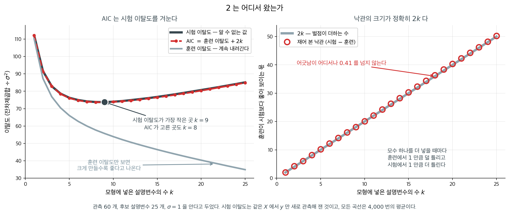
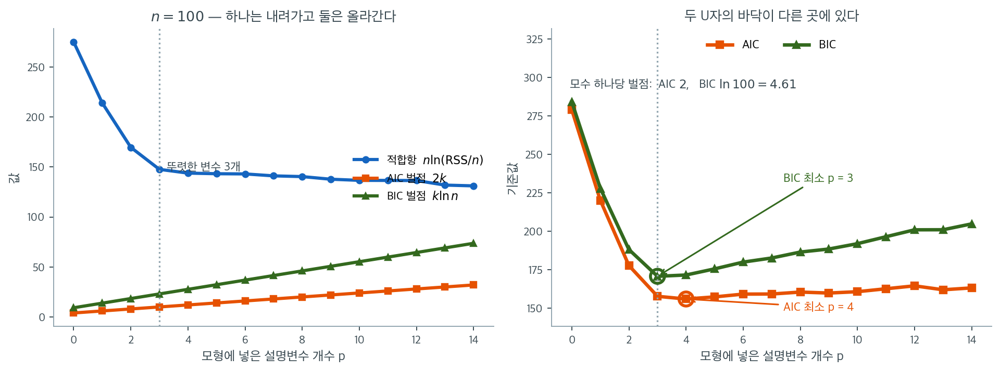

# AIC와 BIC: 모형선택 기준

통계 모형을 세울 때 핵심 과제 가운데 하나는 모형의 복잡도와 적합도를 저울질하는 일이다. **Akaike 정보기준(AIC)**과 **Bayes 정보기준(BIC)**은 모수의 개수에 벌점을 주어 이 절충을 다루는 널리 쓰이는 두 기법이다.

---

## 1. Akaike 정보기준(AIC)

AIC 는 적합도와 복잡도를 저울질한다. 자세한 유도와 소표본 보정(AICc)은 [Akaike 정보기준](aic.md)에 있고, 여기서는 BIC 와 견주는 데 필요한 꼴만 적는다.

$$
AIC = -2 \ln(L) + 2k
$$

$L$ 은 가능도, $k$ 는 모수의 개수다. **AIC 가 작을수록 좋다.**

AIC는 **예측 정확도**를 강조하며, 보지 않은 자료에 잘 일반화되는 모형을 찾는 것이 주된 목표일 때 자주 쓰인다. 정확한 예측에 결정적인 편향과 분산의 균형을 맞추려 한다. AIC의 벌점항은 표본크기를 명시적으로 고려하지 않으므로, 큰 자료에서는 BIC와 다른 결과를 낼 수 있다.

**그림으로 보는 통계학 1.** $2$ 는 어디서 왔는가

위 식에서 $-2\ln L$ 은 적합도이고 $k$ 는 모수의 개수인데, 앞에 붙은 **$2$** 는 어디서
온 수인가. 「복잡한 모형에 벌을 주려고 적당히 고른 수」가 아니다. **재어서 나온 수**다.

아카이케 히로쓰구는 $1971$ 년 $9$ 월 소련 아르메니아의 차흐카조르에서 열린 제$2$ 회
국제정보이론심포지엄에서 「정보이론과 최대가능도 원리의 확장」을 읽었다(논문집은 $1973$ 년에
나왔고, $1974$ 년 『IEEE Transactions on Automatic Control』의 글로 널리 퍼졌다).
이름에 대해 본인이 적어 둔 것이 있는데, **$A$ 는 아카이케의 $A$ 가 아니라 「An」의 $A$** 다 —
「An Information Criterion」, 곧 「정보기준 **하나**」라는 뜻이다. $B$ 와 $C$ 가 올 자리를
일부러 비워 두었다고 적었고, 실제로 몇 해 뒤 슈워츠의 **BIC** 가 왔다. $2006$ 년에
교토상을 받았다.

그가 겨눈 것은 손에 넣을 수 없는 양이었다. **새 자료에서의 이탈도**다. 가진 자료로 그것을
알 수는 없다. 다만 **얼마나 모르는지는 알 수 있다.**

훈련자료로 맞춘 모형은 그 훈련자료에서 실제보다 잘 맞는다. 모수를 자료에 맞추느라 자료의
잡음까지 조금 빨아들였기 때문이다. 이 **낙관**의 크기를 정규선형모형($\sigma$ 를 아는
경우)에서 적어 보면

$$
E[\text{훈련 이탈도}] = n - k,
\qquad
E[\text{시험 이탈도}] = n + k
$$

이고 차이가 **정확히 $2k$** 다. 모수를 하나 더 넣을 때마다 훈련에서 $1$ 만큼 덜 틀리고
시험에서 $1$ 만큼 더 틀린다. 그러니 훈련 이탈도에 $2k$ 를 더해 주면 시험 이탈도의
추정값이 된다. 그것이 AIC 다. 바꾸어 말하면 $2k$ 를 더하는 일은 복잡한 모형에 **벌을 주는**
일이 아니라 훈련자료가 거저 준 만큼을 **도로 내놓게 하는** 일이다.

<figure markdown>
{ width="900" }
  <figcaption markdown>관측 $60$ 개, 후보 설명변수 $25$ 개, $\sigma = 1$ 을 안다고 두었다. 시험 이탈도는 같은 $X$ 에서 $y$ 만 새로 관측해 잰 것이다.</figcaption>
</figure>

재 보면 그대로다.

| $k$ | 훈련 이탈도 | 시험 이탈도 | 차이 | $2k$ |
|---|---|---|---|---|
| $1$ | $110.1$ | $112.2$ | $2.1$ | $2$ |
| $5$ | $66.0$ | $76.2$ | $10.2$ | $10$ |
| $10$ | $53.9$ | $74.0$ | $20.1$ | $20$ |
| $20$ | $40.3$ | $80.7$ | $40.4$ | $40$ |
| $25$ | $34.9$ | $85.1$ | $50.2$ | $50$ |

오른쪽 그림에서 빨간 동그라미가 $2k$ 직선 위에 그대로 놓인다. 어긋남이 어디서도 $0.41$ 을
넘지 않는다.

왼쪽 그림이 그 덕을 보여 준다. 훈련 이탈도만 보면 **설명변수를 넣을수록 좋다**고 나오고,
$k = 25$ 에서 가장 작다. 시험 이탈도는 $k = 9$ 에서 바닥을 치고 다시 올라간다. 그리고
AIC 곡선이 시험 곡선 **위에 거의 그대로 포개져** $k = 8$ 을 고른다. 시험자료를 한 장도
쓰지 않고서 말이다.

그러니 $2$ 는 조정할 수 있는 손잡이가 아니다. **낙관의 크기를 그대로 적어 놓은 수**다. 다음
절의 BIC 가 $2$ 대신 $\ln n$ 을 쓰는 것은 같은 양을 더 잘 추정해서가 아니라 **다른 것을
겨누기 때문**이고, 그 차이가 3 절의 비교를 만든다.

_확인한 곳 — 아카이케가 $1971$ 년 아르메니아 차흐카조르의 제$2$ 회 국제정보이론심포지엄에서 이 기준을 발표했고 그 논문집($1973$)에 「Information theory and an extension of the maximum likelihood principle」로 실렸다는 것, $1974$ 년 『IEEE Transactions on Automatic Control』의 「A new look at the statistical model identification」로 널리 퍼졌다는 것, 본인이 밝힌 대로 **AIC 의 $A$ 가 「Akaike」가 아니라 「An」**이며 뒤에 올 기준들의 자리를 남긴 것이라는 것, $2006$ 년 교토상을 받은 것. 표와 그림의 수는 모두 직접 모의실험한 값이다_

---

## 2. Bayes 정보기준(BIC)

벌점의 $2$ 자리에 $\ln n$ 이 들어간 것이 BIC 다. 베이즈 사후확률에서 어떻게 나오는지와 일치성은 [Bayes 정보기준](bic.md)에 있다.

$$
BIC = -2 \ln(L) + k \ln(n)
$$

$n$ 은 관측값의 개수다. $\ln n$ 이 $2$ 보다 커지는 $n \ge 8$ 부터 BIC 의 벌점이 더 엄하다.

BIC는 Bayes 확률론에 뿌리를 두며 후보들 가운데 **참 모형**을 찾는 데 초점을 맞춘다. 해석 가능성이 우선이거나 과적합이 중대한 걱정거리일 때 특히 유용하다. 예측 정확도에 초점을 맞추는 AIC와 달리 BIC는 가장 적은 모수로 자료를 설명하는 것을 우선한다.

두 기준이 하는 일을 한 그림에 담았다. 관측값 $n = 100$, 후보 설명변수 $14$개인 자료를 만들되 앞의 셋만 뚜렷한 효과($2.5,\ -1.8,\ 1.2$)를 갖고 넷째는 $0.45$로 아슬아슬하며 나머지 열은 계수가 $0$이다. 변수를 $0$개부터 $14$개까지 차례로 넣어 가며 세 양을 계산했다.

왼쪽에서 파란 적합항 $n\ln(\mathrm{RSS}/n)$은 **한 번도 올라가지 않는다.** $p = 0$에서 $275$, $p = 3$에서 $147.7$, $p = 14$에서 $131.1$이다. 이것이 $R^2$이 단조로 오르는 것과 같은 사실이다. 그런데 $p = 3$까지는 가파르게 떨어지다가 그 뒤로는 거의 평평해진다는 점이 중요하다. 진짜 신호는 셋뿐이고 나머지는 잡음을 조금씩 갉아먹을 뿐이기 때문이다. 주황과 초록 벌점선은 반대로 직선으로 올라간다. 기울기가 각각 $2$와 $\ln 100 = 4.61$이므로 **BIC의 벌점선이 두 배 이상 가파르다.**

오른쪽이 둘을 더한 결과다. 두 곡선 모두 U자를 그리지만 **바닥이 다른 곳에 있다.** BIC는 $p = 3$에서 최소 $170.68$을 찍고, AIC는 $p = 4$에서 최소 $155.89$를 찍는다. 네 번째 변수를 넣으면 적합항이 $147.65$에서 $143.89$로 $3.76$만큼 내려가는데, AIC의 값은 $2$뿐이라 남는 장사이고 BIC의 값은 $4.61$이라 밑지는 장사다. 표의 "AIC는 더 복잡한 모형을, BIC는 더 단순한 모형을 선호한다"는 문장이 바로 이 $3.76$ 대 $2$ 대 $4.61$의 셈이다.

그리고 벌점선의 기울기가 $\ln n$이므로 이 차이는 **표본이 커질수록 벌어진다.** $n = 100$에서 $4.61$이던 BIC의 벌점은 $n = 1000$에서 $6.91$, $n = 10^6$에서 $13.8$이 된다. AIC의 $2$는 그대로다. 같은 자료를 더 많이 모을수록 BIC는 변수 하나를 넣는 데 점점 더 강한 증거를 요구하고, 그 요구가 다음 두 절에서 볼 "일치성"이라는 성질을 만들어 낸다.

---

## 3. 예측을 겨냥하는가 참 모형을 겨냥하는가

| 성질 | AIC | BIC |
|---|---|---|
| 벌점 | $2k$ | $k \ln n$ |
| 목표 | 예측오차 최소화 | 참 모형 식별 |
| 일치성 | 없음 | 있음 |
| 효율성 | 있음(점근적으로) | 없음 |
| 경향 | 약간 과적합 | 약간 과소적합 |
| 작은 표본 | AICc가 유한 $n$을 보정 | 표준적인 소표본 보정이 없음 |

!!! tip "실무 지침"
    예측이 목표면 AIC(또는 AICc)를 쓴다. 절약적인 설명 모형을 찾는 것이 목표이고 참 모형이 후보에 있다고 믿으면 BIC를 쓴다. AIC와 BIC가 일치하면 선택은 분명하다. 엇갈릴 때는 대개 애매한 설명변수 하나가 걸려 있는 경우이므로 과학적 맥락을 고려해 결정한다.

표본크기에 대한 민감성이 이 표의 모든 줄을 만든다. AIC 의 벌점 $2$ 는 $n$ 과 무관하고 BIC 의 $\ln n$ 은 $n$ 과 함께 자라므로, 같은 자료를 더 모을수록 BIC 는 변수 하나에 점점 더 강한 증거를 요구한다. 그래서 AIC 는 예측과 예보에, BIC 는 해석과 설명에 어울린다고 말한다.

---

## 4. 실전 보기

집값을 예측하는 선형회귀 모형 여러 개를 적합한다고 하자. 설명변수 한두 개인 단순한 모형에서 시작해 점차 특성을 추가한다. 복잡도가 커질수록 가능도는 좋아지지만 과적합의 위험도 커진다.

후보 모형이 셋 있다고 하자. 설명변수 2개인 단순 모형, 5개인 중간 모형, 10개인 복잡 모형.

- **AIC**는 적합의 개선이 추가된 모수를 정당화한다면 중간 모형이나 복잡 모형을 고를 수 있다.
- **BIC**는 벌점이 더 강하므로, 특히 자료가 크다면 단순 모형을 선호할 수 있다.

앞 절들에서 다룬 Advertising 자료 보기에서는

| 모형 | AIC | BIC |
|---|---|---|
| TV, Radio, Newspaper | 555.8 | 567.5 |
| TV, Radio | 554.0 | 562.8 |
| TV, Radio, TV:Radio | **399.6** | **411.4** |

AIC와 BIC 모두 교호작용 모형을 선호하는 데 의견이 일치하며, 유의하지 않은 Newspaper 설명변수를 빼면 두 기준이 모두 조금 좋아짐을 보여준다.

---

## 연습문제

**연습문제 1.** 
후보 모형 셋의 AIC 값이 245.3, 243.1, 248.7이다. 어느 모형이 선호되는가? 최선과 차선 모형의 AIC 차이가 0.5뿐이라면 어떤 결론을 내리겠는가?

??? success "풀이"
    **AIC가 가장 작은 모형(243.1)**이 선호된다. AIC가 작을수록 적합도와 복잡도의 균형이 좋다.

    차이가 0.5뿐이라면 두 모형은 정보이론적 근거의 관점에서 **사실상 동등**하다고 본다. 흔한 지침은 이렇다. AIC 차이가 2 미만이면 두 모형 모두 상당한 근거를 가지며, 4–7이면 AIC가 더 큰 모형의 근거가 상당히 약하고, 10을 넘으면 사실상 근거가 없다.

---

**연습문제 2.** 
AIC와 BIC를 수학적으로 정의하고 벌점항의 핵심 차이를 설명하라.

??? success "풀이"
    $$
    \text{AIC} = -2\ln(\hat{L}) + 2k
    $$

    $$
    \text{BIC} = -2\ln(\hat{L}) + k\ln(n)
    $$

    여기서 $\hat{L}$은 최대화된 가능도, $k$는 모수의 개수, $n$은 표본크기이다.

    핵심 차이는 벌점이다. AIC는 표본크기와 무관하게 $2k$의 벌점을 주지만, BIC는 $k\ln(n)$의 벌점을 준다. 이는 $n > e^2 \approx 7.4$이면(곧 실무에서 거의 언제나) $2k$보다 크다. 따라서 BIC는 특히 큰 표본에서 더 단순한 모형을 선호한다.

---

**연습문제 3.** 
BIC는 일치성을 가지지만($n \to \infty$일 때 참 모형을 고른다) AIC는 그렇지 않은 이유를 설명하라. 실무에서 AIC를 BIC보다 선호할 상황은 언제인가?

??? success "풀이"
    BIC의 벌점 $k\ln(n)$은 $n \to \infty$일 때 한없이 커지므로, 지나치게 복잡한 모형에서는 결국 벌점이 가능도의 개선을 압도하여 BIC가 참 모형을 고르게 된다. AIC의 고정 벌점 $2k$는 $n$과 함께 커지지 않으므로 자료가 무한히 많아도 조금 과적합된 모형을 계속 고를 수 있다.

    **AIC를 선호할 때**는 참 모형의 식별이 아니라 **예측**이 목표일 때이다. AIC는 하나 빼기 교차검증과 점근적으로 동등하므로 예측오차를 최소화하는 모형을 고르는 데 더 낫다. BIC의 강한 벌점은 모집단의 "참" 모형에 들어 있지 않더라도 예측을 개선하는 설명변수를 배제할 수 있다.

---

**연습문제 4.** 
본문 그림의 오른쪽 그림에서 BIC는 $p = 3$에서 최소 $170.68$을, AIC는 $p = 4$에서 최소 $155.89$를 찍는다. 같은 그림의 왼쪽에서 적합항은 $p = 3$에서 $147.65$, $p = 4$에서 $143.89$이고 관측값은 $n = 100$개다.

이 네 수만 써서, 그림을 그릴 때 설명변수 $p$개인 모형의 모수 개수 $k$를 몇으로 셈했는지 알아내라. 그렇게 센 $k$에 적합계수 말고 무엇이 더 들어갔겠는가?

??? success "풀이"
    두 기준은 적합항에 벌점을 더한 것이므로, 벌점은 기준값에서 적합항을 뺀 값이다.

    $p = 3$의 BIC에서

    $$
    k \ln n = 170.68 - 147.65 = 23.03, \qquad k = \frac{23.03}{\ln 100} = \frac{23.03}{4.6052} = 5.0009 \approx 5
    $$

    $p = 4$의 AIC에서

    $$
    2k = 155.89 - 143.89 = 12.00, \qquad k = 6
    $$

    곧 $p = 3$일 때 $k = 5$, $p = 4$일 때 $k = 6$이므로

    $$
    k = p + 2
    $$

    로 셈했다. 더해진 둘은 **절편 $\beta_0$와 오차분산 $\sigma^2$**이다. 적합항 $n\ln(\mathrm{RSS}/n)$은 정규 선형모형의 $-2\ln L$에서 $n$에만 의존하는 상수를 뗀 것이고, 그 가능도를 최대화할 때 $\sigma^2$도 함께 추정되므로 $\sigma^2$을 모수로 세는 것이 정석이다.

    $k$가 $p$보다 $2$만큼 큰 것은 벌점선을 위로 평행이동시킬 뿐이므로, 본문이 말한 벌점선의 기울기 $2$와 $\ln 100 = 4.61$은 그대로다.

---

**연습문제 5.** 
연습문제 4에서 얻은 $k = p + 2$와 본문이 준 적합항 값 — $p = 0$에서 $275$, $p = 3$에서 $147.65$, $p = 14$에서 $131.1$ — 을 써서 오른쪽 그림의 **두 U자 곡선의 양 끝 네 값**을 구하라. 네 값이 모두 각 곡선의 최소($155.89$와 $170.68$)보다 큰지 확인하라.

이어서 $p = 3$에서 $p = 14$까지 변수 하나당 적합항이 평균 얼마씩 내려가는지 구하고, 그 값을 $2$와 $\ln 100$과 견주어라.

??? success "풀이"
    $\mathrm{AIC}(p) = \text{적합항} + 2(p+2)$, $\mathrm{BIC}(p) = \text{적합항} + (p+2)\ln 100$이다. $\ln 100 = 4.6052$를 쓴다.

    $p = 0$: 벌점이 $2 \times 2 = 4$와 $2 \times 4.6052 = 9.21$이므로

    $$
    \mathrm{AIC}(0) = 275 + 4 = 279.0, \qquad \mathrm{BIC}(0) = 275 + 9.21 = 284.21
    $$

    $p = 14$: 벌점이 $2 \times 16 = 32$와 $16 \times 4.6052 = 73.68$이므로

    $$
    \mathrm{AIC}(14) = 131.1 + 32 = 163.1, \qquad \mathrm{BIC}(14) = 131.1 + 73.68 = 204.78
    $$

    | 끝점 | AIC | BIC |
    |---|---|---|
    | $p = 0$ | $279.0$ | $284.2$ |
    | $p = 14$ | $163.1$ | $204.8$ |
    | 최소 | $155.9$ ($p=4$) | $170.7$ ($p=3$) |

    네 값 모두 해당 곡선의 최소보다 크다. U자가 맞다.

    변수 하나당 평균 이득은

    $$
    \frac{147.65 - 131.1}{14 - 3} = \frac{16.55}{11} = 1.50
    $$

    이다. 이것은 AIC의 값 $2$보다도 작고 BIC의 값 $4.61$보다는 훨씬 작다. 그래서 $p = 3$ 뒤에 붙는 열한 개 변수는 **평균적으로 두 기준 어느 쪽에도 값을 못 치른다.**

    한편 두 U자는 대칭이 아니다. 왼쪽 끝($p=0$)이 오른쪽 끝($p=14$)보다 두 기준 모두에서 더 나쁘다. 진짜 신호 셋을 빼먹는 손해가 쓸모없는 변수 열한 개를 지고 가는 손해보다 크다는 뜻이다.

---

**연습문제 6.** 
어떤 사람이 같은 자료로 같은 그림을 그리면서 절편도 $\sigma^2$도 세지 않고 $k = p$로 셈했다고 하자.

(a) 그 사람이 얻는 AIC 곡선과 BIC 곡선은 본문 그림의 곡선과 어떻게 다른가?

(b) 그 사람이 고르는 $p$는 달라지는가?

(c) 연습문제 1에서 쓴 "AIC 차이가 $2$ 미만이면 둘 다 상당한 근거" 같은 지침은 영향을 받는가?

(d) 이 무관함이 깨지는 경우를 하나 들라.

??? success "풀이"
    $k = p + c$로 센다고 하면

    $$
    \mathrm{AIC}_c(p) = \text{적합항}(p) + 2p + 2c, \qquad \mathrm{BIC}_c(p) = \text{적합항}(p) + p\ln n + c\ln n
    $$

    이다. 곧 $c$는 $p$에 의존하지 않는 **상수 평행이동**으로만 들어간다.

    (a) 두 곡선이 통째로 내려간다. $c$가 $2$에서 $0$으로 바뀌므로 AIC 곡선은 $2c = 4$만큼, BIC 곡선은 $c\ln 100 = 9.21$만큼 내려간다. 모양은 똑같다. 그 사람의 최소값은 $155.89 - 4 = 151.89$와 $170.68 - 9.21 = 161.47$이다.

    (b) 달라지지 않는다. 상수를 더하거나 빼는 것은 최소를 주는 위치를 바꾸지 못하므로 AIC는 여전히 $p = 4$, BIC는 여전히 $p = 3$을 고른다.

    (c) 영향을 받지 않는다. 두 모형의 기준값 **차이**를 보면 $2c$나 $c\ln n$이 서로 지워지기 때문이다. 차이에 대한 지침은 셈하는 관례와 무관하다.

    (d) 비교하는 모형들의 $c$가 서로 다를 때 깨진다. 보기로 정규 선형모형($\sigma^2$을 모수로 세어 $c = 2$)과 Poisson 회귀모형(산포모수가 없어 $c = 1$)을 한 표에 놓고 견주면, 두 값의 차이에 $\ln n$ 한 덩어리가 끼어들어 엉뚱한 쪽이 이길 수 있다. 서로 다른 소프트웨어나 서로 다른 절에서 뽑은 값을 섞어 쓰는 것도 같은 사고다(연습문제 8을 보라).

---

**연습문제 7.** 
4절 Advertising 표의 첫 두 줄은 Newspaper 하나만 차이 난다.

| 모형 | AIC | BIC |
|---|---|---|
| TV, Radio, Newspaper | $555.8$ | $567.5$ |
| TV, Radio | $554.0$ | $562.8$ |

(a) 모수 개수를 세는 관례를 전혀 정하지 않고도, Newspaper를 넣어서 $-2\ln L$이 얼마나 변했는지 표에서 되짚을 수 있다. 그 값을 구하라.

(b) (a)의 값과 BIC 쌍을 함께 써서 이 표를 계산할 때 쓴 표본크기 $n$을 구하라.

(c) 연습문제 1의 지침대로면 두 모형의 AIC 차이는 $1.8$이라 "둘 다 상당한 근거"에 해당한다. (a)의 값에 비추어 이 말을 다시 읽어라.

??? success "풀이"
    큰 모형을 $A$(Newspaper 포함), 작은 모형을 $B$라 하고 $k_A = k_B + 1$이라는 것만 쓴다. 관례가 무엇이든 한 변수를 넣으면 모수가 정확히 하나 늘기 때문이다.

    (a) AIC의 정의에서

    $$
    \mathrm{AIC}_A - \mathrm{AIC}_B = \big[(-2\ln L_A) - (-2\ln L_B)\big] + 2(k_A - k_B)
    $$

    이므로

    $$
    555.8 - 554.0 = \Delta(-2\ln L) + 2, \qquad \Delta(-2\ln L) = 1.8 - 2 = -0.2
    $$

    Newspaper를 넣어 $-2\ln L$이 겨우 $0.2$ 내려갔다.

    (b) BIC에 같은 셈을 하면

    $$
    \mathrm{BIC}_A - \mathrm{BIC}_B = \Delta(-2\ln L) + (k_A - k_B)\ln n = -0.2 + \ln n
    $$

    표에서 이 값은 $567.5 - 562.8 = 4.7$이므로

    $$
    \ln n = 4.7 + 0.2 = 4.9, \qquad n = e^{4.9} = 134.3
    $$

    표의 값이 소수 첫째 자리까지만 적혀 있어 각 차이에 $\pm 0.1$의 여유가 있으니 $n$은 $130$에서 $140$ 사이, 곧 약 $1.4 \times 10^2$이다.

    실제로 이 표는 Advertising 자료 $200$ 행 가운데 **훈련자료로 쓴 앞 $140$ 행**에서 계산한 것이고, $\ln 140 = 4.9416$이다. 되짚은 $4.9$와 맞는다. 자료가 $200$ 행이라고 $n = 200$($\ln 200 = 5.298$)을 넣으면 표의 두 차이를 맞출 수 없다. **기준값을 계산할 때의 $n$은 자료 전체의 크기가 아니라 가능도를 계산한 표본의 크기다.**

    (c) "차이가 $2$ 미만이라 둘 다 근거가 있다"는 말은 **Newspaper가 쓸모 있다는 뜻이 전혀 아니다.** 차이 $1.8$은 벌점 $+2$와 적합 $-0.2$가 합쳐진 값이고, 적합의 기여는 사실상 없다. 작은 모형이 이긴 것은 "거의 비슷한 두 설명" 중 간단한 쪽이 이긴 것이 아니라, **쓸모가 거의 영인 변수가 벌점이 작아서 가려진** 것이다. 가능도비검정으로 보아도 $0.2$는 자유도 $1$의 $5\%$ 기각값 $3.84$에 한참 못 미친다. 그래서 AIC 차이는 크기만 보지 말고 그중 얼마가 벌점인지 늘 쪼개 보아야 한다.

---

**연습문제 8.** 
4절 Advertising 표에서 줄마다 BIC에서 AIC를 빼면 $11.7$, $8.8$, $11.8$이다.

(a) 첫 줄과 셋째 줄의 값은 거의 같은데 둘째 줄만 작은 이유를 설명하라.

(b) 세 값의 비를 써서, 이 표가 $k$를 셀 때 $\sigma^2$을 모수로 세었는지 아닌지 판정하라.

(c) 연습문제 7에서 얻은 $\ln n = 4.9$로 (b)의 답을 교차검증하라.

(d) 이 표의 관례가 연습문제 4에서 알아낸 그림의 관례와 다르다는 사실이 어떤 결론을 바꾸는가?

??? success "풀이"
    (a) 정의에서

    $$
    \mathrm{BIC} - \mathrm{AIC} = k\ln n - 2k = k(\ln n - 2)
    $$

    이므로 이 차이는 **적합도와 무관하게 $k$에만 비례한다.** 첫 줄(TV, Radio, Newspaper)과 셋째 줄(TV, Radio, TV:Radio)은 설명변수가 셋씩이라 $k$가 같고, 둘째 줄(TV, Radio)만 설명변수가 둘이라 $k$가 하나 작다. $11.7$과 $11.8$의 $0.1$ 차이는 표의 값을 소수 첫째 자리로 반올림한 탓이다.

    (b) 설명변수 $p$개일 때 $k = p + c$라 하면 첫 줄과 둘째 줄의 비는

    $$
    \frac{11.7}{8.8} = 1.330
    $$

    이고, 한편 $c = 1$(절편만)이면 $\dfrac{4}{3} = 1.333$, $c = 2$(절편과 $\sigma^2$)이면 $\dfrac{5}{4} = 1.250$이다. 관측된 $1.330$은 $4/3$에 거의 맞고 $5/4$와는 뚜렷이 어긋난다. 따라서 이 표는 **절편은 세고 $\sigma^2$은 세지 않았다**($c = 1$).

    (c) 연습문제 7(b)의 $n = 140$을 쓰면 $\ln n - 2 = 4.9416 - 2 = 2.9416$이므로 $c = 1$이라면

    $$
    k = 4: \ 4 \times 2.9416 = 11.77, \qquad k = 3: \ 3 \times 2.9416 = 8.82
    $$

    표의 $11.7$과 $8.8$에 소수 첫째 자리 반올림 안에서 꼭 맞는다. $c = 2$라면 $5 \times 2.9416 = 14.71$과 $4 \times 2.9416 = 11.77$이 되어 전혀 맞지 않는다. (b)가 확인된다.

    (d) **어느 모형이 뽑히는지는 하나도 바뀌지 않는다.** 연습문제 6에서 보았듯 $c$는 한 표 안의 모든 줄에 같은 상수로 들어가므로 순위도, 줄 사이의 차이도, 차이에 대한 지침도 그대로다. 바뀌는 것은 딱 하나다. **그림의 값과 표의 값을 한 자리에 놓고 크기를 견주면 안 된다.** 둘은 $c$도 $n$도 다르므로 $155.89$와 $399.6$ 같은 수를 직접 비교하는 것은 아무 뜻이 없다. 기준값의 절대 크기는 자료와 관례에 매달린 양이고, 뜻을 갖는 것은 **같은 자료 안에서의 차이**뿐이다.

---

**연습문제 9.** 
본문 그림의 자료에서 네 번째 변수(참 계수 $0.45$)를 넣으면 적합항이 $147.65$에서 $143.89$로 $3.76$ 내려간다. $n = 100$에서 AIC는 이것을 받아들이고($3.76 > 2$) BIC는 거절한다($3.76 < 4.61$).

(a) 이 이득이 표본크기와 무관하게 $3.76$으로 고정되어 있다면, BIC가 네 번째 변수를 받아들이는 $n$의 범위를 구하라.

(b) 네 번째 계수는 $0.45 \neq 0$이므로 참 모형의 설명변수는 넷이다. 그런데 BIC는 $p = 3$을 골랐다. 이것이 연습문제 3에서 말한 BIC의 일치성과 모순인가?

(c) 중첩모형에서 빠진 계수가 $0$이 아니면 적합항의 이득은 대체로 $n$에 비례해 커진다. $n = 100$에서 $3.76$이었으니 이득을 $0.0376\,n$으로 보고, BIC가 네 번째 변수를 받아들이기 시작하는 $n$을 구하라.

??? success "풀이"
    BIC는 변수 하나를 넣는 값으로 $\ln n$을 매기므로, 받아들이는 조건은 "적합항의 이득 $>\ln n$"이다.

    (a) 이득이 $3.76$으로 고정이라면

    $$
    \ln n < 3.76 \quad \Longleftrightarrow \quad n < e^{3.76} = 42.9
    $$

    이므로 $n \leq 42$에서 BIC도 네 번째 변수를 받아들인다. ($n = 100$에서 나온 이득이 표본이 반 토막 난 자료에서 그대로 나올 리는 없으니, 이 셈은 벌점의 크기 비교일 뿐이다.)

    (b) 모순이 아니다. 일치성은 $n \to \infty$에서의 성질이고, 유한한 표본에서 BIC가 **약한 신호를 놓치는 것**은 바로 강한 벌점의 대가다. $0.45$는 앞의 셋($2.5,\ -1.8,\ 1.2$)과 달리 본문이 "아슬아슬하다"고 한 크기이고, $n = 100$에서 그것이 벌어다 주는 $3.76$은 BIC의 문턱 $4.61$ 아래다. 곧 여기서 BIC는 **과소적합**하고 있다. AIC가 $p = 4$를 고른 것은 문턱 $2$가 낮은 덕인데, 그 낮은 문턱에는 연습문제 10에서 볼 대가가 따른다.

    (c) 조건은 $0.0376\,n > \ln n$이다. 좌변은 직선, 우변은 로그이므로 어느 지점부터는 좌변이 이긴다.

    | $n$ | $0.0376\,n$ | $\ln n$ | 판정 |
    |---|---|---|---|
    | $100$ | $3.76$ | $4.61$ | 거절 |
    | $125$ | $4.70$ | $4.83$ | 거절 |
    | $129$ | $4.85$ | $4.86$ | 거절 |
    | $130$ | $4.89$ | $4.87$ | 수용 |
    | $150$ | $5.64$ | $5.01$ | 수용 |

    $n \approx 130$에서 뒤집힌다. 자료를 $30\%$만 더 모으면 BIC도 네 번째 변수를 본다는 뜻이다.

    반면 계수가 참으로 $0$인 나머지 열 개 변수는 $n$이 커져도 이득이 커지지 않고 $O(1)$에 머문다. 문턱 $\ln n$은 한없이 커지므로 그 열 개는 영원히 거절된다. **이득은 $n$에 비례해 자라고 문턱은 $\ln n$으로만 자란다** — 이 속도 차이가 BIC의 일치성이다.

---

**연습문제 10.** 
중첩된 두 모형이 참 계수가 $0$인 설명변수 하나만큼 차이 날 때, 적합항의 이득 $\Delta$는 점근적으로 자유도 $1$의 카이제곱분포를 따른다. 꼬리확률은 다음과 같다.

$$
P(\chi^2_1 > 2) = 0.1573, \qquad P(\chi^2_1 > 4.605) = 0.0319, \qquad P(\chi^2_1 > 13.816) = 0.000202
$$

(a) AIC가 이 쓸모없는 변수를 받아들일 확률을 구하라. 이 확률은 $n$에 어떻게 의존하는가?

(b) 본문 그림의 자료에는 계수가 $0$인 변수가 열 개 있다. 설명변수들이 서로 거의 직교해서 판정들이 사실상 독립이라고 보고, AIC가 붙잡는 쓸모없는 변수의 기대 개수를 구하라. BIC에 대해 $n = 100$과 $n = 10^6$에서 같은 값을 구하라.

(c) (a)와 (b)로 연습문제 3의 "AIC는 일치성을 갖지 않는다"를 수치로 설명하라.

??? success "풀이"
    두 기준이 변수 하나를 넣는 조건은 각각 $\Delta > 2$와 $\Delta > \ln n$이다.

    (a) AIC의 문턱은 $n$과 상관없이 $2$이므로

    $$
    P(\Delta > 2) = P(\chi^2_1 > 2) = 0.1573
    $$

    곧 약 $16\%$다. 그리고 이 값은 **표본크기에 전혀 의존하지 않는다.** 문턱도 $2$로 고정, 영가설 아래 $\Delta$의 분포도 $\chi^2_1$로 고정이기 때문이다.

    (b) 쓸모없는 변수 열 개에 대한 기대 개수는 확률의 합이다.

    AIC:

    $$
    10 \times 0.1573 = 1.57
    $$

    BIC, $n = 100$ (문턱 $\ln 100 = 4.605$):

    $$
    10 \times 0.0319 = 0.32
    $$

    BIC, $n = 10^6$ (문턱 $\ln 10^6 = 13.816$):

    $$
    10 \times 0.000202 = 0.0020
    $$

    (c) AIC는 자료를 얼마나 모아도 쓸모없는 변수를 평균 $1.57$개씩 끌고 간다. 표본을 백만으로 늘려도 이 수는 $1.57$에서 꼼짝하지 않으므로, AIC가 참 모형을 고를 확률은 $1$로 가지 못한다 — 일치성이 없다. BIC는 문턱이 $\ln n$으로 자라 같은 기대 개수가 $0.32 \to 0.0020 \to 0$으로 줄어들고, 그래서 참 모형을 고를 확률이 $1$로 간다.

    이 $1.57$은 본문 그림에서 AIC의 U자 바닥이 BIC의 바닥보다 오른쪽에 있는 까닭과 같은 것이다. AIC는 애초에 **조금 넉넉하게 담도록 설계된 기준**이다. 그 넉넉함이 연습문제 9(b)에서는 참 변수 $0.45$를 건져 올리는 이득으로 나타나고, 여기서는 잡음 변수 한 개 반을 지고 가는 비용으로 나타난다. 예측에서는 전자가, 참 모형을 찾는 데서는 후자가 더 중요하다.

---

## 정리하며

AIC와 BIC는 복잡도에 벌점을 넣어 과적합을 피하도록 돕는 모형선택의 필수 도구이다. AIC는 예측 정확도에, BIC는 단순성에 초점을 맞춘다. 둘 사이의 선택은 분석 목표에 달려 있다.

- 예측오차 최소화가 우선이면 **AIC**를 쓴다.
- 모형의 단순성, 해석 가능성, 또는 큰 표본크기가 우선이면 **BIC**를 쓴다.

어느 쪽도 단독으로 쓰여서는 안 된다. 새 자료에 대한 일반화를 평가하여 추가 검증을 제공하는 교차검증 같은 방법과 함께 쓰는 것이 가장 좋다. 여러 기준을 함께 고려할 때 적합, 복잡도, 예측 성능을 균형 있게 반영한 판단을 내릴 수 있다.

다음 쪽 **[모형선택 비교](model_selection.md)**로 넘어간다. AIC·BIC·교차검증 셋을 **같은 인공자료**에 걸어 — 설명변수 여덟 가운데 셋만 실제로 쓰인 자료다 — 각 기준이 어떤 크기의 모형을 고르는지 본다.
