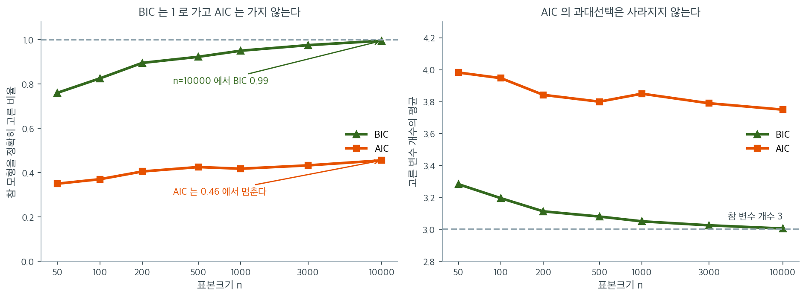
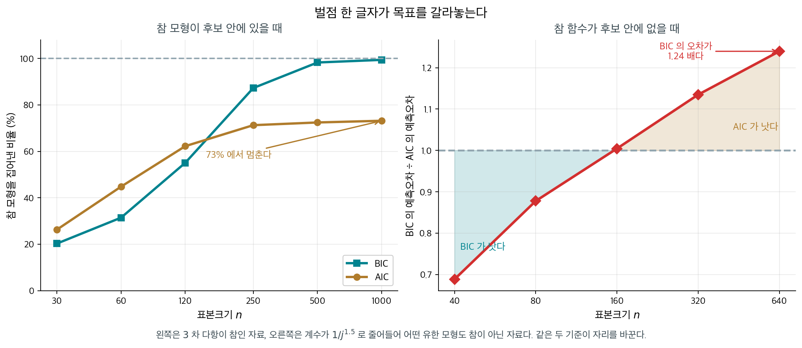

# Bayes 정보기준

모형을 고르는 자리에서 묻는 것이 둘로 갈린다 — **「어느 모형이 다음 자료를 잘 맞힐까」**와 **「참 모형이 무엇일까」**다. 두 물음에 같은 기준을 쓰면 한쪽은 늘 답을 놓친다.

설명변수 여덟 가운데 앞의 셋만 계수가 $0$ 이 아닌 자료에서 표본을 $200$ 배로 늘려 보자 — $n$ 을 $200$ 에서 $40{,}000$ 까지 올린 것이다. BIC 가 참 모형을 집어내는 비율은 $0.76$ 에서 $0.995$ 로 올라간다. AIC 는 $0.35$ 에서 $0.46$ 까지 가고 **거기서 멈춘다.** 고른 변수 개수의 평균이 까닭을 보여 준다 — BIC 는 $3.28$ 에서 $3.005$ 로 참값 $3$ 에 붙고, AIC 는 $3.98$ 에서 $3.75$ 로 조금 내려올 뿐 잡음 변수를 끝까지 달고 다닌다.

바뀐 것은 한 자리뿐이다. 모수 하나의 벌점이 AIC 는 늘 $2$ 인데 BIC 는 $\ln n$ 이다. $n = 200$ 이면 $5.30$, $n = 40{,}000$ 이면 $10.6$ 으로 **표본과 함께 자란다.** 자료가 쌓이면 잡음 변수 하나를 끼워 넣는 값이 점점 비싸져서 결국 못 들어오게 되는 것이다.

그래서 BIC 가 더 좋은 기준이라는 결론은 나오지 않는다. 참 모형이 후보 안에 없으면 「집어낸다」는 말 자체가 뜻을 잃고, 그때는 예측을 겨누는 쪽이 맞다. 둘을 함께 적어 두고 **어긋나는 자리**를 보는 것이 실무에서 가장 안전하다. 모수 하나의 벌점을 $2$ 에서 $\ln n$ 으로 바꾼 것뿐인데 그 하나가 어떻게 이 차이를 만드는가. 아래 상자가 둘이 싸우는 것이 아니라 **다른 물음에 답하고 있다**는 것을 따라간다.

_확인한 곳 — 이 쪽 「둘은 싸우는 것이 아니라 다른 물음에 답한다」 상자와 그 출처 줄_

AIC는 경쟁 모형들의 상대적 예측 정확도를 추정하지만 참 자료생성 모형을 식별하는 것을 목표로 하지는 않는다. 후보 집합에서 올바른 모형을 고르는 것이 목표이고 참 모형이 그 안에 있다고 믿는다면, Bayes 정보기준(BIC)이 더 강한 이론적 보장을 제공한다. BIC는 모형 복잡도에 더 무거운 벌점을 주므로 AIC보다 보수적이다.

---

## 1. Bayes적 동기

BIC는 Schwarz(1978)가 Bayes 관점에서 유도했다. 후보 모형 $\mathcal{M}_1, \ldots, \mathcal{M}_M$이 각각 사전확률 $P(\mathcal{M}_j)$를 갖는다고 하자. Bayes 정리에 의해 자료 $\mathbf{y}$가 주어졌을 때 모형 $j$의 사후확률은

$$
P(\mathcal{M}_j \mid \mathbf{y}) \propto P(\mathbf{y} \mid \mathcal{M}_j) \cdot P(\mathcal{M}_j)
$$

주변가능도 $P(\mathbf{y} \mid \mathcal{M}_j)$는 모든 모수 값에 대해 적분한 것이다.

$$
P(\mathbf{y} \mid \mathcal{M}_j) = \int P(\mathbf{y} \mid \boldsymbol{\theta}_j, \mathcal{M}_j) \, P(\boldsymbol{\theta}_j \mid \mathcal{M}_j) \, d\boldsymbol{\theta}_j
$$

Schwarz는 정칙 조건 아래에서 로그 주변가능도가 다음과 같이 근사됨을 보였다.

$$
\ln P(\mathbf{y} \mid \mathcal{M}_j) \approx \ln \hat{L}_j - \frac{k_j}{2} \ln n
$$

여기서 $\hat{L}_j$는 최대화된 가능도, $k_j$는 모수의 개수, $n$은 표본크기이다. 양변에 $-2$를 곱하면 BIC가 나온다.

---

## 2. 벌점에 표본크기가 들어간다

추정 모수가 $k$개이고 최대화된 로그가능도가 $\ln \hat{L}$인 모형의 **Bayes 정보기준**은

$$
\text{BIC} = k \ln n - 2 \ln \hat{L}
$$

여기서

- $k$는 추정한 모수의 총 개수,
- $n$은 관측값의 개수,
- $\hat{L}$은 최대화된 가능도이다.

AIC와 마찬가지로 **BIC가 작을수록 좋은 모형**이다. 핵심 차이는 벌점항이다. BIC는 $2k$ 대신 $k \ln n$을 쓴다.

---

## 3. 선형회귀의 BIC

정규오차를 갖는 선형회귀 모형에서 최대화된 로그가능도를 대입하면

$$
\text{BIC} = k \ln n + n \ln\!\left(\frac{\text{SSE}}{n}\right) + n \ln(2\pi) + n
$$

상수항은 모형 비교에 영향을 주지 않으므로 실제로 쓰는 공식은

$$
\text{BIC} = k \ln n + n \ln\!\left(\frac{\text{SSE}}{n}\right)
$$

여기서 $k = p + 2$는 $p$개의 회귀계수, 절편, 오차분산을 센 것이다.

---

## 4. BIC 벌점과 AIC 벌점

AIC와 BIC의 복잡도 벌점은 다음과 같다.

| 기준 | 모수 하나당 벌점 |
|-----------|----------------------|
| AIC       | $2$                  |
| BIC       | $\ln n$              |

$n > e^2 \approx 7.39$이면 $\ln n > 2$이므로, 표본크기가 $n \geq 8$인 어떤 경우에도 BIC의 벌점이 AIC보다 엄격하다. 실무의 거의 모든 자료가 이 조건을 만족하므로 BIC는 AIC보다 단순한 모형을 선호한다.

벌점이 커진다는 것은 $n$이 늘어날수록 모수 추가를 정당화하기 위해 BIC가 가능도에서 점점 더 강한 증거를 요구한다는 뜻이다. 이것이 BIC의 일치성을 만들어 내는 기제이다.

---

## 5. 일치성

BIC는 모형선택에서 **일치성**을 갖는다. 참 자료생성 모형이 후보에 들어 있다면 $n \to \infty$일 때 BIC가 참 모형을 고를 확률이 1로 접근한다.

형식적으로, $\mathcal{M}^*$를 참 모형, $\hat{\mathcal{M}}_{\text{BIC}}$를 BIC가 고른 모형이라 하면

$$
P(\hat{\mathcal{M}}_{\text{BIC}} = \mathcal{M}^*) \to 1 \quad (n \to \infty)
$$

AIC는 이 성질을 갖지 않는다. AIC는 점근적으로 효율적이지만(기대 예측오차를 최소화한다) 참 모형으로 수렴하지는 않는다. 오히려 큰 표본에서 조금 과적합된 모형을 고르는 경향이 있다.

"확률이 1로 접근한다"는 말을 모의실험으로 확인해 보자. 참 모형은 설명변수 $8$개 가운데 앞의 셋만 계수가 $0$이 아니고, 나머지 다섯은 순수한 잡음이다. 참 변수 셋은 늘 넣은 채 잡음 다섯의 모든 부분집합($2^5 = 32$가지)을 훑어 AIC와 BIC가 각각 무엇을 고르는지 세었다. 표본크기를 $50$에서 $10{,}000$까지 키우며 매번 $400$번씩 되풀이했다.

왼쪽이 결과다. BIC(초록)는 $n = 50$에서 $0.76$, $n = 200$에서 $0.90$, $n = 1000$에서 $0.95$, $n = 10{,}000$에서 $0.995$로 **차곡차곡 $1$로 올라간다.** 이것이 일치성이다. AIC(주황)는 $n = 50$에서 $0.35$였다가 $n = 10{,}000$에서도 $0.46$에 머문다. 표본을 $200$배로 키웠는데 적중률이 $0.1$밖에 오르지 않았고, 더 키워도 $1$로 가지 않는다.

오른쪽이 그 이유다. BIC가 고른 변수 개수의 평균은 $n = 50$에서 $3.28$이었다가 $n = 10{,}000$에서 $3.005$로 참값 $3$에 붙는다. AIC는 $3.98$에서 $3.75$로 조금 내려올 뿐 $3$ 근처로 가지 않는다. **AIC는 평균 $0.75$개의 잡음 변수를 끝까지 달고 다닌다.** 앞 절의 벌점 계산이 이유를 말해 준다. 잡음 변수 하나를 넣으면 적합항이 평균적으로 대략 $1$만큼 줄어드는데, AIC의 값 $2$는 이 유혹을 물리치기에 충분하지 않은 반면($\chi^2_1$이 $2$를 넘을 확률이 약 $16\%$나 된다) BIC의 값 $\ln n$은 $n$과 함께 커져 결국 어떤 잡음도 통과시키지 않는다.

그렇다고 AIC가 "나쁜" 기준인 것은 아니다. AIC가 달고 다니는 잡음 변수의 계수는 작게 추정되므로 **예측오차에는 거의 해를 끼치지 않는다.** AIC는 참 모형을 맞히는 경기가 아니라 예측오차를 줄이는 경기를 하고 있고, 그 경기에서는 점근적으로 최적이다. 아래 상자가 지적하듯 애초에 참 모형이 후보에 없는 실제 자료에서는 일치성이라는 상은 걸려 있지도 않다.

!!! note "일치성은 참 모형이 후보에 있을 때만"
    BIC의 일치성 보장은 참 모형이 후보 집합 안에 있을 때에만 성립한다. 실제 자료에서는 사실상 언제나 그렇지 않은데, 그런 경우 BIC의 일치성은 의미가 없고 예측 정확도에 초점을 맞추는 AIC가 더 적절할 수 있다.

---

**그림으로 보는 통계학 1.** 둘은 싸우는 것이 아니라 다른 물음에 답한다

§$4$ 와 §$5$ 가 벌점의 차이와 일치성을 적었다. 그런데 실무에서 가장 자주 나오는 물음은
따로 있다 — **그래서 둘이 다른 답을 내면 어느 쪽을 믿는가.**

$1978$ 년 **기디언 슈워츠**가 BIC 를 내놓을 때 그가 푼 문제는 아카이케의 것과 애초에
달랐다. 아카이케는 「**새 자료를 얼마나 잘 맞힐까**」를 물었고, 슈워츠는 베이즈 틀에서
「**어느 모형이 참일 확률이 높은가**」를 물었다. 다른 물음이니 다른 답이 나오는 것이
당연하고, 어느 쪽이 「옳은 벌점」이냐는 물음 자체가 잘못 놓인 것이다.

두 물음을 따로 재어 보면 자리가 깨끗하게 갈린다.

<figure markdown>
  { width=980 }
  <figcaption markdown>왼쪽은 $3$ 차 다항이 참인 자료, 오른쪽은 계수가 $1/j^{1.5}$ 로 줄어들어 **어떤 유한 모형도 참이 아닌** 자료다. 같은 두 기준이 자리를 바꾼다. 자료에서 직접 그렸다.</figcaption>
</figure>

**왼쪽 — 참 모형이 후보 안에 있을 때.** BIC 의 적중률이 $n$ 과 함께 $99.4\%$ 까지 오른다.
§$5$ 가 말한 일치성이 눈에 보이는 꼴이다. AIC 는 $73\%$ 에서 **멈춘다.** 자료를 아무리
늘려도 네 번에 한 번은 쓸데없는 항을 더 넣는다 — 벌점 $2k$ 가 $n$ 과 함께 자라지 않아
큰 표본에서 너무 무르기 때문이다.

**오른쪽 — 참 함수가 후보 안에 없을 때.** 이번에는 반대다. $n = 640$ 에서 BIC 의
예측오차가 AIC 의 $1.24$ 배다. 참이 없으니 「참을 고른다」는 BIC 의 목표가 뜻을 잃고,
$\ln n$ 벌점이 **필요한 항까지 쳐낸다.**

세 번째로 읽을 것이 있다. 오른쪽의 왼쪽 끝 — $n = 40$ 에서는 BIC 가 $0.69$ 배로 **이긴다.**
자료가 적을 때는 AIC 가 먼저 과적합하기 때문이다. 그러니 「AIC 는 예측, BIC 는 설명」이라는
흔한 요약도 작은 표본에서는 그대로 통하지 않는다.

정리하면 고르는 기준은 벌점의 크기가 아니라 **내가 선 자리**다.

- 후보 가운데 참이 있다고 믿을 만하고 **어느 것이 참인지**를 알고 싶다 → BIC
- 참을 담았다고 보기 어렵고 **새 자료를 잘 맞히는 것**이 목적이다 → AIC
- 둘 다 아리송하다 → 두 기준이 같은 모형을 고르는지 보고, 갈리면 그 사이의 모형들을
  교차검증으로 직접 재어 본다

_확인한 곳 — 슈워츠가 $1978$ 년 『Annals of Statistics』의 「Estimating the Dimension of a Model」에서 베이즈 사후확률의 근사로 BIC 를 끌어냈다는 것, BIC 가 일치성을 갖고 AIC 는 갖지 않는 대신 AIC 가 점근적 효율성을 갖는다는 것은 모형선택론의 표준적인 결과다 · 그림의 적중률과 예측오차 비는 이 쪽에서 직접 모의로 쟀다($3$ 천 번 · $600$ 번)_

## 6. 수치 보기

AIC 페이지와 같은 세 모형을 $n = 50$에서 살펴보자.

| 모형 | $p$ | $k$ | SSE | AIC | BIC |
|-------|-----|------|------|------|------|
| A     | 1   | 3    | 120  | 49.8 | $3 \ln(50) + 50 \ln(120/50) = 11.7 + 43.8 = 55.5$ |
| B     | 3   | 5    | 90   | 39.4 | $5 \ln(50) + 50 \ln(90/50) = 19.6 + 29.4 = 49.0$ |
| C     | 6   | 8    | 85   | 42.5 | $8 \ln(50) + 50 \ln(85/50) = 31.3 + 26.5 = 57.8$ |

AIC와 BIC 모두 모형 B를 최선으로 고른다. 다만 BIC는 모형 C에 더 무거운 벌점을 준다. B와 C의 BIC 격차($57.8 - 49.0 = 8.8$)가 AIC 격차($42.5 - 39.4 = 3.1$)보다 크며, 이는 모형 C의 추가 모수 세 개에 대한 BIC의 더 강한 벌점을 반영한다.

이 경우 AIC와 BIC가 일치하지만, 표본이 더 크거나 모형 C의 추가 설명변수가 주는 개선이 더 작았다면 BIC는 모형 B를 더욱 단호하게 선호했을 것이다.

---

## 연습문제

**연습문제 1.** 
설명변수가 $p = 3$개이고 관측값이 $n = 100$개인 선형회귀의 최대화된 로그가능도가 $\ell_1 = -150$이다. 이 모형을 포함하는 $p = 5$개짜리 모형은 $\ell_2 = -145$이다. 두 모형의 BIC를 계산하고 어느 쪽이 선호되는지 판정하라.

??? success "풀이"
    BIC $= -2\ell + k\ln(n)$이며 $k$는 추정한 모수의 개수이다.

    모형 1(설명변수 3개 + 절편 = 4개, 여기에 $\sigma^2$까지 더해 $k = 5$):

    $$
    \text{BIC}_1 = -2(-150) + 5\ln(100) = 300 + 5(4.605) = 300 + 23.03 = 323.03
    $$

    모형 2($k = 5 + 1 + 1 = 7$):

    $$
    \text{BIC}_2 = -2(-145) + 7\ln(100) = 290 + 7(4.605) = 290 + 32.24 = 322.24
    $$

    모형 2의 BIC가 조금 더 낮으므로(322.24 대 323.03) 근소하게 선호된다. 적합의 개선($\Delta\ell = 5$)이 늘어난 복잡도를 겨우 정당화하는 수준이다. 차이가 0.79에 지나지 않으므로 두 모형은 사실상 대등하다고 보아야 한다.

**연습문제 2.** 
AIC의 벌점항 $2k$와 BIC의 벌점항 $k\ln n$을 비교하라. 표본크기가 얼마일 때 BIC가 AIC보다 복잡도에 더 무거운 벌점을 주는가?

??? success "풀이"
    $k\ln n > 2k$, 곧 $\ln n > 2$일 때 BIC가 더 무거운 벌점을 주며, 이는 $n > e^2 \approx 7.39$를 뜻한다.

    표본크기가 $n \geq 8$인 어떤 경우에도 BIC가 모수 하나당 더 엄격한 벌점을 부과한다. 실무에서 $n$은 거의 언제나 8보다 훨씬 크므로 BIC는 일관되게 AIC보다 단순한(더 절약적인) 모형을 고른다.

    $n$이 커지면 BIC의 벌점은 한없이 커지지만($\ln n \to \infty$) AIC의 벌점은 모수당 2로 일정하게 남는다. 그래서 자료가 클수록 BIC는 더욱 단순한 모형을 선호한다. BIC는 일치성을 갖고(참 모형이 후보에 있으면 $n \to \infty$일 때 그것을 고른다) AIC는 효율적이지만(예측오차를 최소화한다) 과적합할 수 있다.

**연습문제 3.** 
BIC의 Bayes적 정당화를 설명하라. BIC는 어떤 의미에서 Bayes 모형비교를 근사하는가?

??? success "풀이"
    BIC는 Bayes 모형비교의 핵심 양인 로그 주변가능도 $\log m(\mathbf{y} \mid M)$을 근사한다.

    $$
    \log m(\mathbf{y} \mid M) \approx \ell(\hat{\theta}) - \frac{k}{2}\ln n + O(1)
    $$

    $\text{BIC} = -2\ell(\hat{\theta}) + k\ln n$이므로 $\text{BIC} \approx -2\log m(\mathbf{y} \mid M) + \text{상수}$이다.

    BIC를 최소화하는 것은 주변가능도를 최대화하는 것과 근사적으로 같으며, 주변가능도는 사전분포에 대해 모수공간 전체를 적분한 값이다. 이 적분은 모수가 많은 모형에 자연스럽게 벌점을 준다. 복잡한 모형은 사전확률을 더 넓은 모수공간에 "펼쳐" 놓기 때문이다(Occam의 면도날). $k\ln n$ 벌점은 이 적분에 대한 라플라스 근사의 최고차 항이다.

**연습문제 4.** 
모형선택에서 AIC를 BIC보다 선호할 때는 언제이며, 반대의 경우는 언제인가?

??? success "풀이"
    **AIC를 선호할 때:**

    - 목표가 **예측**일 때. AIC는 기대 Kullback-Leibler 발산을 최소화하며 하나 빼기 교차검증과 점근적으로 동등하다. 예측을 잘하는 모형을 고른다.
    - 참 모형이 후보에 없을 때(오설정 상황에서 AIC가 더 잘 작동한다).
    - 약간의 과적합을 감수하더라도 과소적합을 피하고 싶을 때.

    **BIC를 선호할 때:**

    - 목표가 **모형 식별**, 곧 참 자료생성과정을 찾는 것일 때. BIC는 일치성을 가져 $n \to \infty$일 때 참 모형을 고를 확률이 1로 접근한다.
    - 절약성이 중요할 때(예: 과학적 해석을 위해 가장 단순하면서 충분한 모형이 필요할 때).
    - 표본이 크고 과적합을 경계하고 싶을 때.

    실무에서는 두 기준을 모두 보고하고 엇갈리는 지점을 짚어 주는 것이 가장 유익한 분석이다.

**연습문제 5.** 
6절 표의 모형 B($k = 5$, $\text{SSE} = 90$)와 모형 C($k = 8$)를 $n = 50$에서 비교한다. 모형 C의 $\text{SSE}$만 바꿀 수 있다고 하자.

(a) BIC가 C를 B보다 선호하려면 $\text{SSE}_C$가 얼마보다 작아야 하는가?

(b) AIC는 어떤가? AIC $= 2k + n \ln(\text{SSE}/n)$을 쓰라.

(c) 두 기준이 엇갈리는 $\text{SSE}_C$의 구간을 적고, 표의 실제 값 $85$가 어디에 놓이는지 말하라.

??? success "풀이"
    **(a)** 3절의 공식으로 두 BIC의 차를 쓰면 $n$이 같으므로

    $$
    \text{BIC}_C - \text{BIC}_B = (8 - 5)\ln 50 + 50 \ln\!\left(\frac{\text{SSE}_C}{90}\right)
    $$

    이것이 음수라야 C가 선호된다. $\ln 50 = 3.9120$이므로 $3(3.9120) = 11.736$이고

    $$
    50 \ln\!\left(\frac{\text{SSE}_C}{90}\right) < -11.736
    \quad\Longleftrightarrow\quad
    \ln\!\left(\frac{\text{SSE}_C}{90}\right) < -0.23472
    $$

    $$
    \frac{\text{SSE}_C}{90} < e^{-0.23472} = 0.79079
    \quad\Longrightarrow\quad
    \text{SSE}_C < 71.17
    $$

    **(b)** AIC의 차는 벌점만 바뀐다.

    $$
    \text{AIC}_C - \text{AIC}_B = 2(8 - 5) + 50 \ln\!\left(\frac{\text{SSE}_C}{90}\right) < 0
    \quad\Longleftrightarrow\quad
    \ln\!\left(\frac{\text{SSE}_C}{90}\right) < -0.12
    $$

    $$
    \frac{\text{SSE}_C}{90} < e^{-0.12} = 0.88692
    \quad\Longrightarrow\quad
    \text{SSE}_C < 79.82
    $$

    **(c)** $\text{SSE}_C < 71.17$이면 두 기준이 모두 C를, $\text{SSE}_C > 79.82$이면 모두 B를 고른다. 엇갈리는 구간은

    $$
    71.17 < \text{SSE}_C < 79.82
    $$

    이며, 여기서는 AIC가 C를, BIC가 B를 고른다. 표의 실제 값 $85$는 이 구간보다 위에 있으므로 두 기준이 모두 B를 고르고, 본문이 말한 대로 일치한다.

    같은 자료에서 모수 셋을 추가하는 대가가 AIC에서는 $\text{SSE}$의 $11.3\%$ 감소($90 \to 79.82$)인데 BIC에서는 $20.9\%$ 감소($90 \to 71.17$)이다. 두 기준의 차이는 "증거가 얼마나 있어야 변수를 들여보내는가"라는 문턱의 차이로 고스란히 번역된다.

**연습문제 6.** 
5절 모의실험을 수식으로 재현해 보자. 참 변수 셋은 늘 모형에 들어 있고, 잡음 변수 다섯은 서로 직교하여 각각 독립으로 들어가거나 빠진다고 보자. 잡음 변수 하나를 넣을 때 $-2\ln\hat{L}$이 줄어드는 양은 근사적으로 $\chi^2_1$을 따른다.

(a) AIC가 잡음 변수 하나를 받아들이는 조건을 $\chi^2_1$에 대한 부등식으로 적고 그 확률을 구하라.

(b) AIC가 고르는 잡음 변수 개수의 기댓값과, AIC가 참 모형을 정확히 맞히는 확률을 구하라.

(c) 본문의 큰 표본 값(적중률 $0.46$, 잡음 변수 평균 $0.75$개)과 비교하라. (a)와 (b)의 값이 $n$에 전혀 의존하지 않는 까닭은 무엇인가?

??? success "풀이"
    **(a)** 잡음 변수 하나를 넣으면 모수가 하나 늘어 벌점이 $2$만큼 커지고 적합항은 $X \sim \chi^2_1$만큼 줄어든다. AIC가 줄어드는 조건은

    $$
    2 - X < 0 \quad\Longleftrightarrow\quad X > 2
    $$

    $\chi^2_1 = Z^2$이므로 $P(X > 2) = P(\lvert Z \rvert > \sqrt{2}) = 2\bigl(1 - \Phi(1.4142)\bigr) = 2(0.07865) = 0.1573$이다. 본문이 말한 "약 $16\%$"가 이 값이다.

    **(b)** 잡음 다섯이 독립이므로 선택되는 개수는 $\text{Bin}(5,\ 0.1573)$을 따른다.

    $$
    E[\text{잡음 개수}] = 5(0.1573) = 0.787
    $$

    참 모형을 맞히는 것은 다섯이 모두 빠지는 사건이므로

    $$
    P(\text{적중}) = (1 - 0.1573)^5 = (0.84269)^5 = 0.425
    $$

    **(c)** 본문의 $n = 10{,}000$ 값은 적중률 $0.46$, 잡음 평균 $0.75$개였다. 계산한 $0.425$와 $0.787$이 이에 잘 맞는다. $n = 50$에서는 본문 값이 $0.35$와 $0.98$로 어긋나는데, 작은 표본에서는 $\sigma^2$을 추정하는 탓에 검정통계량이 $\chi^2_1$보다 $F_{1,\,n-k}$에 가깝고 꼬리가 더 두꺼워 잡음이 더 자주 통과한다. 실제로 $n = 50$, $k = 8$에서 $\chi^2_1$ 대신 $F_{1,\,42}$를 쓰면 통과 확률이 $0.1573$이 아니라 $0.1647$이 되어 적중률은 $0.407$, 잡음 평균은 $0.82$개가 된다. 본문 값 쪽으로 움직이기는 하지만 끝까지 가지는 않으므로, 남는 차이는 잡음 변수들이 완전히 직교하지 않는다는 점과 모의실험 오차로 보아야 한다.

    $n$이 사라진 까닭은 AIC의 벌점이 모수당 $2$라는 **상수**이고, 잡음 변수의 적합 개선은 $n$과 무관하게 극한분포 $\chi^2_1$을 따르기 때문이다. 문턱도 신호도 $n$에 따라 자라지 않으니 오류 확률이 $0$으로 가지 않는다. 이것이 AIC가 일치성을 갖지 못하는 이유의 전부다.

**연습문제 7.** 
연습문제 6의 설정을 BIC로 바꾼다.

(a) BIC가 잡음 변수 하나를 받아들이는 조건을 적고, $n = 50,\ 200,\ 1000,\ 10{,}000$에서 그 확률 $p(n)$을 구하라.

(b) 각 $n$에서 BIC의 적중률 $(1 - p(n))^5$을 구해 본문의 $0.76,\ 0.90,\ 0.95,\ 0.995$와 비교하라.

(c) 정규분포 꼬리 근사 $1 - \Phi(z) \approx \phi(z)/z$를 써서 $p(n)$이 $n$의 함수로 어떤 속도로 $0$에 가는지 보이고, 이것이 왜 일치성인지 말하라.

??? success "풀이"
    **(a)** BIC의 모수당 벌점은 $\ln n$이므로 잡음 변수가 통과하는 조건은 $X > \ln n$이고

    $$
    p(n) = P(\chi^2_1 > \ln n) = 2\Bigl(1 - \Phi\bigl(\sqrt{\ln n}\bigr)\Bigr)
    $$

    | $n$ | $\ln n$ | $\sqrt{\ln n}$ | $p(n)$ |
    |---|---|---|---|
    | $50$ | $3.9120$ | $1.9779$ | $0.0479$ |
    | $200$ | $5.2983$ | $2.3018$ | $0.0213$ |
    | $1000$ | $6.9078$ | $2.6283$ | $0.0086$ |
    | $10{,}000$ | $9.2103$ | $3.0349$ | $0.0024$ |

    **(b)** 적중률은 다섯이 모두 빠질 확률이다.

    | $n$ | $(1 - p(n))^5$ | 본문 값 |
    |---|---|---|
    | $50$ | $0.782$ | $0.76$ |
    | $200$ | $0.898$ | $0.90$ |
    | $1000$ | $0.958$ | $0.95$ |
    | $10{,}000$ | $0.988$ | $0.995$ |

    $n \geq 200$에서는 모의실험과 $0.01$ 안쪽으로 맞는다. $n = 50$에서 계산값이 조금 높은 이유는 연습문제 6(c)와 같다. $\chi^2_1$ 대신 유한표본 분포 $F_{1,\,42}$를 쓰면 $p(50) = 0.0545$, 적중률 $= 0.755$가 되어 본문의 $0.76$을 계산값 $0.782$와 양쪽에서 감싼다. $n = 10{,}000$에서 본문 값 $0.995$가 계산값 $0.988$보다 높은 것은 모의실험 횟수가 $400$번뿐이어서 생기는 표준오차($\sqrt{0.99 \cdot 0.01/400} \approx 0.005$) 범위 안의 차이다.

    **(c)** $z = \sqrt{\ln n}$으로 두면 $\phi(z) = \frac{1}{\sqrt{2\pi}}e^{-z^2/2} = \frac{1}{\sqrt{2\pi}}e^{-(\ln n)/2} = \frac{1}{\sqrt{2\pi}}\, n^{-1/2}$이므로

    $$
    p(n) \approx \frac{2\phi(z)}{z} = \frac{2}{\sqrt{2\pi \ln n}} \cdot \frac{1}{\sqrt{n}}
    $$

    $n = 10{,}000$에 넣으면 $\frac{2}{\sqrt{2\pi(9.2103)}}(0.01) = 0.00263$으로 표의 $0.0024$에 맞는다. 잡음 변수 하나가 통과할 확률이 대략 $n^{-1/2}$로 줄어들므로 적중률은

    $$
    (1 - p(n))^5 \approx 1 - 5p(n) \to 1 \quad (n \to \infty)
    $$

    이것이 바로 $P(\hat{\mathcal{M}}_{\text{BIC}} = \mathcal{M}^*) \to 1$, 곧 일치성이다. 핵심은 벌점 $\ln n$이 **한없이 커진다**는 것 하나다. 신호(잡음 변수의 적합 개선)는 $\chi^2_1$에 머무는데 문턱만 자라므로 오류 확률이 $0$으로 끌려 내려간다. 다만 $n^{-1/2}$는 느린 속도여서 $n$을 $200$배 키워도 오류가 $20$배밖에 줄지 않는다.

**연습문제 8.** 
3절의 공식 $\text{BIC} = k\ln n + n\ln(\text{SSE}/n)$, $k = p + 2$를 쓴다.

(a) 설명변수를 하나 더 넣은 모형이 BIC를 낮추는 조건을 $\text{SSE}_{p+1}/\text{SSE}_p$에 대한 부등식으로 쓰라.

(b) 그 조건이 요구하는 $\text{SSE}$의 **감소율**을 $n = 50,\ 200,\ 1000,\ 10{,}000$에서 구하고, AIC가 요구하는 감소율과 비교하라.

(c) (b)에서 BIC가 요구하는 감소율은 $n$이 커질수록 **작아진다.** 그런데도 BIC가 점점 엄격해진다는 5절의 설명은 어떻게 양립하는가?

??? success "풀이"
    **(a)** 설명변수 하나가 늘면 $k$가 $1$ 늘어난다. $n$은 같으므로

    $$
    \Delta\text{BIC} = \ln n + n \ln\!\left(\frac{\text{SSE}_{p+1}}{\text{SSE}_p}\right) < 0
    \quad\Longleftrightarrow\quad
    \ln\!\left(\frac{\text{SSE}_{p+1}}{\text{SSE}_p}\right) < -\frac{\ln n}{n}
    $$

    $$
    \frac{\text{SSE}_{p+1}}{\text{SSE}_p} < e^{-(\ln n)/n} = n^{-1/n}
    $$

    **(b)** 필요한 감소율은 $r_{\text{BIC}} = 1 - n^{-1/n}$이고, 같은 계산을 AIC에 하면 벌점이 $2$이므로 $r_{\text{AIC}} = 1 - e^{-2/n}$이다.

    | $n$ | $r_{\text{BIC}}$ | $r_{\text{AIC}}$ | 비 |
    |---|---|---|---|
    | $50$ | $7.53\%$ | $3.92\%$ | $1.92$ |
    | $200$ | $2.61\%$ | $0.995\%$ | $2.63$ |
    | $1000$ | $0.688\%$ | $0.200\%$ | $3.44$ |
    | $10{,}000$ | $0.0920\%$ | $0.0200\%$ | $4.60$ |

    두 감소율 모두 $0$으로 가지만 비는 $\ln n / 2$로 커진다. 실제로 $x$가 작을 때 $1 - e^{-x} \approx x$이므로 $r_{\text{BIC}} \approx \ln n / n$, $r_{\text{AIC}} \approx 2/n$이고 비는 $\ln n / 2$이다. 표의 $1.92,\ 2.63,\ 3.44,\ 4.60$이 $\ln n / 2 = 1.96,\ 2.65,\ 3.45,\ 4.61$에 맞는다.

    **(c)** 비교의 기준이 함께 움직이기 때문이다. 쓸모없는 변수 하나가 실제로 주는 $\text{SSE}$ 감소율도 $n$과 함께 작아진다. $\text{SSE}_p/\text{SSE}_{p+1} = 1 + F/(n-k)$이므로 감소율은 대략 $\chi^2_1/n$, 평균 $1/n$이다. 따라서

    $$
    \frac{\text{BIC가 요구하는 감소율}}{\text{잡음이 주는 감소율}} \approx \frac{\ln n / n}{1/n} = \ln n \to \infty
    $$

    반면 AIC에서는 이 비가 $2$로 고정된다. 절대 수치가 작아지는 것은 자료가 많아질수록 $\text{SSE}$가 안정되어 **잴 수 있는 눈금이 고와지는** 탓이고, 그 고운 눈금으로 재면 BIC의 문턱은 잡음의 전형적 크기보다 $\ln n$배 위에 있다. 연습문제 7의 $\chi^2$ 문턱 $\ln n$과 정확히 같은 말이다.

**연습문제 9.** 
AIC와 BIC를 한 틀에 넣어 벌점을 모수당 $c_n$으로 일반화한 기준

$$
C_n(\mathcal{M}) = -2\ln\hat{L}_{\mathcal{M}} + c_n k_{\mathcal{M}}
$$

을 생각한다. AIC는 $c_n = 2$, BIC는 $c_n = \ln n$이다. 후보 집합은 유한하고 참 모형 $\mathcal{M}^*$를 포함한다.

(a) $\mathcal{M} \supsetneq \mathcal{M}^*$인 과대 모형을 이기려면 $c_n$에 어떤 조건이 필요한가?

(b) 참 변수를 빠뜨린 과소 모형을 이기려면 어떤 조건이 필요한가?

(c) (a)와 (b)를 합쳐 일치성의 조건을 적고, $c_n = \ln\ln n$이 그 조건을 만족하는지 보라. 만족한다면, 이 벌점이 AIC의 $2$를 넘어서는 것은 $n$이 얼마부터인가? 또 $n = 50$에서의 BIC 벌점만큼 세지려면 $n$이 얼마여야 하는가?

??? success "풀이"
    **(a)** $\mathcal{M}$이 $\mathcal{M}^*$를 품고 모수가 $d \geq 1$개 많다고 하자. 두 모형 모두 참이므로 가능도비 통계량은

    $$
    X_n = -2\ln\hat{L}_{\mathcal{M}^*} + 2\ln\hat{L}_{\mathcal{M}} \ \xrightarrow{d}\ \chi^2_d
    $$

    이고

    $$
    C_n(\mathcal{M}) - C_n(\mathcal{M}^*) = c_n d - X_n
    $$

    참 모형이 이기려면 $X_n < c_n d$라야 하므로

    $$
    P(\mathcal{M}^* \text{ 승}) \to 1 \quad\Longleftrightarrow\quad P(\chi^2_d < c_n d) \to 1 \quad\Longleftrightarrow\quad c_n \to \infty
    $$

    $c_n = 2$면 $P(\chi^2_d > 2d)$가 $0$이 아닌 값으로 남는다. $d = 1$에서 그 값이 연습문제 6의 $0.1573$이다.

    **(b)** $\mathcal{M}$이 계수가 $0$이 아닌 변수를 빠뜨렸다면 그 모형은 오설정이므로 적합의 손실이 표본크기에 비례해 자란다. 즉 어떤 상수 $\Delta > 0$에 대해

    $$
    -2\ln\hat{L}_{\mathcal{M}} + 2\ln\hat{L}_{\mathcal{M}^*} = n\Delta + O_p(\sqrt{n})
    $$

    모수 개수 차이 $d' = k_{\mathcal{M}^*} - k_{\mathcal{M}} \geq 1$은 $n$과 무관한 고정 수이므로

    $$
    C_n(\mathcal{M}) - C_n(\mathcal{M}^*) = n\Delta - c_n d' + O_p(\sqrt{n})
    $$

    이것이 양수로 남으려면 $c_n = o(n)$, 곧 $c_n/n \to 0$이면 충분하고 필요하다. $c_n$이 $n$과 같은 차수면 벌점이 신호를 삼켜 참 변수를 버린다.

    **(c)** 후보가 유한 개이므로 두 조건을 합집합 상한으로 묶으면

    $$
    c_n \to \infty \quad\text{그리고}\quad \frac{c_n}{n} \to 0
    $$

    일 때, 그리고 그때만 $C_n$이 일치성을 갖는다. $c_n = \ln n$은 둘을 다 만족하고 $c_n = 2$는 첫째를 어긴다. 표의 "AIC 일치성 없음, BIC 있음"이 이 한 줄이다.

    $c_n = \ln\ln n$도 $\infty$로 가고 $n$보다 훨씬 느리므로 **일치성을 갖는다.** 그러나 세기는 형편없다.

    $$
    \ln\ln n > 2 \iff \ln n > e^2 = 7.389 \iff n > e^{7.389} \approx 1618
    $$

    즉 $n \leq 1618$에서는 AIC보다도 헐거운 벌점이다. $n = 50$에서의 BIC 벌점 $\ln 50 = 3.912$만큼 세지려면

    $$
    \ln\ln n = 3.912 \iff \ln n = e^{3.912} = 50.01 \iff n = e^{50.01} \approx 5.2 \times 10^{21}
    $$

    일치성은 $n \to \infty$의 성질이고, 어떤 속도로 그렇게 되는지는 말해 주지 않는다. $\ln\ln n$ 벌점은 극한에서는 참 모형을 맞히지만 지구상의 어떤 자료에서도 AIC보다 나을 것이 없다. BIC의 $\ln n$은 이론적 보장과 실무적 세기를 모두 갖춘 자리에 있다.

**연습문제 10.** 
1절의 근사 $\ln P(\mathbf{y} \mid \mathcal{M}_j) \approx \ln\hat{L}_j - \frac{k_j}{2}\ln n$을 6절 표의 세 모형 A, B, C(BIC $= 55.5,\ 49.0,\ 57.8$)에 적용한다.

(a) 세 모형의 사전확률이 같다면 사후확률 $P(\mathcal{M}_j \mid \mathbf{y})$가 $\exp(-\text{BIC}_j/2)$에 비례함을 보이고 세 값을 구하라.

(b) 모형 C의 사후확률이 모형 B의 것을 넘으려면 사전확률의 비 $P(\mathcal{M}_C)/P(\mathcal{M}_B)$가 얼마보다 커야 하는가?

(c) (a)의 숫자를 "모형 B가 참일 확률이 $95\%$"라고 읽으면 안 되는 이유를 두 가지 대라.

??? success "풀이"
    **(a)** 1절의 근사에 $-2$를 곱하면 $-2\ln P(\mathbf{y} \mid \mathcal{M}_j) \approx \text{BIC}_j$이므로

    $$
    P(\mathbf{y} \mid \mathcal{M}_j) \approx \exp\!\left(-\frac{\text{BIC}_j}{2}\right)
    $$

    Bayes 정리의 $P(\mathcal{M}_j \mid \mathbf{y}) \propto P(\mathbf{y} \mid \mathcal{M}_j) P(\mathcal{M}_j)$에서 사전확률이 모두 $1/3$이면 그 상수는 비례식에 흡수되므로

    $$
    P(\mathcal{M}_j \mid \mathbf{y}) \approx \frac{\exp(-\text{BIC}_j/2)}{\sum_{i} \exp(-\text{BIC}_i/2)}
    = \frac{\exp(-\Delta_j/2)}{\sum_i \exp(-\Delta_i/2)}, \qquad \Delta_j = \text{BIC}_j - \min_i \text{BIC}_i
    $$

    최솟값은 $\text{BIC}_B = 49.0$이므로 $\Delta_A = 6.5$, $\Delta_B = 0$, $\Delta_C = 8.8$이고

    $$
    e^{-3.25} = 0.03877, \qquad e^{0} = 1, \qquad e^{-4.4} = 0.01228
    $$

    합이 $1.05105$이므로

    $$
    P(\mathcal{M}_A \mid \mathbf{y}) = 0.0369, \qquad
    P(\mathcal{M}_B \mid \mathbf{y}) = 0.9515, \qquad
    P(\mathcal{M}_C \mid \mathbf{y}) = 0.0117
    $$

    6절이 지적한 BIC 격차 $8.8$이 $80$대 $1$의 승산으로 번역되는 것이다. AIC 격차는 $3.1$뿐이었으니 같은 계산을 AIC로 하면 C가 훨씬 많은 몫을 받는다.

    **(b)** 사후확률의 비는

    $$
    \frac{P(\mathcal{M}_C \mid \mathbf{y})}{P(\mathcal{M}_B \mid \mathbf{y})}
    \approx \frac{P(\mathcal{M}_C)}{P(\mathcal{M}_B)} \cdot \exp\!\left(-\frac{\text{BIC}_C - \text{BIC}_B}{2}\right)
    = \frac{P(\mathcal{M}_C)}{P(\mathcal{M}_B)} \cdot e^{-4.4}
    $$

    이것이 $1$을 넘으려면

    $$
    \frac{P(\mathcal{M}_C)}{P(\mathcal{M}_B)} > e^{4.4} = 81.5
    $$

    자료를 보기 전에 C가 B보다 $81$배 그럴듯하다고 믿었어야 한다는 뜻이다. BIC 격차 $\Delta$는 이렇게 "뒤집는 데 필요한 사전 승산 $e^{\Delta/2}$"로 읽을 수 있다.

    **(c)** 첫째, 이 수들은 주변가능도의 근사에서 나왔고 그 근사에는 $O(1)$ 오차가 남는다. 연습문제 3에서 보았듯 $\ln P(\mathbf{y} \mid \mathcal{M}) = \ln\hat{L} - \frac{k}{2}\ln n + O(1)$이므로 BIC는 $\ln$ 주변가능도를 상수 차이까지만 맞힌다. 상수항이 모형마다 $1$만 달라도 승산은 $e^{0.5} \approx 1.6$배 흔들린다. 따라서 $0.9515$라는 숫자의 소수점 아래는 믿을 것이 아니다.

    둘째, 모든 확률이 "A, B, C 가운데 하나가 참이다"라는 조건 아래의 값이다. 5절 상자가 말한 대로 참 모형이 후보에 없으면 이 사후확률은 틀린 셋 안에서의 상대적 순위일 뿐이고, 가장 덜 틀린 모형이 $95\%$를 받는다. "B가 참일 확률"이 아니라 "셋 중에서 B가 가장 그럴듯하다는 증거가 꽤 강하다"로 읽어야 한다. $\square$

---

## 정리하며

BIC 는 **참 모형을 식별**하는 것을 겨냥한다.

$$
\text{BIC}=-2\ell(\hat\theta)+k\log n
$$

- **벌점이 $\log n$ 이다.** $n>7$ 이면 $\log n>2$ 이므로 **AIC 보다 언제나 보수적**이며, 표본이 클수록 격차가 벌어진다.
- **베이즈 관점에서 나온다.** 주변가능도의 근사이며, 모형의 사후확률을 비교하는 것과 같다.
- **일치성을 갖는다.** 참 모형이 후보에 있으면 $n\to\infty$ 에서 그것을 고를 확률이 1 로 간다. **AIC 는 이 성질이 없다** — 과적합 쪽으로 치우친다.
- **그래서 목표가 다르다.** 설명과 해석이 목적이면 BIC, 예측이 목적이면 AIC 가 흔히 낫다. **둘이 다른 모형을 고르면 그 사실 자체를 보고한다.**
- **참 모형이 후보에 없다면** BIC 의 이론적 이점이 사라진다. 현실에서는 대개 그렇다.

다음 절 **[교차검증](cross_validation.md)**으로 넘어간다. 근사 대신 직접 재는 방법이다.
