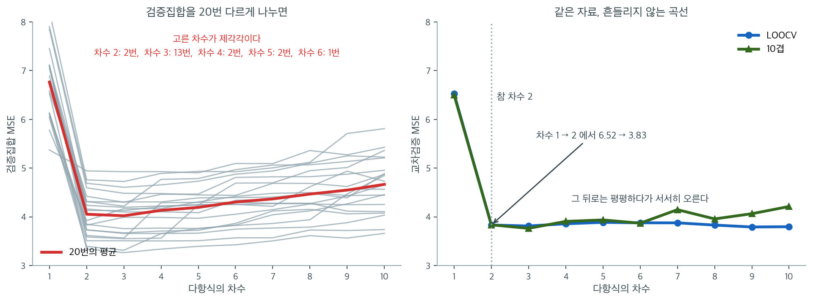
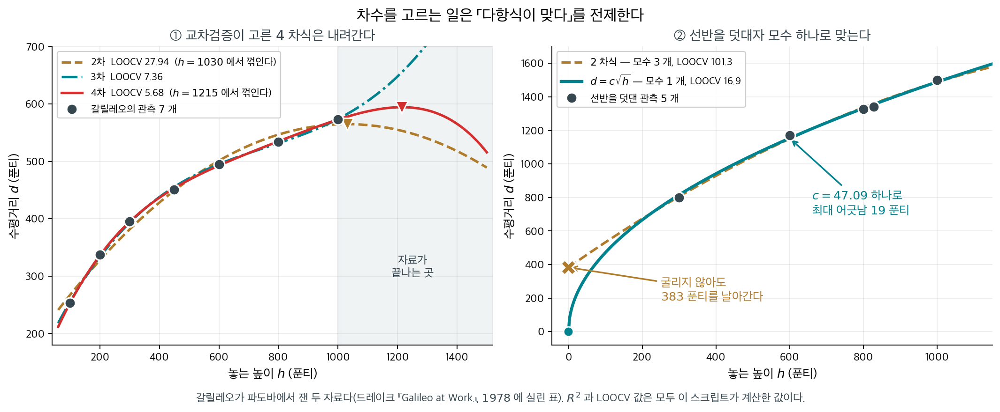

# 교차검증 다항 모형선택

## 개요

이 페이지는 회귀에서 최적 다항 차수를 고르는 세 가지 재표본추출 접근 — 검증집합 방법, 하나 빼기 교차검증(LOOCV), $k$-겹 교차검증 — 을 보인다. 여기서는 참 관계가 $y = 5 + 2x - 0.3x^2$ 인 이차식이라 **옳은 차수가 후보 안에 있다.** 그래서 물음이 분명하다 — 세 방법이 **차수 $2$ 를 찾아내는가.** 검증집합 방법은 변동이 크고, LOOCV는 편향이 작지만 계산 비용이 크며, $k$-겹 교차검증이 실용적인 균형을 준다는 점을 보인다.

참 관계가 어떤 다항식도 아니어서 **옳은 차수가 아예 없을 때** 같은 세 방법이 무엇을 고르는지는 [모형선택을 위한 교차검증](cross_validation.md)에서 본다. 두 쪽을 함께 읽어야 「참이 후보 안에 있는가」가 모형선택에서 무엇을 가르는지가 보인다.

---

## 1. 수학적 배경

### 다항회귀

$d$차 다항 모형은

$$
y_i = \beta_0 + \beta_1 x_i + \beta_2 x_i^2 + \cdots + \beta_d x_i^d + \varepsilon_i.
$$

$d$를 키우면 훈련오차는 줄지만 검정오차는 커질 수 있다(과적합). 모형선택의 목표는 기대 검정오차를 최소화하는 $d$를 찾는 것이다.

### 검증집합 방법의 추정값

자료를 훈련집합과 검증집합으로 나눈다. 각 후보 모형을 훈련자료에 적합하고 검증자료에서 평가한다. 검증집합의 MSE가 검정오차를 추정한다. 단점은 추정값이 무작위 분할에 크게 좌우된다는 점이다.

### LOOCV 의 추정값

LOOCV는 관측값 하나씩을 빼는 $n$개의 겹을 쓴다.

$$
\mathrm{CV}_{(n)} = \frac{1}{n}\sum_{i=1}^n (y_i - \hat{y}_i^{(-i)})^2.
$$

선형모형에서는 모자행렬을 이용해 효율적으로 계산할 수 있다.

$$
\mathrm{CV}_{(n)} = \frac{1}{n}\sum_{i=1}^n \left(\frac{e_i}{1 - h_{ii}}\right)^2.
$$

### k-겹 교차검증의 추정값

자료를 크기가 대략 같은 $K$개의 겹으로 나누고, $K-1$개 겹으로 훈련한 뒤 남겨 둔 겹에서 검정한다.

$$
\mathrm{CV}_{(K)} = \frac{1}{K}\sum_{k=1}^K \mathrm{MSE}_k.
$$

흔한 선택은 $K = 5$나 $K = 10$이다.

### 검증집합 방법

<div class="exbox" markdown>

**보기 1.** <span class="diff easy" title="쉬움"></span> 검증집합을 스무 번 다시 나누기. 같은 자료를 $20$ 번 다르게 나누어 차수 $1$ 부터 $10$ 까지 검증 MSE 를 잰다.

**(1)** 검증집합이 $40$ 개일 때 검증 MSE 가 **얼마나 흔들리는지** 해석적으로 어림하시오. 오차가 정규라고 두어도 된다.

**(2)** $20$ 번의 결과에서 차수 $2$ 의 MSE 가 실제로 얼마나 흩어지는지 재어 (1)과 맞추고, 최적 차수의 빈도를 세시오.

</div>

??? success "풀이"

    **(1) 검증 MSE 는 카이제곱 변량이다.** 모형이 참에 가까우면 검증집합의 잔차는 거의 그 자체의 잡음이므로 $y_i - \hat y_i \approx \varepsilon_i \sim N(0, \sigma^2)$ 이고

    $$
    \mathrm{MSE}_{\text{val}} = \frac{1}{m}\sum_{i=1}^{m} \varepsilon_i^2
    \;\approx\; \frac{\sigma^2}{m}\,\chi^2_m
    $$

    이다. 여기서 $m = 0.2n = 40$ 이다. $\chi^2_m$ 의 평균이 $m$, 분산이 $2m$ 이므로

    $$
    E[\mathrm{MSE}_{\text{val}}] = \sigma^2,
    \qquad
    \operatorname{sd}(\mathrm{MSE}_{\text{val}}) = \sigma^2\sqrt{\frac{2}{m}}
    $$

    곧 **상대표준오차가 $\sqrt{2/m}$** 이다. $m = 40$ 이면

    $$
    \sqrt{\frac{2}{40}} = 0.2236
    $$

    **$22\%$** 다. 참 $\sigma^2 = 4$ 이므로 검증 MSE 가 $4 \pm 0.89$ 쯤으로 흔들린다는 뜻이고, 두 표준편차를 잡으면 $2.2$ 에서 $5.8$ 까지다.

    이것이 보기의 결론을 미리 설명한다. 표의 차수 $2$ 와 차수 $3$ 의 차이가 $0.02$ 쯤인데 측정의 흔들림이 $0.89$ 다. **재려는 차이보다 자가 $40$ 배 거칠다.** 그러니 최적 차수가 분할마다 바뀌는 것이 당연하다.

    눈금을 바꾸려면 $m$ 을 키워야 하지만 그러면 훈련자료가 줄어 모형이 나빠진다. 그 딜레마를 푸는 것이 교차검증이다. **모든 관측값을 한 번씩 검증에 쓰면서도 훈련에는 거의 전부를 쓴다.**

    **(2) 수치적으로.**

    ```python
    import numpy as np
    from sklearn.preprocessing import PolynomialFeatures
    from sklearn.linear_model import LinearRegression

    # 참 모형은 이차식이다. 교차검증이 차수 2 를 골라내는지 보는 것이 목표다.
    np.random.seed(42)
    n = 200
    X = np.random.uniform(1, 10, n)
    y = 5 + 2 * X - 0.3 * X**2 + np.random.normal(0, 2, n)
    X_2d = X.reshape(-1, 1)

    # 검증집합 한 번만 떼어 보면 어떻게 나누느냐에 따라 결과가 들쭉날쭉하다.
    # 그래서 20번 다르게 나눠 보며 그 흔들림을 직접 확인한다.
    degrees = np.arange(1, 11)
    n_validations = 20
    val_mse_multiple = np.zeros((n_validations, len(degrees)))

    for run in range(n_validations):
        val_size = int(0.2 * n)
        indices = np.random.permutation(n)
        train_idx, val_idx = indices[:-val_size], indices[-val_size:]
        for i, degree in enumerate(degrees):
            poly = PolynomialFeatures(degree)
            X_tr = poly.fit_transform(X_2d[train_idx])
            X_va = poly.transform(X_2d[val_idx])
            model = LinearRegression().fit(X_tr, y[train_idx])
            val_mse_multiple[run, i] = np.mean((y[val_idx] - model.predict(X_va)) ** 2)
    ```

    20번의 무작위 분할이 고른 최적 차수와 그 흔들림을 찍어 본다.

    ```python
    import collections

    best_degrees = degrees[val_mse_multiple.argmin(axis=1)]
    print("20번의 최적 차수:", best_degrees.tolist())
    print("빈도:", dict(sorted(collections.Counter(best_degrees.tolist()).items())))

    col2 = val_mse_multiple[:, 1]          # 차수 2
    print(f"차수 2 의 MSE: 최소 {col2.min():.4f}  최대 {col2.max():.4f}  "
          f"평균 {col2.mean():.4f}  표준편차 {col2.std(ddof=1):.4f}  (최대/최소 = {col2.max() / col2.min():.2f})")
    m = int(0.2 * n)
    print(f"이론: 상대표준오차 sqrt(2/{m}) = {np.sqrt(2 / m):.4f}")
    print(f"관측: 표준편차/평균       = {col2.std(ddof=1) / col2.mean():.4f}")
    ```

    출력:

    ```
    20번의 최적 차수: [5, 6, 3, 3, 2, 3, 8, 6, 2, 2, 9, 9, 2, 8, 9, 2, 3, 3, 3, 5]
    빈도: {2: 5, 3: 6, 5: 2, 6: 2, 8: 2, 9: 3}
    차수 2 의 MSE: 최소 2.5677  최대 5.6572  평균 3.9887  표준편차 0.9364  (최대/최소 = 2.20)
    이론: 상대표준오차 sqrt(2/40) = 0.2236
    관측: 표준편차/평균       = 0.2348
    ```

    **(1)의 어림이 아주 잘 맞는다.** 이론값 $0.2236$ 과 관측값 $0.2348$ 이 $5\%$ 차이다. $20$ 번만 되풀이했으니 이 정도 차이는 당연하다(표준편차 자체의 상대오차가 $1/\sqrt{2 \cdot 19} \approx 16\%$ 다).

    차수 $2$ 의 MSE 가 $2.5677$ 에서 $5.6572$ 까지, 곧 **$2.2$ 배**로 흩어진다. 평균 $3.9887$ 은 참 $\sigma^2 = 4$ 에 거의 정확히 맞는다. **치우침은 없고 분산만 크다**는 것이 검증집합 방법의 성격이다.

    **최적 차수는 여섯 가지가 나왔다.** 차수 $3$ 이 $6$ 번, 차수 $2$ 가 $5$ 번, 차수 $9$ 가 $3$ 번, 차수 $5, 6, 8$ 이 각각 $2$ 번이다. 참값 $2$ 를 맞힌 것이 $20$ 번 중 $5$ 번, **$25\%$** 다. 한 번만 나누어 보고 "이 자료의 최적 차수는 $9$" 라고 적었을 수도 있다는 뜻이다.

    여기서 한 가지를 분명히 해 두자. **$20$ 번 중 $15$ 번이 차수 $3$ 이상을 골랐다.** 검증집합 방법의 흔들림은 위아래로 대칭이 아니라 **큰 차수 쪽으로 기울어 있다.** 높은 차수의 모형이 분할에 따라 아주 잘 맞을 때도 있기 때문이고, 그 운 좋은 한 번이 최솟값을 가져간다. 곧 **후보가 많을 때 가장 작은 값을 고르는 일 자체가 복잡한 모형을 편애한다.** 보기 2, 3 의 교차검증이 이 두 문제를 모두 줄인다.

### LOOCV

<div class="exbox" markdown>

**보기 2.** <span class="diff easy" title="쉬움"></span> 하나빼기 교차검증. `LeaveOneOut` 으로 차수 $1$ 부터 $10$ 까지 LOOCV MSE 를 구한다.

**(1)** LOOCV MSE 가 훈련 MSE 보다 **반드시 크거나 같다**는 것을 쪽머리의 지름길 식에서 보이고, 그 비가 대략 $(1 - p/n)^{-2}$ 임을 유도하시오.

**(2)** 지름길 식과 무차별 재적합을 **열 차수 모두에서** 맞추어 보시오. 어긋나는 차수가 있다면 그 까닭을 설명하시오.

</div>

??? success "풀이"

    **(1) 지름길 식이 답을 바로 준다.** 쪽머리의 식은

    $$
    \mathrm{CV}_{(n)} = \frac{1}{n}\sum_{i=1}^n \left(\frac{e_i}{1 - h_{ii}}\right)^2
    $$

    이다. 모자행렬의 대각원소는 $0 \le h_{ii} \le 1$ 이므로 $0 < 1 - h_{ii} \le 1$ 이고, 따라서 각 항이

    $$
    \left(\frac{e_i}{1 - h_{ii}}\right)^2 \ge e_i^2
    $$

    이다. 더하고 $n$ 으로 나누면

    $$
    \mathrm{CV}_{(n)} \ge \frac{1}{n}\sum_i e_i^2 = \mathrm{MSE}_{\text{train}}
    $$

    **언제나 그렇다.** 등호는 모든 $h_{ii} = 0$ 일 때인데 그런 설계행렬은 없다.

    **비의 크기.** 레버리지의 합이 모수의 개수와 같으므로

    $$
    \sum_i h_{ii} = p = d + 1
      \qquad\Longrightarrow\qquad
      \bar h = \frac{p}{n}
    $$

    이다. 모든 $h_{ii}$ 가 평균 근처라고 보면 각 항이 $e_i^2/(1 - p/n)^2$ 이 되어

    $$
    \mathrm{CV}_{(n)} \;\approx\; \frac{\mathrm{MSE}_{\text{train}}}{\bigl(1 - p/n\bigr)^2}
    $$

    를 얻는다. 이것이 **일반화 교차검증(GCV)** 이라 부르는 어림식이다. $n = 200$, $d = 2$ 면 $p/n = 0.015$ 이므로 보정이 $3\%$ 다. $d = 10$ 이면 $p/n = 0.055$ 로 $11\%$ 가 된다. **차수를 올리면 훈련 MSE 는 줄지만 보정이 커지므로 LOOCV 가 올라갈 수 있다.** 과적합이 이 두 힘의 싸움으로 나타난다.

    **(2) 대수적으로는 언제나 같다.** 연습문제 5 가 셔먼–모리슨 공식으로 증명하는 대로 지름길과 무차별 재적합은 **같은 수**다. 그러므로 어긋난다면 수학이 아니라 **수치** 문제다.

    의심할 곳은 분명하다. 설계행렬이 $1, x, x^2, \ldots, x^{10}$ 인데 $x$ 가 $1$ 에서 $10$ 사이이므로 마지막 열의 값이 $10^{10}$ 까지 간다. 열들이 거의 평행해져 $\mathbf{X}^\top\mathbf{X}$ 의 조건수가 폭발하고, 그 역행렬로 계산한 $h_{ii}$ 가 믿을 수 없게 된다. 특히 $1 - h_{ii}$ 가 $0$ 에 가까울 때 분모의 작은 오차가 크게 증폭된다. 조건수를 함께 찍어 확인한다.

    ```python
    from sklearn.model_selection import cross_val_score, LeaveOneOut

    # 하나빼기 교차검증은 관측값 하나씩을 검증집합으로 쓴다. 어떻게 나누느냐에
    # 따른 흔들림이 없다는 것이 장점이고, n 번 적합해야 해서 느린 것이 단점이다.
    loo = LeaveOneOut()
    loocv_mse = np.zeros(len(degrees))
    for i, degree in enumerate(degrees):
        poly = PolynomialFeatures(degree)
        X_poly = poly.fit_transform(X_2d)
        model = LinearRegression()
        scores = cross_val_score(model, X_poly, y, cv=loo,
                                 scoring='neg_mean_squared_error')
        loocv_mse[i] = -scores.mean()
    ```

    ```python
    train_mse = np.zeros(len(degrees))
    shortcut = np.zeros(len(degrees))
    cond = np.zeros(len(degrees))
    for i, degree in enumerate(degrees):
        X_poly = PolynomialFeatures(degree).fit_transform(X_2d)
        fit = LinearRegression().fit(X_poly, y)
        e = y - fit.predict(X_poly)
        h = np.diag(X_poly @ np.linalg.pinv(X_poly.T @ X_poly) @ X_poly.T)
        shortcut[i] = np.mean((e / (1 - h)) ** 2)
        train_mse[i] = np.mean(e ** 2)
        cond[i] = np.linalg.cond(X_poly)

    print("  d  LOOCV(무차별)   지름길     훈련MSE   훈련/(1-p/n)^2     조건수")
    for i, degree in enumerate(degrees):
        print(f"  {degree:2d}  {loocv_mse[i]:10.4f}  {shortcut[i]:10.4f}  {train_mse[i]:8.4f}  "
              f"{train_mse[i] / (1 - (degree + 1) / n) ** 2:12.4f}   {cond[i]:.2e}")
    print(f"LOOCV >= 훈련 MSE 가 모든 차수에서 성립: {bool(np.all(loocv_mse >= train_mse))}")
    print(f"지름길과 무차별의 최대 차이 = {np.abs(loocv_mse - shortcut).max():.3f}")
    # 반올림한 뒤 비교한다. 차이의 생값은 BLAS 구현에 따라 자리 수가 달라진다.
    same = np.round(loocv_mse, 4) == np.round(shortcut, 4)
    print(f"소수 넷째 자리까지 같은 차수 = {degrees[same].tolist()}")
    print(f"어긋나는 차수             = {degrees[~same].tolist()}")
    print(f"적합 횟수: 무차별 {n * len(degrees)} 번,  지름길 {len(degrees)} 번")
    ```

    출력:

    ```
      d  LOOCV(무차별)   지름길     훈련MSE   훈련/(1-p/n)^2     조건수
       1      6.5243      6.5243    6.3816        6.5111   1.38e+01
       2      3.8318      3.8318    3.7175        3.8316   2.26e+02
       3      3.8123      3.8123    3.6552        3.8059   4.11e+03
       4      3.8574      3.8574    3.6530        3.8427   8.27e+04
       5      3.8870      3.8870    3.6338        3.8620   1.77e+06
       6      3.9246      3.8772    3.6225        3.8900   3.74e+07
       7      3.9769      3.8766    3.6200        3.9279   8.59e+08
       8      4.0359      3.8308    3.6127        3.9611   1.88e+10
       9      4.0686      3.7920    3.5739        3.9600   4.35e+11
      10      4.1443      3.7969    3.5736        4.0017   9.55e+12
    LOOCV >= 훈련 MSE 가 모든 차수에서 성립: True
    지름길과 무차별의 최대 차이 = 0.347
    소수 넷째 자리까지 같은 차수 = [1, 2, 3, 4, 5]
    어긋나는 차수             = [6, 7, 8, 9, 10]
    적합 횟수: 무차별 2000 번,  지름길 10 번
    ```

    **(1)의 두 결론이 맞는다.**

    열 차수 모두에서 LOOCV 가 훈련 MSE 보다 크다. 그리고 GCV 어림식이 놀랄 만큼 잘 맞는다. 차수 $2$ 에서 $3.8316$ 대 $3.8318$ 로 소수 셋째 자리까지 같고, 차수 $3$ 에서 $3.8059$ 대 $3.8123$ 이다.

    유도가 예고한 싸움도 표에 그대로 있다. **훈련 MSE 는 $6.3816$ 에서 $3.5736$ 으로 단조감소**하는데, 보정 $(1 - p/n)^{-2}$ 이 $1.020$ 에서 $1.120$ 으로 커지면서 둘의 곱이 차수 $3$ 에서 바닥을 치고 다시 올라간다. **과적합이라는 말의 산술이 이 두 열이다.**

    **(2) 차수 6 부터 어긋난다.** 차수 $1$ 에서 $5$ 까지는 두 값이 소수 넷째 자리까지 같고, 차수 $6$ 부터 $10$ 까지는 모두 어긋난다. 전체 최대 차이가 $0.347$ 이며, 차수 $6$ 에서 $3.9246$ 대 $3.8772$, 차수 $9$ 에서 $4.0686$ 대 $3.7920$ 으로 갈라진다. (낮은 차수에서 남는 차이의 **생값**은 $10^{-15}$ 에서 $10^{-9}$ 사이로 선형대수 라이브러리에 따라 달라지므로, 반올림한 뒤 견주는 것이 옳다.)

    범인은 마지막 열의 조건수다. 차수 $5$ 에서 $1.77 \times 10^6$ 이던 것이 차수 $6$ 에서 $3.74 \times 10^7$, 차수 $10$ 에서 $9.55 \times 10^{12}$ 가 된다. 배정밀도의 상대정밀도가 $10^{-16}$ 이므로 조건수가 $10^{13}$ 이면 **유효숫자가 세 자리밖에 남지 않는다.** 그 정밀도로 계산한 $h_{ii}$ 로 $1 - h_{ii}$ 를 만들어 나누면 오차가 몇 퍼센트로 커진다.

    어느 쪽이 맞는가. **무차별 재적합 쪽이 더 믿을 만하다.** 지름길은 $(\mathbf{X}^\top\mathbf{X})^{-1}$ 을 한 번 만들어 모든 $h_{ii}$ 를 거기서 끌어내므로 그 한 번의 오차가 전부에 번지는데, 무차별 쪽은 겹마다 따로 최소제곱을 풀고 sklearn 은 정규방정식 대신 QR/SVD 기반의 `lstsq` 를 쓴다. 지름길의 값이 훈련 MSE 쪽으로 **끌려 내려간** 모양($3.7969 < 3.8318$, 차수 $10$ 이 차수 $2$ 보다 낮다)인 것도 오차의 흔적이다. 과적합이 심해지는데 LOOCV 가 내려갈 수는 없다.

    교훈은 둘이다. 첫째, **지름길 식은 대수적으로 정확하지만 수치적으로는 설계행렬의 조건에 달려 있다.** 연습문제 1 이 차수 $2$ 에서 두 값의 일치를 확인하는 것은 조건수가 $226$ 으로 작기 때문이다. 둘째, **원시 거듭제곱 기저를 차수 $5$ 넘게 쓰지 말라.** 직교다항식(`numpy.polynomial.legendre` 나 patsy 의 `poly()`)을 쓰면 조건수가 $10$ 대에 머물고 이 문제가 사라진다.

### k-겹 교차검증

<div class="exbox" markdown>

**보기 3.** <span class="diff easy" title="쉬움"></span> 10겹 교차검증. `KFold(n_splits=10, shuffle=True, random_state=42)` 로 차수마다 교차검증 MSE 를 구한다.

**(1)** 차수마다 적합하는 횟수를 LOOCV 와 견주시오. 10겹의 추정값이 LOOCV 보다 **위로 치우치는** 까닭도 적으시오.

**(2)** 10겹에는 `random_state` 라는 난수가 남아 있다. 씨앗을 $20$ 가지로 바꾸어 최적 차수가 얼마나 흔들리는지 재고, 보기 1 의 검증집합 방법과 견주시오.

</div>

??? success "풀이"

    **(1) 차수마다 10 번이다.** 겹이 $10$ 개이고 겹마다 한 번 적합하므로 $10$ 번이다. LOOCV 는 $n = 200$ 번이므로 **$20$ 배 빠르다.** 차수 열 개를 모두 보려면 $100$ 번 대 $2000$ 번이다.

    **위로 치우치는 까닭.** 겹 하나를 떼어 놓으면 훈련에 쓰는 자료가 $n \times 9/10 = 180$ 개로 줄어든다. LOOCV 는 $199$ 개를 쓴다. 훈련자료가 적으면 추정한 계수가 덜 정확하고 예측오차가 커지므로

    $$
    \mathrm{CV}_{(10)} \;\gtrsim\; \mathrm{CV}_{(n)}
    $$

    가 기대된다. 보기 2 에서 쓴 어림식으로 크기를 가늠할 수 있다. 모수 $p$ 개에 대해 예측오차가 대략 $\sigma^2(1 + p/n_{\text{train}})$ 이므로, 두 방법의 비는

    $$
    \frac{1 + p/180}{1 + p/199}
    $$

    이고 $p = 2$ 에서 $1.0005$, $p = 11$ 에서 $1.003$ 이다. **차이가 $0.3\%$ 아래**라는 뜻이고, 실제 표에서도 두 열이 거의 같다.

    주의할 것은 이 어림이 **평균의 방향**만 말한다는 점이다. 한 번의 10겹 값이 LOOCV 보다 작게 나오는 일은 흔하다. 아래 표에서 차수 $3$ 의 10겹 값 $3.7948$ 이 LOOCV 의 $3.8123$ 보다 작은 것이 그 예다.

    **(2) 씨앗이 남아 있으므로 흔들린다.** LOOCV 는 분할이 유일하게 정해져 흔들림이 없지만, 10겹은 어떤 관측값이 어느 겹에 들어가는지를 난수로 정한다. 그러므로 `random_state` 를 바꾸면 값이 달라지고 최적 차수도 바뀔 수 있다.

    다만 보기 1 보다는 훨씬 안정될 것이다. 검증집합 방법은 $40$ 개로 한 번 재지만, 10겹은 **모든 $200$ 개를 한 번씩 검증에 쓰고 $10$ 개 값을 평균**한다. 보기 1 에서 유도한 상대표준오차 $\sqrt{2/n_{\text{val}}}$ 의 꼴로 어림하면 $\sqrt{2/200} = 0.1$ 이 되어야 하나, 겹들이 같은 훈련자료를 많이 공유하므로 그대로 쓸 수는 없다. 수로 재는 편이 낫다.
    ```python
    from sklearn.model_selection import KFold

    # k겹 교차검증은 그 둘의 절충이다. 10번만 적합하면 되고, 하나빼기보다
    # 추정의 분산이 작다. 그래서 실제로는 이쪽을 가장 많이 쓴다.
    kfold = KFold(n_splits=10, shuffle=True, random_state=42)
    kfold_mse = np.zeros(len(degrees))
    for i, degree in enumerate(degrees):
        poly = PolynomialFeatures(degree)
        X_poly = poly.fit_transform(X_2d)
        model = LinearRegression()
        scores = cross_val_score(model, X_poly, y, cv=kfold,
                                 scoring='neg_mean_squared_error')
        kfold_mse[i] = -scores.mean()
    ```

    ```python
    import collections

    print("10겹:", kfold_mse.round(4).tolist())
    print("LOOCV:", loocv_mse.round(4).tolist())
    print(f"최대 차이 = {np.abs(kfold_mse - loocv_mse).max():.4f} (차수 {degrees[np.abs(kfold_mse - loocv_mse).argmax()]})")

    cnt = collections.Counter(); gap = []; at2 = []
    for rs in range(20):
        kf = KFold(n_splits=10, shuffle=True, random_state=rs)
        col = []
        for d in degrees:
            X_poly = PolynomialFeatures(d).fit_transform(X_2d)
            col.append(-cross_val_score(LinearRegression(), X_poly, y, cv=kf,
                                        scoring='neg_mean_squared_error').mean())
        col = np.array(col)
        cnt[int(degrees[col.argmin()])] += 1
        gap.append(col[1] - col[2]); at2.append(col[1])
    gap = np.array(gap)
    print("random_state 20개에서 최적 차수 빈도:", dict(sorted(cnt.items())))
    print(f"차수2 - 차수3: 평균 {gap.mean():+.4f}  표준편차 {gap.std(ddof=1):.4f},  "
          f"차수 3 이 더 작은 비율 {(gap > 0).mean():.2f}")
    print(f"차수 2 의 10겹 MSE: 평균 {np.mean(at2):.4f}  표준편차 {np.std(at2, ddof=1):.4f}")
    print(f"  (보기 1 의 검증집합 표준편차 {val_mse_multiple[:, 1].std(ddof=1):.4f} 와 견주라)")
    ```

    출력:

    ```
    10겹: [6.4595, 3.8361, 3.7948, 3.8162, 3.8284, 3.8642, 3.9221, 4.0216, 4.0074, 4.0964]
    LOOCV: [6.5243, 3.8318, 3.8123, 3.8574, 3.887, 3.9246, 3.9769, 4.0359, 4.0686, 4.1443]
    최대 차이 = 0.0648 (차수 1)
    random_state 20개에서 최적 차수 빈도: {2: 5, 3: 15}
    차수2 - 차수3: 평균 +0.0147  표준편차 0.0200,  차수 3 이 더 작은 비율 0.75
    차수 2 의 10겹 MSE: 평균 3.8454  표준편차 0.0307
      (보기 1 의 검증집합 표준편차 0.9364 와 견주라)
    ```

    **(1) 두 열의 차이가 $0.0648$ 을 넘지 않는다.** 가장 큰 차이가 차수 $1$ 에서 나는데, 거기서는 10겹이 $6.4595$ 로 LOOCV 의 $6.5243$ 보다 **작다.** 유도한 "10겹이 위로 치우친다" 는 평균의 이야기이고 한 번의 값에는 적용되지 않는다는 것을 그대로 보여 준다. 차수 $4$ 부터는 10겹이 일관되게 작은데, 이 구간에서는 설계행렬의 조건수 문제(보기 2)가 LOOCV 쪽을 더 세게 흔든다.

    어느 쪽이든 **차이가 $1\%$ 안쪽**이고 유도한 $0.3\%$ 와 자리 수가 같다. $n = 200$ 에서는 $180$ 개로 훈련하든 $199$ 개로 훈련하든 거의 같다는 뜻이다. 그런데 계산은 $20$ 배 차이가 난다. 이것이 실무에서 10겹을 쓰는 이유다.

    **(2) 흔들리지만 보기 1 과는 차원이 다르다.**

    - 최적 차수가 $20$ 개 씨앗 가운데 차수 $3$ 에서 $15$ 번, 차수 $2$ 에서 $5$ 번 나왔다. **두 값 사이에서만 흔들린다.** 보기 1 의 검증집합 방법은 $2$ 에서 $9$ 까지 여섯 가지 차수를 골랐다.
    - 차수 $2$ 의 MSE 표준편차가 $0.0307$ 이다. 보기 1 의 $0.9364$ 와 견주면 **$30$ 배 작다.**

    그렇다고 결론이 확정된 것은 아니다. 차수 $2$ 와 $3$ 의 차이가 평균 $+0.0147$, 표준편차 $0.0200$ 이므로 **차이가 흔들림보다 작다.** 그래서 차수 $3$ 이 이기는 비율이 $0.75$ 로 확실하지 않다.

    **참 차수가 $2$ 라는 것을 알고 있으니 답은 분명하다.** 교차검증은 $75\%$ 의 경우에 차수 $3$ 을 가리켜 **틀린 쪽으로 기울었다.** 삼차항이 이 표본의 잡음을 조금 더 맞춰 주기 때문이고, 어떤 재표집 방법도 이 미세한 과적합을 막아 주지 못한다.

    막아 주는 것은 **1 표준오차 규칙**이다. `random_state=42` 인 이 10겹에서 차수 $3$ 의 겹별 MSE 는 표준편차가 $1.0049$ 이므로 평균의 표준오차가 $1.0049/\sqrt{10} = 0.3178$ 이다. 문턱은

    $$
    3.7948 + 0.3178 = 4.1126
    $$

    이고 차수 $2$ 의 $3.8361$ 은 이 안에 들어온다(차수 $1$ 의 $6.4595$ 는 들어오지 않는다). 그러므로 1 표준오차 규칙은 **차수 $2$ 를 고르며 참값을 맞힌다.** 요점은 겹 사이의 흔들림이 비교하려는 차이보다 훨씬 크다는 것이고, 그럴 때는 언제나 단순한 쪽이 낫다.

### 결과

| 차수 | LOOCV MSE | 10-겹 MSE |
|---|---|---|
| 1 | 6.5243 | 6.4595 |
| 2 | 3.8318 | 3.8361 |
| **3** | **3.8123** | **3.7948** |
| 4 | 3.8574 | 3.8162 |
| 5 | 3.8870 | 3.8284 |
| 6 | 3.9246 | 3.8642 |
| 7 | 3.9769 | 3.9221 |
| 8 | 4.0359 | 4.0216 |
| 9 | 4.0686 | 4.0074 |
| 10 | 4.1443 | 4.0964 |

두 방법 모두 형식적으로는 차수 3에서 최솟값을 갖지만, 차수 2와 3의 차이는 0.5%에 지나지 않아 사실상 동률이다. 참 차수가 2인 점을 생각하면 이는 자연스러운 결과이다. 삼차항이 잡음을 조금 더 맞춰 준 것뿐이며, 이런 상황에서는 [1 표준오차 규칙](./cross_validation.md)에 따라 더 단순한 차수 2를 고르는 것이 옳다.

차수 1에서 2로 갈 때 MSE가 $6.52$에서 $3.83$으로 절반 가까이 떨어지는 반면 그 뒤로는 거의 평평하다가 서서히 올라간다는 점이 중요하다. 곡률을 포착하는 것이 결정적이고, 그 이상은 과적합이라는 뜻이다.



세 보기의 결과를 나란히 놓으면 이렇게 된다. 왼쪽은 보기 1이다. 같은 자료를 $20$번 다르게 반으로 나누어 얻은 검증 MSE 곡선을 회색으로 겹쳐 그렸다. 곡선들이 위아래로 크게 벌어진다. 차수 $2$에서만 보아도 MSE가 $3.34$에서 $4.94$까지 흩어져 최솟값과 최댓값이 $1.5$배 차이 난다. 결과적으로 **어떤 차수를 고르느냐도 제각각이다.** $20$번 가운데 차수 $3$을 고른 것이 $13$번, 차수 $2$가 $2$번, 차수 $4$가 $2$번, 차수 $5$가 $2$번, 차수 $6$이 $1$번이었다. 한 번만 나누어 보고 "이 자료의 최적 차수는 $6$"이라고 보고했을 수도 있는 것이다.

오른쪽은 보기 2와 3이다. 같은 자료인데 곡선이 딱 하나씩이고 서로 거의 포개진다. LOOCV는 나누는 방식이 유일하게 정해지므로 애초에 흔들릴 여지가 없고, $10$겹은 $10$개 겹을 평균하므로 분할 운이 대부분 상쇄된다. 두 곡선 모두 차수 $1$의 $6.52$에서 차수 $2$의 $3.83$으로 **절반 가까이 떨어진 뒤 평평해진다.** 곡률을 담는 것이 결정적이고 그 이상은 얻을 것이 없다는 신호다.

다만 오른쪽 곡선의 평평한 구간이 또 다른 함정이다. LOOCV의 최솟값은 형식적으로 차수 $3$($3.8123$)에 있지만 차수 $2$($3.8318$)와의 차이가 $0.5\%$에 지나지 않는다. 이 정도 차이는 자료를 한 번 더 뽑으면 뒤집힌다. **최솟값을 기계적으로 따르는 대신 1 표준오차 규칙으로 더 단순한 차수 $2$를 고르는 것이 옳은 이유**가 여기에 있다. 곡선이 평평하다는 것은 "그 구간 안에서는 어느 것을 골라도 비슷하다"는 뜻이고, 그럴 때는 언제나 단순한 쪽이 낫다.

---

## 2. 해석

- **검증집합**: 빠르지만 불안정하다. 무작위 분할이 달라지면 다른 최적 차수를 고를 수 있어 한 번의 분할로는 신뢰할 수 없다.
- **LOOCV**: 거의 불편이지만(각 훈련집합이 $n-1$개의 관측값을 쓴다) 계산이 비싸고(후보마다 $n$번 적합) $n$개의 훈련집합이 거의 동일하므로 분산이 클 수 있다.
- **10-겹 교차검증**: 실용적인 절충이다. 각 훈련집합이 자료의 $90\%$를 쓰고(편향이 작고) 10개 겹의 평균이 분산을 줄인다.
- 참 관계가 이차($d = 2$)이므로 세 방법 모두 차수 2 또는 그 근처를 고른다. 차수가 높아지면 과적합이 일어나 최솟값 이후 검정오차 곡선이 올라간다.

<div class="storybox" markdown>

**그림으로 보는 통계학 1.** 갈릴레오가 선반을 덧댄 까닭

위 네 줄은 모두 **「참 차수가 후보 안에 있다」**는 전제 위에 서 있다. 그 전제가 깨지면 교차검증이 무엇을 하고 무엇을 하지 않는지를, 사백 년 된 자료로 볼 수 있다.

파도바 시절의 **갈릴레오**가 공을 경사면에 굴려 책상 끝에서 튀어나가게 하고, 바닥에 닿기까지의 **수평거리** $d$ 를 **놓는 높이** $h$ 별로 쟀다. 일곱 번이다. 길이 단위는 그때의 **푼티**(punti)다.

이 쪽이 한 일을 그 일곱 점에 그대로 해 보자.

| 차수 | 모수 | $R^2$ | LOOCV RMSE | 꺾이는 자리 |
|---|---|---|---|---|
| $1$ | $2$ | $0.9264$ | $45.00$ | 없다 |
| $2$ | $3$ | $0.9903$ | $27.94$ | $h = 1030$ |
| $3$ | $4$ | $0.9994$ | $7.36$ | 없다 |
| **$4$** | $5$ | $0.9998$ | **$5.68$** | $h = 1215$ |
| $5$ | $6$ | $0.9970$ | $7.56$ | 없다 |

**교차검증은 차수 $4$ 를 고른다.** 그런데 고른 그 식은 $h = 1215$ 에서 꺾여 **내려간다.** 더 높은 데서 놓으면 더 가까이 떨어진다는 말이다. $2$ 차식은 더 이르게 꺾인다 — $h = 1030$ 이면 자료의 맨 끝($1000$)에서 겨우 $30$ 푼티 위다. 꺾이지 않는 것은 $3$ 차뿐인데, LOOCV 는 그 $3$ 차($7.36$)보다 $4$ 차($5.68$)를 더 좋다고 말한다. **고른 모형이 물리적으로 불가능하다는 사실은 교차검증값 어디에도 나타나지 않는다.**



갈릴레오는 두 번째 실험을 했다. 경사면 끝에 **수평 선반**을 덧대어, 공이 책상을 떠날 때 아래로 향하던 속도 성분을 없앤 것이다. 그러면 셈이 단순해진다. 떠나는 속도는 수평이고, 바닥까지 떨어지는 시간은 책상 높이로 고정되며, 굴러 내린 높이와 속도는 $v \propto \sqrt h$ 로 이어진다. 곧

$$
d = c\sqrt h
$$

이고 **모수가 하나뿐**이다. 선반을 덧댄 다섯 점에 맞추면 $c = 47.09$, $R^2 = 0.9967$, LOOCV RMSE $16.9$ 다. 같은 자료에 맞춘 모수 셋짜리 $2$ 차식은 LOOCV $101.3$ 으로 **여섯 배** 나쁘고, $h = 0$ 에서 **굴리지 않아도 $383$ 푼티를 날아간다**고 말한다.

마지막 확인이 이 이야기의 매듭이다. 선반이 **없던** 첫 자료에 같은 $d = c\sqrt h$ 를 맞추면 $R^2$ 이 $0.826$ 으로 떨어지고 잔차가 $+52.8,\ +53.9,\ +48.3,\ +26.4,\ +4.7,\ -32.1,\ -59.9$ 로 **굽는다.** 선반이 없으면 그 식이 맞지 않는다는 뜻이고, **선반을 덧댄 까닭이 바로 그것이다.** 갈릴레오가 한 일은 모형을 자료에 맞춘 것이 아니라 **모형이 맞는 자료를 만들러 간 것**이다.

교차검증은 **후보 가운데** 가장 나은 것을 고른다. 후보 밖에 모수 하나로 더 잘 맞는 것이 있는지는 말해 주지 않는다. 참 차수가 아예 없을 때 같은 세 방법이 무엇을 고르는지는 [모형선택을 위한 교차검증](cross_validation.md)이 이어받는다.

_확인한 곳 — 두 자료의 열두 쌍과 단위가 푼티라는 것, 두 번째 실험이 경사면 끝에 수평 선반을 덧대어 처음의 아래 방향 속도 성분을 없앤 것이라는 설명, 갈릴레오가 파도바에서 서른한 살에 시작해 마흔두 살에 이 연구를 마쳤다는 것, 그리고 자료의 출처가 드레이크 『Galileo at Work』($1978$)라는 것은 [『Journal of Statistics Education』 $3$ 권 $1$ 호($1995$)에 실린 디키·아널드의 자료 설명](https://jse.amstat.org/v3n1/datasets.dickey.html)에서 읽었다. 같은 글이 다항식 적합은 「높은 높이에서 거리가 줄어든다」고 예측하는 잘못을 범하므로 높이의 제곱근에 회귀하는 것이 옳다고 적은 것도 거기서 읽었다. **갈릴레오의 원문은 읽지 못했고**, 푼티가 오늘의 어느 길이인지는 그 글에 없어 적지 않는다 · $R^2$, LOOCV 값, 꺾이는 자리, 잔차는 모두 그 열두 쌍으로 직접 계산한 값이다_

</div>

---

## 연습문제

<div class="drillbox" markdown>

**연습문제 1.** <span class="diff med" title="중간"></span> 모자행렬 지름길로 $n$개 모형을 다시 적합하지 않고 2차 다항회귀의 LOOCV MSE를 계산하라. 무차별 계산 결과와 일치하는지 확인하라.

</div>

??? success "풀이"

    ```python
    poly = PolynomialFeatures(2)
    X_poly = poly.fit_transform(X_2d)
    model = LinearRegression().fit(X_poly, y)
    H = X_poly @ np.linalg.inv(X_poly.T @ X_poly) @ X_poly.T
    e = y - model.predict(X_poly)
    h = np.diag(H)
    loocv_shortcut = np.mean((e / (1 - h)) ** 2)
    print(f"LOOCV (shortcut): {loocv_shortcut:.4f}")
    print(f"LOOCV (brute):    {loocv_mse[1]:.4f}")
    ```

    출력:

    ```
    LOOCV (shortcut): 3.8318
    LOOCV (brute):    3.8318
    ```

    지름길 공식으로 계산한 LOOCV와 $n$번 적합해 얻은 값이 소수점 넷째 자리까지 같다.

    선형모형에서는 관측값을 하나씩 빼고 다시 적합할 필요가 없다. $\text{LOOCV} = \frac{1}{n}\sum \left(\frac{e_i}{1 - h_{ii}}\right)^2$로 **한 번의 적합**에서 얻을 수 있으며, 지렛값 $h_{ii}$가 그 역할을 한다.

    두 값 모두 $3.8318$로 일치한다. 지름길 공식이 선형모형에서 하나 빼기 재적합과 대수적으로 동등하기 때문이다. $\square$

---

<div class="drillbox" markdown>

**연습문제 2.** <span class="diff med" title="중간"></span> $n$을 200에서 1000으로 늘려라. 검증집합 방법의 변동성과 LOOCV·10-겹 사이의 격차는 어떻게 달라지는가?

</div>

??? success "풀이"

    $n = 1000$이면 (1) 훈련집합과 검증집합이 모두 커져 특정 분할에 대한 민감도가 줄어들므로 검증집합 방법이 더 안정된다. (2) 10-겹 교차검증의 편향(자료의 $90\%$만 훈련에 쓰는 데서 오는)이 $n$이 클 때 무시할 만해지므로 LOOCV와의 격차가 좁아진다. 두 방법이 참 검정오차에 대해 비슷한 추정값으로 수렴한다. $\square$

---

<div class="drillbox" markdown>

**연습문제 3.** <span class="diff med" title="중간"></span> (10-겹 교차검증으로 얻은) 검정 MSE와 함께 훈련 MSE를 다항 차수의 함수로 그려라. 그림에 드러나는 편향–분산 절충을 설명하라.

</div>

??? success "풀이"

    ```python
    train_mse = []
    for degree in degrees:
        poly = PolynomialFeatures(degree)
        X_poly = poly.fit_transform(X_2d)
        model = LinearRegression().fit(X_poly, y)
        train_mse.append(np.mean((y - model.predict(X_poly)) ** 2))
    ```

    훈련 MSE는 차수에 따라 단조롭게 감소한다(모수가 많아지면 훈련자료를 언제나 더 잘 맞춘다). 검정 MSE는 처음에 감소했다가(편향 감소) 이후 증가한다(분산 증가). 최적 차수는 검정 MSE가 최소가 되는 지점이다. 이 U자 모양의 검정오차 곡선이 편향–분산 절충의 상징적인 모습이다. $\square$

---

<div class="drillbox" markdown>

**연습문제 4.** <span class="diff med" title="중간"></span> $K$-겹 교차검증에서 $K$의 선택에 편향–분산 절충이 있는 이유를 설명하라. 극단인 $K = 2$와 $K = n$의 경우는 어떠한가?

</div>

??? success "풀이"

    $K$가 작으면(예: $K = 2$) 각 훈련집합이 자료의 $50\%$만 쓰므로 오차 추정값에 위쪽 편향이 생긴다(적은 자료로 훈련한 모형은 성능이 나쁘다). 그러나 $K$개의 추정값이 겹치지 않는 훈련집합에서 나오므로 분산은 작다. $K = n$(LOOCV)이면 각 훈련집합이 $n-1$개의 관측값을 쓰므로 편향이 최소이지만, $n$개의 훈련집합이 거의 완전히 겹쳐 추정값들이 강하게 상관되고 분산이 클 수 있다. $K = 5$나 $K = 10$이 이 양극단의 균형을 잡는다. $\square$

---

<div class="drillbox" markdown>

**연습문제 5.** <span class="diff hard" title="어려움"></span> 계수 1의 갱신에 대한 Sherman-Morrison-Woodbury 공식에서 $\mathrm{CV}_{(n)} = \frac{1}{n}\sum_i \left(\frac{e_i}{1 - h_{ii}}\right)^2$을 유도하라.

</div>

??? success "풀이"

    관측값 $i$를 지우는 것은 $\mathbf{X}^\top\mathbf{X}$의 계수 1 갱신과 같다. Sherman-Morrison 공식에 의해

    $$
    (\mathbf{X}_{(-i)}^\top\mathbf{X}_{(-i)})^{-1} = (\mathbf{X}^\top\mathbf{X} - \mathbf{x}_i\mathbf{x}_i^\top)^{-1} = (\mathbf{X}^\top\mathbf{X})^{-1} + \frac{(\mathbf{X}^\top\mathbf{X})^{-1}\mathbf{x}_i\mathbf{x}_i^\top(\mathbf{X}^\top\mathbf{X})^{-1}}{1 - h_{ii}}.
    $$

    정리하면 관측값 $i$의 하나 빼기 예측오차가 $y_i - \hat{y}_i^{(-i)} = e_i/(1 - h_{ii})$로 간단해지고 공식이 나온다. $\square$

---

<div class="drillbox" markdown>

**연습문제 6.** <span class="diff hard" title="어려움"></span> 보기 2 의 표에는 LOOCV 열과 GCV 어림식 열 $\mathrm{MSE}_{\text{train}}/(1 - p/n)^2$ 이 나란히 있다.

**(1)** 모형이 맞을 때 $E[e_i^2] = \sigma^2(1 - h_{ii})$ 임을 써서

$$
E\bigl[\mathrm{CV}_{(n)}\bigr] = \sigma^2 \cdot \frac{1}{n}\sum_{i=1}^n \frac{1}{1 - h_{ii}}
\;\ge\; \frac{\sigma^2}{1 - p/n}
= E\!\left[\frac{\mathrm{MSE}_{\text{train}}}{(1 - p/n)^2}\right]
$$

을 보이시오. 곧 **GCV 어림식은 LOOCV 를 아래로 치우쳐 추정한다.** 등호가 성립하는 설계는 어떤 것인가.

**(2)** 표의 두 열의 차이는 차수 $1$ 에서 $0.0132$, 차수 $2$ 에서 $0.0002$, 그 뒤로 $0.0064,\ 0.0147,\ 0.0250,\ \ldots,\ 0.1426$ 이다. 차수 $2$ 부터 차수가 오를수록 차이가 커지는 까닭을 (1)에서 설명하시오. 그런데 차수 $1$ 은 레버리지 평균이 가장 작은데도 차이가 차수 $2$ 의 $66$ 배다. (1)의 어느 가정이 깨진 것인가.

</div>

??? success "풀이"

    **(1) 기댓값을 두 번 쓰면 된다.** 잔차벡터는 $\mathbf{e} = (\mathbf{I} - \mathbf{H})\boldsymbol{\varepsilon}$ 이고 $\mathbf{I} - \mathbf{H}$ 가 멱등이므로

    $$
    E[e_i^2] = \sigma^2 (1 - h_{ii})
    $$

    이다. 지름길 식의 각 항에 넣으면

    $$
    E\!\left[\left(\frac{e_i}{1 - h_{ii}}\right)^2\right]
    = \frac{\sigma^2 (1 - h_{ii})}{(1 - h_{ii})^2}
    = \frac{\sigma^2}{1 - h_{ii}}
    $$

    이므로 더하고 $n$ 으로 나누어 첫 등식을 얻는다. 같은 식에서

    $$
    E[\mathrm{MSE}_{\text{train}}] = \frac{1}{n}\sum_i \sigma^2(1 - h_{ii}) = \sigma^2(1 - \bar h),
    \qquad \bar h = \frac{1}{n}\sum_i h_{ii} = \frac{p}{n}
    $$

    이므로 GCV 어림식의 기댓값은 $\sigma^2(1 - \bar h)/(1 - \bar h)^2 = \sigma^2/(1 - \bar h)$ 다.

    남은 것은 두 값의 비교다. $f(h) = (1 - h)^{-1}$ 은 $[0, 1)$ 에서 $f''(h) = 2(1-h)^{-3} > 0$ 이므로 **볼록**이고, 옌센 부등식에서

    $$
    \frac{1}{n}\sum_i f(h_{ii}) \;\ge\; f\!\left(\frac{1}{n}\sum_i h_{ii}\right) = f(\bar h)
    $$

    이다. 양변에 $\sigma^2$ 을 곱하면 바라던 부등식이다. **등호는 모든 $h_{ii}$ 가 같을 때, 곧 $h_{ii} \equiv p/n$ 인 완전히 균형 잡힌 설계에서만 성립한다.** 다항회귀의 설계행렬은 $x$ 의 양 끝에서 레버리지가 커지므로 등호가 되지 않는다.

    부수적으로 $f(h) \ge 1$ 에서 $E[\mathrm{CV}_{(n)}] \ge \sigma^2$ 도 나온다. **어떤 모형을 써도 LOOCV 의 기댓값이 잡음 수준 아래로 내려갈 수 없다.** 연습문제 8 에서 이 바닥을 쓴다.

    **(2) 차이의 크기는 레버리지의 흩어짐이다.** 옌센 간격을 $\bar h$ 주위에서 이차까지 펼치면

    $$
    \frac{1}{n}\sum_i f(h_{ii}) - f(\bar h)
    \;\approx\; \frac{f''(\bar h)}{2}\operatorname{Var}(h)
    = \frac{\operatorname{Var}(h)}{(1 - \bar h)^3}
    $$

    이므로

    $$
    E\bigl[\mathrm{CV}_{(n)}\bigr] - E[\mathrm{GCV}]
    \;\approx\; \frac{\sigma^2 \operatorname{Var}(h)}{(1 - \bar h)^3}
    $$

    다. 차수를 올리면 두 가지가 동시에 커진다. 레버리지의 **합**이 $p = d+1$ 이므로 $\bar h$ 가 커지고, 고차 다항식은 $x$ 의 양 끝에서 값이 폭발하므로 레버리지가 거기에 몰려 **흩어짐**이 커진다. 실제로 이 자료에서 레버리지의 표준편차는 차수 $2$ 의 $0.008$ 에서 차수 $5$ 의 $0.022$ 로 커진다. 차이가 $0.0002 \to 0.0250$ 으로 벌어지는 것이 이 두 힘의 곱이다.

    **차수 1 에서 깨지는 가정은 $E[e_i^2] = \sigma^2(1 - h_{ii})$ 다.** 이 식은 **모형이 맞을 때**만 성립한다. 참 관계가 이차인데 직선을 맞추면 잔차에 편향 $b_i$ 가 섞여

    $$
    E[e_i^2] = \sigma^2(1 - h_{ii}) + b_i^2
    $$

    이 된다. 그러면 LOOCV 의 기댓값은

    $$
    \frac{1}{n}\sum_i \frac{\sigma^2}{1 - h_{ii}} + \frac{1}{n}\sum_i \frac{b_i^2}{(1 - h_{ii})^2}
    $$

    이고, 둘째 항이 **$b_i^2$ 과 $h_{ii}$ 의 상관**을 끌어들인다. 직선적합의 레버리지는 $x$ 가 양 끝일 때 가장 크고, 포물선을 직선으로 맞출 때 남는 편향도 $x$ 의 양 끝에서 가장 크다. **큰 편향과 큰 레버리지가 같은 점에 겹치므로** $b_i^2/(1-h_{ii})^2$ 의 평균이 $\overline{b^2}/(1-\bar h)^2$ 보다 훨씬 커지고, 차이가 옌센 항($\sigma^2\operatorname{Var}(h)/(1-\bar h)^3 \approx 4 \times 1.8 \times 10^{-5} \approx 0.00007$)의 $180$ 배인 $0.0132$ 가 된다.

    교훈은 **GCV 어림식이 모형이 맞는 구간에서만 믿을 만하다**는 것이다. 과소적합된 모형에서는 어림식이 LOOCV 를 더 크게 낮춰 부르므로, 어림식만 보고 최적 차수를 고르면 실제보다 낮은 차수 쪽으로 기울 수 있다. $\square$

---

<div class="drillbox" markdown>

**연습문제 7.** <span class="diff hard" title="어려움"></span> 보기 1 의 상대표준오차 $\sqrt{2/m}$ 은 "모형이 참에 가까우면" 이라는 전제로 얻은 것이다. 차수 $1$ 에서는 그 전제가 깨진다.

**(1)** 검증점에서 $y_i - \hat y_i \approx b_i + \varepsilon_i$ 라 하자. $b_i$ 는 고정된 편향이고 $\varepsilon_i \sim N(0, \sigma^2)$ 이다. $Z \sim N(b, \sigma^2)$ 에 대해 $\operatorname{Var}(Z^2) = 2\sigma^4 + 4b^2\sigma^2$ 임을 쓰고, 검증 MSE 의 평균과 표준편차를 $\overline{b^2} = \frac{1}{m}\sum_i b_i^2$ 으로 나타내시오.

**(2)** 보기 2 의 표에서 차수 $1$ 의 $\overline{b^2}$ 을 역산하고, $m = 40$ 일 때 검증 MSE 의 표준편차와 상대표준오차를 수로 구하시오. 보기 1 의 $0.2236$ 과 견주면 어느 쪽이 큰가.

**(3)** (1), (2)로 "검증집합 방법이 답하는 질문" 과 "답하지 못하는 질문" 을 가르시오.

</div>

??? success "풀이"

    **(1) 비중심 카이제곱이다.** $b_i + \varepsilon_i \sim N(b_i, \sigma^2)$ 이고 서로 독립이므로

    $$
    E[\mathrm{MSE}_{\text{val}}] = \frac{1}{m}\sum_i \bigl(b_i^2 + \sigma^2\bigr) = \overline{b^2} + \sigma^2
    $$

    이다. 분산은 독립인 항들의 분산을 더하면 되므로

    $$
    \operatorname{Var}(\mathrm{MSE}_{\text{val}})
    = \frac{1}{m^2}\sum_i \bigl(2\sigma^4 + 4b_i^2\sigma^2\bigr)
    = \frac{2\sigma^4 + 4\overline{b^2}\sigma^2}{m}
    $$

    이고

    $$
    \operatorname{sd}(\mathrm{MSE}_{\text{val}}) = \sqrt{\frac{2\sigma^4 + 4\overline{b^2}\sigma^2}{m}},
    \qquad
    \frac{\operatorname{sd}}{E} = \frac{\sqrt{2\sigma^4 + 4\overline{b^2}\sigma^2}}{\sqrt{m}\,\bigl(\sigma^2 + \overline{b^2}\bigr)}
    $$

    다. $\overline{b^2} = 0$ 이면 $\sqrt{2/m}$ 으로 돌아가 보기 1 의 식이 특수한 경우임을 확인할 수 있다.

    **(2) 표에서 편향을 읽는다.** 검정 MSE 는 $\sigma^2 + \overline{b^2}$ 을 재는 것이므로, 차수 $1$ 의 LOOCV $6.5243$ 에서

    $$
    \overline{b^2} \approx 6.5243 - 4 = 2.5243
    $$

    이다. 참 $\sigma^2 = 4$ 와 $m = 40$ 을 넣으면

    $$
    \operatorname{sd} = \sqrt{\frac{2 \cdot 16 + 4 \cdot 2.5243 \cdot 4}{40}}
    = \sqrt{\frac{32 + 40.389}{40}} = \sqrt{1.8097} = 1.3453
    $$

    이고

    $$
    \frac{\operatorname{sd}}{E} = \frac{1.3453}{6.5243} = 0.2062
    $$

    이다. **상대표준오차는 $0.2236$ 보다 오히려 작아졌고($0.2062$), 절대표준편차는 $0.894$ 에서 $1.345$ 로 커졌다.** 편향이 평균을 $4 \to 6.52$ 로 $63\%$ 올리는 동안 표준편차는 $0.894 \to 1.345$ 로 $50\%$ 밖에 오르지 않기 때문이다.

    보기 1 의 코드로 차수 $1$ 열(`val_mse_multiple[:, 0]`)을 실제로 재면 평균 $6.5745$, 표준편차 $1.3351$ 이 나와 어림 $1.3453$ 과 $0.8\%$ 안에서 맞는다. (이 표본에서 잡음의 실현값이 참값보다 조금 작아 $\frac{1}{n}\sum\varepsilon_i^2 = 3.76$ 인데, $\sigma^2 = 3.76$, $\overline{b^2} = 2.77$ 로 다시 계산해도 $1.321$ 이므로 어림은 배분에 둔감하다.)

    **(3) 검증집합 방법은 "곡률이 필요한가" 에는 답하고 "삼차항이 필요한가" 에는 답하지 못한다.**

    | 비교 | 재려는 차이 | 한 번 재기의 표준편차 | 차이/표준편차 |
    |---|---|---|---|
    | 차수 1 대 차수 2 | $2.52$ | $1.345$ | $1.9$ |
    | 차수 2 대 차수 3 | $0.02$ | $0.894$ | $0.02$ |

    차수 $1$ 과 $2$ 의 차이는 측정의 흔들림보다 크므로 한 번의 분할로도 거의 분간되고, 같은 검증집합에서 두 차수를 함께 재면 $\varepsilon_i$ 가 공유되어 쌍대 차이의 잡음이 더 지워진다. 그래서 보기 1 의 $20$ 번에서 차수 $1$ 은 **한 번도** 뽑히지 않았다.

    차수 $2$ 와 $3$ 은 사정이 다르다. 두 모형의 적합이 거의 같으므로 쌍대 차이에서 지워지지 않고 남는 부분 — 삼차항이 검증집합의 잡음을 얼마나 맞히는가 — 이 바로 재려는 차이와 같은 크기다. 검증집합을 키워도, 분할을 되풀이해도 이 벽은 사라지지 않는다. 연습문제 9 가 그 크기를 정확히 잰다. $\square$

---

<div class="drillbox" markdown>

**연습문제 8.** <span class="diff hard" title="어려움"></span> 보기 3 은 `random_state=42` 인 10겹에서 1 표준오차 문턱을 $3.7948 + 0.3178 = 4.1126$ 으로 잡고 차수 $2$ 를 골랐다.

**(1)** 결과 표의 10겹 열에서 문턱 $4.1126$ 아래에 드는 차수를 모두 찾으시오. 그 결과는 "규칙이 차수 $2$ 와 $3$ 을 견주어 $2$ 를 골랐다" 는 읽기와 어떻게 다른가. 또 문턱의 폭 $0.3178$ 이 왜 그만한 크기인지 보기 1 의 $\sqrt{2/m}$ 식으로 어림하시오.

**(2)** 후보에 차수 $11, 12, \ldots$ 를 더 넣는다고 하자. 최솟값 규칙과 1 표준오차 규칙의 답은 각각 어떻게 달라지는가. 1 표준오차 규칙이 차수 $2$ 를 버리려면 어떤 일이 일어나야 하는지 부등식으로 쓰고, 연습문제 9 의 결과를 미리 빌려 그 확률을 어림하시오.

</div>

??? success "풀이"

    **(1) 차수 2 부터 10 까지 전부 들어온다.** 10겹 열은 $6.4595,\ 3.8361,\ 3.7948,\ 3.8162,\ 3.8284,\ 3.8642,\ 3.9221,\ 4.0216,\ 4.0074,\ 4.0964$ 이고, 이 가운데 가장 큰 차수 $10$ 의 $4.0964$ 조차 문턱 $4.1126$ 아래다. 문턱 밖에 있는 것은 차수 $1$ 의 $6.4595$ 하나뿐이다.

    까닭은 산술로 분명하다. 차수 $2$ 부터 $10$ 까지의 **전 범위**가

    $$
    4.0964 - 3.7948 = 0.3016
    $$

    인데 문턱의 폭이 $0.3178$ 로 그보다 넓다. 최솟값이 그 무리 안에 있으면 무리 전체가 문턱 안에 들어온다는 뜻이다.

    그러므로 **"차수 2 와 3 을 견주어 2 가 이겼다" 는 읽기는 틀렸다.** 규칙이 한 일은 "차수 $2$ 에서 $10$ 까지는 모두 동률" 이라고 선언하고 그 가운데 가장 단순한 것을 집은 것이다. 규칙이 실제로 가른 것은 차수 $1$ 과 나머지, 곧 **곡률이 필요한가** 하나다.

    **문턱 폭의 크기.** 겹 하나의 MSE 는 $m = n/K = 20$ 개 점에서 잰 것이므로 보기 1 의 식에서

    $$
    \operatorname{sd}(\mathrm{MSE}_k) \approx \sigma^2\sqrt{\frac{2}{n/K}} = \sigma^2\sqrt{\frac{2K}{n}}
    $$

    이고, $K$ 개를 평균한 값의 표준오차는 이것을 $\sqrt{K}$ 로 나눈

    $$
    \mathrm{SE} \approx \frac{\sigma^2}{\sqrt{K}}\sqrt{\frac{2K}{n}} = \sigma^2\sqrt{\frac{2}{n}} = 4\sqrt{\frac{2}{200}} = 0.4
    $$

    다. 관측값 $0.3178$ 과 자리 수가 같다. **$K$ 가 약분되어 사라진다**는 점이 재미있다. 겹을 잘게 쪼개면 겹별 MSE 는 거칠어지지만 개수가 늘어 서로 상쇄하므로, 문턱의 폭은 결국 **전체 표본으로 잡음을 한 번 잰 정밀도** $\sigma^2\sqrt{2/n}$ 이다. (겹끼리 훈련자료를 공유하는 효과를 무시한 어림이라 $K$ 에 따라 조금씩 달라지기는 한다. 그래도 폭의 자리 수를 정하는 것은 $K$ 가 아니라 $n$ 이다.) 이것이 차수 $2$ 와 $3$ 의 차이 $0.04$ 보다 $8$ 배 크다. 1 표준오차 규칙이 평평한 구간을 통째로 삼키는 것은 우연이 아니다.

    **(2) 최솟값 규칙은 흔들리고 1 표준오차 규칙은 움직이지 않는다.**

    최솟값 규칙은 후보를 늘릴 때마다 위험이 커진다. 새 후보 가운데 하나가 운 좋게 $3.7948$ 아래로 내려가면 답이 그쪽으로 넘어가고, 보기 1 이 보인 대로 **가장 작은 값을 고르는 일 자체가 복잡한 모형을 편애한다**($20$ 번 중 $15$ 번이 차수 $3$ 이상, 최대 차수 $9$).

    1 표준오차 규칙은 다르다. 차수 $2$ 가 버려지려면 새 최솟값 $\mathrm{CV}_{\min}$ 이

    $$
    \mathrm{CV}_{\min} + \mathrm{SE} < 3.8361
    \qquad\Longrightarrow\qquad
    \mathrm{CV}_{\min} < 3.8361 - 0.3178 = 3.5183
    $$

    을 만족해야 한다(문턱 폭은 (1)에서 본 대로 어느 차수가 최솟값이 되든 $\sigma^2\sqrt{2/n}$ 쯤이다). 곧 지금의 최솟값 $3.7948$ 보다 $0.2765$ 를 더 내려가야 한다.

    연습문제 9 의 결과를 쓰면 이것이 얼마나 어려운지 보인다. 참 모형 위에 군더더기 모수 $j$ 개를 더 얹을 때 교차검증값의 변화는

    $$
    \Delta \mathrm{CV} \approx \frac{\sigma^2}{n}\bigl(2j - \chi^2_j\bigr)
    $$

    이므로, $0.2765$ 를 내려가려면

    $$
    \frac{4}{200}\bigl(\chi^2_j - 2j\bigr) \ge 0.2765
    \qquad\Longrightarrow\qquad
    \chi^2_j \ge 2j + 13.83
    $$

    이 필요하다. 확률은 $j = 1$ 에서 $P(\chi^2_1 \ge 15.83) = 7 \times 10^{-5}$, $j = 5$ 에서 $P(\chi^2_5 \ge 23.83) = 2.3 \times 10^{-4}$, $j = 20$ 에서 $6 \times 10^{-5}$ 이고 $j$ 가 커지면 다시 줄어든다. **어느 $j$ 에서도 $2.4 \times 10^{-4}$ 를 넘지 않는다.**

    그러므로 이 자료에서 1 표준오차 규칙의 답은 **후보를 아무리 늘려도 차수 2 에서 움직이지 않는다.** 연습문제 6 에서 본 바닥 $E[\mathrm{CV}] \ge \sigma^2$ 이 그 이유를 한마디로 말해 준다. 교차검증값은 잡음 수준 아래로 내려갈 수 없는데, $3.5183$ 은 $\sigma^2 = 4$ 보다 $12\%$ 낮다. **최솟값 규칙은 후보의 개수에 따라 답이 바뀌고, 1 표준오차 규칙은 바뀌지 않는다.** 이것이 후자를 쓰는 진짜 이유다. $\square$

---

<div class="drillbox" markdown>

**연습문제 9.** <span class="diff hard" title="어려움"></span> 보기 3 은 씨앗 $20$ 개 가운데 $15$ 번($75\%$) 교차검증이 참 차수 $2$ 가 아니라 차수 $3$ 을 가리켰다고 보고하고 "어떤 재표집 방법도 이 미세한 과적합을 막아 주지 못한다" 고 적었다. 그 말을 정량화한다.

**(1)** 참 모형이 차수 $2$($p = 3$)일 때 $\mathrm{RSS}_2 - \mathrm{RSS}_3 = \sigma^2 Z^2$, $Z \sim N(0,1)$ 이다. 보기 2 의 GCV 어림식 $\mathrm{CV}_{(n)} \approx (\mathrm{RSS}_d/n)(1 - p/n)^{-2}$ 을 $p/n$ 의 일차까지 펼쳐

$$
\mathrm{CV}_{(n)}(3) - \mathrm{CV}_{(n)}(2) \;\approx\; \frac{\sigma^2}{n}\bigl(2 - Z^2\bigr)
$$

을 유도하시오.

**(2)** 보기 2 의 훈련 MSE 열에서 이 자료의 $Z^2$ 을 구하고, (1)이 예측하는 LOOCV 차이를 표의 실제 차이 $3.8123 - 3.8318$ 과 견주시오.

**(3)** (1)에서 **새 자료**에 대해 교차검증이 차수 $3$ 을 고를 확률을 구하시오. 그 확률은 $n$ 에 어떻게 의존하는가. 보기 3 의 $75\%$ 와 이 확률이 왜 다른 수인지 설명하시오.

</div>

??? success "풀이"

    **(1) 일차까지 펼치면 두 항만 남는다.** $(1 - p/n)^{-2} \approx 1 + 2p/n$ 이므로 $p_2 = 3$, $p_3 = 4$ 에 대해

    $$
    \mathrm{CV}(3) - \mathrm{CV}(2)
    \approx \frac{1}{n}\left[\mathrm{RSS}_3\Bigl(1 + \frac{8}{n}\Bigr) - \mathrm{RSS}_2\Bigl(1 + \frac{6}{n}\Bigr)\right]
    = \frac{1}{n}\left[(\mathrm{RSS}_3 - \mathrm{RSS}_2) + \frac{8\,\mathrm{RSS}_3 - 6\,\mathrm{RSS}_2}{n}\right]
    $$

    이다. 첫 항은 가정에서 $-\sigma^2 Z^2$ 이다. 둘째 항은 $\mathrm{RSS}_2 \approx \mathrm{RSS}_3 \approx n\sigma^2$ 이므로

    $$
    \frac{8\,\mathrm{RSS}_3 - 6\,\mathrm{RSS}_2}{n} \approx (8 - 6)\sigma^2 = 2\sigma^2
    $$

    이고, 따라서

    $$
    \mathrm{CV}(3) - \mathrm{CV}(2) \approx \frac{\sigma^2}{n}\bigl(2 - Z^2\bigr)
    $$

    를 얻는다. 구조가 선명하다. **군더더기 모수 하나를 더 얹으면 벌점 $2\sigma^2/n$ 을 꼭 물고, 그 대신 $\sigma^2 Z^2/n$ 만큼 운에 걸어 본다.** 벌점 $2$ 가 바로 AIC 의 모수당 벌점이며, LOOCV 가 AIC 와 점근적으로 같은 규칙인 까닭이다.

    **(2) 이 자료의 $Z^2$ 은 $3.12$ 다.** 표의 훈련 MSE 는 차수 $2$ 에서 $3.7175$, 차수 $3$ 에서 $3.6552$ 이므로

    $$
    \mathrm{RSS}_2 - \mathrm{RSS}_3 = 200 \times (3.7175 - 3.6552) = 200 \times 0.0623 = 12.46,
    \qquad
    Z^2 = \frac{12.46}{4} = 3.115
    $$

    다. (1)에 넣으면

    $$
    \mathrm{CV}(3) - \mathrm{CV}(2) \approx \frac{4}{200}(2 - 3.115) = 0.02 \times (-1.115) = -0.0223
    $$

    이고 표의 실제 차이는 $3.8123 - 3.8318 = -0.0195$ 다. **부호도 크기도 맞는다**(둘 다 반올림하면 $-0.02$ 다). 차수 $3$ 이 이긴 폭 $0.02$ 가 어디서 왔는지 이제 정확히 안다. 벌점 $2 \times 0.02 = 0.04$ 를 물고 운으로 $3.115 \times 0.02 = 0.062$ 를 벌어 차액 $0.022$ 가 남은 것이다.

    **(3) 새 자료에서는 $15.7\%$ 이고 $n$ 과 무관하다.** (1)의 부호는 $Z^2 > 2$ 인지에만 달려 있으므로

    $$
    P\bigl(\mathrm{CV} \text{ 가 차수 } 3 \text{ 을 고름}\bigr) = P(\chi^2_1 > 2) = 0.1573
    $$

    이다. $\sigma^2/n$ 은 양변의 공통인수라 부호에 영향을 주지 않는다. **곧 $n$ 을 $200$ 에서 $10^6$ 으로 늘려도 이 확률은 $15.7\%$ 그대로이고 $0$ 으로 가지 않는다.** 교차검증(과 AIC)은 차수선택에서 **일치성이 없다.** 자료를 늘리면 차수 $3$ 과 차수 $2$ 의 예측성능 차이는 $0$ 으로 가지만, 그 차이를 재는 잡음도 똑같은 속도로 줄어들기 때문이다. 표본 크기에 따라 커지는 벌점(BIC 의 $\log n$)을 써야 비로소 확률이 $0$ 으로 간다.

    **보기 3 의 $75\%$ 는 다른 확률이다.** 그것은 **이 자료를 고정한 채** 겹 나누기만 $20$ 가지로 바꾼 것이므로 "새 자료에서 틀릴 확률" 이 아니다. 이 표본은 $Z^2 = 3.115$ 로 이미 위쪽 꼬리에 있고($P(\chi^2_1 > 3.115) = 0.078$, 삼차항이 유의수준 $8\%$ 로 유의하다), 삼차항이 진짜로 이 표본의 잡음을 잘 맞춘다. 그러므로 어떻게 나누어도 차수 $3$ 이 자주 이기는 것이 당연하다. 나머지 $25\%$ 는 그 차액(보기 3 의 10겹에서는 평균 $+0.0147$)이 겹 나누기의 흔들림 $0.0200$ 과 같은 크기여서 뒤집히는 몫이다. 정규근사로 $\Phi(0.0147/0.0200) = \Phi(0.735) = 0.77$ 이니 보기 3 의 $0.75$ 와 맞는다.

    두 수를 섞지 않는 것이 중요하다. **$75\%$ 는 분할 운, $15.7\%$ 는 표본 운이다.** 분할 운은 겹을 늘리거나 되풀이해 평균하면 지울 수 있지만, 표본 운은 자료를 새로 뽑지 않는 한 지울 수 없고 $n$ 을 키워도 줄지 않는다. $\square$

---

<div class="drillbox" markdown>

**연습문제 10.** <span class="diff hard" title="어려움"></span> 보기 2 는 차수 $6$ 부터 지름길 식과 무차별 재적합이 갈라지는 것을 보고 범인을 조건수로 지목했다.

**(1)** 설계행렬의 열을 가역행렬 $\mathbf{A}$ 로 섞어 $\tilde{\mathbf{X}} = \mathbf{X}\mathbf{A}$ 로 바꾸어도 $h_{ii}$, $e_i$, 따라서 $\mathrm{CV}_{(n)}$ 이 **한 치도 변하지 않음**을 보이시오. 르장드르 기저 $P_0(z), \ldots, P_d(z)$ 가 그런 $\mathbf{A}$ 로 얻어지는 기저임도 확인하시오.

**(2)** 따라서 보기 2 의 어긋남은 수학이 아니라 수치다. $x \in [1, 10]$ 을 $z \in [-1, 1]$ 로 옮긴 뒤 르장드르 기저로 지름길 식을 다시 계산해, 열 차수 **모두**에서 무차별 값과 소수 넷째 자리까지 맞음을 확인하고 조건수가 얼마나 줄었는지 적으시오.

</div>

??? success "풀이"

    **(1) 모자행렬은 열공간만 본다.** $\mathbf{A}$ 가 가역이면

    $$
    \tilde{\mathbf{H}}
    = \tilde{\mathbf{X}}(\tilde{\mathbf{X}}^\top\tilde{\mathbf{X}})^{-1}\tilde{\mathbf{X}}^\top
    = \mathbf{X}\mathbf{A}\bigl(\mathbf{A}^\top\mathbf{X}^\top\mathbf{X}\mathbf{A}\bigr)^{-1}\mathbf{A}^\top\mathbf{X}^\top
    = \mathbf{X}\mathbf{A}\mathbf{A}^{-1}(\mathbf{X}^\top\mathbf{X})^{-1}(\mathbf{A}^\top)^{-1}\mathbf{A}^\top\mathbf{X}^\top
    = \mathbf{H}
    $$

    이다. 기하적으로는 당연한 일이다. $\mathbf{H}$ 는 $\mathbf{X}$ 의 **열공간**으로의 직교사영이고 $\mathbf{X}\mathbf{A}$ 의 열공간은 $\mathbf{X}$ 의 열공간과 같다. 사영이 같으므로 $h_{ii}$ 도 같고 $\mathbf{e} = (\mathbf{I} - \mathbf{H})\mathbf{y}$ 도 같으므로

    $$
    \mathrm{CV}_{(n)} = \frac{1}{n}\sum_i \left(\frac{e_i}{1 - h_{ii}}\right)^2
    $$

    이 그대로다. 하나 빼기 적합도 마찬가지다. $\tilde{\mathbf{X}}_{(-i)} = \mathbf{X}_{(-i)}\mathbf{A}$ 의 열공간이 $\mathbf{X}_{(-i)}$ 의 열공간과 같으므로 예측값 $\hat y_i^{(-i)}$ 까지 같다. **계수는 바뀌지만 적합값과 잔차는 바뀌지 않는다.**

    르장드르 기저가 그런 경우다. $z = 2(x-1)/9 - 1$ 은 일차 변환이므로 $P_k(z)$ 는 $x$ 의 $k$ 차 다항식이고 최고차항 계수가 $0$ 이 아니다. 그러므로 $[\,P_0(z) \mid P_1(z) \mid \cdots \mid P_d(z)\,] = [\,1 \mid x \mid \cdots \mid x^d\,]\mathbf{A}$ 에서 $\mathbf{A}$ 는 **대각원소가 모두 $0$ 이 아닌 상삼각행렬**이고, 따라서 가역이다. 두 기저는 같은 공간의 다른 좌표계일 뿐이다.

    **(2) 기저를 바꾸면 어긋남이 사라진다.**

    ```python
    from numpy.polynomial.legendre import legvander

    # x 를 [-1, 1] 로 옮긴 뒤 르장드르 다항식으로 같은 공간의 다른 기저를 만든다.
    z = 2 * (X - 1) / 9 - 1

    cv_leg = np.zeros(len(degrees))
    print("  d  조건수(원시)  조건수(르장드르)  지름길(르장드르)  무차별(LOOCV)")
    for i, d in enumerate(degrees):
        L = legvander(z, d)
        beta = np.linalg.lstsq(L, y, rcond=None)[0]
        eL = y - L @ beta
        hL = np.diag(L @ np.linalg.pinv(L.T @ L) @ L.T)
        cv_leg[i] = np.mean((eL / (1 - hL)) ** 2)
        print(f"  {d:2d}     {cond[i]:.2e}          {np.linalg.cond(L):6.2f}        "
              f"{cv_leg[i]:10.4f}     {loocv_mse[i]:10.4f}")

    same = np.round(cv_leg, 4) == np.round(loocv_mse, 4)
    print(f"소수 넷째 자리까지 같은 차수 = {degrees[same].tolist()}")
    print(f"최대 차이가 1e-4 보다 작은가: {bool(np.abs(cv_leg - loocv_mse).max() < 1e-4)}")
    print(f"원시 기저에서는 최대 차이 = {np.abs(shortcut - loocv_mse).max():.3f}")
    ```

    출력:

    ```text
      d  조건수(원시)  조건수(르장드르)  지름길(르장드르)  무차별(LOOCV)
       1     1.38e+01            1.70            6.5243         6.5243
       2     2.26e+02            2.30            3.8318         3.8318
       3     4.11e+03            2.73            3.8123         3.8123
       4     8.27e+04            3.26            3.8574         3.8574
       5     1.77e+06            3.62            3.8870         3.8870
       6     3.74e+07            4.12            3.9246         3.9246
       7     8.59e+08            4.53            3.9769         3.9769
       8     1.88e+10            5.17            4.0359         4.0359
       9     4.35e+11            6.01            4.0686         4.0686
      10     9.55e+12            6.83            4.1443         4.1443
    소수 넷째 자리까지 같은 차수 = [1, 2, 3, 4, 5, 6, 7, 8, 9, 10]
    최대 차이가 1e-4 보다 작은가: True
    원시 기저에서는 최대 차이 = 0.347
    ```

    **열 차수 모두에서 맞는다.** 원시 기저에서 $0.347$ 까지 벌어졌던 차이가 르장드르 기저에서는 $10^{-4}$ 아래로 내려갔다. 특히 차수 $10$ 의 지름길 값이 $3.7969$(원시, 차수 $2$ 보다도 낮은 불가능한 값)에서 $4.1443$ 으로 바뀌어 무차별 값과 정확히 일치한다. **보기 2 에서 "무차별 쪽이 더 믿을 만하다" 고 한 판단이 옳았음이 이렇게 확인된다.**

    조건수는 $9.55 \times 10^{12}$ 에서 $6.83$ 으로 줄었다. $12$ 자리가 사라진 것이다. 차수 $1$ 의 $13.8$ 조차 르장드르의 $1.70$ 보다 크다는 점에 주목하라. 원시 거듭제곱 기저는 **처음부터** 나쁜 좌표계였고, 차수가 오르며 그것이 기하급수로 나빠질 뿐이다.

    요점은 (1)과 (2)를 함께 읽는 데 있다. **대수적으로 같은 두 계산이 수치적으로 같지 않다.** 바꾼 것은 좌표계뿐이고 모형도, 적합값도, LOOCV 의 참값도 그대로인데, 배정밀도 $10^{-16}$ 이 보존되는지 여부가 갈린다. 다항회귀에서 직교다항식 기저를 쓰라는 권고가 취향이 아니라 **수치해석**인 까닭이다. $\square$

---

## 정리하며

다항 차수 선택으로 **세 재표집 방법의 성격**을 비교했다.

- **참 관계가 이차인 자료를 쓴다.** 정답을 아는 상태에서 각 방법이 그것을 찾아내는지 볼 수 있다.
- **검증집합 방법은 변동이 크다.** 나누기를 바꾸면 고르는 차수가 달라지며, 훈련자료가 줄어 오차가 비관적이다.
- **LOOCV 는 편향이 작지만 분산이 크다.** 훈련집합들이 거의 같아 오차 추정값들이 강하게 상관되기 때문이다.
- **$k$-겹이 균형을 잡는다.** $k=5{-}10$ 에서 편향과 분산이 모두 적당하며, 실무의 기본 선택이다.
- **차수를 올리면 훈련오차는 단조 감소하지만 검증오차는 U 자다.** 과소적합과 과적합 사이의 최저점이 최적 차수이며, **1장의 편향–분산 절충이 그림 하나로 보인다.**

다음 절 **[부분집합·단계적 선택 실습](subset_stepwise_selection.md)**으로 넘어간다.
