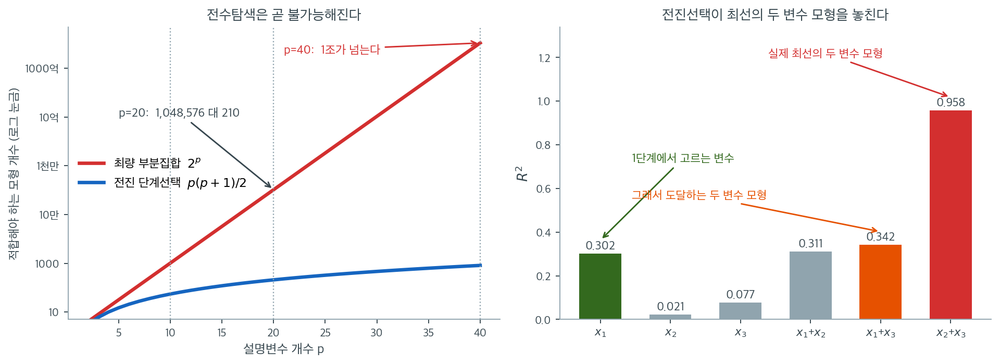
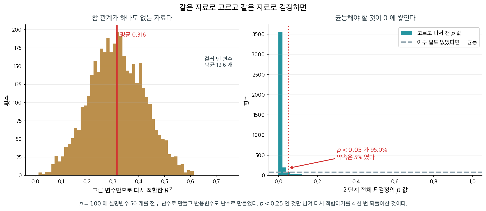
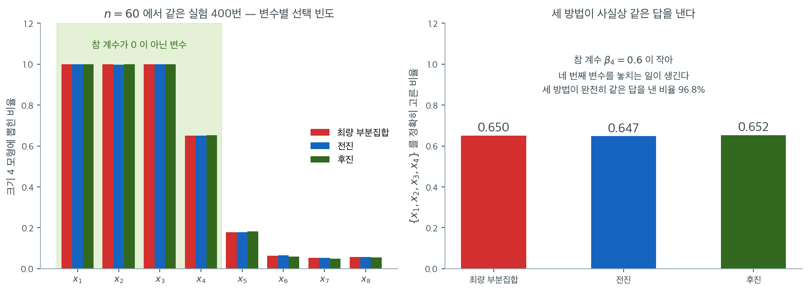

# 부분집합 선택과 단계적 선택

## 개요

설명변수가 $p$ 개면 고를 수 있는 부분집합이 $2^p$ 개다. 이 쪽은 그 수를 먼저 세어 **왜 전수탐색이 금방 불가능해지는지** 보이고, 그 대가로 쓰는 탐욕적 방법 셋(최량 부분집합·전진·후진)과 그 변형을 적은 뒤, 고른 모형을 무엇으로 판정하는지와 **이 방법들이 왜 비판받는지**를 차례로 다룬다. 마지막에 설명변수 여덟 개(참으로 관련 있는 것 넷, 잡음 넷)인 인공자료로 세 방법을 끝까지 돌려 보고, 같은 실험을 $400$ 번 되풀이해 세 방법이 얼마나 자주 갈라지는지 센다.

---

## 1. 전수탐색의 비용과 탐욕적 탐색의 대가

세 방법의 값을 먼저 적어 둔다. 적합해야 할 모형의 개수가 방법을 고르는 이유의 거의 전부다.

### 최량 부분집합은 2ᵖ 개를 적합한다

적합해야 할 모형의 총 개수는

$$
\sum_{k=0}^{p} \binom{p}{k} = 2^p
$$

이는 지수적으로 늘어난다. $p = 10$이면 $2^{10} = 1{,}024$개로 감당할 만하다. $p = 20$이면 백만 개를 넘고, $p = 40$이면 1조 개를 넘어 전수 탐색이 비현실적이 된다.

!!! warning "$p$가 크면 최량 부분집합은 불가능하다"
    최량 부분집합 선택은 보통 $p \leq 20$ 정도의 문제로 제한된다. 설명변수 집합이 더 크면 단계적 방법이나 정칙화 접근(릿지, 라쏘, 엘라스틱넷)이 필요하다.

### 전진과 후진은 p(p+1)/2 개를 적합한다

단계 $k$에서 전진 선택은 $p - k$개의 모형을 적합한다. 총합은

$$
\sum_{k=0}^{p-1} (p - k) = \frac{p(p+1)}{2}
$$

$O(p^2)$이므로 최량 부분집합의 $2^p$보다 훨씬 작다. $p = 20$이면 전진 선택은 210개 모형만 적합하지만 최량 부분집합은 백만 개가 넘는다.

적합하는 모형의 총 개수는 전진 선택과 같은 $p(p+1)/2$이다.



왼쪽이 두 계산 비용을 겹쳐 놓은 것이다. 세로축이 로그 눈금인데도 붉은 $2^p$가 직선으로 치솟는다. $p = 10$에서는 $1{,}024$개 대 $55$개로 둘 다 감당할 만하지만, $p = 20$에서 $1{,}048{,}576$개 대 $210$개로 **오천 배** 차이가 나고, $p = 40$에서는 $1$조 개를 넘는 $1{,}099{,}511{,}627{,}776$개 대 $820$개가 된다. 초당 백만 개의 모형을 적합할 수 있다 해도 $p = 40$의 전수탐색에는 $12$일이 걸린다. $p$가 하나 늘 때마다 비용이 두 배가 된다는 사실이 이 곡선의 전부다.

오른쪽이 그 절약의 대가다. 설명변수 셋짜리 자료를 일부러 이렇게 만들었다. $x_2$와 $x_3$은 상관이 $0.9$로 거의 같은 변수인데 $y$는 **그 둘의 차이**로 만들어져 있다. 그래서 $x_2$ 하나만으로는 $R^2 = 0.021$, $x_3$ 하나만으로는 $0.077$에 지나지 않지만, 둘을 함께 넣으면 $R^2 = 0.958$로 껑충 뛴다. 한편 $x_1$은 그 차이를 잡음과 섞어 만든 변수라 단독 $R^2$이 $0.302$로 셋 중 가장 크다.

전진선택은 1단계에서 반드시 $x_1$을 고른다. 셋 중 단독 설명력이 가장 크기 때문이다. 그러면 2단계에서 도달할 수 있는 최선은 $\{x_1, x_3\}$으로 $R^2 = 0.342$다. **최선의 두 변수 모형 $\{x_2, x_3\}$의 $0.958$과 견주면 거의 세 배 차이**인데, 전진선택은 그 모형을 쳐다볼 기회조차 없다. $x_2$도 $x_3$도 1단계에서 뽑히지 못했기 때문이다. 이것이 통계학에서 **억제 효과**라 부르는 상황이며, 변수들이 서로 상관되어 있을 때 탐욕적 탐색이 실패하는 전형적인 방식이다. 절약이 늘 공짜는 아니다.

---

## 2. 세 방법

### 최량 부분집합 선택

**최량 부분집합 선택**은 $p$개 후보 설명변수의 가능한 모든 부분집합을 평가하여 주어진 기준을 최적화하는 것을 고른다.

1. 각 $k = 0, 1, \ldots, p$에 대해 정확히 $k$개의 설명변수를 담은 $\binom{p}{k}$개의 모형을 모두 적합한다.
2. 크기가 $k$인 모형들 가운데 SSE가 가장 작은(동등하게 $R^2$가 가장 큰) 것을 찾아 $\mathcal{M}_k$라 한다.
3. 복잡도에 벌점을 주는 기준(수정 $R^2$, AIC, BIC, 교차검증 오차)으로 $\mathcal{M}_0, \mathcal{M}_1, \ldots, \mathcal{M}_p$ 가운데 전체 최선 모형을 고른다.

### 전진 단계적 선택

**전진 단계적 선택**은 절편만 있는 모형에서 시작하여 설명변수를 하나씩 더해 나간다.

1. $\mathcal{M}_0$을 절편만 있는 모형(설명변수 없음)이라 한다.
2. $k = 0, 1, \ldots, p-1$에 대해 이렇게 된다.
    - 아직 모형에 없는 $p - k$개의 설명변수를 모두 고려한다.
    - SSE를 가장 크게 줄이는(동등하게 부분 F 통계량이 가장 크거나 p값이 가장 작은) 설명변수를 넣는다.
    - 그 결과 모형을 $\mathcal{M}_{k+1}$이라 한다.
3. 수정 $R^2$, AIC, BIC, 교차검증으로 $\mathcal{M}_0, \mathcal{M}_1, \ldots, \mathcal{M}_p$ 가운데 최선 모형을 고른다.

전진 선택은 탐욕적 알고리즘이다. 한번 모형에 들어간 설명변수는 영원히 남는다. 곧 최선의 두 변수 모형에 포함된 변수 가운데 어느 것도 단독으로 최선이 아니라면 전진 선택은 그 모형을 찾아내지 못한다. 모형 공간 전체가 아니라 그 안의 한 경로만 탐색하기 때문이다.

### 후진 단계적 선택

**후진 단계적 선택**은 완전모형에서 시작하여 설명변수를 하나씩 뺀다.

1. $\mathcal{M}_p$를 $p$개 설명변수를 모두 담은 완전모형이라 한다.
2. $k = p, p-1, \ldots, 1$에 대해 이렇게 된다.
    - 현재 모형에 있는 $k$개 설명변수를 각각 빼 보는 것을 고려한다.
    - 뺐을 때 SSE 증가가 가장 작은(동등하게 부분 F 통계량이 가장 작거나 p값이 가장 큰) 설명변수를 뺀다.
    - 그 결과 모형을 $\mathcal{M}_{k-1}$이라 한다.
3. 복잡도에 벌점을 주는 기준으로 $\mathcal{M}_0, \mathcal{M}_1, \ldots, \mathcal{M}_p$ 가운데 최선 모형을 고른다.

후진 선택은 $n > p$를 요구한다. 관측값보다 설명변수가 많으면 완전모형을 적합할 수 없기 때문이다. 전진 선택에는 이런 제약이 없어 고차원 상황($p > n$)에서도, 알고리즘이 설명변수 $n$개를 넘기 전에 멈추기만 하면 적용할 수 있다.

---

## 3. 혼합 접근

전진과 후진 단계를 결합하는 구현도 있다.

- **단계적 회귀**(양방향): 각 단계에서 새 설명변수를 넣는 것과 기존 설명변수를 빼는 것을 모두 고려한다. 앞 단계에서 들어온 설명변수도 다른 변수들이 들어온 뒤 중복이 되면 나중에 빠질 수 있다. 순수한 전진이나 후진보다 유연성이 커진다.

- **순차 교체**: 전진 선택을 마친 뒤, 포함된 설명변수 각각을 제외된 설명변수 각각과 바꿔 보고 기준이 좋아지는 교체를 채택한다.

---

## 4. 선택 기준

각 알고리즘의 3단계에서 어떤 기준을 쓰느냐가 결과에 큰 영향을 준다.

| 기준 | 공식 | 경향 |
|-----------|---------|----------|
| 수정 $R^2$ | $1 - \frac{\text{SSE}/(n-p-1)}{\text{SST}/(n-1)}$ | 중간 정도의 복잡도 |
| AIC | $2k + n\ln(\text{SSE}/n)$ | 예측 지향 |
| BIC | $k\ln n + n\ln(\text{SSE}/n)$ | 절약적 |
| 교차검증 오차 | $\text{CV}_{(K)}$ | 예측오차의 직접 추정 |

복잡도 벌점 없이 SSE나 $R^2$만 쓰면 언제나 가장 큰 모형이 선택되어 변수선택의 목적이 무너진다.

### 최적 크기 고르기

훈련 RSS는 $k$에 따라 언제나 줄어들므로, 최적 $k$는 남겨 둔 자료에서 계산한 기준(검증 RSS, 교차검증, AIC, BIC)을 최소화하여 고른다.

---

## 5. 단계적 방법에 대한 비판

단계적 방법은 실무에서 여전히 널리 쓰이지만 잘 알려진 결함이 있다.

**p값 부풀림**: 설명변수를 순차적으로 여럿 검정하면 우연히 허위 설명변수가 포함될 가능성이 커진다. 최종 단계적 모형의 p값은 그 모형에 이르게 한 탐색 과정을 반영하지 않으므로 지나치게 낙관적이다.

**불안정성**: 자료가 조금만 달라져도 선택되는 모형이 크게 달라질 수 있다. 어떤 자료에서 아슬아슬하게 들어온 설명변수가 조금 흔들린 같은 자료에서는 제외될 수 있다.

**편향된 계수**: 선택된 모형의 계수는 0에서 멀어지는 쪽으로 편향된다. 선택 과정이 추정된 효과가 큰 설명변수를 우선적으로 남기는데, 그중 일부는 우연히 커진 것이기 때문이다.

**다중공선성 무시**: 단계적 방법은 상관된 설명변수를 명시적으로 다루지 않는다. 두 설명변수가 강하게 상관되어 있으면 둘이 비슷한 정보를 담고 있는데도 임의로 하나만 넣고 다른 하나를 뺄 수 있다.

!!! note "현대적 대안"
    정칙화 방법(릿지, 라쏘, 엘라스틱넷)은 포함/배제라는 이분법적 결정 대신 계수를 0 쪽으로 축소하여 이 비판들 상당수에 대처한다. 특히 라쏘는 $\ell_1$ 벌점의 부산물로 변수선택을 수행하여 단계적 방법의 원칙 있는 대안이 된다.

---

<div class="storybox" markdown>

**그림으로 보는 통계학 1.** 잡음 쉰 개로 유의한 모형 만들기

위의 비판 넷은 말로는 다 맞는 말인데, 듣고 나서도 「그래 봐야 얼마나 되겠나」 싶은 것이
사람 마음이다. $1983$ 년에 **데이비드 프리드먼**이 그 「얼마나」를 수로 적어 보였다.

실험은 두 줄이면 끝난다. 관측값 $100$ 개에 설명변수 $50$ 개를 두는데, **설명변수도
반응변수도 전부 난수로 만든다.** 참 관계가 하나도 없다. 그러고 나서 실무가 늘 하는 일을
한다 — 다 넣고 돌려서 **$p$ 가 작은 것만 남기고**, 남은 것으로 다시 돌린다.

<figure markdown>
  { width=980 }
  <figcaption markdown>참 관계가 **하나도 없는** 자료에서 나온 그림이다. 왼쪽 $R^2$ 의 평균이 $0.316$ 이고, 오른쪽은 균등분포여야 할 $p$ 값이 $0$ 에 쌓여 **$95.0\%$ 가 $0.05$ 아래**다. 자료에서 직접 그렸다.</figcaption>
</figure>

수로 적으면 이렇다.

| 단계 | 결과 |
|---|---|
| 1 단계 — $50$ 개 전부 | $R^2 = 0.508$ (이론값 $p/(n-1) = 0.505$) |
| 걸러진 변수 | 평균 $12.6$ 개 (기대 $50 \times 0.25 = 12.5$) |
| 2 단계 — 고른 것만 | $R^2 = 0.316$ |
| 2 단계 전체 $F$ 검정 | $p$ 중앙값 $0.0007$ · **$p<0.05$ 가 $95.0\%$** |

$1$ 단계의 $R^2 = 0.508$ 은 놀랍지 않다. 변수를 $50$ 개나 넣었으니 자유도를 그만큼 쓴
것이고, $p/(n-1)$ 이라는 기댓값이 그대로 나온 것뿐이다. **놀라운 것은 아랫줄이다.**
변수를 열둘로 줄여 $R^2$ 이 $0.316$ 으로 내려앉았는데도, 그 모형이 「우연으로 설명되지
않는다」고 말하는 $F$ 검정이 **스무 번에 열아홉 번** 기각한다. $5\%$ 만 틀리겠다고 약속한
검정이다.

까닭은 이 절이 첫 줄에 적은 그대로다 — **$2$ 단계의 $F$ 통계량은 더 이상 $F$ 분포를 따르지
않는다.** $F$ 분포는 「변수를 미리 정해 두고」 세었을 때의 분포인데, 여기서는 자료를 보고
큰 것만 골라 놓았다. 고르는 행위가 이미 자료를 한 번 썼고, 검정은 그 사실을 모른다.

**그래서 단계적 선택의 진짜 문제는 변수를 잘못 고르는 것이 아니다.** 고르고 나서 내놓는
$p$ 값·$R^2$·신뢰구간이 **전부 틀린 눈금 위에 있다**는 것이다. 보고서에 적힌 수들이 모두
낙관 쪽으로 기울어 있고, 기울어진 크기가 위의 표만큼이다.

고치는 길은 둘이다. 하나는 고르는 데 쓴 자료와 검정하는 데 쓰는 자료를 **나누는** 것이고
(교차검증이 하는 일이다), 다른 하나는 고르는 일 자체를 추정 안에 넣어 그 대가를 식에
적어 두는 것이다 — 위 상자가 가리킨 라쏘가 뒤쪽이다.

_확인한 곳 — D. A. Freedman, 「A Note on Screening Regression Equations」, 『The American Statistician』 $37$권 $2$호($1983$). 관측값 $100$ 개에 난수 설명변수 $50$ 개를 두고 유의한 것만 남겨 다시 적합하면 $R^2$ 과 $F$ 가 크게 나온다는 것이 그 논문의 내용이고, 이 현상을 「프리드먼의 역설」이라 부른다 · 표와 그림의 수치는 $4$ 천 번 되풀이해 이 쪽이 직접 쟀다_

</div>

---

## 6. 세 방법을 수로 따라가기

### 실험용 자료

<div class="exbox" markdown>

**보기 1.** <span class="diff easy" title="쉬움"></span> 실험용 자료. 설명변수 여덟 개 가운데 앞의 넷만 참 계수가 $0$ 이 아닌 자료 $200$ 개를 만든다.

**(1)** 참 계수 $3.0,\ 1.5,\ -2.0,\ 0.8$ 의 **신호 세기**를 추정값의 표준오차 단위로 미리 계산하시오. 네 변수가 모두 쉽게 발견될 것인가.

**(2)** 아래 그림의 "어려운 설정"($n = 60$, $\beta_4 = 0.6$)에서 같은 셈을 해 보고, 세 방법이 거기서 $35\%$ 틀리는 까닭을 설명하시오. 이 자료의 모집단 $R^2$ 도 구하시오.

</div>

??? success "풀이"

    **(1) 표준오차를 미리 알 수 있다.** 설명변수가 서로 독립인 표준정규이므로 $\mathbf{X}^\top\mathbf{X} \approx n\mathbf{I}$ 이고

    $$
    \mathrm{SE}(\hat\beta_j) \approx \frac{\sigma}{\sqrt{n}} = \frac{2}{\sqrt{200}} = 0.1414
    $$

    이다. 그러면 각 참 계수의 기대 $t$ 값은 $\beta_j / 0.1414$ 로

    $$
    \frac{3.0}{0.1414} = 21.2,
    \quad \frac{1.5}{0.1414} = 10.6,
    \quad \frac{-2.0}{0.1414} = -14.1,
    \quad \frac{0.8}{0.1414} = 5.7
    $$

    이다. **가장 약한 신호도 $t = 5.7$** 이니 넷 모두 거의 확실하게 발견된다. 어떤 선택법을 쓰든 같은 답이 나올 조건이다.

    **(2) 어려운 설정에서는 사정이 다르다.** $n = 60$, $\sigma = 2$, $\beta_4 = 0.6$ 이면

    $$
    \mathrm{SE} \approx \frac{2}{\sqrt{60}} = 0.2582,
    \qquad t \approx \frac{0.6}{0.2582} = 2.32
    $$

    이다. $t = 2.32$ 는 유의수준 $5\%$ 를 겨우 넘는 값이고, 표본을 다시 뽑으면 $t$ 가 $1.3$ 이 되거나 $3.3$ 이 되는 일이 예사다($t$ 의 표준편차가 $1$ 이다). 곧 $x_4$ 를 찾아낼 확률이 대략 $P(t > 2) \approx 0.63$ 쯤이고, 쪽의 그림에서 $x_4$ 가 뽑힌 비율이 $0.65$ 인 것과 맞아떨어진다.

    **그러므로 $35\%$ 의 실패는 알고리즘의 결함이 아니다.** 자료에 그만큼의 정보밖에 없다.

    **모집단 $R^2$.** 설명변수가 독립인 표준정규이므로 신호의 분산이 계수의 제곱합이다.

    $$
    \operatorname{Var}(\mathbf{x}^\top\boldsymbol\beta) = 3.0^2 + 1.5^2 + 2.0^2 + 0.8^2 = 9 + 2.25 + 4 + 0.64 = 15.89
    $$

    이고 $\sigma^2 = 4$ 이므로

    $$
    R^2_{\text{pop}} = \frac{15.89}{15.89 + 4} = 0.7989
    $$

    이다.
    ```python
    import numpy as np
    from sklearn.linear_model import LinearRegression

    # 앞의 넷만 참 계수가 0 이 아니다. 세 방법이 이 넷을 찾아내는지 견준다.
    np.random.seed(42)
    n, p = 200, 8
    X = np.random.randn(n, p)
    true_beta = np.array([3.0, 1.5, -2.0, 0.8, 0, 0, 0, 0])
    y = X @ true_beta + np.random.normal(0, 2, n)
    names = [f"x{i+1}" for i in range(p)]
    ```

    ```python
    import statsmodels.api as sm

    print(f"sigma/sqrt(n) = {2 / np.sqrt(n):.4f}")
    fit = sm.OLS(y, sm.add_constant(X)).fit()
    print("실제 SE  :", fit.bse[1:].round(4))
    print("기대 t   :", (true_beta / (2 / np.sqrt(n))).round(2))
    print("실제 t   :", fit.tvalues[1:].round(2))
    print("추정 계수:", fit.params[1:].round(3))
    V_signal = (true_beta ** 2).sum()
    print(f"모집단 R^2 = {V_signal} / ({V_signal} + 4) = {V_signal / (V_signal + 4):.4f},  실제 R^2 = {fit.rsquared:.4f}")
    print(f"그림의 어려운 설정(n=60, beta4=0.6)에서 기대 t = {0.6 / (2 / np.sqrt(60)):.2f}")
    ```

    출력:

    ```
    sigma/sqrt(n) = 0.1414
    실제 SE  : [0.1547 0.1426 0.1396 0.1381 0.1449 0.1272 0.1364 0.135 ]
    기대 t   : [ 21.21  10.61 -14.14   5.66   0.     0.     0.     0.  ]
    실제 t   : [ 18.64  10.39 -13.14   6.02  -1.15  -0.15  -0.07   0.74]
    추정 계수: [ 2.884  1.481 -1.834  0.832 -0.166 -0.019 -0.01   0.1  ]
    모집단 R^2 = 15.89 / (15.89 + 4) = 0.7989,  실제 R^2 = 0.7790
    그림의 어려운 설정(n=60, beta4=0.6)에서 기대 t = 2.32
    ```

    **(1)의 어림이 잘 맞는다.** 어림한 $\mathrm{SE} = 0.1414$ 와 실제 표준오차 $0.1272 \sim 0.1547$ 이 같은 자리 수다. 기대 $t$ 값 $(21.2,\ 10.6,\ -14.1,\ 5.7)$ 과 실제 $(18.6,\ 10.4,\ -13.1,\ 6.0)$ 이 나란히 놓인다. 차이는 표본의 운이며, $t$ 의 표준편차가 $1$ 이라는 것을 생각하면 $21.2$ 대 $18.6$ 은 $2.6$ 표준편차로 다소 큰 쪽이지만 설명변수의 실현된 분산이 작았던 몫이 섞여 있다.

    **가장 약한 넷째 신호도 $t = 6.0$ 이다.** 잡음 변수 넷의 실제 $t$ 는 $-1.15,\ -0.15,\ -0.07,\ 0.74$ 로 모두 $\pm 2$ 안에 있다. **신호와 잡음의 간격이 $6.0$ 과 $1.15$ 로 또렷하다.** 이것이 아래 세 방법이 모두 같은 답을 내게 되는 까닭이다.

    **(2) 어려운 설정의 $t = 2.32$ 가 확인된다.** 이 자료의 $5.66$ 과 견주면 **$2.4$ 배 약한 신호**다. $t$ 가 $2.3$ 근처면 표본마다 발견 여부가 바뀌므로, 선택법의 성능 차이가 아니라 자료의 한계가 결과를 지배한다.

    모집단 $R^2$ 는 $0.7989$ 이고 이 표본의 실제 $R^2$ 는 $0.7790$ 이다. $0.02$ 낮은 것은 이 표본에서 실현된 잡음이 참값보다 컸기 때문이다. **그리고 이 $R^2$ 는 모수 $9$ 개를 쓴 전체 모형의 값**이므로, 참 변수 넷만 쓴 모형의 $R^2$ 와 견주면 그 차이가 잡음 변수가 가져간 몫이 된다.

    마지막으로 추정 계수를 읽어 두자. $(2.884,\ 1.481,\ -1.834,\ 0.832)$ 로 참값 $(3.0,\ 1.5,\ -2.0,\ 0.8)$ 에 가깝고, 잡음 쪽은 $(-0.166,\ -0.019,\ -0.010,\ 0.100)$ 으로 $0$ 에 가깝다. **참 모형을 아는 인공자료로 실험하는 값어치가 여기 있다.** 선택법이 고른 것이 옳은지 틀렸는지 판정할 수 있다.

### 크기별로 남김없이

<div class="exbox" markdown>

**보기 2.** <span class="diff easy" title="쉬움"></span> 최적 부분집합 선택. 크기 $k$ 마다 가능한 조합을 남김없이 적합해 훈련 RSS 가 가장 작은 것을 고른다.

**(1)** 이 함수가 적합하는 모형의 개수를 $p = 8$ 에서 세고, $p = 20$ 에서 얼마가 되는지 적으시오.

**(2)** 최량 부분집합의 RSS 가 $k$ 에 대해 **줄기만 한다**는 것을 증명하고 수로 확인하시오. 그러면 이 함수만으로 최적 $k$ 를 고를 수 있는가.

</div>

??? success "풀이"

    **(1) $2^p - 1$ 개다.** 크기 $k$ 의 부분집합이 $\binom{p}{k}$ 개이고 $k$ 를 $1$ 부터 $p$ 까지 돌므로

    $$
    \sum_{k=1}^{p}\binom{p}{k} = 2^p - 1
    $$

    이다(공집합만 뺀 것). $p = 8$ 이면 $255$ 개이고, 크기별로는 $8, 28, 56, 70, 56, 28, 8, 1$ 로 가운데가 가장 두껍다.

    $p = 20$ 이면 $2^{20} - 1 = 1{,}048{,}575$ 개다. 적합 한 번이 $0.1$ 밀리초라도 두 분쯤 걸린다. $p = 30$ 이면 $10$ 억 개를 넘어 **현실적으로 불가능**하다.

    **(2) 줄기만 한다.** 크기 $k$ 의 최적 집합을 $\mathcal{S}^*_k$ 라 하자. 아무 변수 $j \notin \mathcal{S}^*_k$ 를 더한 $\mathcal{S}^*_k \cup \{j\}$ 는 크기가 $k+1$ 이고, 열을 더하면 사영 공간이 커지므로

    $$
    \mathrm{RSS}\bigl(\mathcal{S}^*_k \cup \{j\}\bigr) \le \mathrm{RSS}\bigl(\mathcal{S}^*_k\bigr)
    $$

    이다. 한편 $\mathcal{S}^*_k \cup \{j\}$ 는 크기 $k+1$ 의 후보 가운데 하나이므로 최솟값은 그보다 작거나 같다. 따라서

    $$
    \mathrm{RSS}_{\text{best}}(k+1) \le \mathrm{RSS}\bigl(\mathcal{S}^*_k \cup \{j\}\bigr) \le \mathrm{RSS}_{\text{best}}(k)
    $$

    **그러므로 이 함수만으로는 최적 $k$ 를 고를 수 없다.** $k$ 를 키우면 RSS 가 결코 늘지 않으니 $k = p$ 가 언제나 "최선" 이 된다. 크기를 고르는 일은 훈련 RSS 밖의 기준 — 검증 RSS, 교차검증, AIC, BIC — 에 맡겨야 한다. 쪽머리의 "최적 크기 고르기" 가 그 이야기다.

    눈여겨볼 것은 $\mathcal{S}^*_k \subset \mathcal{S}^*_{k+1}$ 이 **보장되지 않는다**는 점이다. 위 증명은 "$\mathcal{S}^*_k$ 에 뭘 더한 것보다 좋다" 만 말하고, 실제 $\mathcal{S}^*_{k+1}$ 이 $\mathcal{S}^*_k$ 를 품을 필요는 없다. 이것이 전수탐색이 단계적 방법과 갈릴 수 있는 자리다.
    ```python
    from itertools import combinations

    def best_subset(X, y, max_k=None):
        """모든 부분집합을 다 따져 크기별 최선을 찾는다.

        크기 k 마다 가능한 조합을 남김없이 본다. 답은 확실하지만 부분집합이
        2^p 개라 변수가 스물만 넘어도 감당할 수 없다.
        """
        n, p = X.shape
        if max_k is None:
            max_k = p
        results = {}
        for k in range(1, max_k + 1):
            best_rss, best_features = np.inf, None
            for combo in combinations(range(p), k):
                model = LinearRegression().fit(X[:, combo], y)
                rss = np.sum((y - model.predict(X[:, combo])) ** 2)
                if rss < best_rss:
                    best_rss, best_features = rss, combo
            results[k] = {"features": best_features, "rss": best_rss}
        return results
    ```

    ```python
    from math import comb

    print("크기별 후보 개수:", [comb(p, k) for k in range(1, p + 1)])
    print(f"합 = {sum(comb(p, k) for k in range(1, p + 1))},  2^p - 1 = {2 ** p - 1}")
    print(f"p = 20 이면 {2 ** 20 - 1:,} 개")

    best = best_subset(X, y)
    print("  k  변수집합                     RSS")
    for k in range(1, p + 1):
        print(f"  {k}  {str(best[k]['features']):28s} {best[k]['rss']:9.3f}")
    print("RSS 가 k 에 대해 단조감소:",
          all(best[k + 1]['rss'] <= best[k]['rss'] + 1e-9 for k in range(1, p)))
    ```

    출력:

    ```
    크기별 후보 개수: [8, 28, 56, 70, 56, 28, 8, 1]
    합 = 255,  2^p - 1 = 255
    p = 20 이면 1,048,575 개
      k  변수집합                     RSS
      1  (0,)                          1972.005
      2  (0, 2)                        1303.749
      3  (0, 1, 2)                      861.547
      4  (0, 1, 2, 3)                   711.610
      5  (0, 1, 2, 3, 4)                707.136
      6  (0, 1, 2, 3, 4, 7)             705.141
      7  (0, 1, 2, 3, 4, 5, 7)          705.057
      8  (0, 1, 2, 3, 4, 5, 6, 7)       705.038
    RSS 가 k 에 대해 단조감소: True
    ```

    **(1)의 셈이 맞는다.** 크기별 후보가 $8, 28, 56, 70, 56, 28, 8, 1$ 이고 합이 $255 = 2^8 - 1$ 이다. 가운데 $k = 4$ 에서 $70$ 개로 가장 많다.

    **(2) 단조감소가 확인된다.** $1972.0 \to 1303.7 \to 861.5 \to 711.6 \to 707.1 \to 705.1 \to 705.1 \to 705.0$ 으로 한 번도 올라가지 않는다.

    그리고 이 표가 (2)의 결론을 그대로 보여 준다. **훈련 RSS 만 보면 $k = 8$ 이 이긴다.** 그러나 $k = 4$ 에서 $8$ 로 가며 줄어든 양은 $711.610 - 705.038 = 6.57$ 로, $k = 1$ 에서 $4$ 로 가며 줄어든 $1260$ 의 **$0.5\%$** 다. 잡음 변수 넷을 더해 얻은 것이 그만큼이다.

    이 자료에서는 운 좋게 $\mathcal{S}^*_k$ 가 모두 중첩되어 있다. $(0) \subset (0,2) \subset (0,1,2) \subset (0,1,2,3) \subset \cdots$ 로 쌓인다. 유도에서 말했듯 보장된 일이 아니고, 설명변수가 서로 독립이어서 생긴 결과다. 또한 **$k \le 4$ 에서 고른 집합이 참 변수 $\{x_1, x_2, x_3, x_4\}$ 의 부분집합**이라는 점도 확인해 둘 만하다. 크기 $5$ 부터는 잡음 변수 $x_5$(색인 $4$)가 끼어든다.

### 하나씩 더하기

<div class="exbox" markdown>

**보기 3.** <span class="diff easy" title="쉬움"></span> 전진 단계선택. 빈 모형에서 시작해 RSS 를 가장 많이 줄이는 변수를 하나씩 더한다.

**(1)** 이 함수가 적합하는 모형의 개수를 세고 보기 2 의 $255$ 와 견주시오. $p = 20$ 이면 두 수가 각각 얼마가 되는가.

**(2)** 크기마다 전진선택의 RSS 를 최량 부분집합의 RSS 와 나란히 찍어, 탐욕적 경로가 전역 최적을 놓쳤는지 확인하시오.

</div>

??? success "풀이"

    **(1) 모형 수는 $p(p+1)/2$ 다.** 첫 단계에서 후보가 $p$ 개, 둘째 단계에서 남은 $p-1$ 개, …, 마지막 단계에서 $1$ 개이므로

    $$
    p + (p-1) + \cdots + 1 = \frac{p(p+1)}{2}
    $$

    이고 $p = 8$ 이면 $36$ 이다. 보기 2 의 $255$ 와 비교하면 $7.1$ 배 적다.

    **차이는 $p$ 가 커질 때 폭발한다.** 하나는 $O(p^2)$, 다른 하나는 $O(2^p)$ 다. $p = 20$ 에서는

    $$
    \frac{20 \cdot 21}{2} = 210
    \qquad\text{대}\qquad
    2^{20} - 1 = 1{,}048{,}575
    $$

    로 $5000$ 배 차이가 된다. $p = 40$ 이면 $820$ 대 $1.1 \times 10^{12}$ 다. 전수탐색이 $p \le 20$ 쯤에서 멈추는 까닭이 이것이다.

    **(2) 놓칠 수 있다.** 전진선택은 한 번 들어간 변수를 다시 빼지 않으므로, 단계 $k$ 에서 고른 집합이 단계 $k+1$ 의 최적 집합에 들어 있지 않으면 거기서부터 어긋난다. 연습문제 5 가 증명하는 대로

    $$
    \mathrm{RSS}_{\text{best}}(k) \le \mathrm{RSS}_{\text{fwd}}(k)
    $$

    이고, 등호가 성립하는지는 자료에 달려 있다.

    이 자료에서는 등호를 기대할 만하다. 설명변수 여덟 개가 서로 독립인 표준정규이므로 설계행렬이 거의 직교이고, 그러면 변수 하나가 줄이는 RSS 가 다른 변수의 유무에 거의 영향받지 않는다. 곧 **"RSS 를 가장 많이 줄이는 것부터 차례로" 가 곧 전역 최적**이 된다. 확인해 보자.
    ```python
    def forward_stepwise(X, y):
        """빈 모형에서 시작해 RSS 를 가장 많이 줄이는 변수를 하나씩 더한다.

        따지는 모형이 p(p+1)/2 개로 줄어 훨씬 빠르다. 다만 한 번 들어간 변수는
        빠지지 않으므로 최적 부분집합을 놓칠 수 있다.
        """
        n, p = X.shape
        selected, remaining = [], list(range(p))
        results = {}
        for k in range(1, p + 1):
            best_rss, best_feature = np.inf, None
            for f in remaining:
                trial = selected + [f]
                model = LinearRegression().fit(X[:, trial], y)
                rss = np.sum((y - model.predict(X[:, trial])) ** 2)
                if rss < best_rss:
                    best_rss, best_feature = rss, f
            selected.append(best_feature)
            remaining.remove(best_feature)
            results[k] = {"features": tuple(selected), "rss": best_rss}
        return results
    ```

    ```python
    print(f"forward 가 따지는 모형 수 = p + (p-1) + ... + 1 = {p * (p + 1) // 2},  "
          f"best_subset 은 {2 ** p - 1} (비 {(2 ** p - 1) / (p * (p + 1) // 2):.1f}배)")
    print(f"p = 20 이면 {20 * 21 // 2} 대 {2 ** 20 - 1:,}")

    fwd = forward_stepwise(X, y)
    print("들어온 순서:", fwd[p]['features'])
    print("  k  변수집합(정렬)              fwd RSS     best RSS   차이")
    for k in range(1, p + 1):
        print(f"  {k}  {str(tuple(sorted(fwd[k]['features']))):28s} {fwd[k]['rss']:9.3f}  "
              f"{best[k]['rss']:9.3f}  {fwd[k]['rss'] - best[k]['rss']:.2e}")
    ```

    출력:

    ```
    forward 가 따지는 모형 수 = p + (p-1) + ... + 1 = 36,  best_subset 은 255 (비 7.1배)
    p = 20 이면 210 대 1,048,575
    들어온 순서: (0, 2, 1, 3, 4, 7, 5, 6)
      k  변수집합(정렬)              fwd RSS     best RSS   차이
      1  (0,)                          1972.005   1972.005  0.00e+00
      2  (0, 2)                        1303.749   1303.749  0.00e+00
      3  (0, 1, 2)                      861.547    861.547  0.00e+00
      4  (0, 1, 2, 3)                   711.610    711.610  1.14e-13
      5  (0, 1, 2, 3, 4)                707.136    707.136  0.00e+00
      6  (0, 1, 2, 3, 4, 7)             705.141    705.141  1.14e-13
      7  (0, 1, 2, 3, 4, 5, 7)          705.057    705.057  -2.27e-13
      8  (0, 1, 2, 3, 4, 5, 6, 7)       705.038    705.038  0.00e+00
    ```

    **(1)의 셈이 맞는다.** $36$ 대 $255$ 로 $7.1$ 배이고, $p = 20$ 에서 $210$ 대 $1{,}048{,}575$ 다.

    **(2) 하나도 놓치지 않았다.** 여덟 크기 모두에서 전진선택과 최량 부분집합의 변수집합이 같고 RSS 의 차이가 $10^{-13}$ 아래다. 유도한 예측대로다. (차이가 $k = 7$ 에서 $-2.27 \times 10^{-13}$ 으로 음수인데, 부등식을 어긴 것이 아니라 두 경로가 같은 모형을 다른 순서의 열로 적합해 생긴 반올림 차이다.)

    들어온 순서는 $x_1, x_3, x_2, x_4$ 다(색인 $0, 2, 1, 3$). 참 계수의 절대값이 $3.0,\ 2.0,\ 1.5,\ 0.8$ 인 순서와 정확히 같다. **설명변수가 직교이면 전진선택의 순서가 효과 크기의 순서가 된다.** 그 뒤의 $x_5, x_8, x_6, x_7$ 은 계수가 모두 $0$ 이므로 순서에 뜻이 없다.

    RSS 가 줄어드는 폭도 읽을 거리다. $1972 \to 1304 \to 862 \to 712$ 까지 네 걸음에서 $1260$ 이 줄고, 그 뒤 네 걸음에서는 $712 \to 705$ 로 $7$ 밖에 줄지 않는다. **네 번째와 다섯 번째 사이에 꺾임이 있다.** 참 모형의 크기가 $4$ 라는 신호이며, 다만 훈련 RSS 는 계속 줄기만 하므로 이 꺾임을 눈으로 보는 것 말고 기준이 필요하다. 그것이 연습문제 2 의 검증 RSS 와 연습문제 6 의 AIC 다.

### 하나씩 빼기

<div class="exbox" markdown>

**보기 4.** <span class="diff easy" title="쉬움"></span> 후진 단계선택. 전체 모형에서 시작해 RSS 를 가장 적게 늘리는 변수를 하나씩 뺀다.

**(1)** 이 함수가 적합하는 모형의 개수를 세어 전진선택과 견주시오. 그리고 `n > p` 가 필요한 까닭을 $n = 6$, $p = 8$ 에서 수로 보이시오.

**(2)** 세 방법(최량 부분집합·전진·후진)이 **모든 크기 $k$ 에서** 같은 변수집합을 골랐는지 확인하시오. 같다면 그 사실에서 무엇을 읽어야 하는가.

</div>

??? success "풀이"

    **(1) 적합 횟수는 전진선택과 같다.** 먼저 전체 모형 하나를 적합하고($1$ 번), 그다음 크기를 $p-1$ 로 줄일 때 후보가 $p$ 개, $p-2$ 로 줄일 때 $p-1$ 개, …, 크기 $1$ 로 줄일 때 $2$ 개다. 합하면

    $$
    1 + \bigl(p + (p-1) + \cdots + 2\bigr) = 1 + \left(\frac{p(p+1)}{2} - 1\right) = \frac{p(p+1)}{2}
    $$

    이다. $p = 8$ 이면 $36$ 으로 **전진선택과 정확히 같다.** 방향만 반대이고 셈의 구조는 같다.

    **`n > p` 가 필요한 까닭.** 후진선택은 전체 모형을 적합하는 데서 출발한다. 설계행렬이 $n \times (p+1)$ 이므로 rank 가 $\min(n, p+1)$ 을 넘을 수 없고, $n \le p$ 면 열이 독립일 수 없다. 그러면 계수가 유일하지 않고 **훈련 RSS 가 $0$ 이 되어** 어느 변수를 빼야 할지 가릴 수 없다. 모든 후보의 RSS 가 $0$ 으로 같아지기 때문이다.

    전진선택은 빈 모형에서 출발하므로 이 문제가 없다. 그래서 $p > n$ 인 고차원 자료에서는 전진선택(이나 라쏘)만 쓸 수 있다.

    **(2) 같을지는 보장되지 않는다.** 연습문제 5 가 보이듯 최량 부분집합의 RSS 는 전진선택의 것보다 작거나 같다. 등호는 **탐욕적 경로가 우연히 전역 최적을 지날 때만** 성립한다. 후진선택도 마찬가지로 다른 경로이므로 다른 답을 낼 수 있다.

    보기 1 의 자료는 그 "우연" 이 일어나기 좋은 조건을 갖추고 있다. 설명변수 여덟 개가 서로 **독립인 표준정규**이고, 참 신호 넷의 $t$ 값이 모두 $5$ 를 넘는다. 설명변수가 직교에 가까우면 변수 하나가 줄이는 RSS 가 다른 변수의 유무에 거의 영향받지 않으므로, 탐욕적으로 큰 것부터 고르는 것이 곧 전역 최적이 된다. 그러므로 **세 방법이 모든 $k$ 에서 같을 것**이라고 예측할 수 있다.
    ```python
    def backward_stepwise(X, y):
        """전체 모형에서 시작해 RSS 를 가장 적게 늘리는 변수를 하나씩 뺀다.

        시작점이 전체 모형이므로 n > p 여야 쓸 수 있다. 변수가 관측보다 많으면
        전진선택으로 가야 한다.
        """
        n, p = X.shape
        current = list(range(p))
        results = {}
        model = LinearRegression().fit(X, y)
        results[p] = {"features": tuple(current),
                      "rss": np.sum((y - model.predict(X)) ** 2)}
        for k in range(p - 1, 0, -1):
            best_rss, best_remove = np.inf, None
            for f in current:
                trial = [x for x in current if x != f]
                model = LinearRegression().fit(X[:, trial], y)
                rss = np.sum((y - model.predict(X[:, trial])) ** 2)
                if rss < best_rss:
                    best_rss, best_remove = rss, f
            current.remove(best_remove)
            results[k] = {"features": tuple(current), "rss": best_rss}
        return results
    ```

    ```python
    print(f"backward 가 따지는 모형 수 = 1 + (p + (p-1) + ... + 2) = {1 + sum(range(2, p + 1))}")

    bwd = backward_stepwise(X, y)
    print("  k  변수집합                     RSS      fwd 와 같은 집합인가")
    for k in range(p, 0, -1):
        print(f"  {k}  {str(bwd[k]['features']):28s} {bwd[k]['rss']:9.3f}   "
              f"{set(bwd[k]['features']) == set(fwd[k]['features'])}")
    print("세 방법이 모든 k 에서 같은 집합:",
          all(set(best[k]['features']) == set(fwd[k]['features']) == set(bwd[k]['features'])
              for k in range(1, p + 1)))

    # n <= p 면 출발점이 무너진다.
    X_small, y_small = X[:6], y[:6]
    print(f"n = {len(y_small)}, p = {p} 일 때 전체모형 설계행렬의 rank = "
          f"{np.linalg.matrix_rank(np.column_stack([np.ones(len(y_small)), X_small]))}  (열 {p + 1}개)")
    full = LinearRegression().fit(X_small, y_small)
    print(f"  그 모형의 훈련 RSS = {np.sum((y_small - full.predict(X_small)) ** 2):.3e}")
    ```

    출력:

    ```
    backward 가 따지는 모형 수 = 1 + (p + (p-1) + ... + 2) = 36
      k  변수집합                     RSS      fwd 와 같은 집합인가
      8  (0, 1, 2, 3, 4, 5, 6, 7)       705.038   True
      7  (0, 1, 2, 3, 4, 5, 7)          705.057   True
      6  (0, 1, 2, 3, 4, 7)             705.141   True
      5  (0, 1, 2, 3, 4)                707.136   True
      4  (0, 1, 2, 3)                   711.610   True
      3  (0, 1, 2)                      861.547   True
      2  (0, 2)                        1303.749   True
      1  (0,)                          1972.005   True
    세 방법이 모든 k 에서 같은 집합: True
    n = 6, p = 8 일 때 전체모형 설계행렬의 rank = 6  (열 9개)
      그 모형의 훈련 RSS = 6.306e-29
    ```

    **(1) 적합 횟수가 $36$ 으로 전진선택과 같다.** 그리고 $n = 6$, $p = 8$ 일 때 설계행렬의 열이 $9$ 개인데 rank 가 $6$ 이다. 그 모형의 훈련 RSS 가 $6.3 \times 10^{-29}$, 곧 **$0$** 이다. 관측값 여섯 개를 모수 아홉 개로 완벽히 지나가는 것이고, 변수를 하나 빼도 rank 가 여전히 $6$ 이라 RSS 가 $0$ 으로 남는다. **어느 변수를 뺄지 가릴 수 없다.** 유도한 대로 후진선택의 출발점이 무너진다.

    **(2) 세 방법이 여덟 크기 모두에서 같은 집합을 골랐다.** 후진제거의 경로가 $\{0,\ldots,7\} \to \{0,1,2,3,4,5,7\} \to \cdots \to \{0\}$ 로 내려가는데, 이것이 전진선택이 올라간 길을 **거꾸로 밟은 것**이다. RSS 도 소수 셋째 자리까지 같다.

    읽어야 할 것은 세 가지다.

    첫째, **이 일치는 자료의 성질 때문**이며 알고리즘의 보장이 아니다. 유도에서 말한 대로 설명변수가 직교에 가깝고 신호가 뚜렷해서 생긴 결과다. 쪽의 그림이 보이듯 표본을 $n = 60$ 으로 줄이고 $x_5$ 를 $x_4$ 와 상관 $0.75$ 로 묶으면 세 방법이 완전히 일치하는 비율이 $96.8\%$ 로 내려간다.

    둘째, 그럼에도 **전수탐색의 이득이 작다.** 같은 답을 얻는 데 최량 부분집합은 $255$ 개, 단계적 방법은 $36$ 개를 적합했다. $p$ 가 조금만 커지면 이 비가 폭발한다($p = 20$ 에서 $1{,}048{,}575$ 대 $210$).

    셋째, **세 방법이 일치한다는 것이 답이 옳다는 뜻은 아니다.** 여기서는 참 변수 넷을 정확히 찾았지만, 쪽의 그림에서는 세 방법 모두 $35\%$ 의 경우에 틀렸고 그 실패는 알고리즘이 아니라 자료의 한계였다. **알고리즘의 일치는 자료가 말하는 바가 또렷하다는 증거일 뿐이고, 그 말이 참인지는 다른 문제다.**
---

## 7. 세 방법은 얼마나 자주 갈라지는가



한 번의 자료에서 세 방법이 같은 답을 냈다는 것만으로는 부족하다. 위 보기와 같은 구조($p = 8$, 앞의 넷만 참 계수가 $0$이 아님)를 유지하되 조건을 조금 어렵게 만들어 $400$번 되풀이했다. 표본을 $n = 60$으로 줄이고 넷째 계수를 $\beta_4 = 0.6$으로 약하게 두었으며, 잡음 변수 $x_5$를 $x_4$와 상관 $0.75$가 되도록 만들어 세 방법이 헷갈릴 여지를 주었다. 크기 $4$ 모형을 고르게 했다.

왼쪽이 변수별로 뽑힌 비율이다. 신호가 뚜렷한 $x_1, x_2, x_3$은 세 방법 모두 **$400$번 중 $400$번** 집어넣었다(전진선택이 $x_2$를 한 번 놓친 $0.998$이 유일한 예외다). 반면 $x_4$는 $0.65$에 그치고, 그 자리를 $x_5$가 $0.18$, 나머지 잡음 변수들이 각각 $0.05$ 안팎으로 차지한다. $x_5$가 유독 자주 끼어드는 것은 $x_4$와 상관되어 있어 그 역할을 대신할 수 있기 때문이다. **약한 신호를 찾아내는 일이 선택법의 진짜 시험대**라는 것을 이 막대들이 보여 준다.

오른쪽이 정답 $\{x_1, x_2, x_3, x_4\}$를 정확히 맞힌 비율이다. 최량 부분집합 $0.650$, 전진 $0.647$, 후진 $0.652$로 사실상 구별되지 않는다. 세 방법이 완전히 같은 답을 낸 비율도 $96.8\%$다. 곧 **전수탐색이 보장하는 "전역 최적"은 이 상황에서 거의 값어치가 없다.** 전진선택은 $2^8 = 256$개 대신 $26$개의 모형만 적합하고도 같은 결론에 이르렀다.

동시에 세 방법이 모두 $35\%$의 경우에 틀린다는 사실도 함께 읽어야 한다. 그 실패는 알고리즘의 결함이 아니라 자료의 한계다. $n = 60$, $\sigma = 2$에서 $\beta_4 = 0.6$의 $t$ 값은 $2.3$ 남짓이라 애초에 확실하게 잡아낼 만한 신호가 아니다. **어떤 선택법도 자료에 없는 정보를 만들어 내지는 못한다.** 선택법을 고르는 일보다 신호 대 잡음비를 확인하는 일이 먼저인 이유다.


---

## 8. 전역 최적과 계산 가능성의 교환

- **최량 부분집합**은 크기별 전역 최적 모형을 반드시 찾아내지만 $p > 20$이면 계산이 불가능하다(지수적 증가).
- **전진 단계적**은 탐욕적 근사이므로 전역 최적 모형을 놓칠 수 있지만 $O(p^2)$ 시간에 끝난다. 한번 들어간 설명변수를 다시 뺄 수 없다.
- **후진 단계적**은 완전모형에서 시작하므로 전진 선택과 다른 해를 낼 수 있다. 처음 완전모형을 적합하려면 $n > p$가 필요하다.
- 신호가 강하고 참 모형이 탐색 경로 위에 있으면 세 방법 모두 같은 최적 $k$에서 일치한다.
- **검증 RSS**가 필수적이다. 훈련 RSS는 $k$에 따라 언제나 줄어들므로 모형 크기를 고르는 데 쓸 수 없다.


---

## 연습문제

<div class="drillbox" markdown>

**연습문제 1.** <span class="diff easy" title="쉬움"></span>
설명변수가 $p = 5$개일 때 최량 부분집합 선택은 몇 개의 모형을 평가해야 하는가? 가능한 모형 크기를 모두 나열하라.

</div>

??? success "풀이"
    설명변수가 $p = 5$개면 부분집합의 총 개수는 $2^5 = 32$개이다(설명변수가 없는 영모형 포함).

    크기별 모형 수:

    - 크기 0(절편만): $\binom{5}{0} = 1$개
    - 크기 1: $\binom{5}{1} = 5$개
    - 크기 2: $\binom{5}{2} = 10$개
    - 크기 3: $\binom{5}{3} = 10$개
    - 크기 4: $\binom{5}{4} = 5$개
    - 크기 5(완전모형): $\binom{5}{5} = 1$개

    합계: $1 + 5 + 10 + 10 + 5 + 1 = 32$개. 최량 부분집합 선택은 각 크기의 최선 모형(후보 6개)을 찾은 뒤 AIC/BIC/교차검증으로 그 6개 가운데 고른다.

<div class="drillbox" markdown>

**연습문제 2.** <span class="diff med" title="중간"></span> 세 방법을 모두 실행하고 (검증 RSS로 정한) 최적 $k$에서 선택된 특성을 비교하라. 모두 참 설명변수 4개를 찾아내는가?

</div>

??? success "풀이"

    ```python
    n_train = 140
    X_tr, X_val = X[:n_train], X[n_train:]
    y_tr, y_val = y[:n_train], y[n_train:]

    best = best_subset(X_tr, y_tr)
    fwd = forward_stepwise(X_tr, y_tr)
    bwd = backward_stepwise(X_tr, y_tr)

    # 방법마다 검증 RSS 가 가장 작은 k 를 찾는다
    for method_name, res in [("Best", best), ("Fwd", fwd), ("Bwd", bwd)]:
        val_rss = [np.sum((y_val - LinearRegression().fit(X_tr[:, res[k]["features"]],
                   y_tr).predict(X_val[:, res[k]["features"]])) ** 2)
                   for k in range(1, 9)]
        opt_k = np.argmin(val_rss) + 1
        print(f"{method_name}: k={opt_k}, features={res[opt_k]['features']}")
    ```

    출력:

    ```
    Best: k=4, features=(0, 1, 2, 3)
    Fwd: k=4, features=(0, 2, 1, 3)
    Bwd: k=4, features=(0, 1, 2, 3)
    ```

    최적 부분집합, 전진선택, 후진제거가 모두 같은 변수 집합 $\{0,1,2,3\}$을 골랐다. 전진선택은 넣는 **순서**만 다르다.

    세 방법이 언제나 일치하지는 않는다. 최적 부분집합은 $2^p$개를 모두 보지만 단계적 방법은 탐욕적이라, 변수들이 서로 얽혀 있으면 갈릴 수 있다.

    세 방법 모두 $k = 4$에서 특성 $\{x_1, x_2, x_3, x_4\}$를 고르며 검증 RSS 곡선도 동일하다.

    | $k$ | 1 | 2 | 3 | **4** | 5 | 6 | 7 | 8 |
    |---|---|---|---|---|---|---|---|---|
    | 검증 RSS | 729.3 | 416.6 | 300.9 | **259.5** | 265.7 | 264.6 | 266.7 | 267.3 |

    $k = 4$까지는 검증 RSS가 가파르게 줄다가 그 뒤로는 오히려 조금 늘어난다. 잡음 설명변수 네 개를 넣어도 아무 도움이 되지 않고 오히려 손해임을 보여준다. 신호가 충분히 강하고 참 설명변수들이 처음 네 단계에 모두 들어오므로 탐욕적 방법도 전역 최적과 같은 답을 낸다. $\square$

<div class="drillbox" markdown>

**연습문제 3.** <span class="diff med" title="중간"></span> 참 설명변수 4개는 그대로 두고 $p$를 8에서 20으로 늘려라. 최량 부분집합을 여전히 계산할 수 있는가? 전진 선택은 어떻게 작동하는가?

</div>

??? success "풀이"

    $p = 20$이면 최량 부분집합은 $2^{20} - 1 = 1{,}048{,}575$개의 모형을 평가해야 하므로 계산이 비싸지만 아직은 가능하다. $p = 30$ 이상이면 비현실적이 된다. 전진 선택은 여전히 빠르고($O(p^2)$개 모형) 참 설명변수의 효과가 충분히 강하면 그것들을 찾아낸다. 탐욕적이라는 성질 때문에 우연히 반응변수와 상관된 잡음 설명변수를 일찍 고를 수도 있지만, 참 효과가 강하면 그럴 가능성은 낮다. $\square$

<div class="drillbox" markdown>

**연습문제 4.** <span class="diff med" title="중간"></span> 같은 $k$에서 전진과 후진 단계적 선택이 서로 다른 특성을 고르는 예를 구성하라. 자료의 어떤 성질이 이 차이를 만드는가?

</div>

??? success "풀이"

    설명변수들이 상관되어 있을 때 일어난다. 예를 들어 $x_5$가 $x_1$·$x_2$와 중간 정도로 상관되어 있다면, $x_5$가 일부 신호를 담고 있으므로 전진 선택이 ($x_2$보다 먼저) $x_5$를 일찍 넣을 수 있다. 후진 선택은 모든 설명변수에서 시작하는데, 완전모형 안에서는 $x_2$가 더 유용하므로 $x_2$보다 $x_5$를 먼저 뺄 수 있다. 이 차이는 두 알고리즘의 탐욕적이고 경로 의존적인 성질에서 온다. 추가/제거의 순서가 이미 모형에 들어 있는 다른 설명변수에 달려 있기 때문이다. $\square$

<div class="drillbox" markdown>

**연습문제 5.** <span class="diff med" title="중간"></span> 설명변수가 $k$개일 때 최량 부분집합 선택의 훈련 RSS가 전진 단계적 선택의 것보다 작거나 같음을 증명하라.

</div>

??? success "풀이"

    최량 부분집합은 $\binom{p}{k}$개의 부분집합을 모두 탐색하여 RSS가 가장 낮은 것을 고른다. 전진 선택은 탐욕적 경로를 통해 하나의 특정한 $k$ 변수 모형을 만든다. 전진 선택이 만든 모형도 최량 부분집합이 고려한 $\binom{p}{k}$개 부분집합 가운데 하나이므로 최량 부분집합의 RSS가 그보다 크지 않다.

    $$
    \mathrm{RSS}_{\text{best}}(k) = \min_{\mathcal{S}: |\mathcal{S}|=k} \mathrm{RSS}(\mathcal{S}) \leq \mathrm{RSS}(\mathcal{S}_{\text{fwd}}(k)) = \mathrm{RSS}_{\text{fwd}}(k).
    $$

    탐욕적 경로가 우연히 전역 최적을 찾았을 때 등호가 성립한다. $\square$

<div class="drillbox" markdown>

**연습문제 6.** <span class="diff med" title="중간"></span> 검증 RSS 대신 AIC로 모형선택을 구현하라. AIC로 최적 $k$를 정하고 검증 방식과 비교하라.

</div>

??? success "풀이"

    ```python
    def aic(n, rss, k):
        return n * np.log(rss / n) + 2 * (k + 1)  # +1 for intercept

    fwd = forward_stepwise(X_tr, y_tr)
    aic_vals = []
    for k in range(1, 9):
        aic_vals.append(aic(n_train, fwd[k]['rss'], k))
    opt_k_aic = np.argmin(aic_vals) + 1
    print("AIC per k: [" + ", ".join(f"{v:.2f}" for v in aic_vals) + "]")
    print(f"Optimal k (AIC): {opt_k_aic}")
    ```

    출력:

    ```text
    AIC per k: [310.90, 267.13, 204.61, 178.62, 178.86, 179.83, 181.65, 183.59]
    Optimal k (AIC): 4
    ```

    AIC도 검증 RSS와 마찬가지로 $k = 4$(참 모형 크기)를 고른다. 다만 $k = 4$와 $k = 5$의 차이가 $0.24$에 지나지 않아, AIC의 약한 벌점 때문에 $k = 5$가 선택될 뻔했다는 점에 주목할 만하다. 검증 RSS는 편향이 작지만 변동이 크고(특정 분할에 의존한다), AIC는 자료를 나누지 않아 안정적이지만 점근 근사에 기댄다. 신호가 뚜렷하면 두 방법은 대체로 일치한다. $\square$

<div class="drillbox" markdown>

**연습문제 7.** <span class="diff med" title="중간"></span> 연습문제 6 의 AIC 는 $\mathrm{AIC}(k) = n\log(\mathrm{RSS}_k / n) + 2(k+1)$ 이고, $n = 140$ 에서 값이 $k = 1, \ldots, 8$ 차례로

$$
310.90,\ 267.13,\ 204.61,\ 178.62,\ 178.86,\ 179.83,\ 181.65,\ 183.59
$$

로 나왔다. 이 벌점이 "얼마나 엄한가" 를 수로 재어 보자.

**(1)** AIC 가 변수를 하나 더 넣는 쪽을 택하려면 RSS 가 몇 분의 몇 이상 줄어야 하는가. $n$ 의 식으로 쓰고 $n = 140$ 에서 값을 구하시오.

**(2)** 위 AIC 값만 가지고 $k = 4 \to 5$ 의 실제 RSS 감소율을 거꾸로 계산해 (1) 의 문턱과 견주시오.

**(3)** 벌점을 $2(k+1)$ 에서 $\log n \cdot (k+1)$ (BIC) 로만 바꾸면 여덟 개의 값과 최적 $k$ 가 어떻게 되는가. $k = 4$ 와 $k = 5$ 의 간격 $0.24$ 는 얼마로 벌어지는가.

</div>

??? success "풀이"

    **(1) 문턱은 $1 - e^{-2/n}$ 이다.** 크기를 $k$ 에서 $k+1$ 로 늘릴 때

    $$
    \Delta\mathrm{AIC} = \mathrm{AIC}(k+1) - \mathrm{AIC}(k) = n\log\frac{\mathrm{RSS}_{k+1}}{\mathrm{RSS}_k} + 2
    $$

    이므로 $\Delta\mathrm{AIC} < 0$ 은

    $$
    \frac{\mathrm{RSS}_{k+1}}{\mathrm{RSS}_k} < e^{-2/n}
    \quad\Longleftrightarrow\quad
    \text{RSS 감소율} > 1 - e^{-2/n}
    $$

    과 같다. $n = 140$ 이면 $e^{-2/140} = e^{-0.014286} = 0.985816$ 이므로 **$1.4184\%$** 보다 많이 줄어야 한다. $1 - e^{-2/n} \approx 2/n$ 이니 어림으로 $2/140 = 1.43\%$ 다.

    **(2) 실제 감소율은 $1.249\%$ 로 문턱에 못 미친다.** $\Delta\mathrm{AIC} = 178.86 - 178.62 = 0.24$ 이므로 (1) 의 식에서

    $$
    140\log\frac{\mathrm{RSS}_5}{\mathrm{RSS}_4} = 0.24 - 2 = -1.76,
    \qquad
    \frac{\mathrm{RSS}_5}{\mathrm{RSS}_4} = e^{-1.76/140} = e^{-0.012571} = 0.987507
    $$

    곧 감소율이 $1.2493\%$ 다. 문턱 $1.4184\%$ 에 $0.17$ 퍼센트포인트 모자라고, 그 모자람이 $\Delta\mathrm{AIC} = +0.24$ 로 나타난 것이다. AIC 값에서 RSS 자체도 되돌릴 수 있다. $\mathrm{RSS}_k = n\exp\bigl((\mathrm{AIC}(k) - 2(k+1))/n\bigr)$ 이므로 $\mathrm{RSS}_4 = 466.9$, $\mathrm{RSS}_5 = 461.0$ 이고 차이가 $5.8$ 이다. 잡음 변수 하나가 훈련 RSS 를 $5.8$ 줄였지만 AIC 가 요구한 몫은 $466.9 \times 0.014184 = 6.62$ 였다.

    **(3) BIC 는 같은 $k = 4$ 를 고르지만 훨씬 여유롭게 고른다.** $\mathrm{BIC}(k) = \mathrm{AIC}(k) + (\log n - 2)(k+1)$ 이고 $\log 140 = 4.9416$ 이므로 $(k+1)$ 마다 $2.9416$ 을 더하면 된다.

    | $k$ | 1 | 2 | 3 | **4** | 5 | 6 | 7 | 8 |
    |---|---|---|---|---|---|---|---|---|
    | AIC | 310.90 | 267.13 | 204.61 | **178.62** | 178.86 | 179.83 | 181.65 | 183.59 |
    | BIC | 316.78 | 275.96 | 216.38 | **193.33** | 196.51 | 200.42 | 205.18 | 210.07 |

    최적 $k$ 는 그대로 $4$ 인데 $k = 4$ 와 $k = 5$ 의 간격이 $0.24$ 에서 $196.51 - 193.33 = 3.18$ 로 벌어진다. 정확히 $\log n - 2 = 2.9416$ 만큼 커진 것이다. BIC 의 문턱은

    $$
    1 - e^{-\log n / n} = 1 - e^{-4.9416/140} = 3.468\%
    $$

    로 AIC 문턱의 $\log n / 2 = 2.47$ 배다.

    **읽을 것.** AIC 문턱은 $\approx 2/n$ 이라 $n$ 이 커지면 아무리 작은 개선도 받아들인다. 그래서 AIC 는 참 모형보다 큰 모형을 고르는 일이 끝까지 남는다. BIC 문턱은 $\approx \log n / n$ 으로 $n$ 과 함께 더 느리게 줄어들어 잡음 변수를 더 잘 걸러낸다. $k = 4$ 가 "겨우" 이긴 것인지 "넉넉히" 이긴 것인지는 벌점을 바꿔 보아야 보인다. $\square$

<div class="drillbox" markdown>

**연습문제 8.** <span class="diff med" title="중간"></span>
p값을 조정하지 않으면 단계적 선택이 왜 제1종 오류율을 부풀리고 과적합된 모형을 만들어 내는지 설명하라.

</div>

??? success "풀이"
    각 단계에서 단계적 선택은 여러 후보 설명변수를 검정하고 p값이 가장 작은(또는 개선이 가장 큰) 것을 고른다. 이는 다중검정의 한 형태이다. 모든 설명변수가 실제로는 반응변수와 무관하더라도 $p$개 후보 가운데 가장 좋은 것은 우연히 작은 p값을 가질 가능성이 높다.

    그렇게 얻은 p값은 탐색 과정을 반영하지 않으므로 추론에 쓸 수 없다. $p = 0.03$으로 모형에 들어온 설명변수가 후보 20개 가운데 선택된 것이라면 실제 유의수준은 훨씬 높다. 게다가 단계적 방법이 고른 모형은 그 특정 자료에 최적화되었으므로 훈련자료를 과적합하는 경향이 있다.

    대책으로는 p값 대신 정보기준(AIC, BIC) 사용, 최종 모형 평가를 위한 교차검증, 변수선택과 계수 축소를 동시에 수행하는 정칙화 방법(LASSO)이 있다.

<div class="drillbox" markdown>

**연습문제 9.** <span class="diff med" title="중간"></span>
LASSO의 변수선택과 단계적 선택을 비교하라. 현대 실무에서 LASSO가 일반적으로 선호되는 이유는 무엇인가?

</div>

??? success "풀이"
    **LASSO**는 회귀 목적함수에 $L_1$ 벌점을 더해 일부 계수를 정확히 0으로 축소함으로써 변수선택과 추정을 동시에 수행한다. 정칙화 모수 $\lambda$가 적합과 희소성 사이의 절충을 조절한다.

    **단계적 방법에 대한 LASSO의 장점:**

    1. **연속적인 경로:** $\lambda$가 변함에 따라 LASSO는 모형들의 연속적인 경로를 만들어, 단계적 방법의 이산적이고 탐욕적인 결정을 피한다.
    2. **축소:** 선택된 설명변수의 계수도 0 쪽으로 축소되어 과적합이 줄어든다.
    3. **타당한 추론:** LASSO에 대해서는 선택 후 추론 방법(예: 선택적 추론)이 존재한다. 단계적 p값은 보정 없이는 타당하지 않다.
    4. **확장성:** LASSO는 $p > n$(관측값보다 설명변수가 많은 경우)을 다룰 수 있다. 이 상황에서 후진 소거는 완전모형을 적합할 수 없어 아예 쓸 수 없다.
    5. **교차검증과의 통합:** $\lambda$를 교차검증으로 고르므로 검정오차의 정직한 추정값을 함께 얻는다.

    단계적 방법은 각 선택 단계의 해석 가능성이 중요하거나 정칙화 경로를 계산할 자원이 제한적일 때 여전히 쓸모가 있다.

<div class="drillbox" markdown>

**연습문제 10.** <span class="diff med" title="중간"></span>
1절 그림의 왼쪽의 비용 곡선을 수로 확인한다. 초당 백만 개의 모형을 적합할 수 있다고 하자.

(a) $p = 40$의 전수 탐색에 $12$일이 걸린다는 본문의 주장을 직접 계산해 확인하라.

(b) 같은 속도로 $p = 50$이면 얼마나 걸리는가? $p = 40$의 몇 배인가?

(c) 전수 탐색 시간이 $1$년($365.25$일)을 처음 넘기는 $p$는 얼마인가? 그 $p$에서 전진 선택이 적합하는 모형 수도 함께 적어라.

</div>

??? success "풀이"
    **(a)** 최량 부분집합의 모형 수는 $2^p$이므로 $2^{40} = 1{,}099{,}511{,}627{,}776$개다. 초당 $10^6$개면

    $$
    \frac{1.0995 \times 10^{12}}{10^{6}} = 1{,}099{,}512 \text{초} = \frac{1{,}099{,}512}{86{,}400} = 12.7 \text{일}
    $$

    이다. 본문의 $12$일과 맞는다.

    **(b)** $2^{50} = 1{,}125{,}899{,}906{,}842{,}624$개이므로 $1.1259 \times 10^{9}$초, 곧 $13{,}031$일 $= 35.7$년이다. 배수는 지수의 차이만으로 정해진다.

    $$
    \frac{2^{50}}{2^{40}} = 2^{10} = 1{,}024
    $$

    설명변수 열 개가 늘었을 뿐인데 $12.7$일이 $35.7$년이 된다.

    **(c)** $1$년 $= 365.25 \times 86{,}400 = 31{,}557{,}600$초이므로 $2^p > 10^{6} \times 3.15576 \times 10^{7} = 3.15576 \times 10^{13}$이어야 한다.

    - $2^{44} = 1.759 \times 10^{13}$ → $17{,}592{,}186$초 $= 203.6$일 $= 0.56$년
    - $2^{45} = 3.518 \times 10^{13}$ → $35{,}184{,}372$초 $= 407.2$일 $= 1.11$년

    따라서 $p = 45$가 답이다. 같은 $p$에서 전진 선택은 $45 \cdot 46 / 2 = 1{,}035$개만 적합한다.

    $p$가 하나 늘 때 전수 탐색 비용은 두 배가 되고 전진 선택 비용은 $p+1$개만 늘어난다. $p = 45 \to 46$에서 전수 탐색은 $407$일에서 $814$일로 뛰지만 전진 선택은 $1{,}035$개에서 $1{,}081$개가 된다.

<div class="drillbox" markdown>

**연습문제 11.** <span class="diff hard" title="어려움"></span> 보기 4 는 후진선택이 `n > p` 를 요구한다고 했고, 전진선택은 빈 모형에서 출발하므로 "이 문제가 없다" 고 했다. 그 말을 정확히 하자.

**(1)** 보기 1 의 자료에서 $n = 6$ 만 남기고($p = 8$ 그대로) 전진선택을 끝까지 돌리면, 훈련 RSS 가 처음으로 $0$ 이 되는 단계 $k$ 는 몇인가. 일반적인 $n$ 에 대해 답하고 설계행렬의 rank 로 까닭을 밝히시오.

**(2)** 그러므로 전진선택이 **뜻 있는 선택**을 하는 마지막 단계는 $k$ 가 몇까지인가. 보기 4 가 말한 조건을 "$n > p$" 가 아닌 올바른 형태로 다시 쓰시오.

**(3)** 이 결론과 "고차원 자료($p > n$)에서는 전진선택만 쓸 수 있다" 는 보기 4 의 주장이 어긋나지 않는 까닭을 설명하시오.

</div>

??? success "풀이"

    **(1) $k = n - 1$ 이다.** 단계 $k$ 에서 적합하는 설계행렬은 절편 한 열과 설명변수 $k$ 열, 모두 $k+1$ 열이고 행은 $n$ 개다. 설명변수가 연속형이면 열은 일반위치에 있으므로

    $$
    \operatorname{rank} = \min(n,\ k+1)
    $$

    이다. $k + 1 \ge n$ 이면 rank 가 $n$ 이 되어 열공간이 $\mathbb{R}^n$ 을 모두 덮고, 사영이 $\mathbf{y}$ 자신이 되어 RSS $= 0$ 이다. 곧 $k \ge n - 1$ 에서 RSS $= 0$ 이고 처음 그렇게 되는 단계가 $k = n-1$ 이다. $n = 6$ 이면 $k = 5$ 다. 실제로 돌려 보면 $k = 5$ 에서 RSS 가 $10^{-30}$ 수준으로 떨어진다.

    **(2) 마지막으로 뜻 있는 단계는 $k = n - 2$ 다.** 단계 $k$ 의 선택이 뜻을 가지려면 후보들의 RSS 가 서로 달라야 한다. 단계 $k$ 의 후보는 크기 $k$ 의 모형이고, $k = n-1$ 이면 **모든 후보**가 RSS $= 0$ 으로 동점이 된다. 동점이면 어느 변수를 넣든 같으므로 `np.inf` 와 처음 만난 후보가 뽑히는 구현상의 우연이 답을 정한다. 따라서 변수가 실제로 가려지는 마지막 단계는 $k = n-2$ 다.

    바른 조건은 이렇게 쓴다.

    - 후진선택: **출발점**이 크기 $p$ 모형이므로 $p \le n - 2$ 가 필요하다($p = n-1$ 이면 첫걸음부터 모든 후보가 동점이다). 보기 4 의 "$n > p$" 는 느슨한 표현이다.
    - 전진선택: 고르려는 크기 $k$ 에 대해 $k \le n - 2$ 면 된다. $p$ 는 아무리 커도 좋다.

    **(3) 어긋나지 않는다.** 전진선택의 제약은 $p$ 가 아니라 $k$ 에 걸린다. $p > n$ 인 자료에서도 전진선택은 $k = 1, 2, \ldots, n-2$ 까지 멀쩡히 돌아가고, 애초에 그런 자료에서 우리가 원하는 $k$ 는 $n$ 보다 훨씬 작은 몇 개다. 반면 후진선택은 **아무도 원하지 않는 크기 $p$ 모형을 반드시 한 번 적합해야** 하고 거기서 무너진다. 차이는 알고리즘의 정교함이 아니라 출발점의 위치다.

    같은 이유로, 전진선택을 $p = n - 1$ 까지 끝까지 돌린 결과표의 뒤쪽은 읽을 값이 없다. 보기 3 의 표에서 $k = 8$ 까지 다 찍은 것은 $n = 200$ 으로 $n - 2 = 198$ 이 $p = 8$ 보다 훨씬 커서 모든 단계가 뜻을 가지기 때문이다. $\square$

<div class="drillbox" markdown>

**연습문제 12.** <span class="diff hard" title="어려움"></span> 보기 3 과 보기 4 의 풀이는 "설명변수가 직교에 가까우면 세 방법이 일치한다" 고 했다. 이것을 증명하자. 절편을 뺀 설명변수 열 $\mathbf{x}_1, \ldots, \mathbf{x}_p$ 와 반응 $\mathbf{y}$ 가 모두 중심화되어 있고 열들이 **정확히 직교**($\mathbf{x}_j^\top \mathbf{x}_l = 0$, $j \ne l$)하다고 하자.

**(1)** 임의의 부분집합 $\mathcal{S}$ 에 대해

$$
\mathrm{RSS}(\mathcal{S}) = \lVert \mathbf{y} \rVert^2 - \sum_{j \in \mathcal{S}} g_j,
\qquad
g_j = \frac{(\mathbf{x}_j^\top \mathbf{y})^2}{\lVert \mathbf{x}_j \rVert^2}
$$

임을 보이시오.

**(2)** 이로부터 최량 부분집합·전진선택·후진선택이 **모든 $k$ 에서** 같은 집합을 고르고, 보기 2 의 풀이가 "보장되지 않는다" 고 한 중첩성 $\mathcal{S}^*_k \subset \mathcal{S}^*_{k+1}$ 이 여기서는 성립함을 보이시오. 연습문제 5 의 부등식은 어떻게 되는가.

**(3)** $g_j$ 의 크기 순서가 완전모형 $t$ 값의 절댓값 순서와 같음을 보이고, 보기 1 의 출력에 찍힌 실제 $t$ 값으로 보기 3 의 "들어온 순서" 를 **예측**해 맞는지 확인하시오.

</div>

??? success "풀이"

    **(1) 직교면 RSS 가 변수별 몫의 합으로 쪼개진다.** 정규방정식 $(\mathbf{X}_\mathcal{S}^\top \mathbf{X}_\mathcal{S})\hat{\boldsymbol\beta} = \mathbf{X}_\mathcal{S}^\top \mathbf{y}$ 의 왼쪽 행렬이 대각 $\operatorname{diag}(\lVert \mathbf{x}_j \rVert^2)$ 이므로

    $$
    \hat\beta_j = \frac{\mathbf{x}_j^\top \mathbf{y}}{\lVert \mathbf{x}_j \rVert^2}
    \qquad (j \in \mathcal{S})
    $$

    이고, 이 값은 **$\mathcal{S}$ 에 무엇이 더 들어 있든 바뀌지 않는다.** 이것이 직교의 핵심이다. 그러면

    $$
    \mathrm{RSS}(\mathcal{S}) = \Bigl\lVert \mathbf{y} - \sum_{j \in \mathcal{S}} \hat\beta_j \mathbf{x}_j \Bigr\rVert^2 = \lVert \mathbf{y} \rVert^2 - 2\sum_{j \in \mathcal{S}} \hat\beta_j\, \mathbf{x}_j^\top \mathbf{y} + \sum_{j \in \mathcal{S}} \hat\beta_j^2 \lVert \mathbf{x}_j \rVert^2
    $$

    이고(교차항 $\hat\beta_j\hat\beta_l \mathbf{x}_j^\top\mathbf{x}_l$ 이 모두 $0$), $\hat\beta_j^2\lVert\mathbf{x}_j\rVert^2 = \hat\beta_j\,\mathbf{x}_j^\top\mathbf{y} = g_j$ 이므로 뒤의 두 항이 합쳐져

    $$
    \mathrm{RSS}(\mathcal{S}) = \lVert \mathbf{y} \rVert^2 - \sum_{j \in \mathcal{S}} g_j
    $$

    가 된다. $g_j \ge 0$ 이고 $g_j$ 는 $\mathcal{S}$ 와 무관한 상수다.

    **(2) 세 방법이 모두 "$g_j$ 큰 것부터 $k$ 개" 를 고른다.** $\lVert\mathbf{y}\rVert^2$ 가 고정이므로

    $$
    \min_{\lvert \mathcal{S} \rvert = k} \mathrm{RSS}(\mathcal{S})
    = \lVert \mathbf{y} \rVert^2 - \max_{\lvert \mathcal{S} \rvert = k} \sum_{j \in \mathcal{S}} g_j
    $$

    이고, 상수의 합을 최대로 하는 크기 $k$ 집합은 **큰 것부터 $k$ 개**다. 곧 $g_{(1)} \ge g_{(2)} \ge \cdots \ge g_{(p)}$ 로 정렬했을 때 $\mathcal{S}^*_k = \{(1), \ldots, (k)\}$ 다. 이 집합들은 정의상 서로 포개지므로 $\mathcal{S}^*_k \subset \mathcal{S}^*_{k+1}$ 이다.

    전진선택은 단계마다 $\mathrm{RSS}(\mathcal{S}) - \mathrm{RSS}(\mathcal{S}\cup\{j\}) = g_j$ 를 가장 크게 하는 $j$ 를 넣는데, 이 감소량이 현재 $\mathcal{S}$ 와 무관하므로 그냥 **남은 것 가운데 $g_j$ 가 가장 큰 것**을 넣는다. 결국 $k$ 단계 뒤의 집합이 $\{(1), \ldots, (k)\}= \mathcal{S}^*_k$ 다. 후진선택은 제거의 손해 $g_j$ 가 가장 작은 것을 빼므로 $(p), (p-1), \ldots$ 를 차례로 버려 역시 $\mathcal{S}^*_k$ 에 이른다. 연습문제 5 의 부등식은 **모든 $k$ 에서 등호**가 된다.

    **(3) $g_j$ 의 순서는 $\lvert t_j \rvert$ 의 순서다.** 직교이면 $\mathrm{SE}(\hat\beta_j) = \hat\sigma / \lVert \mathbf{x}_j \rVert$ 이므로

    $$
    t_j = \frac{\hat\beta_j}{\hat\sigma / \lVert \mathbf{x}_j \rVert} = \frac{\hat\beta_j \lVert \mathbf{x}_j \rVert}{\hat\sigma},
    \qquad\text{즉}\qquad
    g_j = \hat\beta_j^2 \lVert \mathbf{x}_j \rVert^2 = \hat\sigma^2 t_j^2
    $$

    이다. $\hat\sigma$ 는 모든 $j$ 에 공통인 상수이므로 $g_j$ 로 줄 세우는 것과 $\lvert t_j \rvert$ 로 줄 세우는 것이 같다. 보기 1 의 출력에 찍힌 완전모형의 실제 $t$ 는

    $$
    (18.64,\ 10.39,\ -13.14,\ 6.02,\ -1.15,\ -0.15,\ -0.07,\ 0.74)
    $$

    이고 $\lvert t \rvert$ 를 내림차순으로 늘어놓으면 $18.64,\ 13.14,\ 10.39,\ 6.02,\ 1.15,\ 0.74,\ 0.15,\ 0.07$ 로 색인이

    $$
    (0,\ 2,\ 1,\ 3,\ 4,\ 7,\ 5,\ 6)
    $$

    이다. 보기 3 의 "들어온 순서: (0, 2, 1, 3, 4, 7, 5, 6)" 과 **여덟 자리가 모두 같다.** 보기 2 의 표에서 $\mathcal{S}^*_k$ 가 전부 포개져 있던 것도 같은 이유다.

    **마지막 한 줄.** 이 자료는 $\mathbf{X}^\top\mathbf{X} \approx n\mathbf{I}$ 로 직교에 **가깝기만** 하므로 위 증명이 그대로 적용되지는 않는다. 그런데도 예측이 여덟 자리까지 맞은 것은, 거의 직교이면 "다른 변수를 통제한 $t$ 값" 과 "혼자 설명하는 몫 $g_j$" 가 같은 순서를 주기 때문이다. 상관이 커지면 이 두 순서가 갈라지고, 그때 세 방법도 갈라진다. 다음 문제가 그 자리를 만든다. $\square$

<div class="drillbox" markdown>

**연습문제 13.** <span class="diff hard" title="어려움"></span> 연습문제 5 의 부등식 $\mathrm{RSS}_{\text{best}}(k) \le \mathrm{RSS}_{\text{fwd}}(k)$ 에서 등호가 깨지는 자료를 손으로 만들자. 독립인 표준정규 $z_1, z_2, w$ 와 $\varepsilon \sim N(0, 0.1^2)$ 로 $m = 200$ 개를 뽑아

$$
y = z_1 + z_2 + \varepsilon,
\qquad
u = \frac{z_1 + z_2}{\sqrt{2}} + 0.6\,w
$$

로 두고 설명변수를 $(u,\ z_1,\ z_2)$ 세 개(색인 $0, 1, 2$)로 삼는다.

**(1)** 세 설명변수와 $y$ 의 상관을 이론값으로 구하고($\varepsilon$ 은 무시해도 된다), 크기 $1$ 에서 전진선택이 무엇을 고를지 예측하시오.

**(2)** 크기 $2$ 의 전역 최적 집합이 무엇인지 말하고, 전진선택이 그 집합에 이를 수 없는 까닭을 적으시오. 전진선택의 크기 $2$ RSS 를 이론으로 어림하시오.

**(3)** 쪽의 `best_subset` 과 `forward_stepwise` 로 $k = 1, 2, 3$ 의 RSS 를 찍어 (1)(2) 를 확인하고, 보기 2 의 풀이가 "보장되지 않는다" 고 한 중첩성 $\mathcal{S}^*_1 \subset \mathcal{S}^*_2$ 가 여기서 깨지는지 보이시오.

</div>

??? success "풀이"

    **(1) $u$ 가 가장 세다.** $(z_1+z_2)/\sqrt{2}$ 의 분산이 $1$ 이므로

    $$
    \operatorname{Var}(u) = 1 + 0.6^2 = 1.36,
    \qquad
    \operatorname{Var}(y) \approx 2,
    \qquad
    \operatorname{Cov}(u, y) = \frac{\operatorname{Var}(z_1+z_2)}{\sqrt{2}} = \frac{2}{\sqrt{2}} = \sqrt{2}
    $$

    이므로

    $$
    \operatorname{Corr}(u, y) = \frac{\sqrt{2}}{\sqrt{1.36}\sqrt{2}} = \frac{1}{\sqrt{1.36}} = 0.8575,
    \qquad
    \operatorname{Corr}(z_1, y) = \operatorname{Corr}(z_2, y) = \frac{1}{\sqrt{2}} = 0.7071
    $$

    이다. 크기 $1$ 의 RSS 는 $\lVert\mathbf{y}\rVert^2(1 - r^2)$ 이니 상관이 가장 큰 $u$ 가 뽑힌다. 전진선택과 최량 부분집합이 $k = 1$ 에서는 **같은 답** $\{u\}$ 를 낸다.

    **(2) 크기 $2$ 의 전역 최적은 $\{z_1, z_2\}$ 이고 전진선택은 거기 못 간다.** $\operatorname{span}\{z_1, z_2\}$ 는 $y$ 의 신호 부분 $z_1 + z_2$ 를 **정확히** 담으므로 RSS 가 잡음만 남아 $\approx m\sigma_\varepsilon^2 = 200 \times 0.01 = 2$ 다. 그런데 전진선택은 첫걸음에서 $u$ 를 이미 넣었고 **한 번 들어간 변수를 다시 빼지 않는다.** 그러니 크기 $2$ 의 후보가 $\{u, z_1\}$ 과 $\{u, z_2\}$ 뿐이고, 둘 다 $w$ 로 오염된 $u$ 를 품고 있다.

    어림해 보자. $\sqrt{2}\,u = z_1 + z_2 + 0.6\sqrt{2}\,w$ 이므로 $\{u, z_2\}$ 로 $y$ 를 맞추면 계수 $a, b$ 에 대해

    $$
    y - a u - b z_2 = \Bigl(1 - \frac{a}{\sqrt 2}\Bigr) z_1 + \Bigl(1 - \frac{a}{\sqrt 2} - b\Bigr) z_2 - 0.6 a\, w + \varepsilon
    $$

    이고, $b$ 로 $z_2$ 항을 없앤 뒤 $f(a) = (1 - a/\sqrt2)^2 + 0.36a^2$ 를 최소화하면 $f'(a) = -\sqrt2 + 1.72a = 0$ 에서 $a = 0.8222$, $f = 0.4186$ 이다. 따라서

    $$
    \mathrm{RSS}_{\text{fwd}}(2) \approx m\,(0.4186 + 0.01) = 200 \times 0.4286 = 85.7
    $$

    로 $\mathrm{RSS}_{\text{best}}(2) \approx 2$ 의 **마흔 배**다. $u$ 는 혼자서는 가장 좋은 변수인데, 짝을 이루면 가장 나쁜 출발점이 된다.

    크기 $3$ 에서는 다시 만난다. 세 변수를 다 쓰면 둘 다 같은 전체 모형이므로 RSS 가 같아진다.

    **(3) 수로 확인한다.**
    ```python
    # 전진선택이 전역 최적을 놓치는 자료. u 는 z1 + z2 를 흉내내지만 w 에 오염되어 있다.
    rng = np.random.default_rng(0)
    m = 200
    z1 = rng.standard_normal(m)
    z2 = rng.standard_normal(m)
    w = rng.standard_normal(m)
    y3 = z1 + z2 + rng.normal(0, 0.1, m)
    X3 = np.column_stack([(z1 + z2) / np.sqrt(2) + 0.6 * w, z1, z2])   # 0=u, 1=z1, 2=z2

    print("y 와의 상관:", [round(float(np.corrcoef(X3[:, j], y3)[0, 1]), 4) for j in range(3)])
    b3 = best_subset(X3, y3)
    f3 = forward_stepwise(X3, y3)
    print("  k  best 집합    best RSS   fwd 집합     fwd RSS")
    for k in range(1, 4):
        print(f"  {k}  {str(b3[k]['features']):12s}{b3[k]['rss']:9.3f}   "
              f"{str(tuple(sorted(f3[k]['features']))):12s}{f3[k]['rss']:9.3f}")
    print("S*_1 이 S*_2 에 들어 있는가:", set(b3[1]['features']) <= set(b3[2]['features']))
    ```

    출력:

    ```text
    y 와의 상관: [0.8566, 0.6547, 0.7082]
      k  best 집합    best RSS   fwd 집합     fwd RSS
      1  (0,)          100.651   (0,)          100.651
      2  (1, 2)          2.011   (0, 2)         79.606
      3  (0, 1, 2)       2.004   (0, 1, 2)       2.004
    S*_1 이 S*_2 에 들어 있는가: False
    ```

    **(1) 이 맞는다.** 표본상관이 $0.8566,\ 0.6547,\ 0.7082$ 로 이론값 $0.8575,\ 0.7071,\ 0.7071$ 과 어울리고($z_1$ 쪽의 $0.6547$ 은 표본의 운이다), 두 방법 모두 $k = 1$ 에서 $u$(색인 $0$)를 골랐다.

    **(2) 가 맞는다.** $k = 2$ 에서 최량 부분집합은 $\{z_1, z_2\}$ 로 RSS $= 2.011$, 전진선택은 $\{u, z_2\}$ 로 RSS $= 79.606$ 이다. **$39.6$ 배 차이**이고 어림 $85.7$ 과 같은 자리 수다. 연습문제 5 의 부등식 $2.011 < 79.606$ 이 **진짜 부등호**로 성립한다. 보기 3 에서 차이가 $10^{-13}$ 이었던 것과 견주어 보라.

    **중첩성이 깨진다.** $\mathcal{S}^*_1 = \{0\}$, $\mathcal{S}^*_2 = \{1, 2\}$ 로 교집합이 비어 있고 출력의 마지막 줄이 `False` 다. 보기 2 의 풀이가 "$\mathcal{S}^*_k \subset \mathcal{S}^*_{k+1}$ 은 보장되지 않는다" 고 한 바로 그 상황이다. 연습문제 12 이 보인 중첩성은 직교라는 가정에 기댄 것이고, 여기서는 $u$ 가 두 참 변수와 상관되어 그 가정이 깨졌다.

    $k = 3$ 에서 둘이 다시 $2.004$ 로 만나는 것도 눈여겨볼 일이다. **탐욕 알고리즘의 손해는 중간 크기에서만 생긴다.** 그리고 그 중간 크기가 바로 우리가 모형을 고르는 자리다. $\square$

<div class="drillbox" markdown>

**연습문제 14.** <span class="diff hard" title="어려움"></span> 7절의 그림은 어려운 설정에서 $400$ 번을 되풀이해 정답 $\{x_1, x_2, x_3, x_4\}$ 를 맞힌 비율이 최량 부분집합 $0.650$, 전진 $0.647$, 후진 $0.652$ 이고 세 방법이 완전히 일치한 비율이 $0.968$ 이라고 보고한다.

**(1)** 최량 부분집합은 크기 $4$ 에서 훈련 RSS 가 가장 작은 집합을 **반드시** 찾아낸다. 그런데도 정답률이 후진선택보다 낮다. 이것이 연습문제 5 의 부등식과 모순인가. 한 번의 되풀이에서 "최량 부분집합은 틀리고 전진선택은 맞는" 일이 일어나는 과정을 RSS 부등식과 함께 적으시오.

**(2)** 네 비율을 $400$ 번 기준의 **횟수**로 환산하여 서로 모순이 없음을 보이시오. 이 차이를 "후진선택이 가장 좋다" 는 증거로 읽어도 되는가.

</div>

??? success "풀이"

    **(1) 모순이 아니다. 두 기준이 다르다.** 연습문제 5 가 보장하는 것은 훈련 RSS 의 크기 비교뿐이다.

    $$
    \mathrm{RSS}_{\text{best}}(4) \le \mathrm{RSS}_{\text{fwd}}(4)
    $$

    여기서 "정답을 맞혔다" 는 것은 고른 집합이 $\{x_1,x_2,x_3,x_4\}$ 와 같다는 뜻이고, 훈련 RSS 와는 다른 척도다. 어긋나는 과정은 이렇다. 어려운 설정에서 $x_5$ 는 $x_4$ 와 상관 $0.75$ 이고 $\beta_4 = 0.6$ 의 $t$ 값이 $2.3$ 남짓이다. 어떤 되풀이에서 실현된 잡음이 $x_5$ 쪽을 거들어

    $$
    \mathrm{RSS}(\{x_1,x_2,x_3,x_5\}) < \mathrm{RSS}(\{x_1,x_2,x_3,x_4\})
    $$

    가 되었다고 하자. 그러면 **전수탐색은 반드시** $\{x_1,x_2,x_3,x_5\}$ 를 집어 틀린다. 그것이 전수탐색의 정의다. 한편 전진선택은 $x_1, x_2, x_3$ 을 넣은 뒤 네 번째 자리를 "현재 모형에 더했을 때의 RSS 감소" 로 고르는데, 이 값은 전역 최적과 다른 양이어서 운 좋게 $x_4$ 를 집을 수 있다. 그 되풀이에서

    $$
    \mathrm{RSS}_{\text{best}}(4) < \mathrm{RSS}_{\text{fwd}}(4)
    \quad\text{이면서}\quad
    \text{best 는 오답, fwd 는 정답}
    $$

    이 동시에 성립한다. 부등식은 지켜지고 정답률은 뒤집힌다. **훈련 RSS 를 더 잘 최소화하는 것이 참 모형을 더 잘 찾는 것은 아니다.** 전수탐색은 잡음까지 더 성실하게 쫓는다.

    **(2) 횟수로 환산하면 모두 들어맞는다.** 비율에 $400$ 을 곱한다.

    | 양 | 비율 | 횟수 |
    |---|---|---|
    | 최량 부분집합 정답 | 0.650 | $260$ |
    | 전진 정답 | 0.647 | $259$ |
    | 후진 정답 | 0.652 | $261$ |
    | 세 방법 완전일치 | 0.968 | $387$ |

    세 방법이 일치한 $387$ 번에서는 세 방법의 정답·오답이 똑같으므로, 정답 횟수의 차이는 **남은 $400 - 387 = 13$ 번**에서만 생길 수 있다. 실제 차이는 최대 $261 - 259 = 2$ 번이고 $2 \le 13$ 이니 아무 모순이 없다. 거꾸로 말하면 $13$ 번의 불일치 가운데 거의 모두에서 세 방법이 똑같이 맞거나 똑같이 틀렸고, 승패가 갈린 것이 두 번 남짓이다.

    **"후진이 가장 좋다" 고 읽으면 안 된다.** 비교가 같은 자료에서 짝지어져 있으므로 차이의 표준오차는 불일치 횟수에 묶인다. 가장 느슨하게 보아도 차이의 크기가 $13/400 = 0.033$ 을 넘을 수 없고, 관찰된 $0.002$ 는 그 안에서 동전 몇 번 던진 결과에 지나지 않는다. $260$ 대 $261$ 을 가지고 순위를 매기는 것은 $400$ 번으로는 잴 수 없는 차이를 재려는 일이다. 2 절이 "사실상 구별되지 않는다" 고 쓴 것이 정확한 표현이다.

    **읽을 것.** 전수탐색의 값어치를 묻는 자리에서 비교해야 하는 양은 "훈련 RSS 를 얼마나 낮췄는가" 가 아니라 "참 모형을 얼마나 맞혔는가" 이고, 후자에서 $256$ 개를 적합한 쪽과 $26$ 개를 적합한 쪽이 $400$ 번 중 두 번 차이로 끝났다. $\square$

<div class="drillbox" markdown>

**연습문제 15.** <span class="diff hard" title="어려움"></span>
1절 그림의 오른쪽의 세 변수 예에서 단독 $R^2$은 $x_1$이 $0.302$, $x_2$가 $0.021$, $x_3$이 $0.077$이고, $R^2(\{x_1, x_3\}) = 0.342$, $R^2(\{x_2, x_3\}) = 0.958$이다.

(a) $x_3$을 더할 때 늘어나는 $R^2$을 세 경우에 대해 구하라. 빈 모형에 더할 때, $\{x_1\}$에 더할 때, $\{x_2\}$에 더할 때.

(b) (a)의 세 값이 서로 크게 다른 것이 전진 선택의 탐욕 규칙에 무엇을 뜻하는가?

(c) 전진 선택이 $\{x_2, x_3\}$에 이르려면 1단계에서 무엇이 뽑혀야 하는가? 주어진 단독 $R^2$ 아래에서 그것이 가능한가?

</div>

??? success "풀이"
    **(a)** 각 경우의 증분은 다음과 같다.

    - 빈 모형 → $\{x_3\}$: $0.077 - 0 = 0.077$
    - $\{x_1\}$ → $\{x_1, x_3\}$: $0.342 - 0.302 = 0.040$
    - $\{x_2\}$ → $\{x_2, x_3\}$: $0.958 - 0.021 = 0.937$

    **(b)** 한 변수의 기여는 그 변수 고유의 양이 아니라 **이미 모형에 들어 있는 것이 무엇인지에 달려 있다**. 여기서는

    $$
    \frac{0.937}{0.040} = 23.4
    $$

    배까지 벌어진다. 전진 선택의 탐욕 규칙은 각 단계에서 **그 시점의** SSE 감소만 보고 변수를 고르며, 한번 고른 변수는 되돌리지 않는다. 그래서 짝을 이뤘을 때만 값이 큰 변수 쌍은 평가될 기회 자체를 얻지 못한다. $y$가 $x_2 - x_3$으로 만들어졌으므로 $x_2$와 $x_3$은 서로가 있어야만 쓸모 있는 변수다.

    **(c)** $\{x_2, x_3\}$에 이르려면 1단계에서 $x_2$ 또는 $x_3$이 뽑혀야 한다. 그런데 1단계의 기준은 단독 SSE 감소, 곧 단독 $R^2$이고

    $$
    0.302 \;(x_1) \; > \; 0.077 \;(x_3) \; > \; 0.021 \;(x_2)
    $$

    이므로 1단계는 **반드시** $x_1$을 고른다. 따라서 불가능하다. $\mathcal{M}_1 = \{x_1\}$으로 고정된 뒤 도달 가능한 2단계 최선은 $\{x_1, x_3\}$의 $0.342$이고, 이는 $\{x_2, x_3\}$의 $0.958$에 비해 거의 세 배 떨어진다.

    억제 효과는 변수의 값이 **짝에만** 있을 때 생기고, 탐욕 탐색은 원리상 짝을 볼 수 없다.

<div class="drillbox" markdown>

**연습문제 16.** <span class="diff hard" title="어려움"></span>
같은 세 변수 자료에 이번에는 후진 단계적 선택을 적용한다. 후진의 첫 단계는 완전모형 $\{x_1, x_2, x_3\}$에서 변수 하나를 빼되 SSE 증가가 가장 작은 쪽, 곧 남는 두 변수 모형의 $R^2$이 가장 큰 쪽을 고른다. $R^2(\{x_2, x_3\}) = 0.958$, $R^2(\{x_1, x_3\}) = 0.342$이고 $R^2(\{x_1, x_2\}) < 0.958$이라고 하자.

(a) 후진 선택은 어느 변수를 먼저 빼며 그때 $\mathcal{M}_2$는 무엇인가? 전진 선택의 $\mathcal{M}_2$와 견주어 보라.

(b) (a)가 "후진이 전진보다 늘 낫다"는 결론을 주지 못하는 까닭을 두 가지 들라. 하나는 2절의 후진 단계적 선택이 밝힌 제약이고, 다른 하나는 탐욕성 자체에 관한 것이다.

</div>

??? success "풀이"
    **(a)** 후진의 첫 단계가 고르는 것은 세 개의 두 변수 모형 가운데 $R^2$이 가장 큰 것이다. $0.958 > 0.342$이고 가정에서 $R^2(\{x_1, x_2\}) < 0.958$이므로 최대는 $\{x_2, x_3\}$이다. 곧 **$x_1$이 먼저 빠지고** $\mathcal{M}_2 = \{x_2, x_3\}$이 된다. 이는 크기 $2$의 최량 부분집합과 같다.

    전진 선택의 $\mathcal{M}_2$는 $\{x_1, x_3\}$으로 $R^2 = 0.342$였다. 같은 자료, 같은 탐욕 비용 $p(p+1)/2 = 6$개의 적합인데 결과는 $0.958$ 대 $0.342$다. 차이의 근원은 출발점이다. 후진은 완전모형에서 출발하므로 $x_2$와 $x_3$이 처음부터 **함께** 들어 있고, 억제 쌍이 깨지지 않은 상태에서 중복인 $x_1$을 떨어낸다. 전진은 그 쌍이 만들어지기 전에 $x_1$을 못으로 박아 버린다.

    **(b)** 두 가지다.

    1. **후진은 $n > p$를 요구한다.** 2절이 적은 후진의 한계가 그것이다. 완전모형을 적합할 수 없으면 후진은 첫 단계조차 시작하지 못한다. $p > n$인 고차원 자료에서는 후진이 아예 선택지가 아니고, 전진이나 정칙화로 가야 한다. 이 예가 잘 풀린 것은 $n > 3$이었기 때문이다.
    2. **후진도 탐욕적이고 한 경로만 본다.** 한번 뺀 변수는 돌아오지 않으므로, 거울상 반례를 만들 수 있다. 완전모형에서 다른 변수들과 겹쳐 부분 $F$ 통계량이 작아진 변수가 먼저 빠지면, 그 변수가 뒤에 남은 변수와 짝을 이뤘을 때만 쓸모 있었더라도 되돌릴 수 없다. 전진·후진은 둘 다 $2^p$개 중 $p+1$개로 이루어진 하나의 사슬만 보며, 전역 최선을 보장하지 않는다.

    그래서 3절의 혼합 접근(양방향 단계적 회귀, 순차 교체)이 존재한다. 전진·후진의 우열은 알고리즘의 성질이 아니라 **그 자료의 상관 구조**가 정한다.

<div class="drillbox" markdown>

**연습문제 17.** <span class="diff hard" title="어려움"></span>
4절은 "복잡도 벌점 없이 SSE나 $R^2$만 쓰면 언제나 가장 큰 모형이 선택된다"고 했다.

(a) 전진 선택의 사슬은 $\mathcal{M}_k \subset \mathcal{M}_{k+1}$로 포개진다. 이때 $\text{SSE}_{k+1} \leq \text{SSE}_k$임을 보여라. 최량 부분집합의 $\mathcal{M}_0, \ldots, \mathcal{M}_p$는 포개지지 않을 수 있는데, 거기서도 같은 부등식이 성립하는가?

(b) 설명변수 $k$개 모형의 수정 $R^2$은 표의 공식에서 $1 - \dfrac{\text{SSE}_k/(n-k-1)}{\text{SST}/(n-1)}$이다. $k$에서 $k+1$로 갈 때 수정 $R^2$이 커지는 것이, 더해진 변수의 부분 $F$ 통계량이 $1$보다 큰 것과 동치임을 보여라.

(c) $n = 30$, $\text{SST} = 400$, $\text{SSE}_2 = 100$, $\text{SSE}_3 = 98$일 때 $R^2$과 수정 $R^2$을 둘 다 계산하고 부분 $F$로 확인하라.

</div>

??? success "풀이"
    **(a)** $\mathcal{M}_{k+1}$의 설계행렬 열공간은 $\mathcal{M}_k$의 열공간을 포함한다. SSE는 그 공간 위에서의 최소제곱 잔차 제곱합, 곧 최솟값이므로 더 넓은 공간에서의 최솟값이 더 작거나 같다.

    $$
    \text{SSE}_{k+1} = \min_{\beta \in V_{k+1}} \lVert y - X\beta \rVert^2 \leq \min_{\beta \in V_k} \lVert y - X\beta \rVert^2 = \text{SSE}_k
    $$

    SST는 모형과 무관하므로 $R^2 = 1 - \text{SSE}/\text{SST}$는 비감소한다.

    최량 부분집합에서도 성립한다. 크기 $k$의 최선 모형 $\mathcal{M}_k$에 남은 변수 하나를 아무렇게나 더한 모형은 크기 $k+1$의 후보이고 그 SSE는 위 논증으로 $\text{SSE}_k$ 이하다. $\mathcal{M}_{k+1}$은 크기 $k+1$ 후보들 가운데 SSE 최소이므로 그보다도 작거나 같다. 포개짐은 필요하지 않다. $\square$

    따라서 벌점 없는 기준으로 3단계를 치르면 늘 $\mathcal{M}_p$가 뽑히고, 선택이라는 행위 자체가 사라진다.

    **(b)** $\text{SST}/(n-1)$은 $k$에 무관한 양수이므로

    $$
    \text{수정 } R^2 \text{ 증가} \iff \frac{\text{SSE}_{k+1}}{n-k-2} < \frac{\text{SSE}_k}{n-k-1}
    $$

    이다($k+1$개 모형의 분모는 $n-(k+1)-1 = n-k-2$). $\Delta = \text{SSE}_k - \text{SSE}_{k+1} \geq 0$으로 두고 양변에 $(n-k-1)(n-k-2) > 0$을 곱하면

    $$
    (n-k-1)\,\text{SSE}_{k+1} < (n-k-2)\,(\text{SSE}_{k+1} + \Delta)
    $$

    $$
    \iff \big[(n-k-1) - (n-k-2)\big]\,\text{SSE}_{k+1} < (n-k-2)\,\Delta \iff \text{SSE}_{k+1} < (n-k-2)\,\Delta
    $$

    양변을 $n-k-2$와 $\text{SSE}_{k+1}$로 나누면

    $$
    F = \frac{\Delta / 1}{\text{SSE}_{k+1}/(n-k-2)} > 1
    $$

    이고 좌변은 바로 자유도 $(1, n-k-2)$의 부분 $F$ 통계량이다. $\square$

    **(c)** $k = 2 \to 3$, $n = 30$이므로 분모는 $n-k-1 = 27$과 $n-k-2 = 26$이고 $\text{SST}/(n-1) = 400/29 = 13.793$이다.

    $$
    R^2_{(2)} = 1 - \frac{100}{400} = 0.750, \qquad R^2_{(3)} = 1 - \frac{98}{400} = 0.755
    $$

    $$
    R^2_{\text{adj},(2)} = 1 - \frac{100/27}{400/29} = 1 - \frac{3.7037}{13.793} = 0.7315
    $$

    $$
    R^2_{\text{adj},(3)} = 1 - \frac{98/26}{400/29} = 1 - \frac{3.7692}{13.793} = 0.7267
    $$

    $R^2$은 올라가고($0.750 \to 0.755$) 수정 $R^2$은 내려간다($0.7315 \to 0.7267$). 부분 $F$로 확인하면

    $$
    F = \frac{100 - 98}{98/26} = \frac{2}{3.7692} = 0.531 < 1
    $$

    로 (b)와 맞는다. 비 조건으로도 같다. $\text{SSE}_3/\text{SSE}_2 = 0.980$인데 문턱은 $(n-k-2)/(n-k-1) = 26/27 = 0.963$이고 $0.980 > 0.963$이다.

    부분 $F = 1$은 "새 변수가 잡음 한 자유도만큼만 설명했다"는 선이고, 수정 $R^2$은 정확히 그 선에서 방향을 바꾼다.

<div class="drillbox" markdown>

**연습문제 18.** <span class="diff hard" title="어려움"></span>
4절의 표에서 $\text{AIC} = 2k + n\ln(\text{SSE}/n)$, $\text{BIC} = k\ln n + n\ln(\text{SSE}/n)$이다. 변수 하나를 더해 $k \to k+1$, $\text{SSE}_k \to \text{SSE}_{k+1}$이 되는 상황을 본다.

(a) AIC가 큰 모형을 고르는 조건과 BIC가 큰 모형을 고르는 조건을 각각 비 $\text{SSE}_{k+1}/\text{SSE}_k$에 대한 부등식으로 써라.

(b) 두 조건이 똑같아지는 표본크기 $n$은 얼마인가? $n$이 그보다 크면 어느 쪽이 더 절약적인가?

(c) $n = 100$, $\text{SSE}_k = 100$, $\text{SSE}_{k+1} = 97$에서 두 기준의 값을 $k$에 대한 식으로 적고 각각 어느 모형을 고르는지 보여라.

</div>

??? success "풀이"
    **(a)** 두 기준 모두 작을수록 좋다. 로그항의 차이는 $n\ln(\text{SSE}_{k+1}/n) - n\ln(\text{SSE}_k/n) = n\ln r$이며 $r = \text{SSE}_{k+1}/\text{SSE}_k$이다.

    $$
    \text{AIC}_{k+1} < \text{AIC}_k \iff 2 + n\ln r < 0 \iff r < e^{-2/n}
    $$

    $$
    \text{BIC}_{k+1} < \text{BIC}_k \iff \ln n + n\ln r < 0 \iff r < e^{-(\ln n)/n} = n^{-1/n}
    $$

    **(b)** 두 문턱이 같은 것은 $2 = \ln n$, 곧 $n = e^2 = 7.39$다. $n > e^2$이면 $\ln n > 2$이므로 BIC의 벌점이 더 크고 문턱 $n^{-1/n}$이 $e^{-2/n}$보다 **작다**. 변수를 하나 더하려면 SSE를 더 많이 줄여야 한다는 뜻이므로 BIC가 더 절약적이다. 표의 "절약적"이라는 경향이 여기서 나온다. 실제 자료는 거의 언제나 $n \geq 8$이므로 BIC는 사실상 항상 AIC보다 작거나 같은 모형을 고른다.

    **(c)** $n = 100$에서 문턱은

    $$
    e^{-0.02} = 0.9802, \qquad 100^{-0.01} = e^{-0.04605} = 0.9550
    $$

    이고 실제 비는 $r = 97/100 = 0.97$로 **그 사이에** 있다. 곧 SSE를 $3\%$ 줄였는데 AIC가 요구하는 $1.98\%$는 넘었고 BIC가 요구하는 $4.50\%$에는 못 미친다. $\text{SSE}_k = n = 100$이라 $\ln(\text{SSE}_k/n) = \ln 1 = 0$이어서 계산이 깔끔하다.

    $$
    n\ln(0.97) = 100 \times (-0.030459) = -3.0459
    $$

    $$
    \text{AIC}_k = 2k, \qquad \text{AIC}_{k+1} = 2(k+1) - 3.0459 = 2k - 1.046
    $$

    $$
    \text{BIC}_k = 4.6052\,k, \qquad \text{BIC}_{k+1} = 4.6052(k+1) - 3.0459 = 4.6052\,k + 1.559
    $$

    AIC는 $1.046$만큼 내려가므로 **큰 모형**을, BIC는 $1.559$만큼 올라가므로 **작은 모형**을 고른다. 같은 사슬 $\mathcal{M}_0, \ldots, \mathcal{M}_p$를 놓고도 기준이 다르면 다른 답이 나온다. 알고리즘의 3단계에서 기준을 고르는 일이 탐색 자체만큼 중요하다.

<div class="drillbox" markdown>

**연습문제 19.** <span class="diff hard" title="어려움"></span>
전진 선택을 끝까지 한 번 돌리면 $p(p+1)/2$개의 모형을 적합한다. 그 모형들이 전체 $2^p$개 부분집합 가운데 어떤 것들인지 센다. $\mathcal{M}_0$(절편만)은 적합 없이 주어진다고 본다.

(a) 전진 선택 한 번이 적합하는 부분집합이 서로 모두 다름을, 곧 그 개수가 정확히 $p(p+1)/2$임을 보여라. 사슬의 $\mathcal{M}_1, \ldots, \mathcal{M}_p$가 따로 세어지지 않는 까닭도 밝혀라.

(b) 따라서 한 번도 적합되지 않는 부분집합은 $2^p - p(p+1)/2 - 1$개다. $p = 3$에서 이 수를 구하고, 1절 그림의 오른쪽 예에서 그것이 구체적으로 어느 집합인지 말하라. 거기서 무슨 일이 벌어지는가?

(c) $p = 20$에서 전진 선택이 한 번이라도 들여다보는 부분집합의 비율을 백분율로 구하라.

</div>

??? success "풀이"
    **(a)** 단계 $k$($k = 0, 1, \ldots, p-1$)에서 적합하는 것은 $\mathcal{M}_k \cup \{x\}$ 꼴, $x \notin \mathcal{M}_k$인 것들로 모두 $p-k$개이고 **크기가 모두 $k+1$**이다. 한 단계 안의 $p-k$개는 더하는 변수 $x$가 서로 다르므로 서로 다른 집합이고, 서로 다른 단계가 내놓는 것은 크기가 달라 겹칠 수 없다. 그러므로 중복이 없고

    $$
    \sum_{k=0}^{p-1} (p-k) = \frac{p(p+1)}{2}
    $$

    개다. $\mathcal{M}_{k+1}$은 단계 $k$에서 적합한 $p-k$개 가운데 SSE가 가장 작은 **그 하나**이므로 이미 이 수에 들어 있고 따로 세지 않는다. 사슬은 새로 적합되는 모형이 아니라 적합된 것들 중의 선택이다.

    **(b)** $p = 3$이면

    $$
    2^3 - \frac{3 \cdot 4}{2} - 1 = 8 - 6 - 1 = 1
    $$

    로 정확히 한 집합만 빠진다. 1절 그림의 오른쪽 예에서 실제로 적합되는 것을 적어 보면 1단계에서 $\{x_1\}, \{x_2\}, \{x_3\}$, 2단계에서 ($\mathcal{M}_1 = \{x_1\}$이므로) $\{x_1, x_2\}, \{x_1, x_3\}$, 3단계에서 $\{x_1, x_2, x_3\}$의 여섯 개다. $\mathcal{M}_0$를 더해 일곱 개. 빠진 하나는

    $$
    \{x_2, x_3\}
    $$

    이고, 그것이 바로 $R^2 = 0.958$인 **최선의 두 변수 모형**이다. 여덟 개 중 일곱 개를 적합하고도 가장 좋은 것 하나만 정확히 놓친 셈이다. 이것은 운이 나빠서가 아니다. 빠지는 집합은 "사슬의 어느 원소에 변수 하나를 더해서는 만들 수 없는 것"이고, $p = 3$에서 그것은 1단계에서 탈락한 두 변수의 짝 $\{x_2, x_3\}$ 하나뿐이다. 그런데 억제 효과는 바로 단독 설명력이 약해 1단계에서 탈락하는 변수들 사이에서 생긴다. 전진 선택이 못 보는 자리와 억제 효과가 사는 자리가 같은 자리다.

    **(c)** $p = 20$이면 적합되는 것이 $20 \cdot 21 / 2 = 210$개, $\mathcal{M}_0$를 더해 $211$개이고 전체는 $2^{20} = 1{,}048{,}576$개다.

    $$
    \frac{211}{1{,}048{,}576} = 2.012 \times 10^{-4} = 0.0201\%
    $$

    한 번도 적합되지 않는 것은 $1{,}048{,}576 - 211 = 1{,}048{,}365$개, 곧 $99.98\%$다.

    1절의 "오천 배 절약"을 뒤집어 읽으면 이 말이 된다. 전진 선택은 모형 공간의 $0.02\%$만 보고 답을 낸다. $p = 3$의 예는 그 표본추출이 어떻게 어긋날 수 있는지를 가능한 가장 작은 크기로 보여 주는 셈이다.


## 정리하며

세 가지 선택 전략을 **같은 자료에서** 견주었다.

- **관련 변수 4개와 잡음 4개**로 만든 자료에서 각 방법이 참 변수들을 찾아내는지 본다.
- **훈련 RSS 는 언제나 변수를 더할수록 줄어든다.** 그래서 **훈련 RSS 로 모형 크기를 고를 수 없다.** 검증 RSS 가 U 자를 그리며 최적점을 알려 준다.
- **최량 부분집합이 훈련 RSS 는 가장 낮지만** 검증에서 단계적 방법을 크게 앞서지는 않는다. **전수 탐색의 이득이 생각보다 작다**는 것이 실무적 교훈이다.
- **전진과 후진이 다른 답을 줄 수 있다.** 탐욕적이라 경로에 의존하며, 어느 쪽이 옳다고 말할 수 없다.
- **잡음 변수가 선택되는 일이 흔하다.** $p$ 가 크고 $n$ 이 작을수록 심하며, 이것이 선택 후 추론이 위험한 이유다.
- **$2^p$ 가 금방 불가능해진다.** $p = 20$ 이면 백만 개가 넘고 $p = 40$ 이면 $1$ 조 개를 넘어, 초당 백만 개를 적합해도 $12$ 일이 걸린다. 전진·후진은 $p(p+1)/2$ 개뿐이라 $p = 40$ 에서 $820$ 개로 끝난다. **그 절약의 대가가 억제 효과다** — 참 모형이 $\{x_2, x_3\}$ 인데 단독 설명력은 $x_1$ 이 가장 커서, 전진선택은 $R^2 = 0.958$ 짜리 모형을 쳐다볼 기회조차 없이 $0.342$ 에 갇힌다.
- **고른 뒤의 p값·$R^2$·신뢰구간은 틀린 눈금 위에 있다.** 참 관계가 하나도 없는 자료에서도 유의한 것만 남겨 다시 적합하면 $F$ 검정이 스무 번에 열아홉 번 기각한다. 단계적 방법의 진짜 문제는 변수를 잘못 고르는 것이 아니라 **고르는 행위가 이미 자료를 한 번 썼다는 사실을 그 뒤의 검정이 모른다**는 것이다.

다음 절부터 **[스플라인과 GAM](../splines_gams/index.md)**으로 넘어간다. 비선형 관계를 다루는 유연한 모형들이다.
