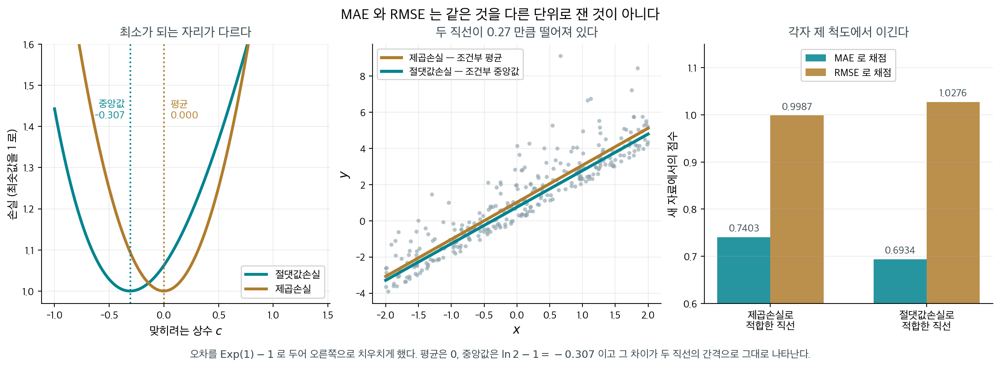
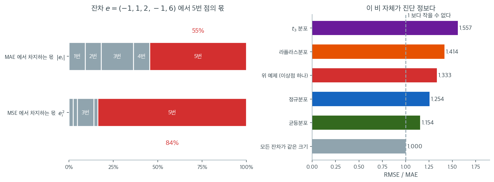

# 평균절대오차, 평균제곱오차, 제곱근평균제곱오차

$R^2$는 설명된 분산의 비율을 알려주지만 예측오차가 $Y$의 원래 단위로 얼마나 큰지는 알려주지 않는다. MAE, MSE, RMSE 같은 오차 척도는 예측오차의 크기를 직접 수량화하여 모형 성능에 대한 보완적인 정보를 제공한다.

---

## 1. 잔차

모든 오차 척도는 **잔차**에서 출발한다. 잔차는 관측값과 적합값의 차이이다.

$$
e_i = y_i - \hat{y}_i, \quad i = 1, \ldots, n
$$

좋은 모형은 크기가 작고 체계적 패턴이 없는 잔차를 만든다. 아래 척도들은 이 잔차들을 하나의 수치로 요약한다.

---

## 2. 평균절대오차

**평균절대오차(MAE)**는 절대잔차의 평균이다.

$$
\text{MAE} = \frac{1}{n} \sum_{i=1}^{n} |y_i - \hat{y}_i|
$$

MAE는 $Y$와 같은 단위로 측정되므로 곧바로 해석할 수 있다. $\text{MAE} = 3.2$이고 $Y$가 달러 단위라면 예측이 평균적으로 \$3.20만큼 빗나간다는 뜻이다.

### 이상점에 로버스트하고 단위가 그대로다

- **이상점에 로버스트**: MAE는 모든 오차를 선형으로 다루므로 큰 오차 하나가 척도를 지나치게 부풀리지 않는다.
- **0에서 미분 불가능**: 절댓값 함수는 0에서 꺾이므로 최적화가 까다롭다. 모수 추정에서 (MSE를 최소화하는) 최소제곱이 더 흔한 이유가 여기 있다.
- **중앙값과의 관계**: $\sum |y_i - c|$를 $c$에 대해 최소화하는 값이 표본중앙값이다. $\sum (y_i - c)^2$을 최소화하는 값이 표본평균인 것과 짝을 이룬다.

---

## 3. 평균제곱오차

**평균제곱오차(MSE)**는 제곱잔차의 평균이다.

$$
\text{MSE} = \frac{1}{n} \sum_{i=1}^{n} (y_i - \hat{y}_i)^2
$$

MSE는 정규방정식을 통해 닫힌 형태의 해를 주므로 회귀에서 가장 흔히 쓰는 손실함수이다. 다만 단위가 $Y$의 원래 단위의 제곱이어서 직접 해석하기는 어렵다.

### 제곱이 큰 오차를 증폭한다

- **이상점에 민감**: 잔차를 제곱하면 큰 오차가 증폭된다. $|e_i| = 10$인 관측값 하나가 합에 100을 보태는 반면, $|e_i| = 1$인 관측값 열 개는 다 합쳐도 10만 보탠다.
- **미분 가능**: MSE는 어디서나 매끄러워 기울기 기반 최적화에 잘 맞는다.
- **분해**: 확률변수의 틀에서 MSE는 편향의 제곱과 분산의 합으로 분해된다: $\text{MSE}(\hat{\theta}) = \text{Bias}^2(\hat{\theta}) + \text{Var}(\hat{\theta})$.

!!! note "MSE와 SSE"
    MSE와 SSE는 척도 인자만 다르다: $\text{MSE} = \text{SSE} / n$. 어떤 문헌에서는 $\sigma^2$의 불편추정값을 얻기 위해 분모로 $n$ 대신 $n - p - 1$을 쓴다. 이 불편 버전은 흔히 $s^2$이나 $\hat{\sigma}^2$으로 표기한다.

---

## 4. 제곱근평균제곱오차

**제곱근평균제곱오차(RMSE)**는 MSE의 제곱근이다.

$$
\text{RMSE} = \sqrt{\text{MSE}} = \sqrt{\frac{1}{n} \sum_{i=1}^{n} (y_i - \hat{y}_i)^2}
$$

RMSE는 $Y$의 원래 단위를 되살려, MSE의 수학적 편리함과 MAE의 해석 가능성을 결합한다.

### 제곱의 민감함을 지키면서 단위를 되찾는다

- **$Y$와 같은 단위**: MAE와 마찬가지로 반응변수의 척도에서 곧바로 해석할 수 있다.
- **언제나 MAE 이상**: (제곱근이 오목하므로) Jensen 부등식에 의해 $\text{RMSE} \geq \text{MAE}$이며, 모든 잔차의 절댓값이 같을 때만 등호가 성립한다.
- **MAE보다 이상점에 민감**: 제곱근을 취하기 전에 큰 제곱오차가 더 큰 기여를 하므로 RMSE는 MSE의 이상점 민감성을 물려받는다.

---

## 5. MAE와 RMSE의 비교

MAE와 RMSE의 관계는 오차 분포에 대한 정보를 드러낸다.

$$
\text{MAE} \leq \text{RMSE} \leq \sqrt{n} \cdot \text{MAE}
$$

아래쪽 경계는 모든 절대잔차가 같을 때, 위쪽 경계는 잔차 하나가 오차 전부를 차지할 때 달성된다. RMSE가 MAE보다 훨씬 크면 오차 분포에 큰 이상점이 있거나 꼬리가 두껍다는 뜻이다.

| 성질 | MAE | RMSE |
|---|---|---|
| 단위 | $Y$와 같음 | $Y$와 같음 |
| 이상점 민감도 | 낮음 | 높음 |
| 미분 가능성 | 아니오(0에서) | 예 |
| 최적화 | 중앙값 회귀로 이어짐 | OLS 회귀로 이어짐 |
| 해석 | 평균 절대오차 | 오차의 표준편차 |

!!! tip "MAE를 RMSE보다 선호할 때"
    이상점이 예상되고 그것이 평가를 지배해서는 안 될 때 MAE를 쓴다(예: 고급 주택 몇 채가 극단적 오차를 만드는 부동산 가격 예측). 큰 오차가 특히 바람직하지 않아 모형에 더 무거운 벌점을 주어야 할 때는 RMSE를 쓴다(예: 과소추정이 위험한 구조 하중 예측).

---

**그림으로 보는 통계학 1.** 척도를 고르는 일이 답을 고르는 일이다

§$5$ 가 둘을 견주며 「RMSE 는 큰 오차에 더 민감하다」고 적었다. 맞는 말인데, 그 말이
가리는 것이 하나 있다. 둘은 **같은 것을 다른 단위로 잰 것이 아니다.** 아예 **다른 것을
맞히라고 시키는 명령**이다.

상수 $c$ 하나로 $y$ 를 맞힌다고 해 보자. 어느 $c$ 가 가장 좋은가는 무엇으로 채점하느냐에
달려 있고, 답이 둘 다 알려져 있다.

$$
\arg\min_c\, E\lvert y - c\rvert = \text{중앙값},
\qquad
\arg\min_c\, E(y - c)^2 = \text{평균}
$$

<figure markdown>
  { width=1000 }
  <figcaption markdown>오차를 $\mathrm{Exp}(1)-1$ 로 두어 오른쪽으로 치우치게 했다. 평균은 $0$, 중앙값은 $\ln 2 - 1 = -0.307$ 이고 **그 차이가 두 직선의 간격으로 그대로 나타난다.** 자료에서 직접 그렸다.</figcaption>
</figure>

가운데 그림이 회귀로 올린 것이다. 제곱손실로 적합하면 조건부 **평균**의 직선이 나오고,
절댓값손실로 적합하면 조건부 **중앙값**의 직선이 나온다. 오차가 대칭이면 둘이 겹치지만,
치우쳐 있으면 $0.27$ 만큼 떨어져 **나란히** 간다.

오른쪽이 결론이다. 새 자료에서 채점해 보면 —

| 적합한 방식 | MAE | RMSE |
|---|---|---|
| 제곱손실 | $0.7403$ | **$0.9987$** |
| 절댓값손실 | **$0.6934$** | $1.0276$ |

**각자 제 척도에서 이긴다.** 어느 직선이 「더 나은 모형」인지 묻는 것은 뜻이 없고,
물어야 할 것은 **무엇을 맞히려 했는가**다.

실무에서 이 선택이 돈이 되는 자리가 있다. 수요를 예측해 재고를 쌓는다고 하자.

- **평균**을 맞히면 — 장기적으로 **총량**이 맞는다. 보험금 총액이나 연간 매출처럼
  **더해서 쓰는** 양이라면 이쪽이다. 큰 사고 하나를 놓치면 총액이 통째로 틀리므로,
  RMSE 가 큰 오차에 민감한 것이 결함이 아니라 **의도**다.
- **중앙값**을 맞히면 — **절반은 위, 절반은 아래**가 된다. 하루 배송 시간처럼 극단값
  몇 개가 전형적인 날을 말해 주지 않는 양이라면 이쪽이다.

그러니 「MAE 와 RMSE 중 무엇을 보고할까」는 보고서를 쓸 때 정할 일이 아니다.
**모형을 적합하기 전에 정해야 할 일**이고, 정하고 나면 그 척도로 적합까지 해야 앞뒤가
맞는다. 제곱손실로 적합해 놓고 MAE 로만 보고하는 것은 과녁을 바꿔 놓고 점수를 매기는
셈이다.

_확인한 곳 — 절댓값손실의 최소점이 중앙값이고 제곱손실의 최소점이 평균이라는 것, 그래서 절댓값손실 회귀(최소절대편차)가 조건부 중앙값을 추정한다는 것은 표준적인 결과이며 분위수회귀의 출발점이기도 하다 · 그림의 수치는 $n=300$ 으로 적합하고 새 자료 $20$ 만 개로 채점해 이 쪽이 직접 쟀다_

## 6. 수치 보기

관측값 $n = 5$개인 모형을 생각하자.

| $i$ | $y_i$ | $\hat{y}_i$ | $e_i$ | $\lvert e_i \rvert$ | $e_i^2$ |
|-----|--------|--------------|--------|----------|---------|
| 1   | 10     | 11           | $-1$   | 1        | 1       |
| 2   | 20     | 19           | 1      | 1        | 1       |
| 3   | 30     | 28           | 2      | 2        | 4       |
| 4   | 40     | 41           | $-1$   | 1        | 1       |
| 5   | 50     | 44           | 6      | 6        | 36      |

각 척도를 계산하면

$$
\text{MAE} = \frac{1 + 1 + 2 + 1 + 6}{5} = \frac{11}{5} = 2.2
$$

$$
\text{MSE} = \frac{1 + 1 + 4 + 1 + 36}{5} = \frac{43}{5} = 8.6
$$

$$
\text{RMSE} = \sqrt{8.6} \approx 2.93
$$

RMSE($2.93$)가 MAE($2.2$)보다 상당히 크다는 점에 주목하라. 이 격차는 큰 오차 $e_5 = 6$ 하나가 만든 것이다. 이 오차는 MSE의 $36/43 \approx 84\%$를 차지하지만 전체 절대오차에서는 $6/11 \approx 55\%$만 차지한다. RMSE가 이상적인 잔차의 영향을 불균형하게 반영함을 보여주는 예이다.

왼쪽이 그 $84\%$와 $55\%$를 눈으로 본 것이다. 위 막대는 다섯 관측값이 MAE에 기여하는 몫을, 아래 막대는 MSE에 기여하는 몫을 각각 100%로 정규화해 나눈 것이다. 같은 자료, 같은 잔차인데 5번 점(붉은 칸)의 크기가 확연히 다르다. MAE에서는 절반을 조금 넘는 $55\%$지만 MSE에서는 $84\%$를 차지해 나머지 네 점이 거의 보이지 않을 지경이 된다. 척도를 바꾸는 것은 단순히 눈금을 바꾸는 일이 아니라 **어느 관측값에 얼마나 발언권을 줄지 다시 정하는 일**이다.

오른쪽은 이 비 $\text{RMSE}/\text{MAE}$가 오차 분포의 모양을 어떻게 드러내는지를 정리한 것이다. 모든 잔차의 절댓값이 같으면 비는 정확히 $1.000$으로, 이것이 도달 가능한 최솟값이다. 균등분포에서 $1.154$, 정규분포에서 $1.254$인데 이 값은 이론값 $\sqrt{\pi/2} = 1.2533$과 맞는다. 위 보기는 $1.333$, 라플라스분포는 $1.414$($=\sqrt{2}$), 꼬리가 두꺼운 $t_3$ 분포는 $1.557$이다. 꼬리가 두꺼울수록 비가 커진다.

실무에서 쓸 수 있는 어림이 여기서 나온다. 모형의 RMSE와 MAE를 함께 계산해 비를 내 보라. **$1.25$ 근처면 잔차가 대체로 정규처럼 행동하고 있다는 신호**이고, $1.5$를 넘으면 소수의 큰 오차가 평가를 지배하고 있다는 신호다. 후자라면 그 관측값들이 무엇인지 들여다봐야 한다. 진짜 이상점일 수도 있고, 모형이 특정 영역에서 체계적으로 실패하고 있다는 뜻일 수도 있다. 어느 쪽이든 평균적인 성능 수치 하나로는 알 수 없는 정보다.

---

## 연습문제

**연습문제 1.** 
실제값 $y = (3, 5, 2, 8)$과 예측값 $\hat{y} = (2.5, 5.5, 1.5, 7)$에 대해 MAE, MSE, RMSE를 계산하라.

??? success "풀이"
    오차: $e = (0.5, -0.5, 0.5, 1.0)$.

    $$
    \text{MAE} = \frac{1}{4}(|0.5| + |-0.5| + |0.5| + |1.0|) = \frac{2.5}{4} = 0.625
    $$

    $$
    \text{MSE} = \frac{1}{4}(0.25 + 0.25 + 0.25 + 1.0) = \frac{1.75}{4} = 0.4375
    $$

    $$
    \text{RMSE} = \sqrt{0.4375} \approx 0.6614
    $$

**연습문제 2.** 
MSE가 MAE보다 큰 오차에 더 무거운 벌점을 주는 이유를 설명하라. MAE가 선호되는 실제 상황을 하나 들어라.

??? success "풀이"
    MSE는 각 오차를 제곱하므로 오차 10은 합에 $10^2 = 100$을 보태고 오차 1은 $1$만 보탠다. 곧 큰 오차 하나가 MSE를 지배한다. MAE는 절댓값을 쓰므로 같은 오차들이 각각 10과 1을 보태어 100:1이 아닌 10:1의 비가 된다.

    **MAE가 선호되는 경우:** 이상점이 예상되며 그것이 모형 평가에 불균형하게 영향을 주어서는 안 될 때이다. 예를 들어 부동산 가격 예측에서 예측오차가 큰 고급 주택 몇 채가 모형 품질 평가를 지배해서는 안 된다. MAE는 "전형적인" 오차 크기를 평가하고, MSE는 "최악의 경우에 벌점을 준" 오차를 평가한다.

**연습문제 3.** 
$\sum(y_i - c)^2$을 최소화하는 $c$가 평균 $\bar{y}$이고, $\sum|y_i - c|$를 최소화하는 값이 중앙값임을 보여라.

??? success "풀이"
    **MSE 최소화(평균):** $f(c) = \sum(y_i - c)^2$을 $c$에 대해 미분하면

    $$
    f'(c) = -2\sum(y_i - c) = -2(n\bar{y} - nc) = 0 \implies c = \bar{y}
    $$

    **MAE 최소화(중앙값):** 함수 $g(c) = \sum|y_i - c|$는 조각별 선형이고 볼록이다. 그 도함수는 $g'(c) = -\#\{y_i > c\} + \#\{y_i < c\}$이다. $g'(c) = 0$이 되려면 $c$의 위와 아래에 있는 관측값의 개수가 같아야 하며, 이것이 곧 중앙값의 정의이다.

    이 관계는 MSE로 최적화한 모형(예: OLS)이 조건부 평균을 예측하고, MAE로 최적화한 모형(예: $\tau = 0.5$의 분위수 회귀)이 조건부 중앙값을 예측하는 이유를 설명해 준다. $\square$

**연습문제 4.** 
모형 성능을 보고할 때 MSE보다 RMSE가 선호되는 이유는 무엇인가? RMSE의 단위는 무엇인가?

??? success "풀이"
    RMSE $= \sqrt{\text{MSE}}$가 선호되는 이유는 반응변수 $y$와 **같은 단위**를 가져 곧바로 해석할 수 있기 때문이다. $y$가 달러 단위라면 RMSE도 달러 단위이며 "전형적인" 예측오차의 크기를 나타낸다. MSE는 달러의 제곱 단위여서 직관적이지 않다.

    RMSE에는 통계적 해석도 있다. 오차가 정규분포를 따르는 모형에서 예측의 약 68%가 실제값의 $\pm$ RMSE 안에 들어오고 약 95%가 $\pm 2 \cdot$ RMSE 안에 들어온다.

    다만 RMSE는 MSE의 단조변환이므로 MSE의 이상점 민감성을 그대로 갖는다. 로버스트한 평가를 위해서는 RMSE와 MAE를 함께 보고하는 것이 좋다.

**연습문제 5.** 
6 절 보기의 잔차는 $\text{MAE} = 2.2$, $\text{RMSE} \approx 2.93$ 이었다. 관측값이 $n = 5$ 개이고 $\text{MAE} = 2.2$ 라는 조건만 지키면서, RMSE 를 가능한 가장 작게 만드는 절대잔차와 가장 크게 만드는 절대잔차를 각각 하나 제시하고 그때의 RMSE 값을 구하라.

보기의 $2.93$ 은 그 두 극단 사이 어디에 놓이는가?

??? success "풀이"
    $\text{MAE} = 2.2$ 는 절대잔차의 합이 $\sum \lvert e_i \rvert = 5 \times 2.2 = 11$ 로 고정되었다는 뜻이다. 5 절의 경계

    $$
    \text{MAE} \leq \text{RMSE} \leq \sqrt{n} \cdot \text{MAE}
    $$

    에서 두 극단의 모양은 이미 지정되어 있다.

    **최소(아래 경계 달성):** 모든 절대잔차가 같을 때, 곧 $\lvert e_i \rvert = 2.2$ 다섯 개일 때이다.

    $$
    \text{MSE} = \frac{5 \times 2.2^2}{5} = 4.84, \qquad \text{RMSE} = \sqrt{4.84} = 2.2
    $$

    **최대(위 경계 달성):** 잔차 하나가 오차 전부를 차지할 때, 곧 절대잔차가 $(11, 0, 0, 0, 0)$ 일 때이다.

    $$
    \text{MSE} = \frac{11^2 + 0 + 0 + 0 + 0}{5} = \frac{121}{5} = 24.2, \qquad \text{RMSE} = \sqrt{24.2} \approx 4.9193
    $$

    이 값은 $\sqrt{5} \cdot 2.2 = 2.2360 \times 2.2 \approx 4.9193$ 과 같아 위 경계를 정확히 달성한다.

    **보기의 위치:** $2.93$ 은 구간 $[2.2,\, 4.9193]$ 안에 있고, 아래 경계에서 위 경계까지의 거리 중

    $$
    \frac{2.9326 - 2.2}{4.9193 - 2.2} = \frac{0.7326}{2.7193} \approx 0.27
    $$

    만큼, 곧 약 $27\%$ 지점에 있다. 비로 보면 $\text{RMSE}/\text{MAE} \approx 1.333$ 으로 최댓값 $\sqrt{5} \approx 2.236$ 에는 한참 못 미친다.

    MAE 를 알아도 RMSE 는 거의 아무것도 결정되지 않는다($2.2$ 에서 $4.92$ 까지 두 배 넘게 벌어진다). 두 척도를 함께 보고해야 하는 이유가 여기 있다. 하나는 오차의 크기를, 다른 하나는 오차가 고르게 퍼졌는지를 말한다. $\square$

**연습문제 6.** 
연습문제 4 의 풀이에는 "오차가 정규분포를 따르면 예측의 약 $68\%$ 가 $\pm\,\text{RMSE}$ 안에, 약 $95\%$ 가 $\pm 2\,\text{RMSE}$ 안에 들어온다" 는 어림이 있다. 이 어림을 6 절 보기의 다섯 잔차에 그대로 적용해 실제 비율을 세어 보고, 어긋나는 방향을 비 $\text{RMSE}/\text{MAE}$ 로 설명하라.

??? success "풀이"
    보기의 잔차는 $e = (-1, 1, 2, -1, 6)$ 이고 $\text{RMSE} = \sqrt{8.6} \approx 2.9326$, $2\,\text{RMSE} \approx 5.8652$ 이다.

    $\pm\,\text{RMSE}$ 안: $\lvert e_i \rvert \leq 2.9326$ 를 만족하는 것은 $1, 1, 2, 1$ 네 개이므로 $4/5 = 80\%$. 어림은 $68\%$ 를 말했으니 **실제가 더 많다**.

    $\pm 2\,\text{RMSE}$ 안: $\lvert e_i \rvert \leq 5.8652$ 를 만족하는 것은 여전히 같은 네 개뿐이다($6 > 5.8652$). 따라서 $4/5 = 80\%$ 이고 어림은 $95\%$ 를 말했으니 **실제가 더 적다**. 바꿔 말해 $2\,\text{RMSE}$ 밖으로 나간 관측값이 정규 어림의 $5\%$ 가 아니라 $20\%$ 다.

    두 어긋남의 방향이 반대라는 점이 핵심이다. 가운데는 어림보다 촘촘하고 꼬리는 어림보다 두껍다. 이것이 바로 $\text{RMSE}/\text{MAE} \approx 1.333$ 이 말하는 모양이다. 6 절의 표에서 정규분포는 $1.254$, 라플라스분포는 $1.414$ 였으므로 이 자료는 정규보다 라플라스 쪽에 가깝다. 작은 잔차 네 개가 RMSE 를 끌어내리는 동안 $e_5 = 6$ 하나가 RMSE 를 끌어올려, $\pm\,\text{RMSE}$ 라는 띠가 "대부분" 을 담는 동시에 꼬리 하나를 놓친다.

    덧붙여 $n = 5$ 로 $68\%$ 나 $95\%$ 를 재는 일 자체가 무리다. 다섯 개로 셀 수 있는 비율은 $0, 20, 40, 60, 80, 100\%$ 뿐이어서 $68\%$ 라는 값은 애초에 나올 수 없다. 정규 어림은 잔차가 정규이고 $n$ 이 충분히 클 때의 이야기이며, 비가 $1.25$ 에서 멀어질수록 먼저 의심해야 하는 것이 그 정규 가정이다.

**연습문제 7.** 
6 절 보기의 반응값에서 $y_5 = 50$ 만 $150$ 으로 바꾼 자료 $y = (10, 20, 30, 40, 150)$ 을 생각하자. 설명변수를 쓰지 않고 모든 관측값을 같은 상수로 예측한다($\hat{y}_i = c$).

(a) 연습문제 3 의 결과를 써서 MAE 를 최소화하는 $c$ 와 MSE 를 최소화하는 $c$ 를 각각 구하라.

(b) 두 $c$ 각각에 대해 MAE 와 RMSE 를 계산하라.

(c) "어느 예측이 더 좋은가" 에 대한 답이 척도에 따라 달라짐을 확인하고, 그 이유를 설명하라.

??? success "풀이"
    **(a)** 연습문제 3 에서 $\sum \lvert y_i - c \rvert$ 를 최소화하는 값은 표본중앙값, $\sum (y_i - c)^2$ 을 최소화하는 값은 표본평균이었다. 정렬된 자료 $10, 20, 30, 40, 150$ 에서

    $$
    \text{중앙값} = 30, \qquad \bar{y} = \frac{10 + 20 + 30 + 40 + 150}{5} = \frac{250}{5} = 50
    $$

    이므로 MAE 최소화는 $c = 30$, MSE 최소화는 $c = 50$ 이다. 원래 보기의 자료 $(10, \ldots, 50)$ 에서는 중앙값과 평균이 모두 $30$ 으로 같았다. 값 하나를 $150$ 으로 밀자 평균만 $50$ 으로 끌려갔다.

    **(b)** $c = 30$ 일 때 잔차는 $(-20, -10, 0, 10, 120)$ 이다.

    $$
    \text{MAE} = \frac{20 + 10 + 0 + 10 + 120}{5} = \frac{160}{5} = 32
    $$

    $$
    \text{MSE} = \frac{400 + 100 + 0 + 100 + 14400}{5} = \frac{15000}{5} = 3000, \qquad \text{RMSE} = \sqrt{3000} \approx 54.77
    $$

    $c = 50$ 일 때 잔차는 $(-40, -30, -20, -10, 100)$ 이다.

    $$
    \text{MAE} = \frac{40 + 30 + 20 + 10 + 100}{5} = \frac{200}{5} = 40
    $$

    $$
    \text{MSE} = \frac{1600 + 900 + 400 + 100 + 10000}{5} = \frac{13000}{5} = 2600, \qquad \text{RMSE} = \sqrt{2600} \approx 50.99
    $$

    **(c)** 정리하면 이렇다.

    | $c$ | MAE | RMSE | RMSE/MAE |
    |---|---|---|---|
    | $30$ (중앙값) | $\mathbf{32}$ | $54.77$ | $1.712$ |
    | $50$ (평균) | $40$ | $\mathbf{50.99}$ | $1.275$ |

    MAE 로 재면 $c = 30$ 이 이기고($32 < 40$), RMSE 로 재면 $c = 50$ 이 이긴다($50.99 < 54.77$). 각 $c$ 는 자기 척도에서만 최적이므로 이 역전은 우연이 아니라 필연이다.

    이유는 두 척도가 $y_5 = 150$ 에 주는 발언권이 다르기 때문이다. MAE 에서 $c$ 를 $30$ 에서 $50$ 으로 올리면 그 한 점의 오차는 $120 \to 100$ 으로 $20$ 줄지만 나머지 네 점의 오차는 각각 $20, 20, 20, 0$ 늘어 합이 $60$ 늘어난다. 둘을 합치면 절대오차의 합이 $160$ 에서 $200$ 으로 $40$ 늘어 손해다. MSE 에서는 같은 이동이 그 한 점의 기여를 $14400 \to 10000$ 으로 $4400$ 줄이는 반면 나머지 네 점은 다 합쳐 $3000 - 600 = 2400$ 만 늘어 이득이다.

    실무의 교훈은 **모형을 고르는 척도와 모형을 평가하는 척도가 다르면 비교가 뒤집힌다**는 것이다. MSE 로 적합한 모형을 MAE 로 평가하는 보고서는 자기 모형에 불리한 시험을 치르는 셈이다. 덧붙여 $c = 30$ 쪽의 비 $1.712$ 는 6 절 어림의 $1.5$ 선을 넘으므로, 소수의 큰 오차가 평가를 지배하고 있다는 경고로도 읽힌다. $\square$

**연습문제 8.** 
6 절은 "비 $\text{RMSE}/\text{MAE}$ 가 $1.5$ 를 넘으면 소수의 큰 오차가 평가를 지배하고 있다" 는 어림을 준다. 이 "소수" 를 수량화해 보자.

잔차 $n$ 개 중 $k$ 개는 절댓값이 모두 $a > 0$ 으로 같고 나머지 $n - k$ 개는 정확히 $0$ 이라고 하자.

(a) 비 $\text{RMSE}/\text{MAE}$ 를 $n$ 과 $k$ 만으로 나타내라. $a$ 가 사라지는 이유도 말하라.

(b) 이 비가 $1.5$ 이상이 되려면 $k/n$ 이 어떤 범위에 있어야 하는가?

(c) (a) 를 뒤집어 비 $r$ 를 "오차에 실제로 참여하는 관측값의 비율" 로 읽는 공식을 쓰고, 6 절에 나온 비 $1.000$, $1.2533$, $1.3330$, $1.4142$, $1.5570$ 에 적용하라.

??? success "풀이"
    **(a)** 절대잔차가 $a$ 인 것이 $k$ 개, $0$ 인 것이 $n - k$ 개이므로

    $$
    \text{MAE} = \frac{ka}{n}, \qquad \text{MSE} = \frac{ka^2}{n}, \qquad \text{RMSE} = a\sqrt{\frac{k}{n}}
    $$

    따라서

    $$
    r = \frac{\text{RMSE}}{\text{MAE}} = \frac{a\sqrt{k/n}}{ka/n} = \frac{n}{k}\sqrt{\frac{k}{n}} = \sqrt{\frac{n}{k}}
    $$

    $a$ 가 사라지는 것은 MAE 와 RMSE 가 모두 $Y$ 와 같은 단위이고 $a$ 에 대해 1 차 동차이기 때문이다. 잔차를 모두 두 배로 하면 두 척도가 함께 두 배가 되어 비는 변하지 않는다. 비가 재는 것은 오차의 **크기**가 아니라 오차의 **모양**이다.

    확인: $k = n$ 이면 $r = 1$ 로 5 절의 아래 경계(모든 절대잔차가 같음)와 맞고, $k = 1$ 이면 $r = \sqrt{n}$ 으로 위 경계(잔차 하나가 전부를 차지)와 맞는다.

    **(b)**

    $$
    r = \sqrt{\frac{n}{k}} \geq 1.5 \iff \frac{n}{k} \geq 2.25 \iff \frac{k}{n} \leq \frac{1}{2.25} = \frac{4}{9} \approx 0.444
    $$

    곧 오차를 내는 관측값이 전체의 약 $44\%$ 이하일 때 비가 $1.5$ 이상이 된다.

    **(c)** $r = \sqrt{n/k}$ 를 $k/n$ 에 대해 풀면

    $$
    \frac{k}{n} = \frac{1}{r^2}
    $$

    이 값을 **유효 참여 비율**로 읽자. 관측된 비 $r$ 를 "전체의 $1/r^2$ 만이 오차를 내고 나머지는 완벽히 맞힌 자료" 로 환산한 것이다.

    | 오차 분포 | $r$ | 유효 참여 비율 $1/r^2$ |
    |---|---|---|
    | 절대잔차가 모두 같음 | $1.0000$ | $100\%$ |
    | 정규 | $1.2533$ | $63.7\%$ |
    | 6 절 보기 | $1.3330$ | $56.3\%$ |
    | 라플라스 | $1.4142$ | $50.0\%$ |
    | $t_3$ | $1.5570$ | $41.2\%$ |

    정규의 값은 $r = \sqrt{\pi/2}$ 이므로 정확히 $2/\pi = 0.6366$ 이고, 라플라스의 값은 $r = \sqrt{2}$ 이므로 정확히 $1/2$ 이다.

    해석이 둘 나온다. 첫째, $1.5$ 라는 경고선은 "자료의 절반 이하만 오차를 내고 있다" 는 뜻이며, 생각보다 관대하지 않은 기준이다. 꼬리가 두꺼운 $t_3$ 조차 $41\%$ 로 겨우 그 선을 넘는다. 둘째, 정규라도 유효 참여 비율은 $100\%$ 가 아니라 $64\%$ 다. 비가 $1$ 보다 큰 것 자체는 이상이 아니며, 이상의 신호는 어디까지나 $1.25$ 로부터의 **이탈**이다. $\square$

**연습문제 9.** 
6 절 보기의 적합값을 그대로 쓰되 전부 같은 상수 $b$ 만큼 평행이동한 예측 $\hat{y}_i + b$ 를 생각하자. 잔차는 $e_i - b$ 가 된다.

(a) $\text{MSE}(b)$ 를 $b$ 의 2 차식으로 쓰고 최소점 $b^\ast$ 와 그때의 MSE, RMSE 를 구하라.

(b) (a) 의 결과를 3 절의 분해 $\text{MSE} = \text{Bias}^2 + \text{Var}$ 와 짝지어 읽어라.

(c) MAE 를 최소화하는 평행이동은 (a) 와 같은가? 다르면 그 값과 MAE 를 구하라.

(d) 최소제곱으로 적합한 모형의 훈련잔차에서는 (a) 의 $b^\ast$ 가 언제나 얼마인가? 이 사실로 보아 6 절 보기의 잔차는 어떤 자료에서 나온 것으로 보아야 하는가?

??? success "풀이"
    보기의 잔차는 $e = (-1, 1, 2, -1, 6)$, $n = 5$ 이고 $\sum e_i = 7$, $\sum e_i^2 = 43$ 이다.

    **(a)**

    $$
    \text{MSE}(b) = \frac{1}{5}\sum_{i=1}^{5} (e_i - b)^2 = \frac{1}{5}\sum e_i^2 - 2b \cdot \frac{1}{5}\sum e_i + b^2 = 8.6 - 2.8b + b^2
    $$

    $b$ 에 대해 미분하면 $-2.8 + 2b = 0$ 이므로

    $$
    b^\ast = \bar{e} = \frac{7}{5} = 1.4
    $$

    이고

    $$
    \text{MSE}(1.4) = 8.6 - 2.8(1.4) + 1.4^2 = 8.6 - 3.92 + 1.96 = 6.64, \qquad \text{RMSE} = \sqrt{6.64} \approx 2.5768
    $$

    RMSE 가 $2.9326$ 에서 $2.5768$ 로 줄었다. 설명변수를 하나도 더 쓰지 않고 예측을 통째로 $1.4$ 만 올려서 얻은 개선이다.

    **(b)** 2 차식에 $b = 0$ 과 $b = b^\ast$ 를 넣고 비교하면

    $$
    \text{MSE}(0) = \text{MSE}(b^\ast) + (b^\ast)^2 = 6.64 + 1.96 = 8.6
    $$

    이것이 바로 $\text{MSE} = \text{Bias}^2 + \text{Var}$ 다. 잔차의 평균 $\bar{e} = 1.4$ 가 편향이고 $1.4^2 = 1.96$ 이 $\text{Bias}^2$ 이며, 중심을 맞춘 뒤 남는

    $$
    \frac{1}{5}\sum (e_i - \bar{e})^2 = \frac{5.76 + 0.16 + 0.36 + 5.76 + 21.16}{5} = \frac{33.2}{5} = 6.64
    $$

    이 분산 몫이다. 보기의 $\text{MSE} = 8.6$ 중 $1.96$ 은 "예측이 체계적으로 낮게 나오는" 고칠 수 있는 오차이고, $6.64$ 는 평행이동으로는 줄일 수 없는 흩어짐이다.

    **(c)** 다르다. 연습문제 3 에 의해 $\sum \lvert e_i - b \rvert$ 를 최소화하는 값은 잔차의 **중앙값**이고, 정렬하면 $-1, -1, 1, 2, 6$ 이므로 중앙값은 $1$ 이다.

    $$
    \text{MAE}(1) = \frac{\lvert -2 \rvert + 0 + 1 + \lvert -2 \rvert + 5}{5} = \frac{10}{5} = 2.0
    $$

    참고로 MSE 최적인 $b = 1.4$ 를 쓰면 $\text{MAE}(1.4) = (2.4 + 0.4 + 0.6 + 2.4 + 4.6)/5 = 10.4/5 = 2.08$ 로 $2.0$ 보다 크다. 평균 $1.4$ 는 큰 잔차 $6$ 에 끌려 중앙값 $1$ 보다 오른쪽에 있고, MAE 는 그 끌림을 보상해 주지 않는다.

    **(d)** 절편이 있는 최소제곱 적합에서는 정규방정식의 첫 식이 $\sum e_i = 0$ 이므로 $\bar{e} = 0$, 곧 $b^\ast = 0$ 이다. 훈련자료에서는 평행이동으로 MSE 를 줄일 여지가 원리상 없고 $\text{Bias}^2$ 항도 $0$ 이다.

    그런데 보기의 잔차는 $\sum e_i = 7 \neq 0$ 이다. 따라서 이 다섯 개는 절편 있는 최소제곱의 훈련잔차일 수 없고, **남겨 둔 자료(또는 교차검증 겹)에서 계산한 예측잔차**로 읽어야 한다. 훈련잔차에서는 저절로 사라지는 편향이 새 자료에서는 되살아난다는 것이 정확히 "훈련자료에서 계산한 오차 척도는 낙관적이다" 라는 말의 내용이다. $\square$

**연습문제 10.** 
두 모형을 비교하는데 MAE 로는 A 가 이기고 RMSE 로는 B 가 이기는 일이 가능한가? $n = 4$ 로 따져 보자. 모형 A 의 절대잔차는 $(0, 0, 0, 4)$ 이고 모형 B 의 절대잔차는 네 개가 모두 $b > 0$ 으로 같다고 하자.

(a) 두 모형의 MAE 와 RMSE 를 구하라(B 는 $b$ 로).

(b) "A 가 MAE 에서 이기고 B 가 RMSE 에서 이긴다" 가 성립하는 $b$ 의 범위를 구하고, 그 범위의 $b$ 를 하나 골라 네 수치를 적어라.

(c) 일반적으로 $\text{MAE}_A < \text{MAE}_B$ 이면서 $\text{RMSE}_A > \text{RMSE}_B$ 이려면 두 모형의 비 $r = \text{RMSE}/\text{MAE}$ 와 두 MAE 사이에 어떤 관계가 필요한가? 5 절의 경계를 써서 역전이 가능한 MAE 비의 한계도 구하라.

??? success "풀이"
    **(a)** 모형 A:

    $$
    \text{MAE}_A = \frac{0 + 0 + 0 + 4}{4} = 1, \qquad \text{MSE}_A = \frac{0 + 0 + 0 + 16}{4} = 4, \qquad \text{RMSE}_A = 2
    $$

    모형 B: 절대잔차가 모두 $b$ 이므로

    $$
    \text{MAE}_B = b, \qquad \text{MSE}_B = b^2, \qquad \text{RMSE}_B = b
    $$

    비는 $r_A = 2/1 = 2 = \sqrt{4}$ 로 위 경계를, $r_B = 1$ 로 아래 경계를 각각 달성한다.

    **(b)** 두 조건을 쓰면

    $$
    \text{MAE}_A < \text{MAE}_B \iff 1 < b, \qquad \text{RMSE}_A > \text{RMSE}_B \iff 2 > b
    $$

    이므로 $1 < b < 2$ 다. 예를 들어 $b = 1.2$ 를 고르면

    | 모형 | MAE | RMSE |
    |---|---|---|
    | A $(0,0,0,4)$ | $\mathbf{1.00}$ | $2.00$ |
    | B $(1.2,1.2,1.2,1.2)$ | $1.20$ | $\mathbf{1.20}$ |

    A 의 MAE 가 더 작은데 RMSE 는 더 크다. 역전은 실제로 일어난다. 세 관측값을 정확히 맞히고 하나를 $4$ 만큼 틀리는 모형과, 네 관측값을 고르게 $1.2$ 씩 틀리는 모형 중 어느 쪽이 나은가라는 질문에 두 척도가 반대로 답하는 것이다.

    **(c)** $\text{RMSE} = r \cdot \text{MAE}$ 이므로 $\text{RMSE}_A > \text{RMSE}_B$ 는 $r_A \text{MAE}_A > r_B \text{MAE}_B$ 이다. 여기에 $\text{MAE}_A < \text{MAE}_B$ 를 함께 쓰면

    $$
    \frac{r_A}{r_B} > \frac{\text{MAE}_B}{\text{MAE}_A} > 1
    $$

    곧 **MAE 가 작은 쪽이 비가 더 커야 하며, 비의 격차가 MAE 의 격차보다 커야 한다**. (b) 에서는 $r_A/r_B = 2$ 이고 $\text{MAE}_B/\text{MAE}_A = 1.2$ 로 조건이 지켜졌다.

    5 절의 경계 $1 \leq r \leq \sqrt{n}$ 에서 $r_A/r_B \leq \sqrt{n}/1 = \sqrt{n}$ 이므로 역전이 가능하려면

    $$
    \frac{\text{MAE}_B}{\text{MAE}_A} < \sqrt{n}
    $$

    이어야 한다. $n = 4$ 면 MAE 가 두 배 넘게 좋은 모형은 RMSE 에서 질 수 없고, $n = 100$ 이면 열 배까지도 질 수 있다. 표본이 커질수록 한 관측값이 RMSE 를 흔들 수 있는 폭이 커지므로 역전의 여지도 넓어진다.

    실무의 결론은 이렇다. MAE 차이가 $\sqrt{n}$ 배 미만인 두 모형의 순위는 척도를 바꾸면 뒤집힐 수 있으므로, **무엇을 최소화할지를 모형을 고르기 전에 정해 두어야 한다**. 평가가 끝난 뒤에 유리한 척도를 골라 보고하는 것은 결과를 고르는 일이다. $\square$

---

## 정리하며

오차 척도는 **$Y$ 의 원래 단위**로 예측오차를 잰다.

| | 정의 | 성격 |
|---|---|---|
| MAE | $\frac1n\sum\lvert e_i\rvert$ | 이상치에 강건, 해석이 직관적 |
| MSE | $\frac1n\sum e_i^2$ | 큰 오차에 중벌, 단위가 제곱 |
| RMSE | $\sqrt{\text{MSE}}$ | 단위 회복, 여전히 이상치에 민감 |

- **RMSE $\ge$ MAE 가 언제나 성립한다.** 두 값의 격차가 클수록 오차의 분포가 고르지 않다는 뜻이며, **그 비 자체가 진단 정보**다.
- **무엇을 최소화할지가 곧 무엇을 중요하게 보는지다.** 큰 오차가 치명적이면 MSE, 모든 오차가 똑같이 나쁘면 MAE 다.
- **최소제곱은 MSE 를 최소화한다.** 그래서 이상치에 끌리며, MAE 를 최소화하는 것이 분위수 회귀(중앙값 회귀)다.
- **$R^2$ 와 상보적이다.** $R^2$ 는 상대적 설명력을, RMSE 는 절대적 오차 크기를 말한다. **함께 보고해야 한다.**
- **훈련자료에서 계산하면 낙관적이다.** 교차검증이나 남겨 둔 자료에서 재야 한다.

다음 절 **[상대 척도](relative_metrics.md)**로 넘어간다.
