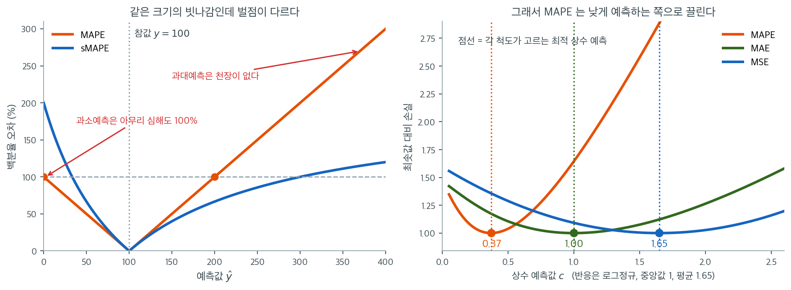
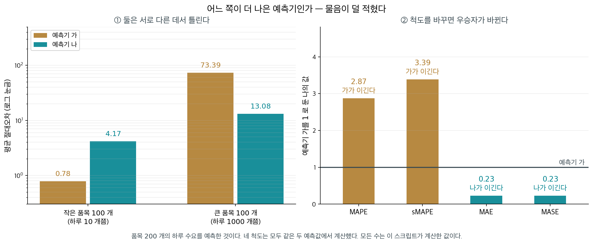

# 평균절대백분율오차와 그 밖의 상대 척도

MAE, MSE, RMSE는 모두 $Y$의 원래 단위로 오차를 잰다. 그래서 척도가 다른 자료끼리 비교하기 어렵다. RMSE가 5라는 것은 반응변수의 범위가 0–10일 때와 0–10,000일 때 전혀 다른 의미를 갖는다. 상대 척도는 오차를 관측값에 대한 비율이나 백분율로 표현하여 서로 다른 맥락 사이의 비교를 가능하게 한다.

<div class="aibox" markdown>

**AI로 보는 통계학 1.** 비로 말하면 단위가 지워진다

포물선을 직선으로 자른 넓이는 $\dfrac{\lvert a\rvert}{6}(\beta-\alpha)^{3}$, 같은 구간을
접선으로 자른 넓이는 $\dfrac{\lvert a\rvert}{3}(\beta-\alpha)^{3}$ 이므로 둘의 비는 늘
$1:2$ 다. 여기서 놀라운 것은 $1:2$ 라는 값이 아니라 **무엇에 무관한가**다. 포물선을 아무리
가파르게 세워도($a$ 를 키워도), 자르는 구간을 아무리 넓혀도($\beta-\alpha$ 를 키워도) 비는
꼼짝하지 않는다. **$a$ 도 $(\beta-\alpha)^{3}$ 도 나눗셈에서 통째로 사라지기** 때문이다.
계수와 구간 길이를 아무렇게나 바꾸어 가며 두 넓이를 실제로 재어 보자.

```python
# 두 넓이를 계수 a 와 구간 길이 d = β-α 를 바꾸어 가며 직접 재어 본다.
# 공통 인수 |a|·d^3 을 두 넓이가 함께 가지므로, 나눗셈에서 그것이 통째로 사라진다.

def areas(a, d):
    """두 넓이. 계수만 1/6 과 1/3 로 다르고 나머지는 똑같다."""
    return abs(a) * d**3 / 6, abs(a) * d**3 / 3     # (직선이 자르는 S1, 접선이 자르는 S2)

print(f"{'a':>6}{'구간 길이':>11}{'S1':>12}{'S2':>12}{'S2/S1':>12}")
for a, d in [(1.0, 1.0), (1.0, 3.0), (5.0, 3.0), (0.2, 7.0), (-4.0, 2.5)]:
    S1, S2 = areas(a, d)                            # 두 넓이는 수백 배로 널뛴다
    print(f"{a:6.1f}{d:11.2f}{S1:12.3f}{S2:12.3f}{S2 / S1:12.6f}")   # 비만 꼼짝 않는다
```

실행하면 다음이 나온다.

```text
     a      구간 길이          S1          S2       S2/S1
   1.0       1.00       0.167       0.333    2.000000
   1.0       3.00       4.500       9.000    2.000000
   5.0       3.00      22.500      45.000    2.000000
   0.2       7.00      11.433      22.867    2.000000
  -4.0       2.50      10.417      20.833    2.000000
```

두 넓이는 $0.167$ 에서 $45$ 까지 이백 배 넘게 널뛰는데 비는 소수 여섯째 자리까지 똑같다.
**비는 두 양이 함께 겪는 것을 지운다.**

기계가 내놓은 답이 얼마나 좋은지 재는 일에서도 똑같은 고민을 한다. 같은 자료를 미터로
재든 센티미터로 재든 모형의 좋고 나쁨은 달라지지 않아야 하는데, 가장 많이 쓰는 잣대인
**제곱오차는 단위를 그대로 따라간다.**

```python
import numpy as np

rng = np.random.default_rng(0)                      # 씨앗을 고정해 늘 같은 값이 나오게 한다
x = np.linspace(0.0, 10.0, 50)                      # 설명변수
y = 2.0 * x + 1.0 + rng.normal(0.0, 1.8, x.size)    # 참값 2x+1 에 잡음을 얹은 관측값

def fit_report(s):
    """세로 단위를 s 배로 바꾼 뒤 일차함수로 맞추고 제곱오차와 R^2 를 돌려준다."""
    yy = s * y                                      # 미터 → 센티미터처럼 단위만 바꾼다
    w = np.polyfit(x, yy, 1)                        # 최소제곱 직선의 기울기와 절편
    r = yy - np.polyval(w, x)                       # 잔차
    mse = float(np.mean(r**2))                      # 단위의 제곱을 그대로 따라간다
    r2 = float(1 - mse / np.var(yy))                # 분모도 같은 단위라 s^2 이 지워진다
    return mse, r2

print(f"{'단위 배수 s':>12}{'MSE':>14}{'R^2':>12}")
for s in [1.0, 10.0, 100.0, 0.1]:
    mse, r2 = fit_report(s)
    print(f"{s:12.1f}{mse:14.4f}{r2:12.6f}")
```

실행하면 다음이 나온다.

```text
     단위 배수 s           MSE         R^2
         1.0        2.3114    0.948210
        10.0      231.1382    0.948210
       100.0    23113.8248    0.948210
         0.1        0.0231    0.948210
```

단위를 백 배로 바꾸면 제곱오차는 **만 배**가 된다($s^{2}$ 이니 그럴 수밖에 없다). 같은
모형, 같은 자료인데 「오차 $0.0231$」과 「오차 $23113.8$」이 둘 다 맞는 말이다. 반면 오른쪽
칸은 꼼짝하지 않는다 — **분자와 분모가 같은 단위**여서 포물선에서 $a$ 가 지워지듯 $s^{2}$ 이
지워지기 때문이다.

그래서 서로 다른 자료에서 얻은 결과를 나란히 놓고 견주려면 **비 꼴의 잣대**를 써야 한다.
「오차가 얼마인가」가 아니라 「**무엇에 견주어** 얼마인가」를 적어야 한다는 말이다. 아래
§1 의 MAPE 가 분모로 $y_i$ 를, §2 의 sMAPE 가 $(\lvert y_i\rvert+\lvert\hat y_i\rvert)/2$ 를,
§3 의 MASE 가 단순예측의 오차를 고른 것이 모두 그 「무엇에」를 고르는 일이다.

다만 지워지는 것이 **늘 지워도 되는 것은 아니다.** 비는 분모가 무엇인지에 모든 것을 건다 —
분모로 삼은 양이 자료마다 크게 다르면 비끼리의 비교도 믿을 수 없게 된다. 아래 §1 이 적은
「$y_i=0$ 이면 정의되지 않는다」가 그 극단이다. 포물선의 비가 깨끗한 것은 두 넓이가
**같은 포물선, 같은 구간**에서 나왔기 때문이지, 비라서 저절로 깨끗한 것이 아니다.

</div>

---

## 1. 평균절대백분율오차

**평균절대백분율오차(MAPE)**는 각 예측오차를 관측값에 대한 백분율로 표현한다.

$$
\text{MAPE} = \frac{1}{n} \sum_{i=1}^{n} \left| \frac{y_i - \hat{y}_i}{y_i} \right| \times 100\%
$$

MAPE가 5%라는 것은 모형의 예측이 참값에 비해 평균 5%만큼 빗나간다는 뜻이다.

### 장점

- **척도무관**: 단위나 크기가 다른 자료들 사이에서 모형 성능을 직접 비교할 수 있다.
- **직관적**: 백분율 오차는 비전문가도 쉽게 이해한다.

### 한계

- **$y_i = 0$이면 정의되지 않는다**: $y_i$로 나누므로 관측값이 0이면 MAPE가 정의되지 않는다. 실무에서는 모든 관측값이 순양수인 자료로 쓰임이 제한된다.
- **비대칭 벌점**: MAPE는 과대예측과 과소예측에 서로 다른 벌점을 준다. 과소예측은 $\hat{y} = 0$인 극단에서도 오차가 100%를 넘을 수 없지만, 과대예측의 오차는 위로 제한이 없다. 이 비대칭 때문에 MAPE는 체계적으로 과소예측하는 모형을 선호하게 된다.
- **위로 유계가 아니다**: 개별 백분율 오차가 100%를 넘을 수 있으며 MAPE에는 유한한 상한이 없다.

---

## 2. 대칭 평균절대백분율오차

**대칭 평균절대백분율오차(sMAPE)**는 분모에 관측값과 예측값의 평균을 써서 MAPE의 비대칭을 완화한다.

$$
\text{sMAPE} = \frac{1}{n} \sum_{i=1}^{n} \frac{|y_i - \hat{y}_i|}{(|y_i| + |\hat{y}_i|) / 2} \times 100\%
$$

이는 다음과 같이 정리할 수 있다.

$$
\text{sMAPE} = \frac{2}{n} \sum_{i=1}^{n} \frac{|y_i - \hat{y}_i|}{|y_i| + |\hat{y}_i|} \times 100\%
$$

### 성질

- **유계**: 각 항이 0%와 200% 사이에 있으므로 $\text{sMAPE} \in [0\%, 200\%]$이다.
- **더 대칭적**: 같은 크기의 과대예측과 과소예측이 MAPE에서보다 비슷한 벌점을 받는다.
- **$y_i = \hat{y}_i = 0$이면 여전히 정의되지 않는다**: 관측값과 예측값이 모두 0이면 분모가 사라진다. 다만 보통 그 항의 기여를 0으로 정의하여 처리한다.

!!! warning "sMAPE도 완전히 대칭은 아니다"
    이름과 달리 sMAPE가 모든 경우에 완벽하게 대칭인 것은 아니다. $y_i$와 $\hat{y}_i$의 부호가 반대이면 거동이 직관에 어긋날 수 있다. sMAPE는 모든 값이 양수일 때 가장 잘 작동한다.



왼쪽 그림은 참값을 $y = 100$으로 고정한 채 예측값 $\hat{y}$만 움직이며 두 척도를 그린 것이다. 주황색 MAPE는 $\hat{y} = 100$에서 0으로 내려왔다가 양쪽으로 올라가는데, 두 팔의 기울기가 같은데도 **왼쪽 팔은 $\hat{y} = 0$에서 끝나 버린다.** 예측값이 음수가 될 수 없으므로 과소예측이 만들 수 있는 최대 벌점은 $100\%$다. 오른쪽 팔에는 그런 천장이 없어서 $\hat{y} = 300$이면 $200\%$, $\hat{y} = 400$이면 $300\%$까지 얼마든지 올라간다. 같은 "두 배 빗나감"이라도 $\hat{y} = 50$은 $50\%$, $\hat{y} = 200$은 $100\%$로 벌점이 두 배 차이 난다. 파란색 sMAPE는 분모에 $\hat{y}$를 함께 넣어 양쪽을 $200\%$로 막아 두었고, 그래서 곡선이 훨씬 대칭에 가깝다.

이 비대칭이 실제로 무엇을 하는지는 오른쪽에서 드러난다. 반응 $Y$가 로그정규분포(중앙값 $1$, 평균 $1.65$)를 따를 때, 상수 하나로 예측한다면 각 척도는 어떤 값을 고를까. MSE를 최소화하는 값은 평균인 $1.65$, MAE를 최소화하는 값은 중앙값인 $1.00$이다. 여기까지는 잘 알려진 사실이다. 그런데 MAPE를 최소화하는 값은 $0.37$이다. 중앙값의 **3분의 1을 조금 넘는** 수이며, 이론값 $e^{-1} = 0.368$과 정확히 맞는다.

이유는 MAPE의 분모에 있다. $|y_i - \hat{y}_i|/y_i$는 $y_i$가 작은 관측값의 오차에 $1/y_i$만큼 큰 가중치를 준다. 그래서 MAPE가 고르는 값은 $1/y$를 가중치로 삼은 가중중앙값이 되고, 분포가 오른쪽으로 치우칠수록 그 값은 아래로 끌려 내려간다. 곧 MAPE로 모형을 고르거나 최적화하면 **체계적으로 낮게 예측하는 모형을 얻게 된다.** 수요 예측이나 매출 예측처럼 반응이 양수이고 치우쳐 있는 자료에서 MAPE를 기준으로 삼았다가 꾸준히 과소예측하게 되는 일이 실무에서 드물지 않은 이유다. 대칭 판본인 sMAPE나 기준 모형 대비 비인 MASE가 그 보완이 된다.

---

## 3. 평균절대척도오차

**평균절대척도오차(MASE)**는 예측오차를 소박한 기준 모형의 표본 내 MAE에 대한 비로 척도화한다. 횡단면 회귀에서 소박한 기준 모형은 보통 표본평균 $\bar{y}$이다.

$$
\text{MASE} = \frac{\displaystyle \frac{1}{n}\sum_{i=1}^{n} |y_i - \hat{y}_i|}{\displaystyle \frac{1}{n}\sum_{i=1}^{n} |y_i - \bar{y}|}
$$

이는 모형 MAE와 기준 MAE의 비로 정리된다.

$$
\text{MASE} = \frac{\text{MAE}_{\text{model}}}{\text{MAE}_{\text{baseline}}}
$$

### 해석

- $\text{MASE} < 1$: 모형이 소박한 기준보다 낫다.
- $\text{MASE} = 1$: 모형이 기준보다 나을 것이 없다.
- $\text{MASE} > 1$: 모형이 기준보다 나쁘다.

MASE는 (분모가 0이 아닌 한) $y_i = 0$일 때도 잘 정의되므로 MAPE의 실용적인 대안이 된다.

---

## 4. 상대제곱오차와 상대절대오차

기준 모형(모든 관측값에 $\bar{y}$를 예측)에 대해 오차를 정규화하는 상대 척도가 둘 더 있다.

**상대제곱오차(RSE)**:

$$
\text{RSE} = \frac{\sum_{i=1}^{n}(y_i - \hat{y}_i)^2}{\sum_{i=1}^{n}(y_i - \bar{y})^2} = \frac{\text{SSE}}{\text{SST}} = 1 - R^2
$$

**상대절대오차(RAE)**:

$$
\text{RAE} = \frac{\sum_{i=1}^{n}|y_i - \hat{y}_i|}{\sum_{i=1}^{n}|y_i - \bar{y}|}
$$

모형이 평균 기준보다 나으면 RSE와 RAE 모두 1보다 작다. RSE는 단순히 $R^2$의 여집합임에 유의하라.

---

## 5. 상대 척도의 비교

| 척도 | $y_i = 0$ 처리 | 유계 | 대칭 | 척도무관 |
|--------|-------------------|---------|-----------|------------|
| MAPE   | 아니오                | 아니오      | 아니오        | 예        |
| sMAPE  | 부분적으로         | 예 (0–200%) | 근사적으로 | 예 |
| MASE   | 예               | 아니오      | 예       | 예        |
| RSE    | 예               | 아니오(다만 보통 $\in [0,1]$) | 예 | 예 |
| RAE    | 예               | 아니오(다만 보통 $\in [0,1]$) | 예 | 예 |

!!! tip "상대 척도 고르기"
    비전문가와 소통하고 모든 관측값이 순양수일 때는 MAPE를 쓴다. 0이 섞여 있거나 기준 모형과의 원칙 있는 비교를 원할 때는 MASE를 쓴다. $R^2$의 직접적인 여집합이 필요할 때는 RSE를 쓴다.

<div class="storybox" markdown>

**그림으로 보는 통계학 1.** MAPE 가 이겼다고 한 쪽을 MASE 는 졌다고 한다

위 표는 다섯 척도의 **성질**을 나란히 놓았다. 그런데 실제로 둘 중 하나를 골라야 할 때 성질표만으로는 끝나지 않는다. **척도를 바꾸면 우승자가 바뀌기** 때문이다.

이것을 가장 크게, 가장 여러 번 겪은 자리가 **예측 경진대회**다. $1982$ 년에 스피로스 마크리다키스가 계열 $1001$ 개를 공개하고 누구든 예측해 보라고 한 것이 시작이었고, 그때 나온 결론이 이후 사십 년 동안 되풀이된다 — **「통계적으로 정교하거나 복잡한 방법이 단순한 방법보다 반드시 더 정확하지는 않다.」**

눈여겨볼 것은 그다음 대회가 **점수를 매긴 방식**이다. $2000$ 년의 세 번째 대회는 계열 $3003$ 개를 놓고 순위를 **다섯 가지로** 매겼다 — sMAPE, 평균 순위, 중앙값 symmetric APE, percentage better, 그리고 중앙값 RAE. 하나로 끝낼 수 있었다면 다섯을 쓰지 않았을 것이다. $2018$ 년의 네 번째 대회는 계열이 $10$ 만 개, 방법이 $61$ 개로 불었고, 우승은 통계와 기계학습을 **섞은** 방법에 돌아갔다. 가장 정확한 $17$ 개 가운데 $12$ 개가 결합 방법이었다. $2020$ 년의 다섯 번째 대회는 한 소매업체의 계층 자료 약 $4$ 만 계열이었는데, 거기서는 기계학습이 상위를 차지해 **직전 대회와 다른 결론**이 나왔다.

왜 하나로 끝낼 수 없는지는 작은 자료로 바로 보인다. 품목 $200$ 개의 하루 수요를 예측한다고 하자. 절반은 하루 **열 개**쯤 나가는 작은 품목이고 절반은 하루 **천 개**쯤 나가는 큰 품목이다. 예측기가 둘 있다.



왼쪽이 둘의 성격이다. **가**는 작은 품목을 잘 맞히고($0.78$) 큰 품목에서 크게 틀린다($73.39$). **나**는 반대다($4.17$, $13.08$). 이제 네 척도로 점수를 매겨 보자.

| 척도 | 예측기 가 | 예측기 나 | 이기는 쪽 |
|---|---|---|---|
| MAPE | $0.0769$ | $0.2208$ | **가** |
| sMAPE | $0.0781$ | $0.2646$ | **가** |
| MAE | $37.08$ | $8.62$ | **나** |
| MASE | $0.0753$ | $0.0175$ | **나** |

**같은 두 예측기, 같은 자료인데 우승자가 갈린다.** 까닭은 분모에 있다. MAPE 와 sMAPE 는 오차를 그 관측값으로 나누므로 **작은 품목의 오차 $1$ 개가 큰 품목의 오차 $100$ 개와 맞먹는다.** MAE 와 MASE 는 나누지 않으므로 큰 품목의 오차가 그대로 무겁다.

오른쪽 판에서 MAE 와 MASE 의 막대가 **똑같이 $0.23$** 인 것도 눈여겨볼 만하다. MASE 는 MAE 를 자료에만 의존하는 상수(기준 모형의 MAE)로 나눈 것이므로, **두 예측기를 견주는 한 순위가 MAE 와 언제나 같다.** MASE 가 더해 주는 것은 순위가 아니라 **눈금**이다 — $0.0753$ 과 $0.0175$ 는 「기준 모형 오차의 $7.5\%$ 와 $1.8\%$」라고 읽힌다.

그러니 「어느 쪽이 더 나은 예측기인가」는 **덜 적힌 물음**이다. 작은 품목이 자주 품절되는 것이 걱정이면 상대오차가 맞는 자이고, 창고 전체의 물량이 걱정이면 절대오차가 맞는 자다. 척도를 고르는 일은 이미 **무엇을 중요하게 볼지를 고르는 일**이고, 대회들이 점수를 여러 가지로 매긴 까닭도 거기에 있다. 11.7절 [MAE·MSE·RMSE](mae_mse_rmse.md)의 상자가 **무엇을 최소화하는가**가 적합을 바꾸는 쪽을 다룬다면, 이 상자는 그 뒤의 물음 — **무엇으로 채점하는가**가 순위를 바꾸는 쪽을 다룬다.

_확인한 곳 — 첫 대회가 $1982$ 년에 계열 $1001$ 개로 열렸다는 것과 「통계적으로 정교하거나 복잡한 방법이 단순한 방법보다 반드시 더 정확한 예측을 주지는 않는다」는 결론, 세 번째 대회($2000$)가 계열 $3003$ 개를 sMAPE·평균 순위·중앙값 symmetric APE·percentage better·중앙값 RAE 의 다섯 가지로 평가했다는 것, 네 번째 대회의 우승이 통계와 기계학습을 섞은 방법이었고 가장 정확한 $17$ 개 가운데 $12$ 개가 결합 방법이었다는 것, 다섯 번째 대회($2020$)가 한 소매업체의 계층 자료 약 $4.2$ 만 계열이었고 직전 대회와 달리 기계학습이 상위를 차지했다는 것은 [Wikipedia 「Makridakis Competitions」](https://en.wikipedia.org/wiki/Makridakis_Competitions)에서 읽었다 · 네 번째 대회의 계열 수 $10$ 만과 방법 수 $61$ 은 그 결과 논문의 **제목**에 그대로 적혀 있고(마크리다키스·스필리오티스·아시마코풀로스, 「The M4 Competition: 100,000 time series and 61 forecasting methods」, International Journal of Forecasting $36$($1$), $2020$, $54$–$74$쪽), 그 서지는 Crossref 의 기록에서 확인했다. **대회 보고서와 논문 본문은 읽지 못했다** · 위 표와 그림의 수는 모두 직접 만든 자료로 계산한 값이고 어느 대회의 결과도 아니다_

</div>

---

## 6. 수치 보기

모든 값이 양수인 관측값 $n = 4$개의 모형을 생각하자.

| $i$ | $y_i$ | $\hat{y}_i$ | $\lvert e_i \rvert$ | $\lvert e_i \rvert/y_i$ | $2\lvert e_i \rvert/(y_i + \hat{y}_i)$ |
|-----|--------|--------------|----------|--------------|-----------------------------|
| 1   | 100    | 110          | 10       | 0.100        | 0.095                       |
| 2   | 200    | 190          | 10       | 0.050        | 0.051                       |
| 3   | 50     | 45           | 5        | 0.100        | 0.105                       |
| 4   | 150    | 160          | 10       | 0.067        | 0.065                       |

표본평균은 $\bar{y} = 125$이다.

$$
\text{MAPE} = \frac{0.100 + 0.050 + 0.100 + 0.067}{4} \times 100\% = 7.9\%
$$

$$
\text{sMAPE} = \frac{0.095 + 0.051 + 0.105 + 0.065}{4} \times 100\% = 7.9\%
$$

MASE를 구하기 위해 기준 MAE를 계산하면

$$
\text{MAE}_{\text{baseline}} = \frac{|100-125| + |200-125| + |50-125| + |150-125|}{4} = \frac{25+75+75+25}{4} = 50
$$

$$
\text{MAE}_{\text{model}} = \frac{10+10+5+10}{4} = 8.75
$$

$$
\text{MASE} = \frac{8.75}{50} = 0.175
$$

MASE가 0.175라는 것은 모형의 평균오차가 소박한 기준 모형 오차의 17.5%에 지나지 않는다는 뜻으로, 평균을 예측하는 것에 비해 예측 성능이 뛰어남을 확인해 준다.

---

## 연습문제

<div class="drillbox" markdown>

**연습문제 1.** <span class="diff easy" title="쉬움"></span>
실제값 $y = (100, 200, 50, 300)$과 예측값 $\hat{y} = (110, 180, 55, 290)$에 대해 평균절대백분율오차(MAPE)를 계산하라.

</div>

??? success "풀이"
    $$
    \text{MAPE} = \frac{1}{n}\sum_{i=1}^n \left|\frac{y_i - \hat{y}_i}{y_i}\right| \times 100\%
    $$

    $$
    = \frac{1}{4}\left(\left|\frac{-10}{100}\right| + \left|\frac{20}{200}\right| + \left|\frac{-5}{50}\right| + \left|\frac{10}{300}\right|\right) \times 100\%
    $$

    $$
    = \frac{1}{4}(0.10 + 0.10 + 0.10 + 0.0333) \times 100\% = \frac{0.3333}{4} \times 100\% = 8.33\%
    $$

<div class="drillbox" markdown>

**연습문제 2.** <span class="diff med" title="중간"></span>
실제값이 0이거나 0에 가까울 때 MAPE가 왜 정의되지 않거나 문제가 되는지 설명하라. 어떤 대안 척도를 쓸 수 있는가?

</div>

??? success "풀이"
    MAPE는 $y_i$로 나누므로 $y_i = 0$이면 정의되지 않는다(0으로 나누기). $y_i$가 0에 가까우면 작은 절대오차도 엄청난 백분율 오차를 만들어 척도를 지배한다.

    **대안:**

    - **대칭 MAPE(sMAPE):** 분모에 $|y_i| + |\hat{y}_i|$를 써서 (둘 다 0이 아닌 한) 0으로 나누기를 피하고 과대·과소예측을 대칭적으로 다룬다.
    - **평균절대척도오차(MASE):** 소박한 예측의 MAE로 정규화하여 개별 $y_i$로 나누는 것을 피한다.
    - **로그 기반 척도:** $y_i > 0$이면 RMSLE(제곱근평균제곱로그오차) $= \sqrt{\frac{1}{n}\sum(\log y_i - \log \hat{y}_i)^2}$를 쓴다. 로그 척도에서 상대오차를 잰다.

<div class="drillbox" markdown>

**연습문제 3.** <span class="diff med" title="중간"></span>
MAPE는 백분율의 관점에서 과대예측과 과소예측을 비대칭적으로 다룬다. 예를 들어 이를 보여라.

</div>

??? success "풀이"
    $y = 100$을 고정하고 예측값을 바꿔 보자.

    | $\hat{y}$ | 오차의 방향 | 백분율 오차 |
    |---|---|---|
    | 0 | 최대 과소예측 | 100% |
    | 50 | 과소예측 | 50% |
    | 150 | 과대예측 | 50% |
    | 300 | 과대예측 | 200% |
    | 1000 | 과대예측 | 900% |

    **비대칭의 핵심**: 분모가 $y = 100$으로 고정되어 있으므로 과소예측이 만들 수 있는 오차는 $\hat{y} = 0$일 때의 **100%가 최대**이다(예측값은 음수가 될 수 없다고 가정). 반면 과대예측의 오차는 위로 아무런 제한이 없다. 따라서 MAPE는 과대예측에 훨씬 무거운 벌점을 주며, MAPE로 최적화한 모형은 체계적으로 **과소예측**하는 쪽으로 치우친다.

    두 번째 비대칭도 있다. MAPE는 값이 작은 관측값의 오차에 더 무거운 벌점을 준다. \$20짜리 물건의 \$10 오차(50%)가 \$200짜리 물건의 \$10 오차(5%)보다 열 배 무겁게 계산된다.

<div class="drillbox" markdown>

**연습문제 4.** <span class="diff med" title="중간"></span>
예측 모형을 평가할 때 MAPE가 좋은 선택이 되는 경우는 언제인가? 절대오차보다 상대오차가 더 의미 있는 응용 분야 두 가지를 들어라.

</div>

??? success "풀이"
    변수의 척도가 크게 달라지고 절대 정확도보다 상대 정확도가 중요할 때 MAPE가 좋은 선택이다.

    1. **소매 수요 예측:** 1000개 팔리는 품목의 10% 오차(100개 차이)는 10개 팔리는 품목의 10% 오차(1개 차이)와 운영상 비슷한 의미를 갖는다. MAPE는 둘을 똑같이 다루지만 MAE는 작은 품목의 오차를 사실상 무시한다.

    2. **재무 예측:** 규모가 다른 기업들의 주가나 매출을 예측할 때. \$10짜리 주식의 \$1 오차(10%)가 \$1000짜리 주식의 \$1 오차(0.1%)보다 훨씬 중요하다. MAPE가 이 척도 불변성을 포착한다.

    값이 0이나 음수가 될 수 있거나(예: 손익), 분포가 심하게 치우쳐 있거나, 모든 관측값에서 동일한 절대 정확도가 필요할 때는 MAPE가 적절하지 않다.

<div class="drillbox" markdown>

**연습문제 5.** <span class="diff med" title="중간"></span>
6절 수치 보기에서 MAPE와 sMAPE가 모두 $7.9\%$로 나왔다. 그러나 표의 두 열 $\lvert e_i \rvert / y_i$와 $2\lvert e_i \rvert/(y_i+\hat{y}_i)$는 항마다 서로 다른 값이다.

(a) 표의 반올림한 값이 아니라 $y_i, \hat{y}_i$ 원값으로 두 척도를 소수 넷째 자리까지 다시 계산하여, 어느 쪽이 얼마나 더 큰지 백분율 포인트로 답하라.

(b) $y_i>0$, $\hat{y}_i>0$이고 $r_i = (\hat{y}_i - y_i)/y_i$라 할 때 sMAPE의 $i$번째 항이 MAPE의 $i$번째 항의 $2/(2+r_i)$배임을 보여라.

(c) (b)를 써서 네 항의 차이가 거의 상쇄되어 두 척도가 소수 첫째 자리에서 같아 보이는 까닭을 설명하라.

</div>

??? success "풀이"
    **(a)** 네 관측값의 상대오차를 약분하지 않고 적으면

    $$
    \frac{10}{100}=0.1,\quad \frac{10}{200}=0.05,\quad \frac{5}{50}=0.1,\quad \frac{10}{150}=0.066667
    $$

    $$
    \text{MAPE} = \frac{0.1+0.05+0.1+0.066667}{4}\times 100\% = \frac{0.316667}{4}\times100\% = 7.9167\%
    $$

    sMAPE의 네 항은

    $$
    \frac{20}{210}=0.095238,\quad \frac{20}{390}=0.051282,\quad \frac{10}{95}=0.105263,\quad \frac{20}{310}=0.064516
    $$

    $$
    \text{sMAPE} = \frac{0.316300}{4}\times100\% = 7.9075\%
    $$

    따라서 **MAPE가 sMAPE보다 $0.0092$ 백분율 포인트 크다.** 본문의 $7.9\%$는 반올림이 이 차이를 가린 결과다.

    **(b)** $\hat{y}_i = y_i(1+r_i)$이므로 $\lvert e_i \rvert = y_i\lvert r_i \rvert$이고 $y_i + \hat{y}_i = y_i(2+r_i)$다. 그러므로

    $$
    \frac{2\lvert e_i \rvert}{y_i+\hat{y}_i} = \frac{2y_i\lvert r_i \rvert}{y_i(2+r_i)} = \lvert r_i \rvert\cdot\frac{2}{2+r_i}
    $$

    이고 MAPE의 항이 $\lvert r_i \rvert$이므로 배율은 $2/(2+r_i)$다. $\square$

    $r_i>0$(과대예측)이면 배율이 1보다 작아 항이 **줄고**, $r_i<0$(과소예측)이면 1보다 커서 항이 **늘어난다.** 이것이 "sMAPE가 과대예측에 덜 엄격하다"는 말의 정확한 내용이다.

    **(c)** 항별 차이는

    $$
    \lvert r_i \rvert\left(\frac{2}{2+r_i}-1\right) = -\frac{r_i\lvert r_i \rvert}{2+r_i}
    $$

    네 관측값의 $r_i$는 각각 $+0.1,\ -0.05,\ -0.1,\ +0.066667$이므로

    | $i$ | $r_i$ | 배율 $2/(2+r_i)$ | 항의 변화 |
    |---|---|---|---|
    | 1 | $+0.1$ | $0.95238$ | $-0.004762$ |
    | 2 | $-0.05$ | $1.02564$ | $+0.001282$ |
    | 3 | $-0.1$ | $1.05263$ | $+0.005263$ |
    | 4 | $+0.066667$ | $0.96774$ | $-0.002151$ |

    합은 $-0.000367$이고 이를 $n=4$로 나누면 $-0.0000918$, 곧 $-0.0092$ 백분율 포인트다. (a)와 일치한다.

    두 과대예측이 깎아낸 양($0.006913$)과 두 과소예측이 보탠 양($0.006545$)이 거의 같아서 **상쇄된다.** 게다가 차이는 $r_i\lvert r_i \rvert$ 꼴이라 $\lvert r_i \rvert \le 0.1$에서는 이차적으로 작다. 곧 두 척도가 같아 보인 것은 sMAPE가 MAPE와 같은 척도라서가 아니라, 이 자료의 오차가 작고 양방향이 균형을 이루었기 때문이다. 오차가 한 방향으로 크게 쏠리면 두 수는 곧 갈라진다.

<div class="drillbox" markdown>

**연습문제 6.** <span class="diff hard" title="어려움"></span>
5절 비교표는 sMAPE의 대칭성을 "근사적으로"라고 적었다. 대칭을 두 가지로 나누어 그 말을 정확히 해 보자. $y>0$으로 고정한다.

(a) **덧셈 대칭**: $\hat{y}=y+d$와 $\hat{y}=y-d$의 sMAPE 항을 각각 구하고, $y=100$, $d=50$에서 수치로 비교하라.

(b) **곱셈 대칭**: $c>1$에 대해 $\hat{y}=cy$와 $\hat{y}=y/c$의 sMAPE 항이 **정확히 같음**을 보여라. 같은 두 예측에 대한 MAPE 항의 비도 구하라.

(c) $y=100$, $c=2$에서 (b)의 네 값을 적고, 비교표의 "근사적으로"가 어느 대칭을 두고 한 말인지 판단하라.

</div>

??? success "풀이"
    **(a)** $d>0$이고 $\hat{y}>0$이라 하자.

    $$
    \text{과대예측 } (\hat{y}=y+d):\quad \frac{2d}{y+(y+d)} = \frac{2d}{2y+d}
    $$

    $$
    \text{과소예측 } (\hat{y}=y-d):\quad \frac{2d}{y+(y-d)} = \frac{2d}{2y-d}
    $$

    분모가 각각 $2y+d$와 $2y-d$이므로 두 값은 같지 않고, 과소예측 쪽이 늘 더 크다. $y=100$, $d=50$이면

    $$
    \frac{100}{250}=0.4 = 40\%,\qquad \frac{100}{150}=0.6667 = 66.67\%
    $$

    같은 절대오차 $50$인데 벌점이 $1.67$배 차이 난다. **sMAPE는 덧셈 대칭이 아니다.**

    **(b)** $\hat{y}=cy$이면

    $$
    \frac{2\lvert y-cy \rvert}{y+cy} = \frac{2y\lvert 1-c \rvert}{y(1+c)} = \frac{2\lvert 1-c \rvert}{1+c}
    $$

    $\hat{y}=y/c$이면

    $$
    \frac{2\lvert y-y/c \rvert}{y+y/c} = \frac{2\lvert 1-1/c \rvert}{1+1/c} = \frac{2\lvert c-1 \rvert / c}{(c+1)/c} = \frac{2\lvert c-1 \rvert}{1+c}
    $$

    두 식이 똑같다. **sMAPE는 곱셈 대칭이 정확히 성립한다.** $\square$

    MAPE 항은 각각 $\lvert 1-c \rvert = c-1$과 $\lvert 1-1/c \rvert = (c-1)/c$이므로 비는

    $$
    \frac{\text{MAPE}(\hat{y}=cy)}{\text{MAPE}(\hat{y}=y/c)} = \frac{c-1}{(c-1)/c} = c
    $$

    곧 **MAPE는 같은 배율의 과대예측에 $c$배 무거운 벌점을 준다.** $c\to\infty$면 이 비도 무한히 커진다.

    **(c)** $y=100$, $c=2$이면 $\hat{y}=200$ 또는 $\hat{y}=50$이고

    | 예측 | MAPE 항 | sMAPE 항 |
    |---|---|---|
    | $\hat{y}=200$ | $100\%$ | $66.67\%$ |
    | $\hat{y}=50$ | $50\%$ | $66.67\%$ |

    본문이 지적한 "$\hat{y}=50$은 $50\%$, $\hat{y}=200$은 $100\%$로 두 배 차이"가 MAPE의 열이고, sMAPE 열에서는 그 차이가 완전히 사라진다.

    따라서 비교표의 "근사적으로"는 **덧셈 대칭을 두고 한 말**이다. 비($\hat{y}/y$)로 재는 곱셈 대칭에서는 sMAPE가 근사가 아니라 정확히 대칭이다. 양의 자료에서 "두 배 높게"와 "두 배 낮게"를 같은 잘못으로 보고 싶다면 이것이 바로 원하던 성질이고, 이 때문에 sMAPE가 MAPE의 보완이 된다.

<div class="drillbox" markdown>

**연습문제 7.** <span class="diff hard" title="어려움"></span>
경고 상자는 "$y_i$와 $\hat{y}_i$의 부호가 반대이면 거동이 직관에 어긋날 수 있다"고만 적었다. 그 거동을 정확히 밝혀 보자.

(a) $y_i$와 $\hat{y}_i$가 모두 0이 아니고 부호가 반대이면 sMAPE의 $i$번째 항이 크기와 무관하게 **정확히 $200\%$**임을 증명하라.

(b) $y=10$에 대해 $\hat{y}=-10$과 $\hat{y}=-1000$의 sMAPE 항을 구해 (a)를 확인하고, 같은 두 예측의 절대오차를 비교하라.

(c) "유계"가 sMAPE의 장점으로 꼽히는데 (a)는 그 장점의 대가가 무엇인지 말해 준다. 무엇인가.

</div>

??? success "풀이"
    **(a)** 일반성을 잃지 않고 $y_i>0>\hat{y}_i$라 하자. 그러면 $-\hat{y}_i = \lvert \hat{y}_i \rvert > 0$이므로

    $$
    \lvert y_i - \hat{y}_i \rvert = y_i - \hat{y}_i = \lvert y_i \rvert + \lvert \hat{y}_i \rvert
    $$

    분모가 바로 이 합이므로

    $$
    \frac{2\lvert y_i-\hat{y}_i \rvert}{\lvert y_i \rvert + \lvert \hat{y}_i \rvert} = \frac{2(\lvert y_i \rvert+\lvert \hat{y}_i \rvert)}{\lvert y_i \rvert+\lvert \hat{y}_i \rvert} = 2
    $$

    백분율로 $200\%$다. $y_i<0<\hat{y}_i$인 경우도 두 기호를 맞바꾸면 같다. 두 크기가 식에서 완전히 약분되었으므로 값은 크기에 전혀 의존하지 않는다. $\square$

    **(b)**

    | 예측 | $\lvert e \rvert$ | $\lvert y \rvert + \lvert \hat{y} \rvert$ | sMAPE 항 |
    |---|---|---|---|
    | $\hat{y}=-10$ | $20$ | $20$ | $200\%$ |
    | $\hat{y}=-1000$ | $1010$ | $1010$ | $200\%$ |

    절대오차는 $20$과 $1010$으로 **50.5배** 차이 나는데 sMAPE는 두 예측을 똑같이 본다. 뿐만 아니라 $\hat{y}=-0.001$처럼 거의 맞춘 듯한 예측도 부호만 틀리면 역시 $200\%$다.

    **(c)** sMAPE의 상한 $200\%$는 부호가 어긋나는 **영역 전체에서 달성된다.** 곧 그 영역에서 sMAPE는 상수여서 분해능이 0이다. 유계성은 공짜로 얻은 성질이 아니라 **"아주 나쁨"을 모두 한 값으로 뭉개는 대가로 산 성질**이다.

    실무의 함의는 분명하다. 부호가 뒤집힐 수 있는 자료(손익, 증감률, 잔차 예측 등)에서는 sMAPE로 모형을 고를 수 없다. 부호 오류가 하나 생기는 순간 그 항은 $200\%$에 못 박혀, 그 오류를 더 키우든 줄이든 척도가 반응하지 않기 때문이다. 경고 상자가 "sMAPE는 모든 값이 양수일 때 가장 잘 작동한다"고 말한 근거가 이것이다.

<div class="drillbox" markdown>

**연습문제 8.** <span class="diff hard" title="어려움"></span>
3절의 MASE와 4절의 RAE는 서로 다른 절에 다른 꼴로 정의되어 있다.

(a) 횡단면 기준 모형 $\bar{y}$를 쓸 때 $\text{MASE} = \text{RAE}$임을 보이고, 6절 자료에서 RAE를 직접 계산하여 $\text{MASE}=0.175$와 맞는지 확인하라.

(b) 같은 자료에서 RSE와 $R^2$을 구하라.

(c) RSE $=0.026$과 RAE $=0.175$는 둘 다 "기준 대비 상대오차"인데 거의 일곱 배 차이 난다. 두 수를 나란히 놓고 읽어도 되는지, 안 된다면 무엇과 비교해야 하는지 답하라.

(d) (a)의 등식이 성립하려면 어떤 조건이 필요한가.

</div>

??? success "풀이"
    **(a)** MASE의 분자와 분모에 똑같이 $1/n$이 붙어 있으므로 약분된다.

    $$
    \text{MASE} = \frac{\frac{1}{n}\sum_i \lvert y_i-\hat{y}_i \rvert}{\frac{1}{n}\sum_i \lvert y_i-\bar{y} \rvert} = \frac{\sum_i \lvert y_i-\hat{y}_i \rvert}{\sum_i \lvert y_i-\bar{y} \rvert} = \text{RAE}
    $$

    두 척도는 이름만 다른 같은 수다. $\square$

    6절 자료로 확인하면 $\bar{y}=125$이고

    $$
    \sum_i \lvert y_i-\hat{y}_i \rvert = 10+10+5+10 = 35
    $$

    $$
    \sum_i \lvert y_i-\bar{y} \rvert = 25+75+75+25 = 200
    $$

    $$
    \text{RAE} = \frac{35}{200} = 0.175 = \text{MASE}
    $$

    **(b)** 제곱합을 구하면

    $$
    \text{SSE} = 10^2+10^2+5^2+10^2 = 325
    $$

    $$
    \text{SST} = 25^2+75^2+75^2+25^2 = 625+5625+5625+625 = 12500
    $$

    $$
    \text{RSE} = \frac{325}{12500} = 0.026, \qquad R^2 = 1-\text{RSE} = 0.974
    $$

    **(c)** 나란히 읽으면 안 된다. RSE는 **제곱**의 비이고 RAE는 **1차**의 비이므로 차원이 다르다. 오차가 기준 편차에 대해 대략 일정한 배율 $k$로 줄어든 상황이면 RAE $\approx k$, RSE $\approx k^2$이 되어 $k<1$인 한 RSE가 늘 더 작게 나온다.

    같은 눈금에 올려면 RSE에 제곱근을 씌운다.

    $$
    \sqrt{\text{RSE}} = \sqrt{0.026} = 0.161
    $$

    이 값이 RAE $=0.175$와 비교할 수 있는 수이고, 실제로 서로 가깝다. 둘의 작은 차이는 RSE가 큰 오차에 더 무거운 가중치를 주는 데서 온다. 곧 "오차가 기준의 $2.6\%$"가 아니라 "오차가 기준의 약 $16\!-\!18\%$"가 올바른 읽기이며, RSE를 그대로 상대오차로 보고하면 성능을 크게 부풀리게 된다.

    **(d)** 기준 모형이 **모든 관측값에 $\bar{y}$를 예측하는 모형**이어야 한다. 본문은 횡단면 회귀에서 그렇게 두었기 때문에 등식이 나온다. 시계열 예측에서 쓰는 본래의 MASE는 분모가 소박한 한 걸음 예측의 오차, 곧 $\frac{1}{n-1}\sum_{i=2}^{n}\lvert y_i-y_{i-1} \rvert$이므로 그때는 $\text{MASE}\neq\text{RAE}$다. 두 척도가 같아지는 것은 정의의 필연이 아니라 기준 모형을 같게 골랐기 때문이다.

<div class="drillbox" markdown>

**연습문제 9.** <span class="diff hard" title="어려움"></span>
척도가 크게 다른 두 관측값 $y=(10,\ 1000)$을 생각하자. 두 모형의 예측은

$$
\hat{y}^{A} = (10,\ 1200), \qquad \hat{y}^{B} = (13,\ 1000)
$$

(a) 두 모형의 MAPE, sMAPE, MAE, MASE를 모두 구하라.

(b) MAPE와 MASE가 서로 반대 순위를 매김을 확인하고, 평균절대오차가 몇 배 차이 나는 모형이 MAPE에서 이기는지 말하라.

(c) sMAPE는 이 순위 역전을 고치는가. 그 답이 MAPE의 **두 가지** 비대칭 중 어느 것에 관한 것인지 밝혀라.

</div>

??? success "풀이"
    **(a)** 오차는 $\hat{y}^A$에서 $(0,\ 200)$, $\hat{y}^B$에서 $(3,\ 0)$이다.

    MAPE:

    $$
    \text{MAPE}_A = \frac{1}{2}\left(\frac{0}{10}+\frac{200}{1000}\right)\times100\% = \frac{0.2}{2}\times100\% = 10\%
    $$

    $$
    \text{MAPE}_B = \frac{1}{2}\left(\frac{3}{10}+\frac{0}{1000}\right)\times100\% = \frac{0.3}{2}\times100\% = 15\%
    $$

    sMAPE:

    $$
    \text{sMAPE}_A = \frac{1}{2}\left(0+\frac{2\cdot200}{1000+1200}\right)\times100\% = \frac{0.181818}{2}\times100\% = 9.09\%
    $$

    $$
    \text{sMAPE}_B = \frac{1}{2}\left(\frac{2\cdot3}{10+13}+0\right)\times100\% = \frac{0.260870}{2}\times100\% = 13.04\%
    $$

    MAE:

    $$
    \text{MAE}_A = \frac{0+200}{2} = 100, \qquad \text{MAE}_B = \frac{3+0}{2} = 1.5
    $$

    MASE: $\bar{y} = 505$이므로

    $$
    \text{MAE}_{\text{baseline}} = \frac{\lvert 10-505 \rvert + \lvert 1000-505 \rvert}{2} = \frac{495+495}{2} = 495
    $$

    $$
    \text{MASE}_A = \frac{100}{495} = 0.202, \qquad \text{MASE}_B = \frac{1.5}{495} = 0.00303
    $$

    **(b)** 순위를 모아 보면

    | 척도 | 모형 A | 모형 B | 이기는 쪽 |
    |---|---|---|---|
    | MAPE | $10\%$ | $15\%$ | A |
    | sMAPE | $9.09\%$ | $13.04\%$ | A |
    | MAE | $100$ | $1.5$ | B |
    | MASE | $0.202$ | $0.00303$ | B |

    MAPE와 MASE는 완전히 반대 순위를 준다. MAPE가 고르는 모형 A의 평균절대오차는 $100$으로 모형 B의 $1.5$보다 **약 67배** 크다. 더 극단적으로, 모형 B는 기준 모형 오차의 $0.3\%$밖에 내지 않는데도 MAPE에서는 패한다.

    **(c)** 고치지 못한다. sMAPE 역시 A를 고른다. 까닭은 sMAPE가 손댄 비대칭이 **방향**의 비대칭(과대예측 대 과소예측)뿐이고, 여기서 작동한 것은 **크기**의 비대칭, 곧 $1/y_i$ 가중 때문에 작은 관측값의 오차가 지배하는 성질이기 때문이다. 연습문제 3의 "두 번째 비대칭"이 그것이다.

    $y=10$에서의 오차 $3$은 $30\%$로 계산되고 $y=1000$에서의 오차 $200$은 $20\%$로 계산된다. sMAPE는 분모를 $(\lvert y \rvert+\lvert \hat{y} \rvert)/2$로 바꾸었을 뿐 여전히 각 관측값 자신의 크기로 나누므로 이 가중을 그대로 물려받는다. 이 가중을 없애려면 분모를 **모든 항에 공통인 수** 하나로 삼아야 하고, 기준 모형의 MAE를 쓰는 MASE(=RAE)가 바로 그것이다. 본문 끝에서 "MASE가 대안이다"라고 한 이유가 0 문제만이 아님을 이 예가 보여 준다.

    어느 순위가 옳은지는 손실이 결정한다. 품절 비용처럼 손실이 개수에 비례하면 B가 맞고, 관측값마다 상대 정확도가 같은 값을 갖는다면 A가 맞다. 척도를 고르는 일은 손실을 고르는 일이다.

<div class="drillbox" markdown>

**연습문제 10.** <span class="diff hard" title="어려움"></span>
본문 오른쪽 그림은 $Y$가 로그정규분포(중앙값 $1$, 평균 $1.65$)일 때 MAPE를 최소화하는 상수 예측이 $0.37$이고 이것이 $e^{-1}=0.368$과 맞는다고 했다. 이 값을 직접 유도하라.

(a) 중앙값과 평균으로부터 로그정규분포의 모수 $\mu,\sigma^2$를 구하라.

(b) $g(c)=\mathbb{E}\!\left[\lvert Y-c \rvert / Y\right]$를 $c$로 미분하여, 최소점이 가중치 $1/y$의 가중중앙값이 되는 조건을 적어라.

(c) $t=\ln Y$로 치환하여 그 가중중앙값을 닫힌 꼴로 구하고, (a)의 모수를 넣어 $e^{-1}$이 나옴을 확인하라.

(d) MSE·MAE·MAPE를 최소화하는 세 상수를 $\sigma^2$로 나란히 적고, 치우침이 심해질 때 무슨 일이 벌어지는지 말하라.

</div>

??? success "풀이"
    **(a)** 로그정규분포의 중앙값은 $e^{\mu}$, 평균은 $e^{\mu+\sigma^2/2}$다. 중앙값이 $1$이므로

    $$
    e^{\mu}=1 \;\Longrightarrow\; \mu=0
    $$

    평균이 $1.65$이므로

    $$
    e^{\sigma^2/2}=1.65 \;\Longrightarrow\; \sigma^2 = 2\ln 1.65 = 2(0.50078) = 1.00155 \approx 1
    $$

    **(b)** 상수 예측 $c>0$의 MAPE(백분율을 떼고)는 $g(c)=\mathbb{E}[\lvert Y-c \rvert/Y]$다. $Y\neq c$에서

    $$
    \frac{\partial}{\partial c}\frac{\lvert Y-c \rvert}{Y} = \frac{\operatorname{sign}(c-Y)}{Y}
    $$

    이므로

    $$
    g'(c) = \mathbb{E}\!\left[\frac{\mathbf{1}\{Y<c\}}{Y}\right] - \mathbb{E}\!\left[\frac{\mathbf{1}\{Y>c\}}{Y}\right]
    $$

    $g$는 볼록하므로 $g'(c)=0$이 최소를 준다. 밀도를 $f$라 하면 조건은

    $$
    \int_{0}^{c}\frac{f(y)}{y}\,dy = \int_{c}^{\infty}\frac{f(y)}{y}\,dy
    $$

    곧 $c$는 밀도 $y^{-1}f(y)$를 정규화한 분포의 중앙값, 즉 **가중치 $1/y$의 가중중앙값**이다. 본문이 말한 그대로다.

    **(c)** $t=\ln y$로 치환하면 $dy = e^{t}dt$이고 $f(y)\,dy = \varphi(t)\,dt$이다. 여기서 $\varphi$는 $N(\mu,\sigma^2)$의 밀도다. 따라서

    $$
    \frac{f(y)}{y}\,dy = e^{-t}\varphi(t)\,dt \;\propto\; \exp\!\left(-t-\frac{(t-\mu)^2}{2\sigma^2}\right)dt
    $$

    지수를 정리하면

    $$
    (t-\mu)^2 + 2\sigma^2 t = t^2 - 2(\mu-\sigma^2)t + \mu^2 = \bigl(t-(\mu-\sigma^2)\bigr)^2 + \mu^2 - (\mu-\sigma^2)^2
    $$

    상수항은 정규화에 흡수되므로

    $$
    e^{-t}\varphi(t) \;\propto\; \exp\!\left(-\frac{\bigl(t-(\mu-\sigma^2)\bigr)^2}{2\sigma^2}\right)
    $$

    곧 가중분포는 로그 눈금에서 $N(\mu-\sigma^2,\ \sigma^2)$다. 정규분포의 중앙값은 그 평균이므로 $t^{*}=\mu-\sigma^2$이고

    $$
    c^{*} = e^{\mu-\sigma^2}
    $$

    (a)의 값을 넣으면

    $$
    c^{*} = e^{0-1.00155} = 0.3673 \approx e^{-1} = 0.3679
    $$

    본문의 $0.37$과 맞는다. $\square$

    **(d)** $\mu=0$으로 두면 세 최적 상수는

    | 척도 | 최적 상수 | 로그 눈금 위치 | $\sigma^2=1$일 때 |
    |---|---|---|---|
    | MSE | $e^{\sigma^2/2}$ (평균) | $+\sigma^2/2$ | $1.65$ |
    | MAE | $e^{0}$ (중앙값) | $0$ | $1.00$ |
    | MAPE | $e^{-\sigma^2}$ | $-\sigma^2$ | $0.37$ |

    세 점이 로그 눈금에서 $+\sigma^2/2,\ 0,\ -\sigma^2$에 놓인다. $\sigma^2$가 커질수록 MSE의 답은 위로, MAPE의 답은 그 **두 배 빠르게** 아래로 벌어지고, $\sigma\to\infty$면 $c^{*}\to 0$이 된다.

    해석하면 이렇다. 가중치 $1/y$는 로그 눈금에서 분포를 정확히 $\sigma^2$만큼 아래로 기울인다. 치우침이 심한 자료일수록 MAPE는 더 낮은 예측을 상으로 주며, 그 편향은 표본을 늘려도 사라지지 않는다. 모수를 제대로 추정해도 **MAPE라는 목표 자체가 낮은 값을 가리키기** 때문이다. 수요·매출 예측에서 MAPE를 기준으로 삼은 모형이 꾸준히 과소예측하는 까닭이 여기에 있다.

---

## 정리하며

상대 척도는 **척도가 다른 문제끼리 비교**할 수 있게 한다.

$$
\text{MAPE}=\frac1n\sum_i\left|\frac{y_i-\hat y_i}{y_i}\right|\times100\%
$$

- **RMSE 5 는 반응 범위가 0–10 일 때와 0–10{,}000 일 때 전혀 다른 뜻이다.** 백분율로 바꾸면 그 비교가 가능해진다.
- **MAPE 의 치명적 약점은 $y_i=0$ 이다.** 분모가 0 이면 정의되지 않고, 0 에 가까우면 폭발한다. **수요 예측처럼 0 이 흔한 자료에서는 쓸 수 없다.**
- **MAPE 는 비대칭이다.** 과대예측보다 과소예측에 관대하며, 그래서 **체계적으로 낮게 예측하는 모형을 선호**한다. 대칭 판본(sMAPE)이 그 보완이다.
- **MASE 가 대안이다.** 단순 기준 모형 대비 상대 오차이며, 0 문제가 없고 척도에 무관하다.
- **어떤 척도든 하나만 보지 않는다.** 절대 척도와 상대 척도를 함께 보아야 오차의 크기와 그 의미를 동시에 알 수 있다.

다음 절 **[성능 척도 개관](metrics.md)**으로 정리한다.
