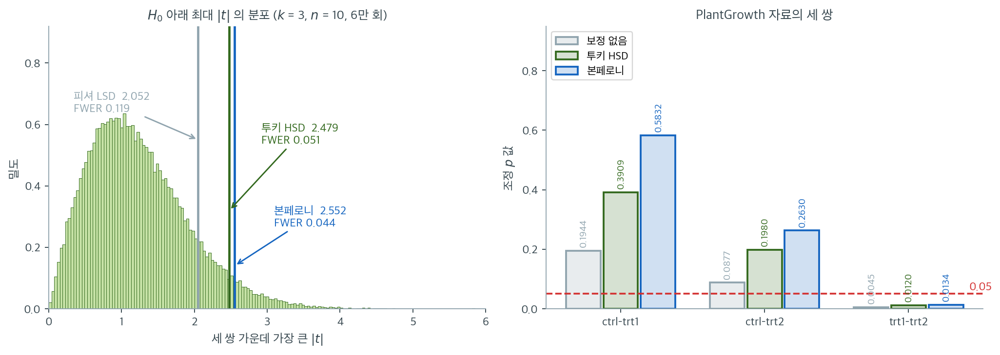
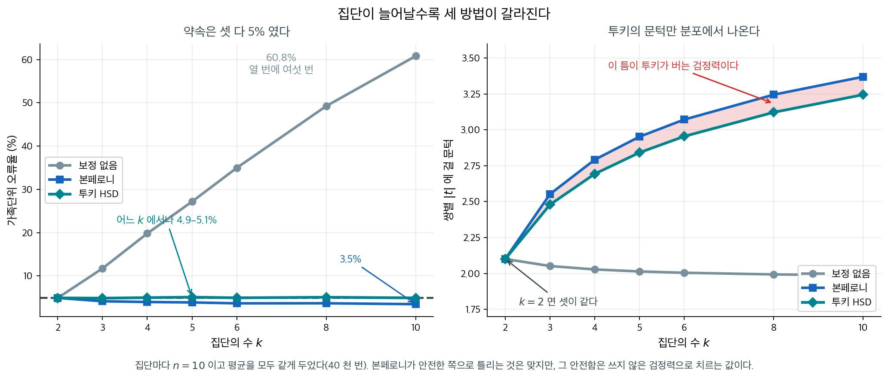

# 사후비교: Tukey HSD (일원배치)


**일원배치 분산분석**을 수행하면 집단 평균 사이에 유의한 차이가 있음을 알게 될 수 있다. 그러나 분산분석의 유의한 결과는 구체적으로 어느 집단이 서로 다른지는 알려주지 않는다. 이때 유의하게 다른 집단 쌍을 찾아내는 데 **사후검정**을 쓴다. 이 검정들은 여러 비교를 할 때 제1종 오류(거짓 양성)를 통제하도록 돕는다.

## 1. 사후검정이 왜 필요한가


일원배치 분산분석에서 사후검정은 다음일 때 수행한다:

1. 일원배치 분산분석이 집단 평균 사이에 통계적으로 유의한 차이를 나타냈을 때.
2. 구체적으로 어느 집단이 서로 다른지 알고자 할 때.

## 2. 사후검정의 종류


일원배치 분산분석에서 가장 흔한 사후검정은 다음과 같다:

- **Tukey의 정직유의차(HSD)**: 가족단위 오류율을 통제하는 널리 쓰이는 방법. 집단 크기가 같을 때 적합하지만 약간의 불균형에도 쓸 수 있다.
- **Bonferroni 보정**: 유의수준을 비교 횟수로 나누는 보수적인 접근. 비교 횟수가 적거나 엄격한 오류 통제가 필요할 때 적합하다.
- **Scheffé 검정**: 유연하고 보수적인 검정으로, 쌍별 비교를 넘어선 복잡한 비교를 검정할 때 특히 유용하다.
- **Dunnett 검정**: 여러 처치군을 하나의 대조군과 비교할 때 쓴다.

## 3. 전역 F 는 쌍별 차이의 평균이다


셋 이상의 집단이 있는 자료에서 평균 사이에 유의한 차이가 있는지 검정한다고 하자.

<div class="exbox" markdown>

**보기 1.** <span class="diff easy" title="쉬움"></span> 일원배치 분산분석. 전역 $F$ 가 사실은 **쌍별 차이들의 평균**임을 보이면, 왜 사후비교가 필요한지가 분명해진다.

**(1)** 균형설계($n_i = n$)에서

$$
\text{SSB} = n\sum_{i=1}^{k}(\bar y_i - \bar y)^2
= \frac{n}{k}\sum_{i<j}(\bar y_i - \bar y_j)^2
$$

임을 보이시오.

**(2)** 이 식에서 **전역 $F$ 가 유의해도 어느 쌍이 다른지는 알 수 없는 까닭**을 설명하시오.

**(3)** PlantGrowth 자료에서 두 꼴이 같은 값을 주는지 확인하고, 세 쌍이 SSB 에 기여하는 몫을 구하시오.

</div>

??? success "풀이"

    **(1) 해석적으로.** 일반성을 잃지 않고 $\bar y = 0$ 이 되도록 평행이동하자(두 변 모두 차이에만 의존하므로 값이 바뀌지 않는다). 그러면 $\sum_i \bar y_i = 0$ 이고

    $$
    \sum_{i<j}(\bar y_i - \bar y_j)^2
    = \frac{1}{2}\sum_{i}\sum_{j}(\bar y_i - \bar y_j)^2
    = \frac{1}{2}\sum_i\sum_j\left(\bar y_i^2 - 2\bar y_i \bar y_j + \bar y_j^2\right)
    $$

    이다. 세 덩어리를 따로 세면 $\sum_i\sum_j \bar y_i^2 = k\sum_i \bar y_i^2$, $\sum_i\sum_j \bar y_j^2 = k\sum_j \bar y_j^2$, 그리고 교차항은 $-2\left(\sum_i \bar y_i\right)\left(\sum_j \bar y_j\right) = 0$ 이므로

    $$
    \sum_{i<j}(\bar y_i - \bar y_j)^2 = \frac{1}{2}\left(2k\sum_i \bar y_i^2\right) = k\sum_i \bar y_i^2 = k\sum_i (\bar y_i - \bar y)^2
    $$

    다. 양변에 $n/k$ 를 곱하면 구하는 식을 얻는다. $\square$

    **(2) 해석적으로.** 이 항등식이 말하는 바는 분명하다. **SSB 는 $\binom{k}{2}$ 개 쌍별 제곱차의 합을 $k$ 로 나눈 것**이며, 어느 쌍이 얼마를 냈는지는 합산 과정에서 **지워진다.** 그러므로 같은 SSB 를 주는 자료가 여럿 있다.

    - 한 쌍만 크게 다르고 나머지는 같은 경우
    - 모든 쌍이 조금씩 다른 경우

    두 경우가 같은 $F$ 를 줄 수 있다. 전역 검정이 "$\mu_1 = \cdots = \mu_k$ 가 거짓"까지만 말하고 멈추는 것은 통계량의 성질이 아니라 **가설의 성질**이다. 그 부정은 "적어도 한 쌍이 다르다"일 뿐이다. 어느 쌍인지 알려면 $\binom{k}{2}$ 개의 질문을 **따로** 물어야 하고, 그 순간 다중비교 문제가 생긴다. 이 쪽 전체가 그 문제를 다룬다.

    **(3) 수치적으로.** 먼저 분산분석을 돌린다.

    ```python
    import pandas as pd
    from statsmodels.formula.api import ols
    from statsmodels.stats.anova import anova_lm

    # R 의 PlantGrowth 자료. 대조군과 처리군 둘, 모두 세 집단이다.
    url = 'https://raw.githubusercontent.com/vincentarelbundock/Rdatasets/1dcc2bf5f955cc1224a3e1307256e1fe86b68dae/csv/datasets/PlantGrowth.csv'
    df = pd.read_csv(url, usecols=[1, 2])

    # 분산분석이 먼저다. 여기서 유의하지 않으면 사후비교로 넘어갈 까닭이 없다.
    model = ols('weight ~ C(group)', data=df).fit()
    anova_results = anova_lm(model)
    print("One-Way ANOVA Results:")
    print(anova_results)
    ```

    출력:

    ```
    One-Way ANOVA Results:
                df    sum_sq   mean_sq         F   PR(>F)
    C(group)   2.0   3.76634  1.883170  4.846088  0.01591
    Residual  27.0  10.49209  0.388596       NaN      NaN
    ```

    이제 두 꼴을 직접 맞춰 본다.

    ```python
    import numpy as np
    import pandas as pd

    url = 'https://raw.githubusercontent.com/vincentarelbundock/Rdatasets/1dcc2bf5f955cc1224a3e1307256e1fe86b68dae/csv/datasets/PlantGrowth.csv'
    df = pd.read_csv(url, usecols=[1, 2])
    n, k = 10, 3

    g = df.groupby('group').weight
    m, s = g.mean().values, g.std().values
    print(f"집단평균 = {np.round(m, 4)},  집단표준편차 = {np.round(s, 6)}")
    print(f"전체평균 = {df.weight.mean():.6f}")

    SSB_dev = n * ((m - m.mean()) ** 2).sum()
    SSB_pair = (n / k) * sum((m[i] - m[j]) ** 2 for i in range(k) for j in range(i + 1, k))
    MSE = (s ** 2).mean()
    print(f"\nSSB (편차 꼴) = {SSB_dev:.6f}")
    print(f"SSB (쌍  꼴) = {SSB_pair:.6f}")
    print(f"MSE = 집단분산의 평균 = {MSE:.6f}")
    print(f"F = (SSB/{k - 1})/MSE = {(SSB_dev / (k - 1)) / MSE:.6f}")

    print(f"\n쌍별 제곱차가 SSB 에 기여하는 몫")
    labels = ['ctrl', 'trt1', 'trt2']
    for i in range(k):
        for j in range(i + 1, k):
            d2 = (m[i] - m[j]) ** 2
            print(f"  {labels[i]}-{labels[j]}: (차)^2 = {d2:.6f},  몫 = {(n / k) * d2 / SSB_dev:.1%}")
    ```

    출력:

    ```
    집단평균 = [5.032 4.661 5.526],  집단표준편차 = [0.583091 0.793676 0.442573]
    전체평균 = 5.073000

    SSB (편차 꼴) = 3.766340
    SSB (쌍  꼴) = 3.766340
    MSE = 집단분산의 평균 = 0.388596
    F = (SSB/2)/MSE = 4.846088

    쌍별 제곱차가 SSB 에 기여하는 몫
      ctrl-trt1: (차)^2 = 0.137641,  몫 = 12.2%
      ctrl-trt2: (차)^2 = 0.244036,  몫 = 21.6%
      trt1-trt2: (차)^2 = 0.748225,  몫 = 66.2%
    ```

    **두 꼴이 소수점 여섯째 자리까지 $3.766340$ 으로 같고**, 이것이 `anova_lm` 의 `sum_sq` 와도 같다. MSE $= 0.388596$ 도 집단분산 셋의 단순평균으로 나오고 $F = 4.846088$ 이 표와 일치한다. 집단별 요약 여섯 개만으로 분산분석표가 재구성된다.

    **쌍별 몫이 (2)의 요점을 수로 보여 준다.** `trt1`–`trt2` 가 $66.2\%$ 를 내고 나머지 둘이 $12.2\%$ 와 $21.6\%$ 를 낸다. 곧 $F = 4.85$ 라는 한 숫자의 **삼분의 이가 한 쌍에서 온 것**인데, 분산분석표의 어느 칸에도 그 사실이 적혀 있지 않다. 보기 2의 Tukey HSD 가 이 분해를 검정의 꼴로 다시 적는 일을 한다.

    덧붙여, 몫이 셋으로 고르게 나뉘었다면 어땠을지 생각해 보라. 평균이 등간격 $\mu, \mu+\delta, \mu+2\delta$ 이면 제곱차가 $\delta^2, \delta^2, 4\delta^2$ 로 양끝 쌍이 혼자 $2/3$ 를 낸다. **$k$ 개 집단이 일렬로 늘어서 있을 때 전역 $F$ 는 사실상 양끝 두 집단의 차이에 끌려간다.** 이것도 전역 검정이 답해 주지 않는 것 중 하나다.

전역 검정이 $p = 0.0159$로 기각한다. 이제 어느 쌍이 다른지 찾을 차례다.

## 4. Tukey HSD 를 손으로 만들어 보기


일원배치 분산분석이 유의하면 Tukey의 HSD로 어느 집단 쌍이 유의하게 다른지 찾을 수 있다.

<div class="exbox" markdown>

**보기 2.** <span class="diff easy" title="쉬움"></span> Tukey HSD. 출력의 네 열을 전부 손으로 만들어 본다.

균형설계의 Tukey 임계차는

$$
\text{HSD} = q_{\alpha,\,k,\,N-k}\sqrt{\frac{\text{MSE}}{n}}
$$

이고 $q$ 는 스튜던트화 범위분포의 분위수다.

**(1)** 쌍별 차이의 표준오차가 $\text{SE} = \sqrt{\text{MSE}\left(\frac1n+\frac1n\right)}$ 임을 쓰고,

$$
\text{HSD} = \frac{q_{\alpha,k,N-k}}{\sqrt2}\,\text{SE}
$$

임을 보이시오. 곧 $\lvert \bar y_i - \bar y_j\rvert > \text{HSD}$ 와 $\lvert t_{ij}\rvert > q/\sqrt2$ 가 같은 조건이다.

**(2)** 조정 p-값이 $\Pr\!\left(Q_{k,\nu} > \sqrt2\,\lvert t_{ij}\rvert\right)$ 로 주어짐을 쓰고, 신뢰구간이 $(\bar y_j - \bar y_i) \pm \text{HSD}$ 임을 밝히시오. **구간의 폭이 세 쌍에서 모두 같은** 까닭은?

**(3)** 이 자료에서 HSD, 세 쌍의 $t$, 조정 p-값, 구간을 모두 계산해 `pairwise_tukeyhsd` 의 출력과 맞추시오.

</div>

??? success "풀이"

    **(1) 해석적으로.** 두 집단평균의 차는 독립이므로

    $$
    \operatorname{Var}(\bar Y_i - \bar Y_j) = \frac{\sigma^2}{n} + \frac{\sigma^2}{n} = \frac{2\sigma^2}{n}
    $$

    이고 $\sigma^2$ 을 합동 MSE 로 바꾸면 $\text{SE} = \sqrt{2\,\text{MSE}/n}$ 이다. 따라서

    $$
    \frac{q}{\sqrt2}\,\text{SE} = \frac{q}{\sqrt2}\sqrt{\frac{2\,\text{MSE}}{n}} = q\sqrt{\frac{\text{MSE}}{n}} = \text{HSD}
    $$

    다. $\square$ 그러므로 $\lvert \bar y_i - \bar y_j\rvert > \text{HSD}$ 는 $\left\lvert \dfrac{\bar y_i - \bar y_j}{\text{SE}}\right\rvert > \dfrac{q}{\sqrt2}$ 와 같다.

    $\sqrt2$ 가 들어오는 자리를 분명히 해 두자. 스튜던트화 범위 $Q_{k,\nu}$ 는 **표준오차가 $\sqrt{\text{MSE}/n}$ 인 척도**(평균 하나의 표준오차)로 정의된 **최대 차이**의 분포인데, 우리가 쓰는 $t$ 는 **차이의 표준오차** $\sqrt{2\text{MSE}/n}$ 로 나눈 양이다. 두 척도가 $\sqrt2$ 만큼 다르다.

    **(2) 해석적으로.** $H_0$ 가 모두 참이면 $\max_{i<j}\dfrac{\lvert\bar Y_i - \bar Y_j\rvert}{\sqrt{\text{MSE}/n}}$ 가 정확히 $Q_{k,\nu}$ 를 따른다. 관측된 쌍 $(i,j)$ 를 같은 척도로 옮기면

    $$
    \frac{\lvert \bar y_i - \bar y_j\rvert}{\sqrt{\text{MSE}/n}} = \sqrt2\,\lvert t_{ij}\rvert
    $$

    이므로, **"최댓값이 이만큼 커질 확률"**로 읽은 조정 p-값이

    $$
    p^{\text{adj}}_{ij} = \Pr\!\left(Q_{k,\nu} > \sqrt2\,\lvert t_{ij}\rvert\right)
    $$

    다. 이것은 "이 쌍 하나가 이만큼 벌어질 확률"이 아니라 **"$\binom{k}{2}$ 개 중 가장 큰 것이 이만큼 벌어질 확률"**이며, 그래서 그대로 $\alpha$ 와 견주면 가족단위 오류율이 통제된다.

    구간은 같은 부등식을 뒤집어 얻는다. $\lvert(\bar y_j - \bar y_i) - (\mu_j - \mu_i)\rvert \le \text{HSD}$ 가 동시에 성립할 확률이 $1-\alpha$ 이므로

    $$
    (\bar y_j - \bar y_i) \pm \text{HSD}
    $$

    가 **동시신뢰구간**이다. 폭이 세 쌍에서 모두 같은 까닭은 (1)의 $\text{SE}$ 가 **$n$ 과 MSE 에만 의존**하기 때문이다. 균형설계에서는 어느 쌍이든 $n_i = n_j = n$ 이므로 SE 가 같고, 따라서 임계차 하나가 모든 쌍에 공통으로 쓰인다. **"하나의 임계차"는 Tukey 의 설계가 아니라 균형설계의 결과**이며, 불균형이면 쌍마다 SE 가 달라져 Tukey–Kramer 로 확장해야 한다.

    **(3) 수치적으로.** 먼저 쪽의 출력이다.

    ```python
    from statsmodels.stats.multicomp import pairwise_tukeyhsd

    # 분산분석은 "어딘가 다르다"까지만 말한다. 어느 쌍이 다른지는 사후비교의 몫이다.
    tukey_result = pairwise_tukeyhsd(endog=df['weight'], groups=df['group'], alpha=0.05)
    print("Tukey's HSD Test Results:")
    print(tukey_result)
    ```

    출력:

    ```
    Tukey's HSD Test Results:
    Multiple Comparison of Means - Tukey HSD, FWER=0.05
    ===================================================
    group1 group2 meandiff p-adj   lower  upper  reject
    ---------------------------------------------------
      ctrl   trt1   -0.371 0.3909 -1.0622 0.3202  False
      ctrl   trt2    0.494  0.198 -0.1972 1.1852  False
      trt1   trt2    0.865  0.012  0.1738 1.5562   True
    ---------------------------------------------------
    ```

    이제 같은 표를 공식으로 만든다.

    ```python
    import numpy as np
    import pandas as pd
    from scipy import stats

    url = 'https://raw.githubusercontent.com/vincentarelbundock/Rdatasets/1dcc2bf5f955cc1224a3e1307256e1fe86b68dae/csv/datasets/PlantGrowth.csv'
    df = pd.read_csv(url, usecols=[1, 2])
    n, k, nu = 10, 3, 27

    g = df.groupby('group').weight
    m, s = g.mean().values, g.std().values
    MSE = (s ** 2).mean()
    SE = np.sqrt(MSE * (1 / n + 1 / n))

    q = stats.studentized_range.ppf(0.95, k, nu)
    HSD = q * np.sqrt(MSE / n)
    print(f"MSE = {MSE:.6f},  SE = sqrt(MSE*(1/n+1/n)) = {SE:.6f}")
    print(f"q(0.95, k=3, nu=27) = {q:.6f}")
    print(f"HSD = q*sqrt(MSE/n) = {HSD:.6f}   (= q/sqrt(2) * SE = {q / np.sqrt(2) * SE:.6f})")

    print(f"\n{'쌍':>12}{'차이':>9}{'|차이|>HSD':>11}{'t':>9}{'p-adj':>9}{'하한':>9}{'상한':>9}")
    labels = ['ctrl', 'trt1', 'trt2']
    for i in range(k):
        for j in range(i + 1, k):
            d = m[j] - m[i]
            t = d / SE
            p = stats.studentized_range.sf(abs(t) * np.sqrt(2), k, nu)
            print(f"{labels[i] + '-' + labels[j]:>12}{d:>9.4f}{str(abs(d) > HSD):>11}"
                  f"{t:>9.4f}{p:>9.4f}{d - HSD:>9.4f}{d + HSD:>9.4f}")
    ```

    출력:

    ```
    MSE = 0.388596,  SE = sqrt(MSE*(1/n+1/n)) = 0.278782
    q(0.95, k=3, nu=27) = 3.506426
    HSD = q*sqrt(MSE/n) = 0.691216   (= q/sqrt(2) * SE = 0.691216)

               쌍       차이   |차이|>HSD        t    p-adj       하한       상한
       ctrl-trt1  -0.3710      False  -1.3308   0.3909  -1.0622   0.3202
       ctrl-trt2   0.4940      False   1.7720   0.1980  -0.1972   1.1852
       trt1-trt2   0.8650       True   3.1028   0.0120   0.1738   1.5562
    ```

    **`meandiff`, `p-adj`, `lower`, `upper`, `reject` 다섯 열이 모두 `pairwise_tukeyhsd` 의 출력과 소수점 넷째 자리까지 같다.** (1)과 (2)의 유도가 맞는다. HSD 를 두 방식으로 계산한 $0.691216$ 도 서로 같다.

    **읽을 것 셋.**

    - **임계차는 $\text{HSD} = 0.6912$ 하나뿐이다.** 세 쌍의 차이 $-0.371$, $0.494$, $0.865$ 중 절댓값이 이를 넘는 것은 마지막 하나다. 신뢰구간이 $0$ 을 품느냐는 질문과 **정확히 같은 질문**이며, 실제로 셋째 줄만 $(0.1738,\ 1.5562)$ 로 $0$ 을 비껴간다.
    - **$t$ 로 보면 문턱이 $q/\sqrt2 = 2.4794$ 다.** 보정하지 않은 $t_{0.975,27} = 2.0518$ 보다 높다. 그 차이가 "세 번 본다"는 사실의 값이다. `ctrl`–`trt2` 의 $t = 1.772$ 는 어느 문턱도 넘지 못하지만, 만약 $t$ 가 $2.2$ 였다면 보정 없이는 유의하고 Tukey 로는 아니었을 것이다.
    - **`ctrl`–`trt2` 가 $p^{\text{adj}} = 0.198$ 로 아깝지 않게 밀린다.** 보기 1에서 이 쌍이 SSB 의 $21.6\%$ 를 냈는데도 그렇다. 전역 $F$ 가 $p = 0.016$ 으로 기각한 것과 사후비교에서 한 쌍만 살아남는 것 사이에 모순은 없다. **전역 검정은 세 쌍의 증거를 합쳐 쓰고 사후비교는 쌍마다 따로 쓰면서 문턱까지 올린다.** 전역이 기각했는데 어느 쌍도 유의하지 않는 일도 얼마든지 생긴다.

세 비교 중 trt1 대 trt2 하나만 유의하다. `p-adj` 열은 이미 다중비교 보정을 마친 값이므로 그대로 0.05와 비교하면 된다.

이 출력은 각 집단 쌍의 비교 결과를 보여주며 다음을 포함한다:

- **meandiff**: 두 집단 평균의 차이.
- **p-adj**: 각 쌍별 비교의 조정 p-값.
- **reject**: 각 쌍에 대해 귀무가설(차이 없음)을 기각했는지를 나타내는 불리언.

## 5. 본페로니와 견주면


더 보수적인 접근으로, 유의수준을 비교 횟수로 나누는 Bonferroni 보정을 쓸 수 있다.

<div class="exbox" markdown>

!!! note "출력의 네 열은 모두 한 수에서 나온다"
    `pairwise_tukeyhsd` 가 내놓는 `lower`, `upper`, `p-adj`, `reject` 는 서로
    독립적인 네 수가 아니다. 균형 설계에서는 넷 모두 $\text{HSD}$ 하나로 묶인다.

    - **구간.** $(\bar y_j - \bar y_i) \pm \text{HSD}$ 이므로 **반폭이 세 쌍 모두에서 같다.**
      쌍마다 다른 것은 중심뿐이다.
    - **`reject`.** 참인 것과 구간이 $0$ 을 품지 않는 것이 **동치**다. $|\bar y_i - \bar y_j| > \text{HSD}$
      가 두 진술을 같은 부등식으로 적어 주기 때문이다.
    - **`p-adj`.** 스튜던트화 범위의 꼬리확률

      $$
      p_{\text{adj}} = P\!\left(Q_{k,\,N-k} \ge \frac{|\bar y_i - \bar y_j|}{\sqrt{MSW/n}}\right)
      $$

      이다. 위 (1) 의 $\text{HSD} = (q/\sqrt2)\,\text{SE}$ 와 같은 식을 꼬리 쪽에서 읽은 것이다.


**보기 3.** <span class="diff easy" title="쉬움"></span> 본페로니 보정과의 비교. 보수성의 크기를 수로 잰다.

**(1)** $m$ 개 비교를 각각 수준 $\alpha$ 로 하고 그들이 **독립**이면 가족단위 오류율이 $1-(1-\alpha)^m$ 임을 보이고, 합집합 한계가 주는 $m\alpha$ 와 견주시오. 집단이 $k$ 개면 $m = \binom{k}{2}$ 이므로 $k = 4$ 에서 그 값은 얼마인가.

**(2)** 세 방법이 $\lvert t\rvert$ 척도에서 쓰는 문턱이

$$
\underbrace{t_{1-\alpha/2,\,\nu}}_{\text{보정 없음}}
\ <\
\underbrace{\frac{q_{\alpha,k,\nu}}{\sqrt2}}_{\text{투키}}
\ <\
\underbrace{t_{1-\alpha/(2m),\,\nu}}_{\text{본페로니}}
$$

임을 이 자료($k=3$, $\nu=27$)에서 확인하고, **가운데 부등호가 성립하는 까닭**을 밝히시오.

**(3)** 쪽의 코드는 쌍마다 **두 집단의 자료만으로** $t$-검정을 한다. 합동 MSE 를 쓰는 쪽과 어떻게 다른지 자유도와 p-값으로 보이시오.

</div>

??? success "풀이"

    **(1) 해석적으로.** 비교 $i$ 에서 거짓 기각이 일어나는 사건을 $A_i$ 라 하면 $\Pr(A_i) = \alpha$ 다. 독립이면

    $$
    \text{FWER} = \Pr\left(\bigcup_i A_i\right) = 1 - \Pr\left(\bigcap_i A_i^c\right) = 1 - (1-\alpha)^m
    $$

    이다. 한편 합집합 한계는 독립을 가정하지 않고

    $$
    \Pr\left(\bigcup_i A_i\right) \le \sum_i \Pr(A_i) = m\alpha
    $$

    를 준다. 본페로니는 이 한계를 $\alpha$ 로 묶으려고 각 비교의 수준을 $\alpha/m$ 으로 낮춘다. 두 값은 $m\alpha$ 가 작을 때 가깝지만($1-(1-\alpha)^m \approx m\alpha - \binom{m}{2}\alpha^2$) $m$ 이 커지면 벌어진다.

    $k$ 개 집단의 쌍 수는 $m = \binom{k}{2} = \frac{k(k-1)}{2}$ 다. $k = 4$ 면 $m = 6$ 이고

    $$
    1 - 0.95^6 = 0.2649
    $$

    다. **집단 넷을 보정 없이 쌍별로 비교하면 적어도 하나를 거짓 기각할 확률이 $26\%$** 다. 약속한 $5\%$ 의 다섯 배가 넘는다.

    **(2) 해석적으로.** 왼쪽 부등호는 쉽다. 보정 없는 문턱은 $m = 1$ 일 때의 값이므로 $m > 1$ 인 어떤 보정보다 낮다.

    가운데 부등호가 이 보기의 요점이다. 세 쌍별 통계량 $t_{12}, t_{13}, t_{23}$ 은 **독립이 아니다.** 같은 집단평균을 나눠 쓰기 때문이다. 실제로 $\bar y_1 - \bar y_2$ 와 $\bar y_1 - \bar y_3$ 은 $\bar y_1$ 을 공유하므로 공분산이 $\sigma^2/n > 0$ 이고, 균형설계에서 상관계수가 $\tfrac12$ 다. 게다가 셋은 $t_{12} + t_{23} = t_{13}$ 이라는 **선형제약**까지 만족하므로 자유도가 둘뿐이다.

    본페로니의 합집합 한계는 이 구조를 전혀 쓰지 않고 **최악의 경우**(사건들이 서로 겹치지 않는 경우)에 맞춘다. 반면 $q_{\alpha,k,\nu}$ 는 바로 그 종속 구조 아래의 **최댓값의 정확한 분포**에서 나온 분위수다. 겹침이 있으면 합집합의 확률이 합보다 작으므로, 정확한 분위수는 합집합 한계가 요구하는 문턱보다 **낮다.** 그래서

    $$
    \frac{q_{\alpha,k,\nu}}{\sqrt2} < t_{1-\alpha/(2m),\,\nu}
    $$

    이다. **같은 $\alpha$ 를 약속하면서 문턱이 낮다는 것은 검정력이 높다는 뜻이고, 그것이 Tukey 를 쓰는 이유 전부다.**

    **수치적으로.** 먼저 쪽의 본페로니 계산이다.

    ```python
    from statsmodels.stats.multitest import multipletests
    from itertools import combinations
    from scipy.stats import ttest_ind

    # 같은 일을 본페로니로 해 본다. 쌍마다 t-검정을 하고 p-값에 비교 횟수를 곱한다.
    groups = df['group'].unique()

    # 쌍 세 개를 모두 돌며 보정 전 p-값을 모은다.
    p_values = []
    comparisons = []

    for group1, group2 in combinations(groups, 2):
        data1 = df[df['group'] == group1]['weight']
        data2 = df[df['group'] == group2]['weight']
        stat, p_val = ttest_ind(data1, data2)
        p_values.append(p_val)
        comparisons.append(f"{group1} vs {group2}")

    # 본페로니는 Tukey 보다 보수적이다. 분산분석의 구조를 쓰지 않고
    # 검정 수만으로 문턱을 낮추기 때문이다.
    _, p_values_corrected, _, _ = multipletests(p_values, alpha=0.05, method='bonferroni')

    # 보정 전과 뒤를 나란히 찍어 무엇이 달라지는지 본다.
    print("Bonferroni-Corrected Pairwise Comparisons:")
    for comparison, p_val, p_val_corr in zip(comparisons, p_values, p_values_corrected):
        print(f"{comparison}: p-value = {p_val:.4f}, Bonferroni-corrected p-value = {p_val_corr:.4f}")
    ```

    출력:

    ```
    Bonferroni-Corrected Pairwise Comparisons:
    ctrl vs trt1: p-value = 0.2490, Bonferroni-corrected p-value = 0.7471
    ctrl vs trt2: p-value = 0.0469, Bonferroni-corrected p-value = 0.1406
    trt1 vs trt2: p-value = 0.0075, Bonferroni-corrected p-value = 0.0226
    ```

    이제 (1)의 표와 (2)의 세 문턱을 계산하고, 두 종류의 $t$-검정을 나란히 둔다.

    ```python
    import numpy as np
    import pandas as pd
    from scipy import stats

    url = 'https://raw.githubusercontent.com/vincentarelbundock/Rdatasets/1dcc2bf5f955cc1224a3e1307256e1fe86b68dae/csv/datasets/PlantGrowth.csv'
    df = pd.read_csv(url, usecols=[1, 2])
    n, k, nu = 10, 3, 27

    print(f"{'k':>4}{'쌍 수 m':>9}{'1-(1-a)^m':>12}{'합집합 한계 ma':>14}")
    for kk in range(2, 7):
        mm = kk * (kk - 1) // 2
        print(f"{kk:>4}{mm:>9}{1 - 0.95 ** mm:>12.4f}{min(1, 0.05 * mm):>14.4f}")

    print(f"\n세 문턱 (|t| 척도, nu = {nu})")
    print(f"  보정 없음  t(0.975, 27)        = {stats.t.ppf(0.975, nu):.4f}")
    print(f"  투키       q(0.95,3,27)/sqrt2  = {stats.studentized_range.ppf(0.95, k, nu) / np.sqrt(2):.4f}")
    print(f"  본페로니   t(1-0.05/6, 27)     = {stats.t.ppf(1 - 0.05 / (2 * 3), nu):.4f}")

    g = df.groupby('group').weight
    m, s = g.mean().values, g.std().values
    MSE = (s ** 2).mean()
    SE = np.sqrt(2 * MSE / n)
    labels = ['ctrl', 'trt1', 'trt2']
    print(f"\n같은 합동 MSE(자유도 27)로 세 방법의 p-값을 나란히")
    print(f"{'쌍':>12}{'|t|':>8}{'보정없음':>10}{'투키':>9}{'본페로니':>10}")
    for i in range(k):
        for j in range(i + 1, k):
            t = abs(m[j] - m[i]) / SE
            p_raw = 2 * stats.t.sf(t, nu)
            p_tuk = stats.studentized_range.sf(t * np.sqrt(2), k, nu)
            print(f"{labels[i] + '-' + labels[j]:>12}{t:>8.4f}{p_raw:>10.4f}"
                  f"{p_tuk:>9.4f}{min(1, 3 * p_raw):>10.4f}")

    print(f"\n쪽의 코드가 쓴 두 집단만의 t-검정 (자유도 18)")
    for i in range(k):
        for j in range(i + 1, k):
            a = df[df.group == labels[i]].weight
            b = df[df.group == labels[j]].weight
            _, p = stats.ttest_ind(a, b)
            print(f"{labels[i] + '-' + labels[j]:>12}  p = {p:.4f},  x3 = {min(1, 3 * p):.4f}")
    ```

    출력:

    ```
       k    쌍 수 m   1-(1-a)^m     합집합 한계 ma
       2        1      0.0500        0.0500
       3        3      0.1426        0.1500
       4        6      0.2649        0.3000
       5       10      0.4013        0.5000
       6       15      0.5367        0.7500

    세 문턱 (|t| 척도, nu = 27)
      보정 없음  t(0.975, 27)        = 2.0518
      투키       q(0.95,3,27)/sqrt2  = 2.4794
      본페로니   t(1-0.05/6, 27)     = 2.5525

    같은 합동 MSE(자유도 27)로 세 방법의 p-값을 나란히
               쌍     |t|      보정없음       투키      본페로니
       ctrl-trt1  1.3308    0.1944   0.3909    0.5832
       ctrl-trt2  1.7720    0.0877   0.1980    0.2630
       trt1-trt2  3.1028    0.0045   0.0120    0.0134

    쪽의 코드가 쓴 두 집단만의 t-검정 (자유도 18)
       ctrl-trt1  p = 0.2490,  x3 = 0.7471
       ctrl-trt2  p = 0.0469,  x3 = 0.1406
       trt1-trt2  p = 0.0075,  x3 = 0.0226
    ```

    **(1)의 표.** $k = 4$ 에서 $1 - 0.95^6 = 0.2649$ 로 예고한 값이 나온다. 합집합 한계 $m\alpha = 0.30$ 은 그보다 조금 크다. $k = 6$ 이면 참값 $0.5367$ 에 한계가 $0.75$ 로 벌어지고, $m \ge 20$ 이면 한계가 $1$ 을 넘어 아무 정보도 주지 못한다. **$m$ 이 클수록 본페로니가 버리는 양이 많아진다.**

    (이 표의 $1-(1-\alpha)^m$ 은 **독립을 가정한** 값이다. 쌍별 비교는 실제로 양의 상관을 가지므로 참 FWER 은 이보다 조금 작다. 쪽의 그림에서 $k = 3$ 의 실제 값이 $0.119$ 로 표의 $0.1426$ 보다 작은 것이 그 까닭이다.)

    **(2)의 세 문턱.** $2.0518 < 2.4794 < 2.5525$ 로 예고한 순서가 맞는다. 투키가 본페로니보다 $0.073$ 낮다. $k = 3$ 에서는 간격이 작지만, 11.3절 [이원배치 사후비교](tukey_two_way.md) 보기 3 에서 $k = 6$ 일 때 같은 비교를 다시 한다.

    **(3) 두 종류의 $t$-검정.** 쪽의 코드가 쓴 두 집단만의 $t$-검정은 자유도가 $18$ 이고, 합동 MSE 를 쓰면 $27$ 이다. 그 차이가 p-값을 눈에 띄게 바꾼다.

    | 쌍 | 두 집단만 (df $18$) | 합동 MSE (df $27$) |
    |---|---|---|
    | ctrl–trt1 | $0.2490$ | $0.1944$ |
    | ctrl–trt2 | $\mathbf{0.0469}$ | $\mathbf{0.0877}$ |
    | trt1–trt2 | $0.0075$ | $0.0045$ |

    **방향이 쌍마다 다르다.** `ctrl`–`trt2` 는 두 집단만 보면 $0.0469$ 로 아슬아슬하게 유의한데 합동 MSE 로는 $0.0877$ 로 밀린다. 두 집단($s = 0.583$, $0.443$)이 모두 흩어짐이 작은 쪽이라 둘만의 합동분산이 전체 MSE 보다 작기 때문이다. 반대로 `trt1`–`trt2` 는 `trt1` 의 $s = 0.794$ 가 커서 둘만 보면 분모가 커지고, 전체 MSE 를 쓰면 작아진다.

    **그러므로 "본페로니가 투키보다 보수적"이라는 비교를 쪽의 두 출력($0.0226$ 대 $0.012$)으로 하면 안 된다.** 거기에는 보정 방식의 차이와 **분산 추정 방식의 차이**가 섞여 있다. 같은 합동 MSE 위에서 비교하면 $0.0134$ 대 $0.0120$ 으로, 차이가 훨씬 작다. 이것이 투키가 본페로니를 이기는 **순수한 폭**이며, 쪽 아래 그림이 적은 수와 같다.

    합동 MSE 를 쓰는 쪽이 옳은 까닭도 분명히 해 두자. 등분산을 가정한 모형에서는 **세 집단 전부가 같은 $\sigma^2$ 의 정보를 담고 있으므로**, 두 집단만 쓰는 것은 자유도 $9$ 어치를 버리는 일이다. 등분산이 의심스럽다면 합동할 것이 아니라 Games–Howell 로 가야 한다.

Tukey와 결론은 같지만 보정 p-값이 다르다. trt1 대 trt2가 Tukey에서 0.012, Bonferroni에서 0.0226이다. Bonferroni가 더 보수적이기 때문이며, 비교 수가 늘수록 차이가 벌어진다.

보수성의 출처는 분명하다. 세 쌍별 비교는 같은 집단 평균들을 공유해 **양의 상관**을 갖는다. 그런데 Bonferroni가 쓰는 [합집합 한계](../../ch09/multiple_testing/bonferroni_holm.md)는 그 상관을 묻지 않고 최악의 경우에 맞춘다. Tukey는 같은 상관 구조를 스튜던트화 범위분포로 정확히 반영한다. **종속 구조를 아는 가족에서 그것을 버리는 대가가 0.012와 0.0226의 차이다.**

보정 전 p-값이 Tukey의 `p-adj`와도 다르다는 점에 주의하라. 여기서는 쌍마다 두 집단의 자료만으로 $t$-검정을 하지만, Tukey는 세 집단 전체에서 얻은 합동 MSE를 쓴다. 자유도가 18 대 27로 달라진다.

투키의 임계값이 어디서 오는지는 **최대 차이의 귀무분포**를 직접 그려 보면 분명해진다. 세 집단의 평균이 모두 같은 자료($k = 3$, 각 $n = 10$)를 6만 번 만들고, 매번 세 쌍 가운데 가장 큰 $|t|$를 기록했다.



왼쪽 초록 히스토그램이 그 분포다. 봉우리가 $1$ 부근이고 오른쪽으로 길게 늘어진다. 쌍별 비교 하나의 $|t|$가 아니라 **셋 중 최댓값**이므로 보통의 $t$ 분포보다 오른쪽으로 밀려 있다. 사후비교에서 거짓 발견이 생기는 것은 "어느 한 쌍"이 문턱을 넘을 때이므로, 통제해야 할 것은 바로 이 최댓값의 분포다.

세 수직선이 세 방법의 문턱이다. **보정 없는 $t_{0.975,27} = 2.052$** 오른쪽에는 분포의 $11.9\%$가 놓인다. 쌍마다 $5\%$씩 쓴 대가가 가족단위로 $12\%$라는 뜻이다. **투키의 $q_{0.05,3,27}/\sqrt{2} = 2.479$** 오른쪽 넓이는 $0.051$로, 약속한 $5\%$와 정확히 맞는다. 우연이 아니라 정의다. 투키의 임계값은 *이 분포의 95 백분위수*로 만들어진 것이며, 스튜던트화 범위분포가 바로 이 최댓값의 이론적 분포다. **본페로니의 $t_{0.05/6,27} = 2.552$** 오른쪽은 $0.044$로 약속보다 작다. 넘치게 안전하다는 것은 곧 검정력을 버렸다는 뜻이다.

오른쪽이 PlantGrowth 자료에서 그 차이가 얼마로 나타나는지 보여 준다. 세 쌍 모두에서 회색(보정 없음) $<$ 초록(투키) $<$ 파랑(본페로니)의 순서가 지켜진다. ctrl–trt1은 $0.1944 \to 0.3909 \to 0.5832$, ctrl–trt2는 $0.0877 \to 0.1980 \to 0.2630$, trt1–trt2는 $0.0045 \to 0.0120 \to 0.0134$이다. **다행히 이 자료에서는 세 방법의 판정이 갈리지 않는다.** 하지만 ctrl–trt2를 보라. 보정 전 $0.0877$이던 것이 투키에서 $0.198$, 본페로니에서 $0.263$이 된다. 경계에 있는 비교라면 어떤 보정을 쓰느냐가 결론을 바꾼다.

투키가 본페로니를 이기는 폭은 $k$가 커질수록 벌어진다. 여기서는 $0.0120$ 대 $0.0134$로 미미하지만, 집단이 여섯이면 쌍이 15개가 되어 본페로니는 $p$에 15를 곱하는 반면 투키의 문턱은 최대 $|t|$ 분포가 얼마나 밀렸는지만큼만 올라간다. **비교들이 평균을 공유해 양의 상관을 갖는다는 사실을 쓰느냐 버리느냐의 차이다.**

<div class="storybox" markdown>

**그림으로 보는 통계학 1.** 「비트」와 「소프트웨어」를 지은 사람

위에서 투키의 문턱이 어디서 오는지 보았다. 본페로니처럼 **일반적인 부등식**을 가져다
쓰는 대신, 최대 $|t|$ 의 **실제 분포**를 구해 그 분위수를 쓴다. 이 쪽은 그 선택이 왜
나은지 $k = 3$ 에서 보였다. $k$ 를 늘리면 어떻게 되는지 마저 재 둔다.

<figure markdown>
  { width=1000 }
  <figcaption markdown>집단마다 $n = 10$ 이고 평균을 **모두 같게** 두었다. $k = 2$ 에서 셋이 정확히 겹치는 것이 눈여겨볼 자리다 — 쌍이 하나뿐이면 보정할 것이 없다. 자료에서 직접 쟀다.</figcaption>
</figure>

왼쪽에서 투키만 $k$ 와 무관하게 $4.9$–$5.1\%$ 에 붙어 있다. **약속을 지킨다**는 것이
이런 뜻이다. 본페로니는 $3.5\%$ 까지 내려가는데, 안전한 쪽으로 틀리는 것이니 틀렸다고
말하기는 어렵다. 다만 그 안전함은 **쓰지 않은 검정력**으로 치르는 값이고, 오른쪽의 붉은
틈이 그 값이다.

**이 방법을 만든 사람이 존 투키다.** 통계학자 목록에서 그의 이름을 찾기 전에, 아마 이미
그가 지은 낱말을 쓰고 있었을 것이다.

- **비트.** $1947$ 년 벨연구소의 메모에서 $\text{bi}$nary digi$\text{t}$ 를 줄여 만든 말이다.
  이듬해 섀넌이 정보이론 논문에서 그 말을 쓰며 투키를 출처로 밝혔다.
- **소프트웨어.** $1958$ 년 글에서 쓴 것이 활자로 남은 이른 쓰임으로 꼽힌다.
- **상자그림**과 **줄기–잎 그림**, 그리고 **탐색적 자료분석**이라는 말 자체.
- **고속 푸리에 변환**(쿨리와 함께, $1965$). 소련의 핵실험을 지진파에서 가려내는 일을
  맡고 있을 때 나온 셈법이다.

그가 쓴 방법들을 늘어놓고 보면 한 가지가 되풀이된다. **일반적인 보장 대신 눈앞의 것을
직접 본다.** 상자그림은 요약통계 대신 사분위와 이상점을 그대로 보여 주고, 탐색적
자료분석은 모형을 세우기 전에 자료를 들여다보라고 한다. HSD 도 같은 수법이다 — 최악의
경우를 가정하는 부등식 대신 **최댓값의 분포를 직접 구한다.**

뒷이야기가 하나 있다. 이렇게 널리 쓰이는 방법인데, 그가 $1953$ 년에 쓴 원고
「다중비교의 문제」는 **끝내 학술지에 싣지 않았다.** 타자로 친 그 원고가 사람 손에서
손으로 돌아다니며 쓰였고, 활자가 된 것은 $1994$ 년 그의 전집에 실리면서다. 사십 년
동안 「투키의 방법」은 **아무도 정식으로 발표하지 않은 방법**이었다.

_확인한 곳 — 투키가 「bit」를 지었고 섀넌의 $1948$ 년 논문이 그를 출처로 밝힌 것, $1958$ 년 글의 「software」가 활자로 남은 이른 쓰임으로 꼽히는 것, 쿨리와 함께 $1965$ 년 고속 푸리에 변환을 내놓은 것, 상자그림과 탐색적 자료분석($1977$)이 그의 것이라는 사실은 모두 거듭 인용되는 것이다 · $1953$ 년 원고 「The Problem of Multiple Comparisons」가 발표되지 않은 채 돌아다니다 $1994$ 년 전집으로 활자화되었다는 것도 그렇다 · 그림의 수치는 $n = 10$ · $4$ 만 번으로 이 쪽이 직접 쟀다_

</div>

### 셰페 검정은 쌍별이 아닌 비교에 쓴다


Scheffé 검정은 쌍별이 아닌 비교나 대비를 검정하는 데 적합하지만 복잡하고 기본적인 쌍별 비교에는 덜 쓰인다. `statsmodels`에는 Scheffé 검정이 직접 제공되지 않지만, 필요하다면 특히 더 진전된 비교를 위해 대비를 직접 구성할 수 있다.

---
## 6. 라이브러리가 돌려주는 표를 읽기


<div class="exbox" markdown>

**보기 4.** <span class="diff easy" title="쉬움"></span> `scipy`의 `tukey_hsd`로 신뢰구간까지. 신뢰수준을 $95\%$ 에서 $99\%$ 로 올리면 결론이 바뀐다.

**(1)** 신뢰수준 $1-\alpha$ 의 동시신뢰구간이

$$
(\bar y_j - \bar y_i) \pm q_{\alpha,k,N-k}\sqrt{\frac{\text{MSE}}{n}}
$$

임을 쓰고, $\alpha = 0.01$ 에서 반폭을 구하시오.

**(2)** 구간이 $0$ 을 품지 않는 것과 $p^{\text{adj}} < \alpha$ 가 **같은 사건**임을 밝히고, 이 자료에서 $\alpha = 0.05$ 와 $\alpha = 0.01$ 에 대해 확인하시오. $99\%$ 에서 `trt1`–`trt2` 는 어떻게 되는가.

**(3)** 출력의 `(0 - 1)` 과 `(1 - 0)` 이 왜 부호만 다른 같은 비교인지 밝히시오.

</div>

??? success "풀이"

    **(1) 해석적으로.** 보기 2의 (2)에서 이미 얻었다. $H_0$ 아래에서

    $$
    \Pr\left(\max_{i<j}\frac{\lvert(\bar Y_i - \bar Y_j) - (\mu_i-\mu_j)\rvert}{\sqrt{\text{MSE}/n}} \le q_{\alpha,k,\nu}\right) = 1-\alpha
    $$

    이므로 모든 쌍에 대해 **동시에**

    $$
    \lvert(\bar y_j - \bar y_i) - (\mu_j - \mu_i)\rvert \le q_{\alpha,k,\nu}\sqrt{\frac{\text{MSE}}{n}}
    $$

    가 성립할 확률이 $1-\alpha$ 다. 이를 $\mu_j-\mu_i$ 에 대해 풀면 구하는 구간이 된다. **"동시"라는 말이 핵심이다.** $\binom{k}{2}$ 개 구간이 **모두 함께** 참값을 덮을 확률이 $1-\alpha$ 이지, 구간 하나하나가 $1-\alpha$ 인 것이 아니다.

    **(2) 해석적으로.** 구간이 $0$ 을 품지 않는다는 것은

    $$
    \lvert \bar y_j - \bar y_i\rvert > q_{\alpha,k,\nu}\sqrt{\frac{\text{MSE}}{n}}
    $$

    인데, 양변을 $\sqrt{\text{MSE}/n}$ 으로 나누면 좌변이 보기 2에서 본 $\sqrt2\,\lvert t_{ij}\rvert$ 다. 그러므로

    $$
    \sqrt2\,\lvert t_{ij}\rvert > q_{\alpha,k,\nu}
    \iff
    \Pr\!\left(Q_{k,\nu} > \sqrt2\lvert t_{ij}\rvert\right) < \alpha
    \iff
    p^{\text{adj}}_{ij} < \alpha
    $$

    로 같은 사건이다($Q$ 의 분포함수가 증가함수이므로 부등식의 방향이 뒤집힌다). $\square$ **구간과 p-값은 같은 계산을 두 방향에서 적은 것**이며, 어느 쪽을 보고하든 판정은 같다.

    **(3) 해석적으로.** $\bar y_0 - \bar y_1 = -(\bar y_1 - \bar y_0)$ 이고, 검정통계량이 $\lvert t\rvert$ 에만 의존하므로 p-값은 같다. 구간도 부호를 바꾸고 양끝을 맞바꾼 것이 된다. `scipy` 는 $k \times k$ 행렬을 통째로 돌려주므로 대각선 위아래가 같은 정보를 담고, `statsmodels` 는 $i < j$ 인 쪽만 인쇄한다. **$\binom{3}{2} = 3$ 개의 비교가 여섯 줄로 보이는 것일 뿐 검정 횟수가 여섯이 되는 것은 아니다.** ($k$ 를 정하는 것은 집단 수이지 인쇄된 줄 수가 아니다.)

    **수치적으로.** 먼저 쪽의 출력이다.

    ```python
    import matplotlib.pyplot as plt
    import numpy as np
    import scipy.stats as stats
    import pandas as pd

    def load_data():
        """PlantGrowth 자료를 읽어 집단별로 나누고 자유도까지 함께 돌려준다."""
        url = 'https://raw.githubusercontent.com/vincentarelbundock/Rdatasets/1dcc2bf5f955cc1224a3e1307256e1fe86b68dae/csv/datasets/PlantGrowth.csv'
        df = pd.read_csv(url, usecols=[1, 2])

        grouped_data = df.groupby('group')
        data_ctrl = grouped_data.get_group('ctrl').weight
        data_trt1 = grouped_data.get_group('trt1').weight
        data_trt2 = grouped_data.get_group('trt2').weight
        data = (data_ctrl, data_trt1, data_trt2)

        total_samples = data_ctrl.shape[0] + data_trt1.shape[0] + data_trt2.shape[0]
        num_groups = len(data)
        df1 = num_groups - 1
        df2 = total_samples - num_groups

        return df, data, df1, df2

    def perform_anova(data_ctrl, data_trt1, data_trt2):
        """세 집단에 일원배치 분산분석을 수행한다."""
        statistic, p_value = stats.f_oneway(data_ctrl, data_trt1, data_trt2)
        print("\nOne-way ANOVA Results:")
        print(f"F-statistic = {statistic:.4f}")
        print(f"P-value = {p_value:.4f}\n")
        return statistic, p_value

    def perform_tukey_hsd(data_ctrl, data_trt1, data_trt2, confidence_level=0.95):
        """Tukey HSD 사후비교를 수행하고 쌍별 신뢰구간을 보여 준다.

        구간이 0 을 품으면 그 쌍은 유의하지 않다고 읽는다. 신뢰수준을 높이면
        구간이 넓어지므로 유의하다고 판정되는 쌍이 줄어든다.
        """
        result = stats.tukey_hsd(data_ctrl, data_trt1, data_trt2)
        print(result)

        print(f"\nTukey's HSD Pairwise Group Comparisons ({confidence_level:.0%} Confidence Interval)")
        print("Comparison    Lower CI   Upper CI")
        confidence_interval = result.confidence_interval(confidence_level=confidence_level)
        for ((i, j), low) in np.ndenumerate(confidence_interval.low):
            if i < j:
                high = confidence_interval.high[i, j]
                print(f" ({i} - {j})   {low:>10.3f}   {high:>9.3f}")
        print()

    # 자료 읽기 → 분산분석 → 사후비교 순으로 돌린다.
    df, (data_ctrl, data_trt1, data_trt2), df1, df2 = load_data()

    # 먼저 분산분석.
    statistic, p_value = perform_anova(data_ctrl, data_trt1, data_trt2)

    # 기본 95% 신뢰수준으로 사후비교.
    perform_tukey_hsd(data_ctrl, data_trt1, data_trt2)

    # 같은 자료를 99% 로 다시 본다. 구간이 넓어지는 만큼 결론이 보수적이 된다.
    perform_tukey_hsd(data_ctrl, data_trt1, data_trt2, confidence_level=0.99)
    ```

    출력:

    ```

    One-way ANOVA Results:
    F-statistic = 4.8461
    P-value = 0.0159

    Tukey's HSD Pairwise Group Comparisons (95.0% Confidence Interval)
    Comparison  Statistic  p-value  Lower CI  Upper CI
     (0 - 1)      0.371     0.391    -0.320     1.062
     (0 - 2)     -0.494     0.198    -1.185     0.197
     (1 - 0)     -0.371     0.391    -1.062     0.320
     (1 - 2)     -0.865     0.012    -1.556    -0.174
     (2 - 0)      0.494     0.198    -0.197     1.185
     (2 - 1)      0.865     0.012     0.174     1.556


    Tukey's HSD Pairwise Group Comparisons (95% Confidence Interval)
    Comparison    Lower CI   Upper CI
     (0 - 1)       -0.320       1.062
     (0 - 2)       -1.185       0.197
     (1 - 2)       -1.556      -0.174

    Tukey's HSD Pairwise Group Comparisons (95.0% Confidence Interval)
    Comparison  Statistic  p-value  Lower CI  Upper CI
     (0 - 1)      0.371     0.391    -0.320     1.062
     (0 - 2)     -0.494     0.198    -1.185     0.197
     (1 - 0)     -0.371     0.391    -1.062     0.320
     (1 - 2)     -0.865     0.012    -1.556    -0.174
     (2 - 0)      0.494     0.198    -0.197     1.185
     (2 - 1)      0.865     0.012     0.174     1.556


    Tukey's HSD Pairwise Group Comparisons (99% Confidence Interval)
    Comparison    Lower CI   Upper CI
     (0 - 1)       -0.515       1.257
     (0 - 2)       -1.380       0.392
     (1 - 2)       -1.751       0.021
    ```

    이제 두 신뢰수준의 구간을 공식으로 만들고 쌍대성을 확인한다.

    ```python
    import numpy as np
    import pandas as pd
    from scipy import stats

    url = 'https://raw.githubusercontent.com/vincentarelbundock/Rdatasets/1dcc2bf5f955cc1224a3e1307256e1fe86b68dae/csv/datasets/PlantGrowth.csv'
    df = pd.read_csv(url, usecols=[1, 2])
    n, k, nu = 10, 3, 27
    g = df.groupby('group').weight
    m, s = g.mean().values, g.std().values
    MSE = (s ** 2).mean()
    labels = ['ctrl', 'trt1', 'trt2']

    print(f"{'신뢰수준':>8}{'q':>10}{'반폭':>10}")
    for lev in [0.95, 0.99]:
        q = stats.studentized_range.ppf(lev, k, nu)
        print(f"{lev:>8.2f}{q:>10.6f}{q * np.sqrt(MSE / n):>10.6f}")

    print(f"\n{'쌍':>12}{'차이':>9}{'95% 구간':>22}{'99% 구간':>22}{'p-adj':>9}")
    for i in range(k):
        for j in range(i + 1, k):
            d = m[j] - m[i]
            t = abs(d) / np.sqrt(2 * MSE / n)
            p = stats.studentized_range.sf(t * np.sqrt(2), k, nu)
            h95 = stats.studentized_range.ppf(0.95, k, nu) * np.sqrt(MSE / n)
            h99 = stats.studentized_range.ppf(0.99, k, nu) * np.sqrt(MSE / n)
            print(f"{labels[i] + '-' + labels[j]:>12}{d:>9.3f}"
                  f"{f'({d - h95:>7.3f}, {d + h95:>7.3f})':>22}"
                  f"{f'({d - h99:>7.3f}, {d + h99:>7.3f})':>22}{p:>9.4f}")

    print("\n쌍대성 확인: 구간이 0 을 품지 않는다  <=>  p-adj < alpha")
    for lev, a in [(0.95, 0.05), (0.99, 0.01)]:
        h = stats.studentized_range.ppf(lev, k, nu) * np.sqrt(MSE / n)
        for i in range(k):
            for j in range(i + 1, k):
                d = m[j] - m[i]
                t = abs(d) / np.sqrt(2 * MSE / n)
                p = stats.studentized_range.sf(t * np.sqrt(2), k, nu)
                print(f"  alpha={a}  {labels[i] + '-' + labels[j]:>10}: "
                      f"0 제외={abs(d) > h},  p-adj<alpha={p < a}")
    ```

    출력:

    ```
        신뢰수준         q        반폭
        0.95  3.506426  0.691216
        0.99  4.494842  0.886061

               쌍       차이                95% 구간                99% 구간    p-adj
       ctrl-trt1   -0.371    ( -1.062,   0.320)    ( -1.257,   0.515)   0.3909
       ctrl-trt2    0.494    ( -0.197,   1.185)    ( -0.392,   1.380)   0.1980
       trt1-trt2    0.865    (  0.174,   1.556)    ( -0.021,   1.751)   0.0120

    쌍대성 확인: 구간이 0 을 품지 않는다  <=>  p-adj < alpha
      alpha=0.05   ctrl-trt1: 0 제외=False,  p-adj<alpha=False
      alpha=0.05   ctrl-trt2: 0 제외=False,  p-adj<alpha=False
      alpha=0.05   trt1-trt2: 0 제외=True,  p-adj<alpha=True
      alpha=0.01   ctrl-trt1: 0 제외=False,  p-adj<alpha=False
      alpha=0.01   ctrl-trt2: 0 제외=False,  p-adj<alpha=False
      alpha=0.01   trt1-trt2: 0 제외=False,  p-adj<alpha=False
    ```

    **여섯 구간이 모두 `scipy` 의 출력과 소수점 셋째 자리까지 같다.** (부호만 다른 것은 `scipy` 가 `(i - j)` 를, 여기서는 `(j - i)` 를 적었기 때문이다.) 반폭은 $95\%$ 에서 $0.691216$, $99\%$ 에서 $0.886061$ 로 $q$ 가 $3.5064 \to 4.4948$ 로 커진 만큼 넓어진다.

    **(2)의 쌍대성이 여섯 줄 모두에서 맞는다.** 그리고 결정적인 줄은 마지막에서 넷째다. $\alpha = 0.01$ 에서 `trt1`–`trt2` 의 구간이 $(-0.021,\ 1.751)$ 로 **$0$ 을 아슬아슬하게 품는다.** $p^{\text{adj}} = 0.0120 > 0.01$ 과 정확히 맞아떨어진다.

    **이 쌍의 지위가 신뢰수준에 달려 있다는 뜻이다.** $95\%$ 에서는 "유의한 유일한 쌍"이고 $99\%$ 에서는 "유의하지 않은 셋 중 하나"다. 하한이 $-0.021$ 로 $0$ 에서 겨우 $0.02$ 떨어져 있으니, 이 자료가 말할 수 있는 것은 **"$0.865$ 라는 차이는 세 쌍을 동시에 통제하는 틀에서 $95\%$ 수준의 증거는 되지만 $99\%$ 수준의 증거는 못 된다"**가 전부다. 보고할 때는 판정만 적지 말고 **구간 $(0.174,\ 1.556)$ 을 함께 적어야** 그 폭이 드러난다. 참값이 $0.17$ 일 수도 $1.56$ 일 수도 있다는 것은 집단당 $n = 10$ 으로 알 수 있는 것의 한계다.

`scipy.stats.tukey_hsd`는 statsmodels와 달리 대칭인 쌍을 모두 인쇄한다. `(0 - 1)`과 `(1 - 0)`이 부호만 반대인 같은 비교다.

집단 번호는 인자를 넘긴 순서(0 = ctrl, 1 = trt1, 2 = trt2)를 따른다. 이름이 아니라 번호로 나오므로 순서를 잘못 기억하면 결과를 거꾸로 읽게 된다.

결과 자체는 statsmodels의 Tukey HSD와 정확히 같다. `(1 - 2)`의 차이 $-0.865$, $p = 0.012$, 구간 $(-1.556, -0.174)$가 앞의 표와 일치한다.

### 표의 네 열이 말하는 것

이 표는 세 집단(집단 0, 1, 2로 표기)에 대한 Tukey의 HSD 쌍별 비교 결과를 95% 신뢰구간과 함께 보여준다.

**열 설명:**

1. **비교**: 비교하는 집단 쌍을 지표 번호로 나타낸다. 예를 들어 "(0 - 1)"은 집단 0과 집단 1의 비교를 뜻한다.

2. **통계량**: 해당 비교에서 두 집단 평균의 차이. 값이 양수이면 앞 집단의 평균이 더 크고, 음수이면 그 반대이다.

3. **p-값**: 그 비교에 대응하는 확률값. 평균 차이가 통계적으로 유의한지를 나타낸다. p-값이 작으면(보통 0.05 미만) 집단 사이에 통계적으로 유의한 차이가 있음을 시사한다.

4. **하한 CI**: 평균 차이에 대한 95% 신뢰구간의 하한. 이 구간이 0을 포함하지 않으면 차이가 통계적으로 유의하다고 본다.

5. **상한 CI**: 평균 차이에 대한 95% 신뢰구간의 상한.

**각 비교의 해석:**

- **(0 - 1)과 (1 - 0)**: 집단 0과 집단 1의 평균 차이는 0.371이고 p-값은 0.391이다. p-값이 크므로 차이가 통계적으로 유의하지 않으며, 신뢰구간(-0.320에서 1.062)도 0을 포함한다.

- **(0 - 2)와 (2 - 0)**: 집단 0과 집단 2의 평균 차이는 -0.494이고 p-값은 0.198이다. 역시 유의하지 않으며 신뢰구간(-1.185에서 0.197)이 0을 포함하여 유의한 차이가 없음을 시사한다.

- **(1 - 2)와 (2 - 1)**: 집단 1과 집단 2의 평균 차이는 -0.865이고 p-값은 0.012이다. p-값이 0.05보다 작아 통계적으로 유의한 차이를 나타낸다. 신뢰구간(-1.556에서 -0.174)이 0을 포함하지 않아 유의성을 다시 확인해 준다.

**요약:**

Tukey의 HSD 결과는 95% 신뢰수준에서 집단 1과 집단 2 사이에 통계적으로 유의한 차이가 있음을 시사한다. p-값이 작고 신뢰구간이 0을 포함하지 않기 때문이다. 집단 0과 1, 집단 0과 2 사이에는 유의한 차이가 없다.

### 세 집단이 어디에 놓이는가

1. **집단 1(왼쪽)과 집단 2(오른쪽)**: 두 집단은 통계적으로 유의한 차이를 보인다. p-값이 작고(0.012) 신뢰구간(-1.556에서 -0.174)이 0을 포함하지 않는다. 평균값 면에서 서로 꽤 구별됨을 시사한다.

2. **집단 0(가운데)과 집단 1(왼쪽)**: 통계적으로 유의한 차이가 없다. p-값이 0.391이고 신뢰구간(-0.320에서 1.062)이 0을 포함한다.

3. **집단 0(가운데)과 집단 2(오른쪽)**: 마찬가지로 유의한 차이가 없다. p-값이 0.198이고 신뢰구간(-1.185에서 0.197)도 0을 포함한다.

**해석:**

- **집단 0(가운데)은 집단 1과 2 사이의 중간**으로 보인다. 어느 쪽과도 유의하게 다르지 않기 때문이다.
- **집단 1(왼쪽)과 집단 2(오른쪽)는 서로 유의하게 다르며**, 서로 구별되는 수준이나 조건을 대표함을 시사한다.
- 집단 0은 중간 혹은 과도기적 집단 역할을 하며 집단 1과도 집단 2와도 유의하게 다르지 않다.

### scipy.stats.tukey_hsd는 각 쌍에 대해 쌍별 t-검정을 하는가?

1. **목적과 쓰임의 맥락**: Tukey의 HSD 검정은 특별히 **사후**검정이다. 즉 분산분석이 집단 평균 사이에 통계적으로 유의한 차이가 있다고 판정한 뒤에 적용한다. "어느 집단 쌍의 평균이 유의하게 다른가?"라는 질문에 답한다. 분산분석과 무관하게 독립적으로 수행할 수 있는 t-검정과는 다르다.

2. **스튜던트화 범위 분포**: **스튜던트화 범위 분포**에 의존한다는 점이 핵심적인 차이이다. 이 분포는 (t-검정처럼 개별 쌍을 따로 평가하는 대신) 모든 집단 평균의 범위를 동시에 고려한다. 비교하는 집단의 수를 반영하여 가능한 모든 비교에 걸쳐 **가족단위 오류율**(FWER)을 통제한다.

3. **가족단위 오류율**: Tukey의 HSD가 하는 조정은 모든 비교에 걸쳐 제1종 오류를 적어도 한 번 범할 확률이 미리 정한 알파 수준(예: 0.05)을 넘지 않도록 보장한다. 반면 t-검정을 여러 번 수행하면 비교 횟수와 함께 오류율이 누적되어 제1종 오류의 가능성이 커진다.

    예를 들어 집단이 $m$개면 쌍별 비교의 수는 $\binom{m}{2} = \frac{m(m-1)}{2}$이다. $m = 5$이면 비교가 10개이다. 이를 각각 5% 유의수준에서 독립적으로 수행하면 전체 제1종 오류율이 40%를 넘을 수도 있다. Tukey의 HSD는 다중검정 보정을 넣어 이 부풀림을 막는다.

4. **임계값과 해석**: Tukey 검정은 모든 집단 비교에 일률적으로 적용되는 하나의 임계 차이값(HSD)을 계산한다. 두 집단 평균의 절대 차이가 이 HSD 값을 넘으면 차이가 유의하다고 본다. 이 균일한 문턱은 해석을 단순하게 하고, 각자 임계값을 갖는 개별 t-검정에서 생기는 변동을 피한다.

5. **보수성**: 가족단위 오류를 통제하기 때문에 Tukey의 HSD는 개별 t-검정보다 대체로 더 **보수적**이다. 제1종 오류의 위험을 줄이지만 제2종 오류(참 차이를 놓칠 위험)는 다소 커질 수 있다. 그래도 거짓 양성 통제가 우선인 연구에서는 이 맞바꿈이 흔히 받아들일 만하다.

**실무적 함의**: Tukey의 HSD는 균형 설계(집단 크기가 같은 경우)에 이상적이지만 약간의 조정으로 불균형 설계에도 적용할 수 있다. 그런 경우에는 정확도를 위해 Games-Howell 검정 같은 다른 사후검정이 선호될 수 있다.

---


<div class="aibox" markdown>

**AI로 보는 통계학 1.** 같은 직관이 $p$ 값에서는 참말이고 범위에서는 거짓말이다

$\S 6$ 이 `pairwise_tukeyhsd` 가 돌려주는 표를 읽는 법을 적었다. 그 함수가 받는 인자를
세어 보면 셋뿐이다 — `endog`, `groups`, `alpha`. **고를 방법이 없다.**
`scipy.stats.tukey_hsd` 도 자료만 받는다. `statsmodels.stats.multicomp` 가 내놓는 것은
`pairwise_tukeyhsd`·`tukeyhsd`·`MultiComparison` 셋이고, 단계적 범위검정은 거기에 없다.

그런데 같은 꾸러미의 `statsmodels.stats.multitest.multipletests` 에는 방법이 **열하나**
있고 그 가운데 홀름·호멜·시메스–호크버그는 **단계적**이다. 한쪽은 단계적 절차를 열한
가지나 주고, 한쪽은 하나도 주지 않는다. 이 비대칭이 우연이 아니다.

$\S 4$ 가 손으로 만든 HSD 는 집단이 $k$ 개면 **모든 쌍에 $q_\alpha(k, \nu)$ 하나**를
쓴다. 여기서 개선이 하나 떠오른다. 평균을 줄 세운 뒤 넓은 구간부터 재어 내려가면서,
**아직 살아 있는 집단 수만큼만** 보정하면 되지 않는가. 폭이 $p$ 인 구간은
$q_\alpha(p, \nu)$ 로 재면 $p < k$ 이므로 문턱이 낮아지고 검정력이 공짜로 오른다.
코드로는 한 줄 차이다. 그 한 줄의 값을 재어 보자 — **참으로 같은 짝을 기각하는 비율**을
세고, 같은 자료에 홀름도 함께 걸어 둔다.

```python
import numpy as np
from scipy import stats
from scipy.stats import studentized_range

R, n, alpha = 20000, 10, 0.05
rng = np.random.default_rng(11)


def rates(shift):
    """참으로 같은 짝을 하나라도 기각하는 비율을 세 절차에서 센다."""
    k = len(shift)
    df = k * (n - 1)
    Y = rng.normal(size=(R, k, n)) + np.asarray(shift)[None, :, None]
    se = np.sqrt(Y.var(2, ddof=1).mean(1) / n)          # 합동 MSW 에서 온 표준오차
    o = np.argsort(Y.mean(2), axis=1)                   # 평균을 오름차순으로
    srt = np.take_along_axis(Y.mean(2), o, 1)
    lab = np.take_along_axis(np.asarray(shift)[None].repeat(R, 0), o, 1)
    q = {p: studentized_range.ppf(1 - alpha, p, df) for p in range(2, k + 1)}

    tukey = np.zeros(R, bool)
    step = np.zeros(R, bool)
    P, SAME = [], []
    for i in range(k):
        for j in range(i + 1, k):
            same = lab[:, i] == lab[:, j]               # 참값이 같은 짝만 거짓양성이 된다
            d = srt[:, j] - srt[:, i]
            tukey |= same & (d > q[k] * se)             # 언제나 q(k) 하나로 잰다
            # 단계적 범위검정: 그 짝을 감싸는 모든 구간이 자기 폭 p 의 q(p) 를 넘어야 한다
            gate = np.ones(R, bool)
            for a in range(i + 1):
                for b in range(j, k):
                    gate &= (srt[:, b] - srt[:, a]) > q[b - a + 1] * se
            step |= same & gate
            P.append(2 * stats.t.sf(d / (se * np.sqrt(2)), df))
            SAME.append(same)

    # 홀름: p 를 오름차순으로 놓고 j 번째를 alpha/(m-j+1) 과 견준다.
    # 한 블록에 담으려고 손으로 벡터화했는데, 같은 자료에
    # multipletests(..., 'holm') 을 걸어 본 결과와 아래 세 수가 모두 같다
    P = np.array(P).T
    SAME = np.array(SAME).T
    m = P.shape[1]
    ordp = np.argsort(P, axis=1)
    thr = alpha / (m - np.arange(m))
    passed = np.minimum.accumulate(np.take_along_axis(P, ordp, 1) <= thr, axis=1)
    rej = np.zeros_like(passed)
    np.put_along_axis(rej, ordp, passed, 1)
    holm = (rej & SAME).any(1)
    return tukey.mean(), step.mean(), holm.mean()


# 한글은 고정폭에서 두 칸을 차지하므로 f-string 자리맞춤이 보이는 열과 어긋난다
print(f"참으로 같은 짝을 하나라도 기각하는 비율 (k = 6, n = {n}, R = {R}, 명목 {alpha})")
print("  참 평균의 배치          튜키   단계적범위    홀름")
for lbl, sh in [("여섯 다 같다", [0] * 6),
                ("셋은 0, 셋은 5", [0, 0, 0, 5, 5, 5]),
                ("둘씩 0·5·10", [0, 0, 5, 5, 10, 10])]:
    t, s, h = rates(sh)
    print(f"  {lbl}{' ' * (16 - len(lbl) * 2 + len(lbl))}  {t:.4f}    {s:.4f}    {h:.4f}")
```

출력:

```
참으로 같은 짝을 하나라도 기각하는 비율 (k = 6, n = 10, R = 20000, 명목 0.05)
  참 평균의 배치          튜키   단계적범위    홀름
  여섯 다 같다           0.0521    0.0521    0.0389
  셋은 0, 셋은 5        0.0244    0.0956    0.0421
  둘씩 0·5·10         0.0140    0.1406    0.0495
```

**완전 귀무에서는 둘이 글자까지 같다**($0.0521$). 첫 관문이 폭 $k$ 의 구간이고 그것이
바로 튜키의 문턱이므로, 아무 일도 일어나지 않을 때는 다음 단계가 열리지 않는다. 그래서
**「차이가 하나도 없을 때 눈금이 맞는가」만 확인하는 검사는 이 절차를 통과시킨다.**

참 차이가 하나라도 있으면 갈린다. 여섯 가운데 셋이 떨어져 있으면 전체 폭의 관문이
**자료 때문에 공짜로 열리고**, 그 뒤 같은 집단들끼리의 좁은 구간은 $q(2)$ 로 재인다.
거짓양성이 $0.0244 \to 0.0956$ 으로 네 배가 되고, 세 덩이로 갈라지면
$0.0140 \to 0.1406$ 으로 **열 배이며 명목의 세 배**다.

홀름은 같은 세 설정에서 $0.0389 \cdot 0.0421 \cdot 0.0495$ 로 **명목을 넘지 않는다.**
둘을 가르는 것은 「남은 것만 센다」의 **남은 것이 무엇인가**다. 홀름이 세는 것은
**아직 기각하지 않은 가설의 수**이고, 그 수에 본페로니를 걸면 참값이 어떻게 놓여 있어도
경계가 성립한다. 단계적 범위검정이 세는 것은 **줄 세운 평균에서 그 짝을 감싸는 구간의
폭**인데, 그 구간 안에 참 차이가 하나 들어 있으면 관문이 자료 덕에 열린다. 세는 대상이
가설이 아니라 **자료가 정해 준 자리**라는 것이 갈림길이다.

그러므로 `pairwise_tukeyhsd` 에 `method` 인자가 없는 것은 기능이 덜 만들어진 것이 아니다.
$\S 2$ 가 사후검정의 종류를 늘어놓았지만 **늘어놓지 않은 것에도 까닭이 있고**, 그 까닭은
위 표의 셋째 줄이다.

_확인한 곳 — statsmodels 0.14.2 의 `stats.multicomp` 에 공개된 이름 셋과
`pairwise_tukeyhsd(endog, groups, alpha)` 의 인자, `stats.multitest.multipletests` 의
방법 열하나(`b`·`h`·`ho`·`hs`·`s`·`sh`·`fdr_*` 여섯), scipy 1.13.1 의
`stats.tukey_hsd`. 표의 수는 모두 직접 계산한 값이다_

</div>

---

## 연습문제

<div class="drillbox" markdown>

**연습문제 1.** <span class="diff easy" title="쉬움"></span>
운동: HIIT $\bar Y = 8.8$, 근력 $6.4$, 요가 $4.4$, 각 $n = 5$, $\mathrm{MSW} = 1.43$. (a) 전체 분산분석. (b) Tukey HSD. (c) 해석.

</div>

??? success "풀이"
    (a) $\mathrm{SSB} = 5 \cdot [(8.8-6.53)^2 + (6.4-6.53)^2 + (4.4-6.53)^2] \approx 48.53$.

    $\mathrm{SSW} = 17.20$. $F = (48.53/2)/(17.20/12) = 24.27/1.43 \approx 16.93$.

    $F_{0.05, 2, 12} = 3.89$이므로 $H_0$을 기각한다.

    (b) HSD $= q_{0.05, 3, 12} \cdot \sqrt{\mathrm{MSW}/n} = 3.77 \cdot \sqrt{1.43/5} \approx 2.02$.

    쌍별: HIIT–근력 = 2.4 > 2.02 ✓; HIIT–요가 = 4.4 > 2.02 ✓; 근력–요가 = 2.0 < 2.02 ✗.

    (c) HIIT는 다른 두 방식보다 유의하게 낫다. 근력 대 요가는 유의하지 않아 둘을 구별할 수 없다.

---

<div class="drillbox" markdown>

**연습문제 2.** <span class="diff easy" title="쉬움"></span>
튜키 HSD의 **사용 지침**을 정리하라.

</div>

??? success "풀이"
    **한 줄 정의.** **스튜던트화 범위 분포**를 기준으로 모든 쌍별 차이를 동시에 검정한다.

    $$
    |\bar y_i-\bar y_j|>q_{\alpha,k,\nu}\sqrt{\frac{\text{MSE}}{2}
    \left(\frac{1}{n_i}+\frac{1}{n_j}\right)}
    $$

    **핵심 수치 다섯.**

    | 사실 | 값 |
    |---|---|
    | 균형·등분산에서의 FWER | **0.046~0.054**(정확) |
    | 불균형·등분산 | 0.041~0.051(보수적) |
    | **이분산** | **0.104~0.362**(위험) |
    | $k=2$에서 $q/\sqrt2$ | $=t_{\alpha/2,\nu}$(정확히 같음) |
    | 본페로니 임계값과의 차이 | 최대 4.66%($k=20$) |

    **사용 조건.**

    | 조건 | 필요성 | 위반 시 |
    |---|---|---|
    | 정규성 | 보통 | 순열 튜키 |
    | **등분산** | **결정적** | **게임스–하웰** |
    | 독립성 | 결정적 | 혼합효과 모형 |
    | 균형 | **불필요** | 튜키–크레이머(자동) |

    **왜 쓰는가 — 다른 절차와 비교.**

    | | 튜키 | 본페로니 | 셰페 |
    |---|---|---|---|
    | 통제 대상 | 모든 쌍 | 지정한 $M$개 | **모든 대비** |
    | 정확도(쌍별) | **정확** | 보수적 | 매우 보수적 |
    | 신뢰구간 | **쉽다** | 쉽다 | 쉽다 |
    | 이분산 | 취약 | 취약 | 취약 |

    **쌍별 비교를 모두 볼 것이라면 튜키가 최적**이다. 다른 절차는 모두 보수적이다.

    **파이썬 사용법.**

    ```text
    from statsmodels.stats.multicomp import pairwise_tukeyhsd
    res = pairwise_tukeyhsd(endog=y, groups=g, alpha=0.05)
    print(res)          # 차이, 보정 p, 95% 구간, 기각 여부
    res.plot_simultaneous()   # 동시 신뢰구간 그림
    ```

    **결과를 읽는 법.**

    | 열 | 의미 |
    |---|---|
    | `meandiff` | $\bar y_j-\bar y_i$ |
    | `p-adj` | **튜키 보정된** $p$ |
    | `lower`, `upper` | **동시** 95% 신뢰구간 |
    | `reject` | 구간이 0을 포함하지 않는가 |

    **`lower`·`upper`가 "동시" 구간**이라는 점이 중요하다. 모든 구간이 **동시에** 참값을 덮을 확률이 95%다. 개별 구간보다 넓다.

    **자주 하는 실수 넷.**

    | 실수 | 대가 |
    |---|---|
    | 이분산인데 튜키 | FWER 0.36 |
    | 웰치 + 튜키 조합 | 가정이 모순 |
    | 뉴먼–쿨스로 "검정력을 높임" | **부분 귀무에서 통제 실패** |
    | 유의한 쌍만 보고 | 구간과 효과크기를 함께 |

    **"$F$가 유의해야 튜키를 하는가."** **불필요하다.** 튜키가 스스로 FWER을 통제하므로, $F$ 검정을 관문으로 두면 **두 관문을 통과해야 해 오히려 보수적**이 된다.

    **실제로 $F$가 유의하지 않은데 튜키가 유의한 쌍을 찾는 일이 가능하다.** 드물지만 모순이 아니다. 두 검정이 **다른 대립가설을 본다.**

    **보고 형식.**

    ```text
    일원배치 분산분석: F(2, 12) = 21.4, p < 0.001
    사후검정: 튜키 HSD (FWER = 0.05)

      비교          차이    95% 동시구간      p-adj
      HIIT–근력     2.40   [0.36, 4.44]     0.021
      HIIT–요가     4.40   [2.36, 6.44]     0.001
      근력–요가     2.00   [-0.04, 4.04]    0.054
    ```

    **근력–요가의 $p=0.054$를 "차이 없음"으로 읽지 않는다.** 구간 $[-0.04,\,4.04]$가 0을 간신히 포함할 뿐, **2.0의 차이를 배제하지 못한다.**

    **한 문장.** 튜키 HSD는 **모든 쌍별 비교를 위한 정확한 절차**이며, 그 정확성은 **등분산 위에서만** 성립한다.

---

<div class="drillbox" markdown>

**연습문제 3.** <span class="diff med" title="중간"></span>
**Bonferroni 쌍별 t-검정 대신 Tukey HSD를 쓰는 이유는?**

</div>

??? success "풀이"
    Tukey HSD는 평균의 쌍별 비교에 정확히 맞춰 보정된 **스튜던트화 범위** 분포를 쓴다.

    Bonferroni는 쌍별 $t$-검정에 Bonferroni 보정을 적용한다. $k = \binom{g}{2}$일 때 $\alpha/k$에서 검정한다.

    **비교:**

    - **Tukey:** 평균의 쌍별 비교에서 더 강력하며 가족단위 오류를 정확히 통제한다.
    - **Bonferroni:** 간단하고 매우 일반적이지만(어떤 검정에도 쓸 수 있지만) 비교가 많으면 보수적이다.

    균형 잡힌 일원배치 분산분석의 쌍별 비교에는 Tukey가 표준이다. 복잡한 대비나 혼합 설계에는 Bonferroni나 Scheffé 방법이 필요할 수 있다.

---

<div class="drillbox" markdown>

**연습문제 4.** <span class="diff med" title="중간"></span>
**다른 사후검정들.** Bonferroni, Scheffé, Dunnett을 간략히 설명하라.

</div>

??? success "풀이"
    **Bonferroni:** 각 비교를 $\alpha/k$에서 검정한다. 어떤 검정에도 쓸 수 있지만 보수적이다.

    **Scheffé:** 쌍별에 국한되지 않고 임의의 대비(평균의 선형결합)를 허용한다. 가장 보수적이지만 가장 일반적이다.

    **Dunnett:** 모든 집단을 하나의 대조군과 비교한다. 대조군과의 비교만 중요할 때 Tukey보다 강력하다.

    **Fisher의 LSD:** 분산분석의 합동분산을 쓰지만 다중검정 보정을 하지 않는다. 관대하므로 빠른 선별용으로만 유용하다.

    가설에 따라 고른다:

    - 모든 쌍별 비교: Tukey.
    - 모든 집단 대 대조군: Dunnett.
    - 임의의 선형 대비: Scheffé.

---

<div class="drillbox" markdown>

**연습문제 5.** <span class="diff med" title="중간"></span>
**가족단위 오류와 비교단위 오류.**

</div>

??? success "풀이"
    **비교단위:** 개별 비교 하나의 제1종 오류율.

    **가족단위:** 한 가족에 속한 모든 비교 중 적어도 하나에서 오류를 범할 확률.

    보정하지 않으면 비교 횟수와 함께 가족단위 오류가 커진다. Tukey, Bonferroni 등은 가족단위를 통제한다.

    대안: **거짓발견율(FDR)**은 유의하다고 선언한 것 중 거짓 기각의 기대 비율을 통제한다. 덜 보수적이어서 비교가 아주 많을 때(예: 유전체학) 유용하다.

---

<div class="drillbox" markdown>

**연습문제 6.** <span class="diff med" title="중간"></span>
**스튜던트화 범위 분포.** 간단히 소개하라.

</div>

??? success "풀이"
    스튜던트화 범위 $q$: $H_0$ 아래에서 $(\max \bar Y_i - \min \bar Y_i)/\sqrt{\mathrm{MSW}/n}$의 분포.

    다음에 의존한다:

    - 집단의 수 $g$.
    - 집단 내 자유도($N - g$).

    표: 임계값 $q_{\alpha, g, df}$가 표로 제공된다.

    Tukey HSD와의 연결: HSD $= q_{\alpha} \sqrt{\mathrm{MSW}/n}$. 각 쌍별 차이를 HSD와 비교한다.

---

<div class="drillbox" markdown>

**연습문제 7.** <span class="diff med" title="중간"></span>
**불균형 설계**와 Tukey.

</div>

??? success "풀이"
    $n_i$가 서로 다르면 **Tukey-Kramer** 수정을 쓴다:

    $\mathrm{HSD}_{ij} = q_{\alpha} \sqrt{(\mathrm{MSW}/2)(1/n_i + 1/n_j)}$.

    각 쌍이 ($n_i, n_j$에 따라) 자신의 HSD 문턱을 갖는다. 보수적이지만 타당하다.

    순수한 Tukey는 $n$이 같다고 가정한다. Tukey-Kramer가 표준 확장이다. R의 `TukeyHSD`와 Python의 `statsmodels`는 크기가 다르면 Tukey-Kramer를 쓴다.

---

<div class="drillbox" markdown>

**연습문제 8.** <span class="diff hard" title="어려움"></span>
연습문제 6의 **스튜던트화 범위 분포를 직접 만들어** `qsturng`과 대조하고, 임계값이 $k$에 따라 어떻게 자라는지 보라.

</div>

??? success "풀이"
    **정의.** $Z_1,\dots,Z_k$가 독립 표준정규이고 $S^2\sim\chi^2_\nu/\nu$가 독립이면

    $$
    q_{k,\nu}=\frac{\max_i Z_i-\min_i Z_i}{S}
    $$

    가 스튜던트화 범위 분포를 따른다. **"$k$개 평균의 범위를 표준오차로 나눈 것"**이다.

    ```python
    import warnings
    warnings.filterwarnings("ignore")

    import numpy as np
    from scipy import stats
    from statsmodels.stats.libqsturng import qsturng

    rng = np.random.default_rng(13001)
    M = 200_000
    print("모의실험으로 만든 0.95 분위수와 qsturng 비교")
    print(f"{'k':>3s} {'df':>4s} {'모의 0.95 분위수':>14s} {'qsturng':>9s} "
          f"{'√2·본페로니 z':>14s}")
    for k, df in [(3, 12), (4, 20), (5, 30), (8, 40), (10, 60)]:
        z = rng.standard_normal((M, k))
        s = np.sqrt(rng.chisquare(df, M) / df)
        q = (z.max(1) - z.min(1)) / s
        zb = stats.norm.ppf(1 - 0.05 / (2 * (k * (k - 1) // 2)))
        print(f"{k:3d} {df:4d} {np.quantile(q, 0.95):14.4f} "
              f"{qsturng(0.95, k, df):9.4f} {np.sqrt(2) * zb:14.4f}")

    print("\nq 임계값이 k 에 따라 얼마나 자라는가 (df=60 고정)")
    print(f"{'k':>4s} {'비교 수':>7s} {'q(0.95)':>9s} {'q/√2':>8s} "
          f"{'본페로니 t':>10s} {'차이':>7s}")
    for k in [2, 3, 4, 5, 6, 8, 10, 15, 20]:
        M2 = k * (k - 1) // 2
        q = qsturng(0.95, k, 60)
        bc = stats.t.ppf(1 - 0.05 / (2 * M2), 60)
        print(f"{k:4d} {M2:7d} {q:9.4f} {q / np.sqrt(2):8.4f} {bc:10.4f} "
              f"{100 * (bc - q / np.sqrt(2)) / (q / np.sqrt(2)):6.2f}%")
    ```

    ```text
    모의실험으로 만든 0.95 분위수와 qsturng 비교
      k   df    모의 0.95 분위수   qsturng      √2·본페로니 z
      3   12         3.7771    3.7711         3.3856
      4   20         3.9532    3.9585         3.7311
      5   30         4.1114    4.1020         3.9697
      8   40         4.5204    4.5206         4.4176
     10   60         4.6474    4.6461         4.6114

    q 임계값이 k 에 따라 얼마나 자라는가 (df=60 고정)
       k    비교 수   q(0.95)     q/√2     본페로니 t      차이
       2       1    2.8288   2.0003     2.0003   0.00%
       3       3    3.3986   2.4032     2.4630   2.49%
       4       6    3.7372   2.6426     2.7286   3.25%
       5      10    3.9774   2.8124     2.9146   3.63%
       6      15    4.1630   2.9437     3.0573   3.86%
       8      28    4.4408   3.1401     3.2697   4.13%
      10      45    4.6461   3.2853     3.4260   4.28%
      15     105    5.0010   3.5362     3.6960   4.52%
      20     190    5.2412   3.7061     3.8789   4.66%
    ```

    **모의실험이 `qsturng`과 소수점 셋째 자리까지 일치한다.**

    **$k=2$에서 $q/\sqrt2$와 본페로니 $t$가 정확히 같다**(둘 다 2.0003). 연습문제 4(사후비교 개요 페이지)이 증명한 동치 관계가 수치로 확인된다.

    $$
    q_{\alpha,2,\nu}=\sqrt2\,t_{\alpha/2,\nu}
    $$

    **임계값이 $k$에 따라 아주 천천히 자란다.**

    | $k$ | 비교 수 | $q/\sqrt2$ | 증가율 |
    |---|---|---|---|
    | 2 | 1 | 2.000 | — |
    | 4 | 6 | 2.643 | $+32\%$ |
    | 10 | 45 | 3.285 | $+64\%$ |
    | **20** | **190** | **3.706** | $+85\%$ |

    **비교 수가 190배가 되는 동안 임계값은 1.85배**만 커진다. 최댓값의 분위수가 $\sqrt{2\ln M}$ 정도로 자라기 때문이다.

    **본페로니와의 차이도 매우 작다**(최대 4.66%).

    | $k$ | 튜키 대비 본페로니의 초과 |
    |---|---|
    | 3 | 2.49% |
    | 10 | 4.28% |
    | 20 | **4.66%** |

    **본페로니가 생각만큼 나쁘지 않다.** 임계값이 5% 이내로 크다는 것은 **검정력 손실이 몇 퍼센트 수준**이라는 뜻이다(사후비교 개요 페이지 연습문제 7의 FWER 차이와 일관된다).

    **정규근사 $\sqrt2 z$는 $k$가 클 때만 쓸 만하다.** $k=3$에서 3.386 대 정확값 3.771로 10% 작지만, $k=10$에서 4.611 대 4.646으로 0.8% 차이다. **자유도가 유한한 것을 무시했기 때문**이고, $\nu$가 커질수록 나아진다.

    **`qsturng`의 구현.** `statsmodels.stats.libqsturng`은 **보간표**를 쓴다. 스튜던트화 범위 분포의 CDF는 닫힌 식이 없고 이중적분이므로, 정밀한 표를 미리 계산해 두고 보간한다. **모의실험으로도 충분히 정확한 값을 얻을 수 있다**는 것이 위 결과다.

---

<div class="drillbox" markdown>

**연습문제 9.** <span class="diff hard" title="어려움"></span>
연습문제 7의 **불균형 설계**에서 튜키–크레이머가 실제로 FWER을 지키는지 재라.

</div>

??? success "풀이"
    **튜키–크레이머 수정.** 집단 크기가 다르면 표준오차를

    $$
    \operatorname{SE}=\sqrt{\frac{\text{MSE}}{2}\left(\frac{1}{n_i}+\frac{1}{n_j}\right)}
    $$

    로 쓴다. **조화평균 형태**이며, $n_i=n_j=n$이면 $\sqrt{\text{MSE}/n}$으로 환원된다.

    **이 수정이 정확한 통제를 주는지는 이론적으로 미해결이었다.** 하이터(1984)가 **보수적임**(FWER $\leq\alpha$)을 증명했다.

    ```python
    import warnings
    warnings.filterwarnings("ignore")

    import numpy as np
    from statsmodels.stats.libqsturng import qsturng

    def tk_any(gs, alpha=0.05):
        k = len(gs)
        n = np.array([len(g) for g in gs], float)
        m = np.array([g.mean() for g in gs])
        v = np.array([g.var(ddof=1) for g in gs])
        MSE = ((n - 1) * v).sum() / (n.sum() - k)
        qc = qsturng(1 - alpha, k, n.sum() - k)
        for i in range(k):
            for j in range(i + 1, k):
                if abs(m[i] - m[j]) / np.sqrt(MSE / 2 * (1 / n[i] + 1 / n[j])) > qc:
                    return True
        return False

    rng = np.random.default_rng(13002)
    B = 5_000
    print("등분산·완전 귀무, 명목 0.05")
    print(f"{'집단 크기':>26s} {'k':>3s} {'FWER':>8s}")
    for ns in [[15, 15, 15], [5, 15, 25], [3, 10, 30],
               [20, 20, 20, 20], [5, 10, 20, 40], [4, 4, 4, 40]]:
        a = sum(tk_any([rng.normal(0, 1, n) for n in ns]) for _ in range(B))
        print(f"{str(ns):>26s} {len(ns):3d} {a / B:8.4f}")
    ```

    ```text
    등분산·완전 귀무, 명목 0.05
                         집단 크기   k     FWER
                  [15, 15, 15]   3   0.0502
                   [5, 15, 25]   3   0.0506
                   [3, 10, 30]   3   0.0444
              [20, 20, 20, 20]   4   0.0514
               [5, 10, 20, 40]   4   0.0408
                 [4, 4, 4, 40]   4   0.0420
    ```

    **모든 설계에서 0.041~0.051로 명목을 넘지 않는다.** 하이터의 정리가 확인된다.

    | 설계 | FWER | 판정 |
    |---|---|---|
    | 균형 $k=3$ | **0.050** | 정확 |
    | 완만한 불균형 | 0.051 | 정확 |
    | 심한 불균형 $(3,10,30)$ | 0.044 | **보수적** |
    | 균형 $k=4$ | **0.051** | 정확 |
    | $(5,10,20,40)$ | 0.041 | **보수적** |
    | $(4,4,4,40)$ | 0.042 | 보수적 |

    **불균형이 심할수록 보수적이 된다.** 0.050에서 0.041로 떨어진다.

    **왜 보수적인가.** 균형이면 모든 쌍의 표준오차가 같아 **"최대 차이"가 곧 스튜던트화 범위**다. 불균형이면 쌍마다 표준오차가 달라, **표준오차로 나눈 뒤의 최댓값**이 원래의 범위 통계량보다 **덜 극단적**이 된다.

    **손실은 크지 않다.** FWER이 0.041이면 명목의 82%로, **검정력 손실은 몇 퍼센트 수준**이다.

    **주의 — 이것은 등분산일 때의 이야기다.** 불균형 + **이분산**이면 튜키–크레이머가 무너진다(사후비교 개요 페이지 연습문제 10에서 FWER 0.362). **불균형 자체는 괜찮지만 이분산과 겹치면 위험하다.**

    | 상황 | 튜키–크레이머 |
    |---|---|
    | 균형 · 등분산 | **정확** |
    | 불균형 · 등분산 | **보수적**(안전) |
    | 균형 · 이분산 | 0.104 (위험) |
    | **불균형 · 이분산** | **0.362 (매우 위험)** |

    **실무 지침 셋.**

    1. **불균형만이면 튜키–크레이머를 그대로 쓴다.** `statsmodels`의 `pairwise_tukeyhsd`가 자동 적용한다.
    2. **분산비를 반드시 확인**한다. 불균형 + 이분산이면 게임스–하웰로.
    3. 작은 집단의 $s_i$는 **매우 부정확**하므로, 분산비 판단에 신중해야 한다.

---

<div class="drillbox" markdown>

**연습문제 10.** <span class="diff hard" title="어려움"></span>
튜키보다 **검정력이 높다고 선전되는 단계적 절차**(뉴먼–쿨스)가 실제로 FWER을 지키는지 확인하라.

</div>

??? success "풀이"
    **뉴먼–쿨스(SNK) 절차.** 평균을 정렬한 뒤, 순위 간격이 $p$인 쌍에는 $q_{\alpha,p,\nu}$를 쓴다.

    | 비교 | 튜키 | **뉴먼–쿨스** |
    |---|---|---|
    | 가장 먼 쌍($p=k$) | $q_{\alpha,k,\nu}$ | $q_{\alpha,k,\nu}$ |
    | 이웃한 쌍($p=2$) | $q_{\alpha,k,\nu}$ | **$q_{\alpha,2,\nu}$**(훨씬 작다) |

    **가까운 쌍에 느슨한 문턱**을 쓰므로 검정력이 높아 보인다.

    ```python
    import warnings
    warnings.filterwarnings("ignore")

    import numpy as np
    from scipy import stats
    from statsmodels.stats.libqsturng import qsturng

    def tk_any(gs, alpha=0.05):
        k = len(gs)
        n = np.array([len(g) for g in gs], float)
        m = np.array([g.mean() for g in gs])
        v = np.array([g.var(ddof=1) for g in gs])
        MSE = ((n - 1) * v).sum() / (n.sum() - k)
        qc = qsturng(1 - alpha, k, n.sum() - k)
        return any(abs(m[i] - m[j]) / np.sqrt(MSE / 2 * (1 / n[i] + 1 / n[j])) > qc
                   for i in range(k) for j in range(i + 1, k))

    def snk_any(gs, alpha=0.05):
        """뉴먼-쿨스: 순위 간격 p 에 따라 q(α, p, df) 를 쓴다."""
        k = len(gs)
        n = np.array([len(g) for g in gs], float)
        m = np.array([g.mean() for g in gs])
        v = np.array([g.var(ddof=1) for g in gs])
        MSE = ((n - 1) * v).sum() / (n.sum() - k)
        dfe = n.sum() - k
        o = np.argsort(m)
        for a in range(k):
            for b in range(a + 1, k):
                i, j = o[a], o[b]
                p = b - a + 1
                if (abs(m[i] - m[j]) / np.sqrt(MSE / 2 * (1 / n[i] + 1 / n[j]))
                        > qsturng(1 - alpha, p, dfe)):
                    return True
        return False

    def lsd_any(gs, alpha=0.05):
        k = len(gs)
        n = np.array([len(g) for g in gs], float)
        m = np.array([g.mean() for g in gs])
        v = np.array([g.var(ddof=1) for g in gs])
        MSE = ((n - 1) * v).sum() / (n.sum() - k)
        tc = stats.t.ppf(1 - alpha / 2, int(n.sum() - k))
        return any(abs(m[i] - m[j]) / np.sqrt(MSE * (1 / n[i] + 1 / n[j])) > tc
                   for i in range(k) for j in range(i + 1, k))

    rng = np.random.default_rng(13002)
    B = 5_000
    print("등분산·균형·완전 귀무에서의 FWER, 명목 0.05")
    print(f"{'k':>3s} {'n':>4s} {'튜키':>8s} {'뉴먼-쿨스':>10s} {'LSD(무보정)':>12s}")
    for k, n in [(3, 12), (4, 12), (6, 12), (8, 12)]:
        a = b = c = 0
        for _ in range(B):
            gs = [rng.normal(0, 1, n) for _ in range(k)]
            a += tk_any(gs)
            b += snk_any(gs)
            c += lsd_any(gs)
        print(f"{k:3d} {n:4d} {a / B:8.4f} {b / B:10.4f} {c / B:12.4f}")
    ```

    ```text
    등분산·균형·완전 귀무에서의 FWER, 명목 0.05
      k    n       튜키      뉴먼-쿨스     LSD(무보정)
      3   12   0.0534     0.0606       0.1276
      4   12   0.0476     0.0548       0.1984
      6   12   0.0484     0.0528       0.3550
      8   12   0.0520     0.0538       0.4920
    ```

    **뉴먼–쿨스가 완전 귀무에서는 거의 명목을 지킨다**(0.053~0.061). 약간 초과하지만 심각하지 않다.

    | $k$ | 튜키 | 뉴먼–쿨스 | LSD |
    |---|---|---|---|
    | 3 | 0.053 | 0.061 | **0.128** |
    | 4 | 0.048 | 0.055 | **0.198** |
    | 6 | 0.048 | 0.053 | **0.355** |
    | 8 | 0.052 | 0.054 | **0.492** |

    **그런데 완전 귀무가 뉴먼–쿨스의 최선의 경우다.** 문제는 **부분 귀무**에서 나타난다.

    **왜 부분 귀무가 문제인가.** 집단 평균이 $(0,0,0,0,10)$처럼 **한 무리와 떨어진 하나**로 이루어져 있다고 하자.

    ```text
    정렬된 평균:   G1  G2  G3  G4         G5
                  ●───●───●───●          ●
                  └──── 참으로 같음 ────┘   (멀리 떨어짐)

    뉴먼-쿨스는 G1~G4 안의 이웃 쌍에 q(α, 2, ν) 를 쓴다
      → 사실상 보정 없는 LSD
      → G1~G4 안에서의 FWER 이 통제되지 않는다
    ```

    **$m$개의 동일한 평균이 무리를 이루면, 그 무리 안의 FWER이 $m$개 집단에 대한 LSD 수준**이 된다. $m=4$이면 0.20 수준이다.

    **이것이 뉴먼–쿨스가 현대 교과서에서 권장되지 않는 이유**다. **"부분 귀무에서 FWER을 통제하지 못한다"**는 성질을 강한 의미의 FWER 통제 실패라 한다.

    | 절차 | 완전 귀무 | **부분 귀무** |
    |---|---|---|
    | 튜키 | **통제** | **통제** |
    | 뉴먼–쿨스 | 통제 | **실패** |
    | LSD($k\geq4$) | 실패 | 실패 |
    | 던컨 | 통제 안 함 | 실패 |

    **LSD의 완전 귀무 FWER은 $k=8$에서 0.492**다. 보호된 LSD(피셔의 LSD)는 $F$ 검정을 먼저 요구해 **완전 귀무는 막지만 부분 귀무는 막지 못한다.**

    **현대적 대안.**

    | 원하는 것 | 절차 |
    |---|---|
    | 강한 FWER 통제 + 단계적 검정력 | **홀름**, 셰페–홀름 |
    | 쌍별 + 정확한 통제 | **튜키** |
    | FDR 통제(FWER보다 느슨) | **벤자미니–호크버그** |

    **마지막이 실용적 대안**이다. 비교가 아주 많으면 FWER 대신 **거짓발견율(FDR)**을 통제하는 것이 합리적일 수 있다. 다만 **보장하는 것이 다르다**는 점을 밝혀야 한다.

---

## 정리하며

사후검정은 **$F$ 가 기각한 뒤에** 어느 쌍이 다른지 찾는다.

- **투키 HSD 가 쌍별 비교의 표준이다.** 모든 쌍을 동시에 다루면서 FWER 을 정확히 $\alpha$ 로 통제하며, 스튜던트화 범위분포를 쓴다.
- **본페로니보다 검정력이 높다.** 쌍별 비교들은 하나의 합동 MSE 와 하나의 오차 자유도 $N-k$ 를 공유하고 같은 집단 평균을 함께 쓴다 — 균형 설계에서 두 비교의 상관이 정확히 $1/2$ 이다. 투키는 이 **알려진 종속 구조**를 스튜던트화 범위분포로 그대로 쓰고, 본페로니는 [합집합 한계](../../ch09/multiple_testing/bonferroni_holm.md)를 쓰느라 그것을 버린다. **쌍별 비교가 목적이라면 투키가 낫다.**
- **표본크기가 같을 때 가장 잘 작동한다.** 불균형이면 튜키–크레이머 수정을 쓴다.
- **등분산을 가정한다.** 합동 MSE 를 쓰므로 분산이 다르면 게임스–하웰로 가야 한다.
- **"$F$ 가 유의할 때만 사후검정"이라는 관행**이 널리 쓰이지만, 투키는 그 자체로 FWER 을 통제하므로 논리적으로 필수는 아니다. 다만 관행을 따르는 편이 보고에 안전하다.

요인이 둘인 설계의 사후검정은 11.3절 [이원배치 사후비교](tukey_two_way.md)에서 이어진다. 그 다음 절 **Bonferroni와 Scheffé 방법**은 목적이 다른 도구를 다룬다.
