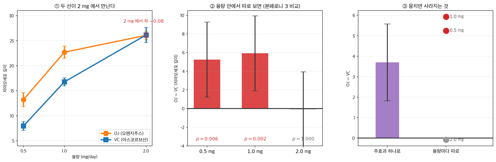

# 사후비교: Tukey HSD (이원배치)


이원배치 분산분석의 사후검정은 유의한 주효과와 교호작용 효과를 자세히 살피는 데 꼭 필요하다.

## 1. 언제 쓰는가


이원배치 분산분석에서 사후검정은 대체로 다음에 쓴다:

1. **주효과 조사**: 주효과 중 하나 또는 둘 다(예: 요인 A나 요인 B) 유의하면, 사후검정으로 그 요인의 어느 수준이 서로 유의하게 다른지 찾을 수 있다.
2. **교호작용 효과 검토**: 요인 A와 B 사이에 유의한 교호작용이 있으면, 사후검정으로 어떤 요인 수준 조합에서 유의한 차이가 나타나는지 판정할 수 있다.

## 2. 사후검정의 종류


- **Tukey의 정직유의차(HSD)**: 가족단위 오류율을 통제하기 때문에 분산분석의 쌍별 비교에 널리 쓰인다.
- **Bonferroni 보정**: 유의수준을 비교 횟수로 나누는 더 보수적인 방법.
- **단순 효과 분석**: 교호작용 효과가 유의하면, 다른 요인의 각 수준에서 한 요인의 효과를 살피는 단순 효과 분석을 쓸 수 있다.

## 3. 이원배치 분산분석을 먼저 돌린다


<div class="exbox" markdown>

**보기 1.** <span class="diff easy" title="쉬움"></span> 이원배치 분산분석. 균형설계의 제곱합은 **행·열·칸 평균만으로** 손으로 적힌다.

**(1)** 요인 A가 $a$ 수준, 요인 B가 $b$ 수준, 칸마다 $n$ 개인 균형설계에서

$$
\text{SS}_A = bn\sum_i(\bar y_{i\cdot\cdot}-\bar y)^2,
\quad
\text{SS}_B = an\sum_j(\bar y_{\cdot j\cdot}-\bar y)^2,
\quad
\text{SS}_{AB} = n\sum_{i,j}(\bar y_{ij\cdot}-\bar y)^2 - \text{SS}_A - \text{SS}_B
$$

이고 이 넷이 $\text{SS}_T$ 로 **정확히** 분해됨을 쓰시오. 교호작용의 자유도가 $(a-1)(b-1)$ 인 까닭을 밝히시오.

**(2)** ToothGrowth 자료에서 행·열·칸 평균을 구하고 네 제곱합과 세 $F$ 를 손으로 만들어 `anova_lm` 과 맞추시오.

**(3)** 교호작용이 유의할 때 주효과를 단독으로 읽으면 안 되는 까닭을 칸 평균으로 설명하시오.

</div>

??? success "풀이"

    **(1) 해석적으로.** 칸 평균을 $\bar y_{ij\cdot}$ 라 쓰고 관측값을

    $$
    y_{ijl} - \bar y
    = \underbrace{(\bar y_{i\cdot\cdot}-\bar y)}_{\alpha_i}
    + \underbrace{(\bar y_{\cdot j\cdot}-\bar y)}_{\beta_j}
    + \underbrace{(\bar y_{ij\cdot}-\bar y_{i\cdot\cdot}-\bar y_{\cdot j\cdot}+\bar y)}_{(\alpha\beta)_{ij}}
    + \underbrace{(y_{ijl}-\bar y_{ij\cdot})}_{e_{ijl}}
    $$

    로 쪼갠다. 균형설계에서는 $\sum_i \alpha_i = 0$, $\sum_j\beta_j = 0$, $(\alpha\beta)_{ij}$ 가 행으로도 열로도 합이 $0$ 이며 $\sum_l e_{ijl} = 0$ 이므로 **네 조각이 서로 직교**한다. 따라서 제곱해 더하면 교차항이 모두 사라져

    $$
    \text{SS}_T = \text{SS}_A + \text{SS}_B + \text{SS}_{AB} + \text{SS}_E
    $$

    가 된다. 각 조각의 제곱합은 그 조각이 같은 값을 갖는 관측 수를 곱한 것이므로 $\text{SS}_A = bn\sum_i\alpha_i^2$, $\text{SS}_B = an\sum_j\beta_j^2$, $\text{SS}_{AB} = n\sum_{i,j}(\alpha\beta)_{ij}^2$ 다. 그리고 $n\sum_{i,j}(\bar y_{ij\cdot}-\bar y)^2$ 을 펼치면 세 항의 합이므로 $\text{SS}_{AB}$ 는 거기서 $\text{SS}_A$ 와 $\text{SS}_B$ 를 뺀 나머지다.

    자유도는 자유로운 성분의 수다. $(\alpha\beta)_{ij}$ 는 $ab$ 개인데 행 제약 $a$ 개와 열 제약 $b$ 개가 걸리고 그중 하나가 겹치므로 $ab - a - b + 1 = (a-1)(b-1)$ 개가 자유롭다. $\square$

    **(3) 해석적으로.** 교호작용이 유의하다는 것은 $(\alpha\beta)_{ij} \ne 0$, 곧 **요인 A의 효과가 요인 B의 수준마다 다르다**는 뜻이다. 주효과 $\alpha_i$ 는 그 다른 효과들을 B의 수준에 걸쳐 **평균낸 것**이므로, 평균이 실제 어느 수준에서도 일어나지 않는 일을 가리킬 수 있다. 극단적으로 A의 효과가 B의 한 수준에서 $+5$, 다른 수준에서 $-5$ 라면 주효과는 $0$ 이 되어 "효과 없음"으로 보고되지만 두 수준 모두에서 효과는 뚜렷하다.

    **(2) 수치적으로.** 먼저 쪽의 분산분석표다.

    ```python
    import pandas as pd
    from statsmodels.formula.api import ols
    from statsmodels.stats.anova import anova_lm

    # ToothGrowth 자료. 보충제 종류(supp)와 투여량(dose) 두 요인이 있다.
    url = 'https://raw.githubusercontent.com/vincentarelbundock/Rdatasets/1dcc2bf5f955cc1224a3e1307256e1fe86b68dae/csv/datasets/ToothGrowth.csv'
    df = pd.read_csv(url, usecols=[1, 2, 3])

    # 콜론이 교호작용 항이다. 두 요인의 효과가 서로 독립인지를 이 항이 묻는다.
    model = ols('len ~ C(supp) + C(dose) + C(supp):C(dose)', data=df).fit()
    anova_results = anova_lm(model)
    print(anova_results)
    ```

    출력:

    ```
                       df       sum_sq      mean_sq          F        PR(>F)
    C(supp)           1.0   205.350000   205.350000  15.571979  2.311828e-04
    C(dose)           2.0  2426.434333  1213.217167  91.999965  4.046291e-18
    C(supp):C(dose)   2.0   108.319000    54.159500   4.106991  2.186027e-02
    Residual         54.0   712.106000    13.187148        NaN           NaN
    ```

    이제 같은 표를 행·열·칸 평균만으로 만든다.

    ```python
    import numpy as np
    import pandas as pd

    url = 'https://raw.githubusercontent.com/vincentarelbundock/Rdatasets/1dcc2bf5f955cc1224a3e1307256e1fe86b68dae/csv/datasets/ToothGrowth.csv'
    df = pd.read_csv(url, usecols=[1, 2, 3])
    a, b, n = 2, 3, 10                      # supp 2 수준, dose 3 수준, 칸마다 10 개

    gm = df.len.mean()
    mi = df.groupby('supp').len.mean()      # 행 평균
    mj = df.groupby('dose').len.mean()      # 열 평균
    cell = df.groupby(['supp', 'dose']).len.mean()

    SSA = b * n * ((mi - gm) ** 2).sum()
    SSB = a * n * ((mj - gm) ** 2).sum()
    SScell = n * ((cell - gm) ** 2).sum()
    SSAB = SScell - SSA - SSB
    SSE = ((df.len - df.groupby(['supp', 'dose']).len.transform('mean')) ** 2).sum()
    SST = ((df.len - gm) ** 2).sum()

    print(f"전체평균 = {gm:.4f}")
    print(f"행 평균 (supp) = {np.round(mi.values, 4)}")
    print(f"열 평균 (dose) = {np.round(mj.values, 4)}")
    print(f"칸 평균 =\n{cell.round(3)}")
    print(f"\nSS_supp     = {SSA:.6f}   (df {a - 1})")
    print(f"SS_dose     = {SSB:.6f}   (df {b - 1})")
    print(f"SS_교호작용 = {SSAB:.6f}   (df {(a - 1) * (b - 1)})")
    print(f"SS_잔차     = {SSE:.6f}   (df {a * b * (n - 1)})")
    print(f"SS_전체     = {SST:.6f}   (df {a * b * n - 1})")
    print(f"네 조각의 합 = {SSA + SSB + SSAB + SSE:.6f},  차 = {SST - SSA - SSB - SSAB - SSE:.2e}")

    MSE = SSE / (a * b * (n - 1))
    print(f"\nMSE = {MSE:.6f}")
    print(f"F_supp = {(SSA / (a - 1)) / MSE:.6f}")
    print(f"F_dose = {(SSB / (b - 1)) / MSE:.6f}")
    print(f"F_교호 = {(SSAB / ((a - 1) * (b - 1))) / MSE:.6f}")
    ```

    출력:

    ```
    전체평균 = 18.8133
    행 평균 (supp) = [20.6633 16.9633]
    열 평균 (dose) = [10.605 19.735 26.1  ]
    칸 평균 =
    supp  dose
    OJ    0.5     13.23
          1.0     22.70
          2.0     26.06
    VC    0.5      7.98
          1.0     16.77
          2.0     26.14
    Name: len, dtype: float64

    SS_supp     = 205.350000   (df 1)
    SS_dose     = 2426.434333   (df 2)
    SS_교호작용 = 108.319000   (df 2)
    SS_잔차     = 712.106000   (df 54)
    SS_전체     = 3452.209333   (df 59)
    네 조각의 합 = 3452.209333,  차 = 1.14e-12

    MSE = 13.187148
    F_supp = 15.571979
    F_dose = 91.999965
    F_교호 = 4.106991
    ```

    **네 제곱합과 세 $F$ 가 `anova_lm` 의 출력과 소수점 여섯째 자리까지 같고**, 분해의 잔차가 $1.14\times10^{-12}$ 로 부동소수점 오차 수준이다. 균형설계이므로 Type I·II·III 제곱합이 모두 같다는 사실도 여기에 함께 들어 있다. 요인이 직교하므로 **항을 넣는 순서가 결과를 바꾸지 않는다.**

    **(3)을 칸 평균으로 읽는다.** 같은 용량에서 OJ 와 VC 의 차이를 보면

    | 용량 | OJ | VC | OJ $-$ VC |
    |---|---|---|---|
    | $0.5$ | $13.23$ | $7.98$ | $\mathbf{+5.25}$ |
    | $1.0$ | $22.70$ | $16.77$ | $\mathbf{+5.93}$ |
    | $2.0$ | $26.06$ | $26.14$ | $\mathbf{-0.08}$ |

    다. **보충제의 효과가 용량 $2.0$ 에서 사라진다.** 주효과 $20.66 - 16.96 = 3.70$ 은 이 셋($5.25$, $5.93$, $-0.08$)의 평균일 뿐이고, 세 용량 가운데 **어느 하나에서도 실제로 일어나지 않는 값**이다. 교호작용 $F = 4.11$ ($p = 0.022$)이 바로 이 불균질함을 재고 있다. 보기 3·8이 이 표를 검정의 꼴로 다시 적는다.

두 주효과와 교호작용이 모두 유의하다. 교호작용이 유의하다는 것은 주효과를 단독으로 해석하기 전에 조심하라는 신호다.

## 4. 주효과의 사후검정


<div class="exbox" markdown>

**보기 2.** <span class="diff easy" title="쉬움"></span> 주효과 사후검정. 분산분석표의 `C(supp)` 는 $p = 0.00023$ 인데 `pairwise_tukeyhsd` 는 $p = 0.060$ 을 준다. 어긋남의 크기를 수로 밝힌다.

**(1)** `pairwise_tukeyhsd(endog=df['len'], groups=df['supp'])` 는 용량을 **무시하고** 일원배치를 돌린다. 그때 쓰는 오차제곱합이

$$
\text{SS}_E^{(1)} = \text{SS}_T - \text{SS}_{\text{supp}} = \text{SS}_{\text{dose}} + \text{SS}_{AB} + \text{SS}_E
$$

임을 보이고, 자유도가 $58$ 임을 밝히시오.

**(2)** 두 MSE 의 비를 구하고, 같은 차이 $\bar y_{VC} - \bar y_{OJ} = -3.70$ 에 대해 두 $t$ 값이 $\sqrt{\text{MSE}^{(1)}/\text{MSE}^{(2)}}$ 배만큼 다름을 보이시오.

**(3)** 두 p-값을 계산해 $0.060$ 과 $0.00023$ 을 재현하고, 어느 쪽을 보고해야 하는지 밝히시오.

</div>

??? success "풀이"

    **(1) 해석적으로.** 보기 1의 분해 $\text{SS}_T = \text{SS}_{\text{supp}} + \text{SS}_{\text{dose}} + \text{SS}_{AB} + \text{SS}_E$ 에서 $\text{SS}_{\text{supp}}$ 를 옮기면 곧바로 얻는다. 균형설계라 요인들이 직교하므로 **용량을 모형에서 빼도 $\text{SS}_{\text{supp}}$ 는 한 치도 바뀌지 않고**, 그 대신 용량이 설명하던 몫이 통째로 오차로 들어간다. 자유도는 $59 - 1 = 58$ 이다($2 + 2 + 54 = 58$ 과 맞는다).

    **(2) 해석적으로.** 두 분석의 **분자는 같다.** 집단평균 차 $-3.70$ 이 균형설계에서 모형과 무관하게 같기 때문이다. 다른 것은 분모뿐이고

    $$
    \frac{t^{(2)}}{t^{(1)}}
    = \frac{\text{SE}^{(1)}}{\text{SE}^{(2)}}
    = \sqrt{\frac{\text{MSE}^{(1)}}{\text{MSE}^{(2)}}}
    $$

    다. **용량을 모형에 넣는 일은 분자를 키우는 것이 아니라 분모를 줄이는 것**이며, 그것이 검정력을 얻는 전부다. 이것이 요인설계의 요점이기도 하다. 통제할 수 있는 변동원을 모형에 넣으면 같은 자료로 더 작은 차이를 잡아낸다.

    **(3) 수치적으로.** 먼저 쪽의 출력이다.

    ```python
    from statsmodels.stats.multicomp import pairwise_tukeyhsd

    # 주효과에 대한 사후비교. 교호작용이 유의하면 주효과를 이렇게 읽는 것이
    # 오해를 부를 수 있어, 아래 단순효과 분석으로 넘어가는 편이 낫다.
    tukey_dose = pairwise_tukeyhsd(endog=df['len'], groups=df['dose'], alpha=0.05)
    print("Post-Hoc Test for Dose:")
    print(tukey_dose)

    # 보충제 종류에 대한 주효과 사후비교.
    tukey_supp = pairwise_tukeyhsd(endog=df['len'], groups=df['supp'], alpha=0.05)
    print("Post-Hoc Test for Supplement:")
    print(tukey_supp)
    ```

    출력:

    ```
    Post-Hoc Test for Dose:
    Multiple Comparison of Means - Tukey HSD, FWER=0.05
    ===================================================
    group1 group2 meandiff p-adj  lower   upper  reject
    ---------------------------------------------------
       0.5    1.0     9.13   0.0  5.9018 12.3582   True
       0.5    2.0   15.495   0.0 12.2668 18.7232   True
       1.0    2.0    6.365   0.0  3.1368  9.5932   True
    ---------------------------------------------------
    Post-Hoc Test for Supplement:
    Multiple Comparison of Means - Tukey HSD, FWER=0.05
    =================================================
    group1 group2 meandiff p-adj  lower  upper reject
    -------------------------------------------------
        OJ     VC     -3.7 0.0604 -7.567 0.167  False
    -------------------------------------------------
    ```

    이제 두 분석의 분모를 나란히 놓는다.

    ```python
    import numpy as np
    import pandas as pd
    from scipy import stats

    url = 'https://raw.githubusercontent.com/vincentarelbundock/Rdatasets/1dcc2bf5f955cc1224a3e1307256e1fe86b68dae/csv/datasets/ToothGrowth.csv'
    df = pd.read_csv(url, usecols=[1, 2, 3])

    gm = df.len.mean()
    mi = df.groupby('supp').len.mean()
    SST = ((df.len - gm) ** 2).sum()
    SSA = 3 * 10 * ((mi - gm) ** 2).sum()
    SSE2 = ((df.len - df.groupby(['supp', 'dose']).len.transform('mean')) ** 2).sum()

    MSE1 = (SST - SSA) / 58                    # supp 만 넣은 일원배치
    MSE2 = SSE2 / 54                           # 이원배치 + 교호작용
    print(f"일원배치 MSE = (SST - SS_supp)/58 = {MSE1:.6f}   (df 58)")
    print(f"이원배치 MSE = SS_E/54            = {MSE2:.6f}   (df 54)")
    print(f"비 = {MSE1 / MSE2:.4f},  제곱근 = {np.sqrt(MSE1 / MSE2):.4f}")

    d = mi['VC'] - mi['OJ']
    print(f"\nVC - OJ = {d:.4f}  (어느 쪽에서나 같다)")
    for lab, mse, nu in [("일원배치", MSE1, 58), ("이원배치", MSE2, 54)]:
        se = np.sqrt(mse * (1 / 30 + 1 / 30))
        t = d / se
        print(f"  {lab}: SE = {se:.4f},  t = {t:.4f},  p = {2 * stats.t.sf(abs(t), nu):.6f}")

    print(f"\n일원배치 MSE 안에 들어 있는 것")
    SSB = 2 * 10 * ((df.groupby('dose').len.mean() - gm) ** 2).sum()
    SSAB = SST - SSA - SSB - SSE2
    print(f"  SS_dose   = {SSB:.4f}  ({SSB / (SST - SSA):.1%})")
    print(f"  SS_교호   = {SSAB:.4f}  ({SSAB / (SST - SSA):.1%})")
    print(f"  SS_잔차   = {SSE2:.4f}  ({SSE2 / (SST - SSA):.1%})")
    print(f"  합        = {SSB + SSAB + SSE2:.4f}  = SST - SS_supp = {SST - SSA:.4f}")
    ```

    출력:

    ```
    일원배치 MSE = (SST - SS_supp)/58 = 55.980333   (df 58)
    이원배치 MSE = SS_E/54            = 13.187148   (df 54)
    비 = 4.2451,  제곱근 = 2.0604

    VC - OJ = -3.7000  (어느 쪽에서나 같다)
      일원배치: SE = 1.9318,  t = -1.9153,  p = 0.060393
      이원배치: SE = 0.9376,  t = -3.9461,  p = 0.000231

    일원배치 MSE 안에 들어 있는 것
      SS_dose   = 2426.4343  (74.7%)
      SS_교호   = 108.3190  (3.3%)
      SS_잔차   = 712.1060  (21.9%)
      합        = 3246.8593  = SST - SS_supp = 3246.8593
    ```

    **두 p-값 $0.060393$ 과 $0.000231$ 이 각각 `pairwise_tukeyhsd` 의 $0.0604$ 와 분산분석표의 $2.311828\times10^{-4}$ 를 재현한다.** 집단이 둘뿐이라 Tukey 가 보통의 $t$-검정과 같아진 것도 확인된다($q_{\alpha,2,\nu}/\sqrt2 = t_{1-\alpha/2,\nu}$).

    **어긋남의 정체는 분모 하나다.** 분자는 양쪽에서 똑같이 $-3.70$ 이고, MSE 가 $55.98$ 대 $13.19$ 로 **$4.245$ 배** 다르다. 그 제곱근 $2.0604$ 가 그대로 $t$ 의 비다. 실제로 $1.9153 \times 2.0604 = 3.946$ 이다.

    마지막 표가 그 $4.245$ 배의 출처다. 일원배치 오차제곱합 $3246.86$ 가운데

    - **$74.7\%$ 가 용량이 만든 변동**($\text{SS}_{\text{dose}} = 2426.43$)
    - $3.3\%$ 가 교호작용
    - $21.9\%$ 만이 진짜 잔차

    다. 용량을 모형에 넣지 않으면 그 압도적인 변동이 통째로 "잡음"으로 셈해지고, 보충제의 $3.70$ 이라는 차이가 그 안에 묻힌다. **설계상 통제된 요인을 분석에서 빼는 것은 자료를 버리는 일이다.**

    **(3) 어느 쪽을 보고할 것인가.** 자료가 $2\times3$ 요인설계로 **수집되었으므로** 이원배치 쪽, 곧 $p = 0.00023$ 이 옳다. 쪽의 `pairwise_tukeyhsd(groups=df['supp'])` 호출은 설계를 모르는 채 돌아간 것이다.

    그러나 여기에 한 겹이 더 있다. **보기 1에서 보았듯 교호작용이 유의하므로($p = 0.022$) `supp` 의 주효과 $-3.70$ 자체를 보고하는 일이 적절하지 않다.** 그 값은 용량별 차이 $+5.25$, $+5.93$, $-0.08$ 의 평균이고 어느 용량에서도 실제로 일어나지 않는다. 그러므로 올바른 답은 "$0.060$ 이 아니라 $0.00023$ 을 보고하라"가 아니라 **"주효과 대신 보기 4의 단순효과를 보고하라"**다.

용량은 세 수준이 서로 모두 다르지만, 보충제는 $p = 0.060$으로 유의하지 않다. 분산분석표에서 `C(supp)`가 $p = 0.00023$이었던 것과 어긋나 보이는데, 이 Tukey가 용량을 무시하고 OJ 30개와 VC 30개를 통째로 비교하기 때문이다. 용량이 만드는 큰 변동이 잡음으로 남아 보충제의 차이를 덮는다.

## 5. 교호작용의 사후검정


<div class="exbox" markdown>

**보기 3.** <span class="diff easy" title="쉬움"></span> 교호작용 사후검정. 칸이 여섯이 되면서 치르는 값을 잰다.

**(1)** 두 요인을 붙여 $K = ab = 6$ 개 칸으로 보면 쌍이 몇 개인가. 보정하지 않았을 때의 가족단위 오류율(독립 가정)을 구하시오.

**(2)** 투키의 임계차 $q_{0.05,6,54}\sqrt{\text{MSE}/n}$ 와 본페로니의 $t_{1-0.05/30,\,54}\sqrt{2\text{MSE}/n}$ 를 계산해 견주시오. 11.3절 [Tukey HSD (일원배치)](tukey.md) 보기 3의 $k=3$ 일 때보다 차이가 벌어지는가.

**(3)** 같은 용량끼리의 세 비교(`OJ_d` 대 `VC_d`)를 뽑아 교호작용이 무엇인지 수로 적으시오.

**(4)** 이 접근이 **잃는 것**을 하나 지적하시오. 여섯 칸을 아무 구조 없는 여섯 집단으로 다루면 무엇이 사라지는가.

</div>

??? success "풀이"

    **(1) 해석적으로.** $K = 6$ 이므로 $m = \binom{6}{2} = 15$ 다. 보정하지 않고 각각 $\alpha = 0.05$ 로 검정하면(독립 가정)

    $$
    1 - 0.95^{15} = 0.5367
    $$

    로 **절반이 넘는 확률로 적어도 하나를 거짓 기각**한다. 11.3절 [Tukey HSD (일원배치)](tukey.md) 보기 3의 표 마지막 줄이 이것이다. 실제로는 비교들이 양의 상관을 가져 참값이 이보다 조금 작지만, 어느 쪽이든 보정 없이 쓸 수 있는 수치가 아니다.

    **(2)–(3) 수치적으로.** 먼저 쪽의 출력이다.

    ```python
    # 두 요인을 붙여 하나의 요인으로 만든다. 이러면 여섯 칸을 서로 견줄 수 있다.
    df['supp_dose'] = df['supp'].astype(str) + "_" + df['dose'].astype(str)

    # 칸 여섯 개의 모든 쌍을 견주므로 비교 횟수가 15 로 늘어난다. 그만큼 보수적이 된다.
    tukey_interaction = pairwise_tukeyhsd(endog=df['len'], groups=df['supp_dose'], alpha=0.05)
    print("Post-Hoc Test for Interaction (Supplement x Dose):")
    print(tukey_interaction)
    ```

    출력:

    ```
    Post-Hoc Test for Interaction (Supplement x Dose):
     Multiple Comparison of Means - Tukey HSD, FWER=0.05  
    ======================================================
    group1 group2 meandiff p-adj   lower    upper   reject
    ------------------------------------------------------
    OJ_0.5 OJ_1.0     9.47    0.0   4.6719  14.2681   True
    OJ_0.5 OJ_2.0    12.83    0.0   8.0319  17.6281   True
    OJ_0.5 VC_0.5    -5.25 0.0243 -10.0481  -0.4519   True
    OJ_0.5 VC_1.0     3.54  0.264  -1.2581   8.3381  False
    OJ_0.5 VC_2.0    12.91    0.0   8.1119  17.7081   True
    OJ_1.0 OJ_2.0     3.36 0.3187  -1.4381   8.1581  False
    OJ_1.0 VC_0.5   -14.72    0.0 -19.5181  -9.9219   True
    OJ_1.0 VC_1.0    -5.93 0.0074 -10.7281  -1.1319   True
    OJ_1.0 VC_2.0     3.44 0.2936  -1.3581   8.2381  False
    OJ_2.0 VC_0.5   -18.08    0.0 -22.8781 -13.2819   True
    OJ_2.0 VC_1.0    -9.29    0.0 -14.0881  -4.4919   True
    OJ_2.0 VC_2.0     0.08    1.0  -4.7181   4.8781  False
    VC_0.5 VC_1.0     8.79    0.0   3.9919  13.5881   True
    VC_0.5 VC_2.0    18.16    0.0  13.3619  22.9581   True
    VC_1.0 VC_2.0     9.37    0.0   4.5719  14.1681   True
    ------------------------------------------------------
    ```

    이제 두 문턱을 견주고 같은 용량끼리의 세 비교를 뽑는다.

    ```python
    import numpy as np
    import pandas as pd
    from scipy import stats

    url = 'https://raw.githubusercontent.com/vincentarelbundock/Rdatasets/1dcc2bf5f955cc1224a3e1307256e1fe86b68dae/csv/datasets/ToothGrowth.csv'
    df = pd.read_csv(url, usecols=[1, 2, 3])
    n, K, nu = 10, 6, 54
    cell = df.groupby(['supp', 'dose']).len.mean()
    MSE = ((df.len - df.groupby(['supp', 'dose']).len.transform('mean')) ** 2).sum() / nu
    m = K * (K - 1) // 2
    print(f"칸 수 K = {K},  쌍 수 m = {m},  보정 없는 FWER (독립 가정) = {1 - 0.95 ** m:.4f}")

    q = stats.studentized_range.ppf(0.95, K, nu)
    HSD = q * np.sqrt(MSE / n)
    SE = np.sqrt(2 * MSE / n)
    tb = stats.t.ppf(1 - 0.05 / (2 * m), nu)
    print(f"\nMSE = {MSE:.6f},  SE = {SE:.6f}")
    print(f"투키    q(0.95,6,54) = {q:.4f}  ->  |t| 문턱 {q / np.sqrt(2):.4f},  임계차 {HSD:.4f}")
    print(f"본페로니 t(1-0.05/30, 54) = {tb:.4f}  ->  임계차 {tb * SE:.4f}")
    print(f"투키가 낮은 폭: |t| 에서 {tb - q / np.sqrt(2):.4f},  임계차에서 {tb * SE - HSD:.4f}")

    print(f"\n같은 용량끼리의 세 비교")
    for d in [0.5, 1.0, 2.0]:
        diff = cell[('VC', d)] - cell[('OJ', d)]
        t = abs(diff) / SE
        p = stats.studentized_range.sf(t * np.sqrt(2), K, nu)
        print(f"  dose={d}: OJ-VC 차 = {-diff:>6.2f},  |t| = {t:.4f},  p-adj = {p:.4f},  "
              f"구간 ({diff - HSD:>7.3f}, {diff + HSD:>7.3f})")
    ```

    출력:

    ```
    칸 수 K = 6,  쌍 수 m = 15,  보정 없는 FWER (독립 가정) = 0.5367

    MSE = 13.187148,  SE = 1.624017
    투키    q(0.95,6,54) = 4.1783  ->  |t| 문턱 2.9545,  임계차 4.7981
    본페로니 t(1-0.05/30, 54) = 3.0714  ->  임계차 4.9880
    투키가 낮은 폭: |t| 에서 0.1169,  임계차에서 0.1899

    같은 용량끼리의 세 비교
      dose=0.5: OJ-VC 차 =   5.25,  |t| = 3.2327,  p-adj = 0.0243,  구간 (-10.048,  -0.452)
      dose=1.0: OJ-VC 차 =   5.93,  |t| = 3.6514,  p-adj = 0.0074,  구간 (-10.728,  -1.132)
      dose=2.0: OJ-VC 차 =  -0.08,  |t| = 0.0493,  p-adj = 1.0000,  구간 ( -4.718,   4.878)
    ```

    **임계차 $4.7981$ 과 p-값·구간이 `pairwise_tukeyhsd` 의 출력과 소수점 넷째 자리까지 같다.** `OJ_0.5 VC_0.5` 줄의 $(-10.0481,\ -0.4519)$, $p = 0.0243$ 이 그대로 재현된다.

    **(2) 두 문턱의 차이.** $\lvert t\rvert$ 척도에서 투키가 $2.9545$, 본페로니가 $3.0714$ 로 **$0.1169$** 낮다. 11.3절 [Tukey HSD (일원배치)](tukey.md) 보기 3의 $k = 3$ 에서는 $2.4794$ 대 $2.5525$ 로 $0.0731$ 이었으니 **차이가 $1.6$ 배로 벌어졌다.** 임계차로 보면 $4.798$ 대 $4.988$ 로 $0.19$ 단위만큼 투키가 유리하다. 쪽의 본문이 "$k$ 가 커질수록 벌어진다"고 한 것의 수치다.

    다만 솔직히 적자면 **그 폭은 여전히 작다.** $m = 15$ 에서도 본페로니가 투키보다 $4\%$ 쯤 높은 문턱을 쓸 뿐이다. 투키를 쓰는 진짜 이유는 검정력의 큰 차이가 아니라 **임계차가 하나로 떨어져 해석이 간단하고, $\alpha$ 를 정확히 쓰며, 동시신뢰구간이 자동으로 따라온다**는 데 있다.

    **(3) 교호작용의 내용.** 같은 용량끼리의 세 비교가 $+5.25$ ($p = 0.024$), $+5.93$ ($p = 0.007$), $-0.08$ ($p = 1.000$)이다. **용량 $0.5$ 와 $1.0$ 에서는 OJ 가 앞서고 용량 $2.0$ 에서는 둘이 구별되지 않는다.** 마지막 줄의 구간 $(-4.718,\ 4.878)$ 은 $0$ 을 품되 폭이 $9.6$ 이나 되므로, "차이가 없다"가 아니라 **"$\pm 4.8$ 안쪽의 차이는 이 자료로 가려낼 수 없다"**로 읽어야 한다. 앞 두 용량의 차이 $5.25$, $5.93$ 이 그 폭보다 겨우 큰 정도임을 생각하면, 용량 $2.0$ 에서 효과가 "사라졌다"는 결론도 조심스럽게 적어야 한다.

    **(4) 이 접근이 잃는 것.** 여섯 칸을 아무 구조 없는 여섯 집단으로 다루면 **요인구조가 통째로 사라진다.** 구체적으로

    - **$15$ 개 비교 가운데 뜻이 분명한 것은 일부뿐이다.** `OJ_0.5` 대 `VC_2.0` 같은 비교는 보충제와 용량이 **함께** 바뀌므로 어느 쪽 탓인지 말할 수 없다. 그런 비교가 $15$ 개 중 $6$ 개다. 그런데 보정은 그 $6$ 개까지 모두 세어 문턱을 올린다.
    - **교호작용 자체를 검정하지 않는다.** 교호작용은 "차이의 차이"($5.25$ 와 $-0.08$ 의 차)인데, 쌍별 비교의 목록에는 그 대비가 아예 들어 있지 않다. 분산분석표의 $F = 4.11$ 이 재는 것과 이 표가 재는 것은 다른 양이다.
    - **용량의 순서가 쓰이지 않는다.** $0.5 < 1.0 < 2.0$ 이라는 순서 정보를 버리고 세 범주로만 다룬다. 추세 대비를 쓰면 자유도 하나로 같은 질문을 더 강하게 물을 수 있다.

    그래서 다음에 볼 **단순효과 분석**이 흔히 더 낫다. 비교 수를 $15$ 에서 $3 + 3$ 으로 줄이면서 물음을 뚜렷하게 만든다.

같은 용량끼리 비교한 세 줄(`OJ_0.5 VC_0.5`, `OJ_1.0 VC_1.0`, `OJ_2.0 VC_2.0`)을 보면 차이가 각각 $-5.25$($p = 0.024$), $-5.93$($p = 0.007$), $-0.08$($p = 1.000$)이다. 낮은 용량에서는 OJ가 앞서지만 용량 2.0에서는 차이가 사라진다. 이것이 교호작용의 내용이다.

## 6. 단순효과 분석


교호작용 효과가 유의하면 **단순 효과 분석**으로 다른 요인의 각 수준에서 한 요인의 효과를 살펴 자세히 나눠 볼 수 있다.

<div class="exbox" markdown>

!!! note "칸 단위 Tukey 의 분모는 왜 이원배치의 $MSE$ 인가"
    위에서 $q_{0.05,6,54}\sqrt{MSE/n}$ 의 $MSE$ 를 이원배치표의 잔차 평균제곱으로
    그냥 썼다. 그래도 되는 까닭은 **두 모형의 적합값이 같은 수**라는 데 있다.
    포화 이원배치 모형 $y_{ijk} = \mu + \alpha_i + \beta_j + (\alpha\beta)_{ij} + \varepsilon_{ijk}$ 는
    모수가 $ab$ 개로 **칸마다 자유로운 평균 하나씩**을 주는 것과 같고, 여섯 칸짜리
    일원배치 $y_{ijk} = \mu_{ij} + \varepsilon_{ijk}$ 도 똑같다. 적합값이 둘 다 칸평균이므로
    잔차가 같고 따라서

    $$
    SSE_{\text{2way}} = SSW_{\text{6칸}} = \sum_{i,j}\sum_k (y_{ijk} - \bar y_{ij\cdot})^2,
    \qquad df = N - ab = 60 - 6 = 54
    $$

    로 **두 분석의 분모가 완전히 같다.** 보기 2 에서 주효과 Tukey 가 분모를 부풀렸던
    것과 대비된다 — 칸으로 쪼개는 것은 두 요인을 모두 모형에 넣는 일이기 때문이다.


**보기 4.** <span class="diff easy" title="쉬움"></span> 단순효과 분석. 두 조각으로 나누면 제곱합이 정확히 어디로 가는지 적을 수 있다.

**(1)** 보충제를 고정하고 용량 효과를 재는 두 단순효과 제곱합의 합이

$$
\text{SS}_{\text{dose}}^{(OJ)} + \text{SS}_{\text{dose}}^{(VC)}
= \text{SS}_{\text{dose}} + \text{SS}_{AB}
$$

임을 보이시오. 두 잔차제곱합의 합은 무엇이 되는가.

**(2)** 자유도도 맞아떨어짐을 확인하시오($2 + 2$ 대 $2 + 2$, $27 + 27$ 대 $54$).

**(3)** 단순효과의 Tukey 반폭을 보기 3의 여섯 칸 Tukey 반폭과 견주시오. 자유도를 $54$ 에서 $27$ 로 잃는데도 구간이 좁아지는가.

**(4)** OJ 와 VC 안에서 각각 용량 $1.0$ 대 $2.0$ 을 비교해 교호작용의 내용을 적으시오.

</div>

??? success "풀이"

    **(1) 해석적으로.** 보충제 $i$ 안에서 용량 효과의 제곱합은

    $$
    \text{SS}_{\text{dose}}^{(i)} = n\sum_j (\bar y_{ij\cdot} - \bar y_{i\cdot\cdot})^2
    $$

    이다. 보기 1의 분해 $\bar y_{ij\cdot} - \bar y_{i\cdot\cdot} = \beta_j + (\alpha\beta)_{ij}$ 를 넣으면

    $$
    \text{SS}_{\text{dose}}^{(i)} = n\sum_j \left(\beta_j + (\alpha\beta)_{ij}\right)^2
    = n\sum_j \beta_j^2 + 2n\sum_j \beta_j(\alpha\beta)_{ij} + n\sum_j (\alpha\beta)_{ij}^2
    $$

    이고, $i$ 에 대해 더하면 가운데 항이 $2n\sum_j \beta_j \sum_i (\alpha\beta)_{ij} = 0$ (교호작용의 열 합이 $0$)으로 사라진다. 남는 것은

    $$
    \sum_i \text{SS}_{\text{dose}}^{(i)} = an\sum_j\beta_j^2 + n\sum_{i,j}(\alpha\beta)_{ij}^2
    = \text{SS}_{\text{dose}} + \text{SS}_{AB}
    $$

    다. $\square$ **단순효과는 주효과와 교호작용을 합쳐 다시 나눈 것**이며, 자른 방향만 다를 뿐 같은 제곱합을 다루고 있다.

    잔차제곱합은 더 간단하다. 두 분석 모두 칸 평균에서 재므로

    $$
    \sum_i \text{SS}_E^{(i)} = \sum_i \sum_j\sum_l (y_{ijl} - \bar y_{ij\cdot})^2 = \text{SS}_E
    $$

    로 **이원배치의 잔차제곱합과 정확히 같다.**

    **(2) 해석적으로.** 단순효과 쪽은 보충제마다 자유도 $b-1 = 2$ 이므로 합이 $4$ 이고, 오른쪽은 $\text{SS}_{\text{dose}}$ 의 $2$ 와 $\text{SS}_{AB}$ 의 $(a-1)(b-1) = 2$ 로 역시 $4$ 다. 잔차는 보충제마다 $b(n-1) = 27$ 이므로 합이 $54 = ab(n-1)$ 로 맞는다. 다만 **각 단순효과 분석은 자기 $27$ 만 쓰고 상대편의 $27$ 을 쓰지 않는다.** 이것이 (3)에서 치르는 값이다.

    **(3)–(4) 수치적으로.** 먼저 쪽의 출력이다.

    ```python
    # 단순효과 분석: 보충제를 하나로 고정해 두고 투여량 효과만 본다.
    # 교호작용이 있을 때 결과를 말이 되게 읽는 방법이다.
    oj_data = df[df['supp'] == 'OJ']
    vc_data = df[df['supp'] == 'VC']

    # 보충제별로 따로 일원배치 분산분석을 돌린다.
    oj_model = ols('len ~ C(dose)', data=oj_data).fit()
    vc_model = ols('len ~ C(dose)', data=vc_data).fit()

    # 두 결과를 견주면 교호작용이 무엇을 뜻하는지 드러난다.
    print("ANOVA for Dose within Supplement OJ:")
    print(anova_lm(oj_model))

    print("ANOVA for Dose within Supplement VC:")
    print(anova_lm(vc_model))

    # 보충제별 사후비교.
    print("Tukey HSD for Dose within Supplement OJ:")
    print(pairwise_tukeyhsd(endog=oj_data['len'], groups=oj_data['dose'], alpha=0.05))

    print("Tukey HSD for Dose within Supplement VC:")
    print(pairwise_tukeyhsd(endog=vc_data['len'], groups=vc_data['dose'], alpha=0.05))
    ```

    출력:

    ```
    ANOVA for Dose within Supplement OJ:
                df      sum_sq     mean_sq          F        PR(>F)
    C(dose)    2.0  885.264667  442.632333  31.441504  8.887164e-08
    Residual  27.0  380.105000   14.077963        NaN           NaN
    ANOVA for Dose within Supplement VC:
                df       sum_sq     mean_sq          F        PR(>F)
    C(dose)    2.0  1649.488667  824.744333  67.072379  3.357317e-11
    Residual  27.0   332.001000   12.296333        NaN           NaN
    Tukey HSD for Dose within Supplement OJ:
    Multiple Comparison of Means - Tukey HSD, FWER=0.05 
    ====================================================
    group1 group2 meandiff p-adj   lower   upper  reject
    ----------------------------------------------------
       0.5    1.0     9.47    0.0  5.3096 13.6304   True
       0.5    2.0    12.83    0.0  8.6696 16.9904   True
       1.0    2.0     3.36 0.1309 -0.8004  7.5204  False
    ----------------------------------------------------
    Tukey HSD for Dose within Supplement VC:
    Multiple Comparison of Means - Tukey HSD, FWER=0.05
    ===================================================
    group1 group2 meandiff p-adj  lower   upper  reject
    ---------------------------------------------------
       0.5    1.0     8.79   0.0  4.9018 12.6782   True
       0.5    2.0    18.16   0.0 14.2718 22.0482   True
       1.0    2.0     9.37   0.0  5.4818 13.2582   True
    ---------------------------------------------------
    ```

    이제 (1)의 항등식과 (3)의 반폭을 확인한다.

    ```python
    import numpy as np
    import pandas as pd
    from scipy import stats

    url = 'https://raw.githubusercontent.com/vincentarelbundock/Rdatasets/1dcc2bf5f955cc1224a3e1307256e1fe86b68dae/csv/datasets/ToothGrowth.csv'
    df = pd.read_csv(url, usecols=[1, 2, 3])
    n = 10
    gm = df.len.mean()
    SSB = 2 * n * ((df.groupby('dose').len.mean() - gm) ** 2).sum()
    SSE = ((df.len - df.groupby(['supp', 'dose']).len.transform('mean')) ** 2).sum()
    SSA = 3 * n * ((df.groupby('supp').len.mean() - gm) ** 2).sum()
    SST = ((df.len - gm) ** 2).sum()
    SSAB = SST - SSA - SSB - SSE

    tot_ss, tot_e = 0.0, 0.0
    print(f"{'보충제':>6}{'SS_dose':>12}{'SSE':>12}{'MSE':>11}{'df':>5}{'Tukey 반폭':>12}")
    for s in ['OJ', 'VC']:
        sub = df[df.supp == s]
        mu = sub.groupby('dose').len.mean()
        ss = n * ((mu - sub.len.mean()) ** 2).sum()
        sse = ((sub.len - sub.groupby('dose').len.transform('mean')) ** 2).sum()
        mse = sse / 27
        half = stats.studentized_range.ppf(0.95, 3, 27) * np.sqrt(mse / n)
        tot_ss += ss
        tot_e += sse
        print(f"{s:>6}{ss:>12.4f}{sse:>12.4f}{mse:>11.6f}{27:>5}{half:>12.4f}")

    print(f"\n단순효과 SS 의 합   = {tot_ss:.4f}")
    print(f"SS_dose + SS_교호   = {SSB:.4f} + {SSAB:.4f} = {SSB + SSAB:.4f}")
    print(f"단순효과 SSE 의 합  = {tot_e:.4f}   (= 이원배치 SSE = {SSE:.4f})")

    MSE2 = SSE / 54
    half6 = stats.studentized_range.ppf(0.95, 6, 54) * np.sqrt(MSE2 / n)
    print(f"\n여섯 칸 Tukey 의 반폭 = {half6:.4f}  (비교 15 개, df 54)")
    print(f"단순효과 Tukey 의 반폭 = 위 표 (비교 3 개씩, df 27)")

    print(f"\nOJ 안에서 dose 1.0 vs 2.0")
    sub = df[df.supp == 'OJ']
    mu = sub.groupby('dose').len.mean()
    mse = ((sub.len - sub.groupby('dose').len.transform('mean')) ** 2).sum() / 27
    d = mu[2.0] - mu[1.0]
    t = d / np.sqrt(2 * mse / n)
    print(f"  차 = {d:.2f},  |t| = {abs(t):.4f},  p-adj = {stats.studentized_range.sf(abs(t) * np.sqrt(2), 3, 27):.4f}")
    sub = df[df.supp == 'VC']
    mu = sub.groupby('dose').len.mean()
    mse = ((sub.len - sub.groupby('dose').len.transform('mean')) ** 2).sum() / 27
    d = mu[2.0] - mu[1.0]
    t = d / np.sqrt(2 * mse / n)
    print(f"VC 안에서 dose 1.0 vs 2.0")
    print(f"  차 = {d:.2f},  |t| = {abs(t):.4f},  p-adj = {stats.studentized_range.sf(abs(t) * np.sqrt(2), 3, 27):.6f}")
    ```

    출력:

    ```
       보충제     SS_dose         SSE        MSE   df    Tukey 반폭
        OJ    885.2647    380.1050  14.077963   27      4.1604
        VC   1649.4887    332.0010  12.296333   27      3.8882

    단순효과 SS 의 합   = 2534.7533
    SS_dose + SS_교호   = 2426.4343 + 108.3190 = 2534.7533
    단순효과 SSE 의 합  = 712.1060   (= 이원배치 SSE = 712.1060)

    여섯 칸 Tukey 의 반폭 = 4.7981  (비교 15 개, df 54)
    단순효과 Tukey 의 반폭 = 위 표 (비교 3 개씩, df 27)

    OJ 안에서 dose 1.0 vs 2.0
      차 = 3.36,  |t| = 2.0024,  p-adj = 0.1309
    VC 안에서 dose 1.0 vs 2.0
      차 = 9.37,  |t| = 5.9750,  p-adj = 0.000007
    ```

    **(1)의 항등식이 소수점 넷째 자리까지 맞는다.** $885.2647 + 1649.4887 = 2534.7533$ 이고 $\text{SS}_{\text{dose}} + \text{SS}_{AB} = 2426.4343 + 108.3190 = 2534.7533$ 이다. 잔차제곱합의 합도 $712.1060$ 으로 이원배치의 $\text{SS}_E$ 와 **정확히 같다.** 두 단순효과 분석이 자료를 쪼개 쓸 뿐 새로 만들거나 버리는 것이 없음을 보여 준다.

    **(3) 반폭 비교가 뜻밖이다.**

    | 분석 | 비교 수 | 자유도 | Tukey 반폭 |
    |---|---|---|---|
    | 여섯 칸 전부 | $15$ | $54$ | $4.7981$ |
    | OJ 안에서만 | $3$ | $27$ | $\mathbf{4.1604}$ |
    | VC 안에서만 | $3$ | $27$ | $\mathbf{3.8882}$ |

    **자유도를 $54$ 에서 $27$ 로 절반이나 잃는데도 구간이 좁아진다.** 비교 수가 $15$ 에서 $3$ 으로 줄어 $q$ 가 $4.1783$ 에서 $3.5064$ 로 내려오는 효과가 자유도 손실보다 크기 때문이다. VC 쪽은 MSE 까지 $12.30$ 으로 전체 $13.19$ 보다 작아 $3.89$ 로 더 좁다. **묻는 질문을 좁히면 답이 선명해진다**는 다중비교의 일반 원리가 수로 나타난 것이다.

    (반대로 OJ 안의 MSE 는 $14.08$ 로 전체보다 크다. 등분산을 믿는다면 $54$ 자유도의 합동 MSE 를 쓰고 비교 수만 $3$ 으로 줄이는 쪽이 가장 좋다. 그 경우 반폭은 $3.5064\sqrt{13.187/10} = 4.027$ 이 된다. 다만 `pairwise_tukeyhsd` 를 부분자료에 돌리면 자동으로 그 집단만의 MSE 를 쓰므로, 그렇게 하려면 대비를 직접 짜야 한다.)

    **(4) 교호작용의 내용.** 용량 $1.0 \to 2.0$ 의 효과가

    - OJ 에서 $+3.36$, $\lvert t\rvert = 2.00$, $p^{\text{adj}} = 0.131$ — **유의하지 않다.**
    - VC 에서 $+9.37$, $\lvert t\rvert = 5.98$, $p^{\text{adj}} = 0.000007$ — **강하게 유의하다.**

    반면 용량 $0.5 \to 1.0$ 은 OJ 에서 $+9.47$, VC 에서 $+8.79$ 로 둘 다 크고 둘 다 유의하다. 그러므로 교호작용 $F = 4.11$ ($p = 0.022$)이 요약한 이야기는 **"OJ 는 용량 $1.0$ 에서 이미 천장에 닿고 VC 는 $2.0$ 까지 계속 오른다"**이다. 보기 1의 칸 평균 표를 다시 보면 OJ 가 $13.23 \to 22.70 \to 26.06$, VC 가 $7.98 \to 16.77 \to 26.14$ 로 **용량 $2.0$ 에서 두 곡선이 만난다.**

    **이것이 보기 2의 주효과 $-3.70$ 이 왜 쓸모없는 보고인지에 대한 최종 답이다.** 보충제의 효과는 $5.25$, $5.93$, $-0.08$ 로 용량에 따라 달라지고, 그 평균 하나를 적으면 "두 보충제 중 OJ 가 조금 낫다"는 쪽으로 읽히는데 실제 이야기는 **"낮은 용량에서는 OJ 가 확실히 낫고 충분한 용량에서는 어느 쪽이든 같다"**이다. 실무적으로 전혀 다른 결론이다.

단순 효과 분석이 교호작용을 가장 또렷하게 보여준다. OJ 안에서는 용량 1.0과 2.0의 차이가 $p = 0.131$로 유의하지 않은 반면, VC 안에서는 같은 비교가 $p < 0.001$로 강하게 유의하다.

즉 **용량을 0.5에서 1.0으로 올리는 것은 두 보충제 모두에서 효과가 있지만, 1.0에서 2.0으로 더 올리는 것은 VC에서만 효과가 있다.** 교호작용 항의 $p = 0.022$가 요약한 것이 이 이야기다.

<div class="storybox" markdown>

**그림으로 보는 통계학 1.** 교호작용이 그 실험의 물음이었다

이 쪽이 내내 쓴 ToothGrowth 는 교과서가 교호작용을 보이려고 고른 자료처럼 보인다.
순서가 거꾸로다. **그 실험이 바로 그 교호작용을 재려고 설계된 것이다.**

자료의 생김새를 다시 보자. 기니피그 $60$ 마리에게 비타민 C 를 세 용량
($0.5$, $1$, $2$ mg/day)으로 주되, 주는 방법을 둘로 갈랐다 — **오렌지주스(OJ)**와
**아스코르브산(VC)**. 칸마다 $10$ 마리다. 잰 것은 앞니의 **치아모세포** 길이인데,
이 세포의 자람이 비타민 C 섭취에 민감해서 섭취량의 잣대로 쓸 수 있었기 때문이다.

여기서 물음이 보인다. 아스코르브산은 **순수한 비타민 C** 이고 오렌지주스는 비타민 C
**를 담고 있는 음식**이다. 둘을 같은 밀리그램으로 맞춰 주었는데도 결과가 다르다면,
오렌지주스에는 아스코르브산 말고 **다른 무언가**가 더 있다는 뜻이 된다. 그것을
가리키는 양이 바로 **보충제 × 용량의 교호작용**이다. 주효과가 아니다.

재어 보면 답이 그대로 나온다.



- **①** 두 선이 낮은 용량에서 벌어져 있다가 $2$ mg 에서 **만난다.** 칸평균이
  $0.5$ mg 에서 $13.23$ 대 $7.98$, $1$ mg 에서 $22.70$ 대 $16.77$ 인데, $2$ mg 에서는
  $26.06$ 대 $26.14$ 로 **차이가 $-0.08$** 이다.
- **②** 용량 안에서 따로 견준 단순효과다. 비교 셋에 본페로니를 걸면 $0.5$ mg 에서
  $p = 0.006$, $1$ mg 에서 $p = 0.002$ 로 갈리고 $2$ mg 에서는 $p = 1.000$ 이다.
  **낮은 용량에서는 오렌지주스가 분명히 앞서고, 충분히 주면 차이가 사라진다.**
- **③** 그런데 용량을 평균해 넘기고 주효과만 보면 「OJ 가 $3.70$ 앞선다
  ($p = 0.00023$)」 한 줄이 된다. 틀린 수는 아니다. 다만 **존재하지 않는 평균적
  보충제**에 대한 수이고, $2$ mg 에서 차이가 없다는 사실이 그 안에서 사라진다.

읽을 것은 이것이다. 이 쪽 $\S 4$ 가 「교호작용이 유의하면 주효과의 쌍별 비교가 오해를
부른다」고 적은 까닭이 여기 있다. 교호작용은 분석을 성가시게 만드는 방해물이 아니라
**실험이 묻고 있던 것 자체**일 수 있다. 그럴 때 주효과로 내려가 한 줄로 적는 일은
요약이 아니라 **답을 지우는 일**이다.

_확인한 곳 — R `datasets::ToothGrowth` 의 문서. 「치아모세포(치아 성장을 맡는 세포)의
길이를 기니피그 $60$ 마리에서 잰 것이고, 각 동물이 비타민 C 를 세 용량($0.5$, $1$,
$2$ mg/day) 가운데 하나로 오렌지주스 또는 아스코르브산(VC 로 적는다) 두 전달 방법 가운데
하나를 통해 받았다」는 설명, 변수 `len`·`supp`·`dose` 의 뜻, 출처가 C. I. Bliss (1952)
*The Statistics of Bioassay* 이고 참고문헌이 E. W. Crampton (1947) *The growth of the
odontoblast of the incisor teeth as a criterion of vitamin C intake of the guinea pig*,
『The Journal of Nutrition』 $33$ 권 $5$ 호 $491$–$504$ 쪽이라는 것이 거기 있다. 칸마다
$10$ 마리인 것은 $60$ 을 여섯 칸으로 나눈 값이다. 그림과 표의 수는 그 $60$ 개 값으로
직접 계산했다_

</div>

## 7. 단계 요약


1. **이원배치 분산분석 수행**: 유의한 주효과와 교호작용 효과를 파악한다.
2. **주효과의 사후검정**: 유의한 각 주효과에 대해 Tukey의 HSD나 다른 쌍별 검정을 쓴다.
3. **교호작용의 사후검정**: 교호작용 효과가 유의하면 결합된 요인 수준에 Tukey의 HSD를 적용하거나 단순 효과 분석을 수행한다.

---

---

## 연습문제

<div class="drillbox" markdown>

**연습문제 1.** <span class="diff hard" title="어려움"></span>
보기 3 의 칸 단위 Tukey는 **15개 비교 전부**에 대해 FWER를 통제한다. 그런데 연구 질문이 "같은 용량에서 OJ와 VC가 다른가"뿐이라면 비교가 **3개**다. 두 방식의 임계값을 비교하고 대가를 계산하라.

</div>

??? success "풀이"
    **문제.** 6칸 Tukey는 $\binom62=15$개를 동시에 통제한다. 그런데 15개 중 **OJ\_0.5 vs VC\_2.0** 같은 비교는 아무도 궁금해하지 않는다. **묻지 않은 질문의 값을 대신 치르고 있다.**

    ```python
    import numpy as np
    import pandas as pd
    from scipy import stats
    import statsmodels.api as sm
    from statsmodels.formula.api import ols
    from statsmodels.stats.libqsturng import qsturng

    tooth = [4.2, 11.5, 7.3, 5.8, 6.4, 10, 11.2, 11.2, 5.2, 7,
             16.5, 16.5, 15.2, 17.3, 22.5, 17.3, 13.6, 14.5, 18.8, 15.5,
             23.6, 18.5, 33.9, 25.5, 26.4, 32.5, 26.7, 21.5, 23.3, 29.5,
             15.2, 21.5, 17.6, 9.7, 14.5, 10, 8.2, 9.4, 16.5, 9.7,
             19.7, 23.3, 23.6, 26.4, 20, 25.2, 25.8, 21.2, 14.5, 27.3,
             25.5, 26.4, 22.4, 24.5, 24.8, 30.9, 26.4, 27.3, 29.4, 23]
    df = pd.DataFrame({
        "len": tooth,
        "supp": ["VC"] * 30 + ["OJ"] * 30,
        "dose": ([0.5] * 10 + [1.0] * 10 + [2.0] * 10) * 2,
    })

    tab = sm.stats.anova_lm(ols("len ~ C(supp)*C(dose)", data=df).fit(), typ=2)
    MSE = tab.loc["Residual", "sum_sq"] / tab.loc["Residual", "df"]
    dfe = int(tab.loc["Residual", "df"])
    se = np.sqrt(2 * MSE / 10)

    q = qsturng(0.95, 6, dfe)                                # 6칸 Tukey
    t_bon = stats.t.ppf(1 - 0.05 / (2 * 3), dfe)             # 관심 3개 본페로니
    t_sid = stats.t.ppf(1 - (1 - 0.95**(1 / 3)) / 2, dfe)    # 관심 3개 시닥
    t_raw = stats.t.ppf(0.975, dfe)                          # 보정 없음

    print(f"공통 SE(차이) = {se:.4f},  df = {dfe}")
    print(f"\n{'방법':>18s} {'배수':>8s} {'임계 차이':>10s}")
    print(f"{'6칸 Tukey (15개)':>18s} {q / np.sqrt(2):8.4f} "
          f"{q / np.sqrt(2) * se:10.4f}")
    print(f"{'본페로니 (3개)':>18s} {t_bon:8.4f} {t_bon * se:10.4f}")
    print(f"{'시닥 (3개)':>18s} {t_sid:8.4f} {t_sid * se:10.4f}")
    print(f"{'보정 없음':>18s} {t_raw:8.4f} {t_raw * se:10.4f}")

    print("\n같은 용량에서의 OJ-VC 차이")
    for d in [0.5, 1.0, 2.0]:
        diff = (df[(df.supp == "OJ") & (df.dose == d)].len.mean()
                - df[(df.supp == "VC") & (df.dose == d)].len.mean())
        print(f"  dose {d}: {diff:+7.3f}   "
              f"Tukey15 {'통과' if abs(diff) > q / np.sqrt(2) * se else ' - '}   "
              f"본페로니3 {'통과' if abs(diff) > t_bon * se else ' - '}")
    ```

    ```text
    공통 SE(차이) = 1.6240,  df = 54

                    방법       배수      임계 차이
        6칸 Tukey (15개)   2.9545     4.7981
             본페로니 (3개)   2.4708     4.0127
               시닥 (3개)   2.4641     4.0017
                 보정 없음   2.0049     3.2560

    같은 용량에서의 OJ-VC 차이
      dose 0.5:  +5.250   Tukey15 통과   본페로니3 통과
      dose 1.0:  +5.930   Tukey15 통과   본페로니3 통과
      dose 2.0:  -0.080   Tukey15  -    본페로니3  -
    ```

    **임계 차이가 4.80에서 4.01로 17% 줄어든다.**

    | 방법 | 통제하는 비교 수 | 임계 차이 |
    |---|---|---|
    | 6칸 Tukey | 15 | 4.798 |
    | 본페로니 | **3** | 4.013 |
    | 시닥 | **3** | 4.002 |
    | 보정 없음 | 1 | 3.256 |

    **검정력으로 환산하면 어떻게 될까.** 임계 차이가 $\delta_c$일 때 필요한 표본은 $\delta_c^2$에 비례하므로

    $$
    \left(\frac{4.798}{4.013}\right)^2=1.43
    $$

    **묻지 않은 12개 비교 때문에 표본을 43% 더 써야 한다.**

    **이 자료에서는 결론이 같다.** 세 비교 모두 두 기준에서 판정이 일치한다. 차이 $+5.25$와 $+5.93$이 두 임계값을 모두 넘고, $-0.08$은 둘 다 못 넘는다. **그러나 차이가 4.0과 4.8 사이였다면 갈렸을 것이다.**

    **시닥이 본페로니보다 조금 낫다**(2.4641 대 2.4708). 비교가 독립이라는 가정을 쓰기 때문인데, 비교 수가 적으면 차이가 미미하다. **3개에서 0.3%**다.

    **원칙.** **가설을 세운 뒤에 비교 집합을 정하고, 그 집합에 대해서만 보정한다.**

    | 상황 | 권장 |
    |---|---|
    | 모든 칸 쌍이 궁금함(탐색적) | **Tukey (칸 전체)** |
    | 미리 정한 소수의 비교 | **본페로니 / 시닥** |
    | 대조군 대 여러 처리 | **더넷** |
    | 몇 개든 대비를 사후에 고름 | **셰페** |

    **위험한 실수.** 15개를 다 보고 나서 "관심 있던 것은 3개였다"고 말하는 것은 **보정 쇼핑**이다. 사전에 문서로 남겨야 정당하다.


---

## 정리하며

이원배치의 사후검정은 **어느 항이 유의했는지**에 따라 갈린다.

- **주효과가 유의하면** 그 요인의 수준들 사이에서 Tukey HSD 를 돌린다. 다른 요인은
  평균해 넘긴다.
- **교호작용이 유의하면** 주효과의 쌍별 비교가 오해를 부른다. 칸 단위로 비교하거나
  단순효과 분석으로 내려가야 한다.
- **칸 단위 비교는 값이 비싸다.** $2 \times 3$ 설계면 칸이 여섯이라 비교가 $15$ 개가
  되고, 문턱이 그만큼 올라간다. 보기 $3$ 에서 그 대가를 수로 쟀다.
- **단순효과는 자유도를 잃는 대신 물음을 좁힌다.** 보기 $4$ 가 제곱합이 어디로
  가는지를 그대로 적어 보인다.
- **무엇을 물을지 먼저 정해 두어야 한다.** $15$ 개를 다 보고 나서 관심 있던 것이
  셋이었다고 말하는 것은 보정 쇼핑이다. 연습문제 $1$ 이 그 값을 계산한다.

일원배치 쪽은 11.3절 [Tukey HSD (일원배치)](tukey.md)에 있다. 등분산이 미덥지 않으면
11.3절 [게임스-하월 검정](games_howell.md)으로 간다.

