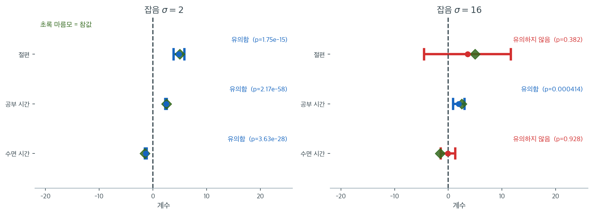
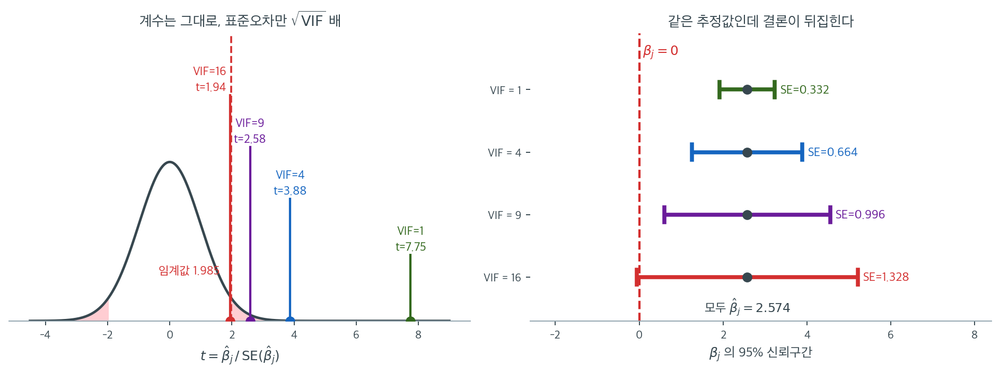

# 회귀계수의 가설검정 (t-검정)

<div class="leadbox" markdown>

**들어가는 이야기** — 「유의하지 않다」가 무엇에 대한 말인가

보고서에서 변수를 빼는 가장 흔한 근거가 「유의하지 않다」 한 줄이다. 그 한 줄이 무엇에 대한 말인지 먼저 보아야 한다.

$n = 100$ 에 설명변수가 둘인 모형에서 계수 추정값 $2.574$ 를 **고정해 두고** 설명변수끼리의 상관만 키워 보자. VIF 가 $1$ 일 때는 표준오차가 $0.332$ 이고 $t = 2.574/0.332 = 7.75$ 로 임계값 $1.985$ 에서 한참 멀다. VIF 는 그 변수를 나머지 설명변수에 회귀했을 때 남는 몫의 역수이고, 표준오차는 그 제곱근만큼 부푼다. VIF 를 $16$ 으로 올리면 표준오차가 $\sqrt{16} = 4$ 배로 부풀어 $1.328$ 이 되고, 같은 추정값에서 $t = 2.574/1.328 = 1.94$ 가 되어 임계값을 넘지 못한다.

추정값은 처음부터 끝까지 $2.574$ 였고 구간의 중심도 그대로다. 달라진 것은 폭뿐이어서 $(1.915,\ 3.233)$ 처럼 벌어진다 — 표준오차가 네 배가 되면 구간도 네 배로 벌어진다. 그러니 그 판정이 바뀐 까닭은 **효과가 작아진 것이 아니라 그 효과를 다른 변수의 몫과 분간할 정보가 자료에 없어진 것**이다.

그래서 「유의하지 않다」를 「효과가 없다」로 옮겨 적으면 안 된다. 그 변수를 뺀 보고서는 효과가 없다고 말한 것이 아니라 **묻지 않기로 했다**고 말한 것이다. 두 변수를 묶어 한꺼번에 검정하면 $F$ 가 그 정보를 되찾는다. 그러면 그 판정은 계수에 대한 말인가, 그 계수를 분간할 정보가 자료에 있는지에 대한 말인가. 아래 상자가 같은 출력표의 두 행이 왜 같은 뜻이 아닌지를 따라간다.

_확인한 곳 — 이 쪽 「같은 표의 두 행이 같은 뜻이 아니다」 상자와 그 출처 줄_

</div>

선형회귀에서 핵심 목표 가운데 하나는 각 설명변수가 종속변수에 미치는 영향을 평가하는 것이다. 보통 **t-검정**으로 수행하는 회귀계수의 가설검정은 설명변수가 모형에 유의하게 기여하는지를 판단한다.

---

## 1. t-검정의 설정

선형회귀의 t-검정은 회귀계수가 0이라는 귀무가설, 곧 해당 설명변수가 종속변수에 아무 효과가 없다는 가설을 평가한다.

가설은 다음과 같다.

- **귀무가설 ($H_0$):** $\beta_i = 0$ — 설명변수에 효과가 없다.
- **대립가설 ($H_1$):** $\beta_i \neq 0$ — 설명변수에 유의한 효과가 있다.

각 계수에 대해 **t 통계량**을 계산한다.

$$
t = \frac{\hat{\beta}_i}{SE(\hat{\beta}_i)}
$$

여기서

- $\hat{\beta}_i$는 설명변수 $i$의 추정된 계수,
- $SE(\hat{\beta}_i)$는 추정값의 표준오차로, 추정의 변동을 나타낸다.

t 통계량은 추정된 계수가 0에서 표준오차 몇 개만큼 떨어져 있는지를 잰다. 절댓값이 클수록 귀무가설에 반하는 증거가 강하다.

---

## 2. t-검정의 p값

**p값**은 귀무가설이 참이라고 가정했을 때 계산된 t 통계량만큼 또는 그보다 더 극단적인 값을 관측할 확률이다.

- **작은 p값 (< 0.05):** 계수가 0과 유의하게 다르다 — $H_0$을 기각한다. 그 설명변수는 종속변수에 유의한 영향을 준다.
- **큰 p값 ($\geq$ 0.05):** $H_0$을 기각하지 못한다. 그 설명변수는 종속변수에 유의한 영향을 주지 않을 수 있고, 포함해도 예측 성능이 나아지지 않을 수 있다.

!!! example "연봉 예측"
    경력 연수로 연봉을 예측하는 선형회귀 모형에서 t-검정은 "경력 연수"가 연봉에 유의한 효과를 갖는지 평가한다. 그 계수의 p값이 0.001이라면 경력 연수가 연봉의 유의한 설명변수라고 결론짓는다.

---

## 3. 계수의 신뢰구간

p값이 유의성에 대한 이분법적 판정을 준다면, **신뢰구간**은 계수가 취할 만한 값의 범위를 준다. 95% 신뢰구간은 다음과 같이 계산한다.

$$
CI = \hat{\beta}_i \pm \left( t_{1-\alpha/2} \times SE(\hat{\beta}_i) \right)
$$

여기서 $t_{1-\alpha/2}$는 원하는 신뢰수준에서 t 분포의 임계값이다.

**해석:**

- 신뢰구간이 **0을 포함하면** 계수는 0과 유의하게 다르지 않다. 그 설명변수는 유의한 영향을 주지 않을 수 있다.
- 신뢰구간이 **0을 배제하면** 그 설명변수는 유의하며, 모형에 의미 있게 기여한다는 더 강한 증거가 된다.

!!! example "광고 예산"
    매출을 예측하는 회귀모형에서 "광고 예산"이라는 설명변수의 95% 신뢰구간이 $(0.03, 0.12)$라면 0을 포함하지 않으므로 광고 예산이 매출에 유의한 영향을 준다고 결론짓는다.

---

## 4. 유의성의 해석

설명변수의 유의성은 t-검정의 결과와 그에 딸린 p값으로 정해진다.

**통계적으로 유의한 계수** ($p < 0.05$):

- 그 설명변수는 종속변수의 변동 일부를 설명하며 모형을 개선한다.
- 이 변수의 변화는 결과의 변화와 연관된다.
- 여기서 한 걸음 더 나아가고 싶어진다 — 예를 들어 직무 성과를 예측하는 데 "교육 수준"이 유의하다면 교육 수준은 중요한 결정 요인이다. **그 한 걸음을 $t$ 검정이 보증해 주지 않는다는 것**이 바로 아래 상자의 내용이다.

**통계적으로 유의하지 않은 계수** ($p \geq 0.05$):

- 이 설명변수가 종속변수에 영향을 준다고 주장할 증거가 충분하지 않다.
- 전반적인 적합을 개선하지 못한다면 모형에서 뺄 수 있다.

거꾸로 가는 오해도 있다. $p < 0.05$ 는 효과가 **있다**는 말이고 효과가 **클** 것이라는 말이 아니다. 표본이 크면 실질적으로 무의미한 크기의 효과도 유의해진다. 통계적 유의성과 실질적 유의성을 가르는 일은 11.3절 [유의성의 해석](significance.md)이 따로 다룬다.

<div class="storybox" markdown>

**그림으로 보는 통계학 1.** 같은 표의 두 행이 같은 뜻이 아니다

위 목록의 셋째 줄을 다시 읽어 보자. **「직무 성과를 예측하는 데 교육 수준이 유의하다면 교육 수준은 중요한 결정 요인이다.」** 이 문장은 $t$ 검정이 보증해 주지 않는다. 그리고 보증해 주지 않는다는 사실은 **표 어디에도 적혀 있지 않다.**

$2013$ 년에 **대니얼 웨스트라이크**와 **샌더 그린랜드**가 이것에 이름을 붙였다. 「**표 2 의 오류**」다. 논문의 표 $2$ 는 보통 관심 변수 한 줄과 함께 **교란요인으로 넣은 변수들의 계수까지** 한 표에 늘어놓는데, 그 모형은 **관심 변수 하나를 위해 설계된 것**이어서 나머지 행에는 같은 보증이 따라오지 않는다는 것이다.

성과 $Y$ 를 설명하는 데 관심 변수인 **연수 시간** $X$ 와, 교란요인인 **교육 수준** $Z$ 를 넣었다고 하자. 참 구조가 이렇다고 하자 — 교육은 연수를 늘리고($0.8$), 연수는 성과를 올리고($1.0$), 교육은 성과를 따로도 올린다($0.5$). 그러면

$$
\text{교육의 총효과} = 0.5 + 0.8 \times 1.0 = 1.3
$$

이다. 그런데 **표의 교육 행은 $0.5$ 를 준다.** 곧은 화살표 하나만 잰 것이고, 교육이 연수를 통해 내는 $0.8$ 은 **연수 행이 가져갔다.** 연수 행은 그래서 옳다 — 교육을 보정했으니 연수의 총효과 $1.0$ 을 정확히 잰다. 같은 표에서 한 행은 총효과이고 다른 한 행은 직접효과다.


관측되지 않는 것이 하나 끼면 더 나빠진다. 가정 **배경** $U$ 가 교육을 높이고($1.0$) 성과를 낮춘다($-2.0$)고 하자. $U$ 는 연수에 직접 작용하지 않으므로 **연수 행은 여전히 옳다**($+0.999$). 그런데 교육 행은

| | 참 총효과 | 표가 주는 값 |
|---|---|---|
| 연수 $X$ 행 | $+1.0$ | $+0.999$ |
| 교육 $Z$ 행 ($U$ 없을 때) | $+1.3$ | $+0.501$ |
| 교육 $Z$ 행 ($U$ 있을 때) | $+1.3$ | $\mathbf{-0.499}$ |

로 **부호가 뒤집힌다.** 관측 $2000$ 개짜리 자료를 $2000$ 번 만들어 평균한 값이고, 흔들림(SD $0.043$)의 열 배도 넘는 거리다. 표를 한 번 뽑아 보면 교육 행의 $t$ 가 $-10.90$, 연수 행이 $+24.24$ 로 **둘 다 압도적으로 유의하다.** 어느 행이 틀렸는지 가릴 단서가 표 안에 없다.

고칠 길은 표를 더 잘 읽는 것이 아니다. **노출–결과 쌍마다 보정해야 할 변수 집합이 다르므로**, 교육의 효과를 알고 싶으면 교육을 주인공으로 둔 모형을 따로 세워야 한다. 위 설정에서 $U$ 가 없다면 교육만 넣은 단순회귀가 $+1.300$ 으로 제값을 준다. $U$ 가 있다면 그것도 $+0.301$ 로 틀리고, **그 자료로는 답을 얻을 수 없다.** 무엇을 보정해야 하는지는 10.4절 [방향성 비순환 그래프](../../ch10/causation/dags.md)가, 왜 그래야 하는지는 10.3절 [교란변수](../../ch10/confounding/confounding_variables.md)가 다룬다.

이름이 붙은 뒤에도 같은 지적은 되풀이된다. $2020$ 년에 나온 대규모 코로나 사망 위험요인 연구를 두고도 그 논문이 이 오류를 범했다는 편지와, 인과적 주장을 한 적이 없다는 저자들의 반론이 오갔다.

_확인한 곳 — 「표 2 의 오류」라는 이름을 웨스트라이크와 그린랜드가 $2013$ 년에 붙였다는 것과 서지(「The Table 2 Fallacy: Presenting and Interpreting Confounder and Modifier Coefficients」, American Journal of Epidemiology $177$($4$), $292$–$298$), 그 핵심이 「관심 변수 하나를 위해 설계된 다변량 회귀의 나머지 모수에까지 인과적 해석을 주려 할 때 생긴다」는 것, 「인과추론이 목적이라면 보통 보정할 변수는 노출–결과 쌍마다 다르다」는 것, 그리고 $2020$ 년 코로나 사망 위험요인 연구를 두고 같은 지적과 저자들의 반론이 오갔다는 것은 [Wikipedia 「Table 2 fallacy」](https://en.wikipedia.org/wiki/Table_2_fallacy)에서 읽었다. **논문 본문과 그 편지들은 읽지 못했다** · 표와 그림의 수는 모두 직접 모의실험해 얻은 값이고 어느 연구의 자료도 아니다_

</div>

---

## 5. statsmodels 로 계수 검정하기

앞의 네 절이 손으로 적은 식을 `statsmodels` 는 표 하나로 내놓는다. 설명변수가 둘인 적합부터 시작해, $p$값과 신뢰구간을 배열로 꺼내는 법과 변수가 여럿일 때 한 줄씩 읽는 법까지 세 보기로 본다.

<div class="exbox" markdown>

**보기 1.** <span class="diff easy" title="쉬움"></span> 설명변수 두 개.

</div>

??? success "풀이"
    ```python
    import numpy as np
    import statsmodels.api as sm

    def print_summary(res):
        """summary()에서 실행 날짜와 시각만 지우고 인쇄한다(재현 가능한 출력을 위해)."""
        lines = []
        for line in str(res.summary()).split("\n"):
            if line.startswith(("Date:", "Time:")):
                lines.append(line[:19].ljust(38) + line[38:])
            else:
                lines.append(line)
        print("\n".join(lines))

    np.random.seed(0)
    X = np.random.rand(100, 2)
    y = 3 * X[:, 0] + 5 * X[:, 1] + np.random.randn(100)

    X_const = sm.add_constant(X)
    results = sm.OLS(y, X_const).fit()
    print_summary(results)
    ```

    출력:

    ```
                                OLS Regression Results                            
    ==============================================================================
    Dep. Variable:                      y   R-squared:                       0.743
    Model:                            OLS   Adj. R-squared:                  0.738
    Method:                 Least Squares   F-statistic:                     140.3
    Date:                                   Prob (F-statistic):           2.39e-29
    Time:                                   Log-Likelihood:                -133.53
    No. Observations:                 100   AIC:                             273.1
    Df Residuals:                      97   BIC:                             280.9
    Df Model:                           2                                         
    Covariance Type:            nonrobust                                         
    ==============================================================================
                     coef    std err          t      P>|t|      [0.025      0.975]
    ------------------------------------------------------------------------------
    const          0.1145      0.259      0.442      0.659      -0.400       0.629
    x1             2.5737      0.332      7.742      0.000       1.914       3.233
    x2             5.0296      0.328     15.346      0.000       4.379       5.680
    ==============================================================================
    Omnibus:                        0.410   Durbin-Watson:                   2.045
    Prob(Omnibus):                  0.815   Jarque-Bera (JB):                0.502
    Skew:                           0.144   Prob(JB):                        0.778
    Kurtosis:                       2.807   Cond. No.                         5.58
    ==============================================================================

    Notes:
    [1] Standard Errors assume that the covariance matrix of the errors is correctly specified.
    ```

요약표의 `P>|t|` 열이 각 계수에 대한 $H_0\colon \beta_j = 0$의 양측 p-값이다. 그 옆의 `[0.025 0.975]`가 95% 신뢰구간이고, 둘은 같은 정보를 다르게 표현한 것이다.

<div class="exbox" markdown>

**보기 2.** <span class="diff easy" title="쉬움"></span> p값과 신뢰구간 뽑아내기.

</div>

??? success "풀이"
    ```python
    np.random.seed(42)
    X = np.random.rand(100, 1)
    y = 2.5 * X[:, 0] + np.random.randn(100)

    X_const = sm.add_constant(X)
    results = sm.OLS(y, X_const).fit()

    p_values = results.pvalues
    confidence_intervals = results.conf_int()

    print("P-values:", p_values)
    print("95% CI:\n", confidence_intervals)
    ```

    출력:

    ```
    P-values: [2.09535133e-01 1.62497167e-09]
    95% CI:
     [[-0.12283207  0.55302438]
     [ 1.43199824  2.6484553 ]]
    ```

`pvalues`와 `conf_int()`로 요약표의 값을 배열로 꺼낸다. 절편의 p-값은 0.21로 유의하지 않고 기울기는 $1.6 \times 10^{-9}$로 강하게 유의하다.

<div class="exbox" markdown>

**보기 3.** <span class="diff easy" title="쉬움"></span> 여러 설명변수의 해석.

</div>

??? success "풀이"
    ```python
    np.random.seed(42)
    study_hours = np.random.rand(100) * 10
    sleep_hours = np.random.rand(100) * 8
    exam_scores = 5 + 2.5 * study_hours - 1.5 * sleep_hours + np.random.randn(100) * 2

    X = np.column_stack((study_hours, sleep_hours))
    X_const = sm.add_constant(X)
    results = sm.OLS(exam_scores, X_const).fit()

    conf = results.conf_int()   # ndarray when the input is a NumPy array
    for i, name in enumerate(["Intercept", "Study Hours", "Sleep Hours"]):
        pval = results.pvalues[i]
        ci = conf[i]
        status = "Significant" if pval < 0.05 else "Not Significant"
        print(f"{name}: coef={results.params[i]:.4f}, "
              f"p={pval:.4g} ({status}), "
              f"95% CI=({ci[0]:.4f}, {ci[1]:.4f})")
    ```

    출력:

    ```text
    Intercept: coef=4.8212, p=1.754e-15 (Significant), 95% CI=(3.8122, 5.8303)
    Study Hours: coef=2.4317, p=2.171e-58 (Significant), 95% CI=(2.2992, 2.5641)
    Sleep Hours: coef=-1.3202, p=3.633e-28 (Significant), 95% CI=(-1.4883, -1.1521)
    ```

!!! warning "`conf_int()`의 반환 형식은 입력에 따라 달라진다"
    `sm.OLS`에 NumPy 배열을 넘기면 `conf_int()`가 `ndarray`를 돌려주므로 `conf[i]`로 색인해야 한다. pandas `Series`/`DataFrame`을 넘겼을 때에만 `DataFrame`이 반환되어 `.iloc[i]`를 쓸 수 있다. 배열 입력에 `.iloc`를 쓰면 `AttributeError`가 난다.

---

## 6. 잡음이 커지면 유의성을 잃는다



보기 3의 결과를 표 대신 **계수 그림**으로 옮겨 보았다. 가로축이 계수의 값, 가로 막대가 95% 신뢰구간, 가운데 점이 추정값, 초록 마름모가 참값 $(5,\ 2.5,\ -1.5)$이다. 왼쪽 패널이 보기 3 과 같은 잡음 $\sigma = 2$의 결과이고, 구간이 아주 짧아 점처럼 보인다. 공부 시간은 $(2.299,\ 2.564)$, 수면 시간은 $(-1.488,\ -1.152)$로 둘 다 참값을 담고 $0$에서 멀찍이 떨어져 있다. 회귀표를 수십 줄 읽는 것보다 이 한 장이 빠르다.

오른쪽은 **같은 설명변수, 같은 참 계수**에 잡음만 $\sigma = 16$으로 여덟 배 키운 결과다. 참값은 조금도 변하지 않았다. 그런데 결론이 크게 달라진다. 공부 시간은 추정값 $1.953$, 구간 $(0.893,\ 3.013)$, $p = 0.0004$로 여전히 유의하다. 수면 시간은 추정값 $-0.061$, 구간 $(-1.406,\ 1.283)$, $p = 0.93$으로 유의성을 잃었다. 절편도 $p = 0.38$로 함께 떨어졌다. 표준오차가 $0.085$에서 $0.678$로 여덟 배 커지면서 구간이 참값과 $0$을 한꺼번에 삼켜 버린 것이다.

이 대비가 이 절의 요지다. 오른쪽 패널에서 수면 시간이 "유의하지 않다"는 판정을 받았지만, 참 효과는 여전히 $-1.5$다. 붉은 구간 $(-1.406,\ 1.283)$은 "효과가 $0$이다"라고 말하는 것이 아니라 **"$-1.4$일 수도 $+1.3$일 수도 있어 모르겠다"**고 말하고 있다. 초록 마름모가 구간 안에 있다는 사실이 그 점을 확인해 준다. $p$값만 보고했다면 이 구별이 통째로 사라졌을 것이다. 계수 그림이 회귀 결과를 보여 주는 표준 도구인 까닭이 여기에 있다. 유의성과 효과 크기와 정밀도를 한 장에 동시에 담기 때문이다.

- 보기 1에서는 두 설명변수($x_1$과 $x_2$)의 참 계수가 모두 0이 아니므로(3과 5) 두 $p$값이 모두 작고 둘 다 유의하다고 판정될 것으로 기대한다.
- 보기 2에서는 설명변수 하나의 참 계수가 2.5이고 잡음 표준편차가 1이다. 기울기의 $p$값이 매우 작아 선형관계를 확인해 줄 것이다.
- 보기 3에서는 "Study Hours"가 시험 점수에 양의 효과(계수 $\approx 2.5$)를, "Sleep Hours"가 음의 효과(계수 $\approx -1.5$)를 갖는다. 둘 다 통계적으로 유의해야 한다. 신뢰구간이 효과 크기의 그럴듯한 범위를 준다. 추정값이 참값과 조금 다른 것은($2.43$ 대 $2.5$, $-1.32$ 대 $-1.5$) 표집변동 때문이며, 참값이 신뢰구간 안에 들어 있는지 확인해 보면 좋다.
- 어떤 설명변수가 "유의하지 않다"($p > 0.05$)는 것이 효과가 0임을 증명하지는 않는다. 선택한 유의수준에서 $H_0$을 기각할 증거가 부족하다는 뜻일 뿐이다. 신뢰구간이 같은 정보를 더 유익하게 전달한다.

---

## 7. t-검정에서 다중공선성의 역할

앞 절의 표준오차는 잡음이 커져서 부풀었다. 설명변수끼리 닮아도 똑같이 부푼다.

**다중공선성**은 둘 이상의 설명변수가 강하게 상관되어 개별 효과를 구분하기 어려워지는 상황이다. 이는 다음을 일으킨다.

- 계수의 표준오차를 부풀려 t 통계량을 줄인다.
- p값을 부풀려 유의성에 대한 잘못된 결론을 낳는다.
- 신뢰구간을 넓혀 유의성을 결론짓기 어렵게 만든다.

**다중공선성에 대처하기:**

- **분산팽창인자(VIF):** VIF가 5나 10을 넘으면 다중공선성을 시사한다. 상관된 설명변수를 빼거나 결합하는 것이 대책이다.
- **주성분분석(PCA):** 설명변수를 서로 무상관인 성분으로 변환한다.
- **릿지 회귀:** 계수를 정칙화하여 다중공선성의 영향을 줄인다.



VIF가 무엇을 하는지는 정의 하나로 정리된다. 다른 설명변수들과의 상관 때문에 $\hat{\beta}_j$의 분산이 VIF배로 부풀고, 따라서 **표준오차는 $\sqrt{\mathrm{VIF}}$배가 된다.** 계수 추정값 자체는 건드리지 않는다. 위 그림은 $n = 100$, 설명변수 두 개인 모형에서 $\hat{\beta}_j = 2.574$를 고정해 두고 VIF만 $1, 4, 9, 16$으로 바꾸어 본 것이다.

왼쪽에서 네 개의 막대가 같은 계수가 만드는 $t$ 값이다. VIF $= 1$(공선성 없음)이면 $\mathrm{SE} = 0.332$, $t = 7.75$로 기각역 훨씬 바깥에 있다. VIF $= 4$면 $\mathrm{SE} = 0.664$, $t = 3.88$. VIF $= 9$면 $\mathrm{SE} = 0.996$, $t = 2.58$로 아직 기각역 안이지만 경계가 가까워졌고, VIF $= 16$에 이르면 $\mathrm{SE} = 1.328$, $t = 1.94$가 되어 임계값 $1.985$를 **넘지 못한다.** $p$값으로 보면 $0.0000 \to 0.0002 \to 0.0113 \to 0.0555$로 옮겨 간다. 정확히 따지면 이 계수가 유의성을 잃기 시작하는 지점은 VIF $= 15.26$이다.

오른쪽이 같은 이야기를 신뢰구간으로 옮긴 것이다. 네 구간의 중심은 모두 $2.574$로 같다. 달라지는 것은 폭뿐이다. VIF $= 1$일 때 $(1.915,\ 3.233)$이던 구간이 VIF $= 16$에서는 $(-0.062,\ 5.209)$로 벌어져 $0$을 삼킨다. 여기서 반드시 붙잡아야 할 점이 있다. **"유의하지 않다"는 판정이 나왔다고 해서 효과가 사라진 것이 아니다.** 추정값은 처음부터 끝까지 $2.574$였다. 달라진 것은 그 값을 얼마나 믿을 수 있느냐뿐이고, 공선성은 자료가 그 계수를 개별적으로 분간할 정보를 갖고 있지 않다는 사실을 표준오차로 정직하게 보고한 것이다. 그래서 VIF가 높을 때의 올바른 대응은 유의하지 않은 변수를 기계적으로 빼는 것이 아니라, 상관된 변수들을 묶거나 정칙화하거나 아예 결합가설로 검정하는 것이다.

---

## 연습문제

!!! note "이 절의 연습문제에 대하여"
    연습문제 1부터 4까지는 두 표본의 평균을 비교하는 $t$ 검정이다. 회귀계수의 $t$ 검정과 통계량의 구조($\hat{\theta}/SE(\hat{\theta})$)와 판정 규칙이 동일하므로, $t$ 검정의 기계적 절차를 익히는 연습으로 삼는다. 연습문제 5부터 10까지는 7절 그림의 모형($n = 100$, 설명변수 두 개, $\hat{\beta}_j = 2.574$, VIF $= 1$일 때 $\mathrm{SE} = 0.332$)을 그대로 쓰고, 연습문제 11부터는 5절·6절의 `statsmodels` 보기로 돌아간다.

<div class="drillbox" markdown>

**연습문제 1.** <span class="diff easy" title="쉬움"></span>
이탈리아와 프랑스의 교육을 연구하는 한 연구자가 두 나라 남성이 평균적으로 학교를 몇 년 다녔는지 비교하려 한다. 각 나라에서 남성을 무작위로 표본추출하여 다음을 얻었다.

| | 이탈리아 | 프랑스 |
|:---:|:---:|:---:|
| 평균 | 10.7 | 10.4 |
| 표준편차 | 2.3 | 2.5 |
| 표본 수 | 46 | 58 |

유의수준 $\alpha = 0.05$에서 두 나라의 평균 재학 연수에 유의한 차이가 있는지 검정하라.

</div>

??? success "풀이"

    두 표본 $t$ 검정(합동분산):

    $$
    H_0: \mu_A = \mu_B \quad \text{대} \quad H_1: \mu_A \neq \mu_B
    $$

    ```python
    import numpy as np
    from scipy import stats

    def main():
        X_1_bar, X_2_bar = 10.7, 10.4
        s_1, s_2 = 2.3, 2.5
        n_1, n_2 = 46, 58

        s_p_square = ((n_1-1) * s_1**2 + (n_2-1) * s_2**2) / (n_1 + n_2 - 2)
        statistic = (X_1_bar - X_2_bar) / np.sqrt(s_p_square / n_1 + s_p_square / n_2)
        df = n_1 + n_2 - 2
        p_value = 2 * stats.t(df).cdf(-abs(statistic))
        print(f"{df = :.4f}")
        print(f"{statistic = :.4f}")
        print(f"{p_value   = :.4f}")

        alpha = 0.05
        if p_value <= alpha:
            print("We choose H_1, or using statistician's jargon, reject H_0")
        else:
            print("We choose H_0, or using statistician's jargon, fail to reject H_0")

    if __name__ == "__main__":
        main()
    ```

    출력:

    ```
    df = 102.0000
    statistic = 0.6295
    p_value   = 0.5304
    We choose H_0, or using statistician's jargon, fail to reject H_0
    ```

    $p = 0.530$으로 기각하지 못한다. 자유도 102는 합동 $t$-검정의 $n_1 + n_2 - 2$다.

    $p = 0.530 > 0.05$이므로 $H_0$을 기각하지 못한다. 두 나라의 평균 재학 연수가 다르다는 증거가 없다.

<div class="drillbox" markdown>

**연습문제 2.** <span class="diff easy" title="쉬움"></span>
노르웨이와 미국의 소득을 연구하는 한 경제학자가 두 나라의 연평균 소득을 비교하려 한다. 각 나라에서 사람들을 무작위로 표본추출하여 천 달러 단위로 소득을 얻었다.

| | 노르웨이 | 미국 |
|:---:|:---:|:---:|
| 평균 | 64.3 | 53.4 |
| 표준편차 | 18.2 | 23.9 |
| 표본 수 | 65 | 75 |

유의수준 $\alpha = 0.05$에서 두 나라의 평균 연소득에 유의한 차이가 있는지 검정하라.

</div>

??? success "풀이"

    두 표본 $t$ 검정(Welch, 비합동분산):

    $$
    H_0: \mu_A = \mu_B \quad \text{대} \quad H_1: \mu_A \neq \mu_B
    $$

    ```python
    import numpy as np
    from scipy import stats

    def main():
        X_1_bar, X_2_bar = 64.3, 53.4
        s_1, s_2 = 18.2, 23.9
        n_1, n_2 = 65, 75

        statistic = (X_1_bar - X_2_bar) / np.sqrt(s_1**2 / n_1 + s_2**2 / n_2)
        top = (s_1**2 / n_1 + s_2**2 / n_2)**2
        bottom = (s_1**2 / n_1)**2 / (n_1 - 1) + (s_2**2 / n_2)**2 / (n_2 - 1)
        df = top / bottom
        p_value = 2 * stats.t(df).cdf(-abs(statistic))
        print(f"{df = :.4f}")
        print(f"{statistic = :.4f}")
        print(f"{p_value   = :.4f}")

        alpha = 0.05
        if p_value <= alpha:
            print("We choose H_1, or using statistician's jargon, reject H_0")
        else:
            print("We choose H_0, or using statistician's jargon, fail to reject H_0")

    if __name__ == "__main__":
        main()
    ```

    출력:

    ```
    df = 135.8395
    statistic = 3.0572
    p_value   = 0.0027
    We choose H_1, or using statistician's jargon, reject H_0
    ```

    $p = 0.0027$로 기각한다. 자유도가 135.8로 정수가 아닌 것은 Welch 자유도이기 때문이다.

    $p = 0.0027 < 0.05$이므로 $H_0$을 기각한다. 두 나라의 평균 연소득에 유의한 차이가 있다.

    !!! warning "Welch 자유도 공식"
        Welch–Satterthwaite 자유도의 분모는

        $$
        \frac{(s_1^2/n_1)^2}{n_1 - 1} + \frac{(s_2^2/n_2)^2}{n_2 - 1}
        $$

        이다. 분모를 $n_1$, $n_2$로 나누는 실수를 자주 보는데, 표본이 크면 차이가 미미하지만(여기서는 135.84 대 137.77) 표본이 작으면 자유도를 크게 부풀려 $p$값을 과소평가하게 된다. 연습문제 4가 그 예이다.

<div class="drillbox" markdown>

**연습문제 3.** <span class="diff easy" title="쉬움"></span>
미국과 캐나다의 결혼을 연구하는 한 사회학자가 두 나라 여성이 처음 결혼했을 때의 평균 나이를 비교하려 한다. 각 나라에서 기혼 여성을 무작위로 표본추출하여 다음을 얻었다.

| | 미국 | 캐나다 |
|:---:|:---:|:---:|
| 평균 | 25.5 | 26.3 |
| 표준편차 | 3.8 | 3.2 |
| 표본 수 | 108 | 102 |

유의수준 $\alpha = 0.05$에서 두 나라의 초혼 평균 연령에 유의한 차이가 있는지 검정하라.

</div>

??? success "풀이"

    두 표본 $t$ 검정(합동분산):

    $$
    H_0: \mu_A = \mu_B \quad \text{대} \quad H_1: \mu_A \neq \mu_B
    $$

    ```python
    import numpy as np
    from scipy import stats

    def main():
        X_1_bar, X_2_bar = 25.5, 26.3
        s_1, s_2 = 3.8, 3.2
        n_1, n_2 = 108, 102

        s_p_square = ((n_1-1) * s_1**2 + (n_2-1) * s_2**2) / (n_1 + n_2 - 2)
        statistic = (X_1_bar - X_2_bar) / np.sqrt(s_p_square / n_1 + s_p_square / n_2)
        df = n_1 + n_2 - 2
        p_value = 2 * stats.t(df).cdf(-abs(statistic))
        print(f"{df = :.4f}")
        print(f"{statistic = :.4f}")
        print(f"{p_value   = :.4f}")

        alpha = 0.05
        if p_value <= alpha:
            print("We choose H_1, or using statistician's jargon, reject H_0")
        else:
            print("We choose H_0, or using statistician's jargon, fail to reject H_0")

    if __name__ == "__main__":
        main()
    ```

    출력:

    ```
    df = 208.0000
    statistic = -1.6454
    p_value   = 0.1014
    We choose H_0, or using statistician's jargon, fail to reject H_0
    ```

    $p = 0.101$로 5% 수준에서는 기각하지 못한다. 경계에 가까운 값이므로 "차이가 없다"가 아니라 "이 표본으로는 판단하기 어렵다"로 읽어야 한다.

    $p = 0.101 > 0.05$이므로 $H_0$을 기각하지 못한다. 표본평균의 차이 0.8년은 이 표본크기에서 우연으로 설명될 수 있다.

<div class="drillbox" markdown>

**연습문제 4.** <span class="diff easy" title="쉬움"></span>
Julie는 새로 나온 전기차 두 모델 A와 B가 완전 충전 후 얼마나 멀리 갈 수 있는지 시험했다. 각 모델의 새 차 5대씩을 표본으로 얻어 완전히 충전한 뒤 통제된 경로에서 최대한 멀리 주행했다.

| | 모델 A | 모델 B |
|:---:|:---:|:---:|
| 평균 | 168 km | 172 km |
| 표준편차 | 5.4 km | 7.5 km |
| 표본 수 | 5 | 5 |

유의수준 $\alpha = 0.05$에서 두 모델의 평균 주행거리에 유의한 차이가 있는지 검정하라.

</div>

??? success "풀이"

    두 표본 $t$ 검정(Welch, 비합동분산):

    $$
    H_0: \mu_A = \mu_B \quad \text{대} \quad H_1: \mu_A \neq \mu_B
    $$

    ```python
    import numpy as np
    from scipy import stats

    def main():
        X_1_bar, X_2_bar = 168, 172
        s_1, s_2 = 5.4, 7.5
        n_1, n_2 = 5, 5

        statistic = (X_1_bar - X_2_bar) / np.sqrt(s_1**2 / n_1 + s_2**2 / n_2)
        top = (s_1**2 / n_1 + s_2**2 / n_2)**2
        bottom = (s_1**2 / n_1)**2 / (n_1 - 1) + (s_2**2 / n_2)**2 / (n_2 - 1)
        df = top / bottom
        p_value = 2 * stats.t(df).cdf(-abs(statistic))
        print(f"{df = :.4f}")
        print(f"{statistic = :.4f}")
        print(f"{p_value   = :.4f}")

        alpha = 0.05
        if p_value <= alpha:
            print("We choose H_1, or using statistician's jargon, reject H_0")
        else:
            print("We choose H_0, or using statistician's jargon, fail to reject H_0")

    if __name__ == "__main__":
        main()
    ```

    출력:

    ```
    df = 7.2688
    statistic = -0.9678
    p_value   = 0.3642
    We choose H_0, or using statistician's jargon, fail to reject H_0
    ```

    $p = 0.364$로 기각하지 못한다. 표본이 작아 자유도가 7.27밖에 안 되는 것이 결정적이다.

    $p = 0.364 > 0.05$이므로 $H_0$을 기각하지 못한다. 각 모델 5대로는 4 km의 차이를 탐지할 검정력이 거의 없다.

    자유도 분모에 $n-1$ 대신 $n$을 쓰면 자유도가 7.27이 아니라 9.09가 되고 $p$값도 0.364가 아닌 0.358이 된다. 결론은 같지만, 표본이 작을수록 이 오류의 영향이 커진다.

<div class="drillbox" markdown>

**연습문제 5.** <span class="diff easy" title="쉬움"></span>
본문은 같은 계수의 95% 신뢰구간이 VIF $= 1$일 때 $(1.915,\ 3.233)$, VIF $= 16$일 때 $(-0.062,\ 5.209)$라고 했다. 손으로 다음을 확인하라.

(a) 두 구간의 중심을 각각 구하고, 그것이 VIF와 무관하게 $\hat{\beta}_j = 2.574$임을 확인하라.

(b) 두 구간의 폭을 구하고 그 비를 계산하라. 그 비가 $\sqrt{\mathrm{VIF}}$와 맞는가?

(c) VIF $= 16$ 구간의 반폭이 공식 $t_{1-\alpha/2} \times SE(\hat{\beta}_j)$와 맞는지 $t_{1-\alpha/2} = 1.985$, $\mathrm{SE} = 1.328$로 확인하라.

</div>

??? success "풀이"

    **(a) 중심.** 신뢰구간은 $\hat{\beta}_j$를 중심으로 대칭이므로 중심은 두 끝점의 평균이다.

    $$
    \frac{1.915 + 3.233}{2} = \frac{5.148}{2} = 2.574, \qquad \frac{-0.062 + 5.209}{2} = \frac{5.147}{2} = 2.5735
    $$

    둘 다 $2.574$다(뒤쪽의 $2.5735$는 끝점을 소수 셋째 자리에서 반올림한 탓이다). VIF는 중심을 옮기지 않는다.

    **(b) 폭.**

    $$
    3.233 - 1.915 = 1.318, \qquad 5.209 - (-0.062) = 5.271
    $$

    비는 $5.271 / 1.318 = 3.999$로 $\sqrt{16} = 4$와 맞는다. 표준오차가 $\sqrt{\mathrm{VIF}}$배가 되면 구간의 폭도 똑같이 $\sqrt{\mathrm{VIF}}$배가 된다. 폭이 $2 t_{1-\alpha/2} \times SE$이고 $t_{1-\alpha/2}$는 VIF와 무관하기 때문이다.

    **(c) 반폭.** 실제 반폭은 $5.271 / 2 = 2.6355$이고 공식은

    $$
    t_{1-\alpha/2} \times SE(\hat{\beta}_j) = 1.985 \times 1.328 = 2.6361
    $$

    이다. 자유도 $97$의 임계값을 반올림하지 않고 $1.98472$로 쓰면 $2.63571$이 되어 $2.6355$와 셋째 자리까지 맞는다.

    세 결과를 묶으면 그림의 오른쪽 패널이 한 문장으로 요약된다. **공선성은 추정값(중심)을 건드리지 않고 불확실성(폭)만 $\sqrt{\mathrm{VIF}}$배로 늘린다.**

<div class="drillbox" markdown>

**연습문제 6.** <span class="diff easy" title="쉬움"></span>
본문의 표(VIF $= 1, 4, 9, 16$에서 $\mathrm{SE} = 0.332, 0.664, 0.996, 1.328$, $t = 7.75, 3.88, 2.58, 1.94$)를 코드로 재현하고, 같은 모형에서 VIF $= 25$인 경우를 한 줄 더 붙여라. $\hat{\beta}_j = 2.574$와 VIF $= 1$일 때의 $\mathrm{SE} = 0.332$, 그리고 $n = 100$에 설명변수가 두 개라는 사실만 쓴다. 자유도와 임계값도 코드로 구하라.

</div>

??? success "풀이"

    자유도는 $n - (\text{설명변수 개수}) - 1 = 100 - 2 - 1 = 97$이고, $\mathrm{SE}(\mathrm{VIF}) = \mathrm{SE}_1 \sqrt{\mathrm{VIF}}$이므로 나머지는 $t = \hat{\beta}_j / \mathrm{SE}$를 반복하는 일이다.

    ```python
    import numpy as np
    from scipy import stats

    def main():
        beta_hat = 2.574        # VIF 와 무관하게 고정된 추정값
        se_1 = 0.332            # VIF = 1 일 때의 표준오차
        df = 100 - 2 - 1        # n - (설명변수 2개) - 1
        t_crit = stats.t(df).ppf(0.975)
        print(f"df = {df},  t_crit = {t_crit:.4f}")

        for vif in [1, 4, 9, 16, 25]:
            se = se_1 * np.sqrt(vif)
            t = beta_hat / se
            p = 2 * stats.t(df).cdf(-abs(t))
            mark = "유의" if abs(t) > t_crit else "유의하지 않음"
            print(f"VIF = {vif:2d}   SE = {se:.3f}   t = {t:.2f}   p = {p:.4f}   {mark}")

    if __name__ == "__main__":
        main()
    ```

    출력:

    ```text
    df = 97,  t_crit = 1.9847
    VIF =  1   SE = 0.332   t = 7.75   p = 0.0000   유의
    VIF =  4   SE = 0.664   t = 3.88   p = 0.0002   유의
    VIF =  9   SE = 0.996   t = 2.58   p = 0.0112   유의
    VIF = 16   SE = 1.328   t = 1.94   p = 0.0555   유의하지 않음
    VIF = 25   SE = 1.660   t = 1.55   p = 0.1243   유의하지 않음
    ```

    표준오차 $0.332, 0.664, 0.996, 1.328$과 $t$ 값 $7.75, 3.88, 2.58, 1.94$, 임계값 $1.985$, $p$값 $0.0000 \to 0.0002 \to 0.0555$가 모두 본문과 맞는다. VIF $= 9$의 $p$값만 본문의 $0.0113$ 대신 $0.0112$가 나오는데, 이는 반올림한 $\mathrm{SE} = 0.332$를 썼기 때문이다. 반올림하지 않은 적합값 $\mathrm{SE}_1 = 0.33244$를 쓰면 $t = 2.5809$, $p = 0.0114$가 된다. 이 자리의 셋째·넷째 자리는 $\mathrm{SE}$의 반올림에 좌우되므로 $p \approx 0.011$로 읽는 것이 옳다.

    VIF $= 25$에서는 $\mathrm{SE} = 0.332 \times 5 = 1.660$, $t = 1.55$, $p = 0.1243$이다. 추정값은 여전히 $2.574$ 그대로인데 $p$값은 VIF $= 1$일 때의 $0.0000$에서 $0.1243$까지 올라갔다. $t$가 $\sqrt{\mathrm{VIF}}$에 반비례하므로 VIF를 $25$배 늘리면 $t$는 정확히 $5$분의 $1$이 된다($7.75/5 = 1.55$).

<div class="drillbox" markdown>

**연습문제 7.** <span class="diff med" title="중간"></span>
VIF $= 1$일 때의 $t$ 값을 $t_1 = \hat{\beta}_j / \mathrm{SE}_1$이라 쓴다.

(a) $t(\mathrm{VIF}) = t_1 / \sqrt{\mathrm{VIF}}$임을 보여라.

(b) 계수가 유의수준 $\alpha$에서 유의성을 유지할 조건이 $\mathrm{VIF} < (t_1 / t_{1-\alpha/2})^2$임을 보여라.

(c) 본문의 수치로 이 문턱을 계산하여 "유의성을 잃기 시작하는 지점은 VIF $= 15.26$"이라는 문장을 확인하라.

(d) 같은 계수 $\hat{\beta}_j = 2.574$를 처음부터 두 배 덜 정밀하게 추정하여 $\mathrm{SE}_1 = 0.664$였다면 문턱은 얼마가 되는가? 문턱이 $\mathrm{SE}_1$에 어떻게 의존하는지 말하라.

</div>

??? success "풀이"

    **(a)** 본문의 규칙은 표준오차가 $\sqrt{\mathrm{VIF}}$배가 된다는 것, 곧 $\mathrm{SE}(\mathrm{VIF}) = \mathrm{SE}_1 \sqrt{\mathrm{VIF}}$이다. 추정값 $\hat{\beta}_j$는 VIF와 무관하게 고정되므로

    $$
    t(\mathrm{VIF}) = \frac{\hat{\beta}_j}{\mathrm{SE}_1 \sqrt{\mathrm{VIF}}} = \frac{1}{\sqrt{\mathrm{VIF}}} \cdot \frac{\hat{\beta}_j}{\mathrm{SE}_1} = \frac{t_1}{\sqrt{\mathrm{VIF}}}
    $$

    이다. $\square$

    **(b)** 유의하다는 것은 $\lvert t(\mathrm{VIF}) \rvert > t_{1-\alpha/2}$이다. (a)를 넣으면

    $$
    \frac{\lvert t_1 \rvert}{\sqrt{\mathrm{VIF}}} > t_{1-\alpha/2} \iff \sqrt{\mathrm{VIF}} < \frac{\lvert t_1 \rvert}{t_{1-\alpha/2}} \iff \mathrm{VIF} < \left( \frac{\lvert t_1 \rvert}{t_{1-\alpha/2}} \right)^{2}
    $$

    이다($\mathrm{VIF} \geq 1 > 0$, $t_{1-\alpha/2} > 0$이므로 부등식의 방향은 바뀌지 않고 제곱도 동치다). $\square$

    **(c)** $t_1 = 2.574 / 0.332 = 7.7530$이고 자유도 $97$에서 $t_{0.025} = 1.98472$이므로

    $$
    \mathrm{VIF}^{\ast} = \left( \frac{7.7530}{1.98472} \right)^{2} = 3.9063^{2} = 15.26
    $$

    이다. 본문의 $15.26$과 일치한다. VIF가 이 값을 넘는 순간 $t$는 $1.98472$ 아래로 내려간다.

    **(d)** 이번에는 $t_1 = 2.574 / 0.664 = 3.8765$이므로

    $$
    \mathrm{VIF}^{\ast} = \left( \frac{3.8765}{1.98472} \right)^{2} = 1.9532^{2} = 3.81
    $$

    이다. 일반적으로 $\mathrm{VIF}^{\ast} = (\hat{\beta}_j / (\mathrm{SE}_1 t_{1-\alpha/2}))^2$이므로 문턱은 $1/\mathrm{SE}_1^2$에 비례한다. $\mathrm{SE}_1$이 두 배가 되면 문턱은 $4$분의 $1$로 줄어 $15.26$에서 $3.81$이 된다.

    해석하면, **공선성을 얼마나 견디는지는 공선성이 없을 때의 $t$ 값 하나로 정해진다.** 처음부터 넉넉하게 유의했던 계수($t_1 = 7.75$)는 VIF $15$까지 버티지만, 간신히 유의했던 계수는 아주 약한 공선성에도 무너진다. 그래서 "VIF가 커도 유의하니 괜찮다"는 말은 $t_1$이 컸다는 뜻일 뿐, 공선성이 없었다는 뜻이 아니다.

<div class="drillbox" markdown>

**연습문제 8.** <span class="diff med" title="중간"></span>
본문은 한편으로 "VIF가 5나 10을 넘으면 다중공선성을 시사한다"고 하고, 다른 한편으로 이 계수가 유의성을 잃는 지점은 VIF $= 15.26$이라고 한다. 두 기준이 어긋나는 자리를 수치로 드러내라.

같은 모형($\hat{\beta}_j = 2.574$, $\mathrm{SE}_1 = 0.332$, 자유도 $97$)에서 VIF $= 1, 5, 10, 15, 20$에 대해 $\mathrm{SE}$, $t$, $p$를 구하고 경험법칙의 두 문턱과 $t$-검정의 판정을 나란히 찍는 코드를 쓰라. 그리고 두 기준이 서로 다른 답을 주는 VIF 구간을 말하라.

</div>

??? success "풀이"

    연습문제 7의 문턱 $\mathrm{VIF}^{\ast} = (t_1/t_{1-\alpha/2})^2$도 같이 찍어 두면 비교가 쉽다.

    ```python
    import numpy as np
    from scipy import stats

    def main():
        beta_hat, se_1, df = 2.574, 0.332, 97
        t_crit = stats.t(df).ppf(0.975)
        t_1 = beta_hat / se_1
        vif_star = (t_1 / t_crit) ** 2
        print(f"t_1 = {t_1:.4f}   t_crit = {t_crit:.4f}   유의성 문턱 VIF* = {vif_star:.2f}")
        print("VIF     SE      t       p     VIF>5  VIF>10  t-검정")
        for vif in [1, 5, 10, 15, 20]:
            se = se_1 * np.sqrt(vif)
            t = beta_hat / se
            p = 2 * stats.t(df).cdf(-abs(t))
            r_5 = "넘음" if vif > 5 else "이하"
            r_10 = "넘음" if vif > 10 else "이하"
            test = "유의" if abs(t) > t_crit else "유의하지 않음"
            print(f"{vif:3d}  {se:.3f}  {t:6.3f}  {p:.4f}   {r_5}   {r_10}    {test}")

    if __name__ == "__main__":
        main()
    ```

    출력:

    ```text
    t_1 = 7.7530   t_crit = 1.9847   유의성 문턱 VIF* = 15.26
    VIF     SE      t       p     VIF>5  VIF>10  t-검정
      1  0.332   7.753  0.0000   이하   이하    유의
      5  0.742   3.467  0.0008   이하   이하    유의
     10  1.050   2.452  0.0160   넘음   이하    유의
     15  1.286   2.002  0.0481   넘음   넘음    유의
     20  1.485   1.734  0.0862   넘음   넘음    유의하지 않음
    ```

    경험법칙과 $t$-검정이 어긋나는 구간은 $5 < \mathrm{VIF} < 15.26$이다. VIF $= 10$에서는 경험법칙이 "다중공선성 있음"이라고 경고하는데 $p = 0.0160$으로 여전히 유의하고, VIF $= 15$에서도 $p = 0.0481$로 간신히 기각한다. 유의성이 처음 깨지는 것은 $15.26$을 넘긴 VIF $= 20$($p = 0.0862$)에서다.

    이것이 모순은 아니다. VIF $> 5$는 "$\mathrm{SE}$가 $\sqrt{5} = 2.24$배 부풀었다"는 **추정의 정밀도**에 대한 진술이고, $p < 0.05$는 그 부푼 $\mathrm{SE}$로도 $0$을 배제할 수 있느냐는 **다른 질문**에 대한 답이다. 연습문제 7(d)가 보여 준 대로 어긋남은 반대 방향으로도 생긴다. $\mathrm{SE}_1 = 0.664$인 계수라면 문턱이 $3.81$이므로 VIF $= 5$라는 "괜찮은" 값에서 이미 유의성을 잃는다.

    요약하면 **VIF의 경험법칙은 유의성에 대한 진술이 아니다.** 경고등일 뿐이고, 그 경고가 결론을 바꾸는지는 계수마다 $t_1$을 보고 따져야 한다.

<div class="drillbox" markdown>

**연습문제 9.** <span class="diff hard" title="어려움"></span>
본문은 공선성이 "계수 추정값 자체는 건드리지 않고" 표준오차만 $\sqrt{\mathrm{VIF}}$배로 늘린다고 주장한다. 모의실험으로 확인하라.

참 모형은 $y = 2.574 x_1 + x_2 + \varepsilon$, $\varepsilon \sim N(0,\ 3.32^2)$, $n = 100$이고 $x_1, x_2$는 표준정규이며 상관계수가 $\rho$다. $\rho = 0$(VIF $= 1$)과 $\rho = 0.9682$(VIF $= 16$) 각각에 대해 $2000$번 자료를 새로 뽑아 절편이 있는 최소제곱 적합을 하고, 다음 네 가지를 구하라.

1. $\hat{\beta}_1$의 평균
2. $\hat{\beta}_1$의 표준편차(추정값이 실제로 얼마나 흔들리는가)
3. 보고된 표준오차 $\mathrm{SE}(\hat{\beta}_1)$의 평균
4. $H_0: \beta_1 = 0$의 기각률

씨앗은 `np.random.default_rng(0)`으로 고정하라. 결과로 (i) 추정값이 치우치지 않는다, (ii) 표준오차가 $4$배가 된다, (iii) "유의하지 않다"가 "효과가 없다"가 아니다 — 이 세 가지를 각각 짚어라.

</div>

??? success "풀이"

    설명변수가 두 개뿐일 때 VIF는 $1/(1-\rho^2)$이다. $\rho = 0.9682$면 $\rho^2 = 0.9375$이고 $1/(1 - 0.9375) = 16$이므로 표준오차는 $\rho = 0$일 때의 $\sqrt{16} = 4$배가 되어야 한다. 표준오차는 교과서 공식 $\widehat{\mathrm{Var}}(\hat{\beta}) = s^2 (X^{\top}X)^{-1}$의 대각에서 꺼낸다.

    ```python
    import numpy as np
    from scipy import stats

    # === 설정: n = 100, 설명변수 2개, 참값 beta_1 = 2.574 ===
    N, BETA_1, BETA_2, SIGMA, REPS = 100, 2.574, 1.0, 3.32, 2000
    DF = N - 3
    T_CRIT = stats.t(DF).ppf(0.975)

    def one_fit(rng, rho):
        """상관 rho 인 설명변수 두 개로 한 번 적합하고 (beta_1 추정값, 표준오차)를 돌려준다."""
        z_1, z_2 = rng.standard_normal(N), rng.standard_normal(N)
        x_1 = z_1
        x_2 = rho * z_1 + np.sqrt(1 - rho**2) * z_2
        y = BETA_1 * x_1 + BETA_2 * x_2 + SIGMA * rng.standard_normal(N)
        X = np.column_stack([np.ones(N), x_1, x_2])
        XtX_inv = np.linalg.inv(X.T @ X)
        beta_hat = XtX_inv @ X.T @ y
        resid = y - X @ beta_hat
        s_square = resid @ resid / DF
        se = np.sqrt(s_square * np.diag(XtX_inv))
        return beta_hat[1], se[1]

    def main():
        print(f"참값 beta_1 = {BETA_1}, n = {N}, df = {DF}, 반복 = {REPS}")
        for rho, vif in [(0.0, 1), (0.9682458, 16)]:
            rng = np.random.default_rng(0)
            out = np.array([one_fit(rng, rho) for _ in range(REPS)])
            b, se = out[:, 0], out[:, 1]
            reject = np.mean(np.abs(b / se) > T_CRIT)
            print(f"rho = {rho:.4f} (VIF = {vif:2d}):  평균 추정값 = {b.mean():.3f}   "
                  f"추정값 표준편차 = {b.std(ddof=1):.3f}   평균 SE = {se.mean():.3f}   "
                  f"기각률 = {reject:.3f}")

    if __name__ == "__main__":
        main()
    ```

    출력:

    ```text
    참값 beta_1 = 2.574, n = 100, df = 97, 반복 = 2000
    rho = 0.0000 (VIF =  1):  평균 추정값 = 2.582   추정값 표준편차 = 0.339   평균 SE = 0.337   기각률 = 1.000
    rho = 0.9682 (VIF = 16):  평균 추정값 = 2.637   추정값 표준편차 = 1.380   평균 SE = 1.347   기각률 = 0.492
    ```

    **(i) 추정값은 치우치지 않는다.** 평균이 $2.582$와 $2.637$로, 둘 다 참값 $2.574$ 주변이다. 모의오차는 각각 $0.339/\sqrt{2000} = 0.008$과 $1.380/\sqrt{2000} = 0.031$이므로 두 값 다 참값에서 모의오차의 두 배 안쪽에 있다. 공선성이 심한 쪽은 추정값이 치우친 것이 아니라 흔들림이 커진 것이다.

    **(ii) 표준오차가 $4$배가 된다.** 보고된 $\mathrm{SE}$의 평균이 $0.337 \to 1.347$로 $1.347/0.337 = 4.00$배, 곧 $\sqrt{\mathrm{VIF}} = 4$배다. 게다가 두 경우 모두 보고된 $\mathrm{SE}$의 평균($0.337$, $1.347$)이 추정값의 실제 표준편차($0.339$, $1.380$)와 거의 같다. 표준오차는 과장도 축소도 없이 흔들림을 **정직하게 보고하고 있다.** VIF $= 1$에서 $\mathrm{SE} \approx 0.337$인 것은 $\sigma/\sqrt{n} = 3.32/10 = 0.332$에 해당하며, 본문 그림의 $0.332$가 바로 이 값이다.

    **(iii) 유의하지 않다 $\neq$ 효과가 없다.** $\beta_1 = 2.574$는 두 경우 모두 똑같이 $0$이 아니다. 그런데 기각률은 $1.000$에서 $0.492$로 떨어진다. 참인 효과를 두고도 절반 가까이는 "유의하지 않다"는 판정이 나온다. 이것이 본문 그림의 VIF $= 16$ 막대($t = 1.94$, 임계값 $1.985$ 바로 아래)가 뜻하는 바다. 평균적인 $t$가 임계값 근처에 있으면 판정은 동전 던지기에 가까워진다. 그러니 그 판정을 "효과가 없다"로 읽으면 안 된다.

<div class="drillbox" markdown>

**연습문제 10.** <span class="diff hard" title="어려움"></span>
신뢰구간을 "기각되지 않는 귀무값의 모음"으로 읽으면 본문의 경고가 날카로워진다.

(a) 귀무가설을 $H_0: \beta_j = b$로 일반화하면 통계량은 $t = (\hat{\beta}_j - b) / SE(\hat{\beta}_j)$다. 이때 $\lvert t \rvert \leq t_{1-\alpha/2}$라는 조건과 $b$가 95% 신뢰구간에 들어 있다는 조건이 같은 조건임을 보여라.

(b) $\hat{\beta}_j = 2.574$, $t_{1-\alpha/2} = 1.985$, 그리고 VIF $= 1, 9, 16$에서 $\mathrm{SE} = 0.332, 0.996, 1.328$이다. 각 경우에 $b = 0$과 $b = 5$가 기각되는지 판정하라.

(c) VIF $= 16$에서 이 자료와 양립하는(기각되지 않는) 가장 큰 $b$는 얼마인가?

(d) (b)와 (c)를 근거로, VIF가 높아 유의하지 않게 된 변수를 모형에서 빼는 것이 왜 위험한지 쓰라.

</div>

??? success "풀이"

    **(a)** 조건 $\lvert t \rvert \leq t_{1-\alpha/2}$를 풀어 쓰면

    $$
    \left\lvert \frac{\hat{\beta}_j - b}{SE(\hat{\beta}_j)} \right\rvert \leq t_{1-\alpha/2} \iff \lvert \hat{\beta}_j - b \rvert \leq t_{1-\alpha/2} \, SE(\hat{\beta}_j)
    $$

    이고, 절댓값을 풀면

    $$
    \hat{\beta}_j - t_{1-\alpha/2} \, SE(\hat{\beta}_j) \leq b \leq \hat{\beta}_j + t_{1-\alpha/2} \, SE(\hat{\beta}_j)
    $$

    이다. 오른쪽은 정확히 본문의 $CI = \hat{\beta}_i \pm (t_{1-\alpha/2} \times SE(\hat{\beta}_i))$이다. 따라서 신뢰구간은 **기각되지 않는 $b$의 집합 그 자체**다. $\square$

    **(b)** $t = (2.574 - b)/\mathrm{SE}$를 계산한다.

    | VIF | SE | 신뢰구간 | $b = 0$ | $b = 5$ |
    |:---:|:---:|:---:|:---:|:---:|
    | 1 | 0.332 | $(1.915,\ 3.233)$ | $t = 7.753$, 기각 | $t = -7.307$, 기각 |
    | 9 | 0.996 | $(0.597,\ 4.551)$ | $t = 2.584$, 기각 | $t = -2.436$, 기각 |
    | 16 | 1.328 | $(-0.062,\ 5.209)$ | $t = 1.938$, 기각 못함 | $t = -1.827$, 기각 못함 |

    $p$값으로 보면 VIF $= 16$에서 $b = 0$은 $p = 0.0555$, $b = 5$는 $p = 0.0708$이다. 판정은 모두 $b$가 해당 신뢰구간 안에 있는지와 정확히 일치한다.

    **(c)** 기각되지 않는 $b$의 집합이 신뢰구간이므로 가장 큰 값은 그 상한이다.

    $$
    b_{\max} = 2.574 + 1.985 \times 1.328 = 2.574 + 2.636 = 5.210
    $$

    본문이 적은 상한 $5.209$가 이 값이다(마지막 자리는 반올림 차이다).

    **(d)** VIF $= 16$에서 같은 자료가 "효과 없음"($b = 0$)과 "추정값의 두 배에 가까운 효과"($b = 5$)를 **둘 다 기각하지 못한다.** 그러니 $p = 0.0555$는 $0$을 지지하는 증거가 아니다. $0$과 $5$를 구분할 정보가 자료에 없다는 뜻이다. 이 상태에서 변수를 빼는 것은 구간에 함께 들어 있던 수많은 후보 가운데 가장 극단인 $\beta_j = 0$을 아무 근거 없이 골라 확정하는 일이고, 효과가 $5$였다면 모형은 그만큼을 통째로 잃는다.

    대조적으로 VIF $= 9$에서는 $0$과 $5$가 모두 기각되어 구간 $(0.597,\ 4.551)$이 실질적인 정보를 준다. 차이는 자료가 가진 정보량뿐이다. 그래서 본문이 말한 대로 올바른 대응은 유의하지 않은 변수를 기계적으로 빼는 것이 아니라 상관된 변수들을 묶거나, 정칙화하거나, 결합가설로 검정하는 것이다.

<div class="drillbox" markdown>

**연습문제 11.** <span class="diff easy" title="쉬움"></span> 보기 1에서 계수와 그 표준오차로부터 $\hat{\beta}_1$의 $t$ 통계량을 직접 계산하라. `results.tvalues[1]`의 값과 일치하는지 확인하라.

</div>

??? success "풀이"

    ```python
    t_manual = results.params[1] / results.bse[1]
    t_auto = results.tvalues[1]
    print(f"Manual t: {t_manual:.4f}")
    print(f"Auto t:   {t_auto:.4f}")
    print(f"Match: {np.isclose(t_manual, t_auto)}")
    ```

    출력:

    ```
    Manual t: 36.4271
    Auto t:   36.4271
    Match: True
    ```

    손으로 계산한 $t = \hat\beta/\text{SE}$가 statsmodels의 값과 정확히 같다.

    요약표가 $t_j = \hat{\beta}_j / \mathrm{SE}(\hat{\beta}_j)$를 그대로 계산하는 것이므로 두 값은 동일하다. $\square$

<div class="drillbox" markdown>

**연습문제 12.** <span class="diff med" title="중간"></span> 보기 2에서 잡음 표준편차를 1에서 5로 키우도록 고쳐라. 기울기의 $p$값과 신뢰구간은 어떻게 달라지는가?

</div>

??? success "풀이"

    ```python
    y_noisy = 2.5 * X[:, 0] + 5 * np.random.randn(100)
    results_noisy = sm.OLS(y_noisy, X_const).fit()
    print_summary(results_noisy)
    ```

    출력:

    ```
                                OLS Regression Results                            
    ==============================================================================
    Dep. Variable:                      y   R-squared:                       0.702
    Model:                            OLS   Adj. R-squared:                  0.696
    Method:                 Least Squares   F-statistic:                     114.3
    Date:                                   Prob (F-statistic):           3.10e-26
    Time:                                   Log-Likelihood:                -295.07
    No. Observations:                 100   AIC:                             596.1
    Df Residuals:                      97   BIC:                             603.9
    Df Model:                           2                                         
    Covariance Type:            nonrobust                                         
    ==============================================================================
                     coef    std err          t      P>|t|      [0.025      0.975]
    ------------------------------------------------------------------------------
    const          0.0424      1.209      0.035      0.972      -2.358       2.443
    x1             2.4007      0.159     15.120      0.000       2.086       2.716
    x2             0.1402      0.201      0.696      0.488      -0.260       0.540
    ==============================================================================
    Omnibus:                        3.059   Durbin-Watson:                   2.164
    Prob(Omnibus):                  0.217   Jarque-Bera (JB):                2.645
    Skew:                          -0.207   Prob(JB):                        0.266
    Kurtosis:                       3.681   Cond. No.                         17.6
    ==============================================================================

    Notes:
    [1] Standard Errors assume that the covariance matrix of the errors is correctly specified.
    ```

    잡음을 키운 자료에서는 같은 계수가 유의하지 않게 나온다. 계수의 유의성은 계수의 크기가 아니라 **계수와 표준오차의 비**로 정해지기 때문이다.

    잡음이 커지면 잔차 표준오차 $s$가 커져 $\mathrm{SE}(\hat{\beta}_1)$이 부풀려진다. $t$ 통계량이 작아지고 $p$값이 커지며 신뢰구간이 넓어진다. 잡음이 충분히 크면 참 효과가 0이 아닌데도 기울기가 더 이상 통계적으로 유의하지 않을 수 있다. $\square$

<div class="drillbox" markdown>

**연습문제 13.** <span class="diff med" title="중간"></span> 보기 3에 시험 점수와 무관한 세 번째 설명변수 `caffeine = np.random.rand(100) * 5`를 추가하라. 그 $p$값에 대해 무엇을 기대하며 그 이유는 무엇인가?

</div>

??? success "풀이"

    caffeine이 시험 점수와 독립적으로 생성되었으므로 참 계수는 0이다. OLS 추정값 $\hat{\beta}_{\text{caffeine}}$은 0에 가깝고 $p$값은 클 것이다(대개 $> 0.05$). 다만 순전히 우연으로($\alpha = 0.05$ 수준에서 약 5%의 경우) $p$값이 0.05 아래로 떨어질 수 있는데, 그것이 제1종 오류이다. $\square$

<div class="drillbox" markdown>

**연습문제 14.** <span class="diff med" title="중간"></span> 전체 모형 유의성의 $F$ 검정과 개별 $t$ 검정의 관계를 설명하라. 둘이 다른 결론을 줄 수 있는 경우는 언제인가?

</div>

??? success "풀이"

    $F$ 검정은 $H_0\colon \beta_1 = \beta_2 = \cdots = \beta_{k-1} = 0$(모든 기울기가 동시에 0)을 평가하고, 각 $t$ 검정은 계수 하나를 평가한다. 설명변수들이 무상관이면 개별 $t$ 검정들이 독립이고, 어느 $t$ 검정이 기각하면 사실상 $F$ 검정도 기각한다. 설명변수들이 상관되어 있으면 $F$ 검정은 기각하는데(모형 전체는 유용한데) 어느 개별 $t$ 검정도 기각하지 않는(나머지를 조정하고 나면 어느 설명변수도 유의하지 않은) 일이 가능하다. 다중공선성이 있을 때 일어나는 현상이다. $\square$

<div class="drillbox" markdown>

**연습문제 15.** <span class="diff med" title="중간"></span> 설명변수가 하나인 단순선형회귀에서 $t_1^2 = F$임을 증명하라. 이 동등성이 깨지는 조건은 무엇인가?

</div>

??? success "풀이"

    단순회귀에서는 $k = 2$(절편 + 기울기)이고 $F$ 통계량은

    $$
    F = \frac{\mathrm{ESS}/1}{\mathrm{RSS}/(n-2)}.
    $$

    기울기의 $t$ 통계량은 $t_1 = \hat{\beta}_1 / \mathrm{SE}(\hat{\beta}_1)$이다. 대수적으로 $t_1^2 = \mathrm{ESS}/s^2 = F$임을 보일 수 있다. 이 동등성은 설명변수가 하나일 때(분자 자유도가 1일 때) 정확히 성립한다. 다중회귀에서는 $F$ 검정의 분자 자유도가 $k-1 > 1$이고 모든 기울기를 동시에 검정하므로 동등성이 깨진다. $\square$

<div class="drillbox" markdown>

**연습문제 16.** <span class="diff med" title="중간"></span> 연습문제 11 은 "보기 1 에서"라고 말하면서 `results.params[1] / results.bse[1]` 을 계산했는데, 그 출력은 보기 1 의 표에서 `x1` 행에 적힌 $t = 7.742$ 가 아니라 $36.4271$ 이다.

(a) 이 숫자가 실제로는 어느 모형의 어느 계수에 대한 $t$ 통계량인가. 왜 그렇게 되었는지 설명하라.

(b) (a) 의 답을 확인하라. 그 모형의 출력에 적힌 추정값과 95% 신뢰구간, 그리고 $t^*_{97,\,0.025} = 1.9847$ 만 써서 $36.4271$ 을 되살려 보라.

</div>

??? success "풀이"

    (a) 보기 1, 2, 3 의 코드 블록은 한 세션에서 차례로 돌아가며 블록마다 이름 `results` 를 다시 묶는다. 마지막으로 묶인 것은 보기 3 의 모형, 곧 시험 점수를 공부 시간과 수면 시간에 회귀시킨 적합이다. 따라서 `results.params[1] / results.bse[1]` 은 보기 1 의 `x1` 이 아니라 보기 3 의 **Study Hours** 에 대한 $t$ 통계량이다.

    같은 일이 연습문제 12 에서도 일어난다. 그 풀이는 `X[:, 0]` 과 `X_const` 를 그대로 쓰는데, 두 이름도 보기 3 에서 다시 묶여 있다. 그래서 설명변수가 하나뿐이었던 보기 2 를 고친다고 해 놓고도 출력에 `x1` 과 `x2` 두 행이 나온다. 출력 표에 `x2` 행이 있다는 것 자체가 그 증거다.

    (b) 보기 3 의 Study Hours 는 추정값 $\hat\beta = 2.4317$, 95% 신뢰구간 $(2.2992,\ 2.5641)$ 이다. 구간의 반폭이

    $$
    t^*_{97,\,0.025}\,\mathrm{SE}(\hat\beta) = \frac{2.5641 - 2.2992}{2} = 0.13245
    $$

    이므로

    $$
    \mathrm{SE}(\hat\beta) = \frac{0.13245}{1.9847} = 0.06674, \qquad
    t = \frac{2.4317}{0.06674} = 36.43.
    $$

    연습문제 11 의 출력 $36.4271$ 과 맞는다. 보기 1 의 `x1` 이었다면 같은 계산이 $2.5737 / 0.332 = 7.75$ 를 주어 표의 $7.742$ 와 맞았을 것이다.

    교훈은 두 가지다. 첫째, $t$ 통계량과 신뢰구간은 같은 정보를 담고 있어 어느 쪽에서든 다른 쪽을 복원할 수 있다. 둘째, 유의성을 읽을 때는 그 출력이 **어느 모형의** 출력인지를 먼저 확인해야 한다. 노트북에서 이름을 다시 묶는 습관은 숫자를 조용히 바꿔 놓는다. $\square$

<div class="drillbox" markdown>

**연습문제 17.** <span class="diff hard" title="어려움"></span> 6절은 보기 3 의 자료에 잡음만 $\sigma = 2$ 에서 $\sigma = 16$ 으로 키우면 공부 시간은 유의성을 지키고 수면 시간은 잃는다고 보고했다. 왜 하나만 떨어지는지를 숫자로 설명해 보자. 같은 설명변수 행렬에 잡음만 키우므로 표준오차는 $\sigma$ 에 비례해 $\mathrm{SE}(\sigma) = \mathrm{SE}(2) \cdot \sigma/2$ 로 커진다. 추정값 $\hat\beta_j$ 는 $\sigma = 2$ 에서의 값에 그대로 머문다고 가정하라.

(a) 계수 $j$ 가 유의수준 5% 에서 유의성을 잃기 시작하는 잡음 크기가

$$
\sigma^*_j = \frac{2\,\lvert \hat\beta_j \rvert}{(95\%\ \text{신뢰구간의 반폭})}
$$

임을 보여라. 임계값 $t^*_{97,\,0.025}$ 가 이 식에서 사라지는 까닭도 밝혀라.

(b) 보기 3 의 출력으로 두 기울기의 $\sigma^*_j$ 를 구하고, $\sigma = 16$ 에서 수면 시간만 떨어진 것이 왜 우연이 아닌지 말하라.

(c) 오른쪽 패널의 수면 시간은 실제로 $p = 0.93$ 이었다. (b) 의 어림이 그 정도로 완전히 떨어진 것까지 설명하는가.

</div>

??? success "풀이"

    (a) 유의수준 5% 에서 유의하다는 것은 $\lvert \hat\beta_j \rvert / \mathrm{SE}(\sigma) > t^*_{97,\,0.025}$ 이다. $\mathrm{SE}(\sigma) = \mathrm{SE}(2)\,\sigma/2$ 를 넣으면

    $$
    \frac{\lvert \hat\beta_j \rvert}{\mathrm{SE}(2)\,\sigma/2} > t^*
    \iff \sigma < \frac{2\,\lvert \hat\beta_j \rvert}{t^*\,\mathrm{SE}(2)}.
    $$

    그런데 $\sigma = 2$ 에서의 신뢰구간 반폭이 바로 $t^*\,\mathrm{SE}(2)$ 다. 그래서 분모가 반폭으로 바뀌고 $t^*$ 는 따로 나타나지 않는다. 임계값이 사라진 것이 아니라 **반폭 안에 이미 들어 있다**. 같은 식을 $t$ 로 적으면 $\sigma^*_j = 2\lvert t_j \rvert / t^*$ 로, 문턱은 $\sigma = 2$ 에서의 $t$ 가 임계값보다 몇 배 컸는지를 그대로 잡음 배율로 옮긴 것이다.

    (b) 공부 시간: 반폭 $0.13245$, $\hat\beta = 2.4317$ 이므로

    $$
    \sigma^*_{\text{study}} = \frac{2 \times 2.4317}{0.13245} = 36.7.
    $$

    수면 시간: 반폭 $(-1.1521 + 1.4883)/2 = 0.16810$, $\lvert \hat\beta \rvert = 1.3202$ 이므로

    $$
    \sigma^*_{\text{sleep}} = \frac{2 \times 1.3202}{0.16810} = 15.7.
    $$

    $\sigma = 16$ 은 $15.7$ 을 가까스로 넘고 $36.7$ 에는 한참 못 미친다. 두 계수의 운명이 갈린 것은 잡음이 공부 시간보다 수면 시간을 더 괴롭혔기 때문이 아니라, 처음부터 수면 시간의 여유($\lvert t \rvert = 15.6$)가 공부 시간의 여유($\lvert t \rvert = 36.4$)의 절반이 못 되었기 때문이다. 잡음을 여덟 배로 키우면 두 $t$ 가 모두 여덟 분의 일로 줄어 $4.55$ 와 $1.95$ 가 된다. 앞의 것은 아직 $1.98$ 보다 크고 뒤의 것은 막 작아졌다.

    (c) 설명하지 못한다. $\sigma^*$ 는 추정값을 못 박아 둔 어림이고, 그 어림대로라면 $\sigma = 16$ 의 수면 시간은 문턱을 겨우 넘은 $p \approx 0.05$ 근처여야 한다. 실제 오른쪽 패널의 추정값은 $-1.320$ 이 아니라 $-0.061$ 로, 잡음을 키우면서 추정값까지 함께 흔들렸다. 표준오차만 여덟 배가 된 것이 아니라 추정오차도 여덟 배가 되어 참값 $-1.5$ 에서 거의 $0$ 까지 밀려난 것이다. 그래서 $p$ 가 $0.05$ 가 아니라 $0.93$ 이 되었다. 문턱 계산은 "어디쯤에서 위태로워지는가"를 알려 주는 데까지만 쓸 수 있고, 문턱 근처에서 한 번의 판정은 거의 동전 던지기다. $\square$

<div class="drillbox" markdown>

**연습문제 18.** <span class="diff hard" title="어려움"></span> 6절은 오른쪽 패널($\sigma = 16$)의 수면 시간을 두고, 붉은 구간 $(-1.406,\ 1.283)$ 이 효과가 $0$ 이라고 말하는 것이 아니라 "$-1.4$ 일 수도 $+1.3$ 일 수도 있어 모르겠다"고 말하고 있으며 "초록 마름모가 구간 안에 있다는 사실이 그 점을 확인해 준다"고 적었다. 수면 시간의 참 계수는 $-1.5$ 다.

(a) 적힌 숫자만으로 뒤 문장을 검사하라.

(b) 틀렸다면 무슨 일이 일어난 것인가. 같은 패널의 다른 두 구간 $(0.893,\ 3.013)$ 과 $(-4.503,\ 11.642)$ 는 각각 참값 $2.5$ 와 $5$ 를 어떻게 하고 있는가.

(c) 이 자리에서 그 단락의 요지인 "유의하지 않다는 것이 효과가 $0$ 이라는 뜻은 아니다" 는 그래도 살아남는가. 살아남는다면 어느 숫자가 그것을 받쳐 주는가.

</div>

??? success "풀이"

    (a) 구간의 아래끝이 $-1.406$ 이고 참값이 $-1.5$ 이므로 $-1.5 < -1.406$, 곧 참값은 구간 **밖**이다. 아래끝에서 $0.094$ 만큼 더 아래에 있다. 초록 마름모가 구간 안에 있다는 문장은 이 패널의 수면 시간에 대해서는 틀렸다.

    (b) 95% 신뢰구간이 참값을 놓친 것이다. 드문 일이 아니라 약속된 일이다. "95%" 는 같은 절차를 되풀이할 때 구간이 참값을 덮는 비율이 $0.95$ 라는 뜻이고, 나머지 $5\%$ 에서는 놓친다. 같은 패널의 다른 두 구간은 덮는다. 공부 시간은 $0.893 < 2.5 < 3.013$, 절편은 $-4.503 < 5 < 11.642$ 다. 세 구간 가운데 하나가 빗나간 표본을 만났을 뿐이다.

    (c) 살아남는다. 요지를 받치는 숫자는 마름모의 위치가 아니라 **구간의 폭**이다. $(-1.406,\ 1.283)$ 은 길이가 $2.689$ 로, $\sigma = 2$ 일 때의 $(-1.488,\ -1.152)$ 보다 여덟 배 넓고 부호마저 정하지 못하고 있다. $p = 0.93$ 은 "효과가 없다"가 아니라 "이 자료로는 $-1.4$ 와 $+1.3$ 사이의 어느 것도 배제하지 못한다"는 보고다. 참 효과 $-1.5$ 가 구간을 간신히 벗어났다는 사실은 이 결론을 흔들기는커녕 더 세게 만든다. 이 표본은 효과가 $0$ 이 아닐 뿐 아니라 구간이 담지 못할 만큼 크기까지 한데도 유의성 판정은 "모르겠다"로 나온 것이다.

    덧붙이면, 한 번의 그림에서 마름모가 구간 안에 있는지를 보고 안심하는 것은 쓸 수 있는 논법이 아니다. 실제 자료에서는 참값을 모르므로 마름모를 그릴 수조차 없다. 우리가 믿는 것은 이 한 구간이 아니라 구간을 만드는 **절차의 덮개율**이고, 그것은 연습문제 20 처럼 되풀이해서만 잴 수 있다. $\square$

<div class="drillbox" markdown>

**연습문제 19.** <span class="diff hard" title="어려움"></span> 연습문제 15 는 단순회귀에서 $t_1^2 = F$ 임을 보았다. 보기 1 은 기울기가 둘이고 $F = 140.3$, $t_1 = 7.742$, $t_2 = 15.346$ 이다. 자유도로 나눈 평균을 써 보면 $\tfrac{1}{2}(t_1^2 + t_2^2) = 147.72$ 로 $F$ 와 맞지 않는다. 보기 1 의 적합에서 두 기울기 추정값의 추정 상관은 $\widehat{\mathrm{Corr}}(\hat\beta_1, \hat\beta_2) = 0.0683$ 이다.

(a) 기울기가 둘인 모형에서 $H_0\colon \beta_1 = \beta_2 = 0$ 의 $F$ 통계량이 $r = \widehat{\mathrm{Corr}}(\hat\beta_1, \hat\beta_2)$ 로

$$
F = \frac{t_1^2 - 2r\,t_1 t_2 + t_2^2}{2\,(1 - r^2)}
$$

임을 유도하라.

(b) 숫자를 넣어 $140.3$ 이 나오는지 확인하라.

(c) 평균 공식 $\tfrac{1}{q}\sum_j t_j^2$ 이 맞는 것은 어떤 때인가. 연습문제 15 의 $t_1^2 = F$ 가 아무 조건 없이 성립한 까닭은 무엇인가. 그리고 이 식이 연습문제 14 의 "$F$ 는 기각하는데 어느 $t$ 도 기각하지 않는" 현상을 어디에서 허락하는가.

</div>

??? success "풀이"

    (a) $\hat{\boldsymbol\beta}_S = (\hat\beta_1, \hat\beta_2)^{\mathsf T}$ 와 그 추정공분산

    $$
    \widehat{\mathrm{Var}}(\hat{\boldsymbol\beta}_S) = \mathbf{V} =
    \begin{pmatrix} s_1^2 & r s_1 s_2 \\ r s_1 s_2 & s_2^2 \end{pmatrix},
    \qquad s_j = \mathrm{SE}(\hat\beta_j)
    $$

    에 대해 기울기 둘을 동시에 검정하는 $F$ 통계량은 제약 개수 $q = 2$ 로 나눈 이차형식

    $$
    F = \frac{1}{q}\,\hat{\boldsymbol\beta}_S^{\mathsf T}\,\mathbf{V}^{-1}\,\hat{\boldsymbol\beta}_S
    $$

    이다. $\det \mathbf{V} = s_1^2 s_2^2 (1 - r^2)$ 이므로

    $$
    \mathbf{V}^{-1} = \frac{1}{1 - r^2}
    \begin{pmatrix} 1/s_1^2 & -r/(s_1 s_2) \\ -r/(s_1 s_2) & 1/s_2^2 \end{pmatrix}.
    $$

    이것을 끼워 넣고 $t_j = \hat\beta_j / s_j$ 로 바꾸면

    $$
    \hat{\boldsymbol\beta}_S^{\mathsf T} \mathbf{V}^{-1} \hat{\boldsymbol\beta}_S
    = \frac{1}{1 - r^2}\left( \frac{\hat\beta_1^2}{s_1^2}
    - 2r\,\frac{\hat\beta_1}{s_1}\frac{\hat\beta_2}{s_2}
    + \frac{\hat\beta_2^2}{s_2^2} \right)
    = \frac{t_1^2 - 2r\,t_1 t_2 + t_2^2}{1 - r^2}
    $$

    이고, $q = 2$ 로 나누면 구하려던 식이다.

    (b) $t_1^2 = 59.94$, $t_2^2 = 235.50$, $t_1 t_2 = 118.81$ 이다. $r = 0.0683$ 이므로 $2r\,t_1t_2 = 16.24$, $1 - r^2 = 0.99533$ 이고

    $$
    F = \frac{59.94 - 16.24 + 235.50}{2 \times 0.99533}
    = \frac{279.20}{1.99066} = 140.25.
    $$

    보기 1 의 표에 적힌 $140.3$ 과 맞는다.

    (c) 평균 공식은 $r = 0$ 일 때, 곧 두 추정값이 무상관일 때만 맞는다. 그때 $\mathbf{V}$ 가 대각이 되어 교차항이 사라진다. 보기 1 은 $r = 0.0683$ 으로 $0$ 에 가깝기에 $140.25$ 와 $147.72$ 가 그만큼만 어긋났다. 연습문제 15 의 경우는 기울기가 하나뿐이어서 상관을 맺을 상대가 없고, $q = 1$ 이면 이차형식이 그대로 $t_1^2$ 이므로 동등성이 조건 없이 성립한다.

    또 이 식은 $r > 0$ 이면 교차항 $-2r t_1 t_2$ 가 (두 $t$ 의 부호가 같을 때) 분자를 깎아 $F$ 를 평균보다 작게 만든다는 것도 보여 준다. 두 추정값이 함께 흔들린다면 둘을 합친 증거는 각각을 더한 것보다 적다. 반대로 다중공선성이 심해 $\lvert r \rvert \to 1$ 이면 분모 $1 - r^2$ 가 $0$ 으로 가면서, 같은 부호의 작은 $t_1, t_2$ 와 $r < 0$ 의 조합만으로도 $F$ 가 얼마든지 커질 수 있다. 바로 연습문제 14 가 말한 현상이 대수적으로 앉아 있는 자리다. 개별 $t$ 는 다른 변수를 모두 조정한 뒤의 고유한 몫만 보는데, $F$ 는 그 몫들 사이의 상관까지 셈에 넣기 때문이다. $\square$

<div class="drillbox" markdown>

**연습문제 20.** <span class="diff hard" title="어려움"></span> 연습문제 13 은 무관한 설명변수 `caffeine` 의 $p$ 값이 크겠지만 "순전히 우연으로 약 5% 의 경우" $0.05$ 아래로 떨어진다고 했다. 그 $5\%$ 를 실제로 재라.

보기 3 의 설정에 `caffeine = rng.random(100) * 5` 를 넣은 회귀를 씨앗을 고정해 $5000$ 번 되돌려, `caffeine` 의 $p$ 값이 $0.05$ 아래인 비율과 그 계수의 95% 신뢰구간이 $0$ 을 덮는 비율을 세어라. 두 비율의 합이 왜 반드시 $100\%$ 가 되는지 밝히고, 측정값이 이름값 $5\%$ 와 맞는지 모의실험의 오차까지 셈하여 판정하라.

</div>

??? success "풀이"

    ```python
    import numpy as np
    import statsmodels.api as sm

    rng = np.random.default_rng(0)
    n, reps = 100, 5000
    rejected = 0
    covered = 0
    betas = []

    for _ in range(reps):
        study = rng.random(n) * 10
        sleep = rng.random(n) * 8
        caffeine = rng.random(n) * 5          # 점수와 무관한 설명변수
        scores = 5 + 2.5 * study - 1.5 * sleep + rng.standard_normal(n) * 2
        X_const = sm.add_constant(np.column_stack((study, sleep, caffeine)))
        res = sm.OLS(scores, X_const).fit()
        betas.append(res.params[3])
        if res.pvalues[3] < 0.05:
            rejected += 1
        lo, hi = res.conf_int()[3]
        if lo <= 0 <= hi:
            covered += 1

    print(f"반복 {reps}회")
    print(f"caffeine 의 p < 0.05 : {rejected}회 ({100 * rejected / reps:.2f}%)")
    print(f"95% 신뢰구간이 0 을 덮음 : {covered}회 ({100 * covered / reps:.2f}%)")
    print(f"beta_caffeine 평균 {np.mean(betas):.4f}, 표준편차 {np.std(betas):.4f}")
    ```

    출력:

    ```text
    반복 5000회
    caffeine 의 p < 0.05 : 255회 (5.10%)
    95% 신뢰구간이 0 을 덮음 : 4745회 (94.90%)
    beta_caffeine 평균 0.0006, 표준편차 0.1425
    ```

    두 수의 합이 $255 + 4745 = 5000$ 으로 정확히 모든 반복이다. 우연이 아니다. 3절에서 적은 대로 $p < 0.05$ 와 "95% 신뢰구간이 $0$ 을 포함하지 않음" 은 같은 사건을 두 가지로 쓴 것이기 때문이다. 둘 다 $\lvert t \rvert > t^*_{96,\,0.025}$ 와 같다. 그러므로 한 비율은 다른 비율의 여사건이고 합이 $1$ 이 된다.

    측정값 $5.10\%$ 가 이름값 $5\%$ 와 맞는지 보려면 모의실험 자체의 오차를 셈해야 한다. 기각 여부가 베르누이 시행이므로 비율의 표준오차는

    $$
    \sqrt{\frac{0.05 \times 0.95}{5000}} = 0.00308,
    $$

    곧 $0.31$ 퍼센트포인트다. 측정값은 이름값에서 $0.10$ 퍼센트포인트, 표준오차의 $0.32$ 배만큼 떨어져 있다. 어긋났다고 볼 근거가 없다. 거꾸로 말하면 이 $5000$ 번으로는 참 기각률이 $4.5\%$ 인지 $5.5\%$ 인지도 가리지 못한다. 작은 확률을 재려면 반복이 더 필요하다.

    계수 쪽도 함께 보라. $\hat\beta_{\text{caffeine}}$ 의 평균은 $0.0006$ 으로 참값 $0$ 에서 사실상 벗어나지 않았고(비편향), 표본표준편차 $0.1425$ 가 그 추정값이 실제로 얼마나 흔들리는지를 말한다. $\sigma = 2$, $n = 100$ 에서 이만큼 흔들리는 추정값이 $255$ 번은 $0$ 에서 충분히 멀리 튀어 "유의"라는 딱지를 받았다는 것이다. 참 효과가 없는 변수를 모형에 더 넣을 때마다 이 $5\%$ 짜리 복권을 한 장 더 사는 셈이고, 설명변수를 스무 개 넣으면 그중 하나쯤이 유의하게 나오는 것이 오히려 정상이다. $\square$

---

## 정리하며

회귀계수의 가설검정(t-검정)은 개별 설명변수의 유의성을 판단하는 데 결정적이다. p값과 신뢰구간을 평가하여 어떤 설명변수가 종속변수의 변동을 설명하는 데 유의하게 기여하는지 가려낸다. 설명변수의 참된 유의성을 가릴 수 있는 다중공선성을 확인하는 일도 중요하다.

`statsmodels` 출력을 읽을 때 붙잡을 것은 다섯이다.

- **출력에서 세 가지를 읽는다.** 계수(효과의 크기와 방향), 표준오차(정밀도), $p$ 값(유의성). **셋을 함께 보아야** 한다.
- **설명변수가 늘면 해석이 조건부가 된다.** "다른 변수를 고정한 채"라는 단서가 붙으며, 어떤 변수를 함께 넣었느냐에 따라 같은 변수의 계수가 달라진다.
- **참값을 아는 모의자료로 확인하는 것이 좋은 연습이다.** 계수 $3$ 과 $5$ 를 넣고 만든 자료에서 추정값이 그 근처에 오는지, 신뢰구간이 참값을 덮는지 확인할 수 있다.
- **표집변동을 기억한다.** 추정값이 참값과 정확히 같지 않은 것은 정상이며, **신뢰구간이 참값을 포함하는지**가 확인할 점이다.
- **유의하지 않다고 효과가 없는 것이 아니다.** 표본이 작거나 잡음이 크면 실재하는 효과도 못 잡는다.

다음 쪽 **[계수의 p값과 신뢰구간](pvalues_ci.md)**으로 넘어간다. 같은 $t$ 통계량에서 $p$ 값과 구간이 함께 나오는데, 둘이 **같은 표준오차를 쓰기 때문에** 판정이 언제나 일치한다.
