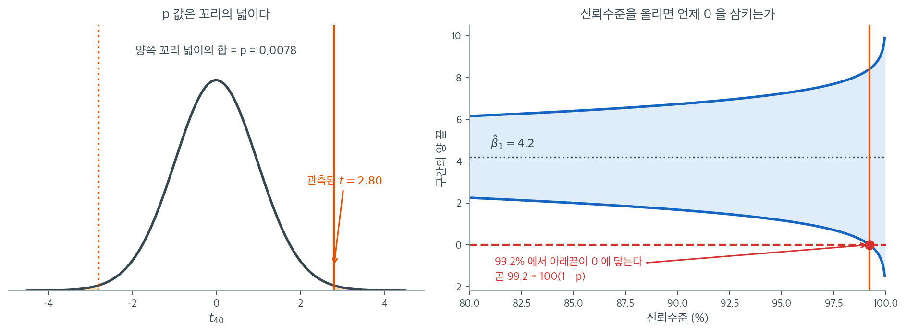
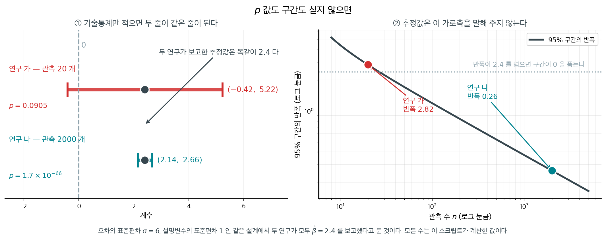

# 계수의 p값과 신뢰구간 이해하기

**들어가는 이야기** — p 값만 적는 자리와 구간까지 적는 자리

회귀 결과를 보고할 때 $p$ 값만 적는 자리와 구간까지 적는 자리가 갈린다. 둘이 같은 계산이라는 것을 알고 나면 그 선택이 무엇을 버리는 일인지도 분명해진다.

회귀 출력이 $\hat\beta_1 = 4.2$, 표준오차 $1.5$, 자유도 $40$ 을 주었다고 하자 — 관측 $42$ 개에 계수 둘을 쓴 자리다. $t = 4.2/1.5 = 2.80$ 이고 그 양쪽 꼬리 넓이가 $p = 0.00783$ 이다. 같은 수로 구간을 만들면 임계값 $t_{40}(0.975) = 2.021$ 을 곱해 $4.2 \pm 3.03$, 곧 $(1.168,\ 7.232)$ 이고 $0$ 을 넉넉히 비껴간다.

신뢰수준을 올려 구간을 계속 벌리면 아래끝이 $0$ 에 닿는 자리가 있다. 그 자리가 정확히 $99.217\%$ 이고, $100(1 - 0.00783)$ 이 바로 그 수다. 우연이 아니라 정의가 그렇다 — $p$ 값은 **구간의 끝이 $0$ 에 닿는 유의수준**이다.

그렇다고 둘 중 하나만 적어도 되는 것은 아니다. $p$ 값은 「$0$ 에서 얼마나 멀리 있나」만 말하고, 구간은 거기에 **얼마나 큰 효과까지 자료가 허락하는가**를 더해서 말한다. $p = 0.008$ 짜리 계수가 $(1.2,\ 7.2)$ 일 수도 있고 $(4.1,\ 4.3)$ 일 수도 있는데, 그 둘로 내릴 결정은 전혀 다르다. 그래서 둘을 함께 적는 것이 권고다. 그러면 $p$ 값과 신뢰구간은 「같은 결론에 이르는 두 척도」인가, 같은 계산을 다른 각도에서 읽은 하나의 수인가. 아래 상자가 그 둘을 함께 싣지 못하게 한 학술지의 이야기를 따라간다.

_확인한 곳 — 이 쪽 「둘 다 싣지 못하게 한 학술지」 상자와 그 출처 줄_

선형회귀 분석에서 **p값**과 **신뢰구간**을 이해하는 일은 회귀계수의 유의성과 정밀도를 해석하는 데 필수적이다. 이 통계량들은 설명변수가 종속변수에 얼마나 강하게 영향을 주는지, 그리고 추정된 효과에 어느 정도 불확실성이 따르는지를 알려준다.

---

## 1. 선형회귀의 p값

p값은 귀무가설이 참이라고 가정했을 때, 설명변수와 종속변수 사이에서 관측된 관계가 우연으로 나타날 확률이다.

가설은 다음과 같다.

- **귀무가설 ($H_0$):** $\beta_i = 0$ — 설명변수 $X_i$는 결과 $Y$에 효과가 없다.
- **대립가설 ($H_1$):** $\beta_i \neq 0$ — 설명변수 $X_i$는 $Y$에 유의한 효과가 있다.

각 계수에 대해 t-검정을 수행하면 $\hat{\beta}_i$와 그 표준오차로 계산한 t 통계량에서 p값이 나오고, 이 p값이 통계적 유의성을 판정한다.

- **작은 p값 (< 0.05):** $H_0$을 기각한다. 그 설명변수는 통계적으로 유의하며 종속변수의 변동을 설명하는 데 기여한다.
- **큰 p값 ($\geq$ 0.05):** $H_0$을 기각하지 못한다. 그 설명변수는 통계적으로 유의하지 않으며 모형에 크게 기여하지 않을 수 있다.

---

**보기 1.**  p값의 해석. 침실 수, 대지 면적, 주택 연식으로 집값을 예측하는 회귀모형을 생각하자.

??? success "풀이"
    | 설명변수 | p값 | 결론 |
    |-----------|---------|------------|
    | 주택 연식 | 0.02 | 0.05 수준에서 유의 — 연식은 집값의 유의한 설명변수이다 |
    | 대지 면적 | 0.25 | 0.05 수준에서 유의하지 않음 — 이 모형에서 대지 면적은 집값에 큰 영향을 주지 않을 수 있다 |

---

## 2. 계수의 신뢰구간

**신뢰구간**은 표본자료에 근거하여 참 모집단 계수가 놓일 것으로 기대되는 값의 범위를 제공한다. p값이 이분법적 판정을 준다면, 신뢰구간은 추정의 정밀도를 전달한다.

**95% 신뢰구간**은, 서로 다른 표본 100개를 뽑아 신뢰구간 100개를 만들면 그 가운데 약 95개가 참 계수값을 포함한다는 뜻이다.

95% 신뢰구간의 공식은

$$
CI = \hat{\beta}_i \pm \left( t_{1-\alpha/2} \times SE(\hat{\beta}_i) \right)
$$

여기서

- $\hat{\beta}_i$는 추정된 회귀계수,
- $SE(\hat{\beta}_i)$는 추정값의 표준오차,
- $t_{1-\alpha/2}$는 95% 신뢰수준에서 t 분포의 임계값이다.

**해석의 핵심 규칙:**

- 신뢰구간이 **0을 포함하면** 그 설명변수는 0과 유의하게 다르지 않을 수 있다. 효과가 불확실하다.
- 신뢰구간이 **0을 배제하면** 그 설명변수는 결과에 유의한 효과를 가질 가능성이 높다.

---

**보기 2.**  신뢰구간의 해석. 연봉을 예측하는 회귀모형을 생각하자.

??? success "풀이"
    | 설명변수 | $\hat{\beta}$ | 95% 신뢰구간 | 해석 |
    |-----------|---------------|--------|----------------|
    | 교육 연수 | 2.5 | (1.2, 3.8) | 유의함 — 구간이 0을 배제한다. 참 효과는 1.2와 3.8 사이에 있다. |
    | 업계 경력 | 0.55 | (−0.4, 1.5) | 불확실함 — 구간이 0을 포함한다. 중요한 설명변수가 아닐 수 있다. |

---

## 3. p값과 신뢰구간의 관계

p값과 신뢰구간은 밀접하게 관련되어 있고 일반적으로 같은 결론에 이른다.

- **p값 < 0.05**이면 대응하는 95% 신뢰구간은 **0을 배제한다** — 그 설명변수는 유의하다.
- **p값 $\geq$ 0.05**이면 95% 신뢰구간은 **0을 포함한다** — 그 설명변수는 유의하지 않다.

두 척도를 함께 써야 통계적 유의성뿐 아니라 설명변수 효과의 실질적 유의성과 불확실성까지 이해할 수 있다.

**이 대응은 회귀에만 있는 것이 아니다.** 어떤 모수에서든 「수준 $\alpha$ 에서 기각하지 못하는 $\theta_0$ 의 집합」이 곧 $1-\alpha$ 신뢰구간이고, 그 일반 규칙과 증명은 9.1절 [신뢰구간과 검정의 쌍대성](../../ch09/foundations/duality.md)에 있다. 계수에서 둘이 정확히 맞아떨어지는 까닭은 **같은 표준오차** $\operatorname{SE}(\hat\beta_j)$ 를 쓰기 때문이다 — 검정통계량 $\hat\beta_j/\operatorname{SE}$ 와 구간 $\hat\beta_j \pm t\operatorname{SE}$ 의 분모가 같다. 분모가 갈려 둘이 어긋나는 모수들이 따로 있고, 그 목록은 [신뢰구간과 검정의 쌍대성](../../ch09/foundations/duality.md) $\S 5$ 다.

두 척도가 "같은 결론에 이른다"는 말은 사실 너무 약하다. 둘은 **같은 계산을 다른 각도에서 읽은 것**이다. 위 그림이 그 사실을 보인다. $\hat{\beta}_1 = 4.2$, $\mathrm{SE} = 1.5$, 자유도 $40$인 회귀 출력을 가지고 왔다.

왼쪽이 $p$값의 정의다. $t = 4.2/1.5 = 2.80$을 계산하고 $t_{40}$ 분포에서 $|T| > 2.80$인 두 꼬리의 넓이를 잰다. 그 합이 $0.0078$이며 이것이 $p$값이다. 그림에서 칠해진 두 조각이 워낙 얇아 눈에 잘 띄지 않는데, 그 얇음이 곧 "$H_0$ 아래에서는 이런 값이 좀처럼 나오지 않는다"는 뜻이다.

오른쪽은 신뢰수준을 $80\%$에서 $99.95\%$까지 연속적으로 움직이며 구간의 두 끝을 그린 것이다. 중심은 언제나 $4.2$로 고정되어 있고 폭만 벌어진다. $90\%$ 구간은 $(1.674,\ 6.726)$, $95\%$는 $(1.168,\ 7.232)$, $99\%$는 $(0.143,\ 8.257)$로 모두 $0$을 배제한다. 그런데 신뢰수준을 계속 올리면 아래끝이 결국 $0$에 닿는다. 그 지점이 정확히 $99.217\%$이고, $99.5\%$ 구간은 $(-0.257,\ 8.657)$로 이미 $0$을 품는다.

$99.217$이라는 수가 어디서 왔는지 보라. $100(1 - p) = 100(1 - 0.00783) = 99.217$이다. 우연이 아니다. **$p$값이란 신뢰구간이 귀무값을 끝점으로 갖게 만드는 신뢰수준의 여집합**이며, 이것이 두 양이 "같은 정보"인 정확한 의미다. 이 관계를 붙잡고 있으면 실무에서 유용한 어림이 따라온다. 어떤 논문이 $p = 0.03$이라고만 보고했다면, 그 자료의 $97\%$ 신뢰구간이 $0$에 걸쳐 있다는 뜻이다. 반대로 $95\%$ 구간의 한쪽 끝이 $0$에 거의 붙어 있다면 $p$가 $0.05$ 언저리라는 뜻이다. 다만 방향은 한쪽으로만 유용하다. 구간은 $p$값을 복원해 주지만 $p$값만으로는 효과의 크기를 복원할 수 없다.

!!! tip "권장 실무"
    p값과 신뢰구간을 모두 보고하라. p값은 효과가 존재하는지*를* 알려주고, 신뢰구간은 그 효과가 *얼마나 큰지*와 얼마나 정밀하게 추정되었는지를 알려준다.

**그림으로 보는 통계학 1.** 둘 다 싣지 못하게 한 학술지

위 쪽지는 「둘 다 보고하라」고 한다. $2015$ 년 $1$ 월, 한 학술지가 정확히 반대를 했다. **둘 다 싣지 못하게 한 것이다.**

사회심리학 학술지 『Basic and Applied Social Psychology』의 편집자 **데이비드 트라피모**와 **마이클 마크스**가 그해 첫 호에 두 쪽짜리 「편집자의 말」을 싣고, 이 학술지는 앞으로 **귀무가설 유의성 검정 절차**를 받지 않겠다고 선언했다. $p$ 값과 그에 딸린 통계량, 그리고 「유의하다」는 판정이 금지되었다. 눈여겨볼 것은 **신뢰구간도 함께 금지되었다**는 점이다 — $p$ 값과 「관련된 추론통계」로 묶여 같은 처분을 받았다. 대신 요구한 것은 **효과크기를 포함한 강한 기술통계**였다.

금지한 쪽의 논리를 이해하기는 어렵지 않다. $3$ 절이 방금 보인 항등식이 그것이다. $p$ 값이 **구간이 귀무값을 끝점으로 갖게 만드는 신뢰수준의 여집합**이라면, $p$ 값만 내쫓고 구간을 남기는 것은 같은 수를 이름만 바꿔 싣는 일 아닌가.

그래서 묻게 된다. **둘을 다 지우면 무엇이 남고, 무엇이 사라지는가.**

오차의 표준편차가 $\sigma = 6$, 설명변수의 표준편차가 $1$ 인 같은 설계에서 두 연구가 **똑같이 $\hat\beta = 2.40$** 을 보고했다고 하자.

| | 관측 수 | 표준오차 | $95\%$ 신뢰구간 | $p$ 값 |
|---|---|---|---|---|
| 연구 가 | $20$ | $1.3416$ | $(-0.42,\ 5.22)$ | $0.0905$ |
| 연구 나 | $2000$ | $0.1342$ | $(2.14,\ 2.66)$ | $1.7 \times 10^{-66}$ |

**연구 가는 효과의 부호조차 정하지 못했고, 연구 나는 소수 둘째 자리까지 못 박았다.** 그런데 기술통계와 효과크기만 적으면 두 논문의 결과 문장이 **글자 그대로 같아진다** — 「계수는 $2.40$ 이다」. 오른쪽 판이 그 사정을 한 장으로 말한다. 구간의 반폭은 $n$ 을 따라 $1/\sqrt n$ 으로 내려가는데, **추정값 하나는 자기가 그 가로축의 어디에 서 있는지를 말해 주지 않는다.**

$3$ 절의 항등식을 여기에 다시 대 보면 금지의 과녁이 어디였는지가 또렷해진다. 연구 가에서 $0$ 이 구간의 끝에 닿는 신뢰수준은 $100(1 - 0.0905) = 90.95\%$ 다. 이 수는 **「유의하지 않다」보다 훨씬 많은 것**을 말한다 — 자료가 효과의 존재 쪽으로 어느 정도까지는 기울어 있다는 것까지 함께 말하기 때문이다. 버릴 것은 그 수가 아니라, **그것을 $0.05$ 와 견주어 두 글자로 요약하는 습관**이었다고 이 책은 읽는다. 구간을 함께 버리면 남는 것은 더 적은 정보이지 더 정직한 정보가 아니다.

_확인한 곳 — $2015$ 년 $1$ 월 $2$ 일 자 『Basic and Applied Social Psychology』 $37$ 권 $1$ 호 $1$–$2$ 쪽에 데이비드 트라피모와 마이클 마크스의 「Editorial」이 실렸다는 서지는 [Crossref 의 기록](https://doi.org/10.1080/01973533.2015.1012991)에서 확인했다 · 그 글이 귀무가설 유의성 검정 절차를 금지하면서 「$p$ 값과 그에 관련된 추론통계, 이를테면 신뢰구간」을 함께 금지했고 대신 효과크기를 포함한 강한 기술통계를 요구했다는 것, 밝힌 까닭이 「가설검정의 현재 수준이 여전히 불확실하다」는 것이었다는 설명은 [Wikipedia 「Basic and Applied Social Psychology」](https://en.wikipedia.org/wiki/Basic_and_Applied_Social_Psychology)에서 읽었다. **편집자의 말 본문은 읽지 못했고, 금지 뒤에 실린 논문들이 실제로 어떻게 달라졌는지도 확인하지 못해 적지 않는다** · 표와 그림의 수는 모두 위 설계로 직접 계산한 값이고 어느 논문의 자료도 아니다_

---

## 4. 실전 해석

"광고 예산"이라는 설명변수에 대해 회귀 출력이 다음을 준다고 하자.

| 지표 | 값 |
|--------|-------|
| 계수 | 2.4 |
| p값 | 0.001 |
| 95% 신뢰구간 | (1.9, 2.9) |

**해석:** 광고 예산은 매출에 유의한 양의 영향을 준다. 관측된 효과가 우연 때문일 확률은 0.001로 매우 낮다. 광고 예산이 한 단위 늘어날 때 매출에 미치는 참 효과가 1.9와 2.9 단위 사이에 있다고 95% 신뢰한다.

---

## 연습문제

**연습문제 1.** 
어떤 회귀계수가 $\hat{\beta}_1 = 4.2$, $\text{SE} = 1.5$, (양측) $p = 0.008$이다. 99% 신뢰구간을 구성하고, p값과 신뢰구간이 같은 정보를 전달하는 이유를 설명하라.

??? success "풀이"
    $t = \hat{\beta}_1 / \text{SE} = 4.2/1.5 = 2.8$이다. 양측 $p = 0.008$이 되려면 자유도가 대략 $df = 40$이어야 한다($2 \times P(T_{40} > 2.8) = 0.0078$).

    $t_{0.995,40} = 2.7045$를 쓰면

    $$
    \hat{\beta}_1 \pm t_{0.005, 40} \times \text{SE} = 4.2 \pm 2.7045 \times 1.5 = 4.2 \pm 4.057 = (0.143, 8.257)
    $$

    구간이 0을 아슬아슬하게 **배제한다**. 이는 $p = 0.008 < 0.01$과 반드시 일치해야 하는 결과이다. $p$값이 0.01보다 작으면 99% 신뢰구간은 언제나 0을 배제한다. 둘은 같은 검정을 다르게 표현한 것일 뿐이기 때문이다.

    더 정확히 말하면, $p$값은 $(1-\alpha)$ 신뢰구간이 0을 배제하게 되는 가장 작은 $\alpha$이다. $p = 0.008$이므로 신뢰수준 $1 - 0.008 = 99.2\%$의 신뢰구간이 0을 끝점으로 갖는, 곧 0을 배제하는 **가장 넓은** 구간이다. 그보다 신뢰수준이 높은 구간은 0을 포함하고, 낮은 구간은 배제한다.

**연습문제 2.** 
어떤 논문이 "처치의 효과는 통계적으로 유의했다($p = 0.04$)"라고만 보고하고 계수 추정값이나 신뢰구간은 보고하지 않았다. 이런 보고가 왜 불완전한지, 어떤 정보가 더 필요한지 설명하라.

??? success "풀이"
    p값만으로는 효과가 정확히 0일 가능성이 낮다는 것밖에 알 수 없다. 효과의 **크기**나 **실질적 유의성**에 대해서는 아무것도 말해 주지 않는다. 표본이 크면 통계적으로 유의한 효과가 실질적으로는 무시할 만큼 작을 수 있다.

    보고에는 다음이 포함되어야 한다. (1) 효과의 크기를 수량화하는 **계수 추정값** $\hat{\beta}$, (2) 추정값과 그 정밀도를 함께 전달하는 **신뢰구간**, (3) 그 효과 크기가 실질적으로 의미 있는지에 대한 **맥락**. 예를 들어 "$\hat{\beta} = 0.3$, 95% 신뢰구간 $(0.01, 0.59)$"라고 쓰면 효과가 유의하긴 하지만 구간이 넓어 참 크기에 상당한 불확실성이 있음이 드러난다.

**연습문제 3.** 
보기 2의 "업계 경력"은 $\hat{\beta} = 0.55$, 95% 신뢰구간 $(-0.4,\ 1.5)$였다. 이 회귀의 자유도가 $d = 30$이라고 하자.

(a) 보고된 구간에서 $SE(\hat{\beta})$를 복원하라.

(b) t 통계량과 양측 p값을 구하라.

(c) 3절의 쌍대성을 써서, 이 구간이 $0$을 **끝점**으로 갖게 되는 신뢰수준을 구하라. 그 수가 "업계 경력은 유의하지 않다"는 판정과 어떻게 맞물리는지 한 줄로 쓰라.

??? success "풀이"
    (a) 구간의 중심이 $(-0.4 + 1.5)/2 = 0.55 = \hat{\beta}$로 맞고, 반폭은 $(1.5 - (-0.4))/2 = 0.95$이다. 반폭 $= t_{0.025,\,30} \times SE$이고 $t_{0.975,\,30} = 2.0423$이므로

    $$
    SE(\hat{\beta}) = \frac{0.95}{2.0423} = 0.4652
    $$

    (b) t 통계량은

    $$
    t = \frac{0.55}{0.4652} = 1.1824
    $$

    이고 양측 p값은 $p = 2 P(T_{30} > 1.1824) = 0.2463$이다. $p \geq 0.05$이므로 $H_0: \beta = 0$을 기각하지 못한다. 구간이 $0$을 포함한다는 사실과 일치한다.

    (c) 쌍대성에 따르면 구간이 $0$을 끝점으로 갖는 신뢰수준은 $100(1-p) = 100(1 - 0.2463) = 75.37\%$이다. 실제로 $t_{0.8768,\,30} = 1.1824$이므로

    $$
    0.55 - 1.1824 \times 0.4652 = 0.000
    $$

    로 아래끝이 정확히 $0$에 닿는다.

    해석: "유의하지 않다"는 판정은 절대적인 것이 아니라 신뢰수준에 상대적이다. 이 자료는 $75\%$보다 낮은 신뢰수준에서는 "효과가 $0$이 아니다"라고 말하고, $75\%$를 넘는 모든 수준에서는 말하지 못한다. $0.05$라는 관행이 $95\%$를 고른 결과일 뿐이다.

**연습문제 4.** 
3절은 "$p < 0.05$이면 95% 신뢰구간이 $0$을 배제한다"고 단언한다. 그런데 어떤 보고서가 p값은 정규근사로($|t|$를 표준정규분포에 넣어서) 계산하고 신뢰구간은 t 임계값으로 만들었다고 하자. 자유도는 $d = 40$이다.

(a) $\hat{\beta} = 3.0$, $SE = 1.5$인 계수에 대해 이 보고서의 p값과 95% 신뢰구간을 각각 구하고, 두 결론이 어긋남을 보이라.

(b) $SE = 1.5$를 고정할 때 이런 어긋남이 일어나는 $\hat{\beta}$의 범위를 구하라.

(c) 3절의 동치관계가 성립하려면 p값과 신뢰구간이 무엇을 공유해야 하는가?

??? success "풀이"
    (a) $t = 3.0/1.5 = 2.0$이다. 정규근사 p값은

    $$
    p_z = 2\left(1 - \Phi(2.0)\right) = 0.0455 < 0.05
    $$

    이므로 보고서는 "유의하다"고 쓴다. 한편 $t_{0.975,\,40} = 2.0211$을 쓴 95% 신뢰구간은

    $$
    3.0 \pm 2.0211 \times 1.5 = 3.0 \pm 3.0316 = (-0.032,\ 6.032)
    $$

    로 $0$을 **포함한다**. 같은 자료, 같은 계수인데 p값은 유의하다 하고 구간은 불확실하다 한다.

    (b) 어긋남은 $z_{0.025} = 1.9600 \leq |t| < t_{0.975,\,40} = 2.0211$일 때 일어난다. $|t| = \lvert \hat{\beta} \rvert / 1.5$이므로

    $$
    2.940 \leq \lvert \hat{\beta} \rvert < 3.032
    $$

    폭이 $0.09$밖에 안 되는 좁은 띠지만, $p$가 $0.05$ 근처인 계수들은 바로 이 띠에 몰려 있다.

    (c) 두 양이 **같은 표준오차**와 **같은 표집분포**(같은 자유도의 t 분포)를 써야 한다. 그러면 $p < \alpha \iff |t| > t_{1-\alpha/2,\,d} \iff$ 구간이 $0$을 배제, 가 자동으로 성립한다. 올바른 t 기반 p값은 $2P(T_{40} > 2.0) = 0.0522 \geq 0.05$이고, 이제 구간이 $0$을 포함한다는 결론과 어긋나지 않는다.

    해석: 3절의 동치는 수학적 정리가 아니라 **같은 계산을 두 번 읽는다는 약속**이다. 약속을 깨면 — 한쪽은 정규, 한쪽은 t — 동치도 깨진다. 자유도가 작을수록 $t_{0.025,\,d}$가 $1.96$에서 멀어져 어긋나는 띠가 넓어진다.

**연습문제 5.** 
3절이 그림으로 보인 사실, 곧 "$p$값은 신뢰구간이 귀무값을 끝점으로 갖게 만드는 신뢰수준의 여집합"을 일반적으로 증명하라. 즉 $\hat{\beta} \neq 0$이고 양측 p값이 $p$일 때, $(1-\alpha)$ 신뢰구간은

- $\alpha > p$이면 $0$을 배제하고,
- $\alpha = p$이면 $0$을 끝점으로 가지며,
- $\alpha < p$이면 $0$을 포함함

을 보이라. 증명에서 t 분포의 어떤 성질을 쓰는지 밝히고, 3절의 수치($\hat{\beta}_1 = 4.2$, $\mathrm{SE} = 1.5$, $d = 40$)로 확인하라.

??? success "풀이"
    $t_{\text{obs}} = \hat{\beta}/\mathrm{SE}$라 하고, 양측 p값의 정의에 따라

    $$
    p = 2 P\left(T_d > \lvert t_{\text{obs}} \rvert\right)
    $$

    $(1-\alpha)$ 신뢰구간은 $\hat{\beta} \pm t_{1-\alpha/2,\,d}\,\mathrm{SE}$이므로, 반폭과 $\lvert \hat{\beta} \rvert$의 크기 비교가 모든 것을 결정한다.

    $$
    \text{구간이 } 0 \text{을 배제} \iff \lvert \hat{\beta} \rvert > t_{1-\alpha/2,\,d}\,\mathrm{SE} \iff \lvert t_{\text{obs}} \rvert > t_{1-\alpha/2,\,d}
    $$

    이제 $\alpha \mapsto t_{1-\alpha/2,\,d}$가 $(0,1)$에서 **연속이고 강하게 감소**함을 쓴다(t 분포의 밀도가 모든 점에서 양수이므로 분포함수가 강증가하고 분위수가 유일하다). 따라서 $t_{\alpha^{*}/2,\,d} = \lvert t_{\text{obs}} \rvert$를 만족하는 $\alpha^{*}$가 단 하나 있다. 분위수의 정의를 그대로 읽으면

    $$
    \frac{\alpha^{*}}{2} = P\left(T_d > \lvert t_{\text{obs}} \rvert\right) = \frac{p}{2}, \qquad \text{즉} \quad \alpha^{*} = p
    $$

    감소성 때문에 $\alpha > p \Rightarrow t_{1-\alpha/2,d} < \lvert t_{\text{obs}} \rvert \Rightarrow$ 배제, $\alpha < p \Rightarrow t_{1-\alpha/2,d} > \lvert t_{\text{obs}} \rvert \Rightarrow$ 포함이고, $\alpha = p$에서는 등호이므로 $0$이 정확히 끝점이 된다. $\square$

    쓰인 성질은 셋이다. (1) $T_d$의 분포가 $0$에 대해 **대칭**이어서 양측 꼬리를 한쪽 꼬리의 두 배로 쓸 수 있다. (2) 분포함수가 **강증가·연속**이어서 분위수가 유일하다. (3) 검정과 구간이 **같은 $\mathrm{SE}$와 같은 $d$**를 쓴다(연습문제 4 가 보인 조건).

    수치 확인: $t_{\text{obs}} = 4.2/1.5 = 2.80$, $p = 2P(T_{40} > 2.80) = 0.00783$이므로 $\alpha^{*} = 0.00783$, 신뢰수준은 $100(1-0.00783) = 99.217\%$이다. 실제로 $t_{0.996084,\,40} = 2.8000$이고

    $$
    4.2 - 2.8000 \times 1.5 = 0.000
    $$

    로 아래끝이 $0$이다. 그림의 오른쪽 곡선이 $99.217\%$에서 $0$ 선과 만나는 이유가 이것이다.

**연습문제 6.** 
3절은 "구간은 $p$값을 복원해 주지만 $p$값만으로는 효과의 크기를 복원할 수 없다"고 했다. 이 비대칭을 정확히 만들어라.

(a) 자유도 $d$와 신뢰수준 $1-\alpha$를 알고 신뢰구간 $(L, U)$만 받았을 때, $t$ 통계량이

$$
t_{\text{obs}} = \frac{L+U}{U-L}\, t_{1-\alpha/2,\,d}
$$

임을 보이고, 보기 2의 "교육 연수" 구간 $(1.2,\ 3.8)$에 $d = 40$을 넣어 p값을 구하라.

(b) 반대로 $d = 40$에서 양측 $p = 0.04$를 주는 회귀 출력 두 개를, $\hat{\beta}$가 $100$배 차이 나게 만들어라. 이것이 왜 $p$값만으로 효과 크기를 복원할 수 없다는 말의 증명이 되는지 쓰라.

??? success "풀이"
    (a) 구간이 $\hat{\beta} \pm t_{1-\alpha/2,d}\mathrm{SE}$의 꼴이므로

    $$
    \hat{\beta} = \frac{L+U}{2}, \qquad \mathrm{SE} = \frac{U-L}{2\,t_{1-\alpha/2,\,d}}
    $$

    두 식을 나누면

    $$
    t_{\text{obs}} = \frac{\hat{\beta}}{\mathrm{SE}} = \frac{(L+U)/2}{(U-L)/(2 t_{1-\alpha/2,d})} = \frac{L+U}{U-L}\, t_{1-\alpha/2,\,d}
    $$

    "교육 연수" 구간은 $L = 1.2$, $U = 3.8$, $\alpha = 0.05$, $d = 40$이므로 $t_{0.975,40} = 2.0211$을 넣어

    $$
    t_{\text{obs}} = \frac{5.0}{2.6} \times 2.0211 = 3.8867, \qquad p = 2P(T_{40} > 3.8867) = 0.00037
    $$

    참고로 $\hat{\beta} = 2.5$(보기 2 가 보고한 값과 일치), $\mathrm{SE} = 2.6/(2 \times 2.0211) = 0.6432$이다. 구간 하나가 네 수 $\hat{\beta}$, $\mathrm{SE}$, $t$, $p$를 모두 되돌려 준다.

    (b) $p = 0.04$는 $\lvert t_{\text{obs}} \rvert = t_{0.98,\,40} = 2.1229$와 같은 말이다. $t$는 비 $\hat{\beta}/\mathrm{SE}$에만 의존하므로 비만 맞추면 된다.

    | 모형 | $\hat{\beta}$ | $\mathrm{SE}$ | $t$ | $p$ | 95% 신뢰구간 |
    |---|---|---|---|---|---|
    | A | $2.1229$ | $1.00$ | $2.1229$ | $0.04$ | $(0.102,\ 4.144)$ |
    | B | $0.021229$ | $0.01$ | $2.1229$ | $0.04$ | $(0.00102,\ 0.04144)$ |

    두 출력의 p값은 소수 다섯째 자리까지 같지만 효과 크기는 $100$배 다르다. $p$값은 **단위가 없는** 양 $\hat{\beta}/\mathrm{SE}$의 함수이므로, $\hat{\beta}$와 $\mathrm{SE}$를 같은 배수로 늘리면 변하지 않는다. 따라서 $p$에서 $\hat{\beta}$로 가는 역함수는 존재하지 않는다. $\square$

    해석: 구간 $\to$ p값은 함수이고 p값 $\to$ 구간은 함수가 아니다. 연습문제 2 가 "계수와 구간을 함께 보고하라"고 요구한 까닭이 이 한 방향성이다.

**연습문제 7.** 
4절의 표는 "광고 예산"에 대해 계수 $2.4$, p값 $0.001$, 95% 신뢰구간 $(1.9,\ 2.9)$를 함께 보고한다. 세 수가 서로 들어맞는지 검사하라.

(a) 쌍대성을 써서, 이 세 수가 동시에 성립하려면 자유도 $d$가 $t_{0.0005,\,d} / t_{0.025,\,d} = 4.8$을 만족해야 함을 보이라.

(b) 이 비가 $d$에 대해 감소함을 이용해, 어떤 정수 자유도도 이 식을 만족하지 못함을 보이라.

(c) $d = 40$이라 가정하고 (i) 구간 $(1.9,\ 2.9)$가 맞을 때의 p값, (ii) $p = 0.001$이 맞을 때의 95% 신뢰구간을 각각 구하라.

??? success "풀이"
    (a) 구간의 중심은 $(1.9+2.9)/2 = 2.4$로 보고된 계수와 맞는다. 반폭이 $0.5$이므로

    $$
    t_{0.025,\,d} \times \mathrm{SE} = 0.5
    $$

    한편 $p = 0.001$이면 연습문제 5 에 따라 $99.9\%$ 구간이 $0$을 끝점으로 가져야 하고, 그 구간의 반폭은 중심까지의 거리 $2.4$와 같다.

    $$
    t_{0.0005,\,d} \times \mathrm{SE} = 2.4
    $$

    두 식을 나누면 $\mathrm{SE}$가 사라지고

    $$
    \frac{t_{0.0005,\,d}}{t_{0.025,\,d}} = \frac{2.4}{0.5} = 4.8
    $$

    (b) 자유도가 커지면 꼬리가 가벼워지는데, 더 먼 꼬리인 $t_{0.0005}$가 $t_{0.025}$보다 훨씬 빠르게 줄어든다. 그래서 이 비는 $d$에 대해 감소하며 $d \to \infty$에서 $z_{0.0005}/z_{0.025} = 3.2905/1.9600 = 1.679$로 수렴한다.

    | $d$ | $1$ | $2$ | $3$ | $4$ | $5$ | $10$ | $40$ |
    |---|---|---|---|---|---|---|---|
    | 비 | $50.10$ | $7.344$ | $4.061$ | $3.101$ | $2.672$ | $2.059$ | $1.757$ |

    $4.8$은 $d = 3$의 값 $4.061$과 $d = 2$의 값 $7.344$ 사이에 있다. 비가 강하게 감소하므로 해는 $d \approx 2.62$ 하나뿐이고, 정수 자유도는 없다. 설령 $d = 2$나 $3$을 받아들인다 해도 그것은 관측값이 네댓 개라는 뜻이어서 광고 예산 회귀로는 말이 되지 않는다.

    (c) $d = 40$이라 하자.

    (i) 구간이 맞다면 $\mathrm{SE} = 0.5 / 2.0211 = 0.2474$이고 $t = 2.4/0.2474 = 9.70$, 따라서

    $$
    p = 2 P(T_{40} > 9.70) = 4.6 \times 10^{-12}
    $$

    보고된 $0.001$보다 아홉 자리나 작다.

    (ii) $p = 0.001$이 맞다면 $\lvert t \rvert = t_{0.9995,\,40} = 3.5510$이므로 $\mathrm{SE} = 2.4/3.5510 = 0.6759$이고 95% 신뢰구간은

    $$
    2.4 \pm 2.0211 \times 0.6759 = (1.034,\ 3.766)
    $$

    보고된 $(1.9,\ 2.9)$보다 두 배 넘게 넓다.

    해석: 4절의 표는 해석을 연습시키려고 고른 예시 수치이고, 세 칸을 서로 독립적으로 고를 수 있는 것처럼 보이게 한다. 그러나 쌍대성 때문에 $\hat{\beta}$, 구간, $p$ 가운데 둘을 정하면 나머지 하나는 자유도까지 포함해 거의 결정된다. 이것이 쌍대성의 실무적 쓸모다 — 남의 표가 서로 들어맞는지 검사할 수 있다.

**연습문제 8.** 
4절은 "광고 예산은 매출에 유의한 **양의** 영향을 준다"고 읽는다. 방향을 미리 정한 이 읽기를 가설로 옮기면 $H_0: \beta \leq 0$ 대 $H_1: \beta > 0$이다. 3절 그림의 출력($\hat{\beta}_1 = 4.2$, $\mathrm{SE} = 1.5$, $d = 40$, 양측 $p = 0.00783$)을 쓰라.

(a) 단측 p값을 구하라.

(b) 신뢰수준 $95\%$의 단측 하한 $\hat{\beta}_1 - t_{0.05,\,d}\,\mathrm{SE}$를 구하고, 그 값이 3절에 적힌 어떤 수와 같은지 찾아 왜 같은지 설명하라.

(c) 단측 하한이 $0$에 닿는 신뢰수준을 구하고, 그것이 연습문제 5 의 $99.217\%$와 어떤 관계인지 쓰라.

??? success "풀이"
    (a) $t$ 분포는 대칭이므로 한쪽 꼬리는 양측의 절반이다.

    $$
    p_{\text{단측}} = P(T_{40} > 2.80) = \frac{0.00783}{2} = 0.00392
    $$

    (b) $t_{0.95,\,40} = 1.6839$이므로

    $$
    \hat{\beta}_1 - t_{0.05,\,40} \times \mathrm{SE} = 4.2 - 1.6839 \times 1.5 = 4.2 - 2.526 = 1.674
    $$

    이 수는 3절이 적어 둔 $90\%$ 양측 구간 $(1.674,\ 6.726)$의 아래끝과 같다. 양측 $90\%$ 구간은 아래위 꼬리에 각각 $5\%$를 남기므로 그 아래끝은 $\hat{\beta}_1 - t_{0.05,d}\mathrm{SE}$, 곧 단측 $95\%$ 하한과 **같은 식**이다. 일반적으로 단측 $100(1-\gamma)\%$ 하한은 양측 $100(1-2\gamma)\%$ 구간의 아래끝이다.

    (c) 하한이 $0$이 되려면 $t_{\gamma,\,40} = 4.2/1.5 = 2.80$이어야 하고, 분위수의 정의로 $\gamma = P(T_{40} > 2.80) = 0.00392$이다. 따라서 단측 신뢰수준 $100(1 - 0.00392) = 99.608\%$에서 하한이 $0$에 닿는다. (b)의 관계를 쓰면 이 하한은 양측 $100(1 - 2 \times 0.00392) = 99.217\%$ 구간의 아래끝이고, 이것이 바로 연습문제 5 의 수다. 같은 지점을 단측으로 세면 $99.608$, 양측으로 세면 $99.217$이라 부르는 것일 뿐이다.

    해석: 쌍대성은 단측에서도 그대로지만 짝이 바뀐다. 단측 p값은 **단측** 신뢰수준의 여집합과 짝을 이룬다. 4절처럼 "양의 영향"이라고 방향을 정해 읽으면서 양측 p값을 보고하면, 실제로 주장하는 것보다 두 배 보수적인 수를 적는 셈이다.

**연습문제 9.** 
2절은 $95\%$ 신뢰구간을 "서로 다른 표본 $100$개를 뽑아 신뢰구간 $100$개를 만들면 그 가운데 약 $95$개가 참 계수값을 포함한다"고 설명한다. 이 "약"을 수로 만들어라. 구간 $100$개가 서로 독립이라고 가정한다.

(a) 참값을 포함하는 구간의 개수 $X$의 분포, 기댓값, 표준편차를 구하라.

(b) $100$개가 **모두** 참값을 포함할 확률을 구하라.

(c) $X \geq 91$일 확률을 구하고, 어떤 연구자가 $100$개 가운데 $91$개만 참값을 덮는 것을 보았을 때 "공식이 틀렸다"고 결론 내려도 되는지 답하라.

(d) 보기 2 의 교육 연수 구간 $(1.2,\ 3.8)$에 대해 "참 $\beta$가 $1.2$와 $3.8$ 사이에 있을 확률이 $0.95$다"라고 쓰면 왜 틀리는가?

??? success "풀이"
    (a) 각 구간이 참값을 덮는 사건은 성공확률 $0.95$인 베르누이 시행이고, 독립이라 가정했으므로

    $$
    X \sim \mathrm{Bin}(100,\ 0.95), \qquad E[X] = 95, \qquad \mathrm{sd}(X) = \sqrt{100 \times 0.95 \times 0.05} = 2.179
    $$

    (b) $P(X = 100) = 0.95^{100} = 0.00592$. 즉 $100$개가 전부 성공하는 일은 $170$번에 한 번쯤 있을 뿐이다. "$95\%$ 신뢰"는 **실패를 $5$개쯤 포함하겠다는 약속**이다.

    (c) $P(X \geq 91) = 0.9718$이다. 표준편차가 $2.18$이므로 $91$은 평균에서 겨우 $1.83$ 표준편차 아래이고, $91$개 이상 덮는 일이 $97\%$ 확률로 일어난다. 따라서 $91$개는 전혀 이상하지 않고 공식을 의심할 근거가 되지 못한다. $X$가 $86$($-4.1$ 표준편차) 정도로 떨어지면 의심할 만하다.

    (d) 빈도주의에서 참 $\beta$는 고정된 상수이고 확률변수가 아니다. 무작위인 것은 표본, 따라서 끝점 $L$과 $U$다. $P(L < \beta < U) = 0.95$라는 진술은 아직 표본을 뽑지 않았을 때 **구간 만드는 절차**에 대해 성립한다. 자료를 넣어 $(1.2,\ 3.8)$이라는 숫자가 나온 뒤에는 $\beta$가 그 안에 있거나 없거나 둘 중 하나이고, 확률은 $1$ 또는 $0$이다. 2절의 "$100$개 가운데 $95$개" 표현이 정확한 까닭이 이것이다 — 확률을 절차의 반복에 걸어 두기 때문이다.

**연습문제 10.** 
보기 1 의 모형은 설명변수가 침실 수, 대지 면적, 주택 연식 셋이고, 1절은 계수 하나마다 $p < 0.05$를 유의성의 기준으로 쓴다.

(a) $H_0: \beta_i = 0$이 참이고 자유도가 $d$일 때, 양측 p값 $p = 2\left(1 - F_d(\lvert T \rvert)\right)$($F_d$는 $T_d$의 분포함수)가 $(0,1)$ 위 균등분포를 따름을 보이라.

(b) 세 계수가 모두 참으로 $0$이고 세 t 통계량이 독립이라면, 셋 가운데 적어도 하나가 $p < 0.05$를 받을 확률은 얼마인가?

(c) 보기 1 은 주택 연식의 $p = 0.02$를 유의하다고 읽었다. 유의수준 $0.05$를 모형 전체에 대해 보장하려면 각 계수에 적용할 기준을 $0.05/3$으로 낮추는 방법이 있다(본페로니). 이 기준에서 주택 연식의 결론은 어떻게 되는가?

(d) 실제 회귀에서 (b)의 독립 가정이 성립하지 않는 이유를 하나 들라.

??? success "풀이"
    (a) $u \in (0,1)$을 잡는다. $T_d$가 대칭이므로 $P(\lvert T \rvert > c) = 2(1 - F_d(c))$이고, $p \leq u$는 $2(1-F_d(\lvert T \rvert)) \leq u$, 곧 $\lvert T \rvert \geq t_{u/2,\,d}$와 같다. 따라서

    $$
    P(p \leq u) = P\left(\lvert T \rvert \geq t_{u/2,\,d}\right) = 2 \times \frac{u}{2} = u
    $$

    분포함수가 $P(p \leq u) = u$이므로 $p \sim \mathrm{U}(0,1)$이다. $\square$ 특히 $P(p < 0.05) = 0.05$ — 귀무가설이 참일 때 유의하다고 잘못 외치는 비율이 정확히 $5\%$라는 뜻이고, 이것이 $0.05$라는 문턱의 의미다.

    (b) 각 계수가 $p < 0.05$를 받을 확률이 (a)에 의해 $0.05$이고 독립이므로

    $$
    P(\text{적어도 하나}) = 1 - (1 - 0.05)^3 = 1 - 0.95^3 = 1 - 0.8574 = 0.1426
    $$

    참으로 아무 효과도 없는 모형에서도 일곱 번에 한 번은 "유의한 설명변수"가 하나 나온다.

    (c) 본페로니 기준은 $0.05/3 = 0.0167$이다. 주택 연식의 $p = 0.02 > 0.0167$이므로 **모형 전체 수준에서는 유의하지 않다**. 보기 1 의 "$0.05$ 수준에서 유의"라는 결론은 그 계수 하나만 미리 정해 놓고 보았을 때만 옳다.

    (d) 세 t 통계량이 분모에 **같은 추정 분산 $\hat{\sigma}^2$**를 공유하므로 독립일 수 없다. 또한 설명변수들이 서로 상관되어 있으면(예: 대지 면적이 큰 집에 침실도 많다) $\hat{\beta}$들 자체가 상관을 가져 t 통계량도 상관된다. 그래서 $0.1426$은 정확한 값이 아니라 어림이다. 다만 상관이 있으면 보통 그보다 작아지므로, "하나쯤은 우연히 유의해 보인다"는 결론의 방향은 바뀌지 않는다.

    해석: $p$값과 신뢰구간의 쌍대성은 **계수 하나**에 대한 진술이다. 표를 한 줄씩 훑으며 $0.05$보다 작은 칸을 찾는 순간, 각 줄이 약속한 $5\%$는 더 이상 표 전체의 오류율이 아니다.

---

## 정리하며

회귀계수의 p값과 신뢰구간을 이해하는 일은 근거 있는 의사결정에 결정적이다. p값은 설명변수가 통계적으로 유의한지를 판정하고, 신뢰구간은 정밀도와 불확실성의 척도를 제공한다. 이 둘을 함께 쓸 때 모형이 내놓은 발견의 강도와 신뢰성을 제대로 평가할 수 있다.

다음 쪽 **[유의성의 해석](significance.md)**으로 넘어간다. 여기까지는 $p$ 값과 구간을 **계산하고 읽는** 법이었고, 거기서는 그 수를 **어떻게 말하면 안 되는지**를 다룬다 — 「유의하다」가 「효과가 크다」도 「참이다」도 아니라는 것이다.
