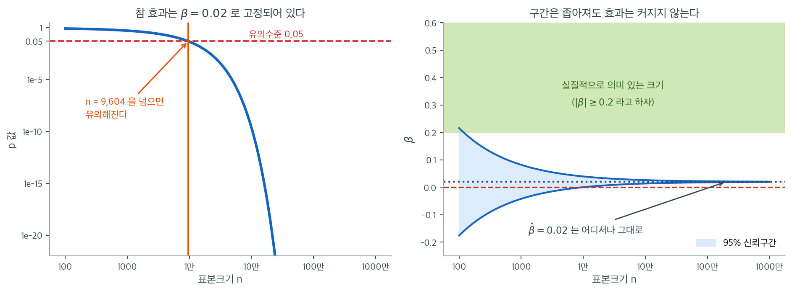
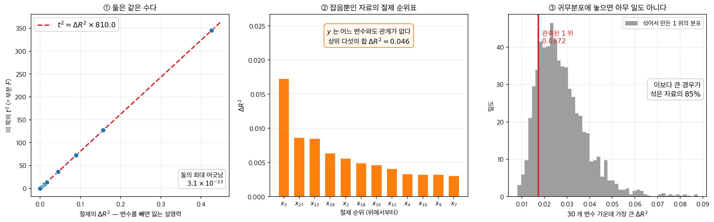

# 유의성의 해석

참 효과를 $\beta = 0.02$ 로, 오차의 표준편차를 $1$ 로 고정해 두고 표본크기만 키워 보자. $n = 1000$ 에서는 $t = 0.63$, $p = 0.53$ 으로 전혀 유의하지 않은데, $n$ 이 $9{,}604$ 를 넘으면 $p$ 가 $0.05$ 아래로 내려가고 더 키우면 자릿수로 작아진다. 세상은 조금도 변하지 않았고 변한 것은 자료의 양뿐이다. 같은 설정의 $95\%$ 신뢰구간은 $(0.0194,\ 0.0206)$ 까지 좁아지는데, 실질적으로 의미 있다고 볼 문턱에는 십분의 일도 다가가지 않는다. 그러면 「유의하다」는 판정 하나에서 효과의 크기에 대해 무엇을 알 수 있는가.

회귀계수의 유의성을 해석하는 일은 선형회귀 결과를 이해하는 데 결정적인 단계이다. 유의성은 설명변수가 우연으로 기대되는 수준을 넘어 결과변수와 의미 있는 관계를 갖는지를 알려준다.

---

## 1. 통계적 유의성과 실질적 유의성

이 두 개념을 구분하는 것이 중요하다.

- **통계적 유의성:** p값이 미리 정한 문턱값(보통 0.05)보다 작으면 계수가 통계적으로 유의하다. 그 관계가 우연히 나타났을 가능성이 낮다는 뜻이다.
- **실질적 유의성:** 계수가 통계적으로 유의하더라도 효과의 크기가 현실에서 의미를 갖기에는 너무 작을 수 있다. 실질적 유의성은 관계의 크기와 그것이 맥락 안에서 의미 있는지를 따진다.

!!! example "작지만 유의한 효과"
    교육 연수로 연봉을 예측하는 모형에서 통계적으로 유의한 계수가 교육 1년 추가가 연봉 \$100 증가와 연관됨을 나타낼 수 있다. 그러나 교육 비용이 이 금액을 훨씬 웃돈다면 그 효과는 실질적으로 의미 있다고 하기 어렵다.

---

## 2. 유의성 판단을 위한 p값 해석

p값은 귀무가설($\beta_i = 0$) 아래에서 관측된 관계(또는 더 극단적인 관계)가 나타날 확률이다.

| p값 | 결론 |
|---------|------------|
| $< 0.01$ | $H_0$에 반하는 강한 증거 — 매우 유의함 |
| $< 0.05$ | 충분한 증거 — 통계적으로 유의함 |
| $\geq 0.05$ | 증거 부족 — 통계적으로 유의하지 않음 |

!!! warning "문턱값은 임의적이다"
    0.05라는 문턱값은 관행이지 자연법칙이 아니다. 의학 시험처럼 어떤 맥락에서는 0.01 같은 더 엄격한 문턱값을 쓴다. p값이 작다는 것은 유의함을 나타낼 뿐, 효과의 크기나 실질적 중요성에 대해서는 아무 정보도 주지 않는다.

---

## 3. 신뢰구간과 유의성

신뢰구간은 유의성을 보는 또 다른 관점을 제공한다. 95% 신뢰구간은 참 모집단 계수가 놓일 가능성이 높은 범위를 준다.

| 경우 | 95% 신뢰구간 | 결론 |
|----------|--------|------------|
| 설명변수 A | (1.5, 3.5) | 유의함 — 구간이 0을 배제한다 |
| 설명변수 B | (−0.5, 2.5) | 유의하지 않음 — 구간이 0을 포함한다 |

신뢰구간의 폭은 정밀도도 나타낸다. 구간이 좁을수록 추정이 정밀하다.

---

## 4. 효과 크기와 실질적 해석

통계적 유의성을 넘어, **효과 크기**는 설명변수가 결과변수를 얼마나 변화시키는지를 잰다. 표본이 크면 효과가 무시할 만한 설명변수에서도 아주 작은 p값이 나올 수 있다.

!!! example "큰 표본, 작은 효과"
    관측값이 10,000개인 연구에서 $p = 0.001$로 유의한 설명변수를 찾았더라도, 실제 효과는 설명변수 한 단위 증가당 0.01 단위 변화 정도로 작을 수 있다. 통계적으로는 유의하지만 실질적으로는 의미가 없다.

p값과 함께 효과 크기를 보고하면 설명변수의 중요성을 더 온전히 보여줄 수 있다.

위 상자의 이야기를 수로 따라가 보자. 참 효과를 $\beta = 0.02$로, 오차의 표준편차를 $\sigma = 1$로 **고정해 두고** 표본크기만 키운다. 세상은 조금도 변하지 않는다. 변하는 것은 우리가 가진 자료의 양뿐이다.

왼쪽이 $p$값의 행로다. $n = 1000$에서는 $\mathrm{SE} = 0.0316$, $t = 0.63$, $p = 0.53$으로 전혀 유의하지 않다. $n$이 $9{,}604$를 넘어서면 $p$가 $0.05$ 아래로 내려가고, 그 뒤로는 걷잡을 수 없이 떨어진다. $n = 10^6$에서 $t = 20.0$, $p \approx 5.5 \times 10^{-89}$이고 $n = 10^7$에서는 $t = 63.3$이다. 세로축이 로그 눈금인데도 곡선이 화면 아래로 곤두박질친다. **$p$값은 표본크기의 함수이지 효과 크기의 함수가 아니다.** 참 효과가 $0$이 아니기만 하면, 자료를 충분히 모았을 때 유의해지지 않는 계수란 없다.

오른쪽이 신뢰구간의 행로다. 여기서는 전혀 다른 이야기가 들린다. 구간은 좁아지지만 **언제나 $0.02$ 둘레를 감싼 채로** 좁아진다. $n = 10^4$에서 $(0.0004,\ 0.0396)$, $n = 10^6$에서 $(0.0180,\ 0.0220)$, $n = 10^7$에서 $(0.0194,\ 0.0206)$이다. 초록으로 칠한 영역은 이 문제에서 실질적으로 의미 있다고 합의한 크기($|\beta| \geq 0.2$)인데, 구간은 자라기는커녕 그쪽으로 다가가지도 않는다. 오히려 $n$이 커질수록 "이 효과는 $0.02$ 근처이고 $0.2$ 근처가 결코 아니다"라고 더 단호하게 말해 준다.

여기서 실무 규칙이 나온다. **큰 자료에서 $p$값은 거의 정보를 주지 않는다.** $p < 0.001$이라는 사실은 "표본이 컸다"는 말과 구별되지 않는다. 반면 신뢰구간은 $n$이 커질수록 유용해진다. 효과의 크기를 점점 더 좁은 범위로 못 박아 주기 때문이다. 그러므로 대규모 자료를 다룰 때는 유의성 판정을 아예 건너뛰고 구간을 보고한 뒤, 그 구간 전체가 실질적 의미의 문턱 아래에 있는지를 묻는 편이 낫다. 이 그림에서는 $n = 10^7$의 구간 $(0.0194,\ 0.0206)$ 전체가 문턱 $0.2$의 10분의 1에도 못 미치므로, "통계적으로 지극히 유의하지만 실질적으로는 무시할 만하다"는 결론이 자료 자체에서 곧바로 읽힌다.

---

## 5. 여러 설명변수와 결합 유의성

설명변수가 여럿인 모형에서는 모형 전체가 유의한 분산을 설명하더라도 개별 설명변수가 유의하지 않을 수 있다. **F-검정**이 결합 유의성을 평가한다.

- F-검정은 **적어도 하나의** 설명변수가 결과에 유의한 효과를 갖는지를 평가한다.
- F-검정이 유의하면($p < 0.05$) 개별 설명변수 중 일부가 유의하지 않더라도 모형 전체는 통계적으로 유의하다.

이는 설명변수들이 상관되어 다중공선성이 개별 유의성을 가릴 수 있는 모형에서 특히 중요하다.

---

## 6. 유의성 해석의 흔한 함정

**1. p값에 대한 과도한 의존**

p값은 유용하지만 유일한 기준이 되어서는 안 된다. 실질적 유의성과 효과 크기도 똑같이 중요하다.

**2. 다중비교 문제**

설명변수를 여럿 검정하면 우연히 유의한 결과를 얻을 확률이 커진다. **Bonferroni 보정** 같은 조정으로 거짓양성률을 통제할 수 있다.

$$
\alpha_{\text{조정}} = \frac{\alpha}{m}
$$

여기서 $m$은 비교 횟수이다.

**3. 맥락 무시**

통계적 유의성이 언제나 실질적 중요성을 뜻하지는 않는다. 유의성은 항상 문제의 맥락 안에서 해석하고 현실적 함의를 고려해야 한다.

**AI로 보는 통계학 1.** $p$ 값을 지우면 남는 것

요즘 모형에는 이 쪽의 표가 없다. 모수가 수억 개인 신경망에 계수마다 $t$ 와 $p$ 를 붙이는
일은 하지 않는다. 대신 **절제 실험**(ablation)을 한다 — 어떤 요소를 빼고 다시 학습해
성능이 얼마나 떨어지는지 보고, 많이 떨어지면 중요한 것으로 친다.

그런데 선형회귀에서 그 둘은 **같은 계산**이다. 변수 $x_j$ 를 빼고 다시 적합했을 때 잃는
설명력 $\Delta R^2_j$ 는 이 쪽의 $t_j$ 와

$$
t_j^2 \;=\; F_j \;=\; \Delta R^2_j \cdot \frac{n-p-1}{1-R^2}
$$

로 묶여 있다. 오른쪽 상수는 변수 $j$ 와 무관하므로, **절제로 매긴 순위와 $\lvert t \rvert$
로 매긴 순위가 언제나 같다.**

**①** 설명변수 $30$ 개짜리 회귀에서 변수마다 하나씩 빼 보았다. $\Delta R^2$ 와 $t^2$ 가
기울기 $810.0$ 인 직선 위에 정확히 놓인다 — 둘의 최대 어긋남이 $3.1 \times 10^{-13}$ 이다.
절제는 이 쪽의 $F$ 검정을 **이름만 바꿔 부른 것**이다.

그렇다면 무엇이 다른가. **$F$ 에는 귀무분포가 붙어 있고 $\Delta R^2$ 에는 없다.**

**②** $y$ 를 어느 변수와도 관계없는 잡음으로 두고 같은 절제를 돌렸다. 순위표가 **그대로
만들어진다.** $1$ 위 $x_3$ 의 $\Delta R^2$ 가 $0.0172$ 이고 상위 다섯을 합하면 $0.046$ 이다.
절제 결과만 적어 놓은 표를 보면 「$x_3$ 가 가장 중요하다」고 읽게 된다 — 중요한 것이
하나도 없는 자료인데.

**③** 그 $1$ 위를 귀무분포에 놓아 보자. $y$ 를 섞어 가며 같은 절제를 $2{,}000$ 번 되풀이해
「$30$ 개 가운데 가장 큰 $\Delta R^2$」의 분포를 만들면 평균이 $0.0277$, 가운데 $95\%$ 가
$[0.0124,\ 0.0544]$ 다. 관측된 $0.0172$ 는 **평균보다도 작다.** 섞은 자료의 $85\%$ 가 이보다
큰 $1$ 위를 만들어 낸다. 이 쪽의 $t$ 로 읽어도 같다 — $x_3$ 의 $p$ 값이 $0.076$ 이다.

그러니 절제 실험이 틀렸다는 말이 아니다. **절제는 통계량을 주고 $p$ 값은 눈금을 준다.**
눈금 없이 통계량만 보면 순위는 언제나 만들어지고, 그 순위가 잡음에서 나온 것인지
알 길이 없다. 신경망에서 그 눈금을 되찾는 길은 $F$ 분포가 아니라 — 모형이 복잡해 분포를
쓸 수 없으니 — **③ 처럼 라벨을 섞어 직접 만드는 것**이다. 돌리는 값이 비싸서 잘 하지
않을 뿐, 못 할 일은 아니다.

_확인한 곳 — 바깥의 사실을 끌어오지 않았다. ①–③ 의 수는 모두 직접 계산한 값이고, 위
항등식 $t_j^2 = \Delta R^2_j (n-p-1)/(1-R^2)$ 은 중첩모형의 $F$ 통계량 정의에서 바로 나온다_

---

## 연습문제

**연습문제 1.** 
관측값이 $n = 100{,}000$개인 회귀에서 어떤 설명변수가 $\hat{\beta} = 0.002$, $p < 0.001$이다. 이 결과는 실질적으로 유의한가? 통계적 유의성과 실질적 유의성의 차이를 설명하라.

??? success "풀이"
    이 결과는 **통계적으로 유의하다**(계수가 0과 확실히 다르다). 그러나 **실질적으로 유의하지** 않을 수 있다(0.002라는 효과 크기가 맥락 안에서 의미를 갖기에 너무 작을 수 있다).

    $n = 100{,}000$이면 표준오차가 $1/\sqrt{n}$의 속도로 줄어들기 때문에 아주 작은 효과도 통계적으로 유의해진다. 통계적 유의성은 "0이 아닐 가능성이 높다"는 뜻이고, 실질적 유의성은 "의사결정에 영향을 줄 만큼 크다"는 뜻이다. 연구자는 $X$가 한 단위 변할 때 $Y$가 0.002 단위 변하는 것이 해당 응용 분야에서 의미 있는지를 판단해야 한다.

**연습문제 2.** 
유의하지 않은 p값($p = 0.15$)이 계수가 0임을 증명하지 않는 이유를 설명하라. 실제로는 무엇을 뜻하는가?

??? success "풀이"
    p값 0.15는 $\beta = 0$일 때 얻은 것만큼 또는 그보다 더 극단적인 검정통계량을 관측할 확률이 15%라는 뜻이다. 이는 $\beta = 0$이라는 **증명이 아니며**, $H_0$을 기각할 증거가 부족하다는 뜻일 뿐이다.

    기각하지 못한 이유는 다음 중 하나일 수 있다. (1) 참 효과가 정말로 0이거나 아주 작다, (2) 실제 효과를 탐지하기에 표본크기가 너무 작다(검정력 부족), (3) 자료의 분산이 커서 진짜 관계를 가리고 있다. 검정력 분석이나 신뢰구간이 p값 하나보다 훨씬 많은 정보를 준다.

**연습문제 3.** 
설명변수가 다섯 개인 모형에서 개별 $t$ 검정은 모두 유의하지 않은데($p > 0.05$) 전체 $F$ 검정은 유의하다($p = 0.01$). 모순처럼 보이는 이 결과를 해석하라.

??? success "풀이"
    이 겉보기 모순은 **다중공선성**에서 비롯된다. 다섯 설명변수가 서로 상관되어 있을 가능성이 높아, 나머지를 고려한 뒤 각 설명변수가 고유하게 기여하는 몫($t$ 검정이 재는 것)은 작다. 그러나 **다 함께 놓고 보면** $Y$의 분산을 유의하게 설명한다($F$ 검정이 탐지하는 것).

    $F$ 검정은 다섯 계수가 동시에 0인지를 검정하며 결합 효과를 탐지하는 데 더 큰 검정력을 갖는다. 개별 $t$ 검정은 다중공선성으로 표준오차가 부풀려져 검정력이 떨어진다. 대책으로는 중복된 설명변수를 빼거나, 정칙화를 쓰거나, VIF 값을 계산해 공선적인 쌍을 찾아내는 방법이 있다.

**연습문제 4.** 
3절의 표에 나온 두 설명변수의 95% 신뢰구간은 각각 $(1.5,\ 3.5)$와 $(-0.5,\ 2.5)$이다. 구간이 $\hat\beta \pm 1.96\,\mathrm{SE}$로 만들어졌다고 보고 다음에 답하라.

(a) 두 설명변수의 $\hat\beta$, $\mathrm{SE}$, $t$ 값을 구하라.

(b) B가 유의하지 않은 까닭이 "효과가 작아서"인지 "추정이 부정밀해서"인지 가려라. $t_A / t_B$를 효과 크기의 비와 정밀도의 비의 곱으로 분해해 보라.

(c) B의 점추정은 그대로 $\hat\beta_B$로 남고 표본만 네 배로 늘어 $\mathrm{SE}$가 절반이 되었다. 새 95% 신뢰구간과 $t$ 값은 얼마이며 결론은 어떻게 바뀌는가?

??? success "풀이"
    **(a)** 구간의 중심이 $\hat\beta$, 반폭이 $1.96\,\mathrm{SE}$이다.

    설명변수 A: 중심 $\hat\beta_A = (1.5+3.5)/2 = 2.5$, 반폭 $1.0$이므로 $\mathrm{SE}_A = 1.0/1.96 = 0.5102$, $t_A = 2.5/0.5102 = 4.90$. 양쪽꼬리 $p \approx 9.6 \times 10^{-7}$로 2절 표의 "매우 유의함"에 해당한다.

    설명변수 B: 중심 $\hat\beta_B = (-0.5+2.5)/2 = 1.0$, 반폭 $1.5$이므로 $\mathrm{SE}_B = 1.5/1.96 = 0.7653$, $t_B = 1.0/0.7653 = 1.31$. $p \approx 0.19$로 유의하지 않다.

    **(b)** 둘 다이다. 비를 분해하면

    $$
    \frac{t_A}{t_B} = \frac{\hat\beta_A}{\hat\beta_B} \cdot \frac{\mathrm{SE}_B}{\mathrm{SE}_A} = \frac{2.5}{1.0} \cdot \frac{0.7653}{0.5102} = 2.5 \times 1.5 = 3.75
    $$

    즉 $t$ 값의 3.75배 차이 가운데 2.5배는 효과 크기에서, 1.5배는 정밀도에서 온다. 표가 "구간의 폭은 정밀도도 나타낸다"고 말한 그 폭이 B에서 $3.0$, A에서 $2.0$인 것이 바로 이 1.5배이다.

    **(c)** $\mathrm{SE}_B' = 0.7653/2 = 0.3827$이므로 구간은

    $$
    1.0 \pm 1.96 \times 0.3827 = (0.25,\ 1.75)
    $$

    이고 $t = 1.0/0.3827 = 2.61$, $p = 0.009$로 유의해진다. 참 효과에 대한 추정값은 하나도 변하지 않았는데 결론만 뒤집혔다. 유의성 판정은 효과의 크기가 아니라 효과와 잡음의 비에 대한 판정이고, 그 비는 자료를 더 모으는 것만으로도 올라간다. $\square$

**연습문제 5.** 
4절의 모의실험은 참 효과 $\beta = 0.02$, 오차의 표준편차 $\sigma = 1$을 고정하고 $\mathrm{SE} = \sigma/\sqrt{n}$으로 두었으며, $n$이 $9{,}604$를 넘을 때 $p$가 $0.05$ 아래로 내려간다고 했다.

(a) $\lvert t \rvert \geq 1.96$을 $n$에 대한 조건으로 풀어 $9{,}604$라는 수를 직접 유도하라.

(b) 참 효과가 실질적 문턱인 $\beta = 0.2$였다면 같은 문턱을 넘기는 데 필요한 $n$은 얼마인가?

(c) (a)와 (b)에서 유의성에 필요한 표본크기와 효과 크기 사이의 일반 관계를 읽어내라.

??? success "풀이"
    **(a)** 모의실험의 설정에서

    $$
    t = \frac{\beta}{\mathrm{SE}} = \frac{\beta}{\sigma/\sqrt{n}} = \frac{\beta \sqrt{n}}{\sigma} = 0.02\sqrt{n}
    $$

    이다. $0.02\sqrt{n} \geq 1.96$은 $\sqrt{n} \geq 98$, 즉 $n \geq 98^2 = 9{,}604$와 같다. 확인차 본문의 수와 맞춰 보면 $n = 1000$에서 $t = 0.02\sqrt{1000} = 0.632$($p = 0.527$), $n = 10^6$에서 $t = 20.0$, $n = 10^7$에서 $t = 63.2$로 모두 들어맞는다.

    **(b)** 같은 식에 $\beta = 0.2$를 넣으면 $\sqrt{n} \geq 1.96/0.2 = 9.8$이므로 $n \geq 96.04$, 즉 $n = 97$이면 충분하다. 관측값 백 개도 안 되는 자료로 탐지된다.

    **(c)** 일반적으로 조건은

    $$
    n \geq \left( \frac{z_{1-\alpha/2}\,\sigma}{\beta} \right)^{\!2}
    $$

    이다. 필요한 표본크기는 효과 크기의 **제곱에 반비례**한다. 효과가 10분의 1이면 표본은 100배가 필요하다 — $9{,}604 / 97 \approx 99$가 바로 그 100배이다. 뒤집어 말하면 표본크기는 "탐지할 수 있는 가장 작은 효과"를 정하는 장치이다. $n = 10^7$짜리 자료에서 유의하다는 말은 효과가 $1.96/\sqrt{10^7} = 0.00062$보다 크다는 말밖에 되지 않으며, 그것은 실질적 문턱 $0.2$와 아무 상관이 없다. $\square$

**연습문제 6.** 
1절의 상자는 교육 1년 추가가 연봉 \$100 증가와 연관된다는 유의한 계수를 놓고 "교육 비용이 이 금액을 훨씬 웃돈다면 그 효과는 실질적으로 의미 있다고 하기 어렵다"고 말한다. 이 비교에는 단위가 어긋난 자리가 있다.

(a) 어긋난 자리를 짚고, 올바르게 비교하려면 무엇과 무엇을 견주어야 하는지 밝히라.

(b) 추가 연봉 \$100이 졸업 후 40년간 매년 들어오고 할인율이 연 3%라면 그 가치는 얼마인가? 할인율 5%로 무한히 들어오는 경우도 구하라.

(c) (b)의 값을 쓰면 상자의 결론은 유지되는가? 어떤 수치를 더 알아야 하는가?

??? success "풀이"
    **(a)** \$100은 **매년 되풀이되는 흐름**이고 등록금은 **한 번 드는 비용**이다. 흐름과 저량을 직접 견주면 효과를 과소평가한다. 올바른 비교는 추가 연봉 흐름의 **현재가치** 대 교육 1년의 **총비용**(등록금 + 그 1년에 벌지 못한 소득, 즉 기회비용)이다.

    **(b)** 40년 유한연금의 현재가치는

    $$
    100 \times \frac{1 - 1.03^{-40}}{0.03} = 100 \times 23.11 = \$2{,}311
    $$

    이고, 할인율 5%로 영구히 받는다면

    $$
    \frac{100}{0.05} = \$2{,}000
    $$

    이다. 즉 \$100이라는 "작은" 연간 효과는 \$2,000대의 자산 가치를 갖는다.

    **(c)** 결론은 유지되지만 근거가 바뀐다. 등록금 하나만 보면 연 \$1,000짜리 수업은 \$2,311보다 싸서 오히려 남는 장사다. 그러나 교육 1년의 총비용에는 포기한 소득이 들어가며, 연소득이 \$30,000이라면 총비용은 \$31,000 수준으로 현재가치의 10배를 넘는다. 그래서 상자의 결론은 살아남는다.

    더 알아야 할 수치는 (1) 등록금, (2) 기회비용이 되는 연소득, (3) 할인율, (4) 효과가 지속되는 기간이다. 실질적 유의성은 계수 하나로 판정되지 않고, 계수를 의사결정과 같은 단위로 옮기는 변환이 반드시 끼어든다는 것이 요점이다. $\square$

**연습문제 7.** 
연습문제 3의 상황을 다시 보자. 설명변수가 다섯이고 개별 $t$ 검정은 모두 $p > 0.05$, 전체 $F$ 검정은 $p = 0.01$이었다.

(a) 6절의 Bonferroni 식으로 $m = 5$, $\alpha = 0.05$일 때의 조정 유의수준을 구하라. 이 보정을 개별 $t$ 검정에 적용하면 연습문제 3의 겉보기 모순은 완화되는가, 심해지는가?

(b) 다섯 검정이 독립이고 모든 귀무가설이 참이라고 할 때, 적어도 하나를 잘못 기각할 확률을 $\alpha = 0.05$와 $\alpha = 0.01$에서 각각 계산하라.

(c) $F$ 검정의 $p = 0.01$에도 Bonferroni 보정을 해야 하는가? 왜 그런지 설명하라.

??? success "풀이"
    **(a)** $\alpha_{\text{조정}} = 0.05/5 = 0.01$이다. 개별 검정의 문턱이 $0.05$에서 $0.01$로 **더 엄격해**지므로, 이미 $p > 0.05$였던 다섯 계수는 더더욱 기각되지 않는다. 겉보기 모순은 완화되지 않고 **심해진다**. 보정은 거짓양성을 막는 장치이지 검정력을 되돌려 주는 장치가 아니다.

    **(b)** 독립이면 하나도 잘못 기각하지 않을 확률이 $(1-\alpha)^5$이므로

    $$
    1 - 0.95^5 = 0.2262, \qquad 1 - 0.99^5 = 0.0490
    $$

    이다. 보정하지 않으면 거짓양성 확률이 22.6%까지 올라가고, $\alpha/m$으로 내리면 4.9%로 목표인 5% 아래에 들어온다. 한편 연습문제 3처럼 설명변수들이 강하게 상관된 경우 실제 확률은 이 독립 계산보다 작다. Bonferroni는 합집합 상한만 쓰므로 상관에 무관하게 타당하지만, 그만큼 보수적이다.

    **(c)** 하지 않는다. $F$ 검정은 다섯 계수를 각각 검정하는 것이 아니라 "$\beta_1 = \cdots = \beta_5 = 0$"이라는 **하나의** 귀무가설에 대한 **하나의** 검정이다. 검정 하나에 귀무가설 하나이므로 그 자체로 유의수준 $0.05$를 지키며, 쪼갤 가족이 없다.

    다중비교 문제는 여러 귀무가설을 따로 검정해 그중 아무거나 유의하면 발표할 때 생긴다. 그래서 $F$를 먼저 보고 유의할 때만 개별 계수를 들여다보는 순서가 쓰인다. 다만 $F$가 말해 주는 것은 "적어도 하나는 0이 아니다"까지이고, 어느 것인지는 말해 주지 않는다. $\square$

**연습문제 8.** 
4절은 **"$p$값은 표본크기의 함수이지 효과 크기의 함수가 아니다"** 라고 단언하고, 바로 뒤에 "참 효과가 $0$이 아니기만 하면"이라는 조건을 붙인다.

(a) 앞 문장을 글자 그대로 받아들이면 틀리는 까닭을 $t$의 식으로 보이라. 그리고 $\beta = 0.02$, $n = 10^6$이 주는 $p \approx 5.5 \times 10^{-89}$와 똑같은 $p$를 내는 다른 $(\beta, n)$ 짝을 하나 만들라.

(b) 그렇다면 저 문장이 전하려는 참뜻을 한 문장으로 다시 쓰라.

(c) "참 효과가 $0$이 아니기만 하면"이라는 조건을 빼면 어디가 무너지는가? $\beta = 0$일 때 $n \to \infty$에서 $p$가 어떻게 되는지 말하라.

??? success "풀이"
    **(a)** 연습문제 5에서 $t = \beta\sqrt{n}/\sigma$였다. $p$는 $n$ 혼자에도, $\beta$ 혼자에도 의존하지 않고 **곱 $\beta\sqrt{n}/\sigma$** 하나를 통해서만 의존한다. 그러므로 효과 크기가 $p$에 들어오지 않는다는 말은 글자 그대로는 거짓이다.

    이 곱을 보존하면 $p$가 그대로다. $\beta$를 10분의 1로 줄이고 $n$을 100배로 늘려 $\beta' = 0.002$, $n' = 10^8$로 두면

    $$
    t' = \frac{0.002 \sqrt{10^8}}{1} = 0.002 \times 10^4 = 20.0
    $$

    로 $n = 10^6$, $\beta = 0.02$일 때의 $t = 20.0$과 같고, 따라서 $p \approx 5.5 \times 10^{-89}$도 같다. 효과가 10분의 1로 작아졌는데 $p$는 한 자리도 변하지 않는다.

    **(b)** "$p$값만 보고는 효과 크기를 알 수 없다. 같은 $p$가 큰 효과와 작은 표본에서도, 무시할 만한 효과와 거대한 표본에서도 나오기 때문이다."

    **(c)** 조건이 없으면 "자료를 충분히 모으면 유의해지지 않는 계수란 없다"가 무너진다. $\beta = 0$이면 $t = 0 \cdot \sqrt{n}/\sigma$의 분포가 $n$과 무관하게 표준정규로 남고, $p$는 모든 $n$에서 $(0,1)$ 균등분포를 따른다. 따라서

    $$
    P(p < 0.05) = 0.05 \quad \text{for all } n
    $$

    으로, $n$을 아무리 키워도 유의할 확률은 유의수준 그대로 $5\%$에 머문다. $p \to 0$은 $\beta \neq 0$에서만 성립하는 검정의 일치성이고, $\beta = 0$에서는 바로 그 일이 일어나지 **않아야** 검정이 제 몫을 하는 것이다. 표본을 늘리는 것이 1종오류율을 키우지는 않는다. $\square$

**연습문제 9.** 
3절의 표는 "구간이 $0$을 배제한다"를 "유의함"과 같은 말로 쓴다.

(a) $(1-\alpha)$ 신뢰구간 $\hat\beta \pm z_{1-\alpha/2}\mathrm{SE}$가 $0$을 배제하는 것과 유의수준 $\alpha$에서 $H_0: \beta = 0$을 기각하는 것이 같은 일임을 보이라.

(b) 2절의 경고 상자는 의학 시험에서 $0.01$ 문턱을 쓴다고 했다. $\hat\beta = 2.5$, $\mathrm{SE} = 1.0$인 계수를 가지고, 95% 신뢰구간은 $0$을 배제하지만 $\alpha = 0.01$에서는 기각되지 않는 반례를 수치로 완성하라. 99% 신뢰구간도 구하라.

(c) 3절 표의 서술을 정확하게 고쳐 쓰라.

??? success "풀이"
    **(a)** 구간이 $0$을 포함하지 않는다는 것은

    $$
    \lvert \hat\beta \rvert > z_{1-\alpha/2}\,\mathrm{SE} \iff \left\lvert \frac{\hat\beta}{\mathrm{SE}} \right\rvert > z_{1-\alpha/2} \iff \lvert t \rvert > z_{1-\alpha/2}
    $$

    와 같고, 마지막 부등식은 양쪽꼬리 $p$값이 $\alpha$보다 작다는 것과 같다. 그러므로 두 판정은 **신뢰수준과 유의수준이 $1-\alpha \leftrightarrow \alpha$로 맞을 때만** 일치한다. $\square$

    **(b)** $t = 2.5/1.0 = 2.5$이므로 $p = 2\bigl(1 - \Phi(2.5)\bigr) = 0.0124$이다. 95% 구간은

    $$
    2.5 \pm 1.96 \times 1.0 = (0.54,\ 4.46)
    $$

    로 $0$을 배제하므로 $\alpha = 0.05$에서는 유의하다. 그러나 $p = 0.0124 > 0.01$이어서 의학 시험의 문턱에서는 기각되지 않는다. 실제로 $z_{0.005} = 2.576$을 쓴 99% 구간은

    $$
    2.5 \pm 2.576 \times 1.0 = (-0.076,\ 5.076)
    $$

    로 $0$을 포함한다. 같은 계수가 어떤 구간을 보느냐에 따라 "유의"와 "비유의"를 모두 받는다.

    **(c)** "구간이 $0$을 배제한다 — 유의함" 대신 "95% 구간이 $0$을 배제한다 — **유의수준 $0.05$에서** 유의함"이라고 써야 한다. 덧붙이면, 표의 설명변수 A는 연습문제 4에서 $p \approx 9.6 \times 10^{-7}$이므로 $0.01$ 문턱도 가뿐히 넘고, 설명변수 B는 99% 구간 $(-0.97,\ 2.97)$에서도 $0$을 포함해 두 문턱 모두에서 유의하지 않다. 문턱이 바뀔 때 결론이 흔들리는 것은 경계 근처의 계수뿐이다. $\square$

**연습문제 10.** 
4절은 큰 자료에서 "유의성 판정을 건너뛰고 구간을 보고한 뒤, 그 구간 전체가 실질적 의미의 문턱 아래에 있는지를 묻는 편이 낫다"고 권한다. 이 권고는 두 판정을 나란히 놓는 것이므로, 네 가지 경우가 생긴다.

$\hat\beta = 0.02$, $\sigma = 1$, $\mathrm{SE} = 1/\sqrt{n}$, 95% 구간, 실질적 문턱 $\lvert \beta \rvert \geq 0.2$로 고정한다.

(a) "유의함"이 성립하는 $n$의 범위와 "구간 전체가 문턱 아래"가 성립하는 $n$의 범위를 각각 구하라.

(b) 네 경우를 $n$의 범위로 분류하고, 각 경우에 예가 되는 $n$ 하나와 그때의 구간을 적어라.

(c) 네 경우 가운데 하나는 $\hat\beta = 0.02$로는 결코 일어나지 않는다. 어느 것이며, 일반적으로 그 경우가 가능해지려면 $\hat\beta$가 어떤 조건을 만족해야 하는가? 그 조건을 만족하는 예를 하나 만들라.

??? success "풀이"
    **(a)** 유의함은 $\lvert t \rvert = 0.02\sqrt{n} \geq 1.96$, 즉 연습문제 5에서 본 $n \geq 9{,}604$이다.

    구간의 상한이 문턱 아래라는 것은

    $$
    0.02 + \frac{1.96}{\sqrt{n}} < 0.2 \iff \frac{1.96}{\sqrt{n}} < 0.18 \iff \sqrt{n} > 10.89 \iff n > 118.6
    $$

    이므로 $n \geq 119$이다. 자료가 아주 조금만 있어도 "이 효과는 $0.2$에 못 미친다"는 말은 할 수 있다는 뜻이다.

    **(b)** 두 조건을 교차하면 이렇게 된다.

    - **유의함 + 구간 전체가 문턱 아래** — $n \geq 9{,}604$. 예로 $n = 10^4$에서 구간은 $(0.0004,\ 0.0396)$, $t = 2.00$, $p = 0.046$이다. 본문이 말한 "통계적으로 유의하지만 실질적으로 무시할 만하다"가 이미 $n = 10^4$에서 나타난다.
    - **유의하지 않음 + 구간 전체가 문턱 아래** — $119 \leq n \leq 9{,}603$. 예로 $n = 1000$에서 구간은 $(-0.042,\ 0.082)$, $t = 0.632$, $p = 0.527$이다. $0$을 포함하므로 유의성 판정은 아무 결론을 못 주지만, 상한 $0.082$가 문턱의 절반도 안 되므로 **실질적 결론은 이미 확정**이다. 권고의 핵심이 바로 이 칸이다.
    - **유의하지 않음 + 구간이 문턱을 넘음** — $n \leq 118$. 예로 $n = 100$에서 $\mathrm{SE} = 0.1$, 구간은 $(-0.176,\ 0.216)$, $t = 0.20$, $p = 0.84$이다. 구간이 $0$과 $0.2$를 모두 품으므로 "효과 없음"과 "실질적으로 의미 있음"을 자료가 구별하지 못한다. 유일하게 "자료를 더 모아야 한다"가 정답인 칸이다.
    - **유의함 + 구간이 문턱을 넘음** — 빈 칸이다.

    **(c)** 마지막 칸이다. $n \geq 9{,}604$와 $n \leq 118$을 동시에 만족하는 $n$이 없기 때문이다. 일반적으로 반폭을 $h = 1.96\,\mathrm{SE}$, 문턱을 $c$라 하면 두 조건은

    $$
    h \leq \hat\beta \quad \text{(유의함)}, \qquad \hat\beta + h > c \quad \text{(문턱을 넘음)}
    $$

    이고, 둘을 함께 만족하는 $h$가 있으려면 $c - \hat\beta < \hat\beta$, 즉

    $$
    \hat\beta > \frac{c}{2} = 0.1
    $$

    이어야 한다. 점추정이 문턱의 절반을 넘어야 한다는 것이다. 예로 $\hat\beta = 0.15$, $n = 400$이면 $\mathrm{SE} = 0.05$, $t = 3.00$, $p = 0.0027$로 유의하고 구간은 $(0.052,\ 0.248)$로 문턱 $0.2$를 넘는다. 이때는 "유의하고, 실질적 의미도 배제할 수 없다"가 결론이며 세 칸 가운데 어느 것과도 다른 처방 — 효과의 크기를 더 좁히기 위한 추가 자료 — 이 필요하다.

    요약하면 $\hat\beta$가 문턱에서 멀면($\hat\beta < c/2$) 자료가 조금만 있어도 실질적 결론이 나고 유의성은 $n$에 끌려다니는 장식이 된다. 두 판정이 모두 살아 있는 것은 점추정이 문턱 근처일 때뿐이다. $\square$

---

## 정리하며

| 도구 | 알려주는 것 |
|------|-------------------|
| p값 | 설명변수가 통계적으로 유의한 효과를 갖는지 |
| 신뢰구간 | 그럴듯한 값의 범위와 추정의 정밀도 |
| 효과 크기 | 효과의 크기와 실질적 중요성 |
| F-검정 | 모형 안 모든 설명변수의 결합 유의성 |

이 도구들을 함께 쓰고 각각의 한계를 이해할 때, 선형회귀에서 설명변수와 결과의 관계에 대해 더 나은 판단을 내릴 수 있다.

다음 쪽 **[OLS 회귀 출력 재현](ols_regression_output.md)**으로 넘어간다. 여기까지 읽는 법을 배운 요약표를 **정규방정식에서 밑바닥부터** 다시 만든다. 계수·표준오차·$t$·$p$·구간이 모두 한 행렬식에서 나오는 것을 보면 표의 칸들이 서로 어떻게 묶여 있는지가 드러난다.
