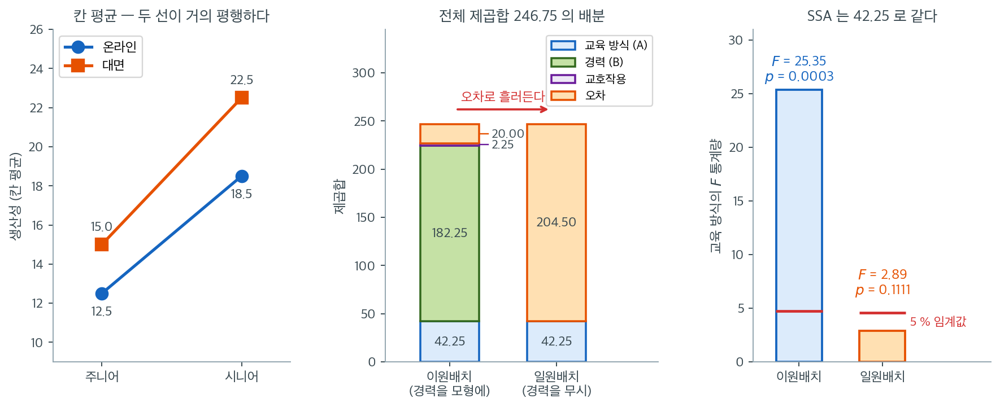
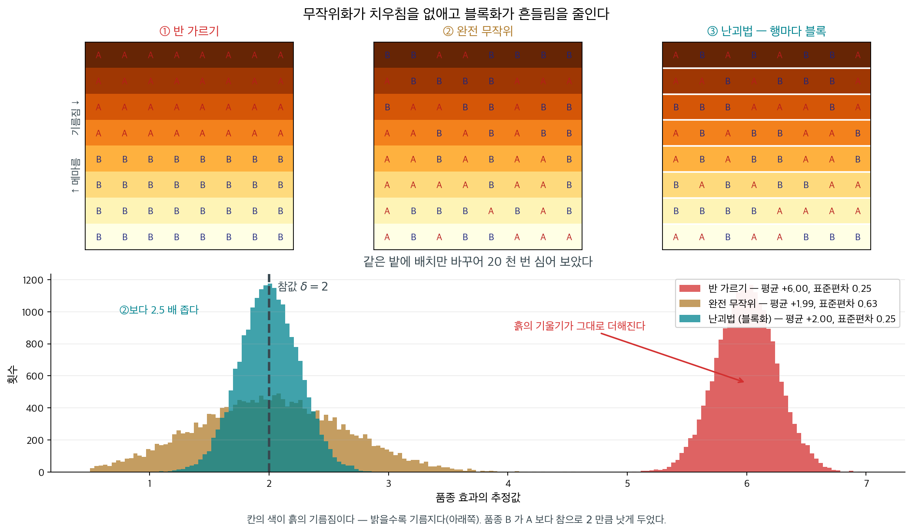

# 이원배치 분산분석: 주효과와 블록화

## 1. 이원배치 분산분석

### A. 이원배치 분산분석이란

<div class="leadbox" markdown>

**들어가는 이야기** — 관심 없는 요인을 적어 둘지

관심 없는 요인을 모형에 적어 둘지 말지를 정해야 할 때가 있다. 그렇게 적어 두는 요인을 **블록**이라 부르고, 블록을 적어 두는 일이 자료를 더 모으는 일만큼 값을 한다. 적어 두지 않으면 **그 요인의 변동이 오차로 흘러들어 오차를 너무 크게** 만들고, $F$ 는 분모가 커진 만큼 작아진다.

교육 방식과 경력을 칸당 넷씩 관측한 자료가 그 자리를 보여 준다. 교육 방식의 제곱합은 $42.25$ 로, 경력을 모형에 넣든 빼든 **한 치도 다르지 않다** — 칸마다 관측 수가 같은 균형 설계라서 두 요인의 제곱합이 서로 겹치지 않기 때문이다. 달라지는 것은 오차뿐이다.

경력을 넣으면 오차에 $20.00$ 만 남아 $F = 25.35$, $p = 0.0003$ 이다. 빼면 경력의 제곱합 $182.25$ 가 갈 곳이 없어 오차로 흘러들어 $204.50$ — **열 배가 넘게** 커지고, 그러면서 $F = 2.89$, $p = 0.1111$ 로 주저앉는다. 같은 자료, 같은 효과인데 둘째 요인을 적어 두었느냐가 결론을 갈랐고, 틀어진 방향은 **효과를 놓치는 쪽**이다.

그렇다고 변수를 많이 넣는 것이 늘 이득은 아니다. 요인을 하나 넣으면 오차의 자유도가 그만큼 줄어드는데 그 몫으로는 열 배를 메우지 못하니, 설명하지 못하는 변수를 넣으면 분모의 제곱합은 그대로인데 나눌 자유도만 깎여 손해가 된다. 제곱합의 세 유형이 갈리는 것도 같은 겹침에서 온다 — 균형 설계이면 셋이 모두 같다. 교호작용에도 둘째 요인 자체에도 관심이 없을 때, 그 요인을 적어 두는 일은 무엇을 사는가. 아래 상자가 그 생각이 처음 쓰인 자리를 따라간다.

_확인한 곳 — 이 쪽 「블록화가 나온 자리는 밭이었다」 상자와 그 출처 줄_

</div>

이원배치 분산분석은 일원배치 분산분석을 확장한 것으로, 두 개의 독립인 범주형 변수(요인)가 연속형 종속변수에 미치는 효과를 살필 수 있게 해 준다. 하나의 요인에 대한 평균 차이를 평가하는 일원배치와 달리, 이원배치 분산분석은 각 요인의 개별 효과(주효과)와 두 요인 사이의 교호작용 효과를 함께 평가할 수 있다. 그래서 두 요인이 독립적으로든 결합해서든 결과에 영향을 줄 수 있는 연구에서 특히 유용하다.

이원배치 분산분석의 주된 목표는 다음을 평가하는 것이다.

1. **주효과**: 각 요인이 종속변수에 미치는 독립적인 효과. 예를 들어 "식이"와 "운동"이 체중 감량에 미치는 효과를 연구한다면 "식이"만의 효과와 "운동"만의 효과를 평가한다.
2. **교호작용 효과**: 어느 한 요인만으로는 설명되지 않는, 두 요인의 결합 효과. 한 요인의 효과가 다른 요인의 수준에 따라 달라지면 교호작용 효과가 있는 것이다.

이원배치 분산분석은 자료의 전체 분산을 세 가지 주요 성분으로 분해한다.

- **요인 A에 의한 분산**: 첫 번째 요인의 수준 차이로 인한 종속변수의 변동.
- **요인 B에 의한 분산**: 두 번째 요인의 수준 차이로 인한 변동.
- **요인 A와 B의 교호작용에 의한 분산**: 개별 기여를 넘어서는 두 요인의 결합 효과.

이원배치 분산분석에서는 분산의 각 원천(요인 A, 요인 B, 둘 사이의 교호작용)에 대해 **F-통계량**을 계산한다. 각 F-통계량은 해당 분산 성분이 집단 내 분산보다 유의하게 큰지를 평가한다. 요인이나 교호작용에 실제 효과가 있다면 그렇게 될 것이다.

요인을 둘 넣는 이유가 "교호작용을 보려고"만은 아니다. 교호작용이 없어도, 심지어 둘째 요인에 아무 관심이 없어도 이원배치가 유리한 경우가 있다. **둘째 요인이 설명하는 변동을 오차에서 빼내기 때문이다.** 이것이 이 절 제목의 "블록화"이며, 아래 연습문제 1의 자료로 확인해 보자. 교육 방식(온라인/대면) $\times$ 경력(주니어/시니어)을 칸당 $n = 4$로 관측했다.



왼쪽에서 두 선이 거의 평행한 것이 보인다. 온라인에서 대면으로 옮기면 주니어는 $12.5 \to 15.0$으로 $2.5$, 시니어는 $18.5 \to 22.5$로 $4.0$ 오른다. 차이가 $1.5$밖에 나지 않아 교호작용 제곱합이 $\text{SSAB} = 2.25$로 전체 $246.75$의 $1\%$에도 못 미친다. **교호작용은 사실상 없다.** 그러니 "교호작용을 보려고" 이원배치를 쓴 것은 아닌 셈이다.

가운데가 이원배치의 진짜 이득이다. 경력을 모형에 넣으면 그 요인이 설명하는 $\text{SSB} = 182.25$가 제 이름표를 달고 따로 떨어져 나가고, 오차에는 $\text{SSW} = 20.00$만 남는다. 경력을 무시하고 교육 방식만으로 일원배치를 하면 이 $182.25$와 $2.25$가 갈 곳이 없어 **고스란히 오차로 흘러들어** $\text{SSE} = 204.50$이 된다. 주니어와 시니어가 원래 생산성이 다르다는 사실이 "설명 안 되는 잡음"으로 취급되는 것이다.

오른쪽이 그 대가다. 교육 방식의 제곱합은 양쪽 모두 $\text{SSA} = 42.25$로 **한 치도 다르지 않다.** 그런데 분모가 $\text{MS}_W = 20.00/12 = 1.667$에서 $\text{MSE} = 204.50/14 = 14.607$로 8.8배 커지는 바람에 $F$가 $25.35$에서 $2.89$로 주저앉는다. 이원배치에서는 $p = 0.0003$으로 명확히 기각하지만 일원배치에서는 $p = 0.1111$로 임계값 $4.60$에 닿지도 못한다. **같은 자료, 같은 효과인데 둘째 요인을 적어 두었느냐 아니냐가 결론을 갈랐다.** 실험을 설계할 때 결과에 영향을 줄 만한 변수를 미리 기록해 두라는 조언이 여기서 나온다.

**이원배치 분산분석의 가정**

일원배치와 마찬가지로 이원배치에도 핵심 가정이 있다.

1. **정규성**: 각 집단 안의 자료가 정규분포를 따라야 한다.
2. **분산의 동질성**: 모든 집단(요인 수준의 조합)의 분산이 대략 같아야 한다.
3. **독립성**: 집단 안에서도, 집단 사이에서도 관측값이 독립이어야 한다.

이 가정들이 어긋나면 결과를 믿기 어려워진다. 가정이 충족되지 않을 때에는 비모수 검정이나 일반화선형모형 같은 대안이 적절할 수 있다.

**장점과 응용**

이원배치 분산분석은 여러 요인을 동시에 조사하는 농학, 심리학, 공학 등에서 널리 쓰인다. 핵심 장점은 요인 사이의 교호작용을 파악할 수 있어, 여러 변수가 종속변수에 어떻게 영향을 주는지 더 종합적으로 이해할 수 있다는 점이다.

**사후분석**

이원배치 분산분석에서 유의한 주효과나 교호작용 효과가 나타나면 집단 사이의 구체적인 차이를 살피기 위해 사후검정을 수행할 수 있다. 예를 들어 Tukey의 HSD로 각 요인 안에서 어느 수준이 다른지, 또는 특정 요인 수준 조합이 특별한 효과를 보이는지 판정할 수 있다.

<div class="storybox" markdown>

**그림으로 보는 통계학 1.** 블록화가 나온 자리는 밭이었다

위에서 블록화를 「둘째 요인이 설명하는 변동을 오차에서 빼낸다」로 적었다. $\text{SSE}$ 가
$204.50$ 에서 $20.00$ 으로 줄고 $F$ 가 $2.89$ 에서 $25.35$ 로 올랐다. 맞는 말인데, **그
생각이 왜 필요했는지**는 교실이 아니라 밭에서 나왔다.

$1919$ 년, 스물아홉의 **로널드 피셔**가 런던 북쪽 **로담스테드 농업시험장**에 일자리를
얻는다. 그곳에는 $1840$ 년대부터 쌓인 작물 수확 기록이 창고째 있었고, 그가 받은 일은 그
묵은 자료에서 무언가를 꺼내 보라는 것이었다.

문제는 금방 드러났다. **밭이 고르지 않다.** 한쪽은 기름지고 한쪽은 메마르다. 품종 둘을
견주려고 한쪽에 A, 다른 쪽에 B 를 심으면, 수확의 차이가 **품종 때문인지 흙 때문인지 알
길이 없다.** 그때까지의 농학 시험이 대체로 그렇게 되어 있었다.

<figure markdown>
  { width=1000 }
  <figcaption markdown>품종 $B$ 가 $A$ 보다 **참으로 $2$ 만큼** 낫게 두었다. 배치만 바꾸어 $2$ 만 번 심어 본 것이고, 흙도 품종도 그대로다. 자료에서 직접 그렸다.</figcaption>
</figure>

**① 반 가르기.** 추정값이 $+6.00$ 이다. 참값의 **세 배**다. 흙의 기울기 $4$ 가 품종 효과에
고스란히 얹혔다. 표준편차는 $0.25$ 로 작으니 **정밀하게 틀린다** — 같은 실험을 되풀이해도
언제나 $6$ 쯤 나온다. 자료를 더 모아도 고쳐지지 않는 종류의 오류다.

**② 완전 무작위.** $64$ 칸에 아무렇게나 섞어 뿌리면 추정값이 $+1.99$ 로 참값에 온다.
**무작위화가 치우침을 없앴다.** 그런데 표준편차가 $0.63$ 으로 커졌다 — 흙의 기울기가
없어진 것이 아니라 **오차 안으로 들어간** 것이다.

**③ 난괴법.** 행마다 블록을 짓고 블록 **안에서** A 와 B 를 섞으면 $+2.00$ 에 표준편차
$0.25$ 다. 치우침도 없고 흔들림도 ②의 $\frac{1}{2.5}$ 다. 한 행 안에서는 흙이 거의 같으니
그 안의 차는 **흙을 빼고 난 품종의 차**이기 때문이다.

**피셔가 한 일이 이 둘이다.** 무작위화가 ①의 병을 고치고, 블록화가 ②의 값을 깎는다. 그가
$1935$ 년에 『실험의 설계』로 묶어 낸 것이 이 생각들이고,
위 그림의 $\text{SSE}\;204.50 \to 20.00$ 은 밭에서 흙의 기울기를 들어낸 일을
숫자로 옮겨 적은 것이다.

그리고 뒤집어 읽을 것이 하나 있다. **블록은 「관심 없는 요인」이다.** 위 자료에서 경력은
알고 싶은 것이 아니라 **치워 두고 싶은 것**이었고, 로담스테드의 흙도 그랬다. 그러니
이원배치를 쓸 까닭이 「요인이 둘이어서」만은 아니다. **요인이 하나여도, 치워 두고 싶은
무언가를 알고 있다면** 그것을 모형에 넣는 편이 낫다. 넣지 않으면 그 변동이 사라지는 것이
아니라 ②처럼 오차로 흘러들 뿐이다.

_확인한 곳 — 피셔가 $1919$ 년 로담스테드 시험장에 들어가 그곳의 묵은 농업 자료를 다루며 분산분석과 실험설계를 세웠고, 무작위화와 블록화(난괴법)를 『The Design of Experiments』($1935$)로 정리했다는 것은 통계사에서 거듭 다루어져 온 것이다 · 그림의 수치($+6.00$ / $+1.99$ / $+2.00$, 표준편차 $0.25$ / $0.63$ / $0.25$)는 $8 \times 8$ 밭에 $2$ 만 번 심어 이 쪽이 직접 쟀다_

</div>

### B. 일원배치 분산분석과 이원배치 분산분석

일원배치와 이원배치 분산분석은 모두 여러 집단의 평균을 비교하는 통계 기법이지만, 평가하는 요인의 수와 분석의 복잡도가 다르다.

#### 일원배치 분산분석

일원배치 분산분석은 하나의 범주형 요인(독립변수)에 근거하여 **셋 이상의 독립 집단** 평균 사이에 유의한 차이가 있는지 판정한다.

- **분석하는 요인**: 요인 하나만 고려한다(예: 비료 종류).
- **목적**: 어떤 집단의 평균이 다른 집단과 유의하게 다른지 검정한다.
- **F-통계량**: **집단 간** 분산과 **집단 내** 분산의 비로 계산한다.
- **해석**: 유의한 결과는 적어도 한 집단의 평균이 다르다는 뜻이지만 어느 집단인지는 알려주지 않는다. 흔히 **사후검정**이 필요하다.
- **가정**: 정규성, 분산의 동질성, 관측의 독립성을 가정한다.

#### 이원배치 분산분석

이원배치 분산분석은 일원배치를 확장하여 두 개의 독립 요인과 그 결합 효과를 종속변수에 대해 분석할 수 있게 한다.

- **분석하는 요인**: 두 요인을 동시에 분석한다.
- **목적**: 세 가지 효과를 검정한다. 첫 요인의 주효과, 둘째 요인의 주효과, 두 요인의 교호작용 효과.
- **F-통계량**: 각 주효과와 교호작용 효과에 대해 별도의 F-통계량을 계산한다.
- **해석**: 유의한 주효과는 한 요인의 적어도 한 수준이 다른 수준과 다름을 뜻하고, 유의한 교호작용 효과는 두 요인이 독립적으로 작동하지 않음을 시사한다.
- **가정**: 일원배치와 마찬가지로 정규성, 분산의 동질성, 관측의 독립성을 가정한다.

#### 요인이 둘이면 교호작용이 더 생긴다

| 항목               | 일원배치 분산분석                                 | 이원배치 분산분석                                      |
|-----------------------|-----------------------------------------------|----------------------------------------------------|
| **요인의 수** | 하나                                    | 둘                                        |
| **주된 목적**      | 하나의 요인에 근거해 집단 평균 사이에 유의한 차이가 있는지 판정 | 각 요인의 주효과와 그 교호작용 효과를 함께 평가 |
| **교호작용 효과**| 분석하지 않음                                  | 분석한다. 두 요인이 결합해 결과에 영향을 주는지 보여준다 |
| **F-통계량**      | 하나의 요인에 대해 F-통계량 하나         | 각 주효과와 교호작용에 대해 별도의 F-통계량 |
| **예**           | 비료 종류가 식물 높이에 미치는 효과 검정 | 비료와 물 주는 빈도가 식물 높이에 미치는 효과 검정 |

#### 각각을 언제 쓰는가

- 하나의 범주형 요인이 연속형 결과변수에 미치는 효과를 검정하고 비교할 집단이 셋 이상일 때 **일원배치 분산분석**을 쓴다.
- 두 범주형 요인이 연속형 결과에 미치는 효과를 연구하고 이 요인들 사이에 교호작용이 있는지 알고 싶을 때 **이원배치 분산분석**을 쓴다.

### C. 이원배치 분산분석의 귀무가설과 선형회귀의 비교

$$\begin{array}{ccc}
&&\text{선형회귀}&&\text{이원배치 분산분석}\\
\text{모형}&&y=\alpha+\beta_1 x_1+\beta_2 x_2 + \gamma x_1x_2
&&
y=\alpha+\sum_{i=1}^{a}\beta^{(1)}_i 1_{C^{(1)}_i}
+\sum_{j=1}^{b}\beta^{(2)}_j 1_{C^{(2)}_j}
+\sum_{i=1}^{a}\sum_{j=1}^{b}\beta_{ij} 1_{C^{(1)}_iC^{(2)}_j}\\
\text{H}_0&&\beta_1=0
&&\quad\text{모든 }\beta^{(1)}_{i}=0\\
\text{H}_0&&\beta_2=0
&&\quad\text{모든 }\beta^{(2)}_{j}=0\\
\text{H}_0&&\gamma=0&&\quad\text{모든 }\beta_{ij}=0\\
\end{array}$$

**선형회귀**와 **이원배치 분산분석**은 모두 두 독립변수(또는 요인)가 종속변수에 미치는 효과를 평가하지만, 독립변수를 다루는 방식이 다르다. 선형회귀는 연속형 설명변수를 다루는 반면 이원배치 분산분석은 범주형 변수를 써서 주효과와 요인 사이의 교호작용을 분석한다.

선형회귀에서 두 연속형 독립변수 $x_1$, $x_2$가 있으면 모형은 다음으로 표현된다.

$$
y = \alpha + \beta_1 x_1 + \beta_2 x_2 + \gamma x_1 x_2
$$

여기서 $\alpha$는 절편, $\beta_1$과 $\beta_2$는 $x_1$과 $x_2$가 $y$에 미치는 효과, $\gamma$는 $x_1$과 $x_2$ 사이의 교호작용 효과를 나타낸다.

이 모형의 가설은 다음과 같다.

- $H_0: \beta_1 = 0$: $x_1$이 $y$에 효과가 없다
- $H_0: \beta_2 = 0$: $x_2$가 $y$에 효과가 없다
- $H_0: \gamma = 0$: $x_1$과 $x_2$ 사이에 $y$에 대한 교호작용이 없다

반면 **이원배치 분산분석**은 범주형 독립변수(요인)를 다루며 모형은 다음과 같다.

$$
y = \alpha + \sum_{i=1}^{a} \beta^{(1)}_i 1_{C^{(1)}_i} + \sum_{j=1}^{b} \beta^{(2)}_j 1_{C^{(2)}_j} + \sum_{i=1}^{a} \sum_{j=1}^{b} \beta_{ij} 1_{C^{(1)}_i C^{(2)}_j} + \text{noise}
$$

여기서 $C^{(1)}_i$는 요인 A의 $a$개 수준, $C^{(2)}_j$는 요인 B의 $b$개 수준, $1_{C^{(1)}_i}$와 $1_{C^{(2)}_j}$는 지시함수, $\beta^{(1)}_i$는 요인 A의 효과(주효과 A), $\beta^{(2)}_j$는 요인 B의 효과(주효과 B), $\beta_{ij}$는 교호작용 효과이다.

**이원배치 분산분석**의 가설은 다음과 같다.

- $H_0: \beta^{(1)}_i = 0$ (모든 $i$에 대해): 요인 A의 주효과가 $y$에 없다
- $H_0: \beta^{(2)}_j = 0$ (모든 $j$에 대해): 요인 B의 주효과가 $y$에 없다
- $H_0: \beta_{ij} = 0$ (모든 $i$, $j$에 대해): 요인 A와 B 사이에 $y$에 대한 교호작용이 없다

---

## 2. 이원배치 분산분석의 두 유형

### 반복 없는 이원배치 분산분석

**반복 없는 이원배치 분산분석**에서는 두 요인의 각 수준 조합에 관측값이 **하나뿐**이다.

**특징:**

- **칸당 관측값 하나**: 각 칸에 자료점이 하나뿐이므로 칸 안의 변동을 추정할 방법이 없다.
- **주효과와 교호작용의 분석**: 각 요인의 수준에 따른 유의한 차이와 유의한 교호작용이 있는지는 여전히 평가할 수 있다.
- **제한된 오차 분석**: 반복이 없으면 주효과나 교호작용으로 설명되지 않는 모든 변동이 하나의 항으로 묶인다.

**분해:**

$$
SST=SSA+SSB+SSAB
$$

### 반복 있는 이원배치 분산분석

**반복 있는 이원배치 분산분석**에서는 두 요인의 각 수준 조합에 **여러 관측값**이 있다.

**특징:**

- **칸당 여러 관측값**: 반복이 있으면 칸 내 변동, 즉 "오차" 분산을 측정할 수 있다.
- **교호작용 효과 검정**: 반복이 있으면 교호작용 효과를 더 정확하게 탐지하고 분석할 수 있다.
- **분산 성분의 분리**: 반복 있는 이원배치 분산분석은 전체 변동을 요인 A, 요인 B, 교호작용, 오차(칸 내 변동)로 분해한다.
- **더 믿을 만한 오차 추정**: 칸 내 변동을 따로 떼어내므로 오차항이 더 잘 추정되어 신뢰성이 높아진다.

**분해:**

$$
SST=SSA+SSB+SSAB+SSE
$$

### 비교 요약

| 항목                     | 반복 없는 이원배치       | 반복 있는 이원배치      |
|-----------------------------|----------------------------------------|-------------------------------------|
| **칸당 관측값**   | 하나                                     | 여럿                            |
| **오차항**              | 분리 불가(집단 내 오차 없음)   | 집단 내 오차를 분리        |
| **주효과**            | 추정 가능                           | 추정 가능                        |
| **교호작용 효과**     | 추정 가능                           | 추정 가능                        |
| **신뢰성**             | 낮음(집단 내 분산 없음)       | 높음(집단 내 분산 있음)      |
| **예**                 | 조건당 참가자 한 명          | 조건당 참가자 여러 명 |

---

## 3. 이원배치 분산분석의 가정

### 언제 이원배치 분산분석을 쓰는가

이원배치 분산분석은 두 개의 독립인 범주형 변수가 하나의 연속형 종속변수에 미치는 효과를 살피는 강력한 방법이다. 두 요인 사이에 *교호작용 효과*가 있는지도 조사할 수 있다.

- **독립변수(요인)가 둘일 때**: 연구에 독립변수가 둘 있고 각 변수가 여러 수준을 가질 때 이원배치 분산분석이 가장 적절하다. 일원배치를 여러 번 하는 것보다 결정적으로 나은 점은 두 독립변수의 영향과 그 교호작용을 동시에 평가할 수 있다는 것이다.

- **교호작용 효과를 탐색할 때**: 한 요인이 종속변수에 미치는 효과가 다른 요인의 수준에 따라 달라질 때 교호작용이 있다고 한다.

- **종속변수가 연속형일 때**: 이원배치 분산분석은 종속변수가 연속 척도로 측정되어야 한다.

- **주효과와 교호작용 효과 모두에 관심이 있을 때**: 이원배치 분산분석은 각 독립변수의 **주효과**와 그 **교호작용 효과** 모두에 대한 통찰을 준다.

### 가정

**관측의 독립성**

- 각 관측값이 서로 독립이다.
- 보통 연구 설계(예: 무작위 대조 실험)로 확보한다.

**정규성**

- 종속변수가 각 집단 안에서 근사적으로 정규분포를 따른다고 가정한다.
- **확인 방법**: 히스토그램이나 Q-Q 그림을 통한 시각적 검토, 형식적 평가로는 Shapiro-Wilk 검정.

**분산의 동질성(등분산성)**

- 종속변수의 분산이 모든 집단에서 대략 같아야 한다.
- **확인 방법**: Levene 검정, 또는 잔차 그림이나 상자그림을 통한 시각적 검토.
- **어긋날 때**: 종속변수의 로그 변환이나 Welch 분산분석 같은 더 로버스트한 방법.

---

## 4. 등분산이 깨지면 특히 흔들린다

- **가정에 대한 민감성**: 일원배치와 마찬가지로 이원배치 분산분석의 결과도 가정 위반, 특히 분산의 동질성 위반에 민감할 수 있다.
- **교호작용이 있을 때의 복잡성**: 교호작용 효과의 해석은 까다로울 수 있다. 특히 교호작용은 유의한데 주효과는 그렇지 않을 때 그렇다. 이런 효과를 해석하는 데 교호작용 그림 같은 그래프 방법을 흔히 쓴다.

## 5. 제곱합의 세 유형은 언제 같은가

절 $1$ 은 균형 설계의 제곱합 분해를 적었다. `statsmodels` 은 분해 방식을
제I·II·III형 셋으로 제공하는데, **균형이면 셋이 같은 수를 주고 불균형이면**
**갈린다.** 그 말이 맞는지 `ToothGrowth` 로 확인한다.

<div class="exbox" markdown>

**보기 1.** <span class="diff easy" title="쉬움"></span> 1단계 — 제곱합의 세 유형은 언제 같은가. 코드의 주석은 "균형 설계에서는 세 유형이 모두 같지만 불균형이면 갈린다"고 말한다. 확인해 보자.

**(1)** 설계가 **균형**이면(모든 칸의 관측 수가 같으면) 요인 $A$ 의 지시열과 요인 $B$ 의 지시열이 중심화한 뒤 **직교**함을 보이고, 이로부터 제I형 제곱합이 항의 순서에 의존하지 않음을 설명하시오. 또 제II형 제곱합은 불균형에서도 **"그 효과를 마지막에 넣은 제I형"** 과 같음을 지적하시오.

**(2)** ToothGrowth 에서 세 유형을 모두 계산해 (1)을 확인하고, 칸 여섯 개 중 둘을 줄여 **불균형으로 만들면** 무엇이 갈라지는지 보이시오.

</div>

??? success "풀이"

    **(1) 해석적으로.** 칸 $(i,j)$ 의 관측 수를 $n_{ij}$ 라 하자. 요인 $A$ 의 수준 $i$ 를 가리키는 지시벡터를 $u_i$, 요인 $B$ 의 수준 $j$ 를 가리키는 지시벡터를 $v_j$ 라 쓰면

    $$
    u_i^\top v_j = n_{ij},
    \qquad
    u_i^\top \mathbf 1 = n_{i\cdot},
    \qquad
    v_j^\top \mathbf 1 = n_{\cdot j}
    $$

    이다. 전체평균을 뺀 중심화 벡터 $\tilde u_i = u_i - \frac{n_{i\cdot}}{N}\mathbf 1$, $\tilde v_j = v_j - \frac{n_{\cdot j}}{N}\mathbf 1$ 의 내적은

    $$
    \tilde u_i^\top \tilde v_j = n_{ij} - \frac{n_{i\cdot} n_{\cdot j}}{N}
    $$

    다. **균형 설계이면 $n_{ij} = n$, $n_{i\cdot} = nb$, $n_{\cdot j} = na$, $N = nab$ 이므로**

    $$
    \tilde u_i^\top \tilde v_j = n - \frac{nb \cdot na}{nab} = n - n = 0
    $$

    으로 **정확히 직교한다.** 두 요인이 만드는 부분공간이 서로 직교하면, 한쪽을 먼저 넣든 나중에 넣든 사영의 크기가 변하지 않는다. 제I형은 "앞의 항들을 넣은 뒤 늘어나는 설명량"이므로 순서에 의존하지 않게 되고, 제II형·제III형도 같은 값이 된다. 이것이 균형 설계의 값어치다. **요인들이 서로 간섭하지 않는다.**

    불균형이면 $n_{ij} \ne \frac{n_{i\cdot}n_{\cdot j}}{N}$ 이라 직교가 깨지고, 두 요인이 **겹치는 설명량**이 생긴다. 먼저 들어온 쪽이 그 겹치는 몫을 가져가므로 제I형이 순서에 따라 달라진다. 제II형은 정의가 "다른 **주효과**를 모두 통제한 뒤의 증가분"이므로, 주효과가 둘뿐인 이 설계에서는 **그 효과를 주효과 중 마지막에 넣은 제I형과 같은 수**가 된다.

    한 가지 덧붙일 것이 있다. `anova_lm(..., typ=3)` 은 **코딩에 민감하다.** 제III형은 "다른 모든 항(교호작용 포함)을 통제한 효과"인데, 교호작용 열이 직교하도록 만들려면 수준 더미를 합이 $0$ 이 되게 코딩해야 한다. statsmodels 의 기본 처리코딩(`C()`)으로 `typ=3` 을 부르면 올바른 제III형이 아니라 **기준수준에서의 단순효과**를 재게 된다. 아래 출력이 그 함정을 보여 준다.

    **(2) 수치적으로.**

    ```python
    import pandas as pd
    from statsmodels.formula.api import ols
    from statsmodels.stats.anova import anova_lm

    url = ('https://raw.githubusercontent.com/vincentarelbundock/'
           'Rdatasets/1dcc2bf5f955cc1224a3e1307256e1fe86b68dae/csv/datasets/ToothGrowth.csv')
    df = pd.read_csv(url, usecols=[1, 2, 3])

    model = ols('len ~ C(supp) + C(dose) + C(supp):C(dose)', data=df).fit()
    # typ=2를 명시한다. statsmodels의 기본값은 typ=1(순차적 제곱합)이라
    # 모형에 넣는 항의 **순서에 따라 결과가 달라진다**. 균형 설계에서는
    # 세 유형이 모두 같지만, 불균형이면 갈린다.
    aov2 = anova_lm(model, typ=2)
    print(aov2)
    ```

    출력:

    ```
                          sum_sq    df          F        PR(>F)
    C(supp)           205.350000   1.0  15.571979  2.311828e-04
    C(dose)          2426.434333   2.0  91.999965  4.046291e-18
    C(supp):C(dose)   108.319000   2.0   4.106991  2.186027e-02
    Residual          712.106000  54.0        NaN           NaN
    ```

    용량의 효과가 압도적이고($F = 92$), 보충제의 효과와 교호작용도 유의하다. 교호작용이 유의하다는 것은 주효과를 따로 해석하기 전에 조심해야 한다는 신호다. "OJ가 VC보다 낫다"는 말이 용량마다 다르게 성립하기 때문이다.

    제II형 제곱합은 각 주효과를 다른 주효과로 조정하되 교호작용은 무시하고 검정한다. 설계가 균형이거나 거의 균형일 때 권장된다. 세 유형을 모두 계산해 본다.

    ```python
    # 균형 설계인가. 여섯 칸의 개수를 센다.
    print("칸별 관측 수")
    print(df.groupby(['supp', 'dose']).size().unstack())

    a1 = anova_lm(model, typ=1)['sum_sq']
    model_rev = ols('len ~ C(dose) + C(supp) + C(dose):C(supp)', data=df).fit()
    a1r = anova_lm(model_rev, typ=1)['sum_sq']
    a2 = anova_lm(model, typ=2)['sum_sq']
    a3_bad = anova_lm(model, typ=3)['sum_sq']
    # 제III형은 합이 0 이 되는 코딩(Sum)으로 적합해야 올바른 값이 나온다.
    model_sum = ols('len ~ C(supp, Sum) + C(dose, Sum) + C(supp, Sum):C(dose, Sum)',
                    data=df).fit()
    a3 = anova_lm(model_sum, typ=3)['sum_sq']

    print(f"\n{'방법':<22}{'supp':>12}{'dose':>14}{'supp:dose':>12}")
    print(f"{'제I형 (supp 먼저)':<22}{a1['C(supp)']:>12.4f}{a1['C(dose)']:>14.4f}"
          f"{a1['C(supp):C(dose)']:>12.4f}")
    print(f"{'제I형 (dose 먼저)':<22}{a1r['C(supp)']:>12.4f}{a1r['C(dose)']:>14.4f}"
          f"{a1r['C(dose):C(supp)']:>12.4f}")
    print(f"{'제II형':<22}{a2['C(supp)']:>12.4f}{a2['C(dose)']:>14.4f}"
          f"{a2['C(supp):C(dose)']:>12.4f}")
    print(f"{'제III형 (처리코딩)':<22}{a3_bad['C(supp)']:>12.4f}{a3_bad['C(dose)']:>14.4f}"
          f"{a3_bad['C(supp):C(dose)']:>12.4f}")
    print(f"{'제III형 (합코딩)':<22}{a3['C(supp, Sum)']:>12.4f}{a3['C(dose, Sum)']:>14.4f}"
          f"{a3['C(supp, Sum):C(dose, Sum)']:>12.4f}")

    print(f"\n네 제곱합의 합 = {a2.sum():.4f},  "
          f"SST = {((df['len'] - df['len'].mean()) ** 2).sum():.4f}")
    print(f"자유도 59 = 1 + 2 + 2 + 54")
    ```

    출력:

    ```
    칸별 관측 수
    dose  0.5  1.0  2.0
    supp
    OJ     10   10   10
    VC     10   10   10

    방법                            supp          dose   supp:dose
    제I형 (supp 먼저)             205.3500     2426.4343    108.3190
    제I형 (dose 먼저)             205.3500     2426.4343    108.3190
    제II형                      205.3500     2426.4343    108.3190
    제III형 (처리코딩)              137.8125      885.2647    108.3190
    제III형 (합코딩)               205.3500     2426.4343    108.3190

    네 제곱합의 합 = 3452.2093,  SST = 3452.2093
    자유도 59 = 1 + 2 + 2 + 54
    ```

    **균형 설계라 네 줄이 같다.** 칸마다 정확히 $10$ 개씩이므로 (1)의 직교성이 성립하고, 제I형(어느 순서로 넣든)·제II형·제III형(합코딩)이 모두 $205.3500$ 과 $2426.4343$ 을 준다. 제곱합 분해도 $3452.2093$ 으로 정확히 맞고 자유도는 $59 = 1+2+2+54$ 로 갈린다.

    **처리코딩으로 부른 제III형만 다르다.** $137.8125$ 와 $885.2647$ 은 틀린 값이 아니라 **다른 질문에 대한 답**이다. 처리코딩에서 `C(supp)` 항은 "dose 가 기준수준($0.5$)일 때의 supp 효과", 곧 단순효과를 가리키므로 주효과와 같을 이유가 없다. `typ=3` 을 쓸 생각이면 반드시 `C(..., Sum)` 으로 적합해야 한다.

    이제 균형을 깨 보면 (1)의 나머지가 드러난다.

    ```python
    # OJ_0.5 에서 둘, VC_0.5 에서 넷을 지워 불균형을 만든다.
    drop = df.index[(df['supp'] == 'OJ') & (df['dose'] == 0.5)][:2].tolist()
    drop += df.index[(df['supp'] == 'VC') & (df['dose'] == 0.5)][:4].tolist()
    dfu = df.drop(index=drop).reset_index(drop=True)
    print("칸별 관측 수 (불균형)")
    print(dfu.groupby(['supp', 'dose']).size().unstack())

    mu = ols('len ~ C(supp) + C(dose) + C(supp):C(dose)', data=dfu).fit()
    mur = ols('len ~ C(dose) + C(supp) + C(dose):C(supp)', data=dfu).fit()
    u1, u1r = anova_lm(mu, typ=1)['sum_sq'], anova_lm(mur, typ=1)['sum_sq']
    u2 = anova_lm(mu, typ=2)['sum_sq']
    print(f"\n{'방법':<22}{'supp':>12}{'dose':>14}")
    print(f"{'제I형 (supp 먼저)':<22}{u1['C(supp)']:>12.4f}{u1['C(dose)']:>14.4f}")
    print(f"{'제I형 (dose 먼저)':<22}{u1r['C(supp)']:>12.4f}{u1r['C(dose)']:>14.4f}")
    print(f"{'제II형':<22}{u2['C(supp)']:>12.4f}{u2['C(dose)']:>14.4f}")
    print(f"\n제II형의 supp 가 '제I형에서 supp 를 나중에 넣은 값'과 같은가: "
          f"{abs(u2['C(supp)'] - u1r['C(supp)']) < 1e-9}")
    print(f"제II형의 dose 가 '제I형에서 dose 를 나중에 넣은 값'과 같은가: "
          f"{abs(u2['C(dose)'] - u1['C(dose)']) < 1e-9}")
    ```

    출력:

    ```
    칸별 관측 수 (불균형)
    dose  0.5  1.0  2.0
    supp
    OJ      8   10   10
    VC      6   10   10

    방법                            supp          dose
    제I형 (supp 먼저)              75.2894     2061.9230
    제I형 (dose 먼저)             125.6611     2011.5513
    제II형                      125.6611     2061.9230

    제II형의 supp 가 '제I형에서 supp 를 나중에 넣은 값'과 같은가: True
    제II형의 dose 가 '제I형에서 dose 를 나중에 넣은 값'과 같은가: True
    ```

    **불균형이 되자 순서가 결과를 바꾼다.** `supp` 의 제곱합이 먼저 넣으면 $75.29$, 나중에 넣으면 $125.66$ 으로 **$1.7$ 배 차이가 난다.** $14$ 개를 지웠을 뿐인데 이렇다. 요인끼리 겹치는 설명량이 생겼고, 제I형은 그 몫을 **먼저 들어온 쪽에 통째로 준다.**

    **제II형이 (1)의 예측과 정확히 맞는다.** `supp` 의 제II형 $125.6611$ 이 "dose 를 먼저 넣은 제I형"의 `supp` 와 같고, `dose` 의 제II형 $2061.9230$ 이 "supp 를 먼저 넣은 제I형"의 `dose` 와 같다. 곧 **제II형은 각 주효과를 늘 마지막에 넣어 본 값**이고, 그래서 순서를 정할 필요가 없다. 코드가 `typ=2` 를 명시한 까닭이 이것이다.

---

## 연습문제

<div class="drillbox" markdown>

**연습문제 1.** <span class="diff easy" title="쉬움"></span>
두 요인: 교육 방식(온라인 대 대면) × 경력(주니어 대 시니어), 칸당 $n = 4$. 칸 평균: 12.5, 18.5, 15.0, 22.5. (a)–(d) 이원배치 분산분석을 수행하라.

</div>

??? success "풀이"
    (a) 행 평균: 온라인 15.5, 대면 18.75. 열 평균: 주니어 13.75, 시니어 20.5. 전체: 17.125.

    (b) $\mathrm{SSA}$(교육 방식) = 42.25, $\mathrm{SSB}$(경력) = 182.25, $\mathrm{SSAB}$(교호작용) = 2.25, $\mathrm{SSW}$ = 20.0.

    (c) 분산분석표:

    | 원천 | SS | df | MS | F |
    |---|---|---|---|---|
    | 교육 방식 | 42.25 | 1 | 42.25 | 25.35 |
    | 경력 | 182.25 | 1 | 182.25 | 109.35 |
    | 교호작용 | 2.25 | 1 | 2.25 | 1.35 |
    | 집단 내 | 20.0 | 12 | 1.667 | |
    | 전체 | 246.75 | 15 | | |

    임계값 $F_{1, 12, 0.05} = 4.75$. 두 주효과는 모두 유의하고 교호작용은 유의하지 않다.

    (d) 교육 방식이 생산성에 미치는 효과는 경력 수준에 의존하지 **않는다**. 대면이 일관되게 더 낫고 그 차이도 주니어와 시니어에서 거의 같다. **가법** 모형으로 충분하다.

---

<div class="drillbox" markdown>

**연습문제 2.** <span class="diff easy" title="쉬움"></span>
이원배치 분산분석의 **해석 순서**를 정리하라.

</div>

??? success "풀이"

    **해석 순서.**

    ```text
    ① 칸 평균 표와 교호작용 그림을 먼저 본다
              ↓
    ② 교호작용 F 검정
        │
        ├─ 유의하지 않음
        │     └─→ 주효과를 그대로 해석
        │         (다만 "교호작용이 없다"가 아니라 "찾지 못했다")
        │
        └─ 유의함
              ├─ 순서형(선이 교차하지 않음)
              │     └─→ 주효과 + "정도가 다름"을 명시
              └─ 비순서형(선이 교차)
                    └─→ 주효과를 해석하지 말고 단순주효과만
              ↓
    ③ 단순주효과 분석 + 다중비교 보정
              ↓
    ④ 교호작용을 대비로 분해(순서형 요인이면 선형·이차)
              ↓
    ⑤ 효과크기 (부분 η², ω²)
    ```

    **왜 교호작용을 먼저 보는가.** 교호작용이 있으면 **주효과의 의미가 달라지기** 때문이다. 주효과는 "다른 요인의 수준에 걸쳐 평균한 효과"인데, 그 평균이 어느 수준에서도 관측되지 않는 값일 수 있다(연습문제 8의 $+3.70$).

    **제곱합 유형 점검.**

    - [ ] 설계가 **균형**인가 → 그렇다면 유형 논쟁 없음
    - [ ] 불균형이면 어떤 유형을 썼는지 **명시**했는가
    - [ ] `statsmodels`에서 III형을 쓴다면 **합-0 코딩**을 했는가
    - [ ] I형을 썼다면 **항의 순서**가 의도한 것인가

    **보고 점검 목록.**

    - [ ] **칸 평균 표**(각 칸의 $n$, 평균, 표준편차)
    - [ ] 교호작용 그림
    - [ ] 분산분석표(SS, df, MS, $F$, $p$) — 유형 명시
    - [ ] **효과크기**(부분 $\eta^2$)
    - [ ] 교호작용이 유의하면 **단순주효과**와 보정 방법
    - [ ] 가정 점검(등분산, 잔차)

    **자주 하는 실수 여섯.**

    | 실수 | 대가 |
    |---|---|
    | 교호작용을 보기 전에 주효과 해석 | 존재하지 않는 효과를 보고 |
    | 비순서형 교호작용에서 주효과 인용 | 명백히 오도 |
    | 단순주효과에 보정 없음 | FWER 부풀림 |
    | 불균형에서 I형을 무심코 사용 | 항 순서에 결과가 좌우 |
    | III형인데 처리 코딩 | **조용히 틀린 SS**(연습문제 10) |
    | 교호작용이 유의하지 않다고 "없다"로 단정 | 검정력 부족일 수 있음 |

    **마지막 항목을 특히 조심한다.** 교호작용 검정은 주효과 검정보다 **검정력이 훨씬 낮다.** 같은 표본에서 주효과는 잡아도 교호작용은 놓치기 쉽다. "$p=0.23$이므로 교호작용이 없다"가 아니라 "**교호작용을 탐지할 만한 증거가 부족하다**"가 정확한 진술이다.

    **한 문장.** 이원배치 분산분석의 핵심 질문은 "두 요인이 각각 효과가 있는가"가 아니라 **"한 요인의 효과가 다른 요인에 따라 달라지는가"**이고, 그 답이 나머지 해석 전체를 좌우한다.

---

<div class="drillbox" markdown>

**연습문제 3.** <span class="diff med" title="중간"></span>
**교호작용의 해석.** 교호작용이 유의하면 주변 효과에 어떤 의미가 있는가?

</div>

??? success "풀이"
    교호작용이 유의하다는 것은 요인 A의 효과가 요인 B의 수준에 따라 달라진다는(그 반대도 마찬가지) 뜻이다.

    교호작용이 있으면 **주변 효과가 오도할 수 있다**:

    - "약 A는 평균적으로 혈압을 10 올린다" — 그러나 노인에서는 20 올리고 젊은 층에서는 5 낮출 수도 있다.
    - "주변" 효과는 집단에 걸쳐 평균을 내므로 이질성을 감춘다.

    **교호작용이 유의할 때의 모범 실무:**

    - **단순 효과**(B의 각 수준에서 A의 효과)를 보고한다.
    - 주변 효과는 신중하게 해석한다.
    - 교호작용 그림(B의 각 수준을 별도의 선으로)을 그린다.

    교호작용이 없으면(연습문제 1) 주변 효과가 정확한 기술이 된다. 각 요인의 효과가 다른 요인의 수준에 걸쳐 같기 때문이다.

---

<div class="drillbox" markdown>

**연습문제 4.** <span class="diff med" title="중간"></span>
**교차 설계와 내포 설계.**

</div>

??? success "풀이"
    **교차:** A의 모든 수준이 B의 모든 수준과 함께 나타난다(연습문제 1: 교육 방식 × 경력). 표준 이원배치 분산분석.

    **내포:** 한 요인의 수준이 다른 요인의 각 수준에만 고유하게 존재한다(학교 안에 내포된 학과 — 학교마다 학과가 다르다). 분석이 달라진다. 계층/혼합효과 모형을 쓴다.

    교차 설계는 교호작용을 추정할 수 있지만 내포 설계는 그렇지 못하다("교호작용"이 요인 B와 교란된다).

    흔한 혼동: 임의 요인과 고정 요인. 임의 요인(예: 피험자)은 분산 성분을 추가로 도입한다. 혼합모형을 쓴다.

---

<div class="drillbox" markdown>

**연습문제 5.** <span class="diff med" title="중간"></span>
**고차 교호작용.** 삼원 분산분석에는 주효과, 2원 교호작용, 3원 교호작용이 있다. 3원 교호작용은 무엇을 뜻하는가?

</div>

??? success "풀이"
    3원 교호작용(A × B × C)은 2원 A × B 교호작용이 C의 수준에 따라 달라진다는 뜻이다.

    예: 약의 효과가 질병 종류에 의존하는데, 그 질병 의존성이 연령대에 따라 달라진다.

    **고차 교호작용은 해석이 어렵다.** 대개 분석을 재구성하라는 신호이다:

    - C의 특정 수준으로 부분집합을 잡아 다시 분석한다.
    - C의 각 수준 안에서 2원 교호작용을 살펴본다.

    실용적 조언: 요인이 $k$개면 교호작용의 수가 $2^k - k - 1$로 늘어난다. 2원을 넘어서면 분산분석 분해보다 항을 명시적으로 넣은 회귀 틀에서 작업하는 편이 흔히 낫다.

---

<div class="drillbox" markdown>

**연습문제 6.** <span class="diff med" title="중간"></span>
불균형 설계의 **제I·II·III형 제곱합**.

</div>

??? success "풀이"
    균형 설계에서는 직교성 덕분에 제곱합 분해가 모호하지 않다. 불균형에서는:

    **제I형(순차):** 각 요인의 제곱합을 앞서 들어간 요인들로 조정한다. 순서에 의존한다.

    **제II형:** 각 요인의 제곱합을 다른 주효과들로 조정하되 교호작용은 반영하지 않는다. 주효과들 사이에 대칭적이다.

    **제III형:** 각 요인의 제곱합을 (교호작용을 포함한) 나머지 전부로 조정한다. 가장 흔히 보고되며 SAS의 기본값이다.

    R의 `aov()`는 제I형을 쓰고, 제III형에는 `car::Anova(type="III")`을 쓴다. 균형 설계에서는 모든 유형이 일치한다.

---

<div class="drillbox" markdown>

**연습문제 7.** <span class="diff med" title="중간"></span>
**이원배치와 일원배치 두 번의 비교.** 두 요인을 함께 연구할 때 이원배치가 선호되는 이유는?

</div>

??? success "풀이"
    이원배치 분산분석은:

    - **교호작용을 추정한다**(일원배치를 따로 두 번 해서는 불가능하다).
    - **더 효율적이다:** 칸에 걸쳐 잡음을 모아 $\mathrm{MSW}$를 더 잘 추정한다.
    - **검정력:** 잔차분산이 작아져 주효과를 탐지하기 쉬워진다.
    - **교란 통제:** A의 주효과를 B를 고정한 채로 추정한다.

    일원배치를 따로 하면:

    - 교호작용 정보를 잃는다.
    - 잡음 추정이 부풀려진다(각 분석이 다른 요인을 무시한다).
    - 요인 수준이 상관되어 있으면 교란이 생길 수 있다.

    **여러 요인을 조작한다면 언제나 다원 분산분석(또는 회귀)을 쓰라.** 이것이 요인 실험 설계(Fisher의 선구적 기여)의 토대이다.

---

<div class="drillbox" markdown>

**연습문제 8.** <span class="diff med" title="중간"></span>
실제 자료(ToothGrowth)로 **이원배치 분산분석 전체**를 수행하고, 교호작용이 유의할 때 무엇을 보고해야 하는지 보여라.

</div>

??? success "풀이"
    **자료.** 기니피그 60마리에게 비타민 C를 두 가지 방법(OJ: 오렌지주스, VC: 아스코르브산)과 세 용량(0.5, 1.0, 2.0 mg)으로 투여하고 치아(치아모세포) 길이를 측정했다. 칸마다 10마리다.

    ```python
    import numpy as np
    import pandas as pd
    import statsmodels.api as sm
    from statsmodels.formula.api import ols

    tooth = [4.2, 11.5, 7.3, 5.8, 6.4, 10, 11.2, 11.2, 5.2, 7,
             16.5, 16.5, 15.2, 17.3, 22.5, 17.3, 13.6, 14.5, 18.8, 15.5,
             23.6, 18.5, 33.9, 25.5, 26.4, 32.5, 26.7, 21.5, 23.3, 29.5,
             15.2, 21.5, 17.6, 9.7, 14.5, 10, 8.2, 9.4, 16.5, 9.7,
             19.7, 23.3, 23.6, 26.4, 20, 25.2, 25.8, 21.2, 14.5, 27.3,
             25.5, 26.4, 22.4, 24.5, 24.8, 30.9, 26.4, 27.3, 29.4, 23]
    df = pd.DataFrame({
        "len": tooth,
        "supp": ["VC"] * 30 + ["OJ"] * 30,
        "dose": ([0.5] * 10 + [1.0] * 10 + [2.0] * 10) * 2,
    })

    print(df.groupby(["supp", "dose"])["len"].agg(["count", "mean", "std"]).round(4))
    model = ols("len ~ C(supp) * C(dose)", data=df).fit()
    print()
    print(sm.stats.anova_lm(model, typ=2).round(6))
    ```

    ```text
               count   mean     std
    supp dose
    OJ   0.5      10  13.23  4.4597
         1.0      10  22.70  3.9110
         2.0      10  26.06  2.6551
    VC   0.5      10   7.98  2.7466
         1.0      10  16.77  2.5153
         2.0      10  26.14  4.7977

                          sum_sq    df          F    PR(>F)
    C(supp)           205.350000   1.0  15.571979  0.000231
    C(dose)          2426.434333   2.0  91.999965  0.000000
    C(supp):C(dose)   108.319000   2.0   4.106991  0.021860
    Residual          712.106000  54.0        NaN       NaN
    ```

    **세 효과가 모두 유의하다.** 그런데 **교호작용이 유의하므로 주효과를 그대로 읽으면 안 된다.**

    **칸 평균을 보면 이유가 분명하다.**

    | 용량 | OJ | VC | 차이 |
    |---|---|---|---|
    | 0.5 | 13.23 | 7.98 | $+5.25$ |
    | 1.0 | 22.70 | 16.77 | $+5.93$ |
    | **2.0** | **26.06** | **26.14** | $-0.08$ |

    **낮은 용량에서는 OJ가 뚜렷이 우세한데, 2.0 mg에서는 차이가 사라진다.** "OJ가 VC보다 낫다"는 주효과의 진술이 **용량 2.0에서는 틀렸다.**

    **주효과를 그대로 인용하면.**

    ```python
    print("주변평균")
    print(f"  supp: {df.groupby('supp')['len'].mean().round(4).to_dict()}")
    print(f"  dose: {df.groupby('dose')['len'].mean().round(4).to_dict()}")
    ```

    ```text
    주변평균
      supp: {'OJ': 20.6633, 'VC': 16.9633}
      dose: {0.5: 10.605, 1.0: 19.735, 2.0: 26.1}
    ```

    **"OJ가 VC보다 평균 3.70 길다"**는 것이 supp 주효과다. 그런데 이 3.70은 **세 용량에서의 차이 $(5.25,\ 5.93,\ -0.08)$의 평균**일 뿐이다. 어느 용량에서도 관측되지 않은 값이다.

    **보고 방식 셋.**

    | 상황 | 보고 |
    |---|---|
    | 교호작용 없음 | 주효과를 그대로 |
    | **교호작용 있음(순서형)** | 주효과 + "정도가 다름"을 명시 |
    | 교호작용 있음(비순서형) | **주효과를 보고하지 않고 단순주효과만** |

    **이 자료는 순서형 교호작용**이다. OJ가 VC보다 **작지는 않고** 다만 차이의 크기가 용량에 따라 다르다. 그래도 "OJ가 언제나 3.7 길다"는 진술은 부정확하다.

    **올바른 요약.**

    > 용량이 늘수록 치아 길이가 길어졌다($F_{2,54}=92.00$, $p<0.001$). 보충제 종류의 효과는 용량에 따라 달랐다($F_{2,54}=4.11$, $p=0.022$). 낮은 용량(0.5, 1.0 mg)에서는 OJ가 VC보다 각각 5.25, 5.93 길었으나, 2.0 mg에서는 차이가 사라졌다($-0.08$).

---

<div class="drillbox" markdown>

**연습문제 9.** <span class="diff hard" title="어려움"></span>
교호작용이 유의할 때 수행하는 **단순주효과 분석**과 대비를 실제로 계산하라.

</div>

??? success "풀이"
    **단순주효과.** 한 요인의 효과를 **다른 요인의 각 수준 안에서** 따로 본다. 합동 $\text{MSE}$를 쓰면 자유도가 커져 유리하다.

    ```python
    import numpy as np
    import pandas as pd
    from scipy import stats
    from statsmodels.stats.multitest import multipletests

    tooth = [4.2, 11.5, 7.3, 5.8, 6.4, 10, 11.2, 11.2, 5.2, 7,
             16.5, 16.5, 15.2, 17.3, 22.5, 17.3, 13.6, 14.5, 18.8, 15.5,
             23.6, 18.5, 33.9, 25.5, 26.4, 32.5, 26.7, 21.5, 23.3, 29.5,
             15.2, 21.5, 17.6, 9.7, 14.5, 10, 8.2, 9.4, 16.5, 9.7,
             19.7, 23.3, 23.6, 26.4, 20, 25.2, 25.8, 21.2, 14.5, 27.3,
             25.5, 26.4, 22.4, 24.5, 24.8, 30.9, 26.4, 27.3, 29.4, 23]
    df = pd.DataFrame({
        "len": tooth,
        "supp": ["VC"] * 30 + ["OJ"] * 30,
        "dose": ([0.5] * 10 + [1.0] * 10 + [2.0] * 10) * 2,
    })

    MSE, df_e, n = 712.106 / 54, 54, 10
    print("① 단순주효과: 각 용량에서 OJ 대 VC  (합동 MSE 사용)")
    pvals = []
    for d in [0.5, 1.0, 2.0]:
        a = df[(df.supp == "OJ") & (df.dose == d)].len.values
        b = df[(df.supp == "VC") & (df.dose == d)].len.values
        diff = a.mean() - b.mean()
        se = np.sqrt(MSE * (1 / n + 1 / n))
        t = diff / se
        p = 2 * stats.t.sf(abs(t), df_e)
        pvals.append(p)
        print(f"  용량 {d}:  OJ {a.mean():6.2f} − VC {b.mean():6.2f} = {diff:+6.2f}"
              f"   t = {t:+.4f},  p = {p:.4f}")
    print(f"  홀름 보정 p: {np.round(multipletests(pvals, method='holm')[1], 4).tolist()}")

    m = df.groupby(["supp", "dose"]).len.mean()
    L = (m[("OJ", 0.5)] - m[("VC", 0.5)]) - (m[("OJ", 2.0)] - m[("VC", 2.0)])
    se = np.sqrt(MSE * 4 / n)
    t = L / se
    print(f"\n② 대비: (OJ−VC) 가 용량 0.5 와 2.0 에서 같은가")
    print(f"  L = {L:+.4f},  SE = {se:.4f},  t = {t:+.4f},  "
          f"p = {2 * stats.t.sf(abs(t), df_e):.4f}")
    ```

    ```text
    ① 단순주효과: 각 용량에서 OJ 대 VC  (합동 MSE 사용)
      용량 0.5:  OJ  13.23 − VC   7.98 =  +5.25   t = +3.2327,  p = 0.0021
      용량 1.0:  OJ  22.70 − VC  16.77 =  +5.93   t = +3.6514,  p = 0.0006
      용량 2.0:  OJ  26.06 − VC  26.14 =  -0.08   t = -0.0493,  p = 0.9609
      홀름 보정 p: [0.0042, 0.0018, 0.9609]

    ② 대비: (OJ−VC) 가 용량 0.5 와 2.0 에서 같은가
      L = +5.3300,  SE = 2.2967,  t = +2.3207,  p = 0.0241
    ```

    **단순주효과가 교호작용의 내용을 구체적으로 말해 준다.**

    | 용량 | 차이 | 보정 $p$ | 결론 |
    |---|---|---|---|
    | 0.5 | $+5.25$ | 0.0042 | **OJ 우세** |
    | 1.0 | $+5.93$ | 0.0018 | **OJ 우세** |
    | 2.0 | $-0.08$ | 0.9609 | 차이 없음 |

    **대비가 "차이의 차이"를 직접 검정**한다. $L=5.33$이고 $p=0.024$로, **용량 0.5와 2.0 사이에서 OJ의 이점이 유의하게 줄어든다.**

    **이 대비의 $p$(0.024)가 교호작용 $F$ 검정의 $p$(0.022)와 비슷하다.** 교호작용의 자유도가 2인데 그중 **한 방향**을 이 대비가 담고 있기 때문이다. 나머지 한 방향(이차 성분)은 거의 신호가 없다.

    ```python
    # 교호작용 SS 를 두 직교 성분으로 분해
    cells = np.array([[m[("OJ", d)] for d in [0.5, 1.0, 2.0]],
                      [m[("VC", d)] for d in [0.5, 1.0, 2.0]]])
    diff_by_dose = cells[0] - cells[1]          # OJ − VC, 용량별
    for label, c in [("선형 (−1,0,1)", np.array([-1., 0, 1])),
                     ("이차 (1,−2,1)", np.array([1., -2, 1]))]:
        L = (c * diff_by_dose).sum()
        ss = L**2 / ((c**2).sum() * 2 / n)
        print(f"  {label}: L = {L:+.4f},  SS = {ss:.4f},  "
              f"F = {ss / MSE:.4f},  p = {stats.f.sf(ss / MSE, 1, df_e):.4f}")
    print(f"  두 성분의 합 = {sum(((c * diff_by_dose).sum())**2 / ((c**2).sum() * 2 / n) for c in [np.array([-1., 0, 1]), np.array([1., -2, 1])]):.4f}"
          f"   (교호작용 SS = 108.3190)")
    ```

    ```text
      선형 (−1,0,1): L = -5.3300,  SS = 71.0222,  F = 5.3857,  p = 0.0241
      이차 (1,−2,1): L = -6.6900,  SS = 37.2967,  F = 2.8283,  p = 0.0984
      두 성분의 합 = 108.3190   (교호작용 SS = 108.3190)
    ```

    **교호작용 제곱합이 정확히 두 조각으로 나뉜다**(71.02 + 37.30 = 108.32).

    **선형 성분이 신호의 2/3**를 담는다($p=0.024$). "용량이 늘수록 OJ의 이점이 줄어든다"는 **단조 경향**이 교호작용의 주된 내용이다.

    **단순주효과 분석의 주의 셋.**

    1. **합동 $\text{MSE}$를 쓸지 각 쌍의 분산을 쓸지** 정해야 한다. 등분산이면 합동이 유리하다(자유도 54 대 18).
    2. **다중비교 보정**이 필요하다. 위에서 세 비교에 홀름을 적용했다.
    3. **어느 요인을 고정할지**가 연구 질문에 달려 있다. "용량별 supp 효과" 대신 "supp별 용량 효과"를 볼 수도 있다.

---

<div class="drillbox" markdown>

**연습문제 10.** <span class="diff hard" title="어려움"></span>
제I형·II형·III형 제곱합이 언제 같고 언제 다른지 확인하라. `statsmodels`에서 제III형을 쓸 때의 **함정**도 함께 보여라.

</div>

??? success "풀이"
    ```python
    import numpy as np
    import pandas as pd
    import statsmodels.api as sm
    from statsmodels.formula.api import ols

    tooth = [4.2, 11.5, 7.3, 5.8, 6.4, 10, 11.2, 11.2, 5.2, 7,
             16.5, 16.5, 15.2, 17.3, 22.5, 17.3, 13.6, 14.5, 18.8, 15.5,
             23.6, 18.5, 33.9, 25.5, 26.4, 32.5, 26.7, 21.5, 23.3, 29.5,
             15.2, 21.5, 17.6, 9.7, 14.5, 10, 8.2, 9.4, 16.5, 9.7,
             19.7, 23.3, 23.6, 26.4, 20, 25.2, 25.8, 21.2, 14.5, 27.3,
             25.5, 26.4, 22.4, 24.5, 24.8, 30.9, 26.4, 27.3, 29.4, 23]
    df = pd.DataFrame({
        "len": tooth,
        "supp": ["VC"] * 30 + ["OJ"] * 30,
        "dose": ([0.5] * 10 + [1.0] * 10 + [2.0] * 10) * 2,
    })

    print("① 균형 설계 — 처리(treatment) 코딩으로 제III형")
    m_trt = ols("len ~ C(supp) * C(dose)", data=df).fit()
    print(sm.stats.anova_lm(m_trt, typ=3).round(4))

    print("\n② 균형 설계 — 합-0(Sum) 코딩으로 제III형")
    m_sum = ols("len ~ C(supp, Sum) * C(dose, Sum)", data=df).fit()
    print(sm.stats.anova_lm(m_sum, typ=3).round(4))
    ```

    ```text
    ① 균형 설계 — 처리(treatment) 코딩으로 제III형
                        sum_sq    df         F  PR(>F)
    Intercept        1750.3290   1.0  132.7299  0.0000
    C(supp)           137.8125   1.0   10.4505  0.0021
    C(dose)           885.2647   2.0   33.5654  0.0000
    C(supp):C(dose)   108.3190   2.0    4.1070  0.0219
    Residual          712.1060  54.0       NaN     NaN

    ② 균형 설계 — 합-0(Sum) 코딩으로 제III형
                                   sum_sq    df         F  PR(>F)
    Intercept                  21236.4907   1.0  1610.393  0.0000
    C(supp, Sum)                 205.3500   1.0    15.572  0.0002
    C(dose, Sum)                2426.4343   2.0    92.000  0.0000
    C(supp, Sum):C(dose, Sum)    108.3190   2.0     4.107  0.0219
    Residual                     712.1060  54.0       NaN     NaN
    ```

    **균형 설계인데 두 결과가 다르다.** supp의 제곱합이 137.81과 205.35다.

    **②가 옳다.** 균형 설계에서는 제I형·II형·III형이 모두 같아야 하는데, ②만 앞서 본 제II형 값(205.35)과 일치한다.

    **왜 ①이 틀렸는가.** 제III형 제곱합은 **각 효과를 다른 모든 효과에 조정한 뒤** 계산한다. 이때 **교호작용 항이 0을 중심으로 코딩되어 있어야** 주효과가 "평균적 효과"로 해석된다. `statsmodels`의 기본 처리 코딩에서는 교호작용이 **기준 수준에서의 효과**를 나타내므로, 주효과가 "기준 수준에서의 단순주효과"가 되어 버린다.

    **`statsmodels`에서 제III형을 쓰려면 반드시 합-0 코딩**을 지정해야 한다. 이것은 흔하고 조용한 실수다.

    **불균형 설계에서는 세 유형이 갈린다.**

    ```python
    df_unbal = df.drop(df.index[[0, 1, 2, 30, 31]]).reset_index(drop=True)
    print("불균형 칸 크기:", df_unbal.groupby(["supp", "dose"]).size().tolist())
    m_u = ols("len ~ C(supp, Sum) * C(dose, Sum)", data=df_unbal).fit()
    for typ in [1, 2, 3]:
        tab = sm.stats.anova_lm(m_u, typ=typ)
        row = tab.loc["C(supp, Sum)"]
        print(f"  제{typ}형  supp 의 SS = {row['sum_sq']:8.4f},  "
              f"F = {row['F']:7.4f},  p = {row['PR(>F)']:.4f}")
    ```

    ```text
    불균형 칸 크기: [8, 10, 10, 7, 10, 10]
      제1형  supp 의 SS = 110.2630,  F =  9.0130,  p = 0.0042
      제2형  supp 의 SS = 138.2290,  F = 11.2989,  p = 0.0015
      제3형  supp 의 SS = 140.4688,  F = 11.4820,  p = 0.0014
    ```

    **세 유형이 모두 다르다.** SS가 110.3, 138.2, 140.5다.

    **세 유형의 정의.**

    | 유형 | 각 효과를 조정하는 대상 |
    |---|---|
    | **I형(축차)** | 모형식에서 **앞에 나온** 항들만 |
    | **II형** | 같은 차수 이하의 **다른 주효과**(교호작용은 제외) |
    | **III형** | **다른 모든 항**(교호작용 포함) |

    **I형은 순서에 의존한다.** `supp * dose`와 `dose * supp`가 다른 결과를 준다. 그래서 **불균형 설계에서는 쓰지 않는다.**

    **교호작용 SS는 세 유형에서 언제나 같다**(92.5549). 가장 높은 차수의 항이라 조정할 상위 항이 없기 때문이다.

    **어느 것을 쓸까.**

    | 상황 | 권장 |
    |---|---|
    | **균형 설계** | 아무거나(모두 같다) |
    | 불균형, 결측이 우연 | **II형**(교호작용이 없다면 더 강력) |
    | 불균형, 교호작용이 유의 | **III형**(관례적으로 가장 흔함) |
    | 위계적 가설이 있음 | I형(순서를 의도적으로) |

    **논쟁이 있는 주제**다. III형이 SAS의 기본이라 널리 쓰이지만, "교호작용이 있는 모형에서 주효과를 조정하는 것이 의미가 있는가"라는 비판이 있다. 연습문제 3·5의 논점과 이어진다.

    **실무 권고 셋.**

    1. **가능하면 균형 설계**로 만든다. 유형 논쟁 자체가 사라진다.
    2. **유형을 명시해 보고**한다. "제II형 제곱합을 사용했다"고 적는다.
    3. **`statsmodels`에서 III형을 쓸 때는 합-0 코딩**을 잊지 않는다.

---

## 정리하며

요인이 둘이 되면 **효과가 셋**이 된다.

$$
\text{SS}_{\text{total}} = \text{SS}_A + \text{SS}_B + \text{SS}_{AB} + \text{SS}_E
$$

- **주효과 둘과 교호작용 하나.** 각 요인의 독립적인 효과와, 어느 한쪽만으로는 설명되지 않는 결합 효과다.
- **교호작용의 뜻은 하나다.** **한 요인의 효과가 다른 요인의 수준에 따라 달라진다**는 것이다. 식이의 효과가 운동 여부에 따라 다르면 교호작용이 있다.
- **분해가 일원배치의 확장이다.** 제곱합과 자유도가 나란히 쪼개지는 구조는 그대로이며, 항이 늘었을 뿐이다.
- **두 요인을 따로 분석하는 것보다 효율적이다.** 같은 자료로 두 효과를 동시에 추정하고, 오차항을 공유하므로 검정력이 높다.
- **균형 설계가 중요하다.** 각 칸의 관측 수가 같으면 세 효과가 직교해 제곱합이 깔끔하게 쪼개지지만, 불균형이면 제곱합의 유형(I·II·III)에 따라 결과가 달라진다.

다음 절 **[교호작용 효과](interaction.md)**에서 그 검정 절차를 다룬다.
