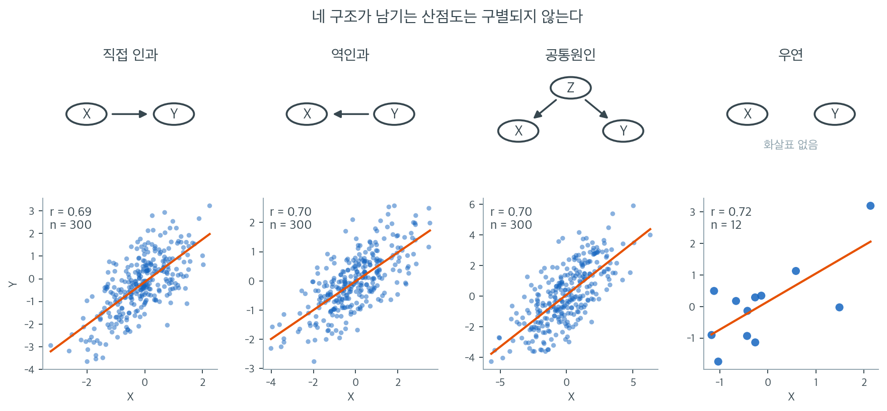

# 인과 개관

## 1. 인과의 이해

인과는 통계학, 과학, 일상적 추론의 기본 개념이다. 한 사건(원인)이 다른 사건(결과)을 직접 만들어내거나 그것에 영향을 주는 관계를 가리킨다. 상관이 관계를 시사할 수는 있지만, 인과는 한 변수의 변화가 다른 변수의 변화에 **책임이 있다**는 뜻까지 담는다는 점에서 한 걸음 더 나아간다.

인과를 이해하는 일은 특정 결과로 이어지는 요인을 찾아내고 그것에 개입하려는 의학, 경제학, 사회과학에서 결정적으로 중요하다.

---

## 2. 상관과 인과

상관과 인과를 구별하는 일이 필수적이다. 상관은 두 변수가 함께 움직인다는 것을 나타낼 뿐 하나가 다른 하나를 일으킨다는 뜻은 아니다. 예를 들어 아이스크림 판매와 익사 사고는 여름에 함께 늘지만 아이스크림을 먹는다고 익사하지 않는다. 고전적인 원리를 잘 보여준다: **상관은 인과를 함의하지 않는다**.

인과에는 더 엄밀한 증거가 필요하다. 인과관계를 확립하려면 대개 통제실험, 종단 연구, 그 밖에 교란변수를 배제할 수 있는 방법이 동원된다.

"상관은 인과를 함의하지 않는다"는 문장은 너무 익숙해서 오히려 실감이 나지 않는다. 위 그림은 그 문장을 눈으로 보여준다. 네 자료는 각각 전혀 다른 기제로 만들었다. 첫째는 $X$가 $Y$를 일으켰고, 둘째는 반대로 $Y$가 $X$를 일으켰으며, 셋째는 $X$와 $Y$ 둘 다 제3의 변수 $Z$가 일으켰고, 넷째는 아무 관계도 없는 두 변수를 그냥 12번 뽑았을 뿐이다. 그런데 상관계수는 차례로 $0.69$, $0.70$, $0.70$, $0.72$로 사실상 구별되지 않는다.

여기서 중요한 점은 네 산점도가 *비슷하게 생겼다*는 것이 아니라, **자료에 담긴 정보만으로는 네 구조를 가려낼 방법이 원리적으로 없다**는 것이다. 상관계수는 $x$와 $y$가 함께 어떻게 흩어져 있는지만 요약할 뿐, 어느 쪽 화살표가 먼저였는지, 뒤에 무엇이 숨어 있는지는 애초에 계산에 들어가지 않는다. 그 정보는 자료 바깥, 즉 실험 설계나 시간 순서나 분야 지식에서 와야 한다.

네 번째 판이 특히 눈여겨볼 만하다. 관측값이 12개뿐인데 $r = 0.72$이고 $p = 0.009$까지 나왔다. 두 변수는 서로 완전히 독립인데도 그렇다. 작은 표본에서는 우연만으로도 이 정도 상관이 어렵지 않게 나오므로, 인과 구조를 따지기 전에 **표본이 이 상관을 뒷받침할 만큼 큰지**부터 물어야 한다. 아래에서 다룰 다섯 가지 인과 기준은 결국 이 그림의 네 판을 서로 갈라놓기 위한 장치들이다.

### 상관(또는 연관)은 인과를 함의하지 않는다

참고: [Correlation vs Causation in Data Science](https://sundaskhalid.medium.com/correlation-vs-causation-in-data-science-66b6cfa702f0)

**Khan Academy 참고 자료**: [Invalid Conclusions from Studies Example](https://www.khanacademy.org/math/ap-statistics/gathering-data-ap/sampling-observational-studies/v/invalid-conclusions-studies-example)

---

## 3. 인과의 기준

두 변수 사이에 인과관계가 있는지 판단하는 데 도움이 되는 기준들이 있다:

1. **시간적 선행**: 원인이 결과보다 먼저 일어나야 한다. 흡연이 폐암을 일으킨다고 주장하려면 연구 참가자에서 흡연이 폐암 진단보다 앞서야 한다.

2. **원인과 결과의 공변**: 원인과 결과가 일관된 관계를 보여야 한다. 원인의 변화가 결과의 변화와 연관되어야 한다. 신체 활동이 정말로 보호 효과가 있다면 활동량이 많을수록 심장질환 발생률이 일관되게 낮아야 한다.

3. **교란변수의 배제**: 교란변수는 원인과 결과 모두에 영향을 줄 수 있는 외부 요인이다. 직접적인 연결을 확립하려면 이 변수들을 통제해야 한다.

4. **개연성**: 인과관계에 대해 과학적으로 합당한 기제나 설명이 있어야 한다. 흡연과 폐암의 인과적 연결은 담배 연기에 발암물질이 들어 있다는 생물학적 증거로 뒷받침된다.

5. **실험적 증거**: 통제실험이 인과에 대한 가장 강한 증거를 준다. 무작위 대조 시험(RCT)은 편향과 교란요인을 최소화하므로 임상 연구의 표준이다.

---

## 4. 인과 확립의 어려움

- **교란변수**: 교란요인을 식별하고 통제하는 일은 가장 큰 과제 중 하나이다. 교란요인은 변수들 사이의 참 관계를 가려 잘못된 결론으로 이끌 수 있다.

- **역인과**: 인과의 방향이 불분명한 경우가 있다. 건강이 나쁘면 소득이 줄 수 있지만 소득이 낮아서 건강이 나빠질 수도 있다. 어느 쪽이 원인인지 확립하려면 신중한 연구 설계가 필요하다.

- **윤리적·실무적 제약**: 인과를 확립하기 위한 실험이 비현실적이거나 비윤리적인 경우가 많다. 효과를 보려고 사람을 해로운 물질에 노출시키는 것은 비윤리적이다. 이런 경우 연구자는 관찰연구와 정교한 통계 방법으로 인과를 추론한다.

---

**보기 1.**  흡연과 폐암 — 기념비적 연구. 흡연과 폐암 사이의 인과적 연결은 의학 연구에서 가장 잘 기록된 예 중 하나이다.

??? success "풀이"
    1950년대에 영국의 연구자 Richard Doll과 Austin Bradford Hill은 수천 명의 영국 의사를 대상으로 기념비적인 **코호트 연구**를 수행했다. 이 연구는 여러 해에 걸쳐 의사들을 추적하며 흡연 습관과 건강 결과에 대한 자료를 모았다. 결과는 담배를 피우는 의사가 비흡연자보다 폐암 발생률이 유의하게 높음을 보여주었다.

    교란변수를 배제하기 위해 연구자들은 나이, 성별, 사회경제적 지위 같은 요인을 통제했다. 연구 설계는 흡연이 폐암 발생보다 앞섰음을 보장했고, 여러 연구와 모집단에 걸친 일관된 결과가 인과적 연결의 강한 증거를 제공했다.

    이 연구는 흡연율을 줄이려는 공중보건 캠페인과 정책 변화로 이어져 결국 수백만 명의 생명을 구했다.

**보기 2.**  백신과 질병 박멸 — 소아마비의 경우. 소아마비는 한때 널리 퍼져 전 세계 수백만 명에게 마비와 죽음을 가져온 무서운 병이었다. 20세기 중반 소아마비 백신의 도입이 전환점이 되었다.

??? success "풀이"
    공중보건 당국이 대대적인 예방접종 캠페인을 벌였고, 백신을 접종한 나라에서 소아마비 발생이 극적으로 줄었다. 인과적 연결은 접종자가 미접종자보다 소아마비에 걸릴 가능성이 유의하게 낮음을 보여준 **무작위 대조 시험**을 포함한 엄밀한 과학 연구로 확립되었다.

    소아마비 백신의 성공은 광범위한 예방접종 노력으로 이어져 세계를 질병 박멸에 가깝게 만들었다. 효과적인 공중보건 개입을 이끄는 데 인과의 확립이 얼마나 중요한지 보여주는 예이다.

**보기 3.**  이중 눈가림 시험과 약효. 의학에서 인과를 확립하는 가장 엄밀한 방법 중 하나가 **이중 눈가림 시험**이다. 이 설계에서는 참가자도 연구자도 누가 치료를 받고 누가 위약을 받는지 모른다. 편향을 없애고 관측된 효과를 치료 덕분이라고 볼 수 있게 한다.

??? success "풀이"
    **예시**: 새 혈압약을 시험하는 임상시험을 생각하자. 참가자를 무작위로 두 집단에 배정하여 한쪽은 실제 약을, 다른 쪽은 위약을 받는다. 몇 달 뒤 약 집단이 위약 집단보다 혈압이 유의하게 떨어졌다. 이중 눈가림 설계 덕분에 이 감소가 기대감이나 다른 교란요인이 아니라 약 때문임을 확신할 수 있다.

**보기 4.**  신약 개발의 단계와 인과적 증거. 신약 개발은 1상부터 4상까지 단계를 나누어 표본을 키워 가며 진행된다. 인과추론의 관점에서 중요한 것은 **단계마다 묻는 질문이 다르고, 따라서 인과적 지위도 다르다**는 점이다.

??? success "풀이"
    - **1상**: 건강한 자원자 20–80명을 대상으로 안전성, 용량 범위, 체내동태를 본다. 대조군이 없으므로 인과 비교를 하는 단계가 아니다.
    - **2상**: 대상 질환 환자 100–200명에게 투여하여 약리효과를 확인하고 적정 용량을 정한다. 이 단계부터 무작위화와 눈가림이 들어온다.
    - **3상**: 수백에서 수천 명 규모의 **무작위 대조 시험**으로 효능을 확증한다. 허가의 근거가 되는 인과적 증거는 여기서 나온다.
    - **4상**: 시판 후 장기 안전성을 감시한다. 대개 무작위화가 없으므로 관찰연구의 한계를 그대로 안는다.

    **예시**: 새 백신의 3상 시험은 참가자를 무작위로 백신군과 위약군에 배정한다. 백신군의 감염 발생이 유의하게 낮으면, 그 차이는 무작위화 덕분에 백신 때문이라고 말할 수 있다. 같은 백신을 접종 희망자와 비희망자로 나누어 비교했다면 두 집단이 애초에 다른 사람들이므로 같은 말을 할 수 없다.

    !!! note "더 자세한 내용"
        각 단계의 설계가 왜 그렇게 다른지, 규제기관이 왜 확증시험을 두 건 요구하는지, 3상 표본크기가 볼 수 있는 위해의 한계를 어떻게 정하는지는 1장의 **통제실험** 절에서 다룬다.

**보기 5.**  학력과 소득 — 종단 연구. 개인을 시간에 걸쳐 추적하는 종단 연구는 사회과학에서 인과를 확립하는 데 필수적이다.

??? success "풀이"
    어떤 장기 연구가 다양한 사회경제적 배경의 학생들을 수십 년에 걸쳐 추적하며 학력, 직업 이력, 소득 자료를 모았다. 분석 결과 학력이 높은 개인이 평생에 걸쳐 일관되게 더 많이 버는 것으로 나타났다.

    인과를 확립하기 위해 연구자들은 가정 배경, 지능, 유년기의 기회 같은 교란변수를 통제했다. 이런 요인들을 고정한 상태에서도 높은 학력이 소득 잠재력 증가로 이어짐을 보임으로써 학력과 소득 사이 인과관계의 강한 증거를 제공했다.

---

## 연습문제

**연습문제 1.** 
어떤 도시가 경찰관이 많은 동네일수록 범죄율이 높다는 것을 관측하고 경찰 배치를 줄이려 한다. 이 추론의 논리적 결함을 지적하고 어떤 종류의 교란이 작동하는지 설명하라.

??? success "풀이"
    논리적 결함은 공통원인을 무시한 채 **상관과 인과를 혼동**한 것이다. 경찰관이 범죄를 일으키는 것이 아니라, 범죄율이 높은 동네에 대응으로 경찰관이 더 배치되는 것이다. 교란변수는 **바탕에 있는 범죄 수준**이며, 그것이 경찰 배치 증가와 관측된 범죄율 모두를 일으킨다.

    이는 **배정 편향**(또는 적응증에 의한 교란)의 예이다. 처치(경찰 배치)가 바로 그 처치가 영향을 주려는 결과(범죄)에 근거해 배정된다. 이 상관에 근거해 경찰 배치를 줄이면 의도와 반대로 범죄가 늘어날 가능성이 크다.

---

**연습문제 2.** 
어떤 기사가 "유기농 식품을 먹는 사람의 암 발생률이 25% 낮다"고 보도했다. Bradford Hill의 기준으로 이 주장을 평가하라. 이 관찰 결과만으로 충족되는 기준은 무엇이고 추가 증거가 필요한 기준은 무엇인가?

??? success "풀이"
    관찰 결과만으로 충족될 수 있는 것:

    - **연관의 강도:** 25% 감소는 중간 정도로 강한 연관이다.
    - **일관성:** 여러 모집단의 여러 연구가 같은 결과를 보여야만 평가할 수 있다.

    추가 증거가 필요한 기준:

    - **시간성:** 유기농 식품 섭취가 암 진단보다 앞섰음을 확인해야 한다(전향적 설계가 필요하다).
    - **생물학적 개연성:** 기제를 제시해야 한다(예: 농약 노출 감소).
    - **용량–반응:** 유기농 식품을 더 많이 먹을수록 위험이 더 줄어야 한다.
    - **실험:** 교란을 배제하려면 무작위 시험이 필요하다(유기농 식품을 먹는 사람은 운동도 더 하고 담배도 덜 피울 수 있다).

    관찰 결과만으로는 인과를 확립하기에 충분하지 않다.

---

**연습문제 3.** 
역인과를 예를 들어 설명하라. 무작위 대조 시험(RCT)은 역인과의 가능성을 어떻게 제거하는가?

??? success "풀이"
    **역인과**는 원인이라고 가정한 것이 실제로는 결과일 때 일어난다. 예를 들어 어떤 연구가 비타민을 먹는 사람이 더 건강하다고 보고한다. 가정된 방향은 비타민이 건강을 만든다는 것이지만, 반대일 수도 있다. 건강한 사람이 건강을 더 의식해서 비타민을 먹을 가능성이 높은 것이다.

    **RCT**는 결과를 측정하기 **전에** 참가자를 무작위로 처치군과 대조군에 배정하여 역인과를 제거한다. 처치가 참가자의 선택이 아니라 연구자에 의해 배정되므로 결과가 처치 배정의 원인이 될 수 없다. 시간 순서가 설계로 보장된다.

---

**연습문제 4.** 
새 개인교습 프로그램이 시험 점수 향상을 일으키는지 검정하는 연구를 설계하라. 처치, 대조, 무작위화 절차, 잠재적 교란요인에 대한 대처를 명시하라.

??? success "풀이"

    1. **처치군:** 개인교습 프로그램을 받도록 무작위 배정된 학생들.
    2. **대조군:** 교습 없음(또는 구조화되지 않은 자습 시간 같은 위약 조건)에 무작위 배정된 학생들.
    3. **무작위화:** 난수 생성기로 각 학생을 같은 확률로 처치군이나 대조군에 배정한다. 기저 시험 점수로 층화 무작위화하면 균형이 개선된다.
    4. **무작위화로 다루어지는 교란요인:** 사회경제적 지위, 이전 학업 성취, 동기, 부모의 관여가 기댓값 수준에서 두 집단에 균형 있게 배분된다.
    5. **측정:** 연구 기간이 끝난 뒤 두 집단에 같은 표준화 시험을 시행한다.
    6. **분석:** 이표본 $t$-검정이나 분산분석으로 평균 점수를 비교한다. 인과효과는 $\bar{Y}_{\text{처치}} - \bar{Y}_{\text{대조}}$로 추정한다.

---

**연습문제 5.** 
§2 의 그림에서 네 번째 판은 서로 **완전히 독립인** 두 변수를 $n = 12$ 번 뽑은 것인데도 $r = 0.72$, $p = 0.009$ 가 나왔다. 상관계수의 유의성 검정은 자유도 $n - 2$ 의 통계량

$$
t = \frac{r\sqrt{n-2}}{\sqrt{1-r^2}}
$$

를 쓴다.

(a) $r = 0.72$, $n = 12$ 에 대해 $t$ 를 구하고, $t_{0.005,\,10} = 3.169$ 와 비교하여 양쪽꼬리 $p$ 값이 $0.01$ 보다 작음을 확인하라.

(b) $n = 12$ 에서 양쪽꼬리 $p$ 값이 $0.01$ 미만이 되는 가장 작은 $\lvert r \rvert$ 을 구하라.

(c) 서로 독립인 변수쌍을 $n = 12$ 씩 20 번 독립적으로 뽑아 매번 유의수준 $0.01$ 로 검정한다면, 적어도 한 번 "유의한 상관"이 나올 확률은 얼마인가?

(d) (b)(c) 의 답을 가지고, 네 번째 판이 "드문 사고"인지 아닌지 한 줄로 판정하라.

??? success "풀이"
    **(a)** $r^2 = 0.72^2 = 0.5184$ 이므로 $1 - r^2 = 0.4816$ 이고 $\sqrt{0.4816} = 0.69397$ 이다. $\sqrt{n-2} = \sqrt{10} = 3.16228$ 이므로

    $$
    t = \frac{0.72 \times 3.16228}{0.69397} = \frac{2.27684}{0.69397} = 3.281
    $$

    이다. $3.281 > 3.169 = t_{0.005,\,10}$ 이므로 양쪽꼬리 $p$ 값은 $2 \times 0.005 = 0.01$ 보다 작다. 실제로 $p = 0.0083$ 이고, 쪽에 적힌 $0.009$ 와 맞는다.

    **(b)** $t$ 의 식을 $r$ 에 대해 풀면

    $$
    r^2 (n-2) = t^2 (1 - r^2) \quad\Longrightarrow\quad r^2 \bigl(n - 2 + t^2\bigr) = t^2 \quad\Longrightarrow\quad \lvert r \rvert = \frac{t}{\sqrt{n-2+t^2}}
    $$

    이다. $t = t_{0.005,\,10} = 3.169$ 를 넣으면 $t^2 = 10.043$ 이고

    $$
    \lvert r \rvert = \frac{3.169}{\sqrt{10 + 10.043}} = \frac{3.169}{4.4769} = 0.708
    $$

    이다. 즉 $n = 12$ 에서는 $\lvert r \rvert \ge 0.708$ 이면 $p < 0.01$ 이다.

    **(c)** 독립인 변수쌍에 대해 매 검정이 1 종 오류를 낼 확률은 유의수준 $0.01$ 이다. 20 번이 서로 독립이므로 한 번도 유의하지 않을 확률이 $0.99^{20} = 0.818$ 이고,

    $$
    P(\text{적어도 한 번 유의}) = 1 - 0.99^{20} = 1 - 0.818 = 0.182
    $$

    이다. 약 18%, 다섯 번 중 한 번꼴이다.

    **(d)** 드문 사고가 아니다. $n = 12$ 에서는 $\lvert r \rvert$ 이 $0.708$ 만 넘으면 유의해지고, 아무 관계 없는 변수쌍을 스무 번만 들여다보면 그런 일이 18% 확률로 벌어진다. $p$ 값이 작다는 것은 "우연으로 보기 어렵다"는 말일 뿐이고, 그것도 **한 번만 보았을 때**의 이야기다. 네 판을 가려내지 못하는 문제(구조의 문제)와 작은 표본에서 우연 상관이 쉽게 나오는 문제(표본크기의 문제)는 서로 다른 함정이며, 네 번째 판은 둘을 동시에 보여준다.

---

**연습문제 6.** 
보기 5 의 종단 연구를 수치로 만들어 보자. 처치 $T = 1$ 은 대졸, $T = 0$ 은 고졸이고 결과 $Y$ 는 40 대의 연소득(만원)이다. 층 변수 $Z$ 는 유년기 가정 배경으로 $Z = H$(유복함), $Z = L$(그렇지 않음)의 두 값을 가진다. 자료가 다음과 같다.

| 층 | $E[Y \mid T=0, Z=z]$ | $E[Y \mid T=1, Z=z]$ | $P(z \mid T=1)$ | $P(z \mid T=0)$ |
|---|---|---|---|---|
| $z = H$ | 3600 | 4000 | 0.7 | 0.2 |
| $z = L$ | 2400 | 2800 | 0.3 | 0.8 |

(a) 거친 차이 $\Delta = E[Y \mid T=1] - E[Y \mid T=0]$ 을 구하라.

(b) 1 장의 정리 1(거친 차이는 층별 효과와 구성 차이의 합이다)로 $\Delta$ 를 두 항으로 쪼개고, 교란항이 $\Delta$ 의 몇 %를 차지하는지 구하라.

(c) 가정 배경을 통제하지 않고 $\Delta$ 를 학력의 인과효과로 보고하면 몇 배 과대평가인가? 보기 5 의 연구자들이 가정 배경을 통제한 이유를 §3 의 다섯 기준 중 하나와 연결해 한 줄로 쓰라.

??? success "풀이"
    **(a)** 전확률의 법칙으로 각 군의 평균을 구한다.

    $$
    E[Y \mid T=1] = 0.7 \times 4000 + 0.3 \times 2800 = 2800 + 840 = 3640
    $$

    $$
    E[Y \mid T=0] = 0.2 \times 3600 + 0.8 \times 2400 = 720 + 1920 = 2640
    $$

    따라서 $\Delta = 3640 - 2640 = 1000$ (만원)이다.

    **(b)** 층별 효과는 $\Delta_H = 4000 - 3600 = 400$, $\Delta_L = 2800 - 2400 = 400$ 이다. 층별 효과의 가중평균은 처치군의 층 비율로 가중하므로

    $$
    \sum_z \Delta_z P(z \mid T=1) = 400 \times 0.7 + 400 \times 0.3 = 400
    $$

    이고, 구성 차이(교란항)는

    $$
    \sum_z E[Y \mid 0, z]\bigl[P(z \mid 1) - P(z \mid 0)\bigr] = 3600 \times (0.7 - 0.2) + 2400 \times (0.3 - 0.8) = 1800 - 1200 = 600
    $$

    이다. 합이 $400 + 600 = 1000 = \Delta$ 로 맞는다. 교란항의 비중은 $600/1000 = 60\%$ 이다.

    **(c)** 가정 배경을 고정했을 때의 효과는 두 층 모두 400 만원인데 거친 차이는 1000 만원이므로 $1000/400 = 2.5$ 배 과대평가다. 과대평가가 생기는 까닭은 교란의 두 조건이 모두 성립하기 때문이다 — 대졸자 중 유복한 집 출신 비율(0.7)이 고졸자 쪽(0.2)보다 훨씬 높고, 유복한 집 출신은 학력과 무관하게 이미 소득이 1200 만원 높다. 보기 5 의 연구자들이 가정 배경을 통제한 것은 §3 의 셋째 기준인 **교란변수의 배제**를 위한 것이고, 통제하지 않으면 거친 차이의 60%가 학력이 아니라 집안에서 온 몫이 된다.

---

**연습문제 7.** 
보기 4 의 4 상(시판 후 감시) 자료에서, 어떤 심부전 약을 처방받은 환자의 1 년 사망률이 처방받지 않은 환자보다 **높게** 나왔다. 같은 약의 3 상 무작위 대조 시험에서는 사망률이 유의하게 **낮았다**.

(a) §3 의 다섯 기준 중, 이 4 상 관찰 자료만으로 뒷받침된다고 말할 수 있는 것을 고르라.

(b) 무너진 기준은 무엇이며 교란변수는 무엇인가? 이것이 연습문제 1 에서 본 교란과 같은 꼴임을 밝히라.

(c) 같은 약인데 3 상에서는 왜 이 문제가 생기지 않는가? 1 장 정리 1 의 교란항을 써서 답하라.

(d) 그렇다면 4 상의 결과를 버리고 3 상만 믿으면 되는가? 보기 4 가 4 상을 따로 두는 이유와 연결해 답하라.

??? success "풀이"
    **(a)** 두 가지다. **시간적 선행** — 처방이 사망보다 앞서 기록되므로 순서는 맞다. **원인과 결과의 공변** — 처방 여부와 사망률이 함께 움직이는 것은 관측되었다. 다만 둘은 인과의 **필요조건**일 뿐이다.

    **(b)** 무너진 것은 셋째 기준인 **교란변수의 배제**다. 교란변수는 **질병의 중증도**다. 심부전이 중한 환자일수록 약을 처방받을 가능성이 높고, 동시에 중증도 자체가 사망률을 높인다. 즉 중증도가 처치와 결과 모두의 원인이다. 연습문제 1 의 경찰–범죄 사례와 정확히 같은 꼴이다 — 거기서는 범죄 수준이 경찰 배치와 범죄율 모두를 일으켰고, 처치가 **바로 그 처치가 바꾸려는 결과에 근거해 배정**되었다. 이것이 **배정 편향**(적응증에 의한 교란)이며, 그래서 효과의 부호까지 뒤집혀 보일 수 있다.

    **(c)** 3 상에서는 처치 $T$ 를 동전으로 정한다. 그러면 $T$ 가 중증도 $Z$ 와 독립이어서 $P(z \mid 1) = P(z \mid 0)$ 이고, 1 장 정리 1 의 교란항

    $$
    \sum_z E[Y \mid 0, z]\bigl[P(z \mid 1) - P(z \mid 0)\bigr]
    $$

    의 괄호가 모든 $z$ 에서 0 이 되어 항 전체가 사라진다. 남는 것은 층별 효과 $\Delta_z$ 들의 가중평균이고, 가중치가 음이 아니고 합이 1 이므로 **모든 $\Delta_z$ 와 반대 부호를 가질 수 없다.** 무작위화의 값어치는 측정하지 못한 $Z$ 에 대해서까지 이 항을 0 으로 만든다는 데 있다.

    **(d)** 아니다. 효능의 인과적 증거는 3 상에서 오지만, 3 상은 수백에서 수천 명 규모이므로 발생률이 아주 낮은 위해는 한 건도 관측되지 않을 수 있다. 4 상은 무작위화가 없어 **효능 비교에는 쓸 수 없지만**, 드문 부작용을 발견하는 데는 유일한 창이다. 올바른 독해는 "4 상의 사망률 비교를 효능 비교로 읽지 않는 것"이지 4 상을 버리는 것이 아니다.

---

**연습문제 8.** 
층이 둘($z \in \{H, L\}$)인 경우를 보자. $a = E[Y \mid 0, H]$, $b = E[Y \mid 0, L]$, $d = P(H \mid 1) - P(H \mid 0)$ 이라 하자.

(a) 1 장 정리 1 의 구성 차이 항이 정확히 $(a - b)\,d$ 와 같음을 보이라.

(b) 두 층의 효과가 같아 $\Delta_H = \Delta_L = \Delta_0$ 라 하자. 거친 차이 $\Delta$ 를 $\Delta_0$, $a-b$, $d$ 로 쓰라.

(c) 처치가 두 층 모두에서 해로워 $\Delta_0 = -200$ 인데 $a - b = 1200$ 이다. 거친 차이가 **양수**가 되어 처치가 이롭게 보이는 $d$ 의 범위를 구하고, $d = 0.5$ 일 때의 $\Delta$ 를 구하라.

(d) (a) 의 곱셈 꼴을 근거로, 교란이 왜 "층 구성이 다르다"와 "층이 결과와 얽혀 있다"는 **두** 조건을 동시에 요구하는지 설명하라.

??? success "풀이"
    **(a)** 층이 둘뿐이므로 $P(L \mid t) = 1 - P(H \mid t)$ 이고

    $$
    P(L \mid 1) - P(L \mid 0) = \bigl(1 - P(H \mid 1)\bigr) - \bigl(1 - P(H \mid 0)\bigr) = -\,d
    $$

    이다. 따라서 구성 차이 항은

    $$
    \sum_z E[Y \mid 0, z]\bigl[P(z \mid 1) - P(z \mid 0)\bigr] = a\,d + b\,(-d) = (a - b)\,d
    $$

    이다. $\square$

    **(b)** 층별 효과의 가중평균은 $\Delta_0 \bigl(P(H\mid1) + P(L\mid1)\bigr) = \Delta_0$ 이므로

    $$
    \Delta = \Delta_0 + (a-b)\,d
    $$

    이다. 거친 차이는 참 효과에 **교란항 하나를 더한 것**이고, 그 교란항은 두 수의 곱이다.

    **(c)** $\Delta = -200 + 1200\,d > 0$ 이려면

    $$
    d > \frac{200}{1200} = \frac{1}{6} = 0.1667
    $$

    이다. 즉 처치군의 $H$ 비율이 대조군보다 16.7%포인트만 높아도 부호가 뒤집힌다. $d = 0.5$ 이면

    $$
    \Delta = -200 + 1200 \times 0.5 = -200 + 600 = 400
    $$

    이다. 두 층 모두에서 200 만원 손해인 처치가 전체로는 400 만원 이득으로 보인다 — 심슨의 역설이다.

    **(d)** 교란항이 $(a-b)\,d$ 라는 **곱**이므로 두 인자 중 하나만 0 이어도 항 전체가 0 이다. $d = 0$ 이면(처치군과 대조군의 층 구성이 같으면) 층이 결과와 아무리 강하게 얽혀 있어도, 즉 $a - b$ 가 아무리 커도 교란이 없다. 거꾸로 $a = b$ 이면(층이 결과와 무관하면) 층 구성이 아무리 치우쳐도 교란이 없다. 그래서 교란변수의 정의에 두 조건이 함께 들어가고, 어느 한쪽을 깨는 것만으로 교란을 없앨 수 있다. 무작위화는 앞쪽($d = 0$)을 모든 변수에 대해 한꺼번에 깨는 장치다.

---

**연습문제 9.** 
§2 는 네 판에 대해 "자료에 담긴 정보만으로는 네 구조를 가려낼 방법이 원리적으로 없다"고 말한다. 셋째 판의 $r = 0.70$ 을 가지고 이것을 식으로 확인하자. 아래 세 모형에서 모든 잡음은 서로 독립인 평균 0 의 정규분포다.

- **모형 1 ($X \to Y$):** $X \sim N(0,1)$, $Y = 0.7X + \delta$, $\delta \sim N(0, v)$
- **모형 2 ($Y \to X$):** $Y \sim N(0,1)$, $X = 0.7Y + \delta$, $\delta \sim N(0, v)$
- **모형 3 ($Z$ 가 공통원인):** $Z \sim N(0, \sigma^2)$, $X = Z + \varepsilon_1$, $Y = Z + \varepsilon_2$, $\varepsilon_1, \varepsilon_2 \sim N(0, \tau^2)$

(a) 세 모형이 모두 $\operatorname{Var}(X) = \operatorname{Var}(Y) = 1$ 과 $\operatorname{Cor}(X,Y) = 0.7$ 을 주도록 $v$, $\sigma^2$, $\tau^2$ 을 정하라.

(b) 그렇게 정했을 때 $(X, Y)$ 의 결합분포가 세 모형에서 **같음**을 말하라. 이로부터 표본크기를 무한히 키우면 세 구조를 가려낼 수 있는지 답하라.

(c) 네 번째 판(서로 독립인 두 변수)은 (b) 의 세 모형과 다른 지위에 있다. 어떻게 다른가?

(d) (b) 와 (c) 를 합쳐, §2 가 말한 "그 정보는 자료 바깥에서 와야 한다"를 두 종류의 한계로 나누어 정리하라.

??? success "풀이"
    **(a)** 세 모형 모두 $(X,Y)$ 가 평균 0 의 이변량 정규분포가 된다. 분산과 공분산만 맞추면 된다.

    모형 1: $\operatorname{Var}(Y) = 0.7^2 \times 1 + v = 0.49 + v$ 이므로 $v = 0.51$ 이어야 $\operatorname{Var}(Y) = 1$ 이다. 이때 $\operatorname{Cov}(X,Y) = 0.7\operatorname{Var}(X) = 0.7$ 이고 두 분산이 1 이므로 $\operatorname{Cor}(X,Y) = 0.7$ 이다. 모형 2 는 $X$ 와 $Y$ 의 역할만 바꾼 것이므로 똑같이 $v = 0.51$ 이다.

    모형 3: $\operatorname{Cov}(X,Y) = \operatorname{Var}(Z) = \sigma^2$ 이고 $\operatorname{Var}(X) = \operatorname{Var}(Y) = \sigma^2 + \tau^2$ 이므로

    $$
    \operatorname{Cor}(X,Y) = \frac{\sigma^2}{\sigma^2 + \tau^2} = 0.7, \qquad \sigma^2 + \tau^2 = 1
    $$

    에서 $\sigma^2 = 0.7$, $\tau^2 = 0.3$ 이다.

    **(b)** 세 모형 모두 $(X,Y)$ 는 평균 $(0,0)$, 공분산행렬

    $$
    \Sigma = \begin{pmatrix} 1 & 0.7 \\ 0.7 & 1 \end{pmatrix}
    $$

    인 이변량 정규분포다. 이변량 정규분포는 평균과 공분산행렬로 완전히 결정되므로 **세 모형의 결합분포는 같은 분포다.** 분포가 같으면 어떤 표본에 대해서도 세 모형의 가능도가 똑같으므로, 어떤 통계량도 어떤 검정도 세 구조를 가려낼 수 없다. 표본크기를 무한히 키워도 사정은 달라지지 않는다. 이것은 추정의 정확도 문제가 아니라 **식별 불가능**의 문제다.

    **(c)** 네 번째 판의 참 분포는 $\operatorname{Cor}(X,Y) = 0$ 이다. 표본상관계수는 $n \to \infty$ 에서 참값으로 수렴하므로, 표본을 키우면 $r \to 0$ 이 되어 $r \to 0.7$ 인 앞의 세 모형과 **구별된다.** 네 번째 판이 그림에서 다른 판들과 섞여 보이는 것은 구조 때문이 아니라 $n = 12$ 라는 **표본크기** 때문이다.

    **(d)** 두 한계가 서로 다르다.

    - **표본의 한계(c):** 자료를 더 모으면 풀린다. "상관이 0 인가 아닌가"는 통계적으로 답할 수 있는 질문이다.
    - **식별의 한계(b):** 자료를 더 모아도 풀리지 않는다. $X \to Y$, $Y \to X$, $Z$ 가 공통원인 중 어느 것인가는 $(X,Y)$ 의 결합분포에 흔적을 남기지 않기 때문이다.

    둘째 한계가 §3 의 다섯 기준이 필요한 이유다. 시간적 선행은 모형 1 과 2 를 가르고, 실험적 증거(무작위화)는 $X$ 를 밖에서 흔들어 모형 3 을 걸러내며, 개연성은 분야 지식을 들여온다. 셋 모두 자료 바깥에서 오는 정보다.

---

**연습문제 10.** 
보기 4 의 마지막 문장은 "같은 백신을 접종 희망자와 비희망자로 나누어 비교했다면 두 집단이 애초에 다른 사람들이므로 같은 말을 할 수 없다"고 말한다. 보기 2 의 소아마비 백신이 실제로 그런 설계도 함께 썼다. 관찰 설계에서 $T = 1$ 은 접종을 희망한 아이, $T = 0$ 은 희망하지 않은 아이이고, 결과 $Y$ 는 10 만 명당 소아마비 발생수다. 층 변수 $Z$ 는 가정의 위생 수준 $H$(높음) / $L$(낮음)이다. 소아마비는 위생이 좋은 집 아이에게 더 흔했고(어릴 때 자연 면역을 얻지 못해서), 접종을 희망한 집도 바로 그런 집이었다. 수치는 설명을 위해 만든 것이다.

| 층 | $E[Y \mid T=0, Z=z]$ | $E[Y \mid T=1, Z=z]$ | $P(z \mid T=1)$ | $P(z \mid T=0)$ |
|---|---|---|---|---|
| $z = H$ | 60 | 24 | 0.75 | 0.25 |
| $z = L$ | 20 | 8 | 0.25 | 0.75 |

(a) 각 층에서 백신이 발생률을 몇 % 줄였는지 구하라.

(b) 거친 차이 $\Delta$ 를 구하고, 연습문제 8 의 $(a-b)\,d$ 꼴로 층별 효과와 교란항으로 쪼개라.

(c) 거친 차이는 층별 효과의 가중평균의 몇 분의 1 인가?

(d) 두 층의 효과가 다르므로 층별 효과의 가중평균은 가중치 $P(z \mid 1)$ 에 따라 달라진다. 가중평균을 $-30$ 으로 묶어 두기 위해 $P(H \mid 1) = 0.75$ 는 그대로 두고 $P(H \mid 0)$ 만 바꿀 수 있다고 하자. 교란항이 백신의 효과를 **완전히** 가려 $\Delta = 0$ 이 되려면 $d$ 와 $P(H \mid 0)$ 이 얼마여야 하는가? 그 값이 뜻하는 바를 한 줄로 쓰라.

(e) 보기 2 가 말하는 무작위 대조 시험은 이 문제를 어떻게 없애는가? 연습문제 6 의 교란과 방향이 어떻게 다른지도 한 줄로 적으라.

??? success "풀이"
    **(a)** $H$ 층: $(60 - 24)/60 = 36/60 = 0.6$, 즉 60% 감소. $L$ 층: $(20-8)/20 = 12/20 = 0.6$, 역시 60% 감소다. 층 안에서 백신은 두 층 모두 발생률을 60% 줄인다.

    **(b)** 먼저 거친 차이를 직접 구한다.

    $$
    E[Y \mid T=1] = 0.75 \times 24 + 0.25 \times 8 = 18 + 2 = 20
    $$

    $$
    E[Y \mid T=0] = 0.25 \times 60 + 0.75 \times 20 = 15 + 15 = 30
    $$

    따라서 $\Delta = 20 - 30 = -10$ 이다. 분해하면 층별 효과가 $\Delta_H = 24 - 60 = -36$, $\Delta_L = 8 - 20 = -12$ 이므로 가중평균은

    $$
    \sum_z \Delta_z P(z \mid 1) = 0.75 \times (-36) + 0.25 \times (-12) = -27 - 3 = -30
    $$

    이고, $a - b = 60 - 20 = 40$, $d = 0.75 - 0.25 = 0.5$ 이므로 교란항은

    $$
    (a-b)\,d = 40 \times 0.5 = +20
    $$

    이다. 합이 $-30 + 20 = -10 = \Delta$ 로 맞는다.

    **(c)** $\lvert -10 \rvert / \lvert -30 \rvert = 1/3$ 이다. 거친 차이는 참 효과의 3 분의 1 밖에 보여주지 않는다. 교란항의 부호가 효과와 **반대**여서 효과를 깎아먹기 때문이다.

    **(d)** $\Delta = -30 + 40\,d = 0$ 에서

    $$
    d = \frac{30}{40} = 0.75
    $$

    이고 $P(H \mid 0) = 0.75 - 0.75 = 0$ 이다. 직접 확인하면 $E[Y \mid T=0] = 0 \times 60 + 1 \times 20 = 20 = E[Y \mid T=1]$ 이므로 정말로 $\Delta = 0$ 이다. 뜻은 이렇다 — 비희망자 집이 **하나도 빠짐없이** 위생이 낮은 집이어야 비로소 효과가 완전히 가려진다. 거꾸로 말하면 표의 $d = 0.5$ 라는 덜 극단적인 쏠림만으로도 이미 효과가 3 분의 1 로 깎였으니, 완전한 은폐는 극단이 필요하지만 심한 왜곡은 극단이 필요하지 않다.

    (가중평균까지 함께 움직이는 것을 허용하면 다른 답도 있다. 표처럼 $P(H \mid 0) = 1 - P(H \mid 1)$ 로 묶어 두면 $\Delta = -24 + 28\,d$ 이므로 $d = 6/7$, 즉 $P(H \mid 1) = 0.9286$, $P(H \mid 0) = 0.0714$ 에서 $\Delta = 0$ 이 된다.)

    **(e)** 무작위 대조 시험은 접종 여부를 희망이 아니라 동전으로 정한다. 그러면 $T$ 가 위생 수준 $Z$ 와 독립이어서 기댓값 수준에서 $P(H \mid 1) = P(H \mid 0)$, 즉 $d = 0$ 이 되고 교란항 $(a-b)\,d$ 가 사라진다. 남는 거친 차이는 모집단의 위생 구성으로 가중한 층별 효과의 평균이고, 가중치가 음이 아니고 합이 1 이므로 그 값은 $-36$ 과 $-12$ 사이에 있다(위생이 높은 집이 $3/4$ 인 모집단이라면 $-30$).

    방향이 연습문제 6 과 반대다. 연습문제 6 에서는 교란항(+600)이 참 효과(+400)와 같은 부호여서 효과를 **부풀렸고**, 여기서는 교란항(+20)이 참 효과($-30$)와 반대 부호여서 효과를 **가렸다**. 교란은 없는 효과를 만들어낼 뿐 아니라 있는 효과를 지우기도 한다. "유의한 차이가 없다"는 결론도 교란 앞에서는 똑같이 믿을 수 없다.

---

## 정리하며

인과의 이해는 정보에 근거한 결정과 과학 지식의 진보에 필수적이다. 상관이 변수들 사이의 관계를 시사할 수는 있지만 인과를 확립하려면 더 엄밀한 증거와 다음에 대한 신중한 고려가 필요하다:

- 교란요인
- 역인과
- 시간적 선행
- 실험 설계

인과의 기준을 적용하고 RCT, 종단 연구, 통계적 통제 등 적절한 연구 방법을 쓰면 여러 현상의 원인을 더 잘 이해하고 보건, 경제, 사회 정책에서 효과적인 개입을 개발할 수 있다.
