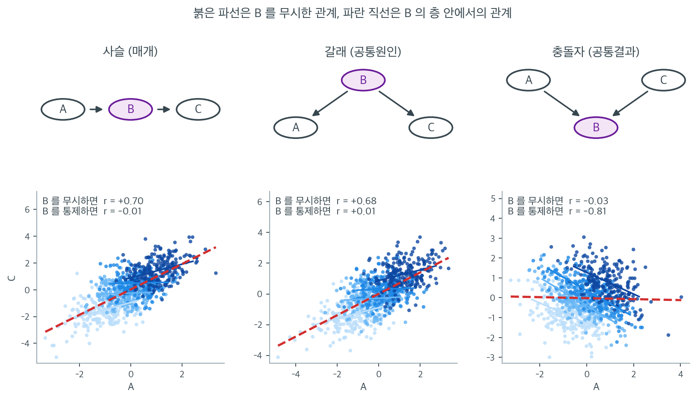

# 방향성 비순환 그래프

이 장에서 우리는 교란요인, 매개자, 충돌자, 잠복변수를 만나 왔다. **방향성 비순환 그래프**(DAG)는 변수들 사이의 인과관계를 나타내는 시각적·수학적 틀을 제공하여 어떤 변수를 통제하고 어떤 변수를 그대로 두어야 하는지 판정할 수 있게 해 준다. DAG는 주로 Judea Pearl이 발전시킨 현대 그래프 기반 인과추론의 토대이다.

---

## 1. DAG란

**방향성 비순환 그래프**는 다음으로 이루어진 그래프이다:

- **노드**(꼭짓점): 각 노드는 변수를 나타낸다.
- **방향 간선**(화살표): $A$에서 $B$로 가는 화살표는 $A$가 $B$의 직접 원인이라는 뜻이다.
- **비순환**: 방향 순환이 없다(화살표를 따라가 자기 자신으로 돌아올 수 없다).

두 노드 사이에 화살표가 없다는 것은 둘 사이에 직접적인 인과효과가 없다는 뜻이다(다른 노드를 통한 간접 효과는 있을 수 있다).

---

## 2. 세 가지 기본 구조

DAG의 모든 경로는 세 가지 기본 요소로 이루어진다. 이 세 구조를 이해하면 어떤 DAG의 통계적 함의든 판정할 수 있다.

### 1. 사슬 (매개)

$$
A \rightarrow B \rightarrow C
$$

$B$는 $A$에서 $C$로 가는 인과 경로 위의 **매개자**이다. 정보가 $B$를 통해 $A$에서 $C$로 흐른다.

- **조건화하지 않으면**: $A$와 $C$가 연관된다.
- **$B$로 조건화하면**: 경로가 막힌다. $B$가 주어졌을 때 $A$와 $C$가 조건부 독립이 된다.

### 2. 갈래 (공통원인)

$$
A \leftarrow B \rightarrow C
$$

$B$는 $A$와 $C$의 **공통원인**(교란요인)이다. 정보가 공통원인 $B$를 통해 $A$와 $C$ 사이를 흐른다.

- **조건화하지 않으면**: $A$와 $C$가 연관된다.
- **$B$로 조건화하면**: 경로가 막힌다. $B$가 주어졌을 때 $A$와 $C$가 조건부 독립이 된다.

### 3. 충돌자 (공통결과)

$$
A \rightarrow B \leftarrow C
$$

$B$는 **충돌자**이다. $A$와 $C$ 모두에 의해 생긴다.

- **조건화하지 않으면**: $A$와 $C$가 연관되지 **않는다**(경로가 막혀 있다).
- **$B$로 조건화하면**: 경로가 **열려** $A$와 $C$ 사이에 허위 연관이 생긴다.

!!! warning "충돌자로 조건화하면 편향이 생긴다"
    조건화가 경로를 막는 사슬·갈래와 달리, 충돌자로 조건화하면 막혀 있던 경로가 열린다. 이는 선택 편향의 흔한 원천이며, 회귀에 변수를 무분별하게 넣으면 추정이 나아지기는커녕 나빠질 수 있는 이유이다.

세 구조를 각각 900개 관측값으로 만들어 $A$와 $C$의 관계를 두 방식으로 잰 그림이다. 붉은 파선은 $B$를 무시하고 전체에 맞춘 직선이고, 점의 색은 $B$의 사분위 층이며 파란 직선들은 각 층 안에서 맞춘 직선이다. 표기된 두 숫자 중 아래쪽은 $B$를 통제한 뒤의 상관, 곧 $A$와 $C$를 각각 $B$에 회귀시키고 남은 잔차끼리의 상관이다.

사슬과 갈래는 숫자가 똑같이 움직인다. 사슬에서는 $+0.70 \to -0.01$, 갈래에서는 $+0.68 \to +0.01$. 붉은 파선은 가파르게 올라가는데 층 안의 파란 직선들은 거의 평평하다. **$B$를 알고 나면 $A$는 $C$에 대해 더 말해 줄 것이 없다**는 뜻이며, 이것이 "조건화하면 경로가 막힌다"의 구체적인 내용이다. 그리고 두 구조가 남기는 자료가 이렇게 구별되지 않는다는 사실이 중요하다. 상관 패턴만으로는 $B$가 매개자인지 교란요인인지 알 수 없고, 그래서 어느 쪽을 통제해야 하는지도 자료가 아니라 DAG가 결정한다.

충돌자는 정반대로 간다. $B$를 무시하면 $r = -0.03$, 곧 $A$와 $C$는 사실상 무관하다. 실제로 둘은 독립으로 생성했으니 옳은 값이다. 그런데 $B$를 통제하는 순간 $r = -0.81$이라는 강한 음의 상관이 **생겨난다.** 세 번째 판에서 각 층의 파란 직선이 가파르게 내려가는 것이 그것이다. 이유는 단순하다. $B = A + C$ 근처의 값으로 묶어 놓으면, 그 층 안에서 $A$가 큰 관측값은 $C$가 작을 수밖에 없다.

실무적 교훈은 하나다. **"가진 변수를 모두 넣으면 안전하다"는 직관은 틀렸다.** 위 세 판에서 $B$를 넣는 행위는 각각 총효과 차단, 교란 제거, 편향 생성이라는 전혀 다른 결과를 낳았고, 셋 다 같은 회귀 코드 한 줄로 보인다. 어느 경우인지는 변수 이름 옆의 화살표를 먼저 그려 봐야만 알 수 있다.

---

## 3. d-분리

**d-분리**(방향 분리) 개념은 세 기본 구조를 일반화하여, 주어진 조건 변수 집합 아래에서 두 변수가 조건부 독립인지 판정한다.

두 노드 $X$와 $Y$가 집합 $S$에 의해 **d-분리**된다는 것은, $X$와 $Y$ 사이의 모든 무방향 경로에 대해 다음 중 하나가 성립한다는 뜻이다:

1. 경로가 사슬 $A \rightarrow B \rightarrow C$ 또는 갈래 $A \leftarrow B \rightarrow C$를 포함하고 $B \in S$이다(충돌자가 아닌 노드로 조건화하여 경로가 막힌다). **또는**

2. 경로가 충돌자 $A \rightarrow B \leftarrow C$를 포함하고 $B \notin S$이며 $B$의 어떤 후손도 $S$에 없다(충돌자로 조건화하지 않아 경로가 막힌다).

$X$와 $Y$가 $S$에 의해 d-분리되면, 그 DAG와 양립하는 어떤 확률분포에서도 $X$와 $Y$는 $S$가 주어졌을 때 조건부 독립이다:

$$
X \perp\!\!\!\perp Y \mid S
$$

---

## 4. 뒷문 기준

**뒷문 기준**은 $X$가 $Y$에 미치는 인과효과를 추정할 때 어떤 변수를 통제해야 하는지 알려주는 실용적인 규칙이다.

변수 집합 $S$가 $(X, Y)$에 대해 뒷문 기준을 만족한다는 것은:

1. $S$의 어떤 변수도 $X$의 후손이 아니다.
2. $S$가 $X$로 들어오는 화살표를 포함하는 $X$–$Y$ 사이의 모든 경로("뒷문 경로")를 막는다.

그런 집합 $S$가 존재하면 $X$가 $Y$에 미치는 인과효과가 **조정 공식**으로 식별된다:

$$
P(Y \mid \text{do}(X = x)) = \sum_s P(Y \mid X = x, S = s) \, P(S = s)
$$

Pearl이 도입한 $\text{do}(\cdot)$ 표기는 개입 분포($X$를 어떤 값으로 설정할 때 일어나는 일)와 관찰 분포($X$가 어떤 값을 가질 때 우리가 관측하는 것)를 구별한다.

---

**보기 1.**  뒷문 기준의 적용. 다음 DAG를 생각하자:

??? success "풀이"
    $$
    Z \rightarrow X \rightarrow Y, \quad Z \rightarrow Y
    $$

    여기서 $Z$는 교란요인이다(뒷문 경로 $X \leftarrow Z \rightarrow Y$가 있다). $X$가 $Y$에 미치는 인과효과를 추정하려면:

    - **$Z$를 통제한다**: $Z$가 $X$의 후손이 아니고 뒷문 경로를 막으므로 $S = \{Z\}$가 뒷문 기준을 만족한다.
    - **아무것도 통제하지 않으면 안 된다**: $S = \emptyset$은 뒷문 경로 $X \leftarrow Z \rightarrow Y$가 열린 채로 남아 실패한다.

    이제 다음을 보자:

    $$
    X \rightarrow M \rightarrow Y, \quad X \rightarrow Y
    $$

    여기서 $M$은 매개자이다. $X$가 $Y$에 미치는 **총** 인과효과를 추정하려면:

    - **$M$을 통제하지 않는다**: ($X$로 들어오는 화살표가 없어) 뒷문 경로가 없으므로 $S = \emptyset$으로 충분하다.
    - **$M$을 통제하면** 간접 경로가 막혀 총효과가 아니라 직접효과만 추정하게 된다.

---

## 5. DAG를 쓰는 실무 절차

1. **DAG를 그린다.** 관련 변수를 모두 나열하고 인과관계에 대한 분야 지식에 근거해 화살표를 그린다. 이 단계는 통계 분석이 아니라 도메인 전문성을 요구한다.

2. **인과적 질문을 정한다.** 무엇을 추정하는가? $X$가 $Y$에 미치는 총효과? 직접효과?

3. **모든 뒷문 경로를 찾는다.** $X$로 들어오는 화살표를 가진 $X$에서 $Y$로의 경로를 모두 나열한다.

4. **뒷문 기준을 적용한다.** ($X$의 후손이나 충돌자를 포함하지 않으면서) 모든 뒷문 경로를 막는 집합 $S$를 찾는다.

5. **분석에서 $S$를 조정한다.** 회귀, 층화, 짝짓기 절차에서 $S$의 변수들을 공변량으로 넣는다.

---

## 6. 흔한 실수

| 실수 | 무엇이 잘못인가 |
|:---|:---|
| 총효과를 추정하면서 매개자를 통제 | 인과 경로의 일부를 막는다 |
| 충돌자를 통제 | 허위 경로를 연다 |
| 충돌자의 후손을 통제 | 역시 충돌자 경로를 연다 |
| 사용 가능한 모든 변수를 회귀에 넣기 | 충돌자 편향을 만들거나 인과 경로를 막을 수 있다 |

통제변수가 많을수록 언제나 좋은 것은 아니라는 것이 원칙이다. 어떤 변수를 넣고 뺄지는 DAG가 알려준다.

---

## 연습문제

**연습문제 1.** 
다음 인과 구조를 나타내는 DAG를 그려라: 흡연이 폐암을 일으키고, 흡연이 치아 착색을 일으키며, 폐암은 치아 착색을 일으키지 않는다. 흡연–폐암 관계에서 치아 착색이 교란요인인지, 매개자인지, 충돌자인지 밝혀라.

??? success "풀이"
    DAG는 흡연 $\to$ 폐암, 흡연 $\to$ 치아 착색이다. 폐암과 치아 착색 사이에는 화살표가 없다.

    치아 착색은 흡연–폐암 관계에서 교란요인도, 매개자도, 충돌자도 **아니다**. 흡연의 또 다른 결과(다른 인과 경로 위의 "후손")일 뿐이다. 치아 착색으로 조건화하는 것은 불필요하며 대체로 해롭지도 않지만 효율은 조금 떨어뜨린다.

    교란요인이라면 흡연과 폐암 모두의 공통원인이어야 하고, 매개자라면 둘 사이의 인과 경로 위에 있어야 하며, 충돌자라면 둘 모두의 공통결과여야 한다.

**연습문제 2.** 
DAG $X \to Z \to Y$에서 $Z$가 매개자인 이유와, $Z$로 조건화하면 $X$와 $Y$의 연관이 어떻게 되는지 설명하라.

??? success "풀이"
    $Z$는 $X$에서 $Y$로 가는 인과 경로 위에 있으므로 **매개자**이다. $X$의 효과는 $Z$를 통해 작동한다. $X$가 $Z$를 일으키고 $Z$가 다시 $Y$를 일으킨다.

    $Z$로 조건화하면(예: 회귀에 $Z$를 공변량으로 넣으면) 인과 경로 $X \to Z \to Y$가 막힌다. 그러면 $X$와 $Y$의 연관이 사라진다(직접 화살표 $X \to Y$도 있다면 직접효과만 남는다).

    실무적으로 중요하다. $X$가 $Y$에 미치는 **총** 인과효과를 추정하려면 매개자로 조건화해서는 안 된다. ($Z$를 통하지 않는) **직접**효과만 원한다면 $Z$로 조건화하는 것이 적절하다.

**연습문제 3.** 
DAG $X \to Z \leftarrow Y$를 생각하자. $Z$가 충돌자인 이유와 $Z$로 조건화할 때 생기는 역설적인 효과를 설명하라.

??? success "풀이"
    $X$와 $Y$에서 화살표 두 개가 들어오므로 $Z$는 **충돌자**이다. 이 구조에서 $X$와 $Y$는 주변적으로 독립이다(둘 사이에 인과적 연결이 없다).

    그러나 충돌자 $Z$로 조건화하면 $X$와 $Y$ 사이에 **허위 연관**이 생긴다. 이를 "충돌자 편향" 또는 "Berkson의 역설"이라 한다. 직관적으로, $Z$가 일어났음을 알 때 $X$가 원인이 아니었다는 것을 알면 $Y$가 원인일 가능성이 커지고(그 반대도 마찬가지), 그래서 음의 상관이 유도된다.

    **예:** 인구 전체에서는 재능($X$)과 외모($Y$)가 독립일 수 있지만, 배우들($Z$ = 배우가 됨. 재능이나 외모 중 하나가 필요하다) 안에서는 음의 상관으로 보인다. $Z$로 조건화하는 것이 조건화 전에는 막혀 있던 경로를 연 것이다.

**연습문제 4.** 
$U$가 관측되지 않을 때 $U \to X$, $U \to Y$, $X \to Y$인 DAG에서 교란 문제를 설명하고 $X$가 $Y$에 미치는 인과효과를 식별하기 위한 뒷문 기준을 진술하라.

??? success "풀이"
    변수 $U$는 $X$와 $Y$의 관측되지 않은 공통원인(교란요인)이다. 인과 경로 $X \to Y$가 참 인과효과를 주지만 뒷문 경로 $X \leftarrow U \to Y$가 허위 연관을 만든다. $U$를 조정하지 않으면 관측된 $X$–$Y$ 연관이 인과효과와 교란을 뒤섞는다.

    **뒷문 기준**(Pearl, 1993)은 이렇게 말한다: 변수 집합 $\mathbf{Z}$가 (1) $X$에서 $Y$로 가는 모든 뒷문 경로를 막고 (2) $\mathbf{Z}$의 어떤 변수도 $X$의 후손이 아니면, $\mathbf{Z}$는 $X$가 $Y$에 미치는 인과효과를 식별하기에 충분하다.

    이 DAG에서는 $U$가 관측되지 않고 경로 $X \leftarrow U \to Y$를 막는 관측 변수도 없으므로, 추가 가정(예: 도구변수) 없이는 관찰자료만으로 $X$가 $Y$에 미치는 인과효과를 **식별할 수 없다**.

**연습문제 5.** 
3 절의 d-분리 기준 2 는 충돌자 $B$ 자신뿐 아니라 "$B$ 의 어떤 후손도 $S$ 에 없다"까지 요구한다. 이 조항이 왜 필요한지 확인하자.

충돌자 구조에 화살표 하나를 덧붙인 DAG $A \to B \leftarrow C$, $B \to D$ 를 생각한다. $A$ 와 $C$ 는 독립인 $N(0,1)$ 이고 $B = A + C$ 이며, $D = B + \varepsilon$ 에서 $\varepsilon \sim N(0, \lambda^2)$ 은 나머지와 독립이다.

**(a)** $S = \emptyset$ 과 $S = \{D\}$ 에 대해 $A$ 와 $C$ 가 d-분리되는지, 기준 1 과 기준 2 를 하나씩 짚어 판정하라.

**(b)** $\lambda \to 0$ 과 $\lambda \to \infty$ 의 두 극단에서 $D$ 로 조건화하는 일이 각각 무엇과 같아지는지 말하라.

**(c)** (b) 를 근거로, 기준 2 에서 후손 조항을 빼고 "$B \notin S$" 만 요구하면 왜 틀린 판정이 나오는지 설명하라.

??? success "풀이"
    **(a)** $A$ 와 $C$ 를 잇는 무방향 경로는 $A \to B \leftarrow C$ 하나뿐이고, 그 중간 노드는 충돌자 $B$ 하나다.

    $S = \emptyset$ 일 때: 경로에 사슬도 갈래도 없으므로 기준 1 은 애초에 쓸 자리가 없다. 기준 2 는 $B \notin S$ 이고 $B$ 의 유일한 후손 $D$ 도 $S$ 에 없으므로 성립한다. 경로가 막히고 $A$ 와 $C$ 는 d-분리된다. 실제로 독립으로 생성했으니 옳은 판정이다.

    $S = \{D\}$ 일 때: 기준 1 은 여전히 쓸 수 없고, 기준 2 는 $B$ 의 후손 $D$ 가 $S$ 에 들어 있어 깨진다. 두 항 모두 실패하므로 경로가 **열려** 있고, $A$ 와 $C$ 는 $\{D\}$ 에 의해 d-분리되지 **않는다**.

    **(b)** $D = A + C + \varepsilon$ 이므로 $D$ 로 조건화하는 일은 잡음 표준편차가 $\lambda$ 인 충돌자로 조건화하는 일과 똑같다. 연습문제 8 에서 보이는 식을 그대로 쓰면 $A$ 와 $C$ 의 조건부(잔차) 상관은 $-1/(1 + \lambda^2)$ 이다.

    $\lambda \to 0$ 이면 $D$ 가 $B$ 의 완전한 복사본이 되고 상관은 $-1$ 로 간다. $B = A + C$ 가 잡음 없이 성립하므로 $B$ 를 알면 $C = B - A$ 가 완전히 정해지는 것이고, $D$ 로 조건화하는 일이 $B$ 로 조건화하는 일과 같아진다.

    $\lambda \to \infty$ 이면 $D$ 는 거의 순수한 잡음이어서 $B$ 에 대해 알려 주는 것이 사실상 없다. $D$ 를 고정해도 $A + C$ 의 값은 거의 제약되지 않으므로 $A$ 와 $C$ 는 조건화 후에도 거의 독립으로 남는다. 곧 후손으로 조건화해서 새는 정보의 양은 $\lambda$ 가 결정하는 연속적인 값이고, 극단 한쪽이 "$B$ 로 조건화하기"이다.

    **(c)** 후손 조항이 없으면 $\lambda$ 가 아무리 작아도 "$B \notin \{D\}$ 이니 기준 2 가 성립, 경로가 막혔다"고 판정하게 된다. 그러나 $\lambda \to 0$ 인 모형에서 $A$ 와 $C$ 는 $D$ 가 주어졌을 때 강하게 음으로 종속이다. d-분리는 **그 DAG 와 양립하는 모든 분포에서** 조건부독립을 보장해야 하는 그래프 조건이므로, 이렇게 반례가 되는 분포가 하나라도 있으면 판정 자체가 무효다. 후손 조항은 "충돌자가 품은 정보가 후손을 타고 새어 나올 수 있다"는 가능성을 미리 차단해 두는 보수적인 장치이고, 6 절 표의 "충돌자의 후손을 통제 — 역시 충돌자 경로를 연다"가 바로 이 조항의 실무판이다. $\square$

**연습문제 6.** 
다음 DAG 를 생각하자.

$$
V \to Z, \quad Z \to X, \quad Z \to Y, \quad X \to M, \quad M \to Y, \quad X \to W, \quad Y \to W
$$

여기서 $V, Z, M, W$ 는 모두 관측된다. 목표는 $X$ 가 $Y$ 에 미치는 **총**효과다.

**(a)** $X$ 에서 $Y$ 로 가는 뒷문 경로를 모두 적어라.

**(b)** $\{V, Z, M, W\}$ 의 부분집합 $16$ 개 가운데 $(X, Y)$ 에 대해 뒷문 기준을 만족하는 것을 **모두** 찾아라.

**(c)** "가진 변수를 모두 넣으면 안전하다"는 선택 $S = \{V, Z, M, W\}$ 가 깨뜨리는 조항을 밝히고, 그때 6 절 표의 어느 실수를 저지르는지 짚어라.

**(d)** $V$ 는 교란요인 $Z$ 의 원인이다. 그런데도 $S = \{V\}$ 로는 교란이 지워지지 않는다. 왜인가?

??? success "풀이"
    **(a)** 뒷문 경로는 $X$ 로 **들어오는** 화살표로 시작하는 $X$–$Y$ 경로다. $X$ 로 들어오는 화살표는 $Z \to X$ 하나뿐이므로 모든 뒷문 경로는 $X \leftarrow Z$ 로 시작한다. $Z$ 에서 갈 수 있는 곳은 $Y$ 와 $V$ 인데, $V$ 로 가면 $V$ 에 다른 간선이 없어 $Y$ 에 닿지 못한다. 경로는 노드를 되풀이할 수 없으니 $Z$ 로 되돌아갈 수도 없다. 따라서 뒷문 경로는

    $$
    X \leftarrow Z \to Y
    $$

    하나뿐이고, $Z$ 가 갈래의 중간 노드이므로 조건화하지 않으면 열려 있다. ($X \to W \leftarrow Y$ 는 $X$ 에서 나가는 화살표로 시작하므로 뒷문 경로가 아니다.)

    **(b)** 조건 1 부터 적용한다. $X$ 의 후손은 $M$, $W$, $Y$ 다($X \to M$, $X \to W$, $X \to M \to Y$). 관측변수 중 $M$ 과 $W$ 가 걸러지므로 후보는 $S \subseteq \{V, Z\}$ 의 네 개뿐이다. 이어서 조건 2 는 유일한 뒷문 경로를 막으라고 하는데, 그러려면 그 경로 위의 비충돌자 노드인 $Z$ 가 $S$ 에 있어야 한다. 남는 것은

    $$
    S = \{Z\} \quad \text{또는} \quad S = \{V, Z\}
    $$

    두 개다. $\emptyset$ 과 $\{V\}$ 는 조건 2 에서, $M$ 이나 $W$ 를 포함하는 $12$ 개는 조건 1 에서 탈락한다. $16$ 개 중 $2$ 개만 쓸 수 있다.

    **(c)** $S = \{V, Z, M, W\}$ 는 **조건 1**($S$ 의 어떤 변수도 $X$ 의 후손이 아니다)을 깨뜨린다. 그것도 두 가지 방식으로 동시에 깨뜨린다.

    - $M$ 은 매개자이므로 인과 경로 $X \to M \to Y$ 를 막아 총효과의 일부를 지운다 — 표의 "총효과를 추정하면서 매개자를 통제".
    - $W$ 는 $X$ 와 $Y$ 의 공통결과인 충돌자이므로, 조건화하면 막혀 있던 $X \to W \leftarrow Y$ 가 열려 허위 연관이 더해진다 — 표의 "충돌자를 통제".

    하나는 참 효과를 깎고 하나는 없던 연관을 보태므로 두 오차가 어느 방향으로 얼마나 겹칠지 알 수 없고, 회귀 출력만 보아서는 둘 다 드러나지 않는다. 그런데도 올바른 집합 $\{Z\}$ 와 이 집합은 코드 한 줄 차이다.

    **(d)** 경로를 막는다는 것은 **그 경로 위에 있는** 비충돌자 노드로 조건화하는 일이다. $V$ 는 뒷문 경로 $X \leftarrow Z \to Y$ 위에 없다. $V$ 를 고정해도 $Z$ 는 자기 고유의 변동만큼 여전히 흔들리고, 그 흔들림이 $X$ 와 $Y$ 를 함께 움직여 허위 연관을 남긴다. $V$ 가 $Z$ 를 **완전히** 결정하는 극단에서만 $V$ 로 조건화하는 일이 $Z$ 로 조건화하는 일과 같아지는데, DAG 는 그런 결정적 관계를 가정하지 않는다. 연습문제 5 의 후손 조항과 같은 논리가 거울처럼 되풀이되는 셈이다. 교란요인의 대리변수는 그것이 교란요인을 얼마나 잘 가리키느냐에 따라 교란을 일부만 지운다. $\square$

**연습문제 7.** 
2 절 그림에서 "사슬과 갈래는 숫자가 똑같이 움직인다"고 했다. 그 그림의 왼쪽 두 판은 다음 모형에서 나왔다(모든 잡음은 서로 독립인 정규난수다).

- 사슬: $A \sim N(0,1)$, $B = A + \epsilon_1$, $C = B + \epsilon_2$, $\epsilon_1, \epsilon_2 \sim N(0, 0.7^2)$
- 갈래: $B \sim N(0,1)$, $A = B + \epsilon_1$, $C = B + \epsilon_2$, $\epsilon_1, \epsilon_2 \sim N(0, 0.7^2)$

**(a)** 두 모형의 $\operatorname{Corr}(A, C)$ 를 이론값으로 구하고 그림에 적힌 $+0.70$, $+0.68$ 과 견주라.

**(b)** $A$ 와 $C$ 를 각각 $B$ 에 회귀시킨 잔차 $e_A$, $e_C$ 에 대해

$$
\operatorname{Cov}(e_A, e_C) = \operatorname{Cov}(A, C) - \frac{\operatorname{Cov}(A,B)\operatorname{Cov}(B,C)}{\operatorname{Var}(B)}
$$

임을 보이고, 두 모형 모두에서 이 값이 **정확히** $0$ 임을 확인하라.

**(c)** 갈래 모형의 두 잡음 표준편차를 $\tau_1, \tau_2$ 로 풀어 주면, 사슬 모형과 $(A, B, C)$ 의 상관행렬이 **완전히 같아지게** 만들 수 있다. 그 $\tau_1, \tau_2$ 를 구하고, 이 사실이 본문의 "어느 쪽을 통제해야 하는지도 자료가 아니라 DAG 가 결정한다"는 말을 어떻게 뒷받침하는지 적어라.

??? success "풀이"
    **(a)** 사슬: $\operatorname{Var}(A) = 1$, $\operatorname{Var}(B) = 1 + 0.49 = 1.49$, $\operatorname{Var}(C) = 1.49 + 0.49 = 1.98$ 이고 $\operatorname{Cov}(A, C) = \operatorname{Cov}(A, B + \epsilon_2) = \operatorname{Cov}(A, B) = 1$ 이므로

    $$
    \operatorname{Corr}(A, C) = \frac{1}{\sqrt{1 \cdot 1.98}} = 0.7107
    $$

    갈래: $\operatorname{Var}(A) = \operatorname{Var}(C) = 1.49$ 이고 $\operatorname{Cov}(A, C) = \operatorname{Var}(B) = 1$ 이므로

    $$
    \operatorname{Corr}(A, C) = \frac{1}{1.49} = 0.6711
    $$

    그림의 $+0.70$ 과 $+0.68$ 은 $900$ 개 표본의 값이고, 이론값 $0.7107$ 과 $0.6711$ 과 소수 둘째 자리에서 맞는다.

    **(b)** $B$ 에 대한 회귀계수는 $k_A = \operatorname{Cov}(A,B)/\operatorname{Var}(B)$, $k_C = \operatorname{Cov}(B,C)/\operatorname{Var}(B)$ 이고 $e_A = A - k_A B$, $e_C = C - k_C B$ 다(절편은 평균이 $0$ 이라 생략). 그러면

    $$
    \operatorname{Cov}(e_A, e_C) = \operatorname{Cov}(A,C) - k_C\operatorname{Cov}(A,B) - k_A\operatorname{Cov}(B,C) + k_Ak_C\operatorname{Var}(B)
    $$

    인데 마지막 두 항이 서로 상쇄되어

    $$
    \operatorname{Cov}(e_A, e_C) = \operatorname{Cov}(A,C) - \frac{\operatorname{Cov}(A,B)\operatorname{Cov}(B,C)}{\operatorname{Var}(B)}
    $$

    가 남는다. 표준편차로 나누면 이 값이 $0$ 이라는 것은 $\rho_{AC} = \rho_{AB}\,\rho_{BC}$ 와 같은 말이다.

    사슬: $\rho_{AB} = 1/\sqrt{1.49} = 0.8192$, $\rho_{BC} = 1.49/\sqrt{1.49 \cdot 1.98} = \sqrt{1.49/1.98} = 0.8675$ 이고 그 곱은 $1/\sqrt{1.98} = 0.7107 = \rho_{AC}$ 다.

    갈래: $\rho_{AB} = \rho_{BC} = 1/\sqrt{1.49} = 0.8192$ 이고 그 곱은 $1/1.49 = 0.6711 = \rho_{AC}$ 다.

    두 경우 모두 잔차 공분산이 정확히 $0$ 이다. 그림의 $-0.01$ 과 $+0.01$ 은 표본에서의 그 $0$ 이다. 이것이 "조건화하면 경로가 막힌다"의 계산판이다.

    **(c)** 갈래에서 $A = B + \epsilon_1$, $C = B + \epsilon_2$, $\epsilon_i \sim N(0, \tau_i^2)$ 라 하면 $\rho_{AB} = 1/\sqrt{1 + \tau_1^2}$, $\rho_{BC} = 1/\sqrt{1 + \tau_2^2}$ 이고 (b) 에 의해 $\rho_{AC}$ 는 이 둘의 곱으로 자동으로 따라온다. 그러므로 $\rho_{AB}$ 와 $\rho_{BC}$ 만 사슬의 값에 맞추면 상관행렬 전체가 맞는다.

    $$
    \frac{1}{\sqrt{1+\tau_1^2}} = \frac{1}{\sqrt{1.49}} \;\Rightarrow\; \tau_1^2 = 0.49, \quad \tau_1 = 0.7
    $$

    $$
    \frac{1}{\sqrt{1+\tau_2^2}} = \sqrt{\frac{1.49}{1.98}} \;\Rightarrow\; 1 + \tau_2^2 = \frac{1.98}{1.49} = 1.3289, \quad \tau_2 = \sqrt{0.3289} = 0.5735
    $$

    이 갈래 모형과 원래 사슬 모형은 상관행렬이 똑같이

    $$
    \rho_{AB} = 0.8192, \quad \rho_{BC} = 0.8675, \quad \rho_{AC} = 0.7107
    $$

    이다. 세 변수를 표준화하면 둘 다 평균 $0$ 의 삼변량 정규분포이고, 그런 분포는 상관행렬로 **완전히 결정**된다. 곧 두 모형은 같은 분포를 낳는다. 표본을 $900$ 개에서 $10^9$ 개로 늘려도, 어떤 검정을 써도 사슬과 갈래를 가를 수 없다.

    그런데 해야 할 일은 정반대다. $A$ 가 $C$ 에 미치는 총효과를 원할 때 사슬에서는 $B$ 를 통제하면 효과가 전부 사라지고, 갈래에서는 통제하지 않으면 교란이 그대로 남는다. 같은 자료에 같은 회귀를 돌려 놓고 한쪽은 옳고 한쪽은 틀린다. 그 차이를 아는 유일한 근거가 화살표의 방향, 곧 자료 밖에서 들여오는 분야 지식이다. $\square$

**연습문제 8.** 
2 절 그림의 세 번째 판은 $A, C \sim N(0,1)$ 을 독립으로 뽑고 $B = A + C + \varepsilon$, $\varepsilon \sim N(0, \sigma^2)$ 로 만든 것이다. 본문이 말하는 "$B$ 를 통제한 뒤의 상관"은 $A$ 와 $C$ 를 각각 $B$ 에 회귀시킨 잔차끼리의 상관이다.

**(a)** 그 상관이

$$
-\frac{1}{1 + \sigma^2}
$$

임을 보여라.

**(b)** 그림을 만든 코드는 $\sigma = 0.5$ 를 썼다. 이론값을 구하고 그림에 적힌 $-0.81$ 과 견주라.

**(c)** $\sigma \to 0$ 과 $\sigma \to \infty$ 의 두 극단에서 이 값이 무엇에 수렴하는지 구하고, 각각을 "$B$ 를 알면 $A$ 와 $C$ 에 대해 무엇을 알게 되는가"로 설명하라.

**(d)** 이 식에 표본 크기 $n$ 이 등장하지 않는다는 점에서 어떤 실무적 결론이 나오는가?

??? success "풀이"
    **(a)** $\operatorname{Var}(B) = \operatorname{Var}(A) + \operatorname{Var}(C) + \sigma^2 = 2 + \sigma^2$ 이고 $\operatorname{Cov}(A,B) = \operatorname{Cov}(C,B) = 1$ 이다. $k = 1/(2+\sigma^2)$ 로 두면 두 회귀계수가 모두 $k$ 이고 잔차는 $e_A = A - kB$, $e_C = C - kB$ 다. $k^2\operatorname{Var}(B) = k$ 임을 쓰면

    $$
    \operatorname{Cov}(e_A, e_C) = \operatorname{Cov}(A,C) - k\operatorname{Cov}(A,B) - k\operatorname{Cov}(B,C) + k^2\operatorname{Var}(B) = 0 - k - k + k = -k
    $$

    $$
    \operatorname{Var}(e_A) = \operatorname{Var}(A) - 2k\operatorname{Cov}(A,B) + k^2\operatorname{Var}(B) = 1 - 2k + k = 1 - k
    $$

    이고 $\operatorname{Var}(e_C)$ 도 대칭으로 같다. 따라서

    $$
    \operatorname{Corr}(e_A, e_C) = \frac{-k}{1-k} = \frac{-1/(2+\sigma^2)}{(1+\sigma^2)/(2+\sigma^2)} = -\frac{1}{1+\sigma^2}
    $$

    이다. 연습문제 7(b) 의 식으로 보면 $\operatorname{Cov}(A,C) = 0$ 인데 $\operatorname{Cov}(A,B)\operatorname{Cov}(B,C)/\operatorname{Var}(B) > 0$ 이어서 차가 음이 되는 것이고, 바로 이 지점에서 충돌자가 사슬·갈래와 갈린다.

    **(b)** $\sigma = 0.5$ 이면

    $$
    -\frac{1}{1 + 0.25} = -0.80
    $$

    이다. 그림의 $-0.81$ 은 $900$ 개 표본의 값이므로 이론값 $-0.80$ 과 맞는다. 통제하기 전의 $-0.03$ 역시 참값 $0$ 의 표본판이다. 곧 $A$ 와 $C$ 는 정말로 독립인데 $B$ 를 넣는 순간 $r \approx -0.8$ 의 강한 상관이 **만들어진다**.

    **(c)** $\sigma \to 0$ 이면 값은 $-1$ 로 간다. 이때 $B = A + C$ 가 정확하므로 $B = b$ 를 아는 것은 $C = b - A$ 를 아는 것과 같다. 층 안에서 $A$ 가 $C$ 를 완전히 결정하니 상관이 $-1$ 이다. 본문의 "$A$ 가 큰 관측값은 $C$ 가 작을 수밖에 없다"가 극한에서 등식이 된 것이다.

    $\sigma \to \infty$ 이면 값은 $0$ 으로 간다. $B$ 가 거의 전부 잡음이어서 $A + C$ 에 대해 알려 주는 것이 없고, 따라서 $B$ 로 조건화해도 $A$ 와 $C$ 는 제약되지 않는다. 충돌자 편향의 크기는 충돌자가 두 원인의 정보를 얼마나 정확히 담고 있는지가 결정한다.

    **(d)** 편향의 크기가 $\sigma$ 만의 함수이고 $n$ 과 무관하다. 자료를 더 모아도 $-1/(1+\sigma^2)$ 은 그대로이고, 다만 그 잘못된 값이 더 정밀하게 추정될 뿐이다. 신뢰구간은 좁아지면서 참값 $0$ 을 점점 더 확실히 배제한다. 표본을 늘리면 줄어드는 것은 잡음이고 편향은 설계에서만 없앨 수 있다 — 여기서는 $B$ 를 회귀에서 빼는 일, 곧 DAG 를 먼저 그리는 일이다. $\square$

**연습문제 9.** 
보기 1 의 첫 DAG $Z \to X \to Y$, $Z \to Y$ 를 수치로 채운다. $X, Y, Z$ 는 모두 $0$ 또는 $1$ 이고 $P(X=1) = 0.5$ 이며 나머지는 다음과 같다.

| | $Z = 0$ | $Z = 1$ |
|:---|:---:|:---:|
| $P(Y=1 \mid X=1, Z=z)$ | $0.90$ | $0.50$ |
| $P(Y=1 \mid X=0, Z=z)$ | $0.80$ | $0.40$ |
| $P(Z=z \mid X=1)$ | $0.20$ | $0.80$ |
| $P(Z=z \mid X=0)$ | $0.80$ | $0.20$ |

**(a)** 관측되는 거친 차이 $P(Y=1 \mid X=1) - P(Y=1 \mid X=0)$ 을 구하라.

**(b)** $S = \{Z\}$ 로 4 절의 조정 공식을 써서 $P(Y=1 \mid \mathrm{do}(X=1)) - P(Y=1 \mid \mathrm{do}(X=0))$ 을 구하라.

**(c)** 거친 차이를 "층별 효과의 가중평균 + 구성 차이"로 쪼개고, 세 수가 실제로 맞아떨어지는지 확인하라.

**(d)** 이 자료에서 구성 차이가 두 연관의 **곱**으로 쓰임을 보이고, 그 식을 써서 거친 차이가 정확히 $0$ 이 되게 만드는 $P(Z=1 \mid X=0)$ 의 값을 구하라. 그때 참 인과효과는 얼마인가?

??? success "풀이"
    **(a)** 각 처치군에서 $Z$ 로 가중평균한다.

    $$
    P(Y=1 \mid X=1) = 0.20 \times 0.90 + 0.80 \times 0.50 = 0.18 + 0.40 = 0.58
    $$

    $$
    P(Y=1 \mid X=0) = 0.80 \times 0.80 + 0.20 \times 0.40 = 0.64 + 0.08 = 0.72
    $$

    거친 차이는 $0.58 - 0.72 = -0.14$ 다. 처치가 결과를 $14$ 퍼센트포인트 **낮추는** 것처럼 보인다.

    **(b)** 조정 공식의 가중치는 $Z$ 의 **주변**분포다. $P(X=1) = 0.5$ 이므로

    $$
    P(Z=1) = 0.5 \times 0.80 + 0.5 \times 0.20 = 0.50
    $$

    이고 $P(Z=0) = 0.50$ 이다. 따라서

    $$
    P(Y=1 \mid \mathrm{do}(X=1)) = 0.50 \times 0.90 + 0.50 \times 0.50 = 0.70
    $$

    $$
    P(Y=1 \mid \mathrm{do}(X=0)) = 0.50 \times 0.80 + 0.50 \times 0.40 = 0.60
    $$

    인과효과는 $0.70 - 0.60 = +0.10$ 이다. 보기 1 에서 본 대로 $\{Z\}$ 가 뒷문 기준을 만족하므로 이 값이 참값이다. 부호가 뒤집혔다.

    **(c)** $p_{xz} = P(Y=1 \mid X=x, Z=z)$, $w_x(z) = P(Z=z \mid X=x)$ 라 쓰면 거친 차이는 $\sum_z w_1(z)p_{1z} - \sum_z w_0(z)p_{0z}$ 이고, 가운데에 $\sum_z w_1(z) p_{0z}$ 를 더하고 빼면

    $$
    \underbrace{\sum_z w_1(z)\,(p_{1z} - p_{0z})}_{\text{층별 효과의 가중평균}} \; + \; \underbrace{\sum_z \bigl(w_1(z) - w_0(z)\bigr)\,p_{0z}}_{\text{구성 차이}}
    $$

    가 된다. 층별 효과는 두 층 모두 $0.90 - 0.80 = 0.10$, $0.50 - 0.40 = 0.10$ 으로 같으므로 첫 항은

    $$
    0.20 \times 0.10 + 0.80 \times 0.10 = 0.10
    $$

    이다. 층별 효과가 층마다 같으니 가중치를 $w_1(z)$ 에서 주변분포 $P(Z=z)$ 로 바꾸어도 값이 $0.10$ 으로 같고, 그래서 이 항이 (b) 의 조정 공식 값과 일치한다. 둘째 항은

    $$
    (0.20 - 0.80) \times 0.80 + (0.80 - 0.20) \times 0.40 = -0.48 + 0.24 = -0.24
    $$

    이다. 합이 $0.10 + (-0.24) = -0.14$ 로 (a) 와 정확히 맞는다. 처치군에 결과가 나쁜 $Z=1$ 층이 몰려 있다는 구성의 차이 하나가 참 효과 $+0.10$ 을 $-0.14$ 로 끌어내렸다.

    **(d)** $Z$ 가 이항이므로 $\Delta = w_1(1) - w_0(1)$ 로 두면 $w_1(0) - w_0(0) = -\Delta$ 다. 구성 차이에 넣으면

    $$
    -\Delta \, p_{00} + \Delta \, p_{01} = -\Delta\,(p_{00} - p_{01})
    $$

    곧 **노출–교란 연관** $\Delta$ 와 **교란–결과 연관** $p_{00} - p_{01}$ 의 곱(부호 반대)이다. 지금 값은 $\Delta = 0.80 - 0.20 = 0.60$, $p_{00} - p_{01} = 0.80 - 0.40 = 0.40$ 이므로 $-0.60 \times 0.40 = -0.24$ 로 (c) 와 같다. 둘 중 하나라도 $0$ 이면 교란이 사라진다.

    이제 $q = P(Z=1 \mid X=0)$ 만 움직이면 $\Delta = 0.80 - q$ 이고 거친 차이는

    $$
    0.10 - (0.80 - q) \times 0.40 = 0
    \;\Rightarrow\;
    0.80 - q = 0.25
    \;\Rightarrow\;
    q = 0.55
    $$

    다. 층별 효과가 두 층에서 같으므로 $q$ 를 바꾸어도 조정된 효과는 여전히 $+0.10$ 이다. 곧 $P(Z=1 \mid X=0) = 0.55$ 인 자료에서는 거친 비교가 "효과가 전혀 없다"고 말하면서 참 효과는 그대로 $+0.10$ 이다. 교란은 부호를 뒤집을 수도 있고 효과를 감쪽같이 지울 수도 있으며, 두 경우를 가르는 것은 자료의 크기가 아니라 $\Delta$ 와 $p_{00} - p_{01}$ 의 곱이다. $\square$

**연습문제 10.** 
"처치보다 먼저 측정된 변수라면 회귀에 넣어도 안전하다"는 규칙이 흔히 쓰인다. 이 규칙의 반례를 만들자. 다음 DAG 를 생각한다.

$$
U_1 \to X, \quad U_1 \to Z, \quad U_2 \to Z, \quad U_2 \to Y, \quad X \to Y
$$

여기서 $U_1, U_2$ 는 관측되지 않고 $Z$ 는 **처치보다 먼저** 측정된 관측변수다.

**(a)** $X$ 에서 $Y$ 로 가는 뒷문 경로를 모두 적고, $S = \emptyset$ 이 뒷문 기준을 만족하는지 d-분리 기준으로 판정하라.

**(b)** $S = \{Z\}$ 는 뒷문 기준의 두 조항 중 어느 것을 통과하고 어느 것을 깨뜨리는가?

**(c)** $U_1, U_2, e_X, e_Y$ 를 독립인 $N(0,1)$ 로 두고 $Z = U_1 + U_2$, $X = U_1 + e_X$, $Y = \beta X + U_2 + e_Y$ 라 하자. 큰 표본에서 $Y$ 를 $X$ 에만 회귀시킨 $X$ 의 계수와, $Y$ 를 $(X, Z)$ 에 회귀시킨 $X$ 의 계수를 각각 구하라.

**(d)** (c) 의 두 수를 참 효과 $\beta$ 와 견주어, 앞의 규칙을 어떻게 고쳐야 하는지 한 문장으로 적어라.

??? success "풀이"
    **(a)** $X$ 로 들어오는 화살표는 $U_1 \to X$ 하나뿐이다. $U_1$ 에서 $Y$ 로 가려면 $Z$ 를 거쳐 $U_2$ 로 가야 하므로 뒷문 경로는

    $$
    X \leftarrow U_1 \to Z \leftarrow U_2 \to Y
    $$

    하나다. 이 경로에는 갈래 $X \leftarrow U_1 \to Z$, 충돌자 $U_1 \to Z \leftarrow U_2$, 갈래 $Z \leftarrow U_2 \to Y$ 가 들어 있다. $S = \emptyset$ 이면 충돌자 $Z$ 가 $S$ 에 없고 $Z$ 의 후손도 $S$ 에 없으므로 d-분리 기준 2 에 의해 경로가 막힌다. 뒷문 경로가 모두 막혔고 $\emptyset$ 은 $X$ 의 후손을 포함하지 않으니 $S = \emptyset$ 이 뒷문 기준을 만족한다. **아무것도 통제하지 않는 것이 옳다.**

    **(b)** 조건 1 은 통과한다. $Z$ 는 $X$ 의 후손이 아니다($X$ 에서 $Z$ 로 가는 방향 경로가 없다). 처치 전에 측정했다는 사실이 보장해 주는 것이 바로 이 조항이고, 그래서 그 규칙이 그럴듯하게 들린다.

    조건 2 가 깨진다. $Z$ 가 그 뒷문 경로 위의 **충돌자**이므로 $Z$ 로 조건화하면 막혀 있던 경로가 **열린다**. 막을 것이 없던 상태에서 뒷문을 손으로 연 셈이다. 이 그림의 모양을 따라 $M$-편향이라 부른다.

    **(c)** 모든 공분산을 적는다. $\operatorname{Var}(X) = \operatorname{Var}(U_1) + 1 = 2$, $\operatorname{Var}(Z) = 2$, $\operatorname{Cov}(X, Z) = \operatorname{Cov}(U_1 + e_X,\, U_1 + U_2) = 1$ 이고

    $$
    \operatorname{Cov}(X, Y) = \beta\operatorname{Var}(X) + \operatorname{Cov}(X, U_2) = 2\beta, \qquad
    \operatorname{Cov}(Z, Y) = \beta\operatorname{Cov}(Z, X) + \operatorname{Var}(U_2) = \beta + 1
    $$

    이다. $X$ 에만 회귀시키면 계수는

    $$
    \frac{\operatorname{Cov}(X,Y)}{\operatorname{Var}(X)} = \frac{2\beta}{2} = \beta
    $$

    로 참값과 정확히 같다. $(X, Z)$ 에 회귀시키면 계수벡터는

    $$
    \begin{pmatrix} 2 & 1 \\ 1 & 2 \end{pmatrix}^{-1}\begin{pmatrix} 2\beta \\ \beta + 1 \end{pmatrix}
    = \frac{1}{3}\begin{pmatrix} 2 & -1 \\ -1 & 2 \end{pmatrix}\begin{pmatrix} 2\beta \\ \beta + 1 \end{pmatrix}
    = \begin{pmatrix} \beta - \tfrac{1}{3} \\[2pt] \tfrac{2}{3} \end{pmatrix}
    $$

    이므로 $X$ 의 계수는 $\beta - 1/3$ 이다.

    **(d)** 아무것도 통제하지 않은 추정은 편향이 $0$ 이었는데, 처치 전에 측정된 변수 $Z$ 를 "안전하니까" 넣은 순간 편향 $-1/3$ 이 생겼다. $Z$ 가 $X$ 와 $Y$ 각각에 상관되어 있다는 점(여기서 $\operatorname{Corr}(X, Z) = 0.5$, $\operatorname{Corr}(Z, Y) \ne 0$)만 보면 교란요인처럼 보이지만, 화살표를 그려 보면 교란요인이 아니라 충돌자다.

    규칙은 이렇게 고쳐야 한다. **측정 시점은 조건 1 만 보장하고, 넣어도 되는지는 조건 2 가, 곧 그 변수가 뒷문 경로 위에서 충돌자인지 아닌지가 결정한다.** 6 절의 마지막 문장이 그대로 적용된다. 어떤 변수를 넣고 뺄지는 자료도 측정 순서도 아니라 DAG 가 알려준다. $\square$

---

## 정리하며

방향성 비순환 그래프(DAG)는 노드(변수)와 방향 간선(인과 화살표)으로 인과관계를 나타낸다. 세 가지 기본 구조인 사슬, 갈래, 충돌자가 어떤 변수로 조건화할 때 다른 변수들 사이의 정보 흐름이 어떻게 달라지는지를 결정한다. d-분리 기준은 이 규칙들을 복잡한 그래프로 일반화하고, 뒷문 기준은 인과효과를 추정할 때 어떤 변수를 통제해야 하는지 알려준다. DAG는 충돌자로 조건화하거나 인과 경로를 막는 흔한 잘못을 피하는 원리적인 틀을 제공하며, 관찰자료를 다루는 연구자에게 필수적인 도구이다.
