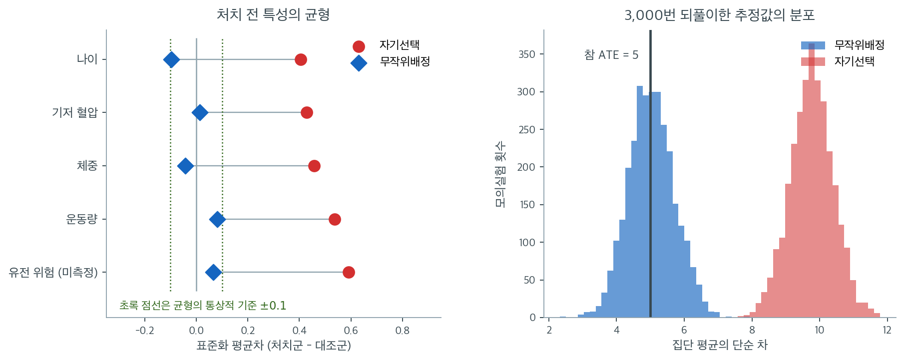

# 무작위 실험과 인과

관찰자료는 상관을 확립할 수 있지만, 언제나 도사리는 교란의 위협 때문에 그 자체로는 인과를 확립하지 못한다. **무작위 실험**은 무작위 배정으로 처치와 (측정되었든 아니든) 모든 잠재적 교란요인 사이의 연결을 끊어 이 문제를 해결한다. 이 절에서는 무작위화가 왜 인과추론의 표준인지, 무작위 대조 시험(RCT)을 어떻게 설계하고 분석하는지 설명한다.

---

## 1. 무작위화가 인과 주장을 가능하게 하는 이유

관찰연구에서는 처치를 받은 개인이 받지 않은 개인과 체계적으로 다를 수 있다. 이런 사전 차이(교란요인) 때문에 결과의 차이를 처치만의 탓으로 돌릴 수 없다.

무작위화는 처치를 **우연에 따라** 배정하여, 평균적으로 처치군과 대조군이 관측되든 관측되지 않든 모든 특성에서 비교 가능하도록 보장한다. 형식적으로 무작위화는 **무시가능성 조건**을 보장한다:

$$
Y(0), Y(1) \perp\!\!\!\perp X
$$

여기서 $Y(0)$과 $Y(1)$은 잠재결과이고 $X$는 처치 지시변수이다. 이 조건 아래에서 집단 평균의 단순 차이가 **평균처치효과**(ATE)의 불편추정값이 된다:

$$
\text{ATE} = \mathbb{E}[Y \mid X = 1] - \mathbb{E}[Y \mid X = 0]
$$

무작위화가 설계 단계에서 교란을 제거했으므로 교란요인에 대한 조정이 필요 없다.

"무작위화는 측정되지 않은 교란요인까지 균형 잡는다"는 문장이 실제로 무슨 뜻인지 모의실험으로 확인해 보자. 참가자 400명에게 처치 전 특성 다섯 개가 있고, 참 평균처치효과는 $5$로 고정했다. 자기선택 설계에서는 이 다섯 특성이 모두 좋은 사람일수록 처치를 택할 확률이 높게 만들었고, 무작위배정 설계에서는 동전을 던졌다.

왼쪽이 처치 전 균형이다. 자기선택에서는 다섯 특성의 표준화 평균차가 $0.40$에서 $0.59$까지, 전부 관례적 기준선 $\pm 0.1$의 바깥이다. 무작위배정에서는 $-0.10$에서 $+0.08$ 사이로 모두 안쪽에 들어온다. 맨 아래 줄을 특히 보라. **"유전 위험"은 연구자가 측정하지 않은 변수인데도 무작위배정에서는 균형이 잡혀 있다.** 무작위화가 개별 변수를 하나씩 맞추는 절차가 아니라 처치 배정을 모든 처치 전 변수와 독립으로 만드는 절차이기 때문이며, 통계적 조정으로는 결코 할 수 없는 일이 바로 이것이다. 회귀는 자기가 본 변수만 조정한다.

오른쪽은 그 대가가 추정값에서 어떻게 나타나는지 보여준다. 같은 실험을 3,000번 되풀이하면 자기선택 설계의 단순 차는 평균 $9.77$에 몰려 참값 $5$의 거의 두 배가 되고, 3,000번 중 단 한 번도 참값 근처에 닿지 못한다. 무작위배정의 분포는 평균 $5.03$으로 검은 선을 정확히 감싼다. 두 분포의 폭은 각각 $0.64$와 $0.67$로 거의 같다는 점이 결정적이다. **자기선택의 문제는 부정확함이 아니라 치우침이다.** 표본을 아무리 키워도 붉은 분포는 좁아질 뿐 참값 쪽으로 옮겨가지 않는다.

**그림으로 보는 통계학 1.** 카드를 섞기 시작한 자리는 텔레파시였다

방금 본 「측정하지 않은 변수까지 균형이 잡힌다」는 성질은 오늘 임상시험의 근거다. 그런데 **그 방법이 처음 쓰인 자리는 밭도 병원도 아니었다.**

이언 해킹이 $1988$ 년 『Isis』 $79$ 권 $3$ 호 $427$–$451$ 쪽에 쓴 글은 이렇게 시작한다.

> **심령 연구**는 새로운 실험 방법론이 생겨나는 자리로는 그럴듯해 보이지 않을 것이다. 그러나 바로 거기에서 우리는, 오늘날 많은 과학에서 표준이고 사회학과 생물학의 많은 영역에서는 **필수**인 기법의 첫 더듬거리는 사용을 발견한다.

$1882$ 년 런던에 **심령연구학회**가 섰다. 회원 명단이 가볍지 않다 — 윌리엄 크룩스, 레일리 경, 올리버 로지. 그 무렵 「텔레파시」라는 낱말이 막 생겼고, 곧 세워질 미국심령연구학회의 첫 사업은 텔레파시 현상이 얼마나 자주 일어나는지 조사하는 것이었다.

문제는 설계였다. 누가 남의 생각을 읽는지 **어떻게 시험하는가.** 카드를 보여 주고 맞히게 하면, 맞힌 까닭이 텔레파시인지 아니면 **순서를 눈치챈 것인지** 가를 수가 없다. 사람은 패턴을 기막히게 잘 찾아낸다.

$1884$ 년에 찰스 샌더스 퍼스와 조지프 재스트로가 그 물음을 푸는 설계를 내놓았다. 『미국 과학아카데미 논문집』 $3$ 권의 「감각의 미세한 차이에 관하여」다. 피실험자에게 $1$ kg 을 들린 뒤 조금 더 무겁거나 가벼운 것을 들리는데, **어느 쪽을 줄지는 잘 섞은 카드 뭉치가 정한다.** 실험자와 피실험자 사이에는 가림막이 있고 개조한 우체국 저울이 그 막을 통과한다. 가리기와 무작위화가 한 설계 안에서 **처음으로 제대로 구현된** 실험으로 꼽힌다.

해킹이 적어 둔 세부가 퍼스라는 사람을 잘 보여 준다. 한 실험은 $50$ 회 시행 한 묶음이고 카드 $50$ 장을 쓰는데, **그냥 섞은 $50$ 장이 아니었다.** 빨강 $13$ 장과 검정 $12$ 장으로 한 묶음, 검정 $13$ 장과 빨강 $12$ 장으로 또 한 묶음을 만들어 하나를 다 쓴 뒤 다른 하나로 넘어갔다. 같은 쪽이 지나치게 길게 이어지는 것을 막으려 한 것이다.

그러고는 **사라졌다.** 해킹의 말대로 「이어지는 문헌에서 무작위화는 통째로 자취를 감춘다」. $1892$ 년 풀러턴과 커텔의 고전적인 감각차 연구에도 없다. [피셔가 밭에서 다시 끌어낼 때](../../ch11/anova_two_way/two_way.md)까지 사십 년이 걸렸다.

마지막으로, 해킹이 덧붙인 한 줄이 §1 을 읽는 데 도움이 된다. 무작위화를 어디에나 쓰자는 데 반대하는 사람들은 **「그것이 시작된 바로 그런 종류의 일, 곧 거의 완전한 무지로 특징지어지는 일에 한정해야 한다」**고 말할 수 있다는 것이다. 뒤집어 읽으면 이렇다. 균형을 맞추거나 짝을 지으려면 **무엇이 중요한지 미리 알아야 한다.** 텔레파시 실험에서는 알 수 없었고, 새 약을 처음 사람에게 쓸 때도 대개 알 수 없다. 위 그림의 맨 아랫줄 — 측정하지도 않은 「유전 위험」이 균형을 이루던 그 줄 — 이 뜻하는 바가 그것이다. **무작위화는 아는 것이 없을 때에도 작동하는 유일한 장치다.**

_확인한 곳 — 인용한 첫 문장(「심령 연구는 … 첫 더듬거리는 사용을 발견한다」)과 「이어지는 문헌에서 무작위화는 통째로 자취를 감춘다」, $1892$ 년 풀러턴·커텔 연구에 무작위화가 없다는 것, 반대자들이 「그것이 시작된 바로 그런 종류의 일, 곧 거의 완전한 무지로 특징지어지는 일에 한정해야 한다」고 말할 수 있다는 대목, 퍼스가 $50$ 회 시행 묶음에 카드 $50$ 장을 쓰되 섞은 한 벌이 아니라 「빨강 $13$ · 검정 $12$」와 「검정 $13$ · 빨강 $12$」 두 묶음을 차례로 썼고 그것이 지나치게 긴 연속을 막기 위함이었다는 것, 심령연구학회가 $1882$ 년 런던에 섰고 크룩스·레일리·로지가 관여했다는 것, 미국심령연구학회의 첫 사업이 텔레파시 빈도 조사였다는 것은 Ian Hacking, 「Telepathy: Origins of Randomization in Experimental Design」, 『Isis』 $79$ 권 $3$ 호 $427$–$451$ 쪽($1988$ 년 $9$ 월)에서 **직접 읽었다** · 퍼스와 재스트로의 「On Small Differences in Sensation」이 『Memoirs of the National Academy of Sciences』 $3$ 권($1884$)이고, $1$ kg 뒤에 더 무겁거나 가벼운 것을 주되 어느 쪽인지를 잘 섞은 카드가 정했으며, 가림막과 개조한 우체국 저울을 썼고, 가리기와 무작위화가 제대로 구현된 첫 실험으로 꼽힌다는 것은 그 논문의 서지와 요약. 이 상자에는 내가 계산한 수가 없다_

---

## 2. 무작위 대조 시험의 구조

전형적인 RCT는 다음 요소로 이루어진다:

1. **모집단 정의.** 목표 모집단과 적격 기준을 정한다.
2. **참가자 모집.** 사전 동의를 받고 적격자를 등록한다.
3. **무작위 배정.** 무작위 기제(동전 던지기, 난수 생성기)로 각 참가자를 처치군이나 대조군에 배정한다.
4. **개입 시행.** 처치군은 개입을 받고 대조군은 위약이나 표준 치료를 받는다.
5. **결과 측정.** 모든 참가자의 반응변수를 기록한다.
6. **분석.** 보통 이표본 t-검정, 순열검정, 회귀로 집단 사이 결과를 비교한다.

---

## 3. 핵심 설계 요소

### 눈가림

**눈가림**은 집단 배정에 대한 지식이 결과에 영향을 주지 않게 한다:

- **단일 눈가림**: 참가자가 자신의 배정을 모른다.
- **이중 눈가림**: 참가자도, 결과를 측정하는 연구자도 배정을 모른다.
- **삼중 눈가림**: 참가자, 결과 평가자, 자료 분석자 모두 눈가림된다.

눈가림은 **위약 효과**(처치받았다고 믿어 행동이 달라지는 것)와 **관찰자 편향**(집단을 알고 결과를 다르게 측정하거나 기록하는 것)을 줄인다.

### 위약 대조

**위약**은 유효 성분만 빼고 모든 면에서 개입을 흉내 내는 비활성 처치이다. 무처치가 아니라 위약과 비교하면 유효 성분의 효과를 "어떤 처치든 받는다"는 효과와 분리할 수 있다.

### 무작위화 방법

- **단순 무작위화**: 각 참가자를 고정된 확률(예: 각 집단 0.5)로 독립적으로 배정한다. 간단하지만 작은 시험에서는 집단 크기가 불균형해질 수 있다.
- **블록 무작위화**: 참가자를 블록 단위로(예: 4명씩) 무작위화하여 집단 크기를 대체로 같게 만든다.
- **층화 무작위화**: 중요한 공변량(예: 나이, 성별)으로 정의된 층 안에서 따로 무작위화하여 그 변수들의 균형을 보장한다.

---

## 4. RCT에서 인과추론의 논리

추론은 다음과 같이 진행된다:

1. 무작위화 이전에 처치군과 대조군은 (기댓값 수준에서) 모든 특성이 동일하다.
2. 두 집단 사이의 유일한 체계적 차이는 처치 그 자체이다.
3. 따라서 결과의 어떤 차이든 처치 때문이어야 한다.

이 논리는 몇 가지 가정에 의존한다:

- **간섭 없음**: 한 참가자의 처치가 다른 참가자의 결과에 영향을 주지 않는다(안정 단위 처치값 가정, SUTVA).
- **순응**: 참가자가 배정받은 처치를 실제로 받는다.
- **탈락 없음**: 집단 사이에 차등적인 중도 탈락이 없다.

이 가정들이 위반되면 인과 해석이 약해진다. 배정된 대로 분석(ITT, intention-to-treat)은 실제로 받은 처치와 무관하게 배정된 집단에 따라 참가자를 분석하여, 순응이 완전하지 않아도 무작위화의 이점을 지켜 준다.

---

**보기 1.**  약 대 위약 시험. 어떤 제약회사가 새 혈압약을 시험한다.

- **모집단**: 경증 고혈압이 있는 40–65세 성인.
- **설계**: 참가자 200명을 약과 위약에 1:1로 무작위 배정.
- **결과**: 12주 뒤 수축기 혈압의 변화.
- **분석**: 평균 혈압 변화를 비교하는 이표본 t-검정.

| 집단 | $n$ | 평균 변화 (mmHg) | 표준편차 |
|:---|:---:|:---:|:---:|
| 약 | 100 | $-12.3$ | 8.5 |
| 위약 | 100 | $-3.1$ | 7.9 |

??? success "풀이"
    추정된 ATE는 $-12.3 - (-3.1) = -9.2$ mmHg이다. 배정이 무작위였으므로 이 차이는 나이, 식습관, 운동 습관 같은 교란요인이 아니라 약 때문이라고 볼 수 있다.

---

## 5. 무작위 실험의 한계

강점에도 불구하고 RCT에는 중요한 한계가 있다:

1. **윤리적 제약.** 어떤 처치는 무작위로 배정할 수 없다(예: 흡연, 빈곤). 해로운 노출에 사람을 배정하는 것은 비윤리적이다.

2. **외적 타당도.** RCT에 등록된 모집단이 관심 있는 더 넓은 모집단을 대표하지 않을 수 있다. 엄격한 적격 기준은 일반화 가능성을 제한한다.

3. **비용과 실행 가능성.** 크고 잘 설계된 RCT는 비용과 시간이 많이 든다.

4. **순응 문제.** 참가자가 배정된 처치를 지키지 않아 처치 효과가 희석될 수 있다.

5. **호손 효과.** 연구에 참여한다는 사실만으로 처치와 무관하게 행동이 달라질 수 있다.

RCT가 어려우면 교란요인을 신중하게 조정한 관찰 방법, 자연실험, [도구변수](instrumental_variables.md)로 눈을 돌린다.

---

## 6. 자연실험

**자연실험**은 연구자가 무작위화하지 않았는데도 어떤 외부 사건이나 정책이 처치에 마치 무작위인 것 같은 변동을 만들 때 일어난다. 예를 들면:

- **징집 추첨**: 생일에 따라 병역이 무작위로 배정된다.
- **지리적 경계**: 학군 경계 양쪽의 학생들이 서로 다른 교육적 개입을 받는다.
- **정책 변화**: 임의의 문턱을 기준으로 한 집단에는 새 규제가 적용되고 다른 집단에는 적용되지 않는다.

자연실험은 준무작위 변동을 활용하여 RCT의 논리를 근사한다. 그 변동이 (개인의 선택에 이끌리지 않고) 진정으로 외생적인 만큼 인과추론이 타당해진다.

---

## 연습문제

**연습문제 1.** 
실험에서 무작위 배정이 관측되지 않은 변수로부터의 교란까지 제거하는 이유를 설명하라.

??? success "풀이"
    무작위 배정은 처치를 적용하기 전에 처치군과 대조군이 관측되든 관측되지 않든 모든 특성에서 평균적으로 동일하도록 보장한다. 배정이 무작위 기제(동전 던지기, 난수 생성기)로 결정되므로 모든 처치 전 변수와 독립이기 때문이다.

    임의의 교란요인 $U$는 (관측 여부와 무관하게) $T$가 처치 지시변수일 때 $U \perp T$를 만족한다. 그러면 $T$에서 $Y$로 가는 뒷문 경로가 없으므로(무작위화가 그런 경로를 모두 "잘라낸다") $E[Y \mid T=1] - E[Y \mid T=0] = E[Y(1)] - E[Y(0)]$, 즉 참 평균처치효과가 된다.

    표본이 충분히 크면 큰 수의 법칙에 의해 모든 변수에서 집단이 균형을 이룬다. 표본이 작으면 우연히 불균형이 생길 수 있으며, 그래서 여전히 가설검정과 신뢰구간을 쓴다.

**연습문제 2.** 
어떤 무작위 실험에서 개인교습 프로그램이 시험 점수를 8점 올린다는 결과($p = 0.02$)를 얻었다. 한 동료가 "상관은 인과를 함의하지 않는다"며 이것이 인과를 증명하지 못한다고 주장한다. 이 동료가 옳은가?

??? success "풀이"
    이 맥락에서 동료는 **틀렸다**. "상관은 인과를 함의하지 않는다"는 말은 교란요인이 연관을 설명할 수 있는 관찰연구에 적용된다. 제대로 무작위화된 실험에서는 인과 해석이 타당하다. 이유는:

    1. 무작위 배정이 교란을 제거한다.
    2. 연구자가 시점을 통제하여(처치가 결과보다 앞선다) 시간적 선행이 확립된다.
    3. 비교 집단(대조군)이 반사실을 제공한다.

    8점 상승은 인과효과의 타당한 추정값이며, 통계적 추론의 통상적인 유보 조건(표집 변동, $p = 0.02$가 반영)만 따른다. 실험에서 인과추론을 위협하는 주된 요소는 교란이 아니라 실무적 문제(비순응, 탈락, 파급효과)이다.

**연습문제 3.** 
무작위 실험의 내적 타당도와 외적 타당도를 정의하라. 내적 타당도는 높지만 외적 타당도가 의심스러운 실험의 예를 들어라.

??? success "풀이"
    **내적 타당도:** 연구 내부에서 인과효과를 올바르게 측정하는 정도. 적절한 무작위화, 탈락 편향 없음, 파급효과 없음, 처치 지침의 준수가 필요하다.

    **외적 타당도:** 결과가 다른 모집단, 상황, 시기로 일반화되는 정도.

    **예:** 부유한 교외 학군 한 곳에서 수행한 수학 앱 무작위 시험이 시험 점수 12점 향상을 보였다(적절한 무작위화와 낮은 탈락률로 내적 타당도가 높다). 그러나 인터넷 접근이 제한적이고 기초 학력과 동기 구조가 다른 자원이 부족한 도시 학교에는 결과가 일반화되지 않을 수 있다(외적 타당도가 의심스럽다).

**연습문제 4.** 
잠재결과 틀에서 평균처치효과(ATE)를 정의하고 "인과추론의 근본 문제"를 설명하라.

??? success "풀이"
    개인 $i$에 대해 $Y_i(1)$을 처치 아래의 잠재결과, $Y_i(0)$을 대조 아래의 잠재결과라 하자. 개인 처치효과는 $\tau_i = Y_i(1) - Y_i(0)$이다.

    **평균처치효과**는

    $$
    \text{ATE} = E[Y(1) - Y(0)] = E[Y(1)] - E[Y(0)]
    $$

    이다.

    **인과추론의 근본 문제**는 각 개인에 대해 잠재결과 중 하나만, 즉 처치를 받았으면 $Y_i(1)$을, 받지 않았으면 $Y_i(0)$을 관측할 뿐 둘 다는 결코 관측할 수 없다는 것이다. 따라서 개인 인과효과 $\tau_i$는 관측 불가능하다.

    무작위화는 이를 집단 수준에서 해결한다. $T \perp (Y(1), Y(0))$이므로 $E[Y \mid T=1] = E[Y(1)]$이고 $E[Y \mid T=0] = E[Y(0)]$이 되어, 개인 효과는 알 수 없어도 집단 평균의 차이가 ATE를 추정한다.

**연습문제 5.** 
보기 1의 표를 그대로 쓴다(약 $n=100$, 평균 $-12.3$, 표준편차 $8.5$ / 위약 $n=100$, 평균 $-3.1$, 표준편차 $7.9$).

(a) 두 평균 차이의 표준오차와 이표본 t 통계량을 구하라.

(b) ATE의 95% 신뢰구간을 구하라. 등분산을 가정하고 $t_{0.975,\,198} = 1.972$를 쓴다.

(c) 똑같은 표가 무작위 배정이 아니라 "환자가 약과 위약 중 원하는 쪽을 골랐다"는 설계에서 나왔다면 (a)와 (b)의 **수치** 중 무엇이 달라지는가. 달라지지 않는다면, 그렇다면 무작위화는 이 분석의 어느 대목을 책임지고 있는 것인가.

??? success "풀이"
    **(a)** 차이의 표준오차는

    $$
    \text{SE} = \sqrt{\frac{8.5^2}{100} + \frac{7.9^2}{100}} = \sqrt{0.7225 + 0.6241} = \sqrt{1.3466} = 1.1604
    $$

    추정된 ATE는 보기 1에서 $-12.3 - (-3.1) = -9.2$ mmHg였으므로

    $$
    t = \frac{-9.2}{1.1604} = -7.93
    $$

    $\text{df} = 198$에서 양쪽 $p$ 값은 $1.6 \times 10^{-13}$으로, 어떤 통상적 유의수준으로도 압도적이다.

    **(b)** $-9.2 \pm 1.972 \times 1.1604 = -9.2 \pm 2.29$, 즉

    $$
    (-11.49,\ -6.91) \ \text{mmHg}
    $$

    **(c)** **아무 수치도 달라지지 않는다.** 표준오차, $t$, $p$, 신뢰구간은 네 숫자 $(n, \bar{y}, s)$ 두 벌만 먹는 함수이므로 배정이 동전이었는지 환자의 선택이었는지를 전혀 모른다. 1절의 모의실험이 바로 이 사실을 수치로 보여 주었다. 자기선택 분포와 무작위배정 분포의 **폭**이 $0.64$와 $0.67$로 거의 같았고, 두 설계를 가른 것은 중심의 위치($9.77$ 대 $5.03$)였다.

    따라서 분업은 이렇다. t-검정은 "$-9.2$라는 차이가 표집 변동만으로 나올 만한 크기인가"만 답한다. "그 차이를 **약의 탓으로 돌려도 되는가**"는 t-검정이 손대지 않는 질문이고, 1절의 무시가능성 $Y(0), Y(1) \perp\!\!\!\perp X$, 즉 무작위 배정이 책임진다. 자기선택 설계에서도 $p$ 값은 똑같이 작게 나오며, 작은 $p$ 값은 치우침에 대해 아무 보호도 해 주지 않는다.

    한 가지 더. 이 구간은 **평균**처치효과의 구간이다. 연습문제 4의 근본 문제 때문에 어떤 환자 한 명의 $\tau_i$가 $-11.49$와 $-6.91$ 사이에 있다는 말로는 읽을 수 없다.

**연습문제 6.** 
3절은 단순 무작위화가 "간단하지만 작은 시험에서는 집단 크기가 불균형해질 수 있다"고 말한다. 참가자 20명을 각각 독립적으로 확률 $1/2$씩 처치군·대조군에 배정한다고 하자.

(a) 두 집단이 정확히 10:10이 될 확률을 구하라.

(b) 집단 크기의 차이가 6 이상(즉 13:7보다 더 치우친 경우까지 포함)일 확률을 구하라.

(c) 같은 20명을 블록 크기 4의 블록 무작위화로 배정하면 (a)의 확률은 얼마가 되는가.

(d) 13:7이 나왔다면 ATE 추정값에 **치우침**이 생기는가? 등분산 $\sigma$를 가정하고 차이의 표준오차 $\sigma\sqrt{1/n_1 + 1/n_2}$를 10:10과 비교해 불균형의 대가를 수치로 말하라.

??? success "풀이"
    처치군 크기를 $N \sim \text{B}(20, 1/2)$라 하면 $2^{20} = 1{,}048{,}576$가지 배정이 모두 같은 확률이다.

    **(a)**

    $$
    P(N = 10) = \frac{\binom{20}{10}}{2^{20}} = \frac{184{,}756}{1{,}048{,}576} = 0.1762
    $$

    균형이 가장 그럴듯한 한 가지 결과이지만 그래도 여섯 번 중 한 번밖에 나오지 않는다.

    **(b)** 차이가 6 이상이라는 것은 $N \ge 13$ 또는 $N \le 7$이다. 대칭이므로

    $$
    P = 2 \cdot \frac{1}{2^{20}} \sum_{k=13}^{20} \binom{20}{k} = 2 \cdot \frac{137{,}980}{1{,}048{,}576} = 0.2632
    $$

    네 번 중 한 번 넘게 13:7 이상으로 치우친다. 이것이 3절의 경고가 말하는 크기다.

    **(c)** $20 = 5 \times 4$이므로 블록 크기 4의 블록 다섯 개가 되고, 각 블록이 2:2를 보장하므로 전체는 반드시 10:10이다. 확률은 $1$이다. 대신 배정의 자유도가 줄어 블록 안의 순서를 알면 블록의 마지막 한두 명을 예측할 수 있게 되므로, 눈가림을 지키려면 블록 크기를 숨기거나 무작위로 바꾸어야 한다.

    **(d)** **치우침은 생기지 않는다.** 불균형한 배정도 여전히 무작위 기제의 산물이므로 $Y(0), Y(1) \perp\!\!\!\perp X$가 그대로 성립하고, 두 집단 평균의 차이는 어떤 $(n_1, n_2)$에서도 ATE의 불편추정값이다. 대가는 정밀도 쪽에서만 나온다.

    $$
    \frac{\sqrt{1/13 + 1/7}}{\sqrt{1/10 + 1/10}} = \frac{\sqrt{0.2198}}{\sqrt{0.2000}} = 1.048
    $$

    표준오차가 4.8% 커진다. 즉 불균형은 **치우침이 아니라 검정력의 문제**다. 1절에서 자기선택 설계가 폭은 그대로 둔 채 중심을 옮겼던 것과 정확히 반대쪽 고장이다.

**연습문제 7.** 
1절 모의실험의 측정되지 않은 변수 "유전 위험"을 저위험·고위험 두 층으로 거칠게 나누고, 자기선택 설계에서 참가자 400명이 다음과 같이 나왔다고 하자. 결과 $Y$는 클수록 좋은 점수다.

| 층 $s$ | 처치군 $n$ | 처치군 평균 | 대조군 $n$ | 대조군 평균 |
|:---|:---:|:---:|:---:|:---:|
| 저위험 | $160$ | $75$ | $40$ | $70$ |
| 고위험 | $40$ | $55$ | $160$ | $50$ |

(a) 처치군 전체 평균, 대조군 전체 평균, 그리고 둘의 차이(거친 차이)를 구하라.

(b) 층별 처치효과 $\tau_s = \bar{y}_{1s} - \bar{y}_{0s}$를 구하고 참 ATE를 말하라.

(c) 처치군·대조군의 층 구성비를 $w^T_s, w^C_s$라 할 때 거친 차이가

$$
\underbrace{\sum_s w^C_s \tau_s}_{\text{층별 효과의 가중평균}} + \underbrace{\sum_s \bigl(w^T_s - w^C_s\bigr) \bar{y}_{1s}}_{\text{구성 차이}}
$$

로 분해됨을 확인하고 두 항의 값을 구하라.

(d) 이 400명을 그대로 두고 **배정만** 무작위로 바꾸어 두 집단의 층 구성비가 모두 $0.5$씩이 되었다면 거친 차이는 얼마인가. (a)–(d)의 결과를 1절 오른쪽 그림의 네 수치($9.77$, $5.03$, 참값 $5$)와 짝지어라.

??? success "풀이"
    **(a)** 구성비는 $w^T = (0.8,\ 0.2)$, $w^C = (0.2,\ 0.8)$이다.

    $$
    \bar{y}_1 = 0.8 \times 75 + 0.2 \times 55 = 60 + 11 = 71, \qquad \bar{y}_0 = 0.2 \times 70 + 0.8 \times 50 = 14 + 40 = 54
    $$

    거친 차이는 $71 - 54 = 17$이다.

    **(b)** $\tau_{\text{저}} = 75 - 70 = 5$, $\tau_{\text{고}} = 55 - 50 = 5$. 두 층에서 효과가 같으므로 모집단의 층 구성이 무엇이든 ATE $= 5$다. 거친 차이 $17$은 참값의 세 배가 넘는다.

    **(c)** 항등식은 단순한 더하고 빼기다.

    $$
    \bar{y}_1 - \bar{y}_0 = \sum_s w^T_s \bar{y}_{1s} - \sum_s w^C_s \bar{y}_{0s} = \sum_s w^C_s (\bar{y}_{1s} - \bar{y}_{0s}) + \sum_s (w^T_s - w^C_s) \bar{y}_{1s}
    $$

    값을 넣으면

    $$
    \sum_s w^C_s \tau_s = 0.2 \times 5 + 0.8 \times 5 = 5, \qquad \sum_s (w^T_s - w^C_s)\bar{y}_{1s} = 0.6 \times 75 + (-0.6) \times 55 = 45 - 33 = 12
    $$

    이고 $5 + 12 = 17$로 (a)와 맞는다. 거친 차이 $17$ 가운데 **참 효과는 $5$뿐이고 $12$는 순전히 구성 차이**다. 처치군에 유전 위험이 낮은(따라서 점수가 애초에 높은) 사람이 몰렸기 때문이다.

    **(d)** $w^T = w^C = (0.5, 0.5)$이면 구성 차이 항의 계수가 모두 $0$이 되어 둘째 항이 사라진다.

    $$
    \bar{y}_1 - \bar{y}_0 = (0.5 \times 75 + 0.5 \times 55) - (0.5 \times 70 + 0.5 \times 50) = 65 - 60 = 5
    $$

    거친 차이가 ATE와 정확히 일치한다. 짝지으면 이렇다. 자기선택의 $17$은 그림 오른쪽의 $9.77$에, 무작위배정의 $5$는 $5.03$에, 그리고 $\sum_s w^C_s \tau_s = 5$는 검은 선 참값 $5$에 대응한다. 1절의 치우침 $9.77 - 5 = 4.77$도 (크기는 이 두 층 모형의 $12$와 다르지만) 바로 이 구성 차이 항이 만든 것이며, 무작위화는 $\tau_s$를 건드리는 것이 아니라 **$w^T_s - w^C_s$를 $0$으로 만들어** 그 항을 지운다. 회귀로 조정한다는 것은 $\bar{y}_{1s}$를 층별로 다시 가중한다는 뜻인데, 층을 정의하는 변수를 측정하지 못했다면(여기서는 "유전 위험") 그 가중을 할 수가 없다.

**연습문제 8.** 
4절은 비순응이 있어도 ITT가 무작위화의 이점을 지켜 준다고 했다. 다음 시험을 보자. 참가자 2,000명을 1,000:1,000으로 무작위 배정했는데 처치군 중 60%만 실제로 약을 먹었다. 순응 여부는 사람의 성향이므로 대조군에도 같은 비율(60%)로 숨어 있다. 모형은 이렇다. 약을 먹지 않으면 결과가 전혀 바뀌지 않고(배정 자체에는 효과가 없다), 처치 없을 때 평균 결과는 순응 성향자가 $50$, 비순응 성향자가 $40$이며, 약은 순응자의 결과를 $10$ 올린다.

(a) 두 팔의 관측 평균과 ITT 추정값을 구하라.

(b) 순응자 평균 인과효과(CACE) $= 10$과 ITT 사이의 관계식을 쓰고 (a)로 확인하라.

(c) "실제로 약을 먹은 사람 대 대조군 전체"로 비교하는 프로토콜 준수 분석의 값을 구하고, 치우침의 크기와 그 출처를 수식으로 짚어라.

(d) 순응률이 $c$로 떨어지면 (a)와 (c)의 값은 각각 어떻게 되는가. $c \to 0$의 극단에서 두 분석이 하는 말을 비교하라.

??? success "풀이"
    순응 성향자를 $C$, 비순응 성향자를 $N$이라 하고 순응률을 $c = 0.6$이라 하자.

    **(a)** 처치군에서는 $C$만 약을 먹어 $50 + 10 = 60$이 되고 $N$은 $40$에 머문다.

    $$
    \bar{y}_1 = 0.6 \times 60 + 0.4 \times 40 = 36 + 16 = 52
    $$

    대조군은 아무도 약을 먹지 않으므로

    $$
    \bar{y}_0 = 0.6 \times 50 + 0.4 \times 40 = 30 + 16 = 46
    $$

    $\text{ITT} = 52 - 46 = 6$이다.

    **(b)** 배정은 $N$의 결과를 전혀 바꾸지 않으므로 ITT는 효과 $10$을 받은 비율 $c$만큼으로 희석된다.

    $$
    \text{ITT} = c \cdot \text{CACE} + (1-c) \cdot 0 = c \cdot \text{CACE} \quad \Longrightarrow \quad \text{CACE} = \frac{\text{ITT}}{c} = \frac{6}{0.6} = 10
    $$

    맞는다. ITT는 **배정의 효과**를 치우침 없이 재고, $c$로 나누는 추가 가정(비순응자에게는 효과가 없다)을 얹으면 순응자에 대한 효과를 복원할 수 있다.

    **(c)** 약을 먹은 사람은 처치군의 $C$뿐이므로 평균 $60$이고, 대조군 전체는 $46$이다.

    $$
    60 - 46 = 14
    $$

    참값 $10$을 $4$만큼 부풀렸다. 출처는

    $$
    60 - \bar{y}_0 = \underbrace{(50 + 10)}_{\text{순응자의 처치 결과}} - \bigl[c \cdot 50 + (1-c) \cdot 40\bigr] = 10 + (1-c)(50 - 40) = 10 + 0.4 \times 10 = 14
    $$

    즉 치우침 $(1-c)(50-40) = 4$는 순응자가 애초에 결과가 좋은 사람들이라는 데서 온다. 약을 먹은 사람만 골라내는 순간 **무작위화로 지웠던 선택을 손으로 되살린 것**이고, 이는 연습문제 7의 구성 차이 항과 같은 고장이다.

    **(d)** 일반 $c$에 대해 $\bar{y}_1 = c(50+10) + (1-c)40 = 40 + 20c$, $\bar{y}_0 = 40 + 10c$이므로

    $$
    \text{ITT} = 10c, \qquad \text{프로토콜 준수} = 60 - (40 + 10c) = 20 - 10c
    $$

    $c \to 0$이면 $\text{ITT} \to 0$으로, "거의 아무도 약을 먹지 않았으니 배정은 결과를 거의 바꾸지 못했다"는 **참말**을 한다. 반면 프로토콜 준수 분석은 $20 - 10c \to 20$으로 치솟아 참 효과 $10$의 두 배를 보고한다. 순응자가 점점 희귀하고 특별한 사람이 될수록 그들을 대조군 전체와 맞대는 비교가 더 크게 틀어지기 때문이다. ITT는 $c$를 몰라도 틀리지 않고, CACE 복원에만 $c$가 필요하다는 점이 4절이 ITT를 기본으로 두는 이유다.

**연습문제 9.** 
1절 오른쪽 그림의 네 수치를 쓴다. 참가자 $n = 400$에서 자기선택 설계의 추정값은 평균 $9.77$, 표준편차 $0.64$였고 무작위배정 설계는 평균 $5.03$, 표준편차 $0.67$이었으며 참값은 $5$다. 치우침은 자기선택에서 $4.77$, 무작위배정에서 $0$으로 보고(관측된 $0.03$은 3,000번 반복의 몬테카를로 잡음이다) 답하라.

(a) 두 설계의 평균제곱오차의 제곱근 $\text{RMSE} = \sqrt{\text{치우침}^2 + \text{표준편차}^2}$를 구하고 비를 내라.

(b) 표본을 100배인 40,000명으로 키우면 (a)의 두 수와 비는 어떻게 되는가. 표준편차는 $1/\sqrt{n}$로 줄고 치우침은 $n$에 의존하지 않는다.

(c) 자기선택 설계의 표본을 아무리 키워도 무작위배정 설계의 $n = 400$ 성능($\text{RMSE} = 0.67$)에 도달할 수 없음을 보여라.

(d) 참값 $5$가 자기선택 분포의 "평균 $\pm\, 1.96 \times$ 표준편차" 구간에 들어오려면 $n$이 어떠해야 하는가.

??? success "풀이"
    **(a)** 자기선택:

    $$
    \sqrt{4.77^2 + 0.64^2} = \sqrt{22.75 + 0.41} = \sqrt{23.16} = 4.81
    $$

    무작위배정은 치우침이 $0$이므로 $\text{RMSE} = 0.67$이다. 비는 $4.81 / 0.67 = 7.2$배다.

    **(b)** 표준편차는 $0.64 \to 0.64/10 = 0.064$, $0.67 \to 0.067$이 되고 치우침은 $4.77$ 그대로다.

    $$
    \sqrt{4.77^2 + 0.064^2} = 4.77, \qquad 0.067
    $$

    비는 $4.77/0.067 = 71$배로 **열 배 더 벌어진다.** 표본을 키우는 일이 좋은 설계에는 온전히 이득이지만 치우친 설계에는 거의 이득이 되지 않기 때문이다. 자기선택 쪽 RMSE는 $4.81$에서 $4.77$로 1% 줄었을 뿐이다.

    **(c)** 모든 $n$에 대해

    $$
    \text{RMSE} = \sqrt{4.77^2 + \sigma_n^2} \ \ge \ 4.77 > 0.67
    $$

    이다. 표준편차 항을 $0$으로 보내더라도 RMSE는 치우침 $4.77$ 아래로 내려가지 않는다. 즉 **아무리 큰 표본으로도 메울 수 없다.** 1절의 "표본을 아무리 키워도 붉은 분포는 좁아질 뿐 참값 쪽으로 옮겨가지 않는다"가 이 부등식이다.

    **(d)** 구간이 참값을 덮으려면 $4.77 \le 1.96 \,\sigma_n = 1.96 \times 0.64 \sqrt{400/n}$, 즉

    $$
    \sqrt{\frac{400}{n}} \ge \frac{4.77}{1.254} = 3.80 \quad \Longrightarrow \quad n \le \frac{400}{3.80^2} = 27.7
    $$

    $n = 400$에서는 이미 $4.77 / 0.64 = 7.45$ 표준편차만큼 벗어나 있고, $n = 40{,}000$에서는 $4.77/0.064 = 74.5$ 표준편차로 더 멀어진다. 조건을 만족시키는 길은 표본을 **키우는** 것이 아니라 스물일곱 명 남짓으로 **줄여** 구간을 참값까지 넓히는 것뿐이다. 치우친 추정량에서는 표본이 커질수록 틀린 값을 더 자신 있게 가리킨다.

**연습문제 10.** 
4절의 간섭 없음 가정(SUTVA)이 깨지는 경우를 수치로 만든다. 어떤 학교의 학생 1,000명을 500:500으로 백신과 위약에 무작위 배정했다. 역학 모형은 다음과 같다. 접종한 학생의 감염 위험은 학교 접종률과 무관하게 $10\%$이고, 접종하지 않은 학생의 감염 위험은 학교 접종률 $\pi$에 따라 $40\% - 30\% \times \pi$로 떨어진다(집단면역).

(a) 이 시험에서 관측되는 두 집단의 감염률과 그 차이를 구하라.

(b) "전원 접종한 학교 대 아무도 접종하지 않은 학교"를 비교하는 정책적 관심량(전체효과)은 얼마인가.

(c) (a)는 (b)를 얼마나 어긋나게 재는가. 무작위화가 완벽했는데도 왜 이런 일이 생기는지 잠재결과 $Y_i(0)$의 표기로 설명하라.

(d) 1,000명이라는 예산을 유지하면서 (b)를 추정하려면 설계를 어떻게 바꾸어야 하는가. 바뀐 설계에서 추정값이 실제로 (b)와 같아지는지 확인하고, 그 설계가 새로 치르는 대가를 하나 말하라.

??? success "풀이"
    **(a)** 접종률은 $\pi = 0.5$다. 접종군은 $10\%$, 위약군은 $40\% - 30\% \times 0.5 = 25\%$다. 차이는

    $$
    10\% - 25\% = -15\ \text{퍼센트포인트}
    $$

    **(b)** 전원 접종이면 모두 $10\%$, 아무도 접종하지 않으면 $\pi = 0$이므로 모두 $40\%$다. 전체효과는

    $$
    10\% - 40\% = -30\ \text{퍼센트포인트}
    $$

    **(c)** 이 시험은 관심량의 **절반만** 잡는다. 무작위화 자체에는 흠이 없다. 깨진 것은 잠재결과가 애초에 잘 정의되어 있다는 가정이다. 간섭이 없다면 학생 $i$의 $Y_i(0)$은 숫자 하나여야 하는데 여기서는 $Y_i(0)$이 **남들의 배정 벡터**에 의존한다. 같은 미접종 학생이 $\pi = 0$인 세상에서는 $40\%$, $\pi = 0.5$에서는 $25\%$, $\pi = 1$에 가까우면 $10\%$의 위험을 갖는다.

    그 결과 대조군이 처치군의 접종으로 **덕을 보아** 기준선이 $40\%$에서 $25\%$로 내려앉고, 두 집단의 차이는 "$\pi = 0.5$인 환경에서 한 사람이 더 접종할 때의 직접효과"가 된다. 이것은 참값이 아닌 것이 아니라 **다른 질문의 참값**이며, 정책이 묻는 전체효과(직접효과 + 집단면역)보다 체계적으로 작다. 간섭 아래에서는 무작위화가 치우침을 없애 주더라도 추정량이 가리키는 양 자체가 바뀐다.

    **(d)** 무작위화의 **단위를 개인에서 집단으로** 올린다. 학생 1,000명을 간섭이 서로 통하지 않는 집단(예: 서로 떨어진 학교나 기숙사 동) 여러 개로 나누고, 집단 단위로 "전원 접종" 또는 "전원 위약"을 무작위 배정한다. 그러면 접종 집단은 $\pi = 1$이므로 $10\%$, 위약 집단은 $\pi = 0$이므로 $40\%$가 되어 추정값이

    $$
    10\% - 40\% = -30\ \text{퍼센트포인트}
    $$

    로 (b)와 정확히 일치한다. 간섭이 집단 **안**에 갇히면 집단을 하나의 단위로 보아 간섭 없음 가정이 되살아나기 때문이다.

    대가는 유효 표본수다. 무작위화된 단위가 1,000명이 아니라 집단의 개수이므로, 두 집단만 쓰면 사실상 배정이 한 번뿐이어서 집단 사이의 모든 차이가 처치와 뒤섞인다. 집단 간 무작위화는 표준오차를 키우며, 같은 검정력을 얻으려면 작은 집단을 여러 개 모아야 한다.

---

## 정리하며

무작위 실험은 무작위 배정이 측정된 교란과 측정되지 않은 교란을 모두 제거하므로 인과관계를 확립하는 표준이다. 핵심 설계 요소인 무작위화, 눈가림, 위약 대조는 집단 사이의 유일한 체계적 차이가 처치 그 자체가 되도록 보장한다. 윤리적·실무적·비용 제약으로 RCT가 어려울 때에는 자연실험과 준실험 설계가 무작위화의 이점을 근사할 수 있다. 무작위화가 왜 인과추론을 가능하게 하는지 이해하면 그 힘과 관찰연구의 한계가 함께 분명해진다.
