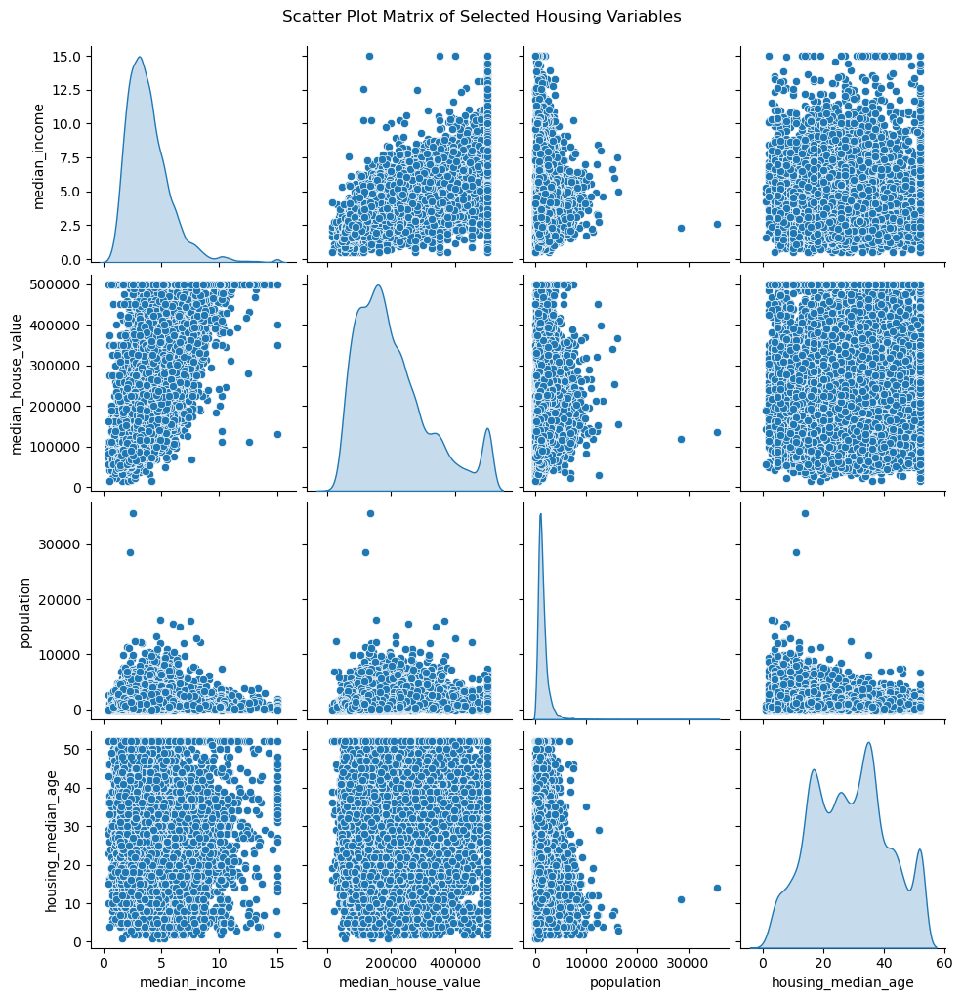
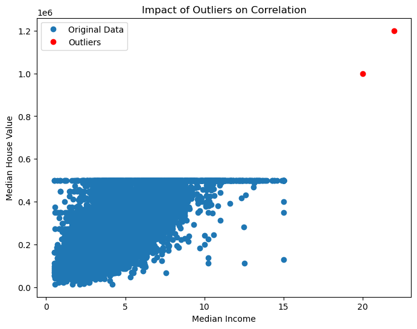

# 교란 개관: 상관, 인과, 교란

## 1. 상관과 인과

**상관**은 두 변수 사이 선형관계의 강도와 방향을 재며 상관계수($-1$에서 $1$)로 수치화한다. **인과**는 한 변수의 변화가 다른 변수의 변화를 직접 일으킨다는 뜻이다.

**핵심 구별**: 상관만으로는 인과를 말할 수 없다. 두 변수가 상관되는 것은 직접적인 인과관계 때문일 수도, 역방향 인과 때문일 수도, 둘 모두에 영향을 주는 바탕의 제3 변수 때문일 수도 있다.

---

## 2. 교란의 역할

**교란요인**은 독립변수와 종속변수 모두와 관련된 외부 변수이다. 둘 사이에 관계가 있다는 잘못된 인상을 만들어 인과에 대한 해석을 오도할 수 있다.

**고전적인 예 — 아이스크림과 익사**:
아이스크림 판매량과 익사 사고 사이에는 상관이 있다. 처음에는 아이스크림을 먹으면 익사한다고 보일 수 있다. 진짜 교란요인은 **기온**이다. 기온이 높으면 아이스크림 판매도 늘고 수영 활동도 늘어 익사 사고가 많아진다. 아이스크림 판매와 익사의 상관은 기온의 교란 효과가 만든 허위상관이다.

### 교란의 식별과 대처

1. **통제변수**: 통계 분석에서 다중회귀 같은 기법으로 교란변수를 통제하여 독립변수가 종속변수에 미치는 효과를 분리한다.

2. **실험 설계**: 무작위 대조 시험(RCT)은 대상을 무작위로 집단에 배정하여 교란요인의 효과를 균형 있게 만들어 교란을 완화한다.

3. **종단 연구**: 변수들을 시간에 걸쳐 추적하면 한 변수의 변화가 다른 변수에 어떤 영향을 주는지 관찰할 수 있어, 교란을 고려하면서 인과를 확립하는 데 도움이 된다.

---

<div class="exbox" markdown>

**보기 1.** <span class="diff easy" title="쉬움"></span> 학력과 소득.

- **관측**: 어떤 연구에서 높은 학력과 높은 소득 사이에 강한 상관을 발견했다.
- **처음의 해석**: 높은 학력이 높은 소득을 일으킨다.

</div>

??? success "풀이"
    - **교란요인**: **사회경제적 배경** — 사회경제적 배경이 좋은 개인은 더 나은 교육을 받을 수 있고 소득도 높은 경향이 있다.
    - **대처 방법**: 분석에서 사회경제적 지위를 통제한다. 가정 배경을 통제한 연구들은 학력이 소득에 양의 영향을 주지만 그 효과가 가정의 사회경제적 지위에 의해 조절됨을 보여준다.

<div class="exbox" markdown>

**보기 2.** <span class="diff easy" title="쉬움"></span> 비타민 섭취와 암 위험.

- **관측**: 비타민 보충제를 먹는 사람의 암 위험이 낮다.
- **처음의 해석**: 비타민 보충제가 암 위험을 줄인다.

</div>

??? success "풀이"
    - **교란요인**: **건강을 의식하는 행동** — 비타민을 먹는 사람은 전반적으로 건강을 더 의식하여 다른 건강한 행동(운동, 균형 잡힌 식사, 금연)도 함께 한다.
    - **대처 방법**: 다른 건강 행동을 통제하여 비타민 섭취가 암 위험에 미치는 효과를 분리한다. 전반적인 건강 행동을 반영한 연구들은 비타민만으로는 암 위험과의 관계가 처음 관측된 만큼 강하지 않다는 결과를 흔히 얻는다.

<div class="exbox" markdown>

**보기 3.** <span class="diff easy" title="쉬움"></span> 커피 소비와 심장질환.

- **관측**: 커피를 많이 마시는 것이 심장질환 발생 증가와 상관된다.
- **처음의 해석**: 커피가 심장질환을 일으킨다.

</div>

??? success "풀이"
    - **교란요인**: **흡연** — 커피를 마시는 사람이 담배를 피울 가능성이 더 높고, 흡연은 알려진 심장질환 위험요인이다.
    - **대처 방법**: 분석에서 흡연을 통제하여 커피 소비가 독립적으로 심장질환 위험에 영향을 주는지 판정한다.

<div class="exbox" markdown>

**보기 4.** <span class="diff easy" title="쉬움"></span> 운동과 체중 감량.

- **관측**: 규칙적으로 운동하는 사람이 체중을 줄이는 경향이 있다.
- **처음의 해석**: 운동이 체중 감량을 일으킨다.

</div>

??? success "풀이"
    - **교란요인**: **식습관** — 규칙적으로 운동하는 사람이 더 건강한 식사를 할 수 있다.
    - **대처 방법**: 식습관(열량 섭취와 식단의 질)을 통제한다. 통제하면 운동과 체중 감량의 관계가 더 뚜렷해지며 운동과 식습관이 모두 중요한 역할을 함이 드러난다.

<div class="exbox" markdown>

**보기 5.** <span class="diff easy" title="쉬움"></span> 업무 성과와 급여.

- **관측**: 성과가 좋은 직원이 급여를 더 많이 받는다.
- **처음의 해석**: 좋은 업무 성과가 높은 급여로 이어진다.

</div>

??? success "풀이"
    - **교란요인**: **경력과 근속** — 경력이 많은 직원은 성과도 좋고 연공에 따라 급여도 높을 수 있다.
    - **대처 방법**: 경력 연수와 근속 기간을 통제하여 성과가 급여에 미치는 직접 효과를 정확히 평가한다.

<div class="exbox" markdown>

**보기 6.** <span class="diff easy" title="쉬움"></span> 아이스크림 판매와 익사 사고.

- **관측**: 아이스크림 판매가 많을수록 익사 사고가 늘어나는 상관이 있다.
- **처음의 해석**: 아이스크림을 먹으면 익사 위험이 높아질 수 있다.

</div>

??? success "풀이"
    - **교란요인**: **기온** — 더운 날씨에 두 변수가 모두 증가한다.
    - **대처 방법**: 기온을 분석하고 통제하면 아이스크림 판매와 익사 사고의 겉보기 상관이 사라지고, 진짜 연결은 아이스크림이 아니라 기온과의 관계임이 드러난다.

<div class="exbox" markdown>

**보기 7.** <span class="diff easy" title="쉬움"></span> 주택 자료에서 교란을 실제로 찾아보기. 캘리포니아 주택 자료에서 중위소득과 중위집값의 상관은 $r = 0.6881$ 이다.

**(1)** 이 상관이 **위치** 때문에 생긴 것은 아닌지 의심해 보자. 편상관의 닫힌 꼴

$$
\rho_{XY\cdot Z} = \frac{r_{XY} - r_{XZ}r_{YZ}}{\sqrt{(1-r_{XZ}^2)(1-r_{YZ}^2)}}
$$

로 위도를 통제한 값을 구하고, 잔차 회귀로 같은 값이 나오는지 확인하시오. 여러 변수를 통제하면 어떻게 되는가.

**(2)** 집값이 $500{,}001$ 달러에서 **잘려 있다.** 잘린 구역을 빼고 다시 재면 $r$ 가 오르는가 내리는가. 그 까닭을 소득의 퍼짐으로 설명하고, 회귀 기울기도 같이 움직이는지 보시오.

</div>

??? success "풀이"

    **(1) 위치는 교란변수가 아니다.** 위도 하나를 통제하면

    $$
    r_{XZ} = -0.0798,\qquad r_{YZ} = -0.1442
    $$

    이므로

    $$
    \rho_{XY\cdot Z} = \frac{0.6881 - (-0.0798)(-0.1442)}{\sqrt{(1-0.0798^2)(1-0.1442^2)}}
    = \frac{0.6766}{0.9865} = 0.6859
    $$

    로 **$0.0022$ 밖에 안 움직인다.** 잔차 회귀로 구한 값도 $0.6859$ 로 소수 넷째 자리까지 같다. 닫힌 꼴과 "각자 $Z$ 에 회귀한 잔차끼리의 상관"이 같은 것이라는 사실이 그대로 확인된다.

    통제할 변수를 바꿔 가며 재어도 마찬가지다.

    | 통제한 변수 | 편상관 |
    |---|---|
    | 없음 | $0.6881$ |
    | 위도 | $0.6859$ |
    | 경도 | $0.6882$ |
    | 위도 + 경도 | $0.6717$ |
    | 주택연령 | $0.7096$ |
    | 인구 | $0.6884$ |
    | 넷 모두 | $0.6800$ |

    **어느 것을 통제해도 $0.67$ 과 $0.71$ 사이를 벗어나지 않는다.** 교란이라면 통제했을 때 상관이 무너져야 하는데 그런 일이 일어나지 않는다. 주택연령을 통제하면 오히려 **올라간다**는 점도 눈여겨볼 만하다. 교란변수를 통제하면 상관이 줄고, 억제변수(suppressor)를 통제하면 늘 수 있다.

    다만 **"교란이 없다"고 결론지을 수는 없다.** 이 자료에 들어 있지 않은 변수(학군, 직업 구성, 토지 규제 등)는 어떤 통제로도 다룰 수 없다. 편상관이 할 수 있는 말은 **"내가 재어 본 이 변수들로는 설명되지 않는다"** 까지다.

    **(2) 내려간다. $0.6881 \to 0.6426$ 이다.** 집값이 $500{,}001$ 인 구역이 $965$ 개로 전체의 $4.68\%$ 다. 이 구역들의 소득 평균은 $7.825$ 로 나머지 $3.677$ 의 두 배가 넘는다. **즉 잘린 구역은 소득이 가장 높은 쪽에 몰려 있다.** 그래서 이들을 빼면 소득의 표준편차가

    $$
    1.8998 \;\longrightarrow\; 1.5703 \qquad (-17.3\%)
    $$

    로 줄어든다. **범위 제한**이다.

    범위 제한이 상관을 깎는다는 것은 $r = \hat\beta \cdot s_X/s_Y$ 에서 바로 읽힌다. 기울기는 $41794 \to 39987$ 로 $4.3\%$ 만 변했는데 $s_X$ 가 $17\%$ 줄었다. **기울기는 관계의 기울기라 범위에 거의 무관하고, $r$ 는 $X$ 가 얼마나 퍼져 있느냐에 직접 달려 있다.**

    그러므로 $r$ 가 떨어진 것을 "절단을 없애니 참값이 나왔다"로 읽으면 안 된다. 둘 다 각자의 모집단에 대해 옳고, **모집단이 달라졌을 뿐**이다.

    ```python
    import os
    import tarfile
    import urllib.request
    import numpy as np
    import pandas as pd
    from scipy import stats

    DOWNLOAD_ROOT = "https://raw.githubusercontent.com/ageron/handson-ml2/7b7e23e7267356f8355580877eff98c43cda1bd0/"
    HOUSING_PATH = os.path.join("datasets", "housing")
    HOUSING_URL = DOWNLOAD_ROOT + "datasets/housing/housing.tgz"

    def fetch_housing_data(housing_url=HOUSING_URL, housing_path=HOUSING_PATH):
        if not os.path.isdir(housing_path):
            os.makedirs(housing_path)
        tgz_path = os.path.join(housing_path, "housing.tgz")
        urllib.request.urlretrieve(housing_url, tgz_path)
        with tarfile.open(tgz_path) as housing_tgz:
            housing_tgz.extractall(path=housing_path)

    def load_housing_data(housing_path=HOUSING_PATH):
        return pd.read_csv(os.path.join(housing_path, "housing.csv"))

    fetch_housing_data()
    df = load_housing_data()

    X, Y = "median_income", "median_house_value"

    # (1) 편상관의 닫힌 꼴과 잔차 회귀가 같은 값을 주는지 본다.
    def partial_corr(d, x, y, zs):
        """z 들을 통제한 x, y 의 편상관. 각자 z 에 회귀한 잔차끼리의 상관이다."""
        Z = np.column_stack([np.ones(len(d))] + [d[z].values for z in zs])
        ex = d[x].values - Z @ np.linalg.lstsq(Z, d[x].values, rcond=None)[0]
        ey = d[y].values - Z @ np.linalg.lstsq(Z, d[y].values, rcond=None)[0]
        return np.corrcoef(ex, ey)[0, 1]

    r_xy = df[X].corr(df[Y])
    z = "latitude"
    r_xz, r_yz = df[X].corr(df[z]), df[Y].corr(df[z])
    closed = (r_xy - r_xz * r_yz) / np.sqrt((1 - r_xz**2) * (1 - r_yz**2))
    print(f"통제 전 r = {r_xy:.4f}")
    print(f"\n위도 하나를 통제")
    print(f"  r_xz = {r_xz:+.4f},  r_yz = {r_yz:+.4f}")
    print(f"  닫힌 꼴   = {closed:.4f}")
    print(f"  잔차 회귀 = {partial_corr(df, X, Y, [z]):.4f}")

    print(f"\n무엇을 통제하든 거의 움직이지 않는다")
    for zs in (["latitude"], ["longitude"], ["latitude", "longitude"],
               ["housing_median_age"], ["population"],
               ["latitude", "longitude", "housing_median_age", "population"]):
        print(f"  {'+'.join(zs):>50s} -> {partial_corr(df, X, Y, zs):.4f}")

    # (2) 집값이 잘린 구역을 빼면 어떻게 되는가
    cap = df[Y].max()
    m = df[Y] == cap
    print(f"\n집값이 {cap:.0f} 로 잘린 구역 = {m.sum()} 개 ({m.mean():.2%})")
    print(f"  그 구역의 소득 평균 {df[X][m].mean():.3f},  나머지 {df[X][~m].mean():.3f}")
    print(f"  소득 표준편차: 전체 {df[X].std():.4f}  ->  제외 후 {df[X][~m].std():.4f}")
    print(f"  상관:          전체 {r_xy:.4f}  ->  제외 후 {df[X][~m].corr(df[Y][~m]):.4f}")
    s1 = stats.linregress(df[X], df[Y]).slope
    s2 = stats.linregress(df[X][~m], df[Y][~m]).slope
    print(f"  회귀 기울기:   전체 {s1:.1f}  ->  제외 후 {s2:.1f}  ({s2/s1 - 1:+.1%})")
    ```

    출력:

    ```
    통제 전 r = 0.6881

    위도 하나를 통제
      r_xz = -0.0798,  r_yz = -0.1442
      닫힌 꼴   = 0.6859
      잔차 회귀 = 0.6859

    무엇을 통제하든 거의 움직이지 않는다
                                                latitude -> 0.6859
                                               longitude -> 0.6882
                                      latitude+longitude -> 0.6717
                                      housing_median_age -> 0.7096
                                              population -> 0.6884
        latitude+longitude+housing_median_age+population -> 0.6800

    집값이 500001 로 잘린 구역 = 965 개 (4.68%)
      그 구역의 소득 평균 7.825,  나머지 3.677
      소득 표준편차: 전체 1.8998  ->  제외 후 1.5703
      상관:          전체 0.6881  ->  제외 후 0.6426
      회귀 기울기:   전체 41793.8  ->  제외 후 39987.0  (-4.3%)
    ```

    닫힌 꼴 $0.6859$ 와 잔차 회귀 $0.6859$ 가 맞고, 범위 제한의 $-17.3\%$ 와 기울기의 $-4.3\%$ 도 맞는다. 앞 보기들과 달리 **여기서는 교란이 잡히지 않았다.** 교란을 찾는 절차를 돌렸을 때 "찾지 못했다"가 나오는 경우를 한 번 보아 두는 것이 이 보기의 몫이다.

    아래 실습들은 이 자료로 상관을 직접 계산하고 그려 보는 연습이다.

```python
import os
import tarfile
import urllib.request
import pandas as pd
import matplotlib.pyplot as plt

DOWNLOAD_ROOT = "https://raw.githubusercontent.com/ageron/handson-ml2/7b7e23e7267356f8355580877eff98c43cda1bd0/"
HOUSING_PATH = os.path.join("datasets", "housing")
HOUSING_URL = DOWNLOAD_ROOT + "datasets/housing/housing.tgz"

def fetch_housing_data(housing_url=HOUSING_URL, housing_path=HOUSING_PATH):
    if not os.path.isdir(housing_path):
        os.makedirs(housing_path)
    tgz_path = os.path.join(housing_path, "housing.tgz")
    urllib.request.urlretrieve(housing_url, tgz_path)
    with tarfile.open(tgz_path) as housing_tgz:
        housing_tgz.extractall(path=housing_path)

def load_housing_data(housing_path=HOUSING_PATH):
    csv_path = os.path.join(housing_path, "housing.csv")
    return pd.read_csv(csv_path)

def plot_housing_data(df):
    fig, (ax0, ax1, ax2) = plt.subplots(1, 3, figsize=(15, 4))

    ax0.plot(df.median_income, df.median_house_value, ',')
    ax0.set_xlabel("Median Income")

    ax1.plot(df.population, df.median_house_value, ',')
    ax1.set_xlabel("Population")

    ax2.plot(df.housing_median_age, df.median_house_value, ',')
    ax2.set_xlabel("Housing Median Age")

    for ax in (ax0, ax1, ax2):
        ax.set_ylabel("Median House Value")
        ax.spines['top'].set_visible(False)
        ax.spines['right'].set_visible(False)

    plt.tight_layout()
    plt.show()

def main():
    fetch_housing_data()
    df = load_housing_data()
    plot_housing_data(df)

if __name__ == "__main__":
    main()
```


세 산점도 중 첫 번째(소득 대 집값)만 뚜렷한 양의 관계를 보인다. 오른쪽 위 모서리에 값이 잘린 자국이 보이는데, 집값이 500,001달러에서 절단된 자료이기 때문이다.

#### 실습 1: 상관계수 계산

**목표**: `median_house_value`와 다른 변수들 사이의 Pearson 상관계수를 계산한다.

```python
import pandas as pd

def calculate_correlations(df):
    income_corr = df['median_income'].corr(df['median_house_value'])
    population_corr = df['population'].corr(df['median_house_value'])
    age_corr = df['housing_median_age'].corr(df['median_house_value'])

    print(f"Correlation (Median Income vs House Value):      {income_corr:.4f}")
    print(f"Correlation (Population vs House Value):         {population_corr:.4f}")
    print(f"Correlation (Housing Median Age vs House Value): {age_corr:.4f}")

if __name__ == "__main__":
    df = load_housing_data()
    calculate_correlations(df)
```

출력:

```
Correlation (Median Income vs House Value):      0.6881
Correlation (Population vs House Value):         -0.0246
Correlation (Housing Median Age vs House Value): 0.1056
```

소득과 집값의 상관은 0.69로 뚜렷하지만 인구수나 주택 연령은 집값과 사실상 무상관이다. 상관행렬을 보면 어느 변수부터 들여다볼지 정할 수 있다.

#### 실습 2: 상관 열지도

**목표**: 모든 수치형 변수 사이의 상관을 시각화한다.

```python
import seaborn as sns
import matplotlib.pyplot as plt

def plot_correlation_heatmap(df):
    # numeric_only=True가 없으면 문자열 열(ocean_proximity) 때문에 예외가 난다.
    # pandas 2부터 비수치 열을 조용히 건너뛰지 않는다.
    corr_matrix = df.corr(numeric_only=True)
    plt.figure(figsize=(10, 8))
    sns.heatmap(corr_matrix, annot=True, cmap="coolwarm", fmt=".2f")
    plt.title("Correlation Matrix of Housing Data")
    plt.show()

if __name__ == "__main__":
    df = load_housing_data()
    plot_correlation_heatmap(df)
```


median_income과 median_house_value 사이의 0.69가 가장 두드러진다. 나머지 변수들은 집값과 거의 무상관이다.

#### 실습 3: 산점도 행렬

**목표**: 쌍별 관계를 시각화하는 쌍 그림을 만든다.

```python
import seaborn as sns
import matplotlib.pyplot as plt

def plot_scatter_matrix(df):
    selected = ['median_income', 'median_house_value', 'population', 'housing_median_age']
    sns.pairplot(df[selected], diag_kind="kde")
    plt.suptitle("Scatter Plot Matrix of Selected Housing Variables", y=1.02)
    plt.show()

if __name__ == "__main__":
    df = load_housing_data()
    plot_scatter_matrix(df)
```



변수 쌍마다 산점도를 그려 어떤 관계가 선형이고 어떤 것이 아닌지 확인한다.

#### 실습 4: 이상점이 상관에 미치는 영향

**목표**: 이상점이 상관에 어떤 영향을 주는지 살펴본다.

```python
import pandas as pd
import matplotlib.pyplot as plt

def add_outliers(df):
    outliers = pd.DataFrame({
        'median_income': [20, 22],
        'median_house_value': [1000000, 1200000]
    })
    df_with_outliers = pd.concat([df, outliers], ignore_index=True)

    original_corr = df['median_income'].corr(df['median_house_value'])
    new_corr = df_with_outliers['median_income'].corr(df_with_outliers['median_house_value'])

    print(f"Original Correlation: {original_corr:.4f}")
    print(f"New Correlation with Outliers: {new_corr:.4f}")

    plt.figure(figsize=(8, 6))
    plt.plot(df['median_income'], df['median_house_value'], 'o', label='Original Data')
    plt.plot(outliers['median_income'], outliers['median_house_value'], 'ro', label='Outliers')
    plt.xlabel('Median Income')
    plt.ylabel('Median House Value')
    plt.legend()
    plt.title("Impact of Outliers on Correlation")
    plt.show()

if __name__ == "__main__":
    df = load_housing_data()
    add_outliers(df)
```

출력:

```
Original Correlation: 0.6881
New Correlation with Outliers: 0.6901
```



이상점 몇 개를 더해도 상관이 0.6881에서 0.6901로 거의 변하지 않는다. $n = 20{,}640$이라 몇 점의 영향이 묽어지기 때문이다. 이상점의 위력은 표본크기에 반비례한다.

#### 실습 5: 상관과 인과에 대한 토론

**목표**: `median_income`과 `median_house_value` 사이의 높은 상관이 왜 반드시 인과를 뜻하지는 않는지 토론한다.

**논의할 점**:

- **교란변수**: 입지의 선호도, 일자리, 교육 시설이 소득과 주택 가격 모두에 영향을 줄 수 있다.
- **역인과**: 소득이 높아 주택 가격이 오르는가, 아니면 비싼 지역이 고소득 거주자를 끌어들이는가?
- **제3의 변수 문제**: 지역의 경제 발전, 지방 정책, 지리적 요인이 두 변수에 동시에 영향을 줄 수 있다.

---

## 3. 요약

교란변수는 변수들 사이 관계의 참모습을 가려 인과에 대한 잘못된 결론으로 이어질 수 있다. 교란요인을 식별하고 통제해야 관심 변수의 참 효과를 분리해 이해할 수 있다.

---

## 4. 추가 실습

### 실습: 교란요인 찾기

겉보기 상관이 있는 연구 결과(예: 화면 사용 시간과 수면의 질, 소셜 미디어 사용과 정신 건강)를 제시하고, 잠재적 교란변수를 찾아 어떻게 통제할 수 있을지 논하라.

### 실습: 실험 설계하기

독서와 학업 성취 사이의 상관이 주어졌을 때, 사회경제적 지위와 이전 학업 성취 같은 교란요인을 통제하면서 인과관계를 검정할 실험을 설계하라.

### 실습: 실제 자료 분석하기

운동, 식습관, 체중 감량, 스트레스 수준 같은 변수가 있는 자료로 상관 분석을 수행한 뒤 다중회귀로 잠재적 교란요인을 통제하라.

---

## 연습문제

<div class="drillbox" markdown>

**연습문제 1.** <span class="diff easy" title="쉬움"></span>
어떤 연구에서 아이스크림 판매와 익사 사망이 양의 상관($r = 0.85$)을 보였다. 가장 그럴듯한 교란요인을 밝히고 그것이 허위 연관을 만드는 기제를 설명하라.

</div>

??? success "풀이"
    가장 그럴듯한 교란요인은 **기온(또는 계절)**이다. 여름철에는 기온이 높아 아이스크림 소비도 늘고 수영하는 사람도 많아져 익사 사망이 늘어난다. 아이스크림 판매와 익사의 상관은 **허위**이다. 하나가 다른 하나를 일으켜서가 아니라 두 변수가 같은 바탕 원인(기온)에 이끌리기 때문에 생긴다.

    형식적으로 $Z$ = 기온, $X$ = 아이스크림 판매, $Y$ = 익사 사망이라 하면 $Z \to X$이고 $Z \to Y$이지만 직접 경로 $X \to Y$는 없다.

<div class="drillbox" markdown>

**연습문제 2.** <span class="diff med" title="중간"></span>
다중회귀 모형에서 학력 통제변수를 추가하자 건강 결과에 대한 소득의 계수가 $\hat{\beta} = 0.45$에서 $\hat{\beta} = 0.12$로 줄었다. 이 변화를 교란의 관점에서 해석하라.

</div>

??? success "풀이"
    큰 감소(0.45에서 0.12로)는 소득과 건강의 관계에서 **학력이 교란요인**임을 나타낸다. 학력은 소득에도(학력이 높으면 소득이 높다) 건강에도(학력이 높으면 건강 행동과 결과가 좋다) 영향을 준다.

    조정하지 않은 계수(0.45)는 직접효과와 소득–학력 경로를 통한 간접효과를 함께 담고 있으므로 소득이 건강에 미치는 직접 효과를 과대추정한다. 학력을 통제한 뒤 남은 계수(0.12)는 학력이 아닌 경로로 작동하는 소득의 효과를 더 정확히 추정한 값이다.

<div class="drillbox" markdown>

**연습문제 3.** <span class="diff med" title="중간"></span>
교란변수와 매개변수의 차이를 설명하라. 회귀모형에 어떤 변수를 넣을지 결정할 때 둘을 구별하는 일이 왜 중요한가?

</div>

??? success "풀이"
    **교란요인**은 처치와 결과 모두를 일으켜 허위 연관을 만드는 변수이다. 교란요인을 통제하면 편향이 제거되고 참 인과효과가 드러난다.

    **매개자**는 처치와 결과 사이의 인과 경로 위에 있는 변수이다($X \to M \to Y$). 매개자를 통제하면 참 인과효과의 일부가 제거되어 총효과를 과소추정하게 된다.

    이 구별이 중요한 이유는 이렇다. 교란요인 통제는 타당한 인과추론에 **필수적**이지만, 총효과를 추정하는 것이 목표라면 매개자 통제는 **해롭다**. 예를 들어 운동이 대사 증가를 통해 부분적으로 체중 감량에 영향을 준다면($\text{운동} \to \text{대사} \to \text{체중 감량}$), 대사를 통제하면 실제 인과 경로가 제거되어 운동의 이득을 과소추정하게 된다.

<div class="drillbox" markdown>

**연습문제 4.** <span class="diff med" title="중간"></span>
Simpson의 역설은 집계 자료의 경향이 교란변수로 자료를 나누면 뒤집히는 현상이다. 처치가 둘, 하위집단이 둘일 때 치료 A의 전체 성공률이 더 높지만 모든 하위집단 안에서는 치료 B의 성공률이 더 높은 간단한 수치 예를 구성하라.

</div>

??? success "풀이"
    | | 하위집단 1(쉬운 사례) | 하위집단 2(어려운 사례) | 전체 |
    |---|---|---|---|
    | 치료 A | 87/100 (87%) | 4/10 (40%) | 91/110 (82.7%) |
    | 치료 B | 9/10 (90%) | 55/100 (55%) | 64/110 (58.2%) |

    하위집단 1에서는 B(90%) > A(87%)이고, 하위집단 2에서도 B(55%) > A(40%)이다. 그러나 전체로는 A(82.7%) > B(58.2%)이다.

    치료 A가 쉬운 사례에 불균형하게 많이 적용되어(110건 중 100건) 전체 성공률이 부풀려졌기 때문에 역설이 생긴다. 하위집단(사례의 난이도)이 교란요인이다.

<div class="drillbox" markdown>

**연습문제 5.** <span class="diff med" title="중간"></span>
보기 7 에서 소득($X$)과 집값($Y$)의 상관은 $r_{XY} = 0.6881$ 이고, 위도($Z$)와는 $r_{XZ} = -0.0798$, $r_{YZ} = -0.1442$ 였다. 편상관의 닫힌 꼴

$$
\rho_{XY\cdot Z} = \frac{r_{XY} - r_{XZ}r_{YZ}}{\sqrt{(1-r_{XZ}^2)(1-r_{YZ}^2)}}
$$

을 **방정식으로 거꾸로 읽어** 다음을 보이시오.

**(1)** $\rho_{XY\cdot Z} = 0$ 이 되려면 $r_{XZ}r_{YZ} = r_{XY}$ 여야 한다. 위도의 $r_{YZ} = -0.1442$ 를 그대로 둔 채 $r_{XZ}$ 를 아무렇게나 바꿀 수 있다고 하면, 상관을 완전히 설명하려면 $r_{XZ}$ 가 얼마여야 하는가. 그 값이 가능한가.

**(2)** 어떤 변수 $Z$ 가 $X$ 와 $Y$ 에 똑같은 세기로 얽혀 있다고 하자($\lvert r_{XZ} \rvert = \lvert r_{YZ} \rvert = \rho$). $0.6881$ 을 전부 허위상관으로 설명하려면 $\rho$ 가 최소 얼마여야 하는가. 두 상관의 부호에 대해서도 말하시오.

**(3)** (1)(2)로부터, 보기 7 의 결론인 "어느 것을 통제해도 $0.67$ 과 $0.71$ 사이를 벗어나지 않는다"가 **우연이 아니라 거의 피할 수 없는 일**이었던 까닭을 한 문장으로 쓰시오.

</div>

??? success "풀이"

    **(1) 불가능하다.** 분모는 항상 양수이므로 $\rho_{XY\cdot Z} = 0$ 은 분자가 $0$ 인 것과 같고, 곧 $r_{XZ}r_{YZ} = r_{XY}$ 다. $r_{YZ} = -0.1442$ 를 넣으면

    $$
    r_{XZ} = \frac{0.6881}{-0.1442} = -4.7718
    $$

    이다. 상관계수는 $[-1, 1]$ 을 벗어날 수 없으므로 이런 $r_{XZ}$ 는 **존재하지 않는다.** 즉 위도가 집값과 $-0.1442$ 만큼만 얽혀 있다는 사실 하나만으로, 위도는 소득을 아무리 강하게 예측하더라도 $0.6881$ 을 설명할 수 없다. $r_{XZ}$ 를 가장 유리한 $-1$ 로 잡아도 분자는 $0.6881 - 0.1442 = 0.5439$ 이고, $r_{XZ} = +1$ 이면 오히려 $0.6881 + 0.1442 = 0.8323$ 으로 커진다.

    **(2) $\rho \ge \sqrt{0.6881} = 0.8295$ 이고, 두 상관의 부호가 같아야 한다.** $r_{XZ}r_{YZ} = r_{XY} > 0$ 이려면 곱이 양수여야 하므로 $r_{XZ}$ 와 $r_{YZ}$ 가 같은 부호여야 하고(둘 다 양수이거나 둘 다 음수), 그때 $r_{XZ}r_{YZ} = (\pm\rho)(\pm\rho) = \rho^2$ 이므로

    $$
    \rho^2 = 0.6881 \quad\Longrightarrow\quad \rho = \sqrt{0.6881} = 0.8295
    $$

    다. 교란요인 하나로 이 상관을 전부 지우려면 **그 변수가 소득과도 $0.83$, 집값과도 $0.83$ 이상으로 상관되어야 한다.** 그 정도면 소득이나 집값과 거의 같은 변수다.

    **(3)** 보기 7 이 통제한 변수들은 집값과의 상관이 $\lvert r_{YZ} \rvert \le 0.15$ 수준(위도 $-0.1442$, 인구 $-0.0246$, 주택연령 $0.1056$)이라, (1)의 계산처럼 $r_{XZ}$ 를 극단으로 보내도 분자에서 $0.15$ 이상을 깎을 수 없다. **약한 교란 후보는 강한 상관을 지울 수 없다** — 교란이 상관을 무너뜨리려면 교란요인이 두 변수 **모두**와 세게 얽혀 있어야 하고, 이 자료의 나머지 변수들은 그 조건에서 한참 멀다.

<div class="drillbox" markdown>

**연습문제 6.** <span class="diff med" title="중간"></span>
연습문제 4 에서 만든 표를 1 장 「교란과 인과관계」의 정리 1 (거친 차이 $=$ 층별 효과의 가중평균 $+$ 구성 차이)로 분해하시오. $T = 1$ 은 치료 A, $T = 0$ 은 치료 B, $Y$ 는 성공 여부($0$ 또는 $1$), $Z$ 는 하위집단이다.

거친 차이 $\Delta$, 층별 효과 $\Delta_{z_1}$ 과 $\Delta_{z_2}$, 가중치 $P(z \mid T=1)$, 그리고 두 항의 값을 각각 구하고 합이 $\Delta$ 와 맞는지 확인하라. 교란항은 층별 항의 몇 배인가.

</div>

??? success "풀이"

    표에서 읽으면 $E[Y \mid 1] = 91/110 = 0.8273$, $E[Y \mid 0] = 64/110 = 0.5818$ 이므로

    $$
    \Delta = \frac{91}{110} - \frac{64}{110} = \frac{27}{110} = 0.2455
    $$

    다. 층별 효과는

    $$
    \Delta_{z_1} = 0.87 - 0.90 = -0.03, \qquad
    \Delta_{z_2} = 0.40 - 0.55 = -0.15
    $$

    로 **둘 다 음수**다. 가중치는 치료 A 의 층 구성이므로

    $$
    P(z_1 \mid T=1) = \frac{100}{110} = \frac{10}{11}, \qquad
    P(z_2 \mid T=1) = \frac{10}{110} = \frac{1}{11}
    $$

    이고, 치료 B 쪽은 정확히 거꾸로 $P(z_1 \mid T=0) = 1/11$, $P(z_2 \mid T=0) = 10/11$ 이다.

    **층별 효과의 가중평균:**

    $$
    (-0.03)\cdot\frac{10}{11} + (-0.15)\cdot\frac{1}{11}
    = -\frac{3}{110} - \frac{3}{220} = -\frac{9}{220} = -0.0409
    $$

    **구성 차이(교란항):** $E[Y \mid 0, z_1] = 0.90$, $E[Y \mid 0, z_2] = 0.55$ 이고 구성의 차이는 $\pm 9/11$ 이므로

    $$
    0.90\cdot\frac{9}{11} + 0.55\cdot\left(-\frac{9}{11}\right)
    = \frac{81}{110} - \frac{9}{20} = \frac{63}{220} = 0.2864
    $$

    **합:** $-9/220 + 63/220 = 54/220 = 27/110 = 0.2455 = \Delta$ 로 정리 1 과 맞는다.

    교란항은 층별 항의

    $$
    \frac{63/220}{9/220} = 7 \quad\text{배}
    $$

    이며 부호도 반대다. **이것이 심슨의 역설의 정체다.** 치료 A 의 참 효과는 $-0.041$(두 층 모두에서 A 가 나쁘다)인데, 구성 차이가 그 $7$ 배 크기로 반대 방향으로 밀어 $+0.246$ 을 만들었다. 거친 차이의 부호는 효과가 아니라 **배정의 불균형**이 정했다.

<div class="drillbox" markdown>

**연습문제 7.** <span class="diff hard" title="어려움"></span>
보기 7 은 "통제했을 때 상관이 무너지면 교란"이라는 절차를 썼고, 주택연령을 통제하면 상관이 $0.6881 \to 0.7096$ 으로 **올라간다**는 것도 보았다. 이 절차가 왜 교란의 판정법이 될 수 없는지를 충돌변수로 보이자.

$X$ 와 $Y$ 가 독립인 베르누이$(1/2)$ 확률변수이고 $C = X + Y$ 라 하자. $C$ 는 $X$ 와 $Y$ 의 공통 **결과**이므로 충돌변수다.

**(1)** $r_{XY}$, $r_{XC}$, $r_{YC}$ 를 구하시오.

**(2)** 보기 7 의 닫힌 꼴에 넣어 $\rho_{XY\cdot C}$ 를 구하시오.

**(3)** 잔차 쪽에서 같은 답을 한 줄로 확인하시오. ($E[X \mid C] = C/2$ 임을 쓰라.)

**(4)** $C$ 의 값마다 층을 나누어 (2)의 값이 어느 층에서 나온 것인지 밝히고, "통제하니 상관이 커졌다"를 교란의 증거로 읽으면 왜 안 되는지 쓰시오.

</div>

??? success "풀이"

    **(1)** 독립이므로 $r_{XY} = 0$ 이다. $\operatorname{Var}(X) = \operatorname{Var}(Y) = 1/4$ 이고 $\operatorname{Var}(C) = 1/4 + 1/4 = 1/2$ 이다. 또

    $$
    \operatorname{Cov}(X, C) = \operatorname{Cov}(X, X) + \operatorname{Cov}(X, Y) = \tfrac14 + 0 = \tfrac14
    $$

    이므로

    $$
    r_{XC} = \frac{1/4}{\sqrt{1/4}\sqrt{1/2}} = \frac{1/4}{(1/2)(1/\sqrt2)} = \frac{1}{\sqrt2} = 0.7071
    $$

    이고 대칭으로 $r_{YC} = 1/\sqrt2$ 다.

    **(2)** 닫힌 꼴에 넣으면

    $$
    \rho_{XY\cdot C}
    = \frac{0 - (1/\sqrt2)(1/\sqrt2)}{\sqrt{(1-\tfrac12)(1-\tfrac12)}}
    = \frac{-1/2}{1/2} = -1
    $$

    다. 무상관이던 두 변수가 $C$ 를 통제하자 **완전 음의 상관**이 되었다.

    **(3)** $E[X \mid C] = C/2$ 는 $C$ 의 선형함수이므로 $X$ 를 $C$ 에 회귀한 잔차는 $e_X = X - C/2$ 다. 그런데 $X + Y = C$ 이므로

    $$
    e_Y = Y - \frac{C}{2} = (C - X) - \frac{C}{2} = \frac{C}{2} - X = -e_X
    $$

    로 두 잔차가 **정확히 서로의 부호 반대**다. 따라서 잔차끼리의 상관은 $-1$ 이고 (2)와 같다.

    **(4)** $C = 0$ 이면 $(X,Y) = (0,0)$ 뿐이고 $C = 2$ 이면 $(1,1)$ 뿐이라 두 층 안에서는 $X$ 와 $Y$ 가 상수다(분산 $0$). 반면 $C = 1$ 인 층에서는 $(0,1)$ 과 $(1,0)$ 이 각각 확률 $1/2$ 이므로 그 안의 상관이 $-1$ 이다. $P(C=1) = 1/2$ 이고, $-1$ 은 전부 이 층에서 나온다. 즉 **"$X$ 와 $Y$ 중 하나뿐임을 아는 상태"가 둘 사이에 없던 연관을 만들어 낸다.**

    그러므로 통제가 상관을 바꾼다는 사실 자체는 아무것도 가리지 못한다. 교란요인을 통제하면 상관이 **줄고**, 매개변수를 통제하면 **줄고**(그런데 그건 편향이 아니라 참 경로를 지운 것이다), 억제변수를 통제하면 **늘고**, 충돌변수를 통제하면 **없던 상관이 생긴다.** 네 경우가 모두 "숫자가 움직였다"로 보이므로, 어느 쪽인지는 자료가 아니라 **변수들의 인과 순서에 대한 바깥의 지식**으로만 정할 수 있다. 보기 7 에서 주택연령 통제가 상관을 올린 것도, 억제변수인지 충돌변수인지는 편상관 표만 봐서는 알 수 없다.

<div class="drillbox" markdown>

**연습문제 8.** <span class="diff hard" title="어려움"></span>
보기 7 (2)는 범위 제한을 $r = \hat\beta \cdot s_X / s_Y$ 로 설명하면서 "$s_X$ 가 $17.3\%$ 줄었는데 기울기는 $4.3\%$ 만 변했다"고 했다. 이 설명을 숫자로 끝까지 따라가 보자. 보기 7 에서 얻은 값은

$$
\hat\beta: 41794 \to 39987, \qquad s_X: 1.8998 \to 1.5703, \qquad r: 0.6881 \to 0.6426
$$

이다.

**(1)** $s_Y$ 가 변하지 않았다고 가정하고 $r = \hat\beta s_X/s_Y$ 로 절단 후의 $r$ 를 예측하시오. 관측값 $0.6426$ 과 얼마나 어긋나는가.

**(2)** 어긋남을 메우려면 $s_Y$ 가 몇 퍼센트 변했어야 하는지 구하시오.

**(3)** (2)의 부호와 크기가 **당연한** 까닭을 밝히고, 보기 7 의 설명에서 빠진 한 조각을 한 문장으로 보충하시오.

</div>

??? success "풀이"

    **(1)** $r = \hat\beta s_X / s_Y$ 를 전후로 나누면

    $$
    \frac{r_{\text{후}}}{r_{\text{전}}}
    = \frac{\hat\beta_{\text{후}}}{\hat\beta_{\text{전}}}\cdot\frac{s_{X\text{후}}}{s_{X\text{전}}}\cdot\frac{s_{Y\text{전}}}{s_{Y\text{후}}}
    $$

    이다. 마지막 인자를 $1$ 로 놓으면

    $$
    \frac{39987}{41794} = 0.9568, \qquad \frac{1.5703}{1.8998} = 0.8266,
    \qquad 0.9568 \times 0.8266 = 0.7908
    $$

    이므로 예측값은 $0.6881 \times 0.7908 = 0.5441$ 이다. 관측값 $0.6426$ 보다 $0.098$ 이나 **낮다.** 상관의 하락폭을 두 배 넘게 과장한 셈이다($-21\%$ 로 예측했는데 실제는 $-6.6\%$).

    **(2)** 어긋남이 전부 $s_Y$ 에서 왔다고 하면

    $$
    \frac{s_{Y\text{후}}}{s_{Y\text{전}}}
    = \frac{0.9568 \times 0.8266}{0.6426/0.6881}
    = \frac{0.7908}{0.9339} = 0.8468
    $$

    이므로 $s_Y$ 도 약 $15.3\%$ 줄었어야 한다. 실제 자료에서 $115{,}396 \to 97{,}712$ 로 $-15.3\%$ 이니 정확히 맞는다.

    **(3)** 당연하다. **잘라 낸 것이 $Y$ 이기 때문이다.** 집값이 상한 $\$500{,}001$ 인 구역 $965$ 개를 빼는 일은 $Y$ 분포의 맨 윗부분을 통째로 없애는 것이므로 $s_Y$ 가 줄지 않을 수 없다. 그리고 그 구역들의 소득 평균이 $7.825$(나머지는 $3.677$)라 $X$ 의 윗부분도 함께 빠지므로 $s_X$ 와 $s_Y$ 가 **같은 방향으로** 줄고, $r$ 안에서 두 축소가 상당 부분 **서로 상쇄된다.** $17.3\%$ 와 $15.3\%$ 의 차이만 남아 $r$ 가 조금 내려간 것이다.

    보충할 한 문장은 이것이다. **범위 제한이 $r$ 를 깎는 것은 $s_X$ 가 줄기 때문이 아니라 $s_X$ 가 $s_Y$ 보다 더 줄기 때문이다.** 설명변수만 좁히면 $r$ 가 뚜렷하게 떨어지지만, 이 자료처럼 $Y$ 쪽을 잘라 양쪽이 같이 좁아지면 효과가 많이 지워진다.

<div class="drillbox" markdown>

**연습문제 9.** <span class="diff hard" title="어려움"></span>
"정리하며"는 집단 수준의 상관을 개인 수준으로 옮기는 **생태학적 오류**를 경고한다.

**(1)** 실습 1 의 $r = 0.6881$ 이 왜 생태학적 상관인지, 자료의 한 행이 무엇인지로 설명하시오.

**(2)** 구역이 둘, 구역마다 가구가 셋인 자료를 만들어 **구역 안에서는 소득과 집값의 상관이 $-1$ 인데 구역 중위값끼리의 상관은 $+1$ 이 되도록** 하시오. 소득은 만 달러, 집값은 천 달러 단위로 쓰라.

**(3)** 그 자료에서 가구 $6$ 개를 뭉쳐 계산한 개인 수준 상관도 구하시오. 세 수를 나란히 놓고 무엇을 배울 수 있는지 쓰시오.

</div>

??? success "풀이"

    **(1)** 주택 자료의 한 행은 가구가 아니라 **인구조사 구역**이고, `median_income` 과 `median_house_value` 는 그 구역의 **중위값**이다. 그러니 $r = 0.6881$ 은 "구역이 둘 있을 때 중위소득이 높은 구역이 중위집값도 높다"는 **구역 사이**의 사실이며, "소득이 높은 가구가 비싼 집에 산다"는 가구 사이의 사실이 아니다. $n = 20{,}640$ 은 가구 수가 아니라 구역 수다.

    **(2)** 다음과 같이 잡으면 된다.

    | 구역 | 가구별 (소득, 집값) | 중위값 |
    |---|---|---|
    | A | $(1, 110)$, $(2, 100)$, $(3, 90)$ | $(2, 100)$ |
    | B | $(5, 210)$, $(6, 200)$, $(7, 190)$ | $(6, 200)$ |

    구역 A 안에서 소득이 $1$ 늘 때 집값이 꼭 $10$ 씩 줄어 완전한 직선이므로 상관은 $-1$ 이고, 구역 B 도 마찬가지로 $-1$ 이다. 한편 중위값은 $(2, 100)$ 과 $(6, 200)$ 두 점뿐이므로 상관이 $+1$ 이다. **구역 중위값으로는 완벽한 양의 관계, 구역 안에서는 완벽한 음의 관계다.**

    **(3)** 여섯 가구를 모두 쓰면 $\bar x = 4$, $\bar y = 150$ 이고 편차는

    $$
    x - \bar x = -3, -2, -1, 1, 2, 3, \qquad
    y - \bar y = -40, -50, -60, 60, 50, 40
    $$

    이므로

    $$
    \sum (x-\bar x)(y-\bar y) = 120 + 100 + 60 + 60 + 100 + 120 = 560
    $$

    $$
    \sum (x-\bar x)^2 = 28, \qquad \sum (y-\bar y)^2 = 15400
    $$

    에서

    $$
    r = \frac{560}{\sqrt{28 \times 15400}} = \frac{560}{656.66} = 0.8528
    $$

    이다. 세 수를 나란히 놓으면

    | 무엇을 재는가 | 상관 |
    |---|---|
    | 구역 중위값끼리(생태학적) | $+1$ |
    | 구역 안의 가구끼리 | $-1$ |
    | 가구 전체를 뭉쳐서 | $+0.8528$ |

    로 **크기도 부호도 다 다르다.** 세 수 모두 옳지만 서로 다른 질문의 답이다. 생태학적 상관 $+1$ 은 구역 간 차이만 보고 구역 안의 변동을 평균으로 지워 버렸고, 뭉친 $+0.8528$ 은 구역 간 차이가 구역 내 차이보다 커서 그쪽으로 끌려간 값이다. 보기 7 의 $0.6881$ 도 첫째 줄에 해당하는 수이므로, 거기에 가구 수준의 해석을 붙이면 부호까지 틀릴 수 있다.

<div class="drillbox" markdown>

**연습문제 10.** <span class="diff hard" title="어려움"></span>
연습문제 6 의 분해에서 교란항

$$
B = \sum_z E[Y \mid T=0, Z=z]\bigl[P(z \mid 1) - P(z \mid 0)\bigr]
$$

의 크기가 무엇으로 정해지는지 재 보자. 기저 결과의 **범위**를

$$
R = \max_z E[Y \mid T=0, Z=z] - \min_z E[Y \mid T=0, Z=z]
$$

라 하고, 두 층 분포의 **총변동거리**를 $d = \tfrac12 \sum_z \lvert P(z \mid 1) - P(z \mid 0) \rvert$ 라 하자.

**(1)** $\lvert B \rvert \le R \cdot d$ 를 증명하시오. (힌트: $\sum_z [P(z\mid1) - P(z\mid0)] = 0$ 이므로 $E[Y\mid 0,z]$ 에서 아무 상수나 빼도 $B$ 가 변하지 않는다.)

**(2)** 연습문제 4 의 표에서 $R$ 과 $d$ 를 구해 한계값 $R \cdot d$ 를 계산하고, 연습문제 6 에서 얻은 $B$ 와 비교하시오.

**(3)** 이 표에서 $R = 0.35$ 를 그대로 두고 배정만 고친다면, 심슨의 역설이 일어나려면 $d$ 가 최소 얼마보다 커야 하는가.

**(4)** 무작위 대조 시험과 아이스크림–익사 예를 이 한계식으로 각각 한 문장씩 설명하시오.

</div>

??? success "풀이"

    **(1)** $a_z = E[Y \mid T=0, Z=z]$, $d_z = P(z \mid 1) - P(z \mid 0)$ 이라 쓰면 $\sum_z d_z = 1 - 1 = 0$ 이므로 임의의 상수 $c$ 에 대해

    $$
    B = \sum_z a_z d_z = \sum_z (a_z - c)\,d_z
    $$

    이다. 여기서 $c$ 를 중간값 $c = \tfrac12(\max_z a_z + \min_z a_z)$ 로 잡으면 모든 $z$ 에서 $\lvert a_z - c \rvert \le R/2$ 가 된다. 따라서

    $$
    \lvert B \rvert \le \sum_z \lvert a_z - c \rvert \lvert d_z \rvert
    \le \frac{R}{2} \sum_z \lvert d_z \rvert = \frac{R}{2} \cdot 2d = R\,d
    $$

    이다. $\square$

    **교란항은 두 수의 곱으로 묶인다.** $R$ 은 "층이 결과와 얼마나 얽혀 있는가", $d$ 는 "처치군과 대조군의 층 구성이 얼마나 다른가"다. 둘 중 **하나라도 $0$ 이면 교란항이 $0$** 이고, 이것이 1 장 정의 1 의 두 조건과 정확히 같다.

    **(2)** 기저 결과는 치료 B 의 성공률이므로 $a_{z_1} = 0.90$, $a_{z_2} = 0.55$ 에서

    $$
    R = 0.90 - 0.55 = 0.35
    $$

    이고, 구성의 차이는 $d_{z_1} = 9/11$, $d_{z_2} = -9/11$ 이므로

    $$
    d = \frac12\left(\frac{9}{11} + \frac{9}{11}\right) = \frac{9}{11} = 0.8182
    $$

    다. 따라서

    $$
    R\,d = 0.35 \times \frac{9}{11} = \frac{3.15}{11} = 0.2864
    $$

    인데 연습문제 6 에서 얻은 $B = 63/220 = 0.2864$ 와 **같다.** 한계가 등호로 달성된 것이다. 층이 둘뿐이면 $\lvert a_z - c \rvert = R/2$ 가 양쪽에서 똑같이 성립하고, 큰 $a_z$ 쪽($z_1$)에 양의 $d_z$ 가 붙어 부호까지 맞아떨어지기 때문이다. 이 표는 **주어진 $R$ 과 $d$ 로 만들 수 있는 최악의 교란**이다.

    **(3)** 역설이 일어나려면 교란항이 층별 항 $-0.0409$ 를 압도해 부호를 뒤집어야 하므로 $\lvert B \rvert > 9/220 = 0.0409$ 가 필요하고, $\lvert B \rvert \le 0.35 d$ 이므로

    $$
    0.35\,d > 0.0409 \quad\Longrightarrow\quad d > \frac{0.0409}{0.35} = 0.1169
    $$

    다. **층 구성이 최소 $11.7\%$ 포인트는 어긋나야** 역설이 가능하다. 이 표의 $d = 0.8182$ 는 그 문턱의 $7$ 배이니 역설이 넉넉히 일어난다.

    **(4) 무작위 대조 시험**은 동전으로 배정하므로 $P(z \mid 1) = P(z \mid 0)$ 이 되어 $d = 0$ 이고, $R$ 이 아무리 크든(층이 결과를 아무리 강하게 좌우하든) 한계식이 $\lvert B \rvert \le 0$ 을 주어 교란항을 **재지 않은 층 변수에 대해서까지** 지운다. 이것이 무작위화가 통제보다 강한 이유다.

    **아이스크림–익사**는 거꾸로 $d$ 가 극단적으로 큰 경우다. 아이스크림이 많이 팔린 날과 적게 팔린 날의 기온 구성이 완전히 다르고($d \approx 1$), 더운 날과 추운 날의 기저 익사율 차이 $R$ 도 크므로 $R \cdot d$ 가 커진다. 한계식은 허위상관의 크기가 **기온과 판매의 얽힘** 과 **기온과 익사의 얽힘** 의 곱으로 정해진다고 말해 주며, 이는 연습문제 5 에서 편상관으로 얻은 "두 쪽 모두와 세게 얽혀야 한다"는 결론과 같은 이야기다.

---

## 정리하며

상관이 인과가 아닌 **세 가지 이유**가 있다.

- **직접 인과**($X\to Y$), **역인과**($Y\to X$), **공통원인**($X\leftarrow Z\to Y$). 관측된 상관 하나로는 이 셋을 구별할 수 없다.
- **교란요인은 둘 모두와 관련되면서 인과 경로 위에 있지 않다.** 아이스크림과 익사 사이의 기온이 그렇다. 연관 자체는 실재하지만 인과적 해석이 틀린 것이다.
- **1장의 구별이 그대로 적용된다.** 인과 경로 위의 변수는 매개변수라 통제하면 안 되고, 공통 결과인 충돌변수는 통제하면 **없던 연관을 만든다.**
- **자료를 더 모아도 해결되지 않는다.** $n$ 을 늘리면 허위 연관의 추정이 더 정밀해질 뿐이다.
- **생태학적 오류**는 집단 수준의 상관을 개인 수준으로 옮길 때 생긴다. 집단에서 성립한 관계가 개인에게는 성립하지 않거나 방향이 뒤집힐 수 있다.

다음 절 **교란과 인과 시연**에서 이를 모의실험으로 확인한다.
