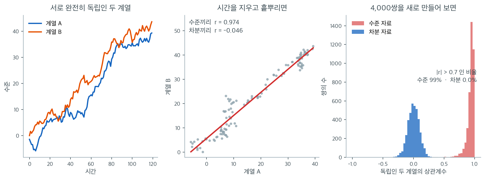

# 허위상관

두 변수가 아무런 인과적 연결 없이도 강한 통계적 상관을 보일 수 있다. 이런 **허위상관**은 교란변수, 공통 추세, 유한 표본에서의 우연, 자료 채굴에서 생긴다. 허위상관을 알아보는 일은 잘못된 결론을 피하는 데 필수적이며 **상관은 인과를 함의하지 않는다**는 원리의 핵심에 있다.

---

## 1. 무엇이 상관을 허위로 만드는가

$X$와 $Y$ 사이의 연관이 어느 방향으로도 직접적인 인과관계를 반영하지 않을 때 그 상관은 **허위**이다. 상관 자체는 존재하지만 그것을 인과의 증거로 해석하면 오도된다. 허위상관은 몇 가지 서로 다른 기제에서 생긴다.

---

## 2. 기제 1: 공통원인 (교란)

허위상관의 가장 흔한 원천은 $X$와 $Y$ 모두에 영향을 주는 **교란변수** $Z$이다:

$$
X \leftarrow Z \rightarrow Y
$$

$X$와 $Y$의 상관은 둘 다 $Z$에 이끌리기 때문에만 존재한다. $Z$를 통제하면 연관이 사라진다.

??? example "아이스크림과 익사"
    아이스크림 판매량($X$)과 익사 사고($Y$)는 양의 상관을 보인다. 교란요인은 기온($Z$)이다. 더운 날씨가 아이스크림 소비와 수영 활동을 모두 늘린다. 아이스크림이 익사를 일으키지는 않는다.

??? example "신발 크기와 읽기 능력"
    학령기 아동에서 신발 크기는 읽기 능력과 양의 상관을 보인다. 교란요인은 나이이다. 나이가 많은 아이일수록 발도 크고 읽기 능력도 좋다. 신발 크기가 문해력을 만들지는 않는다.

---

## 3. 기제 2: 공통 추세

시간에 따라 함께 증가(또는 감소)하는 두 시계열은 완전히 무관하더라도 양의 상관을 보인다. 관찰자료에서 허위상관이 만연하는 원천이다.

공통 추세는 다음에서 생긴다:

- **장기 추세**: 인구 증가, 물가 상승, 기술 변화 때문에 많은 시계열이 함께 상승한다.
- **계절성**: 계절 패턴을 갖는 두 변수는 같은 기간에 측정하면 상관을 보인다.

!!! warning "추세가 있는 시계열은 허위상관을 낳는다"
    미국의 과학 예산과 목맴에 의한 자살 건수의 상관(특정 10년 구간에서 $r \approx 0.99$)은 전적으로 허위이다. 두 계열 모두 시간에 따라 우연히 상승했을 뿐이다. 의미 있는 관계가 아니라 통계적 인공물이다.

시계열을 분석할 때 상관을 계산하기 전에 추세를 제거하거나 차분하면 진짜 연관과 공통 추세의 인공물을 구별하는 데 도움이 된다.



왼쪽의 두 계열은 서로 완전히 독립이다. 매 시점 표준정규 난수에 $+0.35$의 추세를 더해 누적했을 뿐이며, 계열 A를 만드는 난수와 계열 B를 만드는 난수 사이에는 아무 연결도 없다. 그런데 가운데처럼 시간축을 지우고 $(A_t, B_t)$를 흩뿌리면 $r = 0.974$라는, 물리 실험에서나 볼 법한 상관이 나온다. 같은 자료를 차분해서 $(\Delta A_t, \Delta B_t)$로 보면 $r = -0.046$으로 즉시 사라진다.

오른쪽이 이 현상이 얼마나 흔한지 말해 준다. 똑같은 방식으로 독립인 계열 쌍 4,000개를 새로 만들어 상관계수를 모았더니, **수준 자료에서는 $|r| > 0.7$인 쌍이 99%였다.** 차분 자료에서는 그 비율이 $0.0\%$이고 분포가 0을 중심으로 좁게 모인다. 추세가 있는 시계열에서 높은 상관은 예외가 아니라 **기본값**이라는 뜻이다. 두 계열이 모두 올라가기만 하면 점들은 대각선 위에 놓일 수밖에 없다.

여기서 흔한 오해를 하나 정리해 두자. 이 경우 표본크기를 늘려도 도움이 되지 않는다. 오히려 관측 기간을 늘릴수록 $r$은 1에 더 가까워지고 $p$값은 더 작아진다. 관측값들이 독립이 아니기 때문에 $r$의 표준오차를 계산하는 통상적인 공식 자체가 무효이며, 유의성 검정이 보고하는 숫자는 의미가 없다. 서두의 과학 예산과 자살 건수의 $r \approx 0.99$도 이 그림의 한 점일 뿐이다.

경고 신호는 간단하다. **두 변수가 모두 시간에 따라 단조롭게 움직이는가?** 그렇다면 상관계수를 보고하기 전에 차분하거나 추세를 제거하고, 그래도 연관이 남는지 확인해야 한다.

---

## 4. 기제 3: 우연과 자료 채굴

변수가 충분히 많으면 어떤 쌍은 순전히 우연으로 강하게 상관된다. 연구자가 수천 개의 변수 쌍을 검정하고 상관이 높은 것만 보고하면 그중 많은 수가 허위일 것이다.

이 문제를 키우는 것들:

- **다중비교**: 다중성을 조정하지 않고 여러 가설을 검정하는 것.
- **자료 채굴**(p-해킹): 유의한 결과를 찾아 자료를 뒤지는 것.
- **출판 편향**: 학술지가 놀랍고 긍정적인 발견을 선호하는 것.

Tyler Vigen의 "Spurious Correlations" 웹사이트는 통계적으로는 강하지만 터무니없는 상관들(예: 1인당 치즈 소비량과 침대 시트에 얽혀 사망한 건수)을 모아, 큰 자료에서 무의미한 패턴이 얼마나 쉽게 나타나는지 보여준다.

---

## 5. 기제 4: 충돌자 편향 (선택 편향)

더 미묘한 형태의 허위상관은 **충돌자**, 즉 $X$와 $Y$ 모두에 의해 생기는 변수로 조건화할 때 나타난다:

$$
X \rightarrow Z \leftarrow Y
$$

$Z$로 조건화하면(예: $Z$가 특정 값인 개인만 고르면) $X$와 $Y$가 주변적으로 독립이어도 둘 사이에 허위 연관이 만들어진다.

??? example "할리우드의 재능과 외모"
    일반 인구에서 연기 재능($X$)과 외모($Y$)는 무관할 수 있다. 그러나 성공한 배우들($Z$) 안에서는 둘이 음의 상관으로 보인다. 재능이 덜한 배우일수록 외모가 뛰어난 경향이 있고 그 반대도 마찬가지이다. (재능이나 외모 중 하나가 필요한) 성공으로 조건화한 것이 허위의 음의 연관을 만든다.

---

## 6. 허위상관과 진짜 상관 구별하기

어떤 상관이 허위인지 순수하게 통계적인 검정만으로 판정할 수는 없다. 다만 다음 전략들이 도움이 된다:

1. **교란요인을 확인한다.** 그럴듯한 제3의 변수를 찾아 [부분상관](../correlation/partial.md)을 계산한다. 조건화 후 상관이 사라지면 교란되었을 가능성이 크다.

2. **기제를 고려한다.** 그럴듯한 인과 경로가 있는가? 그럴듯한 기제가 없는 상관은 허위일 가능성이 크다.

3. **재현한다.** 독립적인 자료에서도 상관이 유지되는가? 우연이나 자료 채굴로 인한 허위상관은 대체로 재현되지 않는다.

4. **시간 순서를 살핀다.** $X$가 $Y$보다 시간적으로 나중이면 $X$가 $Y$를 일으킬 수 없다(다만 공통원인이 둘 다 설명할 수는 있다).

5. **용량–반응을 살핀다.** $X$가 커질수록 연관이 강해지는가? 용량–반응 관계는 허위상관보다 인과와 더 부합한다.

6. **공통 추세를 통제한다.** 시계열에서는 상관을 계산하기 전에 추세를 제거하거나 차분한다.

---

## 7. 상관이 인과를 함의하지 않는 이유

허위상관의 존재가 **"상관은 인과를 함의하지 않는다"**는 격언의 근본적인 이유이다. $X$와 $Y$ 사이에서 관측된 상관은 여러 인과 구조와 부합한다:

- $X$가 $Y$를 일으킨다
- $Y$가 $X$를 일으킨다
- 공통원인 $Z$가 둘 다 이끈다
- 상관이 통계적 인공물이다(우연, 자료 채굴, 충돌자 편향)

무작위 실험, 신중한 관찰연구 설계, 형식적인 인과추론 방법으로 대안적 설명들을 배제해야만 상관에서 인과로 나아갈 수 있다. [인과 추론의 기준](../causation/causal_criteria.md)을 보라.

---

## 연습문제

<div class="drillbox" markdown>

**연습문제 1.** <span class="diff med" title="중간"></span>
생존자 편향을 보이는 투자 시나리오를 모의실험하라:

1. 10년 동안 $N(0.05, 0.3)$에서 뽑은 무작위 연수익률을 갖는 "기업" 1000개를 생성한다
2. 누적수익률이 $-90\%$ 아래로 떨어진 적이 없으면 그 기업은 "생존"한다
3. 생존 기업의 평균 연수익률과 전체 기업의 평균 연수익률을 계산한다
4. 생존자만 볼 때 인식되는 수익률이 어떻게 부풀려지는지 논한다

```python
import numpy as np

np.random.seed(42)
n_companies = 1000
n_years = 10

# 기업마다 연수익률을 독립으로 뽑는다. 참 평균은 모두 8%로 같다.
returns = np.random.normal(0.08, 0.40, size=(n_companies, n_years))
cumulative = np.cumprod(1 + returns, axis=1)

# 누적수익이 한 번이라도 -90% 아래로 떨어지면 상장폐지로 본다.
survived = (cumulative > 0.10).all(axis=1)

print(f"생존 기업 수: {survived.sum()} / {n_companies}")
print(f"전체 평균 연수익률: {returns.mean():.4f}")
print(f"생존 기업 평균 연수익률: {returns[survived].mean():.4f}")
```

출력:

```
생존 기업 수: 867 / 1000
전체 평균 연수익률: 0.0791
생존 기업 평균 연수익률: 0.1039
```

표본 전체의 평균이 7.91%인데 생존 기업만 보면 10.39%다. 2.5%p가 순전히 생존자 편향에서 나온 허상이다. 1,000곳 중 133곳이 사라졌을 뿐인데 평균이 이만큼 부풀려진다.

</div>

??? success "풀이"

    누적수익률이 $-90\%$ 아래로 떨어진 기업은 생존 집합에서 제외된다. 살아남은 기업들은 편향된 표본이다. 수익률 흐름이 우연히 좋았던 기업은 포함되고 치명적 손실을 입은 기업은 배제되기 때문이다. 최악의 성과를 낸 기업들이 제거되므로 생존 기업의 평균 연수익률이 전체 기업의 평균보다 높다. 이것이 생존자 편향이다. 생존자만 분석하면 투자 성과에 대해 허위로 긍정적인 그림이 만들어진다. 실제로 뮤추얼펀드 데이터베이스와 주가지수도 상장폐지되거나 합병된 펀드가 과거 기록에서 사라지므로 이 편향을 안고 있다.

<div class="drillbox" markdown>

**연습문제 2.** <span class="diff med" title="중간"></span>
아래 각 상황에서 생존자 편향을 지적하고 어떤 자료가 빠졌는지 설명하라:

1. 어떤 보충제를 먹는 사람이 평균적으로 더 오래 산다는 연구 결과.
2. 성공한 식당들을 분석했더니 모두 야외 좌석이 있었다.
3. 20년간 최고 성과를 낸 뮤추얼펀드를 검토했더니 꾸준히 시장을 이겼다.

</div>

??? success "풀이"

    1. **보충제 연구**: 보충제를 먹는 사람은 애초에 더 건강할 수 있다(건강한 이용자 편향). 병이 심해져 복용을 중단했거나 일찍 사망한 사람은 "보충제 이용자" 집단에 들어가지 않는다. 빠진 자료: 질병이나 사망으로 복용을 시작했다 중단한 사람들.

    2. **식당 분석**: 살아남은(성공한) 식당만 연구된다. 야외 좌석이 있었지만 망한 식당은 자료에 없다. 빠진 자료: 야외 좌석을 갖추고 문을 열었다가 나중에 닫은 모든 식당. 이 분석으로는 야외 좌석이 성공에 기여하는지 판정할 수 없다.

    3. **뮤추얼펀드**: 20년 동안 성과가 나빴던 펀드는 대개 청산되거나 합병되거나 이름이 바뀌었다. 살아남은(따라서 성과가 좋았던) 펀드만 데이터베이스에 남는다. 빠진 자료: 20년 기간의 시작 시점에 존재했던 펀드 전체, 특히 그 뒤 청산된 펀드들.

<div class="drillbox" markdown>

**연습문제 3.** <span class="diff med" title="중간"></span>
2절의 아이스크림–익사 보기를 수치로 만들어 보자. $X = 1$ 은 아이스크림 판매량이 많은 날, $Y = 1$ 은 익사 사고가 일어난 날, $Z = 1$ 은 더운 날이다. 자료가 다음과 같다.

| 층 $z$ | $P(Y=1 \mid X=1, Z=z)$ | $P(Y=1 \mid X=0, Z=z)$ | $P(Z=z \mid X=1)$ | $P(Z=z \mid X=0)$ |
|---|---|---|---|---|
| $z = 1$ (더운 날) | $0.20$ | $0.20$ | $0.8$ | $0.1$ |
| $z = 0$ (선선한 날) | $0.04$ | $0.04$ | $0.2$ | $0.9$ |

(가) 거친 차이 $\Delta = P(Y=1 \mid X=1) - P(Y=1 \mid X=0)$ 을 구하라.

(나) 1장 정리 1(거친 차이 = 층별 효과의 가중평균 + 구성 차이)의 두 항을 각각 계산하고 합이 (가)와 맞는지 확인하라.

(다) 이제 아이스크림이 실제로 익사를 **막는다**고 하자. 두 층 모두에서 $\Delta_z = c < 0$ 이라 할 때, 관측되는 거친 차이가 정확히 $0$ 이 되는 $c$ 를 구하라. 이 자료를 본 연구자가 "아이스크림과 익사는 무관하다"고 결론 내리면 무엇을 놓치는가.

</div>

??? success "풀이"

    **(가)** 전확률의 법칙으로 층을 지운다.

    $$
    P(Y=1 \mid X=1) = 0.8 \times 0.20 + 0.2 \times 0.04 = 0.16 + 0.008 = 0.168
    $$

    $$
    P(Y=1 \mid X=0) = 0.1 \times 0.20 + 0.9 \times 0.04 = 0.02 + 0.036 = 0.056
    $$

    이므로 $\Delta = 0.168 - 0.056 = 0.112$ 다. 아이스크림이 많이 팔린 날의 익사 확률이 $11.2$ 퍼센트포인트 높다.

    **(나)** 정리 1 의 꼴로 $p_z = P(z \mid X=1)$, $q_z = P(z \mid X=0)$, $r_{1z} = E[Y \mid X=1, Z=z]$ 라 쓰면 거친 차이는 $\sum_z q_z \Delta_z + \sum_z (p_z - q_z) r_{1z}$ 다. 층별 효과는 두 층 모두 $\Delta_1 = 0.20 - 0.20 = 0$, $\Delta_0 = 0.04 - 0.04 = 0$ 이므로 가중평균도

    $$
    0 \times 0.1 + 0 \times 0.9 = 0
    $$

    이다. 구성 차이는 $r_{1z}$ 에 층 구성비의 차를 곱해 더한 것이므로

    $$
    0.20 \times (0.8 - 0.1) + 0.04 \times (0.2 - 0.9) = 0.14 - 0.028 = 0.112
    $$

    이고 $0 + 0.112 = 0.112$ 로 (가)와 맞는다. **거친 차이 $0.112$ 가 전부 구성 차이**, 즉 교란항이다. 더운 날 비율이 $0.8$ 대 $0.1$ 로 갈리고($P(z \mid 1) \ne P(z \mid 0)$), 더운 날의 익사 확률이 선선한 날의 다섯 배($0.20$ 대 $0.04$)라는 두 조건이 함께 성립해 둘의 곱이 남았다. 기온을 통제하면 연관이 완전히 사라진다는 2절의 주장이 이 계산이다.

    **(다)** 층별 효과가 두 층에서 같으면 가중평균은 가중치와 무관하게 $c$ 다. 구성 차이 항도 변하지 않는다. 기저위험 $r_{0z}$ 를 $0.20, 0.04$ 로 둔 채 $r_{1z} = r_{0z} + c$ 가 되므로

    $$
    \sum_z (p_z - q_z) r_{1z} = \sum_z (p_z - q_z) r_{0z} + c \sum_z (p_z - q_z) = 0.112 + c \times 0 = 0.112
    $$

    로, 구성비의 차가 층에 걸쳐 합이 $0$ 이어서 $c$ 가 깨끗이 떨어져 나간다. 따라서

    $$
    \Delta = c + 0.112 = 0 \quad \Longrightarrow \quad c = -0.112
    $$

    다. 즉 아이스크림이 익사 확률을 $11.2$ 퍼센트포인트 낮추는데도 자료에서는 **상관이 정확히 $0$** 으로 나타난다. 교란은 없는 연관을 만들기도 하지만 있는 연관을 가리기도 한다. "상관이 인과를 함의하지 않는다"의 짝이 되는 명제 — **무상관도 무인과를 함의하지 않는다** — 가 이 한 줄에 들어 있다.

<div class="drillbox" markdown>

**연습문제 4.** <span class="diff med" title="중간"></span>
5절의 할리우드 보기를 가장 단순한 꼴로 만들어 보자. 연기 재능 $X$ 와 외모 $Y$ 는 각각 독립인 베르누이 변수로 $P(X=1) = P(Y=1) = 1/2$ 이고, 성공 여부는 충돌자

$$
Z = \max(X, Y)
$$

즉 재능이나 외모 중 **하나라도** 갖추면 성공($Z=1$)한다고 하자.

(가) 조건화하지 않은 상관 $\mathrm{Corr}(X, Y)$ 를 적어라.

(나) 성공한 배우들만 본다. $Z = 1$ 로 조건화한 뒤의 $(X, Y)$ 결합분포를 쓰고 $\mathrm{Corr}(X, Y \mid Z=1)$ 을 구하라.

(다) 이 음의 상관을 "재능이 외모를 깎는다"로 읽으면 안 되는 까닭을, 조건화로 사라진 칸이 무엇인지 지적해서 설명하라.

</div>

??? success "풀이"

    **(가)** $X$ 와 $Y$ 는 독립이므로 $\mathrm{Corr}(X, Y) = 0$ 이다.

    **(나)** 네 칸의 확률은 각각 $1/4$ 인데 $Z = \max(X,Y) = 0$ 인 칸은 $(0,0)$ 뿐이므로 $P(Z=1) = 3/4$ 이고, 조건화하면 남은 세 칸이 각각 $\frac{1/4}{3/4} = \frac13$ 이 된다.

    | | $Y=0$ | $Y=1$ |
    |---|---|---|
    | $X=0$ | $0$ | $1/3$ |
    | $X=1$ | $1/3$ | $1/3$ |

    따라서 $E[X \mid Z=1] = E[Y \mid Z=1] = \frac23$, $E[XY \mid Z=1] = \frac13$ 이고

    $$
    \mathrm{Cov}(X, Y \mid Z=1) = \frac13 - \frac23 \cdot \frac23 = \frac13 - \frac49 = -\frac19
    $$

    $$
    \mathrm{Var}(X \mid Z=1) = \frac23 - \frac49 = \frac29
    $$

    이다. 두 분산이 같으므로

    $$
    \mathrm{Corr}(X, Y \mid Z=1) = \frac{-1/9}{2/9} = -\frac12
    $$

    다. 독립인 두 변수가 성공자 집단 안에서 $r = -0.5$ 의 또렷한 음의 상관을 보인다.

    **(다)** 조건화가 지운 칸은 $(X,Y) = (0,0)$, 즉 **재능도 외모도 없어 애초에 성공하지 못한 사람들**이다. 이 칸만 사라지면 "둘 다 낮음"이라는 조합이 표에서 없어지므로, 한쪽이 낮은 사람은 반드시 다른 쪽이 높아야 한다. 음의 상관은 자료 생성 과정에 들어 있는 것이 아니라 **표본을 고르는 방식**이 만든 것이다. 그래서 할리우드 안에서 재능과 외모의 상호 대체를 관찰해도, 일반 인구에서 둘이 무관하다는 사실과 아무 모순이 없다.

<div class="drillbox" markdown>

**연습문제 5.** <span class="diff med" title="중간"></span>
4절의 자료 채굴을 직접 해 보자. 서로 완전히 독립인 표준정규 변수 $k = 50$ 개를 각각 $n = 40$ 번 관측한 자료를 만들고, 가능한 모든 쌍의 상관을 계산하라.

(가) 쌍의 개수와, 그중 $p < 0.05$ 인 쌍의 개수를 세고 이론적 기대개수와 비교하라. 상관계수의 검정통계량은 $t = r\sqrt{n-2}/\sqrt{1-r^2}$ 이고 자유도는 $n - 2$ 다.

(나) 가장 센 상관의 $r$ 과 $p$ 값을 보고하라. 이 쌍만 떼어 "유의수준 $0.001$ 에서 유의한 발견"으로 발표하면 무엇이 틀리는가.

(다) 참 상관이 모두 $0$ 임을 아는 상태에서, 이 실험이 6절의 전략 3(재현)과 어떻게 이어지는가.

</div>

??? success "풀이"

    **(가)·(나)**

    ```python
    import numpy as np
    from scipy import stats

    rng = np.random.default_rng(0)
    k, n = 50, 40

    # 서로 완전히 독립인 변수 50 개. 참 상관은 1225 쌍 모두에서 0 이다.
    data = rng.standard_normal((n, k))
    R = np.corrcoef(data, rowvar=False)
    iu = np.triu_indices(k, 1)
    r = R[iu]

    t = r * np.sqrt(n - 2) / np.sqrt(1 - r**2)
    p = 2 * stats.t.sf(np.abs(t), n - 2)
    j = np.abs(r).argmax()

    print(f"쌍의 수: {len(r)}")
    print(f"가장 센 쌍: r = {r[j]:+.4f}, p = {p[j]:.5f}")
    print(f"p < 0.05 인 쌍: {(p < 0.05).sum()} (기대 {0.05 * len(r):.2f})")
    print(f"|r| > 0.4 인 쌍: {(np.abs(r) > 0.4).sum()}")
    ```

    출력:

    ```text
    쌍의 수: 1225
    가장 센 쌍: r = +0.5617, p = 0.00016
    p < 0.05 인 쌍: 63 (기대 61.25)
    |r| > 0.4 인 쌍: 20
    ```

    쌍의 수는 $\binom{50}{2} = 1225$ 다. 참 상관이 모두 $0$ 이므로 각 검정은 확률 $0.05$ 로 거짓 유의를 내고, 기대개수는 $1225 \times 0.05 = 61.25$ 다. 실제로 $63$ 개가 나왔다 — 검정은 약속한 만큼 정확히 틀렸다. $\lvert r \rvert > 0.4$ 인 쌍도 $20$ 개 있다.

    가장 센 쌍은 $r = +0.5617$, $p = 0.00016$ 이다. 이 하나만 보면 "$p < 0.001$ 에서 유의"이지만, 틀린 곳은 $p$ 값의 계산이 아니라 **분모**다. 검정을 $1225$ 번 했으므로 가장 작은 $p$ 값은 $\min$ 의 분포를 따라야 하고, 본페로니로 보정하면 임계값이 $0.05/1225 = 4.1 \times 10^{-5}$ 라서 $0.00016$ 은 유의하지 않다. $1225$ 개 중 최솟값이 $0.00016$ 보다 작을 확률은 $1 - (1 - 0.00016)^{1225} \approx 0.18$ 로, 우연히 이만한 값을 보는 것은 전혀 드문 일이 아니다.

    **(다)** 이 자료에서 "발견"된 $63$ 개 쌍은 전부 자료를 만든 난수의 성질일 뿐이므로, 같은 $50$ 개 변수를 새로 $40$ 번 관측하면 그중 $0.05$ 의 비율만 다시 유의해진다. 즉 재현율이 거짓발견에서는 유의수준 수준으로 떨어진다. 참 연관이 있는 쌍은 검정력만큼의 확률로 다시 유의해지므로, **독립 자료에서의 재현**이 우연과 참 연관을 가르는 가장 값싼 체이다. Vigen의 수집품이 하나같이 재현 논문을 달고 다니지 않는 까닭이기도 하다.

<div class="drillbox" markdown>

**연습문제 6.** <span class="diff med" title="중간"></span>
6절의 전략 1 은 부분상관

$$
r_{XY \cdot Z} = \frac{r_{XY} - r_{XZ}\,r_{YZ}}{\sqrt{1 - r_{XZ}^2}\,\sqrt{1 - r_{YZ}^2}}
$$

을 보라고 한다. 아이스크림 판매량 $X$, 익사 $Y$, 기온 $Z$ 의 쌍별 상관이 $r_{XZ} = 0.90$, $r_{YZ} = 0.80$ 으로 측정되었다.

(가) $r_{XY} = 0.72$ 일 때 $r_{XY \cdot Z}$ 를 구하라.

(나) 같은 $r_{XZ}, r_{YZ}$ 에서 $r_{XY} = 0.80$ 이면 $r_{XY \cdot Z}$ 는 얼마인가.

(다) 일반적으로 교란변수 $Z$ **하나만으로** 설명되는 $X$–$Y$ 상관의 크기를 $r_{XZ}, r_{YZ}$ 로 쓰라. $r_{XZ} = r_{YZ} = 0.99$ 이면 그 값은 얼마이며, 이것이 3절의 과학 예산–자살 사례($r \approx 0.99$)에 대해 무엇을 말해 주는가.

</div>

??? success "풀이"

    **(가)** 분자가 $0.72 - (0.90)(0.80) = 0.72 - 0.72 = 0$ 이므로

    $$
    r_{XY \cdot Z} = \frac{0}{\sqrt{1 - 0.81}\,\sqrt{1 - 0.64}} = 0
    $$

    이다. 기온을 통제하면 아이스크림과 익사의 상관이 흔적도 없이 사라진다.

    **(나)** 분자는 $0.80 - 0.72 = 0.08$, 분모는 $\sqrt{0.19}\,\sqrt{0.36} = 0.4359 \times 0.6 = 0.2615$ 이므로

    $$
    r_{XY \cdot Z} = \frac{0.08}{0.2615} = 0.306
    $$

    이다. 주변상관은 $0.72$ 에서 $0.80$ 으로 조금 커졌을 뿐인데 부분상관은 $0$ 에서 $0.306$ 으로 뛴다. 분자에서 $r_{XZ} r_{YZ} = 0.72$ 를 빼기 때문에 **기준선 위로 얼마나 남는지**가 관심사이고, 분모 $0.2615$ 가 $1$ 보다 훨씬 작아 남은 $0.08$ 을 네 배 가까이 증폭한다.

    **(다)** 부분상관의 분자가 $0$ 이 되는 자리가 "$Z$ 만으로 설명되는" 지점이므로 그 크기는 곱

    $$
    r_{XY} = r_{XZ}\,r_{YZ}
    $$

    다. $r_{XZ} = r_{YZ} = 0.99$ 이면 $0.99^2 = 0.9801$ 이다. 즉 두 계열이 각각 공통 요인과 $0.99$ 로 묶여 있기만 하면, 서로 아무 인과관계가 없어도 $r \approx 0.98$ 이 나온다. 3절의 과학 예산과 자살 건수에서 그 공통 요인은 **시간**이다. 두 계열 모두 시간과 거의 완벽하게 상관되므로 곱이 $0.98$ 에 이르고, $r \approx 0.99$ 는 놀라운 수가 아니라 이 곱이 돌려준 값이다(시간과의 상관이 $0.995$ 면 곱은 $0.990$ 이다).

<div class="drillbox" markdown>

**연습문제 7.** <span class="diff hard" title="어려움"></span>
3절은 "관측 기간을 늘릴수록 $r$ 은 1 에 더 가까워진다"고 했다. 그림의 생성 과정을 그대로 두고 이를 유도하자. 독립인 두 계열이

$$
A_t = \sum_{i=1}^{t} (\delta + a_i), \qquad B_t = \sum_{i=1}^{t} (\delta + b_i), \qquad t = 1, \dots, T
$$

이고 $a_i, b_i \sim N(0, \sigma^2)$ 는 모두 독립, $\delta = 0.35$, $\sigma = 1$ 이다.

(가) $A_t = \delta t + S_t$ 로 쪼개고($S_t$ 는 추세 없는 확률보행), 시점 $t = 1, \dots, T$ 에 걸친 결정적 부분 $\delta t$ 의 표본분산이 $\delta^2 (T^2-1)/12$ 임을 적어라.

(나) $E[S_t S_s] = \sigma^2 \min(t,s)$ 를 써서 $S_t$ 의 표본분산의 기댓값이 정확히 $\sigma^2 (T^2-1)/(6T)$ 임을 보이라. ($\sum_{t,s} \min(t,s) = T(T+1)(2T+1)/6$ 을 쓰면 된다.)

(다) 두 계열의 공분산에는 추세끼리의 몫만 남으므로 $r$ 이 $A_t$ 의 분산 중 추세가 차지하는 비율로 근사된다. 그 비율을 $\delta, \sigma, T$ 로 간단히 정리하고 $T = 50, 200, 800$ 에서 값을 구하라.

(라) 이 비율이 $0.9$ 를 넘는 최소의 $T$ 를 구하고, $T \to \infty$ 의 극한을 말하라. 같은 자료를 차분하면 어떻게 되는가.

</div>

??? success "풀이"

    **(가)** 합을 쪼개면 $A_t = \delta t + S_t$, $S_t = \sum_{i \le t} a_i$ 다. $t$ 가 $1, \dots, T$ 를 고르게 지나므로 $t$ 의 표본분산은 $(T^2-1)/12$ 이고, 결정적 부분의 표본분산은 그 $\delta^2$ 배인 $\delta^2 (T^2-1)/12$ 다.

    **(나)** 표본분산을 $V_S = \frac1T \sum_t S_t^2 - \bigl(\frac1T \sum_t S_t\bigr)^2$ 로 두면 첫 항의 기댓값은

    $$
    \frac1T \sum_{t=1}^{T} \sigma^2 t = \sigma^2 \frac{T+1}{2}
    $$

    이고, 둘째 항의 기댓값은

    $$
    \frac{\sigma^2}{T^2} \sum_{t}\sum_{s} \min(t,s) = \frac{\sigma^2}{T^2} \cdot \frac{T(T+1)(2T+1)}{6} = \sigma^2 \frac{(T+1)(2T+1)}{6T}
    $$

    다. 빼면

    $$
    E[V_S] = \sigma^2 (T+1)\left[\frac12 - \frac{2T+1}{6T}\right] = \sigma^2 (T+1) \cdot \frac{3T - 2T - 1}{6T} = \sigma^2 \frac{(T+1)(T-1)}{6T} = \sigma^2 \frac{T^2-1}{6T}
    $$

    이다. 추세 부분은 $T^2$ 처럼 커지는데 확률보행 부분은 $T$ 처럼만 커진다.

    **(다)** 두 계열의 난수가 독립이므로 $\mathrm{Cov}(A, B)$ 에는 $\delta t$ 끼리의 몫 $\delta^2 (T^2-1)/12$ 만 평균적으로 남고, 각 계열의 분산은 두 부분의 합이다. 공통인자 $(T^2-1)$ 이 깨끗이 약분되어

    $$
    r \approx \frac{\delta^2 (T^2-1)/12}{\delta^2 (T^2-1)/12 + \sigma^2 (T^2-1)/(6T)}
    = \frac{1}{1 + \dfrac{2\sigma^2}{\delta^2 T}}
    = \frac{1}{1 + \dfrac{16.33}{T}}
    $$

    이다($2/0.35^2 = 16.33$). 값은 $T = 50$ 에서 $0.754$, $T = 200$ 에서 $0.925$, $T = 800$ 에서 $0.980$ 이다.

    **(라)** $16.33/T \le 1/9$ 에서 $T \ge 146.9$ 이므로 최소 $T = 147$ 이다. $T \to \infty$ 면 비율이 $1$ 로 가므로 $r \to 1$ 이다. 두 계열이 점점 같은 기울기의 직선 하나로 수렴하고, 서로 다른 몫인 확률보행의 분산 비중은 $O(1/T)$ 로 줄어든다. 반면 차분하면 $\Delta A_t = \delta + a_t$ 로 상수에 백색잡음을 더한 것이 되어 $B$ 쪽과 완전히 독립이고, $r$ 의 기댓값은 $T$ 와 무관하게 $0$ 이다. **더 오래 관측하는 것은 해결책이 아니라 증상을 키우는 일**이라는 3절의 경고가 이 식이다.

<div class="drillbox" markdown>

**연습문제 8.** <span class="diff hard" title="어려움"></span>
연습문제 7 의 근사식을 모의실험으로 확인하고, 유의성 검정이 어떻게 되는지 보자. $\delta = 0.35$, $\sigma = 1$ 로 독립인 계열 쌍 4,000 개를 $T = 50, 200, 800$ 에서 만들어

(가) 수준 자료의 평균 $r$ 과 연습문제 7(다)의 근사값을 나란히 적어라.

(나) 각 쌍에 $t = r\sqrt{T-2}/\sqrt{1-r^2}$ 로 유의수준 $0.05$ 의 상관 검정을 하고, 기각률을 $T$ 별로 구하라. 참값이 "무상관"인데 기각률이 어떻게 움직이는가.

(다) 차분 자료의 평균 $r$ 도 함께 보고하고, (나)의 기각률과 묶어 "표본을 늘리면 된다"는 처방이 왜 틀렸는지 한 문장으로 쓰라.

</div>

??? success "풀이"

    ```python
    import numpy as np
    from scipy import stats


    def rowr(U, V):
        """행마다 두 계열의 Pearson 상관을 구한다."""
        U = U - U.mean(axis=1, keepdims=True)
        V = V - V.mean(axis=1, keepdims=True)
        return (U * V).sum(1) / np.sqrt((U**2).sum(1) * (V**2).sum(1))


    rng = np.random.default_rng(1)
    delta, sigma, m = 0.35, 1.0, 4000

    for T in (50, 200, 800):
        A = (delta + sigma * rng.standard_normal((m, T))).cumsum(axis=1)
        B = (delta + sigma * rng.standard_normal((m, T))).cumsum(axis=1)
        rl, rd = rowr(A, B), rowr(np.diff(A, axis=1), np.diff(B, axis=1))
        ts = rl * np.sqrt(T - 2) / np.sqrt(1 - rl**2)
        rej = (2 * stats.t.sf(np.abs(ts), T - 2) < 0.05).mean()
        approx = 1 / (1 + 2 * sigma**2 / (delta**2 * T))
        print(f"T = {T:3d}: 수준 평균 r = {rl.mean():.4f} (근사식 {approx:.4f}), "
              f"기각률 = {rej:.3f}, 차분 평균 r = {rd.mean():+.4f}")
    ```

    출력:

    ```text
    T =  50: 수준 평균 r = 0.7859 (근사식 0.7538), 기각률 = 0.959, 차분 평균 r = -0.0008
    T = 200: 수준 평균 r = 0.9631 (근사식 0.9245), 기각률 = 1.000, 차분 평균 r = -0.0007
    T = 800: 수준 평균 r = 0.9918 (근사식 0.9800), 기각률 = 1.000, 차분 평균 r = -0.0006
    ```

    **(가)** 평균 $r$ 은 $0.786 \to 0.963 \to 0.992$ 로 $1$ 을 향해 올라가고, 근사식 $0.754 \to 0.925 \to 0.980$ 과 거의 같은 자리를 따라간다. 근사값이 조금씩 작은 까닭은 $r$ 이 분수여서 분모의 변동이 평균에 들어오기 때문이다($E[X/Y] \ne E[X]/E[Y]$). 증가의 속도와 극한은 식이 말한 대로다. 본문의 $r = 0.974$ 도 이 곡선 위의 한 점일 뿐이다.

    **(나)** 기각률은 $T = 50$ 에서 이미 $0.959$, $T \ge 200$ 에서는 $1.000$ 이다. 참 상관은 모든 쌍에서 $0$ 이므로 이 기각은 전부 거짓양성이고, 약속한 $0.05$ 와 비교하면 검정이 완전히 망가져 있다. 원인은 $t$ 통계량 공식이 요구하는 **관측값의 독립**이 깨진 것이다. 확률보행은 바로 앞 값을 기억하므로 유효 표본크기가 $T$ 보다 훨씬 작은데, 공식은 $T$ 를 그대로 믿고 표준오차를 과소평가한다.

    **(다)** 차분 자료의 평균 $r$ 은 세 경우 모두 $-0.001$ 쯤으로 $0$ 이고 $T$ 와 무관하다. 한 문장으로 쓰면 이렇다. **표본을 늘리면 추정의 분산은 줄지만 치우침은 줄지 않으며, 여기서 문제는 전부 치우침이다** — $T$ 를 키우면 거짓 상관은 $1$ 로, 거짓 기각률은 $100\%$ 로 다가간다. 고쳐야 할 것은 표본크기가 아니라 **모형**(추세 제거 또는 차분)이다.

<div class="drillbox" markdown>

**연습문제 9.** <span class="diff hard" title="어려움"></span>
연습문제 4 를 일반화한다. $X, Y$ 는 독립인 베르누이 변수로 $P(X=1) = P(Y=1) = p$ 이고 $Z = \max(X,Y)$ 다.

(가) $P(Z=1) = p(2-p)$ 임을 보이고 $\mathrm{Corr}(X, Y \mid Z=1) = -(1-p)$ 를 유도하라.

(나) $p \to 0$ 과 $p \to 1$ 의 극한에서 이 상관이 어떻게 되는지 해석하라. 성공률 $P(Z=1)$ 이 $0.1$ 인 업계라면 $p$ 와 조건부 상관은 각각 얼마인가.

(다) 6절의 전략 1 은 "$Z$ 로 조건화한 뒤 상관이 사라지면 교란되었을 가능성이 크다"고 한다. 이 문제의 $Z$ 는 그 전략을 어떻게 배반하는가. $X \leftarrow Z \rightarrow Y$ 와 $X \rightarrow Z \leftarrow Y$ 를 자료만 보고 구별할 수 있는지, 구별하려면 무엇이 더 필요한지 답하라.

</div>

??? success "풀이"

    **(가)** $Z = 0$ 은 $(X,Y) = (0,0)$ 일 때뿐이므로 $P(Z=0) = (1-p)^2$ 이고

    $$
    P(Z=1) = 1 - (1-p)^2 = 2p - p^2 = p(2-p)
    $$

    다. $Z=1$ 로 조건화하면 세 칸이 남는다.

    $$
    P(1,1 \mid Z=1) = \frac{p^2}{p(2-p)} = \frac{p}{2-p}, \qquad
    P(1,0 \mid Z=1) = P(0,1 \mid Z=1) = \frac{p(1-p)}{p(2-p)} = \frac{1-p}{2-p}
    $$

    따라서

    $$
    E[X \mid Z=1] = \frac{p}{2-p} + \frac{1-p}{2-p} = \frac{1}{2-p}, \qquad
    E[XY \mid Z=1] = \frac{p}{2-p}
    $$

    이고

    $$
    \mathrm{Cov}(X,Y \mid Z=1) = \frac{p}{2-p} - \frac{1}{(2-p)^2} = \frac{p(2-p) - 1}{(2-p)^2} = \frac{-(1-p)^2}{(2-p)^2}
    $$

    $$
    \mathrm{Var}(X \mid Z=1) = \frac{1}{2-p} - \frac{1}{(2-p)^2} = \frac{1-p}{(2-p)^2}
    $$

    이다. 두 변수의 분산이 같으므로

    $$
    \mathrm{Corr}(X, Y \mid Z=1) = \frac{-(1-p)^2/(2-p)^2}{(1-p)/(2-p)^2} = -(1-p)
    $$

    다. $p = 1/2$ 를 넣으면 연습문제 4 의 $-1/2$ 가 나온다.

    **(나)** $p \to 0$ 이면 상관이 $-1$ 로 간다. 재능도 외모도 아주 드물면 성공자는 거의 모두 **딱 하나만** 갖춘 사람이어서, 한쪽을 알면 다른 쪽을 거의 확정할 수 있다. $p \to 1$ 이면 $0$ 으로 간다. 거의 모두가 둘 다 갖추고 있으면 조건화가 지우는 $(0,0)$ 칸이 비어 있어 아무 왜곡도 생기지 않는다. **충돌자 편향은 조건화가 잘라내는 칸이 클 때 커진다.**

    성공률이 $0.1$ 이면 $p(2-p) = 0.1$, 즉 $p^2 - 2p + 0.1 = 0$ 에서 $p = 1 - \sqrt{0.9} = 0.0513$ 이고 조건부 상관은 $-(1 - 0.0513) = -0.949$ 다. 선발이 혹독한 집단에서는 완전히 독립인 두 자질이 거의 완벽한 음의 상관으로 보인다.

    **(다)** 전략 1 은 조건화 뒤 상관이 **줄어드는** 경우만 염두에 둔다. 여기서는 반대로 조건화가 $0$ 이던 상관을 $-(1-p)$ 로 **만들어 낸다**. 즉 "$Z$ 를 통제했더니 연관이 달라졌다"는 사실만으로는 $Z$ 가 공통원인인지 공통결과인지 알 수 없고, 교란의 경우에는 통제가 올바른 조치이지만 충돌자의 경우에는 통제가 바로 편향의 원인이다.

    두 구조는 관측분포만으로 구별되지 않는다. $X \leftarrow Z \rightarrow Y$ 와 $X \rightarrow Z \leftarrow Y$ 는 세 변수의 결합분포를 같게 맞출 수 있어, 자료는 어느 쪽인지 말해 주지 않는다(7절의 "관측된 상관은 여러 인과 구조와 부합한다"). 필요한 것은 자료 밖에서 오는 것 — 6절 전략 2 의 **기제**, 전략 4 의 **시간 순서**(성공은 재능보다 나중에 결정된다), 그리고 조건화 변수가 처리 **후**에 측정된 것인지에 대한 판단이다. 그래서 통제변수를 고르는 일은 통계적 선택이 아니라 인과적 가정의 선언이다.

<div class="drillbox" markdown>

**연습문제 10.** <span class="diff hard" title="어려움"></span>
3절은 시계열에서 "차분하거나 추세를 제거하고, 그래도 연관이 남는지 확인"하라고 한다. 이 처방이 어느 쪽으로 틀릴 수 있는지 모의실험으로 따져 보자. $T = 200$, 반복 2,000 회로 두 상황을 만든다.

- 상황 A: 표준정규 증분을 쌓은 서로 무관한 확률보행 $X_t$ 와 $W_t$. (추세는 없다.)
- 상황 B: 같은 $X_t$ 와 $Y_t = X_t + 5\varepsilon_t$, $\varepsilon_t \sim N(0,1)$ 백색잡음. 즉 $Y$ 는 **수준에서 $X$ 그 자체**에 큰 측정잡음만 얹은 계열이다.

(가) 두 상황에서 수준 자료의 평균 $\lvert r \rvert$ 과 차분 자료의 평균 $\lvert r \rvert$ 을 구하라.

(나) 상황 B 의 차분 상관의 이론값을 $\mathrm{Var}(\Delta X)$ 와 $\mathrm{Var}(\Delta Y)$ 로 계산하고 모의값과 비교하라.

(다) "차분한 뒤 $\lvert r \rvert < 0.2$ 이면 허위로 판정한다"는 규칙이 두 상황을 각각 몇 %나 허위로 부르는지 보고, 3절의 처방을 어떻게 고쳐 읽어야 하는지 쓰라.

</div>

??? success "풀이"

    **(가)·(다)**

    ```python
    import numpy as np


    def rowr(U, V):
        U = U - U.mean(axis=1, keepdims=True)
        V = V - V.mean(axis=1, keepdims=True)
        return (U * V).sum(1) / np.sqrt((U**2).sum(1) * (V**2).sum(1))


    rng = np.random.default_rng(2)
    T, m = 200, 2000

    X = rng.standard_normal((m, T)).cumsum(axis=1)   # 확률보행
    W = rng.standard_normal((m, T)).cumsum(axis=1)   # X 와 무관한 확률보행
    Y = X + 5.0 * rng.standard_normal((m, T))        # 수준에서 X 와 같은 계열 + 측정잡음

    rl_a, rd_a = rowr(X, W), rowr(np.diff(X, axis=1), np.diff(W, axis=1))
    rl_b, rd_b = rowr(X, Y), rowr(np.diff(X, axis=1), np.diff(Y, axis=1))

    print(f"A (무관한 두 보행): 수준 |r| = {np.abs(rl_a).mean():.4f}, "
          f"차분 |r| = {np.abs(rd_a).mean():.4f}")
    print(f"B (Y = X + 측정잡음): 수준 |r| = {np.abs(rl_b).mean():.4f}, "
          f"차분 |r| = {np.abs(rd_b).mean():.4f}")
    print(f"차분 |r| < 0.2 를 허위의 증거로 쓸 때 A 를 허위라 하는 비율: "
          f"{(np.abs(rd_a) < 0.2).mean():.3f}")
    print(f"같은 규칙이 B 를 허위라 하는 비율: {(np.abs(rd_b) < 0.2).mean():.3f}")
    ```

    출력:

    ```text
    A (무관한 두 보행): 수준 |r| = 0.4162, 차분 |r| = 0.0568
    B (Y = X + 측정잡음): 수준 |r| = 0.6928, 차분 |r| = 0.1405
    차분 |r| < 0.2 를 허위의 증거로 쓸 때 A 를 허위라 하는 비율: 0.994
    같은 규칙이 B 를 허위라 하는 비율: 0.809
    ```

    상황 A 에서는 **추세가 전혀 없는데도** 수준 평균 $\lvert r \rvert$ 이 $0.42$ 나 된다. 공통 추세가 없어도 누적만으로 허위상관이 생긴다는 뜻이고, 차분하면 $0.057$ 로 떨어져 처방이 제대로 작동한다. 그런데 상황 B 에서도 차분 $\lvert r \rvert$ 이 $0.14$ 밖에 안 된다. 여기서 $Y$ 는 $X$ 와 수준에서 **같은 계열**이므로 이보다 더 진짜일 수 없는 관계인데도 차분이 그 관계를 거의 지워 버렸다.

    **(나)** $\Delta X_t$ 의 분산은 증분의 분산이므로 $1$ 이고, $\Delta Y_t = \Delta X_t + 5(\varepsilon_t - \varepsilon_{t-1})$ 의 분산은 $1 + 25 \times 2 = 51$ 이다. 공분산은 $\mathrm{Cov}(\Delta X, \Delta Y) = \mathrm{Var}(\Delta X) = 1$ 이므로

    $$
    \mathrm{Corr}(\Delta X, \Delta Y) = \frac{1}{\sqrt{1 \times 51}} = 0.140
    $$

    이고 모의값 $0.1405$ 와 맞는다. 차분이 관계를 지운 기제가 식에 다 들어 있다. 차분은 $X$ 의 신호에서 한 걸음치($\mathrm{Var} = 1$)만 남기는데 잡음은 두 시점이 겹쳐 $2 \times 25$ 로 **증폭**되므로, 수준에서 신호 대 잡음이 좋던 관계가 차분에서는 뒤집힌다.

    **(다)** 이 규칙은 상황 A 를 $99.4\%$ 허위로 옳게 부르지만, 상황 B 도 $80.9\%$ 나 허위로 부른다. 즉 차분은 허위상관을 지우는 데는 거의 완벽하지만 **진짜 관계도 함께 지울 수 있다.** 그러므로 3절의 처방은 비대칭적으로 읽어야 한다. 차분한 뒤에도 연관이 남으면 그것은 강한 증거다(공통 추세로는 설명되지 않는다). 그러나 차분한 뒤 연관이 사라졌다는 것은 **허위의 증명이 아니다** — 수준에서만 또렷한 진짜 관계이거나 측정잡음이 큰 경우일 수 있으므로, 그때는 추세를 함께 모형에 넣고 추정하는 쪽(공적분·오차수정 모형)이 자료를 버리지 않는 길이다. 어떤 통계적 처리도 6절의 첫 문장, 즉 **허위인지 아닌지는 통계만으로 판정되지 않는다**는 사실을 바꾸지 못한다.

---

## 정리하며

허위상관은 직접적인 인과관계를 반영하지 않는 통계적 연관이다. 교란변수, 공통 추세, 우연, 자료 채굴, 충돌자 편향에서 생긴다. 허위상관의 존재가 상관이 인과를 함의하지 않는 주된 이유이다. 인과적 결론을 내리기 전에 관측된 상관에 대한 대안적 설명을 찾아 배제하는 일이 반드시 필요하다.
