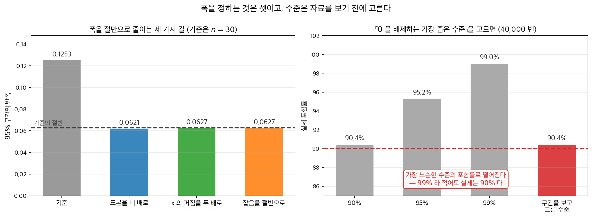
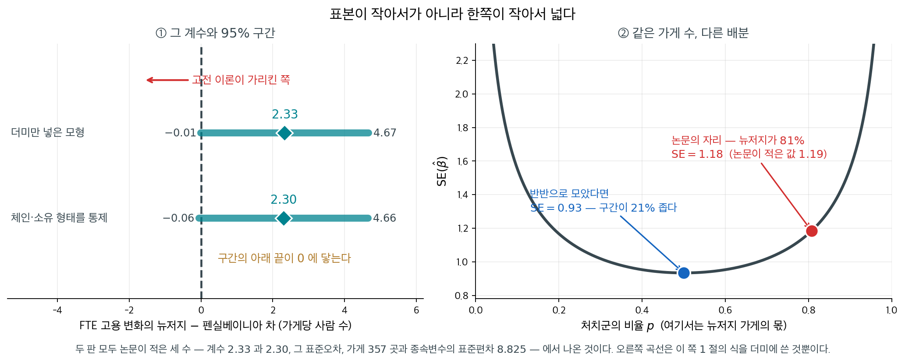
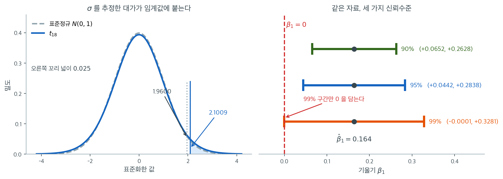
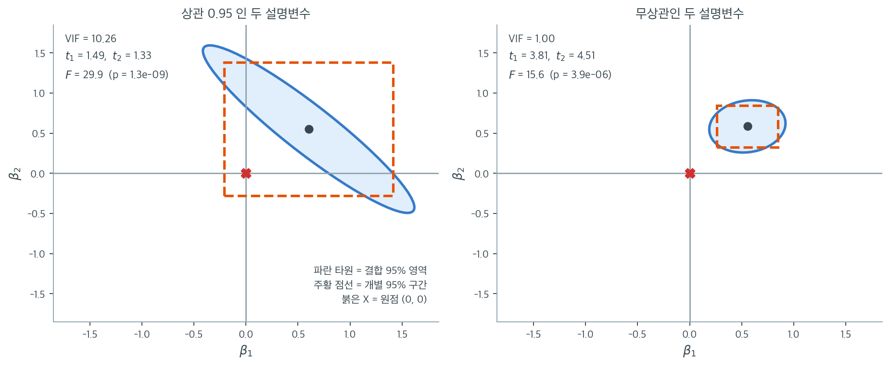
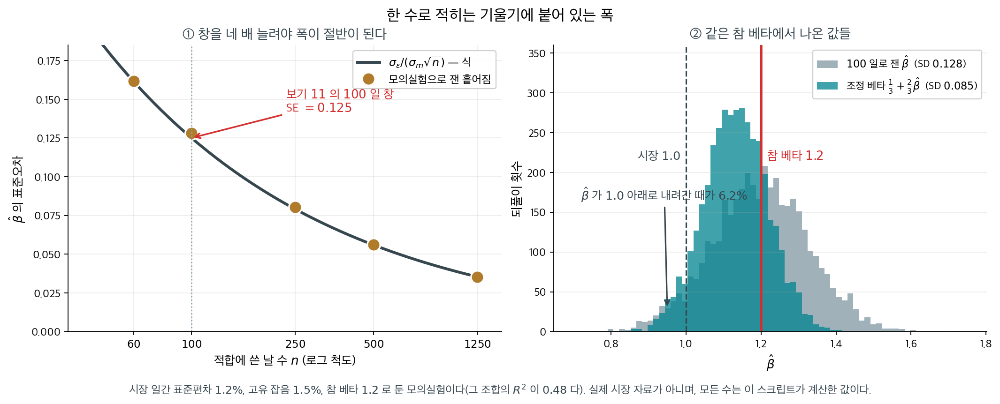

# 계수의 신뢰구간

## 개요

<div class="leadbox" markdown>

**들어가는 이야기** — 최저임금을 올리면 일자리가 줄어드는가

「최저임금을 올리면 일자리가 줄어드는가」는 정책이 걸린 물음이고, 자료가 내놓는 답은 수 하나가 아니라 **그 수에 붙은 구간**이다. 미국 뉴저지주가 최저임금을 시간당 $4.25$ 달러에서 $5.05$ 달러로 올리고 옆 주 펜실베이니아는 그대로였을 때, 카드와 크루거가 양쪽의 패스트푸드 가게를 조사해 얻은 뉴저지 더미 계수가 $2.33$ 이고 표준오차가 $1.19$ 다. 임계값 $t_{355}(0.975) = 1.967$ 을 곱해 더하고 빼면 $2.33 \pm 2.34$, 곧 $95\%$ 구간이 $(-0.01,\ 4.67)$ 이다. 점추정값은 고용이 가게당 두 사람 넘게 **늘었다**고 말하는데 구간은 조금도 늘지 않았을 가능성을 간신히 품는다.

이 쪽은 그 구간을 만드는 식을 세운다. 꼴은 늘 같다 — 점추정값 $\pm$ 임계값 $\times$ 표준오차. 그래서 같은 자료에서 같은 기울기 $0.164$, 같은 표준오차 $0.057$ 로 세 구간을 만들면 **임계값만** $1.734 \cdot 2.101 \cdot 2.878$ 로 달라진다. 오차한계가 각각 $\pm 0.0988$, $\pm 0.1198$, $\pm 0.1641$ 이니 $90\%$ 는 $(0.0652,\ 0.2628)$, $95\%$ 는 $(0.0442,\ 0.2838)$, $99\%$ 는 $(-0.0001,\ 0.3281)$ 이다.

앞의 둘은 $0$ 을 담지 않고 마지막 하나는 왼쪽 끝이 $-0.0001$ 로 $0$ 을 간신히 넘어간다. 점추정값은 하나도 움직이지 않았는데 「양의 연관이 있다」는 문장이 유의수준에 따라 참이 되고 거짓이 된다. $p = 0.0100$ 이라는 사실이 그 아슬아슬함의 다른 얼굴이다.

그러니 여기서 거꾸로 배우지 않도록 적어 둔다. **유의수준은 자료를 보고 고르는 것이 아니다** — 구간을 보고 나서 수준을 고르면 그 구간은 약속한 $1-\alpha$ 를 더 이상 지키지 않는다(8.1절 [해석과 흔한 오해](../../ch08/foundations/interpretation.md)). 수준을 먼저 못 박고 나면 남는 물음은 하나다. 구간의 폭을 정하는 것은 무엇이고, 좁히려면 무엇을 바꾸어야 하는가.

<figure markdown>
{ width="980" }
  <figcaption markdown>**왼쪽.** 반폭은 $t^*\sigma/\sqrt{S_{xx}}$ 이므로 좁히는 길이 셋뿐이다 — 표본을 **네 배**로 하거나, $x$ 의 산포를 **두 배**로 하거나, 잡음을 **절반**으로 하거나. 셋 다 같은 $0.062$ 에 닿는다. 가장 비싼 길이 표본을 늘리는 것이고, 설계를 고칠 수 있다면 $x$ 를 넓게 잡는 편이 싸다. **오른쪽.** 그리고 수준은 **자료를 보기 전에** 고른다. 「$0$ 을 배제하는 가장 좁은 수준」을 고르는 규칙으로 $40{,}000$ 번 돌리면, 보고된 구간의 실제 포함률이 가장 느슨한 수준의 값인 $90.4\%$ 로 떨어진다 — $99\%$ 라 적어도 지켜지는 것은 $90\%$ 다.</figcaption>
</figure> 아래 상자가 그 폭이 가게 수가 아니라 **한쪽이 작아서** 생겼다는 셈을 따라간다.

_확인한 곳 — 이 쪽 [「아래 끝이 $0$ 에 닿은 구간」](#storybox-1) 상자와 그 출처 줄_

</div>

[앞 절](sampling_dist_simple.md)이 유도한 표집분포를 구간으로 옮긴다. 꼴은 언제나 같다 — **점추정값 $\pm$ 임계값 $\times$ 표준오차**이고, 달라지는 것은 표준오차뿐이다.

이 쪽은 **계수 자신**의 구간을 다룬다. $1$ 절에서 단순회귀의 기울기와 절편, 그리고 설명변수가 여럿일 때의 일반 꼴까지 세우고, $2$ 절에서 출력표 한 장만으로 구간을 손으로 만들어 본다. 같은 표집분포가 주는 **평균반응의 신뢰대와 개별반응의 예측대**는 다음 쪽 [신뢰대와 예측대](prediction_bands.md)에서 그린다.

---

## 1. 계수의 신뢰구간

### 기울기

$$
\hat{\beta}_1 \pm t_{n-2}(0.975)\; s\sqrt{\frac{1}{\sum_{i=1}^n(x_i-\bar{x})^2}}
$$

이 구간은 $x$에 대한 $y$의 추정된 변화율의 불확실성을 수량화한다. 구간이 0을 포함하지 않으면 유의수준 5%에서 $x$가 $y$에 선형 효과를 갖는다는 증거가 된다.


### 절편

$$
\hat{\beta}_0 \pm t_{n-2}(0.975)\; s\sqrt{\frac{1}{n}+\frac{\bar{x}^2}{\sum_{i=1}^n(x_i-\bar{x})^2}}
$$

절편은 **$x = 0$ 일 때의 평균반응**이므로 그 표준오차가 $\bar x$ 에 따라 달라진다. $\bar x$ 가 $0$ 에서 멀수록 넓어지고, 어떤 경우에도 $s/\sqrt n$ 보다 좁아지지 않는다. 두 식의 유도는 12.2절 [단순 OLS 추정량의 표집분포](sampling_dist_simple.md) 정리 1 과 정리 2 에 있다.

<div class="storybox" markdown id="storybox-1">

**그림으로 보는 통계학 1.** 아래 끝이 $0$ 에 닿은 구간

기울기 구간의 폭을 정하는 것은 분모의 $\sqrt{\sum(x_i-\bar x)^2}$ 다. 이 수가 무엇인지는 $x$ 가 더미일 때 가장 또렷해진다. $x \in \{0, 1\}$ 이고 처치군의 비율이 $p$ 이면

$$
\sum_{i=1}^n (x_i - \bar x)^2 = n\,p(1-p)
$$

이므로 $\mathrm{SE}(\hat\beta_1) = s/\sqrt{n\,p(1-p)}$ 다. **$n$ 뿐 아니라 $p$ 가 들어 있다.** 이 한 줄이 어떤 일을 하는지를 아주 유명한 계수 하나에서 볼 수 있다.

$1992$ 년 $4$ 월 $1$ 일 미국 뉴저지주의 최저임금이 시간당 $4.25$ 달러에서 $5.05$ 달러로 올랐다. 옆 주인 펜실베이니아는 그대로였다. **데이비드 카드**와 **앨런 크루거**가 양쪽 주의 패스트푸드 가게 $410$ 곳을 인상 직전($2$–$3$ 월)과 몇 달 뒤($11$–$12$ 월)에 전화로 조사했다. 고전적인 노동수요 이론은 임금이 오르면 고용이 준다고 말하고, 논문의 첫머리가 그 예측을 인용한다. 그들이 얻은 답은 초록 한 줄에 있다 — 「최저임금 인상이 고용을 줄였다는 징후를 찾지 못했다.」



논문 표 $4$ 의 첫 줄이 **뉴저지 더미 $2.33$, 괄호 안 표준오차 $1.19$** 다. 가게 $357$ 곳에 $t_{355}(0.975) = 1.967$ 을 쓰면 $95\%$ 구간이

$$
2.33 \pm 1.967 \times 1.19 = (-0.01,\ 4.67)
$$

이다. **아래 끝이 $0$ 에 닿는다.** 점추정값은 고용이 가게당 두 사람 넘게 **늘었다**고 말하는데, 구간은 조금도 늘지 않았을 가능성을 간신히 품는다. 체인과 소유 형태를 통제한 둘째 줄도 $2.30\ (1.20)$ 으로 같은 자리다.

그 폭이 어디서 왔는지를 위 식이 말해 준다. 같은 표의 주석이 종속변수(FTE 고용의 변화)의 표준편차를 $8.825$ 라 적는다. $1$ 차 조사에서 응한 가게가 뉴저지 $331$ 곳, 펜실베이니아 $79$ 곳이니 $p = 331/410 = 0.807$ 이고

$$
\frac{8.825}{\sqrt{357 \times 0.807 \times 0.193}} = 1.18
$$

로 **논문이 적은 $1.19$ 와 맞는다.** 오른쪽 판이 그 식을 $p$ 에 대해 그린 것이다. 곡선은 $p = 0.5$ 에서 가장 낮고 양 끝으로 치솟는다. 가게 수를 그대로 두고 반반으로 모았다면 $\mathrm{SE}$ 가 $0.93$ 으로 내려가 **구간이 $21\%$ 좁아진다.** 거꾸로, $80{:}20$ 인 채로 그만한 폭을 얻으려면 가게가 $357$ 곳이 아니라 **$574$ 곳** 필요하다.

**표본이 작아서 넓은 것이 아니라 한쪽이 작아서 넓다.** 펜실베이니아 가게 $79$ 곳이 그 구간의 폭을 거의 혼자 정했고, 응답률도 뉴저지 $90.9$ 퍼센트에 펜실베이니아 $72.5$ 퍼센트로 기울어 있었다. 구간을 좁히고 싶었다면 전화를 더 돌릴 곳은 뉴저지가 아니라 펜실베이니아였다.

끝으로 이 구간이 끝내 답하지 못한 것을 적어 둔다. $2000$ 년에 **노이마르크**와 **워셔**가 전화조사 대신 **급여기록**을 써서 반대 방향의 결과를 내놓았고, 같은 호에 카드와 크루거가 급여세 기록으로 다시 답했다. 논쟁을 움직인 것은 구간의 폭이 아니라 **무엇을 세었는가**였다. 표준오차는 같은 자료를 다시 뽑았을 때의 변동만 재고, **다른 방법으로 세었다면 얼마나 달라졌을까는 재지 않는다.**

_확인한 곳 — 카드·크루거 「Minimum Wages and Employment: A Case Study of the Fast-Food Industry in New Jersey and Pennsylvania」(『American Economic Review』 제$84$ 권 $4$ 호, $1994$, $772$–$793$ 쪽)의 [저자 공개본](https://davidcard.berkeley.edu/papers/njmin-aer.pdf) 본문에서 직접 읽었다 — $1992$ 년 $4$ 월 $1$ 일 뉴저지 최저임금 $4.25 \to 5.05$ 달러, 가게 $410$ 곳 조사(뉴저지 $364$ 곳 가운데 $331$ 곳 $90.9$ 퍼센트, 펜실베이니아 $109$ 곳 가운데 $79$ 곳 $72.5$ 퍼센트), 초록의 「고용을 줄였다는 징후를 찾지 못했다」, 첫머리가 인용한 고전 이론의 예측, 표 $4$ 의 뉴저지 더미 $2.33\ (1.19)$ 와 통제를 넣은 $2.30\ (1.20)$, 그 표의 표본이 가게 $357$ 곳이고 종속변수의 평균이 $-0.237$, 표준편차가 $8.825$ 라는 것 · 노이마르크·워셔의 반론(『같은 학술지』 제$90$ 권 $5$ 호, $2000$, $1362$–$1396$ 쪽)과 카드·크루거의 답변(같은 호 $1397$–$1420$ 쪽), 반론이 급여기록을 썼다는 것은 학회 쪽 서지와 전미경제연구소 작업논문 제목에서 확인했다 · 신뢰구간 $(-0.01,\ 4.67)$, 식으로 구한 $\mathrm{SE} = 1.18$, 반반일 때의 $0.93$, 같은 폭에 필요한 $574$ 곳은 모두 위의 수로 직접 계산한 값이다_

</div>

---

### 신뢰수준을 움직이면



왼쪽이 $t^* = 2.1009$라는 수가 어디서 왔는지를 보여 준다. 파란 곡선이 $t_{18}$, 회색 점선이 표준정규다. 가운데 부분에서는 두 곡선이 거의 겹치지만 꼬리에서 $t_{18}$이 더 두껍다. 오른쪽 꼬리 넓이를 $0.025$로 만드는 지점이 정규에서는 $1.9600$, $t_{18}$에서는 $2.1009$로 $7.2\%$ 더 바깥이다. 이 $7.2\%$가 $\sigma$를 모르고 $s$로 추정한 대가다. 표본이 20개뿐이라 $s$ 자체가 꽤 흔들리고, 그 변동을 구간에 얹어 주어야 약속한 95%를 지킬 수 있다.

오른쪽은 같은 $\hat{\beta}_1 = 0.164$, 같은 $\mathrm{SE} = 0.057$에 신뢰수준만 세 가지로 바꾼 결과다. 90%는 $(0.0652,\ 0.2628)$, 95%는 $(0.0442,\ 0.2838)$, 99%는 $(-0.0001,\ 0.3281)$이다. 세 구간 모두 같은 점 $0.164$를 중심으로 하며 **폭만** 달라진다. 그런데 결론은 달라진다. 90%와 95% 구간은 붉은 점선($\beta_1 = 0$)의 오른쪽에 온전히 놓여 있지만, 99% 구간은 왼쪽 끝이 $-0.0001$로 $0$을 간신히 넘어간다. 곧 유의수준 5%에서는 "카페인과 공부 시간 사이에 양의 연관이 있다"고 말하고, 유의수준 1%에서는 그렇게 말할 수 없다.

이 아슬아슬함이 우연이 아니라는 점이 중요하다. $p$값을 계산하면 $2 \times P(T_{18} > 0.164/0.057) = 0.0100$으로 $0.01$을 간발의 차이로 넘는다. 신뢰구간이 $0$을 담는지와 $p$값이 $\alpha$를 넘는지는 같은 사실의 두 얼굴이며, 그림의 99% 구간이 $0$을 스칠 듯 말 듯 하는 것은 $p$가 $0.01$을 스칠 듯 말 듯 한 것과 정확히 같은 일이다. 그래서 "유의하다/아니다"라는 이분법보다 구간 자체를 보고하는 편이 낫다. $(0.044,\ 0.284)$라는 구간은 효과가 아주 작을 수도($0.044$) 그럭저럭 클 수도($0.284$) 있다고 말해 주는데, "$p < 0.05$"는 그 정보를 통째로 버린다.

- 추정된 기울기 $\hat{\beta}_1 = 0.164$는 카페인 섭취가 한 단위 늘어날 때 공부 시간이 평균 0.164만큼 늘어남과 연관됨을 뜻한다.
- 95% 신뢰구간은, 이 연구를 여러 번 반복한다면 그렇게 얻은 구간의 약 95%가 참 기울기 $\beta_1$을 포함할 것임을 말해 준다.
- 구간이 0을 포함하지 않으므로(양 끝이 모두 양수) 유의수준 5%에서 카페인 섭취와 공부 시간 사이에 통계적으로 유의한 양의 연관이 있다고 결론지을 수 있다.
- 오차한계는 세 가지 양에 의존한다. 임계값 $t^*$(신뢰수준이 높아지거나 $n$이 작아지면 커진다), 기울기의 표준오차, 그리고 암묵적으로 설명변수 값들의 산포다.

### 일반 신뢰구간

$\beta_j$에 대한 $(1 - \alpha)$ 신뢰구간은

$$
\hat{\beta}_j \pm t_{N-p-1}(1 - \alpha/2)\; s\sqrt{v_j}
$$

### 개별 구간이 놓치는 것



개별 $t$ 검정을 나란히 늘어놓으면 마치 계수들을 하나씩 따로 본 것처럼 느껴진다. 그러나 $(\mathbf{X}^\top\mathbf{X})^{-1}$의 비대각 원소가 0이 아닌 한 추정값들은 서로 얽혀 있고, 그 얽힘은 개별 구간에 전혀 나타나지 않는다. 위 그림이 그 불일치다. 두 패널 모두 $n = 60$, 참 계수 $\beta_1 = \beta_2 = 0.6$, $\sigma = 1$로 같고 다른 것은 두 설명변수의 상관뿐이다. 파란 타원이 $(\beta_1, \beta_2)$의 결합 95% 신뢰영역이고, 주황 점선 네모는 두 개별 95% 신뢰구간을 곱해 만든 직사각형이며, 붉은 X가 원점 $(0, 0)$이다.

왼쪽은 두 설명변수의 상관이 $0.95$인 경우다. VIF $= 1/(1-0.95^2) = 10.26$이므로 표준오차가 공선이 없을 때의 $\sqrt{10.26} \approx 3.2$배로 부풀어 $\mathrm{SE}$가 $0.404$와 $0.415$가 되었고, $t_1 = 1.49$, $t_2 = 1.33$으로 **둘 다 유의하지 않다.** 그런데 두 계수가 동시에 0이라는 결합가설의 $F$ 검정은 $F = 29.9$, $p = 1.3\times10^{-9}$로 압도적으로 기각된다. 그림이 그 모순을 풀어 준다. 붉은 X는 주황 네모 **안**에 있지만(각 계수를 따로 보면 0이 배제되지 않는다) 파란 타원 **밖**에 있다(두 계수가 동시에 0인 것은 배제된다). 타원이 오른쪽 아래로 길게 누운 것은 $\hat{\beta}_1$과 $\hat{\beta}_2$의 상관이 $-0.95$라는 뜻이다. 자료는 $\beta_1 + \beta_2$가 얼마인지는 아주 잘 알지만 그 합을 둘로 **어떻게 나눌지**는 거의 모른다.

오른쪽은 같은 실험을 상관 0인 설계로 한 것이다. VIF $= 1.00$이고 표준오차가 $0.146$, $0.130$으로 3분의 1 안팎까지 줄어 $t_1 = 3.81$, $t_2 = 4.51$이 되었다. 타원이 거의 원에 가깝고 네모와 포개져, 개별 구간을 보나 결합 영역을 보나 결론이 같다. **비대각 원소가 0일 때만 개별 구간을 나란히 읽어도 된다**는 것을 이 대비가 말해 준다. 그러므로 회귀표에서 모든 $t$가 작다는 이유로 "쓸모 있는 변수가 없다"고 결론짓기 전에, 전체 $F$ 검정과 설명변수들 사이의 상관을 반드시 함께 보아야 한다.

---

<div class="storybox" markdown id="storybox-2">

**그림으로 보는 통계학 2.** 베타는 수가 아니라 추정값이다

$1$ 절이 세운 구간이 실무에서 **통째로 무시되는** 자리가 있다. 금융의 **베타**다. 12.1절 [단순선형회귀](../linear_regression/simple.md)가 적은 대로 베타는 시장 수익률에 대한 회귀의 기울기 $\hat\beta_1$ 인데, 종목마다 **한 수로** 적혀 돌아다닌다. 그 수에도 표준오차가 붙는다. 단순회귀의 표준오차 식을 수익률의 말로 옮기면 이렇다.

$$
\mathrm{SE}(\hat\beta) \;=\; \frac{\sigma_\varepsilon}{\sigma_m \sqrt{n}}
$$

$\sigma_m$ 은 시장 수익률의 일간 표준편차, $\sigma_\varepsilon$ 은 그 종목의 고유 잡음, $n$ 은 적합에 쓴 날 수다.

**옮기는 데 걸린 걸음은 하나다.** 12.2절 [단순 OLS 추정량의 표집분포](../estimation_inference/sampling_dist_simple.md) 정리 1 이 $\mathrm{SE}(\hat\beta_1) = \sigma/\sqrt{S_{xx}}$ 를 주는데, 여기서 설명변수가 시장 수익률 $m_1,\ldots,m_n$ 이고 오차가 고유 잡음이므로 $\sigma = \sigma_\varepsilon$ 이다. 남은 것은 $S_{xx}$ 뿐인데, 그 $n$ 일 동안 관측된 시장 수익률의 표준편차를 $\sigma_m$ 이라 쓰면

$$
S_{xx} = \sum_{t=1}^{n}(m_t - \bar m)^2 = n\,\sigma_m^2
\qquad\Longrightarrow\qquad
\sqrt{S_{xx}} = \sigma_m\sqrt{n}
$$

이다. **$\sqrt{n}$ 은 제곱합이 $n$ 개를 더한 것이라서, $\sigma_m$ 은 그 하나하나가 $\sigma_m$ 만큼 퍼져 있어서 나온다.** 그러니 분모의 두 인자는 서로 다른 것을 말한다 — 앞은 **얼마나 오래 보았나**, 뒤는 **시장이 얼마나 움직였나**다.

뒤엣것이 뜻밖이다. **시장이 요동친 기간에 잰 베타가 더 정확하다.** 베타는 시장이 움직일 때 그 종목이 얼마나 따라가는지를 재는 수인데, 시장이 가만히 있으면 따라갈 일이 없어 기울기가 정해지지 않는다. 지렛대가 짧으면 기울기를 못 재는 것과 같다 — 12.2절 [단순 OLS 추정량의 표집분포](../estimation_inference/sampling_dist_simple.md) 정리 1 이 「$x$ 가 넓게 퍼질수록 분산이 준다」로 적어 둔 그 사실이고, 여기서는 그 $x$ 가 시장이다.

**표의 두 열이 조금 어긋나는 까닭도 여기 있다.** 위 식은 $\sigma_m$ 을 **그 기간에 실제로 관측된** 산포로 볼 때 정확하다. 그런데 모의실험은 시장 수익률을 매번 새로 뽑으므로 $S_{xx}$ 자체가 확률변수다. 그때 $S_{xx}/\sigma_m^2 \sim \chi^2_{n-1}$ 이고 $E[1/\chi^2_d] = 1/(d-2)$ 이므로 산포가

$$
\sqrt{\operatorname{Var}(\hat\beta)} = \frac{\sigma_\varepsilon}{\sigma_m\sqrt{n-3}}
$$

으로 **$\sqrt n$ 이 아니라 $\sqrt{n-3}$** 이 된다. $n = 100$ 에서 $0.1250$ 대 $0.1269$ 로 둘째 자리까지는 같고, $n$ 이 커지면 차이가 사라진다. 표의 「모의실험으로 잰 산포」이 「식이 말하는 SE」보다 늘 조금 큰 것이 그 몫이다. 아래 보기 $11$ 은 $n = 100$ 으로 적합한다. 얼마나 되는지 수를 넣어 보자 — 시장 $\sigma_m = 1.2\%$, 고유 잡음 $\sigma_\varepsilon = 1.5\%$, 참 베타 $1.20$ 으로 둔다(그 조합이 주는 회귀의 $R^2$ 이 $0.48$ 이다).

| 적합에 쓴 날 수 | 모의실험으로 잰 산포 | 식이 말하는 SE | $95\%$ 구간의 폭 |
|---|---|---|---|
| $60$ | $0.1618$ | $0.1614$ | $\pm 0.32$ |
| $\mathbf{100}$ | $\mathbf{0.1280}$ | $\mathbf{0.1250}$ | $\mathbf{\pm 0.25}$ |
| $250$ | $0.0802$ | $0.0791$ | $\pm 0.16$ |
| $500$ | $0.0560$ | $0.0559$ | $\pm 0.11$ |
| $1250$ | $0.0352$ | $0.0354$ | $\pm 0.07$ |



**$100$ 일로 잰 베타 $1.20$ 의 $95\%$ 구간은 대략 $(0.95,\ 1.45)$ 다.** 값의 $5$ 분의 $1$ 이 폭이다. 오른쪽 판이 같은 참 베타에서 나온 추정값들인데, **$6.2\%$ 는 $1.0$ 아래로 내려간다** — 시장보다 덜 움직이는 종목으로 읽히는 것이다. 참 베타는 조금도 변하지 않았는데 그렇다. 폭을 절반으로 줄이려면 날 수를 네 배로 늘려야 하고($n$ 이 분모에서 제곱근으로 들어가니까), 그러면 **오래된 날들이 지금의 그 회사와 같은 회사인가**라는 다른 물음이 생긴다.

이 사정은 오래전에 수로 확인되었다. $1971$ 년에 **마셜 블룸**이 『Journal of Finance』에 베타 추정값이 다음 기간에 $1$ 쪽으로 되돌아가는 경향을 보고했고, 네 해 뒤 같은 학술지에 그 「회귀 경향」을 따로 다룬 글을 실었다. 그래서 업계에는 추정한 베타를 $1$ 쪽으로 당겨 적는 관행이 생겼다 — **조정 베타** $\tfrac13 + \tfrac23\hat\beta$ 다. 위 그림의 청록 분포가 그것을 씌운 결과로, 산포가 $0.128$ 에서 $0.085$ 로 준다. 대신 평균이 $1.132$ 로 참값 $1.20$ 보다 $0.068$ 낮다. **편향을 받고 폭을 산 것**이고, 이 쪽에서 계속 보게 될 거래가 여기에도 있다.

다만 조정 베타의 $\tfrac23$ 을 위 표의 표준오차만으로 설명할 수는 없다. 블룸이 잰 것은 **참 베타 자체가 시간이 지나며 $1$ 쪽으로 움직이는 경향**이고, 측정의 변동은 그 위에 얹힌다. 이 상자가 보인 것은 둘 가운데 **아래쪽 한 겹**이다 — 참 베타가 못처럼 고정되어 있어도 $100$ 일짜리 베타는 이만큼 춤춘다.

_확인한 곳 — 마셜 E. 블룸의 「On the Assessment of Risk」(『The Journal of Finance』 $26$ 권 $1$ 호, $1971$ 년 $3$ 월, $1$–$10$ 쪽)와 「Betas and Their Regression Tendencies」(같은 학술지 $30$ 권 $3$ 호, $1975$ 년 $6$ 월, $785$–$795$ 쪽)의 서지는 [Crossref 의 기록](https://doi.org/10.1111/j.1540-6261.1971.tb00584.x)에서 확인했다 · 그 글들이 베타 추정값의 $1$ 로의 회귀 경향을 보고했고 거기서 $\tfrac13 + \tfrac23\hat\beta$ 꼴의 조정 베타가 나와 금융정보 서비스에서 쓰인다는 것은 그 방법을 소개하는 이차 자료들에서 읽었다. **두 논문의 본문은 읽지 못했고, 어느 회사가 어떤 식을 쓰는지도 확인하지 못해 적지 않는다** · 위 표와 그림의 수는 모두 가정한 값으로 직접 모의실험해 얻은 것이고 **실제 시장 자료가 아니다**_

</div>

## 2. 문제: 공부 시간과 카페인 섭취

<div class="probox" markdown>

**문제 1.** <span class="diff easy" title="쉬움"></span>

Musa는 자기 학교 학생 20명을 대상으로 공부 시간과 카페인 섭취의 상관을 조사한다. 최소제곱 회귀를 수행하여 다음 출력을 얻었다.

|  | Coef | SE Coef | T | P |
|:---|---:|---:|---:|---:|
| Constant | 2.544 | 0.134 | 18.955 | 0.000 |
| Caffeine | 0.164 | 0.057 | 2.862 | 0.010 |

$S = 1.532$, $R^2 = 31.3\%$

**과제**: 최소제곱 회귀직선 기울기의 95% 신뢰구간을 구하라.

</div>

??? success "풀이"
    회귀 출력에서 다음을 읽는다.

    - $\hat{\beta}_1 = 0.164$ (추정된 기울기)
    - $\text{SE}(\hat{\beta}_1) = 0.057$ (기울기의 표준오차)
    - $n = 20$이므로 $\text{df} = n - 2 = 18$

    95% 신뢰구간은

    $$
    \hat{\beta}_1 \pm t_{18}(0.975) \times \text{SE}(\hat{\beta}_1) = 0.164 \pm 2.1009 \times 0.057
    $$

    $$
    = 0.164 \pm 0.1198 = (0.0442,\; 0.2838)
    $$

    **해석**: 카페인 섭취와 공부 시간을 잇는 참 기울기가 0.044와 0.284 사이에 있다고 95% 신뢰한다. 이 구간이 0을 포함하지 않으므로 양의 선형관계에 대한 통계적으로 유의한 증거가 있다.
!!! note "$S$와 $R^2$는 이 문제에 쓰이지 않는다"
    기울기의 신뢰구간은 $\hat{\beta}_1$과 그 표준오차만으로 계산된다. $S$와 $R^2$는 참고용 수치이다. 다만 이 둘은 서로 무관하지 않다. $t = 2.862$, $\text{df} = 18$에서 $R^2 = t^2/(t^2 + \text{df}) = 8.19/26.19 = 0.313$이므로, 출력표의 $R^2$는 반드시 31.3%가 되어야 한다.

<div class="exbox" markdown>

**보기 1.** <span class="diff easy" title="쉬움"></span> 출력표만으로 신뢰구간 만들기. 문제 1의 표에서 $\hat\beta_1 = 0.164$, $\text{SE} = 0.057$, $n = 20$ 을 읽어 $95\%$ 신뢰구간을 계산한다.

**(1)** 왜 $z_{0.975} = 1.96$ 대신 $t_{18}(0.975)$ 를 쓰는가. 정규분위수로 대신하면 구간이 몇 퍼센트 짧아지는가.

**(2)** 표의 `T = 2.862` 와 `Coef/SE Coef` $= 0.164/0.057$ 이 **일치하지 않는다.** 어느 쪽이 맞는가. 또 "신뢰구간이 $0$ 을 담지 않는다"와 "$p < 0.05$"가 **같은 문장**임을 확인하시오.

</div>

??? success "풀이"

    **(1) $\sigma$ 를 모르고 $s$ 로 바꿔 썼기 때문이다.** $\sigma$ 를 안다면

    $$
    \frac{\hat\beta_1 - \beta_1}{\sigma/\sqrt{S_{xx}}} \sim N(0, 1)
    $$

    이지만, $\sigma$ 를 $s$ 로 바꾸면 분모가 확률변수가 되어 꼬리가 두꺼워진다. A.4절이 보인 대로 $s^2$ 이 $\hat\beta_1$ 과 독립이고 $(n-2)s^2/\sigma^2 \sim \chi^2_{n-2}$ 이므로 비는 **$t_{n-2}$ 를 따른다.** 정규분위수를 쓰면 $t$ 의 두꺼운 꼬리를 무시하는 셈이라 구간이 짧아지고 **포함률이 $0.95$ 아래로 떨어진다.**

    짧아지는 양은 분위수의 비로 정해진다. $t_{18}(0.975) = 2.1009$, $z_{0.975} = 1.9600$ 이니 $1 - 1.96/2.1009 = 6.7\%$ 다. 자유도가 작을수록 커진다.

    **(2) `T = 2.862` 가 맞고, 표의 `Coef` 와 `SE Coef` 가 반올림된 값이다.** 보고된 수로 나누면 $0.164/0.057 = 2.8772$ 로 $2.862$ 와 어긋난다. 거꾸로 $T$ 를 믿고 풀면 $\text{SE} = 0.164/2.862 = 0.057303$ 이니, 표의 `0.057` 은 $0.057303$ 을 소수 셋째 자리에서 반올림한 것이다. `T` 열은 반올림 전의 값으로 계산되었다. **출력표를 역산할 때는 반올림된 자리에서 셋째 자리 불일치가 생기는 것이 정상이다.**

    두 문장이 같은 까닭은 구간과 검정이 같은 통계량을 쓰기 때문이다.

    $$
    0 \notin \left(\hat\beta_1 - t^* \text{SE},\ \hat\beta_1 + t^* \text{SE}\right)
    \;\Longleftrightarrow\;
    \left\lvert \frac{\hat\beta_1}{\text{SE}} \right\rvert > t^*
    \;\Longleftrightarrow\;
    p < 0.05
    $$

    가운데 식은 양변을 $\text{SE}$ 로 나눈 것이고, 오른쪽은 $p$ 값의 정의다. **구간과 검정은 같은 정보를 두 가지로 적은 것이며, 구간은 거기에 "얼마나 큰가"까지 얹어 준다.**

    ```python
    from scipy import stats

    def main():
        """회귀 출력표의 기울기와 표준오차만으로 신뢰구간을 만든다.

        표준오차는 이미 주어진 값이라고 보고, t 임계값만 자유도 n-2 로 구한다.
        """
        beta_1_hat = 0.164
        n = 20
        df = n - 2
        confidence_level = 0.95
        alpha = 1 - confidence_level
        t_star = stats.t(df).ppf(1 - alpha / 2)
        standard_error = 0.057
        margin_of_error = t_star * standard_error
        print(f"{confidence_level:.0%} confidence interval of the slope")
        print(f"{beta_1_hat:.4f} ± {margin_of_error:.4f}")

    if __name__ == "__main__":
        main()
    ```

    출력:

    ```
    95% confidence interval of the slope
    0.1640 ± 0.1198
    ```

    기울기 추정값 0.164에 오차한계 0.120을 붙인 것이다. 구간 $(0.044, 0.284)$가 0을 담지 않으므로 5% 수준에서 기울기가 0이라는 가설을 기각한다.

    (1)과 (2)를 수로 확인한다.

    ```python
    from scipy import stats

    beta_1_hat, se_reported, n = 0.164, 0.057, 20
    df = n - 2
    t_star, z_star = stats.t(df).ppf(0.975), stats.norm.ppf(0.975)
    print(f"t_{df}(0.975) = {t_star:.6f},   z(0.975) = {z_star:.6f},   비 = {t_star / z_star:.4f}")
    print(f"정규로 대신하면 오차한계가 {z_star * se_reported:.4f} 로 "
          f"{t_star * se_reported:.4f} 보다 {1 - z_star / t_star:.1%} 짧아진다")
    print()
    print(f"표의 T = 2.862,   표의 Coef/SE = {beta_1_hat / se_reported:.4f}")
    print(f"  T = 2.862 를 믿으면 SE = 0.164/2.862 = {beta_1_hat / 2.862:.6f}")
    print(f"  p-값:  T=2.862 -> {2 * stats.t(df).sf(2.862):.4f},"
          f"   T={beta_1_hat / se_reported:.4f} -> {2 * stats.t(df).sf(beta_1_hat / se_reported):.4f}")
    print(f"  R^2 = T^2/(T^2+df) = {2.862 ** 2 / (2.862 ** 2 + df):.4f}")
    print()
    lo, hi = beta_1_hat - t_star * se_reported, beta_1_hat + t_star * se_reported
    print(f"95% CI = ({lo:.4f}, {hi:.4f})")
    print(f"  0 을 담는가? {lo <= 0 <= hi}")
    print(f"  |T| = {beta_1_hat / se_reported:.4f} > t_crit = {t_star:.4f} 인가? "
          f"{beta_1_hat / se_reported > t_star}")
    ```

    출력:

    ```
    t_18(0.975) = 2.100922,   z(0.975) = 1.959964,   비 = 1.0719
    정규로 대신하면 오차한계가 0.1117 로 0.1198 보다 6.7% 짧아진다

    표의 T = 2.862,   표의 Coef/SE = 2.8772
      T = 2.862 를 믿으면 SE = 0.164/2.862 = 0.057303
      p-값:  T=2.862 -> 0.0104,   T=2.8772 -> 0.0100
      R^2 = T^2/(T^2+df) = 0.3127

    95% CI = (0.0442, 0.2838)
      0 을 담는가? False
      |T| = 2.8772 > t_crit = 2.1009 인가? True
    ```

    **(1) $t$ 와 $z$ 의 비가 $1.0719$ 다.** 정규분위수를 쓰면 오차한계가 $0.1198$ 에서 $0.1117$ 로 $6.7\%$ 짧아진다. 작아 보이지만 포함률로는 $0.95$ 가 아니라 $t_{18}$ 분포에서 $P(\lvert T\rvert < 1.96) = 0.934$ 가 되어 **$1.6$ 퍼센트포인트**를 잃는다. $n$ 이 커지면 이 손해가 사라진다. 자유도 $8$ 에서 비가 $1.177$, $18$ 에서 $1.072$, $98$ 에서 $1.013$, $998$ 에서 $1.001$ 이다. **$n$ 이 $100$ 쯤 되면 $t$ 와 $z$ 를 구별할 이유가 거의 없고, $20$ 에서는 구별해야 한다.**

    **(2) 반올림이 원인임이 확인된다.** $T$ 를 믿고 역산한 $\text{SE} = 0.057303$ 이 표의 `0.057` 과 반올림으로 맞는다. $p$ 값도 $T = 2.862$ 에서 $0.0104$, $T = 2.8772$ 에서 $0.0100$ 인데 표가 `0.010` 이라 적었으니 **표의 $p$ 는 반올림된 $T$ 로 계산된 것이 아니다.** 소수 셋째 자리까지만 보고된 표에서 역산한 수는 셋째 자리에서 믿지 않는 것이 옳다. $R^2 = 0.3127$ 도 표의 $31.3\%$ 와 맞는다.

    세 판정이 모두 같은 방향이다. 구간이 $0$ 을 담지 않고(`False`), $\lvert T\rvert = 2.8772$ 가 임계값 $2.1009$ 를 넘고(`True`), $p = 0.010 < 0.05$ 다. **세 문장은 하나다.** 다만 구간만이 "기울기가 $0.044$ 와 $0.284$ 사이"라는 **크기** 정보를 준다. $p$ 값은 그것을 말해 주지 못하므로, 결과를 보고할 때는 $p$ 값 하나가 아니라 구간을 적어야 한다. $\square$

---

## 연습문제

!!! note "이 절의 연습문제에 대하여"
    연습문제 $1$–$5$ 는 구간을 직접 만들고 출력표를 읽는 것이고, $6$–$10$ 은
    $2$ 절의 카페인 구간을 파고든다. 두 그룹 안에서는 난도가 오르지만
    그룹끼리는 난도순이 아니다.

<div class="drillbox" markdown>

**연습문제 1.** <span class="diff easy" title="쉬움"></span>
$n = 20$, $\hat{\beta}_1 = 3.5$, $\text{SE}(\hat{\beta}_1) = 1.2$인 단순선형회귀에서 $\beta_1$의 95% 신뢰구간을 구하라.

</div>

??? success "풀이"
    자유도가 $n - 2 = 18$이므로 임계값은 $t_{0.975,18} = 2.101$이다.

    $$
    \hat{\beta}_1 \pm t_{0.025, 18} \cdot \text{SE}(\hat{\beta}_1) = 3.5 \pm 2.101 \times 1.2 = 3.5 \pm 2.521
    $$

    95% 신뢰구간은 $(0.979, 6.021)$이다. 이 구간이 0을 포함하지 않으므로 $\beta_1$은 유의수준 5%에서 0과 유의하게 다르다.

<div class="drillbox" markdown>

**연습문제 2.** <span class="diff med" title="중간"></span>
$\beta_1$의 95% 신뢰구간과 $\alpha = 0.05$에서 $H_0: \beta_1 = 0$에 대한 양측 $t$ 검정의 관계를 설명하라. 둘은 언제 같은 결론에 이르는가?

</div>

??? success "풀이"
    95% 신뢰구간과 $\alpha = 0.05$의 양측 $t$ 검정은 **동등하다**. 유의수준 5%에서 $H_0: \beta_1 = 0$을 기각하는 것은 95% 신뢰구간이 0을 포함하지 않는 것과 필요충분이다.

    $t$ 검정은 $|\hat{\beta}_1/\text{SE}| > t_{1-\alpha/2, n-2}$일 때 기각하는데, 이는 $0 \notin (\hat{\beta}_1 \pm t_{1-\alpha/2} \cdot \text{SE})$와 같은 말이기 때문이다. 유의수준 $\alpha$와 $(1-\alpha)$ 신뢰구간을 짝지으면 언제나 같은 결론에 이른다.

<div class="drillbox" markdown>

**연습문제 3.** <span class="diff med" title="중간"></span>
표본크기 $n$이 커지면 $\beta_1$의 신뢰구간 폭은 어떻게 되는가? 수학적 이유를 설명하라.

</div>

??? success "풀이"
    폭이 줄어든다. 신뢰구간의 폭은 $2 t_{1-\alpha/2, n-2} \cdot \text{SE}(\hat{\beta}_1)$이다. $n$이 커지면

    1. $\text{SE}(\hat{\beta}_1) = \hat{\sigma}/\sqrt{\sum(x_i - \bar{x})^2}$가 줄어든다. 분모가 $n$과 함께 커지기 때문이다.
    2. $t_{1-\alpha/2, n-2} \to z_{1-\alpha/2}$가 된다($df \to \infty$일 때 $t$ 임계값이 $z$ 임계값으로 접근한다).

    두 효과가 모두 구간을 좁히며, 이는 자료가 많아질수록 추정이 정밀해짐을 반영한다.

<div class="drillbox" markdown>

**연습문제 4.** <span class="diff med" title="중간"></span>
문제 1의 출력표에서 `Constant` 행을 읽어 절편 $\beta_0$ 의 $95\%$ 신뢰구간을 구하라.

그다음, 다음 쪽 [신뢰대와 예측대](prediction_bands.md) $1$ 절의 **평균반응 신뢰구간** 공식에 $x_0 = 0$ 을 넣으면 그 구간이 방금 구한 절편의 구간과 **글자까지 같은 식**이 됨을 보이고, 이것이 $\text{SE}(\hat\beta_0)$ 에 대해 무엇을 알려 주는지 적어라.

</div>

??? success "풀이"
    **절편의 구간.** 표에서 $\hat\beta_0 = 2.544$, $\text{SE}(\hat\beta_0) = 0.134$ 이고 $\text{df} = n - 2 = 18$ 이므로 $t_{18}(0.975) = 2.1009$ 를 쓴다.

    $$
    2.544 \pm 2.1009 \times 0.134 = 2.544 \pm 0.2815 = (2.2625,\; 2.8255)
    $$

    **$x_0 = 0$ 의 평균반응 구간.** 다음 쪽 $1$ 절의 공식에 $x_0 = 0$ 을 넣으면 중심은

    $$
    \hat\beta_0 + \hat\beta_1 \cdot 0 = \hat\beta_0
    $$

    이고 오차한계는

    $$
    t_{n-2}(0.975)\, s\sqrt{\frac{1}{n} + \frac{(0-\bar x)^2}{S_{xx}}}
    = t_{n-2}(0.975)\, s\sqrt{\frac{1}{n} + \frac{\bar x^2}{S_{xx}}}
    $$

    이다. 두 구간이 같아야 하므로 괄호 안의 양이 바로 절편의 표준오차다.

    $$
    \text{SE}(\hat\beta_0) = s\sqrt{\frac{1}{n} + \frac{\bar x^2}{S_{xx}}}
    $$

    **해석**: 절편은 따로 떨어진 모수가 아니라 **$x_0 = 0$ 이라는 한 자리에서의 평균반응**이다. 그래서 절편의 표준오차는 평균반응 공식의 특수한 경우이고, 다음 쪽 [신뢰대와 예측대](prediction_bands.md) 보기 5 의 지렛값으로 적으면 $h(0) = 1/n + \bar x^2/S_{xx}$ 다. 여기서 두 가지가 따라온다. 첫째, $\bar x$ 가 $0$ 에서 멀수록 $h(0)$ 이 커져 절편이 부정확해진다. 둘째, $\text{SE}(\hat\beta_0) \ge s/\sqrt n$ 이 언제나 성립한다($h(0) \ge 1/n$ 이므로). 두 번째 사실은 연습문제 5에서 쓴다.

<div class="drillbox" markdown>

**연습문제 5.** <span class="diff hard" title="어려움"></span>
문제 1의 출력표는 `Constant` 행에서 $\hat\beta_0 = 2.544$, $\text{SE} = 0.134$, $T = 18.955$ 를 보고하고 따로 $S = 1.532$ 를 보고한다.

**(1)** `Constant` 행의 세 수가 서로 맞는지 확인하라.

**(2)** 그런데 이 세 수는 $S = 1.532$ 와 **함께 성립할 수 없다.** 연습문제 4에서 얻은 부등식을 써서 모순을 보이고, $\text{SE}(\hat\beta_0) = 0.134$ 가 참이라면 $S$ 가 최대 얼마여야 하는지 구하라.

**(3)** 보기 1은 `Caffeine` 행의 수들(그리고 $R^2$)이 서로 정합임을 확인했다. 그렇다면 표의 어느 수를 의심해야 하는가. 연습문제 4의 구간은 어떻게 되는가.

</div>

??? success "풀이"
    **(1) 행 안에서는 맞는다.** $T = \hat\beta_0/\text{SE}$ 이므로 역산하면

    $$
    \text{SE}(\hat\beta_0) = \frac{2.544}{18.955} = 0.134213
    $$

    이고 표의 `0.134` 는 이것을 소수 셋째 자리에서 반올림한 값이다. 반올림된 수로 거꾸로 나누면 $2.544/0.134 = 18.985$ 가 되어 표의 $18.955$ 와 셋째 자리에서 어긋나지만, 보기 1이 `Caffeine` 행에서 본 것과 똑같은 사정이다. `T` 열이 반올림 전의 값으로 계산되었기 때문이다. **따라서 `Constant` 행의 세 수는 서로 모순이 아니다.**

    **(2) $S$ 와는 모순이다.** 연습문제 4에서

    $$
    \text{SE}(\hat\beta_0) = s\sqrt{\frac{1}{n} + \frac{\bar x^2}{S_{xx}}} \;\ge\; \frac{s}{\sqrt n}
    $$

    이다($\bar x^2/S_{xx} \ge 0$ 이므로, 등호는 $\bar x = 0$ 일 때만). $n = 20$, $S = s = 1.532$ 를 넣으면 하한이

    $$
    \frac{1.532}{\sqrt{20}} = \frac{1.532}{4.4721} = 0.34257
    $$

    인데 표는 $0.134$ 를 적었다. **보고된 값이 이론적 하한의 $0.39$ 배, 곧 하한이 보고값의 $2.55$ 배다.** 어떤 $\bar x$, 어떤 $S_{xx}$ 로도 메울 수 없는 불일치다.

    거꾸로 $\text{SE}(\hat\beta_0) = 0.134213$ 을 참으로 받으면

    $$
    s \;\le\; \sqrt{n}\,\text{SE}(\hat\beta_0) = 4.4721 \times 0.134213 = 0.6002
    $$

    이어야 한다. 더 날카롭게 볼 수도 있다. 보기 1이 얻은 $\text{SE}(\hat\beta_1) = 0.164/2.862 = 0.057303 = s/\sqrt{S_{xx}}$ 와 나누면

    $$
    \frac{\text{SE}(\hat\beta_0)}{\text{SE}(\hat\beta_1)} = \sqrt{\frac{S_{xx}}{n} + \bar x^2} = \frac{0.134213}{0.057303} = 2.3422
    $$

    이므로 $S_{xx}/20 + \bar x^2 = 5.4857$ 이다. 카페인 섭취량이니 $\bar x > 0$ 이고 따라서 $S_{xx} < 109.71$, 그러면

    $$
    s = \text{SE}(\hat\beta_1)\sqrt{S_{xx}} < 0.057303 \times \sqrt{109.71} = 0.6002
    $$

    로 같은 상한이 나온다. **$S$ 는 $0.60$ 보다 작아야 하는데 표는 $1.532$ 라 적혀 있다.**

    **(3) $S = 1.532$ 를 의심해야 한다.** 보기 1이 확인한 정합 관계는 모두 `Caffeine` 행 안의 일이었다. $T = 2.862$ 와 $\text{SE} = 0.057$ 이 맞물리고, $R^2 = T^2/(T^2+\text{df}) = 0.313$ 도 맞았는데, 이 관계들에는 $S$ 가 들어가지 않는다. 반대로 $S$ 를 끌어들이는 식은 $\text{SE}(\hat\beta_1) = S/\sqrt{S_{xx}}$ 와 $\text{SE}(\hat\beta_0) = S\sqrt{h(0)}$ 둘인데, 앞의 식은 $S_{xx}$ 를 모르므로 $S$ 를 검증해 주지 못하고(어떤 $S$ 든 $S_{xx}$ 를 맞추면 된다) 뒤의 식만이 $1/n$ 이라는 **고정된 하한**을 통해 $S$ 를 묶는다. 그 하나뿐인 검증을 통과하지 못한 것이다. 네 계수 수치가 모두 정합이고 $S$ 만 어긋나므로, 가장 그럼직한 것은 $S$ 가 다른 출력에서 잘못 옮겨졌거나 $S$ 가 아닌 다른 양($s_y$ 쯤)이라는 설명이다.

    **연습문제 4의 구간은 그대로 쓸 수 있다.** 절편의 구간은 $\hat\beta_0$, $\text{SE}(\hat\beta_0)$, $\text{df}$ 만으로 만들어지고 $S$ 는 들어가지 않는다. 보기 1이 말한 대로 $S$ 와 $R^2$ 는 구간 계산에 쓰이지 않는 참고 수치다.

    **해석**: **출력표를 역산할 때 믿을 수 있는 것은 "두 수 사이의 비"가 아니라 "한 수의 이론적 한계"다.** $T = \text{Coef}/\text{SE}$ 같은 관계는 세 수가 모두 틀려도 서로 맞아 보일 수 있지만, $\text{SE}(\hat\beta_0) \ge s/\sqrt n$ 처럼 자료와 무관하게 성립하는 부등식은 **단 한 수의 거짓도 드러낸다.** 보고된 수치를 검산할 때 먼저 찾아야 할 것은 이런 부등식이다. $\square$

<div class="drillbox" markdown>

**연습문제 6.** <span class="diff med" title="중간"></span> 12.2절 [단순 OLS 추정량의 표집분포](sampling_dist_simple.md) 정리 1 은 $\hat\beta_1 = \sum_i c_i y_i$, $c_i = (x_i-\bar x)/S_{xx}$ 에서 $\operatorname{Var}(\hat\beta_1) = \sigma^2/S_{xx}$ 를 얻었다. **그 가중치가 하는 일을 더 따져 보자.**

**(1)** $\hat\beta_1$ 이 **$y$ 에 대해 선형인 불편추정량**이라는 것, 곧 $\sum_i c_i = 0$ 과 $\sum_i c_i x_i = 1$ 이 불편성과 정확히 같은 조건임을 보이시오. 반대로 그 두 조건을 만족하는 **아무** 가중치 $a_i$ 를 써도 $\sum_i a_i y_i$ 가 불편임을 확인하시오.

**(2)** 그런 가중치 가운데 $c_i$ 가 **분산을 가장 작게** 한다. $\sum_i a_i^2$ 을 두 조건 아래에서 최소로 만드는 것이 $a_i = c_i$ 임을 보이시오.

</div>

??? success "풀이"

    **(1) 두 조건이 곧 불편성이다.** $E[y_i] = \beta_0 + \beta_1 x_i$ 이므로

    $$
    E\Bigl[\sum_i a_i y_i\Bigr] = \beta_0\sum_i a_i + \beta_1\sum_i a_i x_i
    $$

    이다. 이것이 **모든** $(\beta_0, \beta_1)$ 에 대해 $\beta_1$ 과 같으려면 $\sum_i a_i = 0$ 이고 $\sum_i a_i x_i = 1$ 이어야 하고, 거꾸로 그 둘이면 불편이다. 정리 1 이 확인한 $c_i$ 의 두 성질이 바로 그것이다.

    **(2) 최소분산.** $\operatorname{Var}(\sum_i a_i y_i) = \sigma^2\sum_i a_i^2$ 이므로 $\sum_i a_i^2$ 을 줄이면 된다. $d_i = a_i - c_i$ 라 두면 두 조건에서 $\sum_i d_i = 0$ 과 $\sum_i d_i x_i = 0$ 이고, 따라서

    $$
    \sum_i c_i d_i = \frac{1}{S_{xx}}\sum_i (x_i - \bar x)d_i
    = \frac{1}{S_{xx}}\Bigl(\sum_i d_i x_i - \bar x\sum_i d_i\Bigr) = 0
    $$

    이다. **교차항이 사라진다.** 그러므로

    $$
    \sum_i a_i^2 = \sum_i (c_i + d_i)^2 = \sum_i c_i^2 + \sum_i d_i^2 \;\ge\; \sum_i c_i^2
    $$

    이고 등호는 모든 $d_i = 0$, 곧 $a_i = c_i$ 일 때만 성립한다. $\square$

    이것이 **가우스–마르코프 정리**의 단순회귀 판이다. 정규성을 쓰지 않았다는 점을 눈여겨볼 것 — 독립성과 등분산만으로 「선형 불편추정량 가운데 최소분산」이 나온다. 정규성은 그 뒤 $t$ 분포를 말할 때 비로소 필요하다.

<div class="drillbox" markdown>

**연습문제 7.** <span class="diff med" title="중간"></span> 이 쪽의 **정리하며**는 기울기를 "카페인 1mg 당 시간"으로 읽으라고 했다. 자료는 그대로 두고 카페인만 mg 대신 **100mg** 단위로 다시 재어 $x_i' = x_i / 100$ 으로 회귀한다고 하자. $y$ 는 건드리지 않는다.

**(1)** 연습문제 6 의 $\hat\beta_1 = \sum_i w_i y_i$, $\mathrm{SE}(\hat\beta_1) = s/\sqrt{S_{xx}}$ 를 써서 $\hat\beta_1'$, $\mathrm{SE}(\hat\beta_1')$, 그리고 $95\%$ 신뢰구간을 이 쪽의 수 $0.164$, $0.057$, $(0.0442,\ 0.2838)$ 에서 바로 구하라.

**(2)** 관측 $t$ 통계량, $p$ 값, 자유도, 그리고 보기 1 이 구한 "구간이 $0$ 을 담기 시작하는 신뢰수준 $0.989973$" 가운데 무엇이 바뀌고 무엇이 그대로인가. 바뀌는 것과 바뀌지 않는 것을 가르는 기준이 무엇인지 한 줄로 말하라.

</div>

??? success "풀이"

    **(1) 모두 정확히 $100$ 배가 된다.** $x_i' = x_i/100$ 이면 $\bar{x}' = \bar{x}/100$ 이고

    $$
    S_{xx}' = \sum_i (x_i' - \bar{x}')^2 = \frac{S_{xx}}{100^2},
    \qquad
    w_i' = \frac{x_i' - \bar{x}'}{S_{xx}'} = \frac{(x_i - \bar{x})/100}{S_{xx}/100^2} = 100\,w_i
    $$

    이므로 $\hat\beta_1' = \sum_i w_i' y_i = 100\,\hat\beta_1 = 16.4$ 다. 적합값 $\hat\beta_0' + \hat\beta_1' x_i'$ 는 $\hat\beta_0 + \hat\beta_1 x_i$ 와 **같은 수**이므로 잔차도 같고 잔차 표준오차 $s$ 도 변하지 않는다. 따라서

    $$
    \mathrm{SE}(\hat\beta_1') = \frac{s}{\sqrt{S_{xx}'}} = \frac{s}{\sqrt{S_{xx}}/100} = 100\,\mathrm{SE}(\hat\beta_1) = 5.7
    $$

    이고, 자유도는 그대로 $18$ 이므로 $t^* = 2.1009$ 를 그대로 쓴다. 오차한계는 $2.1009 \times 5.7 = 11.9751$ 이고

    $$
    16.4 \pm 11.9751 = (4.4247,\ 28.3753)
    $$

    로, 이 쪽 구간 $(0.04425,\ 0.28375)$ 의 정확히 $100$ 배다.

    **(2) 비는 그대로, 단위를 가진 양은 바뀐다.** 관측 $t$ 통계량은

    $$
    T_{\text{obs}}' = \frac{\hat\beta_1'}{\mathrm{SE}(\hat\beta_1')} = \frac{100\,\hat\beta_1}{100\,\mathrm{SE}} = \frac{0.164}{0.057} = 2.8772
    $$

    로 변하지 않는다. $100$ 이 분자와 분모에서 상쇄되기 때문이다. 자유도도 $n - 2 = 18$ 로 자료의 개수만 보므로 그대로이고, 따라서 $p = 0.010027$ 도, 보기 1 의 임계값 신뢰수준 $1 - p = 0.989973$ 도 그대로다. 바뀌는 것은 $\hat\beta_1$, $\mathrm{SE}$, 오차한계, 구간의 두 끝 — **단위를 가진 양들뿐**이고, 모두 같은 배수 $100$ 으로 바뀐다.

    기준은 간단하다. **$x$ 의 단위를 재는 일은 $\hat\beta_1$ 축의 눈금을 바꾸는 일**이어서, 척도에 비례하는 양은 따라 바뀌고 두 양의 **비**는 단위가 상쇄되어 불변이다. 그러므로 단위를 골라서 유의성을 만들어 낼 수는 없다. 거꾸로 "$\hat\beta_1 = 0.164$" 는 단위를 적지 않으면 아무 뜻이 없다. $\square$

<div class="drillbox" markdown>

**연습문제 8.** <span class="diff hard" title="어려움"></span> 보기 1 은 귀무값 $0$ 하나만 보았다. 이제 귀무값 $b$ 마다

$$
p(b) = 2\,P\!\left(T_{18} > \frac{\lvert \hat\beta_1 - b \rvert}{\mathrm{SE}}\right),
\qquad \hat\beta_1 = 0.164,\ \ \mathrm{SE} = 0.057
$$

로 함수를 하나 만든다. 보기 1 이 계산한 것은 $p(0) = 0.010027$ 이다.

**(1)** $b$ 가 $95\%$ 신뢰구간에 들어 있는 것과 $p(b) \ge 0.05$ 가 동치임을 보여라. 증명에서 $T_{18}$ 의 생존함수가 가져야 하는 성질이 무엇인지 분명히 밝혀라.

**(2)** $p$ 는 어느 $b$ 에서 최대이고 그 값은 얼마인가. $b \to \pm\infty$ 에서는 어떻게 되는가.

**(3)** $H_0\colon \beta_1 = 0.25$ 를 $\alpha = 0.05$ 에서 양측검정하라. 이 쪽에 적힌 구간 $(0.0442,\ 0.2838)$ 만 보고 판정을 내릴 수 있는가. $p$ 값 자체도 구간에서 읽어 낼 수 있는가.

**(4)** 보기 1 의 "구간이 $0$ 을 담기 시작하는 신뢰수준은 $1 - p$ 다"를 일반 $b$ 로 다시 쓰고, $b = 0.25$ 와 $b = 0$ 에 대해 그 수준을 적어 비교하라.

</div>

??? success "풀이"

    **(1) 생존함수가 연속이고 엄격감소하는 것이 전부다.** $S(t) = P(T_{18} > t)$ 라 쓰면 $S$ 는 $\mathbb{R}$ 에서 연속이고 엄격감소한다($t_{18}$ 의 밀도가 어디서도 $0$ 이 아니므로). $t^* = t^*_{18}(0.975) = 2.1009$ 라 하면

    $$
    b \in \left[\hat\beta_1 - t^*\mathrm{SE},\ \hat\beta_1 + t^*\mathrm{SE}\right]
    \iff \lvert \hat\beta_1 - b \rvert \le t^*\,\mathrm{SE}
    \iff \frac{\lvert \hat\beta_1 - b \rvert}{\mathrm{SE}} \le t^*
    $$

    이고, 양변에 $S$ 를 씌우면 엄격감소 때문에 부등호가 뒤집혀

    $$
    S\!\left(\frac{\lvert \hat\beta_1 - b \rvert}{\mathrm{SE}}\right) \ge S(t^*) = 0.025
    \iff p(b) \ge 0.05
    $$

    가 된다. 모든 변환이 동치이므로 역방향도 같은 줄을 거꾸로 읽으면 된다. $\square$

    이것이 신뢰구간의 참뜻이다. **$95\%$ 신뢰구간은 유의수준 $5\%$ 에서 기각되지 않는 귀무값 $b$ 들의 집합**이다. 연습문제 3 의 쌍대성이 $b = 0$ 한 점에서만 성립하는 우연이 아니라, 모든 $b$ 에서 한꺼번에 성립한다는 말이다. 엄격감소가 없으면 $S$ 를 씌우는 단계가 동치를 잃고 한쪽 방향만 남는다.

    **(2) 꼭지는 $b = \hat\beta_1$ 이고 값은 $1$ 이다.** $p(b)$ 는 $\lvert \hat\beta_1 - b \rvert$ 의 감소함수이므로 그 거리가 $0$ 인 $b = 0.164$ 에서 최대이고,

    $$
    p(0.164) = 2P(T_{18} > 0) = 2 \times 0.5 = 1
    $$

    이다. $b \to \pm\infty$ 면 인수가 $+\infty$ 로 가므로 $p(b) \to 0$ 이다. 그래서 $p$ 는 $0.164$ 를 꼭지로 하고 양쪽으로 $0$ 까지 단조감소하는 봉우리이며, (1) 에 따라 그 봉우리를 높이 $0.05$ 에서 자른 밑면이 바로 $95\%$ 신뢰구간이다. 자르는 높이를 $0.01$ 로 낮추면 밑면이 넓어져 $99\%$ 구간 $(-0.0001,\ 0.3281)$ 이 되고, 보기 1 이 본 대로 그 밑면이 막 $0$ 을 삼키는 높이가 $p(0) = 0.010027$ 이다.

    **(3) 기각하지 못한다. 판정은 되지만 $p$ 값은 읽히지 않는다.** $0.25$ 는 $(0.0442,\ 0.2838)$ 안에 있으므로 (1) 에 의해 $p(0.25) \ge 0.05$ 이고, 따라서 $H_0\colon \beta_1 = 0.25$ 를 $\alpha = 0.05$ 에서 기각하지 못한다. 그러나 구간이 알려 주는 것은 $p$ 와 $0.05$ 의 **대소뿐**이다. 실제 값은 추정값과 표준오차로 직접 계산해야 한다.

    $$
    T_{\text{obs}} = \frac{0.164 - 0.25}{0.057} = -1.50877,
    \qquad p(0.25) = 2P(T_{18} > 1.50877) = 0.148710
    $$

    **(4) 일반 $b$ 에서 임계값은 $1 - p(b)$ 다.** 보기 1 의 유도는 $\hat\beta_1$ 을 $\hat\beta_1 - b$ 로 바꿔 쓰면 글자 그대로 반복된다. 구간이 $b$ 를 담지 않을 조건이 $\lvert \hat\beta_1 - b \rvert / \mathrm{SE} > t^*_{18}(1 - \alpha/2)$ 이고, 등호가 되는 자리가 $\alpha = p(b)$ 이므로 신뢰수준 $1 - p(b)$ 를 넘기는 순간부터 구간이 $b$ 를 담는다. 따라서

    $$
    b = 0.25:\ 1 - 0.148710 = 0.851290,
    \qquad
    b = 0:\ 1 - 0.010027 = 0.989973
    $$

    다. 신뢰수준 $85.13\%$ 만 넘어도 구간은 $0.25$ 를 담지만, $0$ 을 담으려면 $98.9973\%$ 까지 올라가야 한다. 이 차이가 **자료가 $0$ 을 $0.25$ 보다 훨씬 강하게 배척한다**는 뜻이다. 다만 $p$ 는 확률이 아니므로 "$\beta_1 = 0.25$ 일 확률이 $14.9\%$" 로 읽으면 안 된다. $p(b)$ 는 $b$ 를 참이라고 놓았을 때 이만큼 벗어난 자료가 나올 확률이지, $b$ 에 대한 확률이 아니다. $\square$

<div class="drillbox" markdown>

**연습문제 9.** <span class="diff hard" title="어려움"></span> 보기 1 의 풀이는 $t_\nu$ 의 분위수가 $\alpha^{-1/\nu}$ 로 자란다고 했고, $\alpha$ 를 $10^{-2}$ 에서 $10^{-12}$ 로 줄일 때 그 예측이 $10^{10/18} = 3.59$ 배인데 실제는 $17.4502/2.8784 = 6.06$ 배여서 "방향만 맞고 크기는 근사"이라고 했다. 그 불일치의 정체를 밝힌다.

**(1)** 꼬리에서 $P(T_\nu > t) \sim c_\nu\, t^{-\nu}$ 라 하고 $t^*(\alpha)$ 의 점근식을 쓰라. 두 $\alpha$ 에서의 **비**가 미지의 상수 $c_\nu$ 에 의존하지 않음을 보이고, 그러므로 $3.59$ 와 $6.06$ 의 차이를 "상수를 몰라서"로 돌릴 수 없음을 설명하라.

**(2)** 같은 두 점에서 측정되는 **유효 지수**를 $\nu_{\text{eff}} = \ln(\alpha_1/\alpha_2) \big/ \ln\!\big(t^*(\alpha_2)/t^*(\alpha_1)\big)$ 로 정의하고 값을 구하라. $18$ 보다 큰가 작은가. 그 방향이 꼬리의 두께에 대해 무엇을 말하는가.

**(3)** 같은 $\alpha$ 범위에서 정규의 임계값은 $2.5758$ 에서 $7.1305$ 로 $2.77$ 배 커진다. $t_{18}$ 의 $6.06$ 배와 비교하여, 이 쪽의 "$95\%$ 에서는 $7.2\%$ 차이"가 꼬리로 갈수록 어떻게 되는지 수치로 말하라.

</div>

??? success "풀이"

    **(1) 상수는 비에서 깨끗이 상쇄된다.** 양측 임계값은 $P(T_\nu > t^*) = \alpha/2$ 로 정해지므로 점근식 $c_\nu (t^*)^{-\nu} = \alpha/2$ 에서

    $$
    t^*(\alpha) \approx \left(\frac{2c_\nu}{\alpha}\right)^{1/\nu}
    \quad\Longrightarrow\quad
    \frac{t^*(\alpha_2)}{t^*(\alpha_1)} \approx \left(\frac{\alpha_1}{\alpha_2}\right)^{1/\nu}
    $$

    가 된다. $c_\nu$ 가 분자와 분모에 똑같이 들어 있어 사라진다. $\nu = 18$, $\alpha_1/\alpha_2 = 10^{10}$ 을 넣으면 예측은 $10^{10/18} = 3.5938$ 이고, 여기에는 **모르는 양이 하나도 없다.** 그러므로 실제 $6.0625$ 와의 차이는 상수를 잘못 잡아서가 아니라, $t^* \approx 2.88$ 에서 $17.45$ 사이가 아직 멱법칙 $t^{-\nu}$ 가 지배하는 영역이 아니기 때문이다. 실제로 $t_{18}$ 의 꼬리는 $c_\nu t^{-18}\big(1 + O(t^{-2})\big)$ 꼴이고 $t = 2.88$ 에서는 그 보정항이 작지 않다.

    **(2) $\nu_{\text{eff}} = 12.78 < 18$ 이다.**

    $$
    \nu_{\text{eff}} = \frac{\ln 10^{10}}{\ln(17.4502/2.8784)} = \frac{23.0259}{\ln 6.0625} = \frac{23.0259}{1.80212} = 12.777
    $$

    지수가 작으면 $\alpha^{-1/\nu_{\text{eff}}}$ 가 더 **빠르게** 자란다. 곧 이 범위에서 분위수는 극한 멱법칙이 예상하는 것보다 빠르게 밀려 나가고, 같은 말로 꼬리확률이 $t^{-18}$ 보다 **느리게** 줄어든다. 극한의 두께보다 실제 꼬리가 더 두꺼운 셈이다.

    점근식이 틀린 것은 아니고, 쓸 만해지는 $\alpha$ 가 터무니없이 작을 뿐이다. 같은 방식으로 더 깊은 구간에서 유효 지수를 재면 $(10^{-12},\,10^{-22})$ 에서 $17.65$, $(10^{-30},\,10^{-40})$ 에서 $18.00$ 으로 제자리를 찾는다. 통계에서 쓰는 $\alpha$ 는 그 근처에도 가지 않으므로, **보기 1 이 "방향만 맞고 크기는 근사"이라고 적은 것이 정확한 표현이다.**

    **(3) $95\%$ 의 $7.2\%$ 는 꼬리로 가면 $2.4$ 배가 된다.** 두 분포의 임계값 비를 직접 보면

    $$
    \alpha = 0.05:\ \frac{2.1009}{1.9600} = 1.0719,
    \qquad
    \alpha = 10^{-12}:\ \frac{17.4502}{7.1305} = 2.4473
    $$

    이고, 같은 $\alpha$ 범위에서 자라는 속도도 $6.0625$ 대 $2.7682$ 로 $t_{18}$ 이 $2.19$ 배 빠르다. 정규는 $z^*(\alpha) \approx \sqrt{2\ln(1/\alpha)}$ 로 **로그의 제곱근**만큼 자라고 $t_{18}$ 은 $\alpha$ 의 거듭제곱으로 자라므로, 자릿수를 더할수록 격차가 벌어지는 것이 당연하다.

    "꼬리가 두껍다"는 말의 뜻이 여기서 분명해진다. 꼬리확률이 $e^{-t^2/2}$ 로 줄어드는 것과 $t^{-18}$ 로 줄어드는 것의 차이이고, 같은 크기의 작은 꼬리확률을 얻으려면 $t$ 쪽이 훨씬 멀리 나가야 한다는 뜻이다. 그래서 $\sigma$ 를 $s$ 로 바꾼 대가는 $95\%$ 에서는 $7.2\%$ 로 작아 보이지만, 극단적으로 작은 유의수준을 쓰는 상황(다중비교 보정 등)에서는 결코 작지 않다. $\square$

<div class="drillbox" markdown>

**연습문제 10.** <span class="diff hard" title="어려움"></span> $1$ 절의 해석은 $t^* = 2.1009$ 가 $z^* = 1.9600$ 보다 $7.2\%$ 바깥인 것이 "$\sigma$ 를 모르고 $s$ 로 추정한 대가"이며 그래야 "약속한 $95\%$ 를 지킬 수 있다"고 했다. 그 주장을 확인한다.

**(1)** $n = 20$ 에서 $t^*$ 대신 $z^* = 1.95996$ 을 써서 $\hat\beta_1 \pm z^*\,\mathrm{SE}(\hat\beta_1)$ 를 만들었다고 하자. 이 구간의 **참 피복률**을 $T_{18}$ 의 분포함수 $F_{18}$ 로 정확히 나타내라. 유도에서 $\mathrm{SE}$ 가 상수가 아니라는 점을 어디에 썼는지 밝혀라.

**(2)** 그 값을 자유도 $5, 10, 18, 30, 48, 100$ 에서 계산하고, 이 쪽의 설계($n = 20$, 참 $\mathrm{SE} = 0.057$)를 본뜬 모의실험 $200\,000$ 번으로 $t$ 구간과 $z$ 구간의 피복률을 확인하라.

**(3)** 모의실험이 내놓는 추정 $\mathrm{SE}$ 의 평균은 참값 $0.0570$ 보다 작게 나온다. 그 까닭을 밝히고, 그 편향만 고치면 $z$ 구간이 $95\%$ 를 되찾는지 답하라.

</div>

??? success "풀이"

    **(1) 참 피복률은 $2F_{18}(z^*) - 1$ 이다.** 구간이 $\beta_1$ 을 담을 사건은

    $$
    \lvert \hat\beta_1 - \beta_1 \rvert \le z^*\,\mathrm{SE}(\hat\beta_1)
    \iff \frac{\lvert \hat\beta_1 - \beta_1 \rvert}{\mathrm{SE}(\hat\beta_1)} \le z^*
    $$

    인데, 양변을 $\mathrm{SE}$ 로 나눌 때 그 분모가 $s/\sqrt{S_{xx}}$ 로 **자료마다 달라지는 확률변수**라는 점이 결정적이다. 그래서 왼쪽은 표준정규가 아니라 정확히 $\lvert T_{18} \rvert$ 이고,

    $$
    P\big(\lvert T_{18} \rvert \le z^*\big) = 2F_{18}(z^*) - 1
    $$

    가 된다. 만약 분모를 참값 $\sigma/\sqrt{S_{xx}}$ 로 두었다면 그 비는 표준정규여서 피복률이 정확히 $0.95$ 였을 것이다. **$95\%$ 를 깨는 것은 $z^*$ 라는 숫자가 아니라 $\sigma$ 를 $s$ 로 바꾼 일이다.**

    **(2) 수치로.**

    ```python
    import numpy as np
    from scipy import stats

    z_star = stats.norm.ppf(0.975)
    print(f"z* = {z_star:.4f}")
    print("자유도별로 z 구간의 참 피복률")
    for d in (5, 10, 18, 30, 48, 100):
        print(f"  df = {d:4d}:  2F_df(z*) - 1 = {2 * stats.t(d).cdf(z_star) - 1:.4f}")

    # 이 쪽의 카페인 연구를 본뜬 설계로 모의실험한다.
    rng = np.random.default_rng(0)
    n, beta_0, beta_1 = 20, 2.0, 0.164
    nu = n - 2
    x = np.arange(n, dtype=float)
    S_xx = np.sum((x - x.mean()) ** 2)
    sigma = 0.057 * np.sqrt(S_xx)   # 참 SE 가 이 쪽의 0.057 이 되도록 맞춘다
    print(f"\nS_xx = {S_xx:.1f},  sigma = {sigma:.4f},  참 SE = {sigma / np.sqrt(S_xx):.4f}")

    reps = 200_000
    y = beta_0 + beta_1 * x + rng.normal(0.0, sigma, size=(reps, n))

    w = (x - x.mean()) / S_xx                      # 연습문제 6 의 가중치
    b1_hat = y @ w
    b0_hat = y.mean(axis=1) - b1_hat * x.mean()
    resid = y - (b0_hat[:, None] + b1_hat[:, None] * x)
    se_hat = np.sqrt(np.sum(resid ** 2, axis=1) / nu) / np.sqrt(S_xx)

    t_star = stats.t(nu).ppf(0.975)
    err = np.abs(b1_hat - beta_1)
    print(f"t*_{nu} = {t_star:.4f},  z* 보다 {t_star / z_star - 1:.2%} 더 바깥")
    print(f"t 구간의 피복률 = {np.mean(err <= t_star * se_hat):.4f}")
    print(f"z 구간의 피복률 = {np.mean(err <= z_star * se_hat):.4f}")
    print(f"추정 SE 의 평균 = {se_hat.mean():.4f}  (참값 0.0570)")
    ```

    출력:

    ```text
    z* = 1.9600
    자유도별로 z 구간의 참 피복률
      df =    5:  2F_df(z*) - 1 = 0.8927
      df =   10:  2F_df(z*) - 1 = 0.9216
      df =   18:  2F_df(z*) - 1 = 0.9343
      df =   30:  2F_df(z*) - 1 = 0.9407
      df =   48:  2F_df(z*) - 1 = 0.9442
      df =  100:  2F_df(z*) - 1 = 0.9472

    S_xx = 665.0,  sigma = 1.4699,  참 SE = 0.0570
    t*_18 = 2.1009,  z* 보다 7.19% 더 바깥
    t 구간의 피복률 = 0.9498
    z 구간의 피복률 = 0.9342
    추정 SE 의 평균 = 0.0562  (참값 0.0570)
    ```

    **$z$ 구간은 $95\%$ 가 아니라 $93.43\%$ 만 덮는다.** 모의실험의 $0.9342$ 가 이론값 $0.9343$ 과 맞고, $t$ 구간은 $0.9498$ 로 약속을 지킨다($200\,000$ 번의 표준오차가 $\sqrt{0.95 \times 0.05/200000} = 0.0005$ 이므로 $0.9498$ 은 $0.95$ 와 구별되지 않는다). 모자란 $1.57$ 퍼센트포인트, 곧 스무 번 가운데 한 번이 아니라 **열다섯 번 가운데 한 번** 틀리는 것이 이 쪽이 말한 "$7.2\%$ 의 대가"를 내지 않은 값이다. 자유도가 작아질수록 손해가 커져 $df = 5$ 에서는 $89.27\%$ 까지 떨어지고, $df = 100$ 에서도 아직 $94.72\%$ 로 $95\%$ 에 못 미친다. 연습문제 5 가 말한 "대략 $n < 30$" 이라는 근사의 근거가 이 표다.

    **(3) $E[s] < \sigma$ 이지만 그것은 곁가지다.** $s^2$ 은 $\sigma^2$ 의 불편추정량이지만 $\sqrt{\cdot}$ 가 **오목**하므로 옌센 부등식에 의해

    $$
    E[s] < \sqrt{E[s^2]} = \sigma
    $$

    다($s$ 가 상수가 아니므로 부등호가 엄격하다). 자유도 $18$ 에서 그 비는 $E[s]/\sigma = \sqrt{2/18}\,\Gamma(9.5)/\Gamma(9) = 0.98621$ 이고, $0.0570 \times 0.98621 = 0.0562$ 로 출력과 맞는다.

    그러나 **편향을 고쳐도 $z$ 구간은 $95\%$ 를 되찾지 못한다.** $\mathrm{SE}$ 를 $0.98621$ 로 나누어 불편하게 만들면 피복률은

    $$
    P\!\left(\lvert T_{18} \rvert \le \frac{1.95996}{0.98621}\right) = P\big(\lvert T_{18} \rvert \le 1.98736\big) = 0.9377
    $$

    로 $0.9343$ 에서 $0.9377$ 까지만 올라가고 $0.95$ 에는 여전히 못 미친다. 문제는 $s$ 의 **평균**이 아니라 $s$ 의 **변동**이다. 분모가 흔들리면 비의 꼬리가 두꺼워지고, 그 두꺼워진 꼬리를 정확히 셈해 넣은 것이 $t_{18}$ 분포다. 평균만 맞추는 땜질로는 분포를 바꿀 수 없다. $\square$

## 정리하며

계수의 구간은 **점추정값 $\pm$ 임계값 $\times$ 표준오차**이고, 기울기와 절편은 표준오차만 다르다.

$$
\hat\beta_j \pm t_{n-2}(0.975)\times \mathrm{SE}(\hat\beta_j)
$$

- **기울기의 구간이 가장 자주 쓰이며**, $0$ 을 포함하는지가 곧 유의성 판정이다($9$ 장의 쌍대성). 연습문제 $8$ 이 그 쌍대성을 모든 귀무값으로 넓힌다.
- **폭을 정하는 것은 분모의 $\sqrt{S_{xx}}$ 다.** 그래서 좁히는 길이 셋이고(표본을 네 배로, $x$ 의 산포를 두 배로, 잡음을 절반으로) 가장 비싼 길이 표본을 늘리는 것이다. 상자의 최저임금 연구가 그 셈을 보인다.
- **절편의 구간은 $\bar x$ 가 $0$ 에서 멀수록 넓어진다.** 절편이 「$x = 0$ 일 때의 평균반응」이고 그 자리가 자료에서 멀면 외삽이기 때문이다.
- **수준은 자료를 보기 전에 고른다.** 「$0$ 을 배제하는 가장 좁은 수준」을 고르면 $99\%$ 라 적어도 실제 포함률은 $90\%$ 다.
- **단위를 함께 적는다.** 기울기는 단위가 있는 양이므로 「카페인 $1$ mg 당 시간」처럼 읽혀야 한다. 연습문제 $7$ 이 그 척도를 바꾸어 본다.

다음 절 **[신뢰대와 예측대](prediction_bands.md)**로 넘어간다. 같은 표집분포가 $x_0$ 마다 다른 폭의 두 구간을 주고, 그 둘이 답하는 물음이 서로 다르다.
