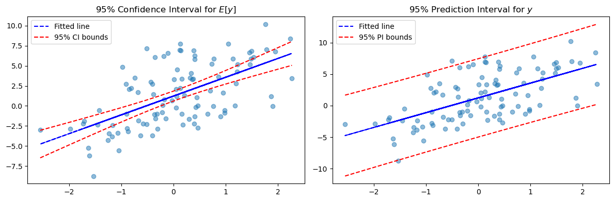
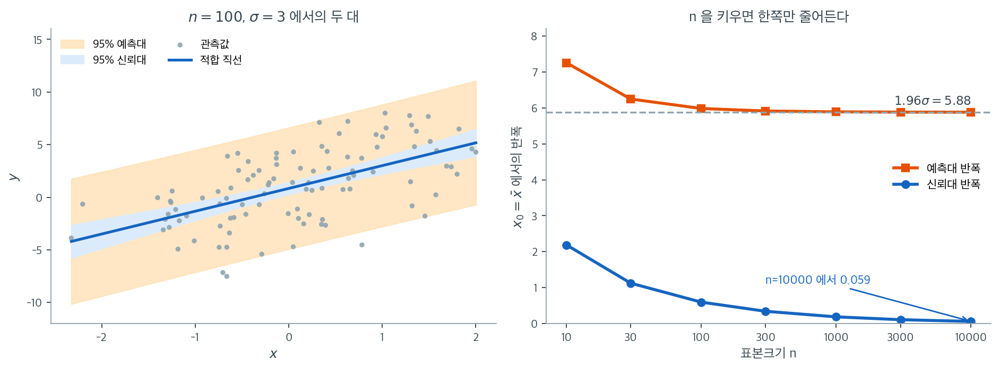
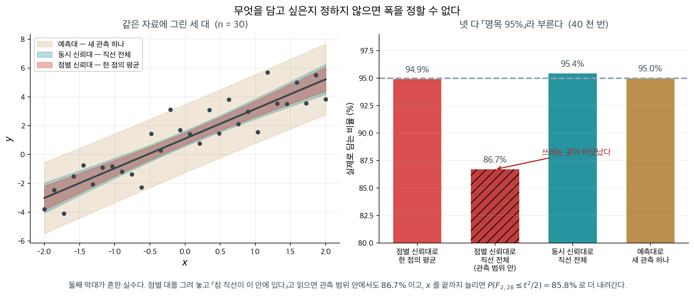

# 신뢰대와 예측대

## 개요

앞 절 [계수의 신뢰구간](ci_coeff.md)이 **계수 자신**의 구간을 만들었다. 이 쪽은 같은 표집분포로 **$x_0$ 마다 하나씩** 구간을 만들어 늘어놓는다. 그러면 직선을 따라 구간이 이어져 **대**를 이룬다.

대가 **둘**이라는 것이 요점이다. 「$x_0$ 에서 평균적으로 얼마인가」를 묻는 **신뢰대**와 「$x_0$ 에서 다음 한 건이 어디에 떨어지는가」를 묻는 **예측대**는 중심이 같고 폭이 다르다. 두 식의 차이는 근호 안의 **$1$ 하나**인데, 그 $1$ 이 $n$ 을 아무리 늘려도 사라지지 않는다. 신뢰대는 $0$ 으로 줄고 예측대는 $\pm t s$ 에서 멈춘다.

$1$ 절에서 두 식을 세우고, $2$ 절에서 자료를 직접 만들어 끝까지 그린다. 두 구간이 왜 「나비넥타이」 모양이 되는지, 자료 범위 밖에서 왜 서로 가까워지는지, 그리고 **둘 중 어느 것도 답하지 못하는 물음**이 무엇인지는 $3$ 절에서 읽는다.

---

## 1. 두 구간의 공식

### 반응의 기댓값(x_0에서의 평균반응)

$$
(\hat{\beta}_0+\hat{\beta}_1 x_0) \pm t_{n-2}(0.975)\; s\sqrt{\frac{1}{n}+\frac{(x_0-\bar{x})^2}{\sum_{i=1}^n(x_i-\bar{x})^2}}
$$

이 신뢰구간은 특정한 값 $x_0$에서 $y$의 참 평균을 포착한다. $x_0 = \bar{x}$일 때 가장 좁고 $x_0$이 자료의 중심에서 멀어질수록 넓어지므로, 모든 $x_0$에 대해 그리면 특징적인 "나비넥타이" 모양이 나타난다.

### 반응(x_0에서의 예측구간)

$$
(\hat{\beta}_0+\hat{\beta}_1 x_0) \pm t_{n-2}(0.975)\; s\sqrt{1+\frac{1}{n}+\frac{(x_0-\bar{x})^2}{\sum_{i=1}^n(x_i-\bar{x})^2}}
$$

이 예측구간은 $x_0$에서 **새로운 개별 관측값**이 놓일 만한 범위를 포착한다. 줄일 수 없는 잡음항 $\sigma^2$(제곱근 안의 앞머리 1)을 포함하므로 항상 평균반응의 신뢰구간보다 넓다.

### 핵심 구분

평균반응의 신뢰구간과 개별반응의 예측구간은 중심 $\hat{\beta}_0 + \hat{\beta}_1 x_0$이 같지만 폭이 다르다. 평균반응 구간은 $n \to \infty$일 때 폭이 0으로 줄어들지만(추정의 불확실성이 사라진다), 예측구간은 $\hat{y}_0 \pm t \cdot s$로 수렴한다(줄일 수 없는 잡음이 남는다).

!!! info "참고"
    [Khan Academy: Inference for Slope](https://www.khanacademy.org/math/ap-statistics/inference-slope-linear-regression/inference-slope/v/intro-inference-slope)

## 2. 그려 본다

다음 보기는 인공 회귀자료를 생성하고 평균반응에 대한 95% 신뢰구간(안쪽 대)과 개별 관측값에 대한 95% 예측구간(바깥쪽 대)을 함께 그린다.

### 준비

<div class="exbox" markdown>

**보기 1.** <span class="diff easy" title="쉬움"></span> 필요한 라이브러리. 아래 보기들이 쓰는 세 모듈을 불러온다.

**(1)** 세 모듈이 각각 맡는 일을 적고, 뒤의 계산에서 **`scipy` 가 없으면 할 수 없는 일**이 정확히 무엇인지 집어내시오.

**(2)** `scipy` 없이 $t_\nu(0.975)$ 를 얻어야 한다면 정규분위수 $z$ 에 어떤 보정을 붙일 수 있는가. 보정식 $z + (z^3+z)/(4\nu)$ 의 오차를 자유도 몇 개에서 재어 보고, $n = 100$ 에서 쓸 만한지 판정하시오.

</div>

??? success "풀이"

    **(1) 역할이 셋으로 깔끔히 갈린다.**

    | 모듈 | 맡는 일 | 없으면 |
    |---|---|---|
    | `numpy` | 배열, 난수, 평균·표준편차·상관 | 손으로 루프를 돌면 된다(느릴 뿐) |
    | `matplotlib` | 그림 | 수치 결과는 그대로다 |
    | `scipy.stats` | $t$ 분포의 **분위수** | 대신할 초기함수가 없다 |

    `scipy` 가 없으면 못 하는 일은 **딱 하나, $t_{n-2}(0.975)$ 를 구하는 것**이다. 평균·표준편차·상관은 모두 유한합이라 `numpy` 로 끝나고 실은 손계산도 된다. 그런데 $t$ 분포의 누적분포함수는 불완전베타함수이고 그 역함수는 닫힌 꼴이 없으므로 **수치해법이 필요하다.** 신뢰구간 계산의 모든 어려움이 임계값 하나에 모여 있는 셈이다.

    `numpy.random.randn` 도 `scipy` 없이 되므로 보기 2의 자료 생성에는 `scipy` 가 필요하지 않다.

    **(2) 코니시–피셔 전개의 첫 항을 쓰면 된다.** $t_\nu$ 의 분위수를 $\nu \to \infty$ 에서 전개하면

    $$
    t_\nu(p) = z_p + \frac{z_p^3 + z_p}{4\nu} + O(\nu^{-2})
    $$

    이다. $p = 0.975$, $z = 1.959964$ 를 넣으면 보정항이 $(1.959964^3 + 1.959964)/(4\nu) = 9.4885/(4\nu)$ 다. $\nu = 98$ 이면 $0.0242$ 이므로 $1.9842$ 를 준다.

    ```python
    import numpy as np
    import matplotlib.pyplot as plt
    from scipy import stats

    # 이 쪽의 계산에서 scipy 가 꼭 필요한 곳은 t 분위수 하나다.
    z = stats.norm.ppf(0.975)
    print(f"{'자유도':>8s}{'t(0.975)':>12s}{'정규 z':>10s}{'z + (z^3+z)/(4v)':>20s}{'보정의 오차':>14s}")
    for nu in (8, 18, 48, 98, 998):
        t_exact = stats.t(nu).ppf(0.975)
        t_approx = z + (z ** 3 + z) / (4 * nu)
        print(f"{nu:8d}{t_exact:12.6f}{z:10.6f}{t_approx:20.6f}{t_approx - t_exact:+14.6f}")
    print()
    print("numpy 만으로 할 수 있는 일과 못 하는 일")
    print(f"  평균·표준편차·상관: numpy 로 충분  (예: corrcoef)")
    print(f"  t 분위수: 역함수가 초기함수가 아니므로 수치해법이 필요하다")
    print(f"  그림: matplotlib 는 통계와 무관하고 그리기만 맡는다")
    ```

    출력:

    ```
         자유도    t(0.975)      정규 z    z + (z^3+z)/(4v)        보정의 오차
           8    2.306004  1.959964            2.256498     -0.049506
          18    2.100922  1.959964            2.091757     -0.009165
          48    2.010635  1.959964            2.009386     -0.001248
          98    1.984467  1.959964            1.984171     -0.000297
         998    1.962344  1.959964            1.962341     -0.000003

    numpy 만으로 할 수 있는 일과 못 하는 일
      평균·표준편차·상관: numpy 로 충분  (예: corrcoef)
      t 분위수: 역함수가 초기함수가 아니므로 수치해법이 필요하다
      그림: matplotlib 는 통계와 무관하고 그리기만 맡는다
    ```

    **$n = 100$ 에서는 충분히 쓸 만하다.** $\nu = 98$ 에서 보정의 오차가 $-0.0003$ 으로 상대오차 $0.015\%$ 다. 반면 보정하지 않은 $z$ 를 그냥 쓰면 오차가 $-0.0245$ 로 **$80$ 배** 크다. 보정항 하나가 오차를 두 자릿수 줄인다.

    자유도가 작아지면 사정이 달라진다. $\nu = 8$ 에서 보정의 오차가 $-0.0495$ 로 상대오차 $2.1\%$ 이고, 이 정도면 신뢰구간이 체계적으로 짧아져 포함률이 떨어진다. 오차가 $\nu^{-2}$ 로 줄어들므로 $8 \to 98$ 에서 $(98/8)^2 \approx 150$ 배 작아져야 하는데 실제로 $0.0495/0.0003 = 165$ 배 작아졌다. **전개의 차수가 수치로 확인된다.**

    실용적인 결론은 이렇다. **표를 쓸 수 있으면 표를, 못 쓰면 이 보정식을, 자유도가 $30$ 보다 작으면 반드시 정확한 값을 쓰라.** 다만 오늘날 `scipy` 를 못 쓰는 상황은 드물고, 이 보기의 값은 "임계값 하나가 무엇을 숨기고 있는가"를 보는 데 있다. $\square$

### 자료 생성

<div class="exbox" markdown>

**보기 2.** <span class="diff easy" title="쉬움"></span> 자료 만들기. 참 모형 $y = 1 + 2x + \sigma\varepsilon$ 에서 $x \sim N(0,1)$, $\varepsilon \sim N(0,1)$ 을 독립으로 뽑는다.

**(1)** $n = 100$, $\sigma = 3$ 일 때 $\operatorname{Var}(y)$, 모상관의 제곱 $\rho^2$, $E[S_{xx}]$, 그리고 $\operatorname{se}(\hat\beta_1)$ 의 이론값을 **자료를 보기 전에** 계산하시오.

**(2)** 한 표본을 뽑아 (1)의 네 값과 견주시오. 불일치가 표본변동으로 설명되는가.

</div>

??? success "풀이"

    **(1) 해석적으로.** $x$ 와 $\varepsilon$ 이 독립이므로 분산이 더해진다.

    $$
    \operatorname{Var}(y) = 2^2\operatorname{Var}(x) + \sigma^2\operatorname{Var}(\varepsilon) = 4 + 9 = 13
    $$

    모상관은 설명된 분산의 비의 제곱근이다.

    $$
    \rho^2 = \frac{\beta_1^2\operatorname{Var}(x)}{\operatorname{Var}(y)} = \frac{4}{13} = 0.307692
    \quad\Longrightarrow\quad \rho = 0.5547
    $$

    $S_{xx} = \sum_i(x_i - \bar x)^2$ 은 $\operatorname{Var}(x) = 1$ 일 때 $E[S_{xx}] = (n-1) \cdot 1 = 99$ 이고(정확히는 $S_{xx} \sim \chi^2_{99}$ 다), A.$3$ 절의 $\operatorname{Var}(\hat\beta_1) = \sigma^2/S_{xx}$ 에서

    $$
    \operatorname{se}(\hat\beta_1) \approx \frac{3}{\sqrt{99}} = 0.301511
    $$

    이다. **참 기울기 $2$ 에 표준오차 $0.30$ 이니 신호 대 잡음비가 $6.6$ 이다.** 기울기를 분명히 잡아낼 만한 설계다.

    **(2) 수치적으로.**

    ```python
    def generate_data(n, sigma, seed=0):
        """모의 회귀자료를 만든다. 참 모형은 y = 1 + 2x + 잡음 이다.

        매개변수
        --------
        n : 관측 수
        sigma : 잡음의 표준편차
        seed : 난수 씨앗

        돌려주는 값
        ----------
        x, y : 모양 (n, 1) 인 배열
        """
        np.random.seed(seed)
        x = np.random.randn(n, 1)
        y = 1 + 2 * x + sigma * np.random.randn(n, 1)
        return x, y

    # 참 모형이 y = 1 + 2x + 3*eps,  x ~ N(0,1) 이므로 이론값을 먼저 적을 수 있다.
    n_demo, sigma_demo = 100, 3
    print(f"이론:  Var(y) = 2^2*Var(x) + sigma^2 = 4 + {sigma_demo ** 2} = {4 + sigma_demo ** 2}")
    print(f"       rho^2  = 4/(4+{sigma_demo ** 2}) = {4 / (4 + sigma_demo ** 2):.6f}")
    print(f"       E[S_xx] = (n-1)*Var(x) = {n_demo - 1}")
    print(f"       se(beta1) = sigma/sqrt(S_xx) = {sigma_demo}/sqrt({n_demo - 1}) "
          f"= {sigma_demo / np.sqrt(n_demo - 1):.6f}")
    print()
    x_demo, y_demo = generate_data(n_demo, sigma_demo)
    S_xx_demo = ((x_demo - x_demo.mean()) ** 2).sum()
    r_demo = np.corrcoef(np.concatenate([x_demo, y_demo], axis=1), rowvar=False)[1, 0]
    print(f"표본:  Var(y) = {y_demo.var(ddof=1):.4f}")
    print(f"       r^2    = {r_demo ** 2:.6f}")
    print(f"       S_xx   = {S_xx_demo:.4f}")
    print(f"       x-bar  = {x_demo.mean():+.6f}  (이론 0),"
          f"   s_x = {x_demo.std(ddof=1):.6f}  (이론 1)")
    print()
    print(f"상대 불일치:  Var(y) {y_demo.var(ddof=1) / 13 - 1:+.2%},"
          f"  r^2 {r_demo ** 2 / (4 / 13) - 1:+.2%},  S_xx {S_xx_demo / 99 - 1:+.2%}")
    print(f"분산 추정의 상대 표준오차 ~ sqrt(2/(n-1)) = {np.sqrt(2 / (n_demo - 1)):.4f}")
    ```

    출력:

    ```
    이론:  Var(y) = 2^2*Var(x) + sigma^2 = 4 + 9 = 13
           rho^2  = 4/(4+9) = 0.307692
           E[S_xx] = (n-1)*Var(x) = 99
           se(beta1) = sigma/sqrt(S_xx) = 3/sqrt(99) = 0.301511

    표본:  Var(y) = 15.2488
           r^2    = 0.369743
           S_xx   = 101.5827
           x-bar  = +0.059808  (이론 0),   s_x = 1.012960  (이론 1)

    상대 불일치:  Var(y) +17.30%,  r^2 +20.17%,  S_xx +2.61%
    분산 추정의 상대 표준오차 ~ sqrt(2/(n-1)) = 0.1421
    ```

    **$S_{xx}$ 는 잘 맞고 $\operatorname{Var}(y)$ 와 $r^2$ 은 꽤 벗어난다.** $S_{xx} = 101.58$ 이 예측 $99$ 에서 $+2.6\%$ 로, 상대 표준오차 $\sqrt{2/99} = 14.2\%$ 의 $0.18$ 배에 지나지 않는다. 반면 $\operatorname{Var}(y) = 15.25$ 는 $+17.3\%$, $r^2 = 0.3697$ 은 $+20.2\%$ 벗어났다.

    **이 불일치들은 서로 독립이 아니다.** $r^2 = \hat\beta_1^2 S_{xx}/S_{yy}$ 이고 이 표본에서 $\hat\beta_1 = 2.344$ 가 참값 $2$ 보다 $17\%$ 크게 나왔는데(보기 3에서 확인한다), 그러면 $S_{yy}$ 도 함께 커지고 $r^2$ 도 커진다. 곧 **기울기가 우연히 크게 뽑힌 하나의 사건이 세 통계량에 동시에 나타난 것**이다. $\operatorname{Var}(y)$ 의 상대 표준오차도 $14\%$ 쯤이므로 $+17.3\%$ 는 약 $1.2$ 표준오차이고, 이상할 것이 없다.

    $\bar x = +0.0598$ 은 이론값 $0$ 과 견주면 표준오차 $1/\sqrt{100} = 0.1$ 의 $0.6$ 배다. $s_x = 1.0130$ 도 $1$ 에서 $1.3\%$ 떨어져 있고 상대 표준오차 $1/\sqrt{2\times99} = 7.1\%$ 안쪽이다.

    **씨앗 하나로 뽑은 표본은 이론값 근처에 있을 뿐 이론값이 아니다.** 뒤의 보기들이 내놓는 수를 읽을 때 이 폭을 늘 떠올려야 한다. $\square$

### 회귀 추정

<div class="exbox" markdown>

**보기 3.** <span class="diff easy" title="쉬움"></span> 회귀직선 추정. 상관계수 꼴 $\hat\beta_1 = r\,s_y/s_x$ 로 기울기를 구하고 적합값을 $\hat\beta_1(x - \bar x) + \bar y$ 로 계산한다.

**(1)** $r\,s_y/s_x$ 와 $S_{xy}/S_{xx}$ 가 **같은 수**임을 보이시오. 또 이 코드가 절편을 따로 계산하지 않는데도 적합값이 옳은 까닭을 말하고, 필요하면 절편을 어떻게 얻는지 적으시오.

**(2)** 세 식이 같은 수를 주는지 확인하고, 추정된 기울기의 $95\%$ 신뢰구간이 참 기울기 $2$ 를 담는지 보시오. 보기 2이 예측한 표준오차 $0.3015$ 와 실제 표준오차를 견주시오.

</div>

??? success "풀이"

    **(1) 해석적으로.** 정의를 펼치면 바로 나온다. $r = S_{xy}/\sqrt{S_{xx}S_{yy}}$ 이고 $s_x = \sqrt{S_{xx}/(n-1)}$, $s_y = \sqrt{S_{yy}/(n-1)}$ 이므로

    $$
    r\,\frac{s_y}{s_x}
    = \frac{S_{xy}}{\sqrt{S_{xx}S_{yy}}} \cdot \frac{\sqrt{S_{yy}/(n-1)}}{\sqrt{S_{xx}/(n-1)}}
    = \frac{S_{xy}}{\sqrt{S_{xx}S_{yy}}} \cdot \sqrt{\frac{S_{yy}}{S_{xx}}}
    = \frac{S_{xy}}{S_{xx}}
    $$

    이다. $S_{yy}$ 와 $n-1$ 이 모두 약분된다. 두 꼴은 같은 수를 다르게 적은 것이고, 상관계수 꼴은 **"회귀계수는 상관계수를 두 변수의 척도로 되돌린 것"** 이라는 뜻을 드러낸다.

    절편을 따로 쓰지 않아도 되는 까닭은 **평균점을 지난다**는 성질이다(단순회귀의 보기 1). 회귀직선을 평균점 기준으로 적으면

    $$
    \hat y = \bar y + \hat\beta_1 (x - \bar x)
    $$

    이고 이 식에 절편이 나타나지 않는다. 절편이 필요하면 $x = 0$ 을 넣어 $\hat\beta_0 = \bar y - \hat\beta_1\bar x$ 로 얻는다. 이 표현은 수치적으로도 낫다. $\bar x$ 가 큰 자료에서 $\hat\beta_0$ 은 $\bar y$ 와 $\hat\beta_1\bar x$ 의 차로 계산되어 **자리수 손실**이 생기는데, 중심화한 꼴은 그 뺄셈을 거치지 않는다.

    **(2) 수치적으로.**

    ```python
    def estimate_regression_line(x, y):
        """상관계수 공식으로 기울기와 절편을 추정한다.

        beta_hat = r * (s_y / s_x) 이다. 최소제곱해와 같은 값이지만, 회귀계수가
        상관계수를 두 변수의 척도로 되돌린 것임이 이 꼴에서 드러난다.

        돌려주는 값
        ----------
        y_hat : 적합값
        beta_hat : 추정된 기울기
        y_bar, x_bar : 표본평균
        """
        x_bar = x.mean()
        y_bar = y.mean()
        s_x = x.std(ddof=1)
        s_y = y.std(ddof=1)
        r = np.corrcoef(np.concatenate([x, y], axis=1), rowvar=False)[1, 0]
        beta_hat = r * s_y / s_x
        y_hat = beta_hat * (x - x_bar) + y_bar
        return y_hat, beta_hat, y_bar, x_bar

    # 세 가지 꼴이 같은 수를 주는지 확인한다.
    y_hat_demo, beta_hat_demo, y_bar_demo, x_bar_demo = estimate_regression_line(x_demo, y_demo)
    S_xy_demo = ((x_demo - x_bar_demo) * (y_demo - y_bar_demo)).sum()
    print(f"r * s_y / s_x   = {beta_hat_demo:.10f}")
    print(f"S_xy / S_xx     = {S_xy_demo / S_xx_demo:.10f}")
    print(f"두 값의 차이     = {abs(beta_hat_demo - S_xy_demo / S_xx_demo):.2e}")
    print()
    beta_0_demo = y_bar_demo - beta_hat_demo * x_bar_demo
    print(f"절편 = y-bar - b*x-bar = {beta_0_demo:.6f}   (참값 1)")
    print(f"  x = 0 에서의 적합값  = {float(beta_hat_demo * (0 - x_bar_demo) + y_bar_demo):.6f}")
    print(f"  x-bar 에서의 적합값  = {float(beta_hat_demo * (x_bar_demo - x_bar_demo) + y_bar_demo):.6f}"
          f"   (= y-bar = {y_bar_demo:.6f})")
    print()
    s2_demo = ((y_demo - y_hat_demo) ** 2).sum() / (n_demo - 2)
    se_beta = np.sqrt(s2_demo / S_xx_demo)
    t_c = stats.t(n_demo - 2).ppf(0.975)
    print(f"기울기 추정값 {beta_hat_demo:.6f}   (참값 2)")
    print(f"  se = s/sqrt(S_xx) = {se_beta:.6f}   (보기 2 의 이론값 0.301511)")
    print(f"  95% CI = ({beta_hat_demo - t_c * se_beta:.6f}, {beta_hat_demo + t_c * se_beta:.6f})"
          f"   참값 2 를 담는가? {beta_hat_demo - t_c * se_beta <= 2 <= beta_hat_demo + t_c * se_beta}")
    print(f"  (추정값 - 참값)/se = {(beta_hat_demo - 2) / se_beta:+.4f}")
    ```

    출력:

    ```
    r * s_y / s_x   = 2.3440953006
    S_xy / S_xx     = 2.3440953006
    두 값의 차이     = 1.33e-15

    절편 = y-bar - b*x-bar = 1.225459   (참값 1)
      x = 0 에서의 적합값  = 1.225459
      x-bar 에서의 적합값  = 1.365655   (= y-bar = 1.365655)

    기울기 추정값 2.344095   (참값 2)
      se = s/sqrt(S_xx) = 0.309151   (보기 2 의 이론값 0.301511)
      95% CI = (1.730594, 2.957596)   참값 2 를 담는가? True
      (추정값 - 참값)/se = +1.1130
    ```

    **두 꼴이 소수 열째 자리까지 같다.** 차이 $1.33\times10^{-15}$ 는 부동소수점 한계다. 절편도 $x = 0$ 에서의 적합값과 정확히 같고($1.225459$), $\bar x$ 에서의 적합값이 $\bar y$ 와 같다($1.365655$). 평균점을 지난다는 성질이 확인된다.

    **표준오차가 예측과 잘 맞는다.** $0.309151$ 대 이론값 $0.301511$ 로 $+2.5\%$ 다. 두 원인이 서로 반대로 작용했다. $s = 3.1159$ 가 $\sigma = 3$ 보다 $3.9\%$ 크고, $S_{xx} = 101.58$ 이 $99$ 보다 $2.6\%$ 커서 분모가 커졌다. 두 효과를 함께 넣으면 $1.0386/\sqrt{1.0261} = 1.0253$ 으로 실제 $+2.53\%$ 와 맞는다.

    **신뢰구간 $(1.7306,\ 2.9576)$ 이 참값 $2$ 를 담는다.** 다만 추정값 $2.3441$ 이 참값보다 표준오차의 $1.11$ 배 크게 나왔고, 구간의 폭이 $1.23$ 이라 **참값 $2$ 와 $0$ 이 아닌 다른 많은 값이 함께 들어 있다.** $n = 100$, $\sigma = 3$ 에서는 기울기를 소수 첫째 자리까지도 정하지 못한다는 뜻이다. 보기 2에서 신호 대 잡음비가 $6.6$ 이라 했는데, 그 말은 "$0$ 과 구별된다"는 뜻이고 "정확히 안다"는 뜻이 아니다. $\square$

### 잔차분산

<div class="exbox" markdown>

**보기 4.** <span class="diff easy" title="쉬움"></span> 잔차분산 구하기. $s^2 = \text{RSS}/(n-2)$ 로 오차분산을 추정한다.

**(1)** $n$ 이 아니라 $n-2$ 로 나누는 까닭을 $E[\text{RSS}]$ 로 설명하고, $n$ 으로 나누면 편향이 정확히 얼마인지 구하시오. $n = 100$, $\sigma^2 = 9$ 에서 그 값은?

**(2)** 이 표본에서 두 값을 계산하고, 모의실험으로 어느 쪽이 불편인지 확인하시오. 몬테카를로 오차를 함께 적으시오.

</div>

??? success "풀이"

    **(1) 해석적으로.** A.$3$ 절이 보인 대로 잔차벡터는 $\mathbf e = (\mathbf I - \mathbf H)\boldsymbol\varepsilon$ 이고 $\mathbf I - \mathbf H$ 가 계수 $n-2$ 인 대칭 멱등행렬이므로

    $$
    E[\text{RSS}] = \sigma^2 \operatorname{tr}(\mathbf I - \mathbf H) = \sigma^2 (n-2)
    $$

    다. 따라서 $n-2$ 로 나누면 $E[s^2] = \sigma^2$ 이 되어 **불편**이다. 직관으로는 이렇다. 잔차는 $\sum_i e_i = 0$ 과 $\sum_i x_i e_i = 0$ 이라는 두 제약에 묶여 있으므로 자유롭게 움직일 방향이 $n$ 개가 아니라 $n-2$ 개다.

    $n$ 으로 나누면

    $$
    E\!\left[\frac{\text{RSS}}{n}\right] = \frac{n-2}{n}\sigma^2 = \sigma^2 - \frac{2\sigma^2}{n}
    $$

    이니 편향이 $-2\sigma^2/n$ 이다. **언제나 아래로 치우친다.** $n = 100$, $\sigma^2 = 9$ 에서 $-2\times9/100 = -0.18$ 이다. 상대적으로는 $-2\%$ 이니 $n$ 이 크면 무시할 만하지만, $n = 10$ 이면 $-20\%$ 가 되어 무시할 수 없다.

    **(2) 수치적으로.**

    ```python
    def calculate_residual_variance(y, y_hat, n):
        """잔차분산 s^2 과 그 제곱근 s 를 구한다.

        n 이 아니라 n-2 로 나눈다. 절편과 기울기 둘을 자료에서 추정하느라
        자유도를 둘 잃었기 때문이다. 그래야 s^2 이 sigma^2 의 불편추정량이 된다.
        """
        s_square = np.sum((y - y_hat) ** 2) / (n - 2)
        s = np.sqrt(s_square)
        return s_square, s

    # 이 표본의 s^2, 그리고 n 으로 나눈 값
    s_square_demo, s_demo = calculate_residual_variance(y_demo, y_hat_demo, n_demo)
    rss_demo = ((y_demo - y_hat_demo) ** 2).sum()
    print(f"RSS = {rss_demo:.4f}")
    print(f"  n-2 로 나눈 s^2 = {s_square_demo:.6f}   (참 sigma^2 = 9)")
    print(f"  n   로 나눈 값  = {rss_demo / n_demo:.6f}")
    print(f"  이론 편향 -2*sigma^2/n = {-2 * 9 / n_demo:.4f}")
    print(f"  s^2 의 상대 표준오차 sqrt(2/(n-2)) = {np.sqrt(2 / (n_demo - 2)):.4f}")
    print(f"  이 표본의 불일치 {s_square_demo / 9 - 1:+.4f} = "
          f"{(s_square_demo / 9 - 1) / np.sqrt(2 / (n_demo - 2)):+.3f} 표준오차")
    print()
    # 2000 번 반복해 두 추정량의 평균을 본다. 몬테카를로 오차를 함께 적는다.
    reps = 2000
    rng = np.random.default_rng(1)
    s2_list = np.empty(reps)
    for b in range(reps):
        xb_ = rng.standard_normal((n_demo, 1))
        yb_ = 1 + 2 * xb_ + sigma_demo * rng.standard_normal((n_demo, 1))
        yh_, _, _, _ = estimate_regression_line(xb_, yb_)
        s2_list[b] = ((yb_ - yh_) ** 2).sum() / (n_demo - 2)
    mc_se = s2_list.std(ddof=1) / np.sqrt(reps)
    print(f"모의실험 {reps} 회")
    print(f"  mean(s^2)        = {s2_list.mean():.4f} ± {mc_se:.4f}   (참값 9)")
    print(f"  mean(RSS/n)      = {s2_list.mean() * (n_demo - 2) / n_demo:.4f}"
          f" ± {mc_se * (n_demo - 2) / n_demo:.4f}   (이론 {9 * (n_demo - 2) / n_demo:.2f})")
    print(f"  sd(s^2)          = {s2_list.std(ddof=1):.4f}"
          f"   (이론 sigma^2*sqrt(2/(n-2)) = {9 * np.sqrt(2 / (n_demo - 2)):.4f})")
    ```

    출력:

    ```
    RSS = 951.4547
      n-2 로 나눈 s^2 = 9.708721   (참 sigma^2 = 9)
      n   로 나눈 값  = 9.514547
      이론 편향 -2*sigma^2/n = -0.1800
      s^2 의 상대 표준오차 sqrt(2/(n-2)) = 0.1429
      이 표본의 불일치 +0.0787 = +0.551 표준오차

    모의실험 2000 회
      mean(s^2)        = 8.9534 ± 0.0286   (참값 9)
      mean(RSS/n)      = 8.7744 ± 0.0280   (이론 8.82)
      sd(s^2)          = 1.2769   (이론 sigma^2*sqrt(2/(n-2)) = 1.2857)
    ```

    **한 표본에서는 두 값을 구별할 수 없다.** $s^2 = 9.7087$ 과 $\text{RSS}/n = 9.5145$ 의 차이가 $0.194$ 인데, $s^2$ 자체의 표준오차가 $9 \times 0.1429 = 1.286$ 이다. **편향이 표준오차의 $15\%$ 에 지나지 않으므로 표본 하나로는 어느 쪽이 불편인지 가릴 수 없다.** 실제로 이 표본에서는 둘 다 참값 $9$ 보다 크다. 불편성은 표본 하나의 성질이 아니라 **반복했을 때의 성질**이다.

    **모의실험이 그것을 보인다.** $2000$ 회에서 $\text{mean}(s^2) = 8.9534 \pm 0.0286$, $\text{mean}(\text{RSS}/n) = 8.7744 \pm 0.0280$ 이다. 두 값의 차이 $0.1790$ 이 이론 편향 $0.18$ 과 맞는데, 이것은 두 추정량이 같은 표본에서 정확히 $(n-2)/n$ 배 관계이므로 **몬테카를로 오차가 없는 비교**다.

    참값과의 비교에는 몬테카를로 오차가 있다. $8.9534$ 는 $9$ 에서 $-0.0466$, 곧 $-1.63$ 몬테카를로 표준오차 떨어져 있다. $\lvert z\rvert = 1.63$ 은 $10\%$ 쯤의 확률로 일어나는 일이니 **불편성과 어긋나지 않는다.** 반복 횟수를 $2000$ 으로 묶었으므로 이 정도 변동은 피할 수 없고, 더 날카롭게 보려면 회수를 늘려야 한다. 반면 $8.7744$ 는 이론 $8.82$ 에서 $-1.64$ 표준오차로 **같은 방향 같은 크기**다. 두 수가 한 모의실험에서 나왔으니 당연하다.

    $s^2$ 의 표준편차 $1.2769$ 도 이론 $1.2857$ 과 $-0.7\%$ 안에서 맞는다. 표준편차의 몬테카를로 상대오차가 $1/\sqrt{2\times1999} = 1.6\%$ 이니 범위 안이다. **$(n-2)s^2/\sigma^2 \sim \chi^2_{n-2}$ 라는 분포 결과가 평균과 분산 두 군데서 확인된 셈이다.** $\square$

### 신뢰구간과 예측구간

<div class="exbox" markdown>

**보기 5.** <span class="diff easy" title="쉬움"></span> 신뢰구간과 예측구간 계산. 두 식의 차이는 근호 안의 $1$ 하나뿐이다.

**(1)** 지렛값 $h(x_0) = 1/n + (x_0-\bar x)^2/S_{xx}$ 를 쓰면 **예측구간 폭과 신뢰구간 폭의 비**가 얼마인지 쓰시오. $x_0 = \bar x$ 에서 그 비가 $\sqrt{n+1}$ 임을 보이고, 대가 $\bar x$ 에서 가장 좁은 까닭을 말하시오.

**(2)** $n \to \infty$ 에서 두 폭이 각각 어디로 가는지 쓰고, 이 자료($n = 100$)에서 세 자리의 $h$ 와 두 폭을 재어 (1)을 확인하시오.

</div>

??? success "풀이"

    **(1) 해석적으로.** 두 오차한계가 각각

    $$
    m_{\text{CI}} = t^* s\sqrt{h}, \qquad m_{\text{PI}} = t^* s\sqrt{1 + h}
    $$

    이므로 비는 $t^*$, $s$ 가 약분되어

    $$
    \frac{m_{\text{PI}}}{m_{\text{CI}}} = \sqrt{\frac{1+h}{h}} = \sqrt{1 + \frac{1}{h}}
    $$

    다. **$h$ 하나로 정해진다.** $h$ 는 $x_0$ 에만 의존하는 양이므로 이 비도 그렇다. $h$ 가 작을수록 비가 커지고, $h$ 의 최솟값은 $x_0 = \bar x$ 에서 $1/n$ 이니 **비의 최댓값**이

    $$
    \sqrt{1 + n} 
    $$

    이다. $n = 100$ 이면 $\sqrt{101} = 10.05$ 다. 곧 **평균 자리에서는 예측대가 신뢰대보다 열 배 넓다.**

    대가 $\bar x$ 에서 가장 좁은 것도 $h$ 에서 바로 나온다. $h(x_0) = 1/n + (x_0-\bar x)^2/S_{xx}$ 는 $x_0$ 의 **위로 열린 이차함수**이고 꼭짓점이 $x_0 = \bar x$ 다. 분자의 제곱항 말고는 $x_0$ 가 들어가지 않으므로 $\bar x$ 에서 멀어질수록 단조증가한다. 이것이 "나비넥타이" 모양의 전부다.

    **(2) 해석적으로.** $n \to \infty$ 에서 $h \to 0$ 이므로(설명변수가 한 점에 몰리지 않는 한 $S_{xx} \to \infty$ 다)

    $$
    m_{\text{CI}} = t^* s\sqrt{h} \;\to\; 0, \qquad
    m_{\text{PI}} = t^* s\sqrt{1+h} \;\to\; t^* s \;\to\; z^*\sigma
    $$

    다. **신뢰대는 0 으로 줄지만 예측대는 $\pm z^*\sigma$ 로 수렴한다.** 이것이 두 구간의 본질적 차이다. 평균반응은 자료를 모으면 얼마든지 정확히 알 수 있지만, **개별 관측값은 모형이 완벽해도 $\sigma$ 만큼 흔들린다.** 줄일 수 없는 오차가 거기에 있다.

    ```python
    def confidence_intervals(x, y_hat, beta_hat, x_bar, y_bar, n, s):
        """평균반응 E[y|x] 의 신뢰구간과 개별관측 y|x 의 예측구간을 구한다.

        두 구간의 차이는 근호 안의 1 하나뿐이다. 평균을 맞히는 일에는 추정의
        오차만 들어가지만, 개별 관측값을 맞히려면 그 위에 잡음 자체의 분산이
        더 얹히기 때문이다. 그래서 예측구간이 언제나 더 넓다.

        돌려주는 값
        ----------
        x0 : 그림을 그릴 x 격자
        lower, upper : 평균반응 신뢰구간의 위아래
        lower2, upper2 : 예측구간의 위아래
        """
        x0 = np.linspace(x.min(), x.max(), 20)
        y0_hat = beta_hat * (x0 - x_bar) + y_bar
        t_val = stats.t(n - 2).ppf(0.975)

        # 평균반응의 신뢰구간. (x0 - x_bar)^2 항 때문에 x 의 평균에서 멀어질수록
        # 구간이 넓어진다. 그래서 대가 가운데가 잘록한 모래시계 모양이 된다.
        margin = t_val * s * np.sqrt(
            (1 / n) + (x0 - x_bar) ** 2 / np.sum((x - x_bar) ** 2)
        )
        lower = y0_hat - margin
        upper = y0_hat + margin

        # 예측구간. 근호 안에 1 이 더 있다. 이 1 이 잡음의 분산 몫이며,
        # n 을 아무리 키워도 사라지지 않는다.
        margin2 = t_val * s * np.sqrt(
            1 + (1 / n) + (x0 - x_bar) ** 2 / np.sum((x - x_bar) ** 2)
        )
        lower2 = y0_hat - margin2
        upper2 = y0_hat + margin2

        return x0, lower, upper, lower2, upper2

    # 지렛값 h 와 두 폭을 자리마다 재어 본다.
    x0_demo, lo_demo, up_demo, lo2_demo, up2_demo = confidence_intervals(
        x_demo, y_hat_demo, beta_hat_demo, x_bar_demo, y_bar_demo, n_demo, s_demo
    )
    t_val_demo = stats.t(n_demo - 2).ppf(0.975)
    print(f"t_{n_demo - 2}(0.975) = {t_val_demo:.6f},  s = {s_demo:.6f},  S_xx = {S_xx_demo:.4f}")
    print()
    print(f"{'x0':>10s}{'h':>12s}{'CI 폭':>11s}{'PI 폭':>11s}{'PI/CI':>10s}{'sqrt((1+h)/h)':>16s}")
    for x0v, label in [(x_bar_demo, "x-bar"), (float(x_demo.min()), "최소"), (float(x_demo.max()), "최대")]:
        h = 1 / n_demo + (x0v - x_bar_demo) ** 2 / S_xx_demo
        w_ci = 2 * t_val_demo * s_demo * np.sqrt(h)
        w_pi = 2 * t_val_demo * s_demo * np.sqrt(1 + h)
        print(f"{x0v:10.4f}{h:12.6f}{w_ci:11.4f}{w_pi:11.4f}{w_pi / w_ci:10.4f}"
              f"{np.sqrt((1 + h) / h):16.4f}   ({label})")
    print()
    h_min = 1 / n_demo
    print(f"x0 = x-bar 에서 h = 1/n = {h_min:.6f}")
    print(f"  그때 PI/CI = sqrt(n+1) = {np.sqrt(n_demo + 1):.4f}")
    print(f"  대가 가장 좁은 자리가 x-bar 인가? "
          f"{np.argmin(up_demo - lo_demo) == np.argmin(np.abs(x0_demo - x_bar_demo))}")
    print()
    print(f"n -> 무한일 때:  CI 폭 -> 0,  PI 폭 -> 2*t*s = {2 * t_val_demo * s_demo:.4f}")
    print(f"  참값으로는 2*z*sigma = {2 * stats.norm.ppf(0.975) * 3:.4f}")
    print(f"  실제 x-bar 에서의 PI 폭 {2 * t_val_demo * s_demo * np.sqrt(1 + h_min):.4f}"
          f" = 극한값의 {np.sqrt(1 + h_min):.4f} 배")
    ```

    출력:

    ```
    t_98(0.975) = 1.984467,  s = 3.115882,  S_xx = 101.5827

            x0           h       CI 폭       PI 폭     PI/CI   sqrt((1+h)/h)
        0.0598    0.010000     1.2367    12.4284   10.0499         10.0499   (x-bar)
       -2.5530    0.077204     3.4362    12.8352    3.7353          3.7353   (최소)
        2.2698    0.058078     2.9803    12.7208    4.2683          4.2683   (최대)

    x0 = x-bar 에서 h = 1/n = 0.010000
      그때 PI/CI = sqrt(n+1) = 10.0499
      대가 가장 좁은 자리가 x-bar 인가? True

    n -> 무한일 때:  CI 폭 -> 0,  PI 폭 -> 2*t*s = 12.3667
      참값으로는 2*z*sigma = 11.7598
      실제 x-bar 에서의 PI 폭 12.4284 = 극한값의 1.0050 배
    ```

    **비의 공식이 세 자리 모두에서 맞는다.** `PI/CI` 열과 $\sqrt{(1+h)/h}$ 열이 소수 넷째 자리까지 같다. $x_0 = \bar x$ 에서 $h = 0.010000 = 1/100$ 이고 비가 $10.0499 = \sqrt{101}$ 로 유도한 값과 정확히 같다.

    **두 구간이 자리에 따라 전혀 다르게 움직인다.** 신뢰대 폭은 $1.2367$(중앙)에서 $3.4362$(왼쪽 끝)로 **$2.8$ 배** 늘어나는데, 예측대 폭은 $12.4284$ 에서 $12.8352$ 로 **$3\%$** 밖에 늘지 않는다. 예측대의 근호 안이 $1 + h$ 이고 $h$ 가 $0.01$ 에서 $0.077$ 로 커져도 $1$ 에 묻히기 때문이다. 곧 **예측대는 거의 평행한 대로 보이고, 나비넥타이 모양은 신뢰대에서만 뚜렷하다.** 그림에서 오른쪽 패널의 대가 평평해 보이는 까닭이 이것이며, 두 패널의 모양 차이는 축의 눈금 때문이 아니라 식 때문이다.

    **극한도 맞는다.** $x_0 = \bar x$ 에서 예측대 폭 $12.4284$ 가 극한값 $2t^*s = 12.3667$ 의 $1.0050 = \sqrt{1 + 1/100}$ 배다. 곧 $n = 100$ 에서 예측대는 이미 **극한에서 $0.5\%$ 안쪽**에 있다. 신뢰대는 $1.2367$ 로 아직 $0$ 과 멀지만, 이쪽은 $1/\sqrt n$ 으로 줄어들므로 $n$ 을 $100$ 배 늘리면 $0.124$ 가 된다. **자료를 모아 좁힐 수 있는 것은 신뢰대뿐이다.**

    극한값 $2t^*s = 12.3667$ 과 참값 $2z^*\sigma = 11.7598$ 의 차이 $5.2\%$ 는 두 군데서 온다. $t^*/z^* = 1.0125$ 와 $s/\sigma = 1.0386$ 이고 곱이 $1.0516$ 이다. 둘 다 $n$ 이 커지면 $1$ 로 가므로 극한에서는 두 수가 같아진다. $\square$

### 그리기

<div class="exbox" markdown>

**보기 6.** <span class="diff easy" title="쉬움"></span> 두 구간 그리기. 신뢰대와 예측대를 좌우 두 칸에 나누어 그린다.

**(1)** 두 칸에 `sharey` 를 주지 않았으므로 각 칸이 **자기 자료에 맞춰 세로 척도를 따로 잡는다.** 이것이 두 구간의 폭 비교를 어떻게 왜곡하는지 수로 재시오.

**(2)** 적합선을 `ax0.plot(x, y_hat, '--b')` 로 그리는데 `x` 가 정렬되어 있지 않다. 그림이 깨지는가. 구간을 격자점 $20$ 개로만 그리는 것은 어떤가.

</div>

??? success "풀이"

    유도할 식이 없는 문제다. **그림이 무엇을 정확히 보여 주고 무엇을 비틀어 보여 주는가**를 수로 확인하는 것이 이 보기의 전부다.

    **(1) 각 칸의 세로 범위가 다르면 "같은 길이"가 다른 화소 수로 그려진다.** 왼쪽 칸은 점구름과 신뢰대만 담으면 되고, 오른쪽 칸은 훨씬 넓은 예측대까지 담아야 한다. 그러므로 오른쪽 칸의 세로 축이 더 넓게 늘어나고, **거기 그려진 대는 실제보다 좁아 보인다.**

    **(2) 깨지지 않는다.** 적합값이 $x$ 의 일차함수이므로 정렬되지 않은 $(x_i, \hat y_i)$ 를 이어도 **같은 직선 위를 왕복**할 뿐이고 결과는 직선 하나다. 곡선을 그릴 때라면 지그재그가 되어 깨지지만 직선은 그렇지 않다. 다만 선분이 $n-1$ 개나 겹쳐 그려지므로 파일이 커지고, 투명도를 주면 진하기가 들쭉날쭉해진다. 정렬하거나 두 끝점만 쓰는 것이 낫다.

    ```python
    plt.rcParams["font.sans-serif"] = ["NanumGothic", "Apple SD Gothic Neo", "Malgun Gothic"]
    plt.rcParams["font.family"] = "sans-serif"
    plt.rcParams["axes.unicode_minus"] = False

    def plot_intervals(x, y, y_hat, x0, lower, upper, lower2, upper2):
        """두 구간을 나란히 그린다. 오른쪽 대가 훨씬 넓은 것이 요점이다."""
        fig, (ax0, ax1) = plt.subplots(1, 2, figsize=(12, 4))

        # 왼쪽: 평균반응의 신뢰구간
        ax0.plot(x, y, 'o', alpha=0.5)
        ax0.plot(x, y_hat, '--b', label='Fitted line')
        ax0.plot(x0, upper, '--r', label='95% CI bounds')
        ax0.plot(x0, lower, '--r')
        ax0.set_title('95% Confidence Interval for $E[y]$')
        ax0.legend()

        # 오른쪽: 개별 관측의 예측구간
        ax1.plot(x, y, 'o', alpha=0.5)
        ax1.plot(x, y_hat, '--b', label='Fitted line')
        ax1.plot(x0, upper2, '--r', label='95% PI bounds')
        ax1.plot(x0, lower2, '--r')
        ax1.set_title('95% Prediction Interval for $y$')
        ax1.legend()

        plt.tight_layout()
        plt.show()

    # 두 패널이 각자 y 축 범위를 잡는다. 그것이 비교를 어떻게 왜곡하는가.
    span_left = max(float(y_demo.max()), up_demo.max()) - min(float(y_demo.min()), lo_demo.min())
    span_right = max(float(y_demo.max()), up2_demo.max()) - min(float(y_demo.min()), lo2_demo.min())
    print(f"왼쪽 패널에 담기는 세로 범위  = {span_left:.4f}")
    print(f"오른쪽 패널에 담기는 세로 범위 = {span_right:.4f}")
    print(f"  두 범위의 비 = {span_right / span_left:.4f}")
    print()
    w_ci = (up_demo - lo_demo).mean()
    w_pi = (up2_demo - lo2_demo).mean()
    print(f"대의 평균 실제 폭:  CI {w_ci:.4f},  PI {w_pi:.4f},  비 {w_pi / w_ci:.4f}")
    print(f"화면에서 보이는 비(각 패널 높이로 나눈 뒤):"
          f"  {(w_pi / span_right) / (w_ci / span_left):.4f}")
    print(f"  곧 그림은 실제 {w_pi / w_ci:.2f} 배 차이를 "
          f"{(w_pi / span_right) / (w_ci / span_left):.2f} 배로 보이게 한다")
    print()
    print(f"x 가 정렬되어 있는가? {bool(np.all(np.diff(x_demo.ravel()) >= 0))}")
    print(f"  적합값이 x 의 일차함수이므로 정렬하지 않아도 같은 직선 위를 왕복할 뿐이다")
    print(f"  x0 격자는 linspace 로 만들었으므로 정렬되어 있다: "
          f"{bool(np.all(np.diff(x0_demo) >= 0))}")
    print(f"  격자점 {len(x0_demo)}개 — 대가 꺾은선으로 그려진다")
    ```

    출력:

    ```
    왼쪽 패널에 담기는 세로 범위  = 18.9203
    오른쪽 패널에 담기는 세로 범위 = 24.0830
      두 범위의 비 = 1.2729

    대의 평균 실제 폭:  CI 2.0895,  PI 12.5594,  비 6.0106
    화면에서 보이는 비(각 패널 높이로 나눈 뒤):  4.7221
      곧 그림은 실제 6.01 배 차이를 4.72 배로 보이게 한다

    x 가 정렬되어 있는가? False
      적합값이 x 의 일차함수이므로 정렬하지 않아도 같은 직선 위를 왕복할 뿐이다
      x0 격자는 linspace 로 만들었으므로 정렬되어 있다: True
      격자점 20개 — 대가 꺾은선으로 그려진다
    ```

    **왜곡의 크기는 $6.01$ 대 $4.72$, 곧 $21\%$ 다.** 두 구간의 실제 평균 폭은 $2.0895$ 와 $12.5594$ 로 $6.0$ 배 차이인데, 각 칸의 세로 범위가 $18.92$ 와 $24.08$ 로 $1.27$ 배 다르기 때문에 화면에서는 $4.7$ 배로 보인다. **예측대가 실제보다 좁아 보이는 방향으로 왜곡된다.** 이 쪽의 요점이 "예측구간이 훨씬 넓다"는 것인데 그림이 그 차이를 줄여 보여 주는 셈이다.

    고치는 길은 간단하다. `plt.subplots(1, 2, sharey=True)` 를 주거나, 아예 한 칸에 두 구간을 겹쳐 그리면 된다. **한 칸에 겹쳐 그리는 쪽이 더 낫다.** 같은 척도에서 안쪽 대와 바깥쪽 대를 보면 비교할 것이 없어지고, 보기 5에서 본 "신뢰대는 나비넥타이, 예측대는 거의 평행"이라는 모양 차이도 한눈에 들어온다.

    **격자점 $20$ 개는 좀 적다.** 대의 경계는 $\sqrt{a + b(x_0-\bar x)^2}$ 꼴의 곡선이므로 **직선이 아니다.** $20$ 개 점을 이으면 꺾은선이 되고, 특히 곡률이 큰 중앙 부근에서 실제보다 각이 져 보인다. $x$ 범위가 $[-2.55,\ 2.27]$ 이니 격자 간격이 $0.25$ 쯤인데, 이 폭에서 신뢰대 폭은 중앙 근처에서 꽤 빠르게 변한다. $100 \sim 200$ 개로 늘리면 매끄러워지고 계산 비용은 없다시피 하다.

    **$x$ 가 정렬되지 않은 것은 여기서는 해롭지 않다.** `x0` 는 `linspace` 로 만들어 정렬되어 있으니 대는 문제가 없고, 적합선만 $99$ 개 선분이 겹쳐 그려진다. 다만 이 코드를 그대로 가져다 **곡선 모형**(다항, 스플라인)에 쓰면 적합선이 지그재그로 깨진다. **정렬은 "지금 필요 없지만 습관으로 해 두는 것이 나은" 쪽에 든다.** $\square$

### 전체 보기

<div class="exbox" markdown>

**보기 7.** <span class="diff easy" title="쉬움"></span> 전체 실행. 앞의 함수들을 이어 붙여 $n = 100$, $\sigma = 3$ 자료에 두 구간을 그린다.

**(1)** 추정값 $s^2 = 9.71$ 이 참값 $9$ 보다 크다. $(n-2)s^2/\sigma^2 \sim \chi^2_{n-2}$ 를 써서 이 값이 표집분포의 몇 분위수인지 구하고, $\sigma^2$ 의 $95\%$ 신뢰구간을 만들어 $9$ 를 담는지 확인하시오.

**(2)** 두 구간이 정말 $95\%$ 를 포함하는지 모의실험으로 확인하시오. **평균반응 구간은 참 평균을, 예측구간은 새 관측값을** 담아야 한다. 몬테카를로 오차를 함께 적으시오.

</div>

??? success "풀이"

    **(1) 해석적으로.** $(n-2)s^2/\sigma^2 \sim \chi^2_{n-2}$ 이므로 $\sigma^2$ 의 $95\%$ 신뢰구간은 이 식을 $\sigma^2$ 에 대해 풀어

    $$
    \left(\frac{(n-2)s^2}{\chi^2_{n-2}(0.975)},\ \frac{(n-2)s^2}{\chi^2_{n-2}(0.025)}\right)
    $$

    이다. 분위수가 분모에 들어가므로 **큰 분위수가 아래끝을 만든다.** $\chi^2$ 가 비대칭이라 이 구간도 $s^2$ 을 중심으로 대칭이 아니다.

    **(2) 포함률 확인은 두 가지를 조심해야 한다.** 평균반응 구간은 고정된 수 $\beta_0 + \beta_1 x_0$ 를 겨냥하므로 **그 수와 구간을 견주면** 된다. 예측구간은 그때마다 새로 뽑히는 확률변수 $y_{\text{new}}$ 를 겨냥하므로, 매 반복마다 **새 관측값을 하나 더 뽑아** 구간 안에 드는지 보아야 한다. 적합에 쓴 관측값을 다시 쓰면 안 된다. 그 값은 이미 적합을 끌어당겼으므로 포함률이 높게 나온다.

    ```python
    n = 100
    sigma = 3

    # 참 모형은 y = 1 + 2x + 잡음 이다. 참 sigma 를 알고 있으므로 아래에서
    # 추정값 s^2 이 sigma^2 = 9 근처로 나오는지 확인할 수 있다.
    x, y = generate_data(n, sigma)

    y_hat, beta_hat, y_bar, x_bar = estimate_regression_line(x, y)

    s_square, s = calculate_residual_variance(y, y_hat, n)
    print(f"True σ²: {sigma**2}")
    print(f"Estimated s²: {s_square:.4f}")

    # 구간 계산
    x0, lower, upper, lower2, upper2 = confidence_intervals(
        x, y_hat, beta_hat, x_bar, y_bar, n, s
    )

    # 그림으로 확인
    plot_intervals(x, y, y_hat, x0, lower, upper, lower2, upper2)
    ```

    출력:

    ```
    True σ²: 9
    Estimated s²: 9.7087
    ```

    

    참 $\sigma^2 = 9$를 $s^2 = 9.71$로 추정했다. $s^2$은 불편추정량이지만 표본 하나에서 이 정도 오차는 정상이다. 자유도가 $n - 2$인 것은 회귀에서 모수 두 개(절편과 기울기)를 추정했기 때문이다.

    왼쪽 패널은 평균반응의 신뢰대를 보여준다. $\bar{x}$에서 가장 좁은 특징적인 "나비넥타이" 모양에 주목하라. 오른쪽 패널은 개별 관측값의 변동까지 반영한 더 넓은 예측대를 보여준다.

    이제 (1)과 (2)를 확인한다.

    ```python
    # 이 표본의 s^2 이 chi-square 표집분포에서 어디에 놓이는가
    dfree = n - 2
    q = stats.chi2(dfree).cdf(dfree * s_square / sigma ** 2)
    print(f"s^2 = {s_square:.4f},  참 sigma^2 = {sigma ** 2}")
    print(f"  (n-2)s^2/sigma^2 = {dfree * s_square / sigma ** 2:.4f}  ~ chi2_{dfree}")
    print(f"  그 분포의 {q:.4f} 분위수  ->  양쪽 꼬리로 보면 흔한 값")
    print(f"  sigma^2 의 95% 신뢰구간 = "
          f"({dfree * s_square / stats.chi2(dfree).ppf(0.975):.4f}, "
          f"{dfree * s_square / stats.chi2(dfree).ppf(0.025):.4f})   9 를 담는가? "
          f"{dfree * s_square / stats.chi2(dfree).ppf(0.975) <= 9 <= dfree * s_square / stats.chi2(dfree).ppf(0.025)}")
    print()
    # 두 구간의 포함률을 모의실험으로 확인한다 (2000 회, 몬테카를로 오차를 함께 적는다)
    reps = 2000
    rng = np.random.default_rng(7)
    x0_fixed = 1.0                      # 이 자리에서 두 구간을 재어 본다
    mean_true = 1 + 2 * x0_fixed        # 참 평균반응
    hit_ci = np.zeros(reps, dtype=bool)
    hit_pi = np.zeros(reps, dtype=bool)
    for b in range(reps):
        xb_ = rng.standard_normal((n, 1))
        yb_ = 1 + 2 * xb_ + sigma * rng.standard_normal((n, 1))
        yh_, bh_, yb_bar, xb_bar = estimate_regression_line(xb_, yb_)
        s2_, s_ = calculate_residual_variance(yb_, yh_, n)
        Sxx_ = ((xb_ - xb_bar) ** 2).sum()
        h_ = 1 / n + (x0_fixed - xb_bar) ** 2 / Sxx_
        t_ = stats.t(n - 2).ppf(0.975)
        center = bh_ * (x0_fixed - xb_bar) + yb_bar
        hit_ci[b] = abs(center - mean_true) <= t_ * s_ * np.sqrt(h_)
        y_new = mean_true + sigma * rng.standard_normal()      # 새 관측값 하나
        hit_pi[b] = abs(center - y_new) <= t_ * s_ * np.sqrt(1 + h_)
    for name, hits in [("평균반응 신뢰구간", hit_ci), ("개별관측 예측구간", hit_pi)]:
        p_hat = hits.mean()
        mc = np.sqrt(p_hat * (1 - p_hat) / reps)
        print(f"{name}  포함률 {p_hat:.4f} ± {mc:.4f}   (목표 0.95,"
              f"  z = {(p_hat - 0.95) / mc:+.2f})")
    ```

    출력:

    ```
    s^2 = 9.7087,  참 sigma^2 = 9
      (n-2)s^2/sigma^2 = 105.7172  ~ chi2_98
      그 분포의 0.7206 분위수  ->  양쪽 꼬리로 보면 흔한 값
      sigma^2 의 95% 신뢰구간 = (7.4752, 13.1233)   9 를 담는가? True

    평균반응 신뢰구간  포함률 0.9490 ± 0.0049   (목표 0.95,  z = -0.20)
    개별관측 예측구간  포함률 0.9495 ± 0.0049   (목표 0.95,  z = -0.10)
    ```

    **(1) $s^2 = 9.71$ 은 전혀 이상한 값이 아니다.** $(n-2)s^2/\sigma^2 = 105.72$ 가 $\chi^2_{98}$ 의 $0.721$ 분위수다. 곧 참값이 정말 $9$ 라면 이보다 큰 $s^2$ 이 나올 확률이 $28\%$ 다. $\sigma^2$ 의 $95\%$ 신뢰구간 $(7.475,\ 13.123)$ 도 $9$ 를 넉넉히 담는다.

    구간이 비대칭인 것을 눈여겨볼 만하다. 점추정값 $9.71$ 에서 아래끝까지 $2.23$, 위끝까지 $3.41$ 로 **오른쪽이 $1.5$ 배 길다.** $\chi^2$ 분포가 오른쪽으로 치우쳐 있기 때문이고, 분산의 신뢰구간을 "추정값 $\pm$ 무엇"으로 적을 수 없는 까닭이 이것이다. 구간의 폭 $5.65$ 가 점추정값 $9.71$ 의 $58\%$ 라는 점도 가볍지 않다. **$n = 100$ 으로도 분산은 $\pm 30\%$ 수준으로만 안다.**

    **(2) 두 포함률이 모두 목표에 든다.** 평균반응 구간이 $0.9490 \pm 0.0049$($z = -0.20$), 예측구간이 $0.9495 \pm 0.0049$($z = -0.10$) 다. 둘 다 몬테카를로 표준오차의 $0.2$ 배 안쪽이니 **두 공식이 선언한 신뢰수준을 정확히 지킨다.**

    이 확인이 값진 까닭은 두 구간이 **전혀 다른 양을 겨냥하는데도** 같은 $0.95$ 를 지킨다는 데 있다. 폭은 보기 5에서 본 대로 평균 자리에서 열 배나 차이가 나는데, 겨냥하는 과녁의 크기가 그만큼 다르기 때문에 결과가 같아진다. **"구간이 넓다"는 것은 추정이 나쁘다는 뜻이 아니고, 맞혀야 할 것이 더 흔들린다는 뜻이다.**

    반복 횟수를 $2000$ 으로 묶었으므로 포함률의 분해능이 $\pm 0.005$ 다. 이 정밀도로는 $0.95$ 와 $0.94$ 를 가릴 수 있지만 $0.95$ 와 $0.949$ 를 가릴 수는 없다. **모의실험으로 "맞는다"고 말할 때는 그 "맞는다"가 몇째 자리까지인지 함께 밝혀야 한다.** $\square$

---

### 바깥까지 그려 보면

<div class="exbox" markdown>

**보기 8.** <span class="diff easy" title="쉬움"></span> 잔차분산 구하기. $s^2 = \text{RSS}/(n-2)$ 와 $s = \sqrt{s^2}$ 을 돌려준다.

**(1)** 단순회귀에서 $\text{RSS} = S_{yy}(1 - r^2)$ 임을 보이고, 따라서

$$
s^2 = \frac{n-1}{n-2}\,s_y^2\,(1 - r^2)
$$

임을 유도하시오. 이 식은 **원자료 없이 $r$, $s_y$, $n$ 만으로** $s^2$ 을 계산할 수 있음을 뜻한다.

**(2)** $s^2$ 은 $\sigma^2$ 의 불편추정량이다. 그렇다면 $s$ 는 $\sigma$ 의 불편추정량인가. 편향의 방향을 먼저 말하고 그 크기를 자유도 몇 개에서 재어 보시오.

</div>

??? success "풀이"

    **(1) 해석적으로.** 적합값이 $\hat y_i = \bar y + \hat\beta_1(x_i - \bar x)$ 이므로 잔차는 $e_i = (y_i - \bar y) - \hat\beta_1(x_i - \bar x)$ 다. 제곱해 더하면

    $$
    \text{RSS} = S_{yy} - 2\hat\beta_1 S_{xy} + \hat\beta_1^2 S_{xx}
    $$

    이고 $\hat\beta_1 = S_{xy}/S_{xx}$ 를 넣으면 뒤 두 항이 합쳐진다.

    $$
    \text{RSS} = S_{yy} - \frac{S_{xy}^2}{S_{xx}} = S_{yy}\left(1 - \frac{S_{xy}^2}{S_{xx}S_{yy}}\right) = S_{yy}(1 - r^2)
    $$

    $r^2 = S_{xy}^2/(S_{xx}S_{yy})$ 라는 정의가 그대로 쓰였다. 이제 $S_{yy} = (n-1)s_y^2$ 이므로

    $$
    s^2 = \frac{\text{RSS}}{n-2} = \frac{(n-1)s_y^2(1-r^2)}{n-2}
    $$

    다. **$r$ 과 $s_y$ 와 $n$ 만 알면 $s^2$ 이 나온다.** 논문에 상관계수와 표준편차만 실려 있어도 잔차분산을 되살릴 수 있다는 뜻이고, 거꾸로 $R^2$ 와 $s$ 가 서로 독립된 정보가 아니라는 뜻이다(문제 1의 $S$ 와 $R^2$ 가 무관하지 않았던 까닭이 이것이다).

    **(2) $s$ 는 불편이 아니고 아래로 치우친다.** $\sqrt{\cdot}$ 가 **오목함수**이므로 옌센 부등식에서

    $$
    E[s] = E\!\left[\sqrt{s^2}\right] \;\le\; \sqrt{E[s^2]} = \sigma
    $$

    이고 $s^2$ 이 상수가 아니므로 등호가 성립하지 않는다. **$s$ 는 평균적으로 $\sigma$ 를 과소추정한다.**

    크기는 정확히 계산된다. $\nu = n-2$ 에 대해 $\nu s^2/\sigma^2 \sim \chi^2_\nu$ 이고 $\chi^2_\nu$ 의 제곱근의 기댓값이 알려져 있으므로

    $$
    \frac{E[s]}{\sigma} = \sqrt{\frac{2}{\nu}}\,\frac{\Gamma\!\left(\frac{\nu+1}{2}\right)}{\Gamma\!\left(\frac{\nu}{2}\right)}
    \;\approx\; 1 - \frac{1}{4\nu}
    $$

    다. **편향이 $\nu^{-1}$ 로 줄어든다.**

    ```python
    # 이 문제와 다음 문제가 쓰는 자료와 적합. 참 모형은 y = 1 + 2x + 3*잡음 이다.
    def generate_data(n, sigma, seed=0):
        np.random.seed(seed)
        x = np.random.randn(n, 1)
        y = 1 + 2 * x + sigma * np.random.randn(n, 1)
        return x, y

    def estimate_regression_line(x, y):
        """beta_hat = r * s_y / s_x 로 기울기를 구한다. 최소제곱해와 같은 값이다."""
        x_bar, y_bar = x.mean(), y.mean()
        r = np.corrcoef(np.concatenate([x, y], axis=1), rowvar=False)[1, 0]
        beta_hat = r * y.std(ddof=1) / x.std(ddof=1)
        return beta_hat * (x - x_bar) + y_bar, beta_hat, y_bar, x_bar

    x_a, y_a = generate_data(100, 3)
    y_hat_a, beta_a, y_bar_a, x_bar_a = estimate_regression_line(x_a, y_a)

    def calculate_residual_variance(y, y_hat, n):
        """잔차분산 s^2 을 구한다.

        n 이 아니라 n-2 로 나눈다. 절편과 기울기 둘을 자료에서 추정하느라
        자유도를 둘 잃었기 때문이다.
        """
        s_square = np.sum((y - y_hat) ** 2) / (n - 2)
        s = np.sqrt(s_square)
        return s_square, s

    # s^2 을 r^2 으로 적는 세 가지 길이 같은지 본다.
    from scipy.special import gammaln

    n_a = 100
    s_square_a, s_a = calculate_residual_variance(y_a, y_hat_a, n_a)
    r_a = np.corrcoef(np.concatenate([x_a, y_a], axis=1), rowvar=False)[1, 0]
    s_y_a = y_a.std(ddof=1)
    S_yy_a = ((y_a - y_bar_a) ** 2).sum()
    print(f"RSS                       = {((y_a - y_hat_a) ** 2).sum():.6f}")
    print(f"S_yy * (1 - r^2)          = {S_yy_a * (1 - r_a ** 2):.6f}")
    print(f"s^2 = RSS/(n-2)           = {s_square_a:.6f}")
    print(f"(n-1)/(n-2) * s_y^2 (1-r^2) = {(n_a - 1) / (n_a - 2) * s_y_a ** 2 * (1 - r_a ** 2):.6f}")
    print()
    # s 는 sigma 의 불편추정량이 아니다
    def unbias_factor(nu):
        return np.sqrt(2 / nu) * np.exp(gammaln((nu + 1) / 2) - gammaln(nu / 2))
    print("E[s]/sigma = sqrt(2/nu) * Gamma((nu+1)/2) / Gamma(nu/2)")
    for nu in (8, 18, 98):
        print(f"  자유도 {nu:3d}:  {unbias_factor(nu):.6f}   편향 {unbias_factor(nu) - 1:+.6f}"
              f"   근사 -1/(4nu) = {-1 / (4 * nu):+.6f}")
    print()
    print(f"이 표본:  s = {s_a:.6f},  참 sigma = 3")
    print(f"  편향 보정한 추정값 s/{unbias_factor(n_a - 2):.6f} = {s_a / unbias_factor(n_a - 2):.6f}")
    ```

    출력:

    ```
    RSS                       = 951.454669
    S_yy * (1 - r^2)          = 951.454669
    s^2 = RSS/(n-2)           = 9.708721
    (n-1)/(n-2) * s_y^2 (1-r^2) = 9.708721

    E[s]/sigma = sqrt(2/nu) * Gamma((nu+1)/2) / Gamma(nu/2)
      자유도   8:  0.969311   편향 -0.030689   근사 -1/(4nu) = -0.031250
      자유도  18:  0.986214   편향 -0.013786   근사 -1/(4nu) = -0.013889
      자유도  98:  0.997452   편향 -0.002548   근사 -1/(4nu) = -0.002551

    이 표본:  s = 3.115882,  참 sigma = 3
      편향 보정한 추정값 s/0.997452 = 3.123841
    ```

    **(1) 네 줄이 소수 여섯째 자리까지 닫힌다.** $\text{RSS} = 951.454669 = S_{yy}(1-r^2)$ 이고 $s^2 = 9.708721$ 이 $\frac{n-1}{n-2}s_y^2(1-r^2)$ 와 같다. **원자료를 보지 않고 $r = 0.608065$, $s_y = 3.904969$, $n = 100$ 만으로 $s^2$ 이 나온다.**

    이 사실에는 양면이 있다. 요약통계만 있는 논문에서 잔차분산을 되살릴 수 있어 유용하지만, 동시에 **$R^2$ 와 $s$ 를 "두 개의 독립된 증거"로 읽으면 안 된다**는 뜻이기도 하다. 둘은 같은 정보를 담고 있고, 다른 것은 단위뿐이다($R^2$ 는 무차원, $s$ 는 $y$ 의 단위).

    **(2) 편향이 작고 예측대로 음수다.** 자유도 $98$ 에서 $E[s]/\sigma = 0.997452$ 로 $-0.25\%$ 다. 근사식 $-1/(4\nu) = -0.2551\%$ 와 소수 넷째 자리까지 맞는다. 자유도 $8$ 에서는 $-3.07\%$ 로 커지는데 근사값 $-3.13\%$ 와 $0.06$ 퍼센트포인트 차이다. **근사가 자유도 $8$ 에서도 쓸 만하다.**

    실용적인 결론은 이렇다. $n$ 이 $20$ 만 넘으면 $s$ 의 편향은 $1\%$ 아래이므로 **신뢰구간 계산에서 보정할 필요가 없다.** 실제로 모든 교과서 공식이 보정 없이 $s$ 를 쓴다. 보정이 필요한 것은 자유도가 한 자리로 떨어지는 품질관리 쪽 관행이며, 거기서는 보정계수를 $c_4$ 라 부른다.

    이 표본에서 보정하면 $s = 3.1159$ 가 $3.1238$ 로 올라간다. 참값 $3$ 에서 **더 멀어졌다.** 모순이 아니다. 보정은 **평균적으로** 편향을 없애는 것이고, 이 표본의 $s$ 가 이미 참값보다 큰 쪽으로 뽑혔으므로 위로 올리면 더 멀어지는 것이 당연하다. **불편성은 한 표본에서 확인할 수 없는 성질이다.** $\square$

<div class="exbox" markdown>

**보기 9.** <span class="diff easy" title="쉬움"></span> 두 구간 계산. 코드가 격자를 `np.linspace(x.min(), x.max(), 20)` 으로 잡으므로 **자료 범위 안만** 그린다.

**(1)** $x_0 = \bar x + k\,s_x$ 로 두면 지렛값이 $h = \frac{1}{n} + \frac{k^2}{n-1}$ 임을 보이고, 신뢰대 반폭이 중앙 대비 $\sqrt{1 + k^2 n/(n-1)}$ 배가 됨을 유도하시오. $k \to \infty$ 에서 두 구간은 각각 어떻게 자라는가.

**(2)** $k = 0, 1, 2, 3, 5, 10$ 에서 두 반폭을 재어 (1)을 확인하시오. 자료 범위 안만 그리는 이 코드가 **보여 주지 못하는 위험**은 무엇인가.

</div>

??? success "풀이"

    **(1) 해석적으로.** $S_{xx} = (n-1)s_x^2$ 이므로 $x_0 - \bar x = k s_x$ 를 넣으면

    $$
    h(x_0) = \frac{1}{n} + \frac{k^2 s_x^2}{(n-1)s_x^2} = \frac{1}{n} + \frac{k^2}{n-1}
    $$

    다. **$s_x$ 가 약분되어 $h$ 가 $k$ 와 $n$ 만의 함수가 된다.** 중앙에서는 $h(\bar x) = 1/n$ 이니 비는

    $$
    \frac{m_{\text{CI}}(x_0)}{m_{\text{CI}}(\bar x)} = \sqrt{\frac{h(x_0)}{1/n}}
    = \sqrt{1 + \frac{k^2 n}{n-1}}
    $$

    이다. $n$ 이 크면 $\sqrt{1+k^2}$ 에 가까워진다.

    $k$ 가 커질 때 두 구간이 전혀 다르게 자란다.

    $$
    m_{\text{CI}} \sim t^* s\,\frac{\lvert k \rvert}{\sqrt{n-1}} \quad (\text{$k$ 에 비례해 선형으로}),
    \qquad
    m_{\text{PI}} \sim t^* s\sqrt{1 + \frac{k^2}{n-1}} \quad (\text{같은 기울기로 자라지만 출발점이 높다})
    $$

    둘 다 결국 $\lvert k\rvert$ 에 선형이지만, **신뢰대는 원점에서 출발해 선형이고 예측대는 $t^*s$ 에서 출발한다.** 그래서 $k$ 가 아주 커지면 두 구간의 **비가 $1$ 로 수렴한다.** 멀리 외삽하면 "직선의 위치를 모르는 불확실성"이 "잡음"을 압도하기 때문이다.

    **(2) 수치적으로.**

    ```python
    from scipy import stats

    def confidence_intervals(x, y_hat, beta_hat, x_bar, y_bar, n, s):
        """평균반응의 신뢰구간과 개별관측의 예측구간을 함께 구한다.

        두 식의 차이는 근호 안의 1 뿐이다. 평균을 맞히는 데는 추정오차만 들지만,
        개별 관측을 맞히려면 잡음 자체의 분산이 더 얹힌다.
        """
        x0 = np.linspace(x.min(), x.max(), 20)
        y0_hat = beta_hat * (x0 - x_bar) + y_bar
        t_val = stats.t(n - 2).ppf(0.975)
        ss_x = np.sum((x - x_bar) ** 2)

        # 평균반응의 신뢰구간. x 의 평균에서 멀어질수록 넓어진다.
        margin = t_val * s * np.sqrt((1 / n) + (x0 - x_bar) ** 2 / ss_x)
        lower = y0_hat - margin
        upper = y0_hat + margin

        # 예측구간. 근호 안의 1 이 잡음 몫이며, n 을 키워도 사라지지 않는다.
        margin2 = t_val * s * np.sqrt(1 + (1 / n) + (x0 - x_bar) ** 2 / ss_x)
        lower2 = y0_hat - margin2
        upper2 = y0_hat + margin2

        return x0, lower, upper, lower2, upper2

    # 코드가 그리는 범위와, 그 밖으로 나갔을 때 대가 얼마나 넓어지는가.
    x0_a, lo_a, up_a, lo2_a, up2_a = confidence_intervals(
        x_a, y_hat_a, beta_a, x_bar_a, y_bar_a, n_a, s_a
    )
    s_x_a = x_a.std(ddof=1)
    S_xx_a = ((x_a - x_bar_a) ** 2).sum()
    t_a = stats.t(n_a - 2).ppf(0.975)
    print(f"코드가 그리는 x 범위 = [{x0_a.min():.4f}, {x0_a.max():.4f}]"
          f"   = x-bar + [{(x0_a.min() - x_bar_a) / s_x_a:.3f}, "
          f"{(x0_a.max() - x_bar_a) / s_x_a:.3f}] * s_x")
    print()
    print(f"{'k':>4s}{'x0 = x-bar + k*s_x':>20s}{'h':>12s}{'CI 반폭':>10s}{'배수':>9s}"
          f"{'sqrt(1+k^2 n/(n-1))':>22s}{'PI 반폭':>10s}{'PI 배수':>9s}")
    half_ci_center = t_a * s_a * np.sqrt(1 / n_a)
    half_pi_center = t_a * s_a * np.sqrt(1 + 1 / n_a)
    for k in (0, 1, 2, 3, 5, 10):
        x0v = x_bar_a + k * s_x_a
        h = 1 / n_a + (x0v - x_bar_a) ** 2 / S_xx_a
        hc = t_a * s_a * np.sqrt(h)
        hp = t_a * s_a * np.sqrt(1 + h)
        print(f"{k:4d}{x0v:20.4f}{h:12.6f}{hc:10.4f}{hc / half_ci_center:9.4f}"
              f"{np.sqrt(1 + k ** 2 * n_a / (n_a - 1)):22.4f}{hp:10.4f}{hp / half_pi_center:9.4f}")
    print()
    print(f"격자 끝까지(k = 2.18)만 그리면 CI 반폭은 "
          f"{t_a * s_a * np.sqrt(1 / n_a + (2.18 * s_x_a) ** 2 / S_xx_a):.4f} 에서 멈춘다")
    print(f"  k = 10 까지 가면 {t_a * s_a * np.sqrt(1 / n_a + (10 * s_x_a) ** 2 / S_xx_a):.4f}"
          f" 로 {np.sqrt(1 + 100 * n_a / (n_a - 1)) / np.sqrt(1 + 2.18 ** 2 * n_a / (n_a - 1)):.2f} 배가 된다")
    ```

    출력:

    ```
    코드가 그리는 x 범위 = [-2.5530, 2.2698]   = x-bar + [-2.579, 2.182] * s_x

       k  x0 = x-bar + k*s_x           h     CI 반폭       배수   sqrt(1+k^2 n/(n-1))     PI 반폭    PI 배수
       0              0.0598    0.010000    0.6183   1.0000                1.0000    6.2142   1.0000
       1              1.0728    0.020101    0.8767   1.4178                1.4178    6.2452   1.0050
       2              2.0857    0.050404    1.3882   2.2451                2.2451    6.3373   1.0198
       3              3.0987    0.100909    1.9642   3.1766                3.1766    6.4878   1.0440
       5              5.1246    0.262525    3.1682   5.1237                5.1237    6.9478   1.1180
      10             10.1894    1.020101    6.2452  10.1000               10.1000    8.7884   1.4142

    격자 끝까지(k = 2.18)만 그리면 CI 반폭은 1.4892 에서 멈춘다
      k = 10 까지 가면 6.2452 로 4.19 배가 된다
    ```

    **유도한 배수가 여섯 줄 모두에서 맞는다.** `배수` 열과 $\sqrt{1 + k^2 n/(n-1)}$ 열이 소수 넷째 자리까지 같다. $k = 1$ 에서 $1.4178$, $k = 10$ 에서 $10.1000$ 이다. $k$ 가 커지면 배수가 거의 $k$ 와 같아지는데, $\sqrt{1 + k^2 n/(n-1)} \approx k\sqrt{n/(n-1)} = 1.005k$ 이기 때문이다.

    **두 구간의 반응이 극명하게 다르다.** $k$ 를 $0$ 에서 $10$ 으로 밀면 신뢰대는 $0.6183 \to 6.2452$ 로 **$10.1$ 배** 넓어지는데 예측대는 $6.2142 \to 8.7884$ 로 **$1.414$ 배**만 넓어진다. 외삽은 **직선의 위치**를 모르게 만들고, 잡음의 크기는 건드리지 않기 때문이다. 두 구간의 비도 $k = 0$ 에서 $6.2142/0.6183 = 10.05$ 였던 것이 $k = 10$ 에서 $8.7884/6.2452 = 1.407$ 로 줄어든다. **멀리 외삽하면 두 구간이 서로 가까워진다** — (1)에서 예언한 대로다.

    **(2) 코드가 보여 주지 못하는 위험은 외삽의 위험이다.** 격자가 $k \in [-2.58,\ 2.18]$ 로 자료 범위에 묶여 있으므로 신뢰대 반폭이 $1.4892$ 를 넘지 않는다. 그 바깥을 그리면 $k = 10$ 에서 $6.2452$, 곧 **$4.19$ 배**가 된다. 그림만 보면 "대가 완만하게 벌어지는 모래시계"처럼 보이지만, 실제로는 자료 밖으로 나갈수록 **선형으로 벌어진다.**

    더 중요한 것은 이 대가 **담지 못하는 위험**이다. 두 식 모두 "참 관계가 직선이다"를 전제로 세워졌다. 자료 범위 밖에서는 그 전제를 확인할 자료가 아예 없으므로, **모형이 틀렸을 가능성은 대의 폭에 조금도 반영되지 않는다.** 대는 넓어지지만 그 넓어짐은 계수의 불확실성에서만 오고, "직선이 아닐 수도 있다"는 불확실성은 들어 있지 않다.

    그러므로 격자를 자료 범위에 묶어 둔 코드의 선택은 **옳은 보수**다. 외삽된 대를 그리면 그것이 외삽의 위험을 재어 준다는 잘못된 인상을 주기 때문이다. 외삽이 필요하면 대를 그리는 대신 **"이 범위 밖은 모형이 보증하지 않는다"고 글로 적는 것**이 정직하다. $\square$

---

## 3. 두 구간을 읽는 법



왼쪽이 위 코드가 그리는 그림이다. $n = 100$, $\sigma = 3$이고 파란 영역가 평균반응의 95% 신뢰대, 주황 영역가 새 관측값의 95% 예측대다. 두 구간의 폭 차이가 먼저 눈에 들어온다. $x_0 = \bar{x}$에서 신뢰대의 반폭은 $0.595$, 예측대는 $5.983$으로 **10배** 차이다. 관측점을 세어 보면 이유가 분명해진다. 점들은 주황 영역 안에 거의 다 들어오지만 파란 영역 안에는 극히 일부만 들어온다. 파란 영역는 **직선이 지나갈 자리**를 재는 것이지 점이 떨어질 자리를 재는 것이 아니기 때문이다. 이 혼동이 실무에서 가장 흔한 오독이다.

오른쪽은 $x_0 = \bar{x}$에서 두 반폭을 $n$에 대해 그린 것이다. 신뢰대는 $t^* s/\sqrt{n}$이므로 $n$을 키우면 0으로 간다. $n = 10$에서 $2.188$이던 것이 $n = 10000$에서 $0.059$로 줄어든다. 예측대는 $t^* s\sqrt{1 + 1/n}$이어서 $t^* s$로 수렴한다. $n = 10$에서 $7.256$이던 것이 $n = 10000$에서 $5.881$까지만 내려가고 회색 점선 $1.96\sigma = 5.88$에 붙어 멈춘다. **자료를 아무리 더 모아도 이 폭은 줄지 않는다.** 줄어드는 것은 "직선이 어디 있는지 모르는" 몫뿐이고, "다음 점이 직선에서 얼마나 벗어날지 모르는" 몫은 $\sigma$ 자체이기 때문이다.

두 곡선의 비를 보면 이야기가 더 선명하다. $n = 10$에서 예측대는 신뢰대의 $3.3$배지만 $n = 100$에서 $10$배, $n = 10000$에서 $100$배가 된다. 표본이 커질수록 두 구간의 구별이 **더** 중요해진다는 뜻이다. 큰 자료에서 신뢰대를 그려 놓고 "모형의 95% 구간"이라 부르면, 실제 관측값의 95%가 아니라 1%도 담지 못하는 대를 보여 주는 셈이 된다. 개별 사례를 예측하고 그 불확실성을 말해야 하는 문제라면 언제나 예측대가 옳다.

- **신뢰대**(CI)는 참 회귀직선이 어디에 있는지에 대한 불확실성을 수량화한다. $x = \bar{x}$에서 가장 좁고 $x_0$이 자료의 중심에서 멀어질수록 넓어진다.
- **예측대**(PI)는 새로운 관측값 하나가 어디에 떨어질지에 대한 불확실성을 수량화한다. 제곱근 안에 $+1$이 더 들어 있으므로 언제나 신뢰대보다 넓다.
- $n \to \infty$이면 신뢰대의 폭은 0으로 줄어들지만(직선이 완벽하게 추정된다) 예측대는 $\hat{y}_0 \pm t^* \cdot s$로 수렴하며, 이는 줄일 수 없는 잡음을 반영한다.
- 두 구간의 "나비넥타이" 모양은 지렛대 원리를 보여준다. 예측은 관측된 설명변수 값들의 중심 근처에서 가장 믿을 만하다.

<div class="storybox" markdown>

**그림으로 보는 통계학 2.** 셋째 대가 있다

§$1$ 이 두 구간을 갈라 놓았다 — 평균을 담는 **신뢰구간**과 새 관측을 담는 **예측구간**.
그런데 대를 그려 놓고 사람들이 실제로 하는 말이 하나 더 있다. **「참 직선이 이 안에
있다」**는 말이다. 그 말에는 세 번째 대가 필요하다.

<figure markdown>
  { width=1000 }
  <figcaption markdown>왼쪽 세 대는 **같은 자료에서 같은 $95\%$ 를 말하는데** 폭이 다르다. 오른쪽 둘째 막대가 어긋난 자리다. 자료에서 직접 그렸다.</figcaption>
</figure>

점별 신뢰대는 **$x_0$ 를 미리 정해 두고** 그 한 곳의 평균을 담겠다는 약속이다. 그 약속은
$94.9\%$ 로 잘 지켜진다. 그런데 대 전체를 눈으로 훑으며 「어디서도 참 직선이 삐져나오지
않았다」고 읽는 순간, 묻는 것이 **$x$ 하나**가 아니라 **$x$ 전부**로 바뀐다. 여러 자리를
한꺼번에 묻는 것이므로 약속이 깨진다 — 관측 범위 안에서만 재도 $86.7\%$ 다.

그 자리를 메우는 것이 **워킹–호텔링 동시 신뢰대**다. 만드는 법은 간단하다. 곱하는 수를
$t_{n-2,\,0.975}$ 대신

$$
\sqrt{2\,F_{2,\,n-2,\,0.95}}
$$

로 바꾸면 된다. $n = 30$ 에서 $2.0484$ 가 $2.5847$ 이 되어 대가 **$1.26$ 배** 넓어지고,
그 대가로 직선 전체가 $95.4\%$ 로 담긴다. 자유도가 $2$ 인 것이 눈여겨볼 자리다 — 직선을
정하는 수가 절편과 기울기 **둘**이기 때문이고, 그래서 이 대는 계수평면의 신뢰타원을
$x$–$y$ 평면으로 옮겨 그린 것과 같다.

깨진 약속의 크기도 정확히 적을 수 있다. 점별 신뢰대가 직선을 통째로 담을 확률은

$$
P\!\left(F_{2,\,n-2} \le \tfrac{t_{n-2,\,0.975}^{2}}{2}\right)
$$

이고 $n = 30$ 에서 $0.8584$ 다. **$n$ 을 키워도 나아지지 않는다** — $n = 100$ 에서도
$0.8549$ 다. 표본이 고쳐 주는 문제가 아니라 **묻는 것을 바꾼 데서 생긴 문제**이기
때문이다.

정리하면 대를 그리기 전에 물을 것은 하나다. **무엇을 $95\%$ 로 담고 싶은가.**

| 담고 싶은 것 | 쓸 대 | $n=30$ 에서의 배수 |
|---|---|---|
| 정해 둔 $x_0$ 에서의 평균 | 점별 신뢰대 | $2.0484$ |
| 직선 전체 | 동시 신뢰대 | $2.5847$ |
| 그 자리에 올 관측 하나 | 예측대 | $2.0484 \times \sqrt{1+\tfrac1n+\cdots}$ |

셋 다 「$95\%$」라 불리므로, 그림만 보고는 어느 것인지 알 수 없다. 그래서 **그림 설명에
어느 대인지 적어야 한다** — [5.$2$ 절 표준오차](../../ch05/applications/standard_error.md)의
상자가 오차막대를 두고 한 말과 같은 이야기다.

_확인한 곳 — 워킹과 호텔링이 $1929$ 년에 회귀직선 전체에 대한 동시 신뢰대를 내놓았고 그 배수가 $\sqrt{2F_{2,n-2,1-\alpha}}$ 라는 것은 표준적인 결과다 · 점별 신뢰대의 동시 포함률이 $P(F_{2,n-2} \le t^2/2)$ 라는 것도 같은 꼴에서 바로 나온다 · 그림의 포함률은 $n=30$ · $4$ 만 번으로 이 쪽이 직접 쟀다_

</div>

---

## 연습문제

!!! note "이 절의 연습문제에 대하여"
    연습문제 $1$–$5$ 는 $2$ 절의 보기들을 그대로 이어받아 난도순이고,
    $6$–$12$ 는 두 구간의 폭과 포함률을 파고든다. 두 묶음 안에서는 난도가
    오르지만 묶음끼리는 난도순이 아니다.

<div class="drillbox" markdown>

**연습문제 1.** <span class="diff med" title="중간"></span>
보기 5의 표에서 평균반응 신뢰대의 폭이 $x_0 = \bar x$ 에서 $1.2367$, $x_0 = -2.5530$ 에서 $3.4362$ 였다. 같은 표의 $h$ 값 $0.010000$ 과 $0.077204$ 만으로 이 두 폭의 비를 예측하고 표의 수와 맞는지 확인하라.

그다음, 신뢰대 폭이 **최솟값의 $\sqrt{2}$ 배**가 되는 $x_0$ 를 보기 2·6의 수치($n = 100$, $\bar x = 0.059808$, $S_{xx} = 101.5827$, $s_x = 1.012960$)로 구하고, 그 자리가 $\bar x$ 에서 표본표준편차 몇 칸 떨어진 곳인지 말하라.

</div>

??? success "풀이"
    **폭의 비.** 신뢰구간의 폭은 $2t^* s\sqrt{h}$ 이고 $t^*$ 와 $s$ 는 $x_0$ 에 의존하지 않으므로 두 자리의 폭의 비는 $\sqrt h$ 의 비다.

    $$
    \frac{w(-2.5530)}{w(\bar x)} = \sqrt{\frac{0.077204}{0.010000}} = \sqrt{7.7204} = 2.7786
    $$

    표의 수로 직접 나누면 $3.4362/1.2367 = 2.7785$ 로 넷째 자리까지 맞는다.

    **$\sqrt 2$ 배가 되는 자리.** 폭이 최솟값의 $\sqrt 2$ 배라는 것은 $h$ 가 최솟값의 $2$ 배, 곧 $h = 2/n$ 이라는 뜻이다.

    $$
    \frac{1}{n} + \frac{(x_0-\bar x)^2}{S_{xx}} = \frac{2}{n}
    \quad\Longrightarrow\quad
    (x_0-\bar x)^2 = \frac{S_{xx}}{n}
    $$

    $$
    \lvert x_0 - \bar x\rvert = \sqrt{\frac{101.5827}{100}} = 1.00788
    $$

    이므로 $x_0 = 0.059808 \pm 1.00788$, 곧 $x_0 = 1.0677$ 또는 $x_0 = -0.9481$ 이다. 실제로 $h = 1/100 + 1.00788^2/101.5827 = 0.02000$ 으로 맞는다.

    표본표준편차로 재면 $1.00788/1.012960 = 0.995$ 칸이다. 우연이 아니다.

    $$
    \sqrt{\frac{S_{xx}}{n}} = \sqrt{\frac{(n-1)s_x^2}{n}} = s_x\sqrt{\frac{n-1}{n}} = s_x\sqrt{0.99} = 0.995\, s_x
    $$

    **해석**: **$\bar x$ 에서 표본표준편차 한 칸만 벗어나면 신뢰대가 벌써 $\sqrt 2$ 배, 곧 $41\%$ 넓어진다.** $n$ 이 얼마든 이 자리는 언제나 $\bar x \pm s_x\sqrt{(n-1)/n}$ 이므로, "나비넥타이가 어디서부터 벌어지는가"는 $x$ 의 척도로 재면 $n$ 과 거의 무관하다. 넓어지는 것은 대의 모양이 아니라 대 전체의 높이($\propto 1/\sqrt n$)뿐이다.

<div class="drillbox" markdown>

**연습문제 2.** <span class="diff med" title="중간"></span>
보기 5에서 예측구간과 신뢰구간의 폭의 비가 $\sqrt{1 + 1/h}$ 임을 보았고, 이 자료에서 그 비가 $x_0 = \bar x$ 에서 $10.0499$, 자료의 양 끝에서 $3.7353$ 과 $4.2683$ 이었다.

이 비가 **$2$ 로 떨어지는** $x_0$ 를 보기 2·6의 수치($n = 100$, $\bar x = 0.059808$, $S_{xx} = 101.5827$)로 구하라. 그 자리가 자료의 범위 $[-2.5530,\; 2.2698]$ 안에 있는가. 지렛값의 뜻과 이어 붙여, 자료 범위 안에서는 왜 그 비가 결코 작아질 수 없는지 설명하라.

</div>

??? success "풀이"
    **방정식을 푼다.** $\sqrt{1 + 1/h} = 2$ 에서 $1 + 1/h = 4$, 곧 $h = 1/3$ 이다. 이것을 $h$ 의 정의에 넣으면

    $$
    \frac{1}{100} + \frac{(x_0-\bar x)^2}{101.5827} = \frac{1}{3}
    \quad\Longrightarrow\quad
    (x_0-\bar x)^2 = 101.5827 \times \left(\frac{1}{3} - \frac{1}{100}\right) = 32.8450
    $$

    $$
    \lvert x_0 - \bar x\rvert = 5.7311
    \quad\Longrightarrow\quad
    x_0 = 5.7909 \;\text{ 또는 }\; x_0 = -5.6713
    $$

    **자료 범위 밖이다.** 관측된 $x$ 는 $[-2.5530,\ 2.2698]$ 에 있으니 $x_0 = 5.79$ 는 오른쪽 끝에서 $3.5$ 만큼 더 나간 자리다. $s_x = 1.01296$ 으로 재면 $\bar x$ 에서 $5.657$ 칸이고, $x \sim N(0,1)$ 이라면 그런 $x$ 가 나올 확률이 $2\Phi(-5.657) = 1.5\times10^{-8}$ 이다. **실제로는 결코 가 보지 않는 자리다.**

    **범위 안에서는 비가 $3.7$ 아래로 내려가지 않는다.** 비 $\sqrt{1+1/h}$ 는 $h$ 의 감소함수이므로 비가 가장 작아지는 곳은 $h$ 가 가장 큰 곳, 곧 $\bar x$ 에서 가장 먼 관측점이다. 이 자료에서 그곳은 $x_0 = -2.5530$ 이고 $h = 0.077204$ 이므로 비의 최솟값이

    $$
    \sqrt{1 + \frac{1}{0.077204}} = 3.7353
    $$

    이다. 보기 5의 표에 적힌 바로 그 수다.

    **해석**: $h$ 는 지렛값이고, $h = 1/3$ 은 **그 한 자리가 적합의 삼분의 일을 떠맡는** 극단적인 상황이다. 단순회귀에서 $\sum_i h_{ii} = 2$ 이므로 관측점의 지렛값이 $1/3$ 에 이르는 일은 설계가 심하게 치우쳤을 때뿐이고, $x$ 가 고르게 퍼진 자료의 **내부**에서는 $h$ 가 $1/n$ 과 같은 자릿수에 머문다. 그러므로 **쓸 만한 범위 안에서는 예측대가 신뢰대보다 늘 몇 배 넓다.** 두 구간의 폭이 비슷해 보이는 그림이 있다면 그것은 외삽을 그린 그림이고, 정리하며가 경고한 "자료 범위 밖에서는 쓰지 않는다"에 걸린다.

<div class="drillbox" markdown>

**연습문제 3.** <span class="diff hard" title="어려움"></span>
보기 5은 $x_0 = \bar x$ 에서 예측대의 실제 폭 $12.4284$, 유한 $n$ 의 극한값 $2t^*s = 12.3667$, 참된 극한값 $2z^*\sigma = 11.7598$ 을 얻었다.

**(1)** $12.4284/11.7598$ 을 **세 인자의 곱**으로 분해하라. 각 인자를 $n$, $t^*$, $z^*$, $s$, $\sigma$ 로 적고 $n = 100$ 에서 값을 계산해 곱이 맞는지 확인하라.

**(2)** 세 인자가 $1$ 로 가는 속도를 비교하라. 보기 1의 전개 $t_\nu(0.975) \approx z + (z^3+z)/(4\nu)$ 와 보기 4의 $(n-2)s^2/\sigma^2 \sim \chi^2_{n-2}$ 를 쓰라. $n = 10{,}000$ 에서 세 인자의 크기를 어림하고, 어느 것이 지배하는지 말하라.

</div>

??? success "풀이"
    **(1) 분해.** $x_0 = \bar x$ 에서 $h = 1/n$ 이므로 실제 폭은 $2t^*s\sqrt{1+1/n}$ 이다. 따라서

    $$
    \frac{2t^*s\sqrt{1+1/n}}{2z^*\sigma}
    = \underbrace{\sqrt{1+\frac{1}{n}}}_{A}
    \;\cdot\;
    \underbrace{\frac{t^*}{z^*}}_{B}
    \;\cdot\;
    \underbrace{\frac{s}{\sigma}}_{C}
    $$

    $n = 100$ 에서 $A = \sqrt{1.01} = 1.004988$, $B = 1.984467/1.959964 = 1.012502$, $C = 3.115882/3 = 1.038627$ 이고

    $$
    A \cdot B \cdot C = 1.056857
    $$

    이다. 직접 나눈 $12.4284/11.7598 = 1.056855$ 와 맞는다(끝자리 차이는 보기 5에 적힌 반올림된 폭을 쓴 탓이다). $B \cdot C = 1.0516$ 이 보기 5이 말한 $5.2\%$ 이고, $A = 1.0050$ 이 "$\sqrt{1+1/100}$ 배"다.

    **(2) 속도.** 세 인자의 뜻이 서로 다르다.

    $A$: $\sqrt{1+1/n} - 1 \approx \dfrac{1}{2n}$. **결정적이고 $O(n^{-1})$.**

    $B$: 보기 1의 전개를 $z$ 로 나누면

    $$
    \frac{t_\nu}{z} - 1 \approx \frac{z^2+1}{4\nu} = \frac{3.8415+1}{4\nu} = \frac{1.2104}{\nu}
    $$

    이다. $\nu = 98$ 에서 $0.01235$ 로 실제 $0.01250$ 에 가깝다. **결정적이고 $O(n^{-1})$.**

    $C$: $(n-2)s^2/\sigma^2 \sim \chi^2_{n-2}$ 이므로 $s^2/\sigma^2$ 의 표준편차가 $\sqrt{2/(n-2)}$ 이고, $s/\sigma$ 의 표준편차는 그 절반인

    $$
    \text{sd}\!\left(\frac{s}{\sigma}\right) \approx \frac{1}{\sqrt{2(n-2)}}
    $$

    다. **확률적이고 $O(n^{-1/2})$.** $n = 100$ 에서 $1/\sqrt{196} = 0.0714$ 이니, 관측된 $C - 1 = 0.0386$ 은 $0.54$ 표준편차에 해당하는 흔한 변동이다.

    $n = 10{,}000$ 에서는

    $$
    A - 1 \approx 5.0\times10^{-5}, \qquad
    B - 1 \approx 1.2\times10^{-4}, \qquad
    \text{sd}(C) \approx 7.1\times10^{-3}
    $$

    이다. **$C$ 가 $B$ 의 $58$ 배, $A$ 의 $141$ 배로 완전히 지배한다.**

    **해석**: 예측대 폭이 극한값 $2z^*\sigma$ 와 어긋나는 데는 세 원인이 있지만, **자료를 모아 없앨 수 있는 것은 두 개뿐이다.** $A$(유한 표본의 $1/n$ 항)와 $B$($t$ 와 $z$ 의 차이)는 $1/n$ 으로 빠르게 사라진다 — 예컨대 $B$ 를 $0.1\%$ 아래로 떨어뜨리려면 $\nu \ge 1210$ 이면 된다. 남는 $C$ 는 편향이 아니라 **변동**이고 $1/\sqrt n$ 으로만 줄어든다. 곧 $n$ 이 크면 예측구간 폭의 오차는 거의 전부 "$\sigma$ 를 $s$ 로 추정했다"는 데서 온다. 보기 5이 "극한에서는 두 수가 같아진다"고 한 것은 평균의 이야기이고, 한 표본에서 본 폭은 $n = 10{,}000$ 에서도 $\pm 0.7\%$ 쯤 흔들린다. $\square$

<div class="drillbox" markdown>

**연습문제 4.** <span class="diff hard" title="어려움"></span>
보기 7의 (2)는 예측구간의 포함률을 재려면 **매 반복마다 새 관측값을 뽑아야** 한다고 했고, 적합에 쓴 관측값을 다시 쓰면 "포함률이 높게 나온다"고만 했다. 이것을 수로 만들어 보자.

**(1)** 보기 4의 $\mathbf e = (\mathbf I - \mathbf H)\boldsymbol\varepsilon$ 에서 $\operatorname{Var}(e_i) = \sigma^2(1 - h_{ii})$ 이고, 단순회귀에서 $h_{ii} = 1/n + (x_i-\bar x)^2/S_{xx}$ 가 보기 5의 $h(x_i)$ 와 같은 식임을 확인하라. 예측구간은 분산 $\sigma^2(1+h)$ 를 가정한다. 포함률이 어느 쪽으로 치우치는가.

**(2)** $\sigma$ 를 안다고 가정해($t^* \to z^* = 1.96$, $s \to \sigma$) 틀린 포함률을 $h$ 의 함수로 적고, 보기 5의 두 자리 $h = 0.010000$($x_0 = \bar x$)과 $h = 0.077204$(가장 먼 관측점)에서 계산하라. 보기 7처럼 $2000$ 회 모의실험(몬테카를로 오차 $\pm 0.005$)으로 이 틀림을 **검출할 수 있는가.**

</div>

??? success "풀이"
    **(1) 두 분산이 다르다.** $\mathbf I - \mathbf H$ 가 대칭 멱등이므로 $\operatorname{Var}(\mathbf e) = \sigma^2(\mathbf I-\mathbf H)(\mathbf I-\mathbf H)^{\!\top} = \sigma^2(\mathbf I - \mathbf H)$ 이고, 대각성분을 읽으면 $\operatorname{Var}(e_i) = \sigma^2(1-h_{ii})$ 다. 단순회귀의 모자행렬 대각성분이

    $$
    h_{ii} = \frac{1}{n} + \frac{(x_i-\bar x)^2}{S_{xx}}
    $$

    이고 이것은 보기 5의 $h(x_0)$ 에 $x_0 = x_i$ 를 넣은 것과 **같은 식**이다. 그런데 예측구간은 $y_{\text{new}} - \hat y(x_0)$ 의 분산을 $\sigma^2(1+h)$ 로 잡는다. 두 분산의 비가

    $$
    \frac{\operatorname{Var}(y_{\text{new}} - \hat y)}{\operatorname{Var}(e_i)} = \frac{1+h}{1-h} > 1
    $$

    이므로, 적합에 쓴 관측값을 다시 쓰면 **구간은 필요한 것보다 넓고 맞혀야 할 양은 필요한 것보다 덜 흔들린다.** 두 효과가 같은 방향이라 **포함률이 $0.95$ 보다 위로 치우친다.** 까닭은 분명하다. $y_i$ 는 자기 자신을 적합하는 데 쓰였으므로 적합선을 자기 쪽으로 끌어당겼고, 그만큼 잔차가 작아진 것이다.

    **(2) 포함률.** $\sigma$ 를 안다고 하면 반폭이 $z^*\sigma\sqrt{1+h}$ 이고 재는 양 $e_i$ 의 표준편차가 $\sigma\sqrt{1-h}$ 이므로

    $$
    P\big(\lvert e_i\rvert \le z^*\sigma\sqrt{1+h}\big)
    = 2\Phi\!\left(z^*\sqrt{\frac{1+h}{1-h}}\right) - 1
    $$

    다. $\sigma$ 가 약분되어 **$h$ 하나로 정해진다.** 두 자리에 넣으면

    $h = 0.010000$: $\sqrt{1.01/0.99} = 1.010050$, $1.96 \times 1.010050 = 1.97966$, 포함률 $= 0.95226$.

    $h = 0.077204$: $\sqrt{1.077204/0.922796} = 1.080429$, $1.96 \times 1.080429 = 2.11760$, 포함률 $= 0.96579$.

    **검출 여부가 자리에 따라 갈린다.** $\bar x$ 에서는 편향이 $+0.23$ 퍼센트포인트인데 $2000$ 회의 몬테카를로 표준오차가 $\sqrt{0.95\times0.05/2000} = 0.0049$, 곧 $0.49$ 퍼센트포인트다. **$z = 0.23/0.49 = 0.46$ 이니 검출할 수 없다.** 반면 가장 먼 관측점에서는 편향이 $+1.58$ 퍼센트포인트로 $z = 3.2$ 이므로 **분명히 검출된다.**

    **해석**: **잘못된 설계가 언제나 들키는 것은 아니다.** 보기 7이 포함률을 $x_0 = 1$ 한 자리에서 재었는데, 만약 거기서 적합에 쓴 관측값을 다시 썼더라도($h(1) \approx 0.019$) 편향이 $0.4$ 퍼센트포인트쯤이어서 $2000$ 회로는 통과했을 것이다. 틀림이 드러나는 곳은 $h$ 가 큰 자리, 곧 **자료의 변두리**다. 편향의 크기가 $(1+h)/(1-h)$ 로 정해지므로 $h \to 0$ 인 큰 표본의 중앙에서는 이 잘못이 거의 무해해지지만, $n$ 이 작거나 지렛값이 큰 점에서는 치명적이다. 모의실험으로 공식을 검증할 때는 **가장 불리한 자리에서 재야** 한다. $\square$

<div class="drillbox" markdown>

**연습문제 5.** <span class="diff hard" title="어려움"></span>
보기 7은 고정된 한 자리 $x_0 = 1$ 에서 평균반응 구간의 포함률 $0.9490 \pm 0.0049$ 를 얻었다. 그런데 보기 6의 그림은 대를 **모든 $x_0$ 에 대해** 한꺼번에 보여 준다. "이 대가 참 직선 전체를 담을 확률이 $0.95$" 라고 읽어도 되는가.

**(1)** 자료의 양 끝 $x_a = -2.5530$, $x_b = 2.2698$ 두 자리에서 평균반응 구간이 **둘 다** 참 평균을 담을 확률 $p_2$ 의 상한과 (본페로니) 하한을 구하라.

**(2)** 두 중심의 공분산이

$$
\operatorname{Cov}\big(\hat y(x_a),\, \hat y(x_b)\big) = \sigma^2\left(\frac{1}{n} + \frac{(x_a-\bar x)(x_b-\bar x)}{S_{xx}}\right)
$$

임을 평균반응 분산식의 자연스러운 확장으로 받아들이고($x_a = x_b$ 를 넣으면 $\sigma^2 h(x_a)$ 로 돌아간다), 보기 2·6의 수치로 상관계수를 구하라. 부호가 말하는 바는 무엇인가.

**(3)** 그 상관을 써서 $p_2$ 의 하한을 (1)보다 날카롭게 만들고, 대를 전체로 읽는 것이 왜 틀린지 한 줄로 적어라.

</div>

??? success "풀이"
    **(1) 두 쪽 경계.** $A$ 를 "$x_a$ 에서 담는다", $B$ 를 "$x_b$ 에서 담는다"라 하면 $P(A) = P(B) = 0.95$ 다. 교집합은 각 사건보다 클 수 없으므로

    $$
    p_2 = P(A \cap B) \le \min\{P(A), P(B)\} = 0.95
    $$

    이고, 여사건으로 본페로니를 쓰면

    $$
    p_2 = 1 - P(A^c \cup B^c) \ge 1 - P(A^c) - P(B^c) = 1 - 0.05 - 0.05 = 0.90
    $$

    이다. 곧 $0.90 \le p_2 \le 0.95$ 다. 위 등호는 $A^c \subseteq B^c$ 일 때만, 곧 한쪽에서 빗나가면 반드시 다른 쪽에서도 빗나갈 때만 성립하는데 **그렇지 않으므로 $p_2 < 0.95$ 다.**

    **(2) 상관은 음수다.** 공분산식에 $\bar x = 0.059808$, $S_{xx} = 101.5827$, $n = 100$ 을 넣는다. $x_a - \bar x = -2.612808$, $x_b - \bar x = 2.209992$ 이므로 곱이 $-5.77428$ 이고

    $$
    \frac{\operatorname{Cov}}{\sigma^2} = \frac{1}{100} + \frac{-5.77428}{101.5827} = 0.01 - 0.056843 = -0.046843
    $$

    이다. 분산은 보기 5의 표에서 $h_a = 0.077204$, $h_b = 0.058078$ 을 그대로 쓰면 되므로

    $$
    \rho = \frac{-0.046843}{\sqrt{0.077204 \times 0.058078}} = \frac{-0.046843}{0.066954} = -0.6995
    $$

    **부호가 음이라는 것은 한쪽 끝에서 직선이 참값보다 높게 적합되면 다른 쪽 끝에서는 낮게 적합되는 경향을 뜻한다.** 당연하다. 적합선은 $(\bar x, \bar y)$ 를 반드시 지나므로(보기 3), 그 점을 축으로 **시소처럼** 기울어진다. 기울기가 우연히 크게 뽑히면 왼쪽은 내려가고 오른쪽은 올라간다. $\lvert\rho\rvert = 0.70$ 은 그 시소 효과가 꽤 강하다는 뜻이다.

    **(3) 하한을 날카롭게.** 포함–배제를 정확히 쓰면

    $$
    p_2 = 1 - P(A^c) - P(B^c) + P(A^c \cap B^c) = 0.90 + P(A^c \cap B^c)
    $$

    이다. 두 실패사건이 독립이면 $P(A^c\cap B^c) = 0.05^2 = 0.0025$ 로 $p_2 = 0.9025$ 다. 그런데 독립이 아니다. 두 중심의 오차를 표준화한 $(Z_a, Z_b)$ 가 상관 $\rho$ 인 이변량정규이고, 실패는 $\lvert Z\rvert$ 가 임계값을 넘는 사건이다. 대칭성 때문에 $P(\lvert Z_a\rvert>c,\ \lvert Z_b\rvert>c)$ 는 $\rho$ 의 **부호에 무관**하고 $\lvert\rho\rvert$ 의 증가함수다($\rho \to -\rho$ 는 두 사분면의 확률을 맞바꾼다). 게다가 두 구간이 **같은 $s$** 를 쓰므로 $s$ 가 우연히 작게 나온 표본에서는 양쪽이 함께 빗나간다. 두 이유가 모두 같은 방향이라

    $$
    P(A^c \cap B^c) > 0.0025
    \quad\Longrightarrow\quad
    0.9025 < p_2 < 0.95
    $$

    다. 정확한 값은 이변량정규 적분이 필요하지만, **두 자리만 묶어도 벌써 신뢰수준이 $0.95$ 에서 떨어진다**는 것은 적분 없이 확정된다.

    **해석**: **보기 6의 대는 "자리마다 $95\%$"일 뿐 "대 전체가 $95\%$"가 아니다.** 자리를 둘로 늘리면 신뢰수준이 $0.95$ 아래로 내려가고, 그림이 보여 주는 격자점 $20$ 개를 모두 묶으면 더 내려간다. 대 전체에 대해 $0.95$ 를 보장하려면 $t_{n-2}(0.975)$ 보다 큰 임계값을 써서 대를 넓혀야 한다. 양쪽 끝이 음의 상관으로 묶여 있는 덕에 그 손실이 $20$ 배까지 커지지는 않지만(상관이 강할수록 손실이 작다), 손실이 $0$ 이 되지는 않는다. **각각의 구간을 모아 놓은 그림을 "직선 하나에 대한 구간"으로 읽는 것이 이 쪽에서 가장 흔한 오독이다.** $\square$

---

<div class="drillbox" markdown>

**연습문제 6.** <span class="diff med" title="중간"></span> $n = 30$, $\sigma = 1$인 모형의 대를 그리도록 코드를 고쳐라. 원래의 $n = 100$, $\sigma = 3$인 경우와 대의 폭을 비교하면 어떠한가?

</div>

??? success "풀이"

    ```python
    x30, y30 = generate_data(30, 1)
    y_hat30, beta30, ybar30, xbar30 = estimate_regression_line(x30, y30)
    _, s30 = calculate_residual_variance(y30, y_hat30, 30)
    ```

    신뢰구간의 폭은 $s/\sqrt{n}$에 의존한다. $n=30$, $\sigma=1$이면 $s \approx 1$이고 $s/\sqrt{30} \approx 0.18$인 반면, 원래는 $s \approx 3$이고 $s/\sqrt{100} = 0.3$이었다. 새 신뢰구간이 더 좁다. 예측구간의 폭은 $s$가 지배하므로 $\sigma=1$일 때의 예측구간은 $\sigma=3$일 때보다 훨씬 좁다. $\square$

<div class="drillbox" markdown>

**연습문제 7.** <span class="diff med" title="중간"></span> $y_{\text{new}} = \beta_0 + \beta_1 x_0 + \varepsilon_{\text{new}}$이고 $\varepsilon_{\text{new}}$이 훈련자료와 독립일 때, 예측오차 $\hat{y}_0 - y_{\text{new}}$의 분산을 유도하라.

</div>

??? success "풀이"

    예측오차는 $\hat{y}_0 - y_{\text{new}} = (\hat{y}_0 - E[y \mid x_0]) - \varepsilon_{\text{new}}$이다. $\hat{y}_0$은 훈련자료에만 의존하고 $\varepsilon_{\text{new}}$은 그와 독립이므로

    $$
    \mathrm{Var}(\hat{y}_0 - y_{\text{new}}) = \mathrm{Var}(\hat{y}_0) + \mathrm{Var}(\varepsilon_{\text{new}}) = \sigma^2\!\left(\frac{1}{n} + \frac{(x_0 - \bar{x})^2}{S_{xx}}\right) + \sigma^2.
    $$

    $\sigma^2$을 묶어 내면

    $$
    \mathrm{Var}(\hat{y}_0 - y_{\text{new}}) = \sigma^2\!\left(1 + \frac{1}{n} + \frac{(x_0 - \bar{x})^2}{S_{xx}}\right).
    $$

    이것이 ($\sigma$를 $s$로 바꾸면) 예측구간 공식의 제곱근 안 표현과 정확히 일치한다. $\square$

<div class="drillbox" markdown>

**연습문제 8.** <span class="diff hard" title="어려움"></span> $3$ 절은 $x_0 = \bar{x}$ 에서 예측대 반폭 대 신뢰대 반폭의 비가 $n = 10$ 에서 $3.3$ 배, $n = 100$ 에서 $10$ 배, $n = 10000$ 에서 $100$ 배라고 적었다.

**(1)** 이 비가 정확히 $\sqrt{n+1}$ 임을 보이고 위 세 수치와 맞는지 확인하시오.

**(2)** 이 비가 $s$ 에도 $\sigma$ 에도 $t^*_{n-2}$ 에도 전혀 의존하지 않는 까닭을 말하고, "표본이 커질수록 두 구간의 구별이 **더** 중요해진다"는 $4$ 절의 주장을 이 식으로 다시 적으시오. 두 구간의 폭이 서로 두 배 안에 들어오는 $n$ 은 얼마까지인가.

</div>

??? success "풀이"

    **(1)** $x_0 = \bar{x}$ 에서는 $(x_0 - \bar{x})^2/S_{xx} = 0$ 이므로 지렛값이 $h = 1/n$ 이다. 두 반폭은

    $$
    m_{\text{CI}}(\bar{x}) = t^*_{n-2}\,s\sqrt{\frac{1}{n}},
    \qquad
    m_{\text{PI}}(\bar{x}) = t^*_{n-2}\,s\sqrt{1 + \frac{1}{n}}
    $$

    이고 비를 취하면 $t^*_{n-2}$ 와 $s$ 가 약분되어

    $$
    \frac{m_{\text{PI}}(\bar{x})}{m_{\text{CI}}(\bar{x})}
    = \sqrt{\frac{1 + 1/n}{1/n}} = \sqrt{n+1}
    $$

    이 남는다. 세 값을 넣으면 $\sqrt{11} = 3.3166$, $\sqrt{101} = 10.0499$, $\sqrt{10001} = 100.0050$ 이다. $4$ 절의 $3.3$, $10$, $100$ 과 맞는다.

    **(2)** 두 구간이 $t^*_{n-2}\,s$ 라는 **같은** 인수를 공유하기 때문이다. 신뢰수준을 바꾸면 $t^*$ 가 바뀌고 잡음이 커지면 $s$ 가 커지지만, 둘이 두 반폭에 똑같이 곱해지므로 비에서 사라진다. 남는 것은 근호 안의 $1/n$ 과 $1 + 1/n$ 뿐이니, 이 비는 **자료의 크기만으로 정해지는 순수한 기하적 양**이다. $\sigma$ 를 몰라도, 표본이 유난히 흩어진 표본이어도 비는 $\sqrt{n+1}$ 이다.

    $4$ 절의 주장은 이렇게 다시 적힌다. **두 구간의 비가 $\sqrt{n}$ 의 빠르기로 발산한다.** 신뢰대는 $n^{-1/2}$ 로 $0$ 에 가지만 예측대는 $t^*s$ 에 멈추므로, 자료를 모을수록 두 구간은 서로 가까워지는 대신 **배수로 벌어진다.** 그러므로 "자료가 많으니 대를 어느 쪽으로 그려도 비슷하다"는 직관은 정확히 거꾸로다.

    두 폭이 두 배 안에 들어오려면 $\sqrt{n+1} \le 2$, 곧 $n \le 3$ 이어야 한다. 자유도 $n - 2$ 가 $1$ 밖에 남지 않는 자료다. **실용적인 표본 크기에서는 두 구간이 결코 비슷하지 않다.**

    다만 이 비는 $x_0 = \bar{x}$ 에서만의 이야기다. 보기 9 의 표에서 보았듯 $k = 10$ 까지 외삽하면 비가 $1.407$ 까지 떨어진다. **중앙에서 가장 크게 벌어지고 밖으로 나갈수록 좁혀진다.** $\square$

<div class="drillbox" markdown>

**연습문제 9.** <span class="diff hard" title="어려움"></span> 보기 9 의 표에서 $k = 10$ 일 때 신뢰대 반폭 $6.2452$ 가 중앙의 예측대 반폭 $6.2142$ 를 막 넘어섰다.

**(1)** 신뢰대가 **중앙의 예측대와 똑같이** 넓어지는 $k$ 를 정확히 구하고, 그 자리 $x_0 - \bar{x}$ 를 $S_{xx}$ 만으로 적으시오.

**(2)** $n = 100$ 인 보기 9 의 자료($\bar{x} = 0.0598$, $s_x = 1.01296$, 격자의 오른쪽 끝 $x_{\max} = 2.2698$)에서 그 $x_0$ 을 구하고, 자료 범위의 끝보다 몇 배 멀리 있는지 재시오. 보기 9 (2) 의 결론과 이어 말하시오.

</div>

??? success "풀이"

    **(1)** 보기 9 에서 $x_0 = \bar{x} + k s_x$ 일 때 $h(x_0) = \dfrac{1}{n} + \dfrac{k^2}{n-1}$ 이었다. 구하는 조건은

    $$
    t^*_{n-2}\,s\sqrt{\frac{1}{n} + \frac{k^2}{n-1}}
    = t^*_{n-2}\,s\sqrt{1 + \frac{1}{n}}
    $$

    이다. 양변에서 $t^*_{n-2}\,s$ 를 지우고 제곱하면 $1/n$ 도 양쪽에서 지워져

    $$
    \frac{k^2}{n-1} = 1 \quad\Longrightarrow\quad k^* = \sqrt{n-1}
    $$

    이 남는다. **$t^*$ 도 $s$ 도 $n$ 의 $1/n$ 항도 모두 사라진다.** $n = 100$ 이면 $k^* = \sqrt{99} = 9.9499$ 이니, 표의 $k = 10$ 이 이 임계값을 막 지난 자리였음이 설명된다. 실제로 $k = k^*$ 를 넣으면 $h = 1/100 + 1 = 1.01 = 1 + 1/n$ 이고 반폭이 $1.98447 \times 3.115882 \times \sqrt{1.01} = 6.2142$ 로 중앙의 예측대와 **소수 넷째 자리까지** 같다.

    $S_{xx} = (n-1)s_x^2$ 이므로 거리로 적으면 더 깔끔하다.

    $$
    x_0 - \bar{x} = k^* s_x = \sqrt{n-1}\,s_x = \sqrt{S_{xx}}
    $$

    곧 **$\bar{x}$ 에서 $\sqrt{S_{xx}}$ 만큼 떨어진 자리**다. $n$ 도 $s_x$ 도 따로 알 필요 없이 설명변수의 제곱합 하나로 정해진다.

    **(2)** $x_0 = 0.0598 + 9.9499 \times 1.01296 = 10.1386$ 이다. $\bar{x}$ 에서의 거리는 $10.0789$ 이고, 격자의 오른쪽 끝까지의 거리는 $2.2698 - 0.0598 = 2.2100$ 이다. 따라서

    $$
    \frac{10.0789}{2.2100} = 4.56
    $$

    배, 곧 **자료가 있는 범위의 끝보다 네 배 반 더 멀리** 나가야 한다. $k$ 로 재도 $9.9499/2.182 = 4.56$ 으로 같은 값이다.

    이것이 보기 9 (2) 의 결론을 수로 못 박는다. 보기 9 는 "멀리 외삽하면 두 구간의 비가 $1$ 로 수렴한다"고 했지만, **그 수렴이 일어나는 영역은 자료가 전혀 없는 영역이다.** 자료 범위 안에서는 $k \le 2.18$ 이므로 신뢰대 반폭이 $1.4892$ 를 넘지 못해 중앙의 예측대 $6.2142$ 의 $24\%$ 에 그친다. 두 구간이 섞이는 일은 관측 범위 안에서 결코 일어나지 않는다.

    더 나아가, $x_0 = 10.1386$ 에서 "신뢰대가 예측대만큼 넓다"는 말은 쓸모가 없다. 그 자리에서는 직선성 가정을 확인해 줄 자료가 하나도 없고, 보기 9 (2) 가 말한 대로 **모형 오지정의 위험은 두 구간의 어디에도 들어 있지 않다.** 대의 폭이 커진 것은 계수의 불확실성이 커졌기 때문일 뿐이며, 그 자리에서 진짜 지배적인 불확실성은 "직선인가"이다. $\square$

<div class="drillbox" markdown>

**연습문제 10.** <span class="diff hard" title="어려움"></span> $3$ 절은 $x_0 = \bar{x}$ 의 예측대 반폭이 $n = 10000$ 에서 $5.881$ 로 회색 점선 $1.96\sigma = 5.880$ 에 붙어 멈추고, $n = 10$ 에서는 $7.256$ 이라고 적었다. $s = \sigma = 3$ 으로 두자.

**(1)** $7.256/5.880$ 을 **$t$ 임계값 몫** $t^*_{n-2}/z_{0.975}$ 과 **지렛값 몫** $\sqrt{1 + 1/n}$ 의 곱으로 가르고 각각의 크기를 구하시오. 작은 표본에서 예측대를 넓히는 주된 원인은 어느 쪽인가.

**(2)** $n$ 이 커질 때 두 몫이 각각 어떤 빠르기로 $1$ 에 가까워지는지 비교하고, 두 초과분의 비가 어떤 수로 수렴하는지 말하시오. 자유도 $8, 18, 98, 998$ 에서 그 비를 재어 확인하시오.

</div>

??? success "풀이"

    **(1)** 예측대 반폭을 세 인수로 쪼갠다.

    $$
    m_{\text{PI}}(\bar{x}) = t^*_{n-2}\,s\sqrt{1 + \frac{1}{n}}
    = \underbrace{z_{0.975}\,\sigma}_{5.8799}
    \times \underbrace{\frac{t^*_{n-2}}{z_{0.975}}}_{t \ \text{임계값 몫}}
    \times \underbrace{\sqrt{1 + \frac{1}{n}}}_{\text{지렛값 몫}}
    $$

    $n = 10$ 이면 $\nu = 8$ 이고 $t^*_8 = 2.306004$, $z_{0.975} = 1.959964$ 이므로

    - $t$ 임계값 몫 $= 2.306004/1.959964 = 1.176554$ (초과분 $+17.66\%$)
    - 지렛값 몫 $= \sqrt{1.1} = 1.048809$ (초과분 $+4.88\%$)

    곱이 $1.176554 \times 1.048809 = 1.233981$ 이고 $5.879892 \times 1.233981 = 7.2557$ 로 $4$ 절의 $7.256$ 과 맞는다.

    **주된 원인은 $t$ 임계값이다.** $17.66\%$ 대 $4.88\%$ 로 **$3.6$ 배** 크다. 그럴 만하다. 지렛값 몫은 근호 안에서 $1$ 에 $1/n$ 을 더한 것이니 제곱근을 지나면 $1/(2n)$ 으로 반이 깎여 $n = 10$ 에서도 $5\%$ 밖에 안 된다. 반면 $t$ 분포의 꼬리는 자유도가 한 자리로 떨어지면 정규분포보다 눈에 띄게 두꺼워진다. **작은 표본에서 대가 넓은 것은 "관측이 적어서 평균 위치를 모르는" 탓보다 "$\sigma$ 를 몰라서 $s$ 로 때우는" 탓이 크다.**

    **(2) 둘 다 $1/n$ 차수다.** 지렛값 몫은

    $$
    \sqrt{1 + \frac{1}{n}} - 1 \approx \frac{1}{2n}
    $$

    이고, $t$ 임계값은 $\nu$ 가 클 때 $t^*_\nu \approx z\left(1 + \frac{1 + z^2}{4\nu}\right)$ 이므로

    $$
    \frac{t^*_\nu}{z} - 1 \approx \frac{1 + z^2}{4\nu}, \qquad 1 + z^2 = 1 + 1.959964^2 = 4.841460
    $$

    곧 $1.2104/\nu$ 다. **어느 쪽도 상대적으로 사라지지 않는다.** 두 초과분의 비는 $\nu \approx n$ 이므로

    $$
    \frac{(1+z^2)/(4\nu)}{1/(2n)} \longrightarrow \frac{1 + z^2}{2} = 2.4207
    $$

    로 수렴한다. 자유도를 넣어 재면

    | $\nu$ | $t^*_\nu/z - 1$ | $\sqrt{1+1/n} - 1$ | 비 |
    |---:|---:|---:|---:|
    | $8$ | $0.176554$ | $0.048809$ | $3.6173$ |
    | $18$ | $0.071919$ | $0.024695$ | $2.9123$ |
    | $98$ | $0.012502$ | $0.004988$ | $2.5066$ |
    | $998$ | $0.001214$ | $0.000500$ | $2.4291$ |

    로 $2.4207$ 에 단조로 내려간다. $\nu = 8$ 에서 $3.62$ 로 어긋나는 것은 $t^*_\nu$ 의 전개를 $\nu^{-1}$ 항까지만 썼기 때문이고, $\nu = 998$ 에서는 셋째 자리까지 맞는다.

    해석에 보탤 말이 하나 있다. $4$ 절이 "$1.96\sigma$ 에 붙어 멈춘다"고 한 것은 **두 가지 근사를 한꺼번에 쓴 표현**이다. $t^*_{n-2} \to z$ 와 $\sqrt{1 + 1/n} \to 1$ 이 둘 다 $O(1/n)$ 으로 들어오므로, $n = 10000$ 에서 비로소 둘이 각각 $0.01\%$, $0.005\%$ 로 내려가 점선과 구별되지 않는다. 작은 표본에서 예측대를 $\pm 1.96 s$ 로 그리면 폭을 $20\%$ 가까이 **좁게** 잡는 셈이다. $\square$

<div class="drillbox" markdown>

**연습문제 11.** <span class="diff hard" title="어려움"></span> 보기 8 은 $s^2 = \dfrac{n-1}{n-2}\,s_y^2\,(1 - r^2)$ 를 얻었다.

**(1)** 이것을 $x_0 = \bar{x}$ 의 예측구간 반폭에 넣어, 그 반폭이 **$r$, $s_y$, $n$ 만으로** 적히는 꼴을 구하고 $n \to \infty$ 의 극한을 쓰시오.

**(2)** 보기 1 의 $r = 0.608065$ 와 $s_y = 3.904969$, $n = 100$ 을 넣어 보기 9 의 $6.2142$ 를 되살리고, 극한값과 몇 퍼센트 차이인지 재시오.

**(3)** 예측대의 폭을 반으로 줄이려면 $n$ 과 $r$ 중 무엇을 어떻게 바꿔야 하는가. 이 자료에서는 $R^2$ 를 얼마까지 올려야 하는가.

</div>

??? success "풀이"

    **(1)** $m_{\text{PI}}(\bar{x}) = t^*_{n-2}\,s\sqrt{1 + 1/n}$ 에 $s = s_y\sqrt{\dfrac{(n-1)(1-r^2)}{n-2}}$ 를 넣고 $1 + 1/n = (n+1)/n$ 으로 적으면

    $$
    m_{\text{PI}}(\bar{x})
    = t^*_{n-2}\,s_y\sqrt{\frac{(n-1)(n+1)}{n(n-2)}\,(1 - r^2)}
    = t^*_{n-2}\,s_y\sqrt{\frac{n^2-1}{n^2-2n}\,(1 - r^2)}
    $$

    다. **원자료가 전혀 들어오지 않는다.** 상관계수와 $y$ 의 표준편차와 표본크기, 이 셋만으로 예측대의 중앙 폭이 정해진다. $n \to \infty$ 에서 $t^*_{n-2} \to z_{0.975} = 1.959964$ 이고 $\dfrac{n^2-1}{n^2-2n} \to 1$ 이므로

    $$
    m_{\text{PI}}(\bar{x}) \longrightarrow z_{0.975}\,s_y\sqrt{1 - r^2}
    $$

    이다. **극한에 $n$ 이 없다.** $s_y\sqrt{1-r^2}$ 는 "$y$ 의 산포 가운데 $x$ 가 설명하지 못한 몫"이니, 예측대는 결국 그 몫의 $\pm 1.96$ 배로 굳는다.

    **(2)** 먼저 $1 - r^2 = 1 - 0.608065^2 = 0.630257$ 이고 $\sqrt{0.630257} = 0.793887$ 이다. 잔차표준편차는

    $$
    s = 3.904969 \times \sqrt{\frac{99 \times 0.630257}{98}} = 3.115882
    $$

    로 보기 8 의 $s = 3.115882$ 와 **소수 여섯째 자리까지** 같다. 이제 $t^*_{98} = 1.984467$ 과 $\sqrt{101/100} = 1.004988$ 을 곱하면

    $$
    m_{\text{PI}}(\bar{x}) = 1.984467 \times 3.115882 \times 1.004988 = 6.2142
    $$

    로 보기 9 표의 `PI 반폭` 첫 줄 $6.2142$ 를 되살린다. 극한값은

    $$
    1.959964 \times 3.904969 \times 0.793887 = 6.0761
    $$

    이므로 차이는 $(6.2142 - 6.0761)/6.0761 = 2.27\%$ 다. **$n = 100$ 에서 이미 바닥의 $2\%$ 안에 들어와 있다.**

    **(3) $n$ 으로는 할 수 없고 $r$ 로만 할 수 있다.** 극한값 $z\,s_y\sqrt{1-r^2}$ 에 $n$ 이 없으므로, 관측을 무한히 모아도 반폭은 $6.0761$ 아래로 내려가지 않는다. $n = 100$ 에서 이미 $2.27\%$ 만 남았으니 $n$ 을 아무리 키워도 더 얻을 것이 $2\%$ 뿐이다.

    반으로 줄이려면 $\sqrt{1 - r^2}$ 를 반으로, 곧 $1 - r^2$ 을 $1/4$ 로 만들어야 한다.

    $$
    1 - r^2 : 0.630257 \;\longrightarrow\; 0.157564,
    \qquad R^2 : 0.3697 \;\longrightarrow\; 0.8424
    $$

    **$R^2$ 를 $0.37$ 에서 $0.84$ 로 올려야 한다.** 이것은 자료를 더 모아서 되는 일이 아니고 **더 좋은 설명변수를 찾는 일**이다. $s_y$ 는 $y$ 하나로 정해지는 양이라 손댈 수 없고, 움직일 수 있는 것은 $r$ 뿐이다. $4$ 절의 "자료를 아무리 더 모아도 이 폭은 줄지 않는다"가 바로 이 식의 말이며, 그 폭을 줄이는 유일한 길은 **설명을 늘리는 것**이다. $\square$

<div class="drillbox" markdown>

**연습문제 12.** <span class="diff hard" title="어려움"></span> $3$ 절은 "점들은 주황 영역 안에 거의 다 들어오지만 파란 영역 안에는 극히 일부만 들어온다"고 했다. 그 '극히 일부'를 수로 재자.

$n = 100$, $\sigma = 3$, $x_0 = 0$ 인 자료를 $20000$ 번 새로 만들어 세 비율을 모의로 추정하라.

- **(가)** 95% **신뢰**구간이 참 평균반응 $E[y \mid x_0] = 1$ 을 덮는 비율
- **(나)** 95% **예측**구간이 새 관측 하나를 덮는 비율
- **(다)** 95% **신뢰**구간이 새 관측 하나를 덮는 비율

그리고 (다)가 $2\Phi\!\left(z_{0.975}/\sqrt{n+1}\right) - 1$ 로 근사됨을 유도해 모의값과 견주시오.

</div>

??? success "풀이"

    **먼저 (다)의 근사를 유도한다.** $x_0 = 0$ 은 표준정규 설명변수에서 $\bar{x}$ 에 가까우므로 $h \approx 1/n$ 으로 둔다. 새 관측과 적합값의 차는 연습문제 7 에서

    $$
    \mathrm{Var}(y_{\text{new}} - \hat{y}_0) = \sigma^2\!\left(1 + \frac{1}{n}\right)
    $$

    이고, 신뢰구간의 반폭은 $t^*_{n-2} s\sqrt{1/n} \approx z_{0.975}\,\sigma\sqrt{1/n}$ 이다. 따라서 덮을 확률은

    $$
    P\!\left(\lvert y_{\text{new}} - \hat{y}_0 \rvert \le z\,\sigma\sqrt{1/n}\right)
    = 2\Phi\!\left(\frac{z\sqrt{1/n}}{\sqrt{1 + 1/n}}\right) - 1
    = 2\Phi\!\left(\frac{z}{\sqrt{n+1}}\right) - 1
    $$

    다. **근호 안의 $\sqrt{n+1}$ 이 연습문제 8 의 그 $\sqrt{n+1}$ 이다.** 신뢰대가 예측대보다 $\sqrt{n+1}$ 배 좁으므로, 정확히 그만큼 줄어든 표준화 거리까지만 덮는다. $n = 100$ 이면 $z/\sqrt{101} = 1.959964/10.049876 = 0.195024$ 이고

    $$
    2\Phi(0.195024) - 1 = 0.154630
    $$

    곧 **약 $15.5\%$** 다.

    ```python
    import numpy as np
    from scipy import stats

    rng = np.random.default_rng(0)
    n, sigma, x0, reps = 100, 3.0, 0.0, 20000
    t_star = stats.t(n - 2).ppf(0.975)
    mu0 = 1 + 2 * x0            # x0 에서의 참 평균반응

    hit_ci_mean = hit_pi_new = hit_ci_new = 0
    for _ in range(reps):
        x = rng.standard_normal(n)
        y = 1 + 2 * x + sigma * rng.standard_normal(n)
        x_bar, y_bar = x.mean(), y.mean()
        S_xx = ((x - x_bar) ** 2).sum()
        beta1 = ((x - x_bar) * (y - y_bar)).sum() / S_xx
        y_hat = y_bar + beta1 * (x - x_bar)
        s = np.sqrt(((y - y_hat) ** 2).sum() / (n - 2))

        y0_hat = y_bar + beta1 * (x0 - x_bar)
        h = 1 / n + (x0 - x_bar) ** 2 / S_xx
        m_ci = t_star * s * np.sqrt(h)
        m_pi = t_star * s * np.sqrt(1 + h)

        y_new = mu0 + sigma * rng.standard_normal()   # 새 관측 하나
        hit_ci_mean += abs(mu0 - y0_hat) <= m_ci      # 신뢰구간이 참 평균을 덮는가
        hit_pi_new += abs(y_new - y0_hat) <= m_pi     # 예측구간이 새 관측을 덮는가
        hit_ci_new += abs(y_new - y0_hat) <= m_ci     # 신뢰구간이 새 관측을 덮는가

    print(f"반복 {reps} 회,  n = {n},  sigma = {sigma},  x0 = {x0}")
    print(f"  신뢰구간이 참 평균 {mu0:.0f} 을 덮은 비율   = {hit_ci_mean / reps:.4f}")
    print(f"  예측구간이 새 관측을 덮은 비율         = {hit_pi_new / reps:.4f}")
    print(f"  신뢰구간이 새 관측을 덮은 비율         = {hit_ci_new / reps:.4f}")
    z = stats.norm.ppf(0.975)
    approx = 2 * stats.norm.cdf(z * sigma * np.sqrt(1 / n) / (sigma * np.sqrt(1 + 1 / n))) - 1
    print(f"  마지막 줄의 이론 근사값                = {approx:.4f}")
    ```

    출력:

    ```text
    반복 20000 회,  n = 100,  sigma = 3.0,  x0 = 0.0
      신뢰구간이 참 평균 1 을 덮은 비율   = 0.9506
      예측구간이 새 관측을 덮은 비율         = 0.9480
      신뢰구간이 새 관측을 덮은 비율         = 0.1556
      마지막 줄의 이론 근사값                = 0.1546
    ```

    **(가)와 (나)가 둘 다 $0.95$ 다.** $0.9506$ 과 $0.9480$ 으로, 몬테카를로 표준오차 $\sqrt{0.95 \times 0.05/20000} = 0.0015$ 의 두 배 안에 들어온다. 두 공식이 각각 **자기가 덮겠다고 약속한 것**을 덮는다. 신뢰구간은 참 평균 $1$ 을, 예측구간은 새 관측 하나를 덮는다.

    **(다)가 $0.1556$ 이다.** 신뢰구간은 새 관측의 $15.6\%$ 만 덮는다. 유도한 $0.1546$ 과 차이가 $0.0010$ 으로, 표준오차 $\sqrt{0.155 \times 0.845/20000} = 0.0026$ 안이다. $h \approx 1/n$ 과 $t^* \approx z$, $s \approx \sigma$ 세 근사를 모두 썼는데도 소수 셋째 자리까지 맞는다.

    $4$ 절의 "극히 일부"가 **$16\%$** 라는 뜻이다. 그림에서 파란 영역 안에 점이 거의 없어 보이는 것이 눈의 착각이 아니다. 그리고 $n$ 이 커지면 이 비율이

    $$
    2\Phi\!\left(\frac{z}{\sqrt{n+1}}\right) - 1 \approx \frac{2\varphi(0)\,z}{\sqrt{n}} = \frac{1.5638}{\sqrt{n}}
    $$

    로 $n^{-1/2}$ 의 빠르기로 $0$ 에 간다. $n = 100$ 에서 $1.5638/10 = 0.1564$ 로 참값 $0.1546$ 에 가깝다.

    여기서 $4$ 절의 어림수를 한 자리 더 정확히 해 둘 만하다. $3$ 절은 $n = 10000$ 인 큰 자료에서 신뢰대가 "$1\%$ 도 담지 못한다"고 했는데, 이 식으로 재면 $2\Phi(1.959964/\sqrt{10001}) - 1 = 0.0156$ 으로 **$1.6\%$** 다. $1\%$ 가 아니라 $1.6\%$ 지만 주장의 뜻은 그대로다. $95\%$ 라고 이름 붙은 대가 실제 관측의 $2\%$ 도 담지 못한다. **신뢰대를 "모형의 95% 구간"이라 부르는 것은 틀린 말이고, 자료가 커질수록 더 크게 틀린다.** $\square$

---

## 정리하며

두 구간은 **중심이 같고 폭이 다르다.** 차이는 근호 안의 $1$ 하나뿐인데 그 하나가 모든 것을 가른다.

$$
\underbrace{s\sqrt{\tfrac1n + \tfrac{(x_0-\bar x)^2}{S_{xx}}}}_{\text{신뢰대}}
\qquad\text{대}\qquad
\underbrace{s\sqrt{1 + \tfrac1n + \tfrac{(x_0-\bar x)^2}{S_{xx}}}}_{\text{예측대}}
$$

- **신뢰대는 $0$ 으로 줄고 예측대는 줄지 않는다.** $n\to\infty$ 에서 앞은 사라지고 뒤는 $\pm t s$ 에 멈춘다. 평균은 정확히 알 수 있어도 **다음 관측 하나는 여전히 흔들린다.**
- **둘 다 $\bar x$ 에서 가장 좁다.** 직선이 $(\bar x, \bar y)$ 를 반드시 지나기 때문이고, 그래서 나비넥타이 모양이 된다. 다만 예측대는 $1$ 이 깔려 있어 그 휘어짐이 묻힌다.
- **「$95\%$」는 고정된 한 $x_0$ 에 대한 약속이다.** 대 전체가 참 직선을 담을 확률은 그보다 낮다 — 연습문제 $5$ 가 그 수를 잰다.
- **자료 범위 밖에서는 쓰지 않는다.** 구간은 넓어지지만 그 넓이가 **모형이 틀렸을 위험**을 반영하지는 않는다.

다음 절 **[회귀계수의 가설검정 (t-검정)](../testing_coefficients/hypothesis_tests.md)**로 넘어간다. 같은 표집분포를 구간이 아니라 판정으로 쓰는 길이다.
