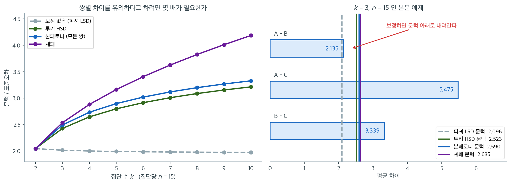
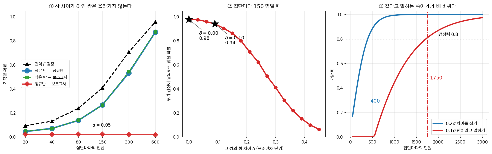

# 사후비교 방법의 비교와 검정력

## 개요

사후비교가 쌍 하나를 놓치면 「보정이 지나쳤다」고 말하게 된다. 그 책임이 보정에 있는지 표본이 작은 데 있는지는 **수로 가를 수 있다.**

참 평균이 $10,\ 12,\ 15$ 인 세 집단에서 집단당 열다섯을 뽑아 Tukey HSD 를 돌리면 참 차이가 $3$ 과 $5$ 인 두 쌍은 잡히고 가까운 한 쌍은 $p = 0.1115$ 로 놓친다. 가까운 쌍의 참 차이가 $2$ 로 분명히 있으니 보정 탓으로 보인다.

그런데 그 쌍을 Tukey 로 잡아낼 확률이 애초에 $0.206$ 이고, 보정을 아예 하지 않는 쪽 — **Fisher LSD** — 으로도 **$0.334$** 다. 보정이 앗아간 몫은 $0.334 - 0.206 = 0.128$ 이고, 나머지 $0.666$ 은 보정과 무관하게 **표본이 작아서 없던 검정력**이다. 보정을 통째로 버려도 열 번에 일곱 번은 여전히 놓친다는 뜻이고, 그 몫은 표본을 늘려야 메워진다. 네 방법의 문턱이 $2.4295$ 에서 $2.5377$ 사이에 몰려 있는 것도 같은 말을 한다 — 방법을 갈아타서 얻을 수 있는 폭이 $2.5377 - 2.4295 = 0.11$ 뿐이다.

방향은 분명하다. 보정은 검정력을 **낮추는 쪽**으로만 작용한다. 다만 이 자리에서 그 몫은 $0.13$ 이고, 보정을 버리면 거짓 기각이 늘어나는 쪽으로 그만큼을 치른다 — 보정은 쌍을 늘릴 때 값을 물리는 장치다. 네 방법은 튜키·본페로니·셰페·게임스–하웰이고, 고르는 기준은 $\S 4$ 가 적는다. 놓친 쌍의 책임은 방법에 있는가 표본에 있는가. 아래 상자가 그 세 번째 쌍이 끝내 한 말을 따라간다.

12.3 의 앞 다섯 쪽은 사후비교 방법을 하나씩 세웠다 —
[Tukey 정직유의차](tukey.md), [Bonferroni와 Scheffé](bonferroni_scheffe.md),
[Dunnett 검정](dunnett.md), [Games-Howell](games_howell.md). 이 쪽은 그 방법들을
**한 자에 올려 견준다.** 문턱을 표준오차 단위로 환산해 집단 수에 따라 그리고,
같은 자료에서 어느 쌍이 어느 방법에 걸리는지 본다. 그리고 지금까지 다루지 않은
물음 하나에 답한다 — **놓친 쌍은 방법이 보수적이었기 때문인가, 표본이 작았기
때문인가.**

## 1. 네 문턱을 한 줄에

집단이 $k$ 개면 쌍별 비교가 $\binom k2$ 개다. 각각을 수준 $\alpha$ 로 검정하면 전역
귀무가설 아래 거짓 기각이 하나라도 나올 확률이 $1 - (1-\alpha)^{\binom k2}$ 로 부풀고,
$k = 5$, $\alpha = 0.05$ 면 벌써 $0.40$ 이다. 네 방법이 그 부풀음을 막는 방식은 모두
**문턱을 올리는 것**이고, 서로 다른 점은 **무엇의 가족에 대해** 올리느냐뿐이다.

| 방법 | 문턱 (쌍별 차이가 이보다 크면 기각) | 가족 | 유도한 곳 |
|---|---|---|---|
| 보정 없음 (Fisher LSD) | $t_{1-\alpha/2,\,N-k}\sqrt{MSW\left(\frac1{n_i}+\frac1{n_j}\right)}$ | 비교 하나 | $\S 2$ 보기 1 |
| Tukey HSD | $q_{\alpha,\,k,\,N-k}\sqrt{MSW/n}$ | 모든 쌍 | [Tukey](tukey.md) 보기 2 |
| Bonferroni | $t_{\alpha/(2m),\,N-k}\sqrt{MSW\left(\frac1{n_i}+\frac1{n_j}\right)}$ | 미리 지정한 $m$ 개 | [Bonferroni와 Scheffé](bonferroni_scheffe.md) 보기 1 |
| Scheffé | $\sqrt{(k-1)F_{\alpha,\,k-1,\,N-k}}\sqrt{MSW\left(\frac1{n_i}+\frac1{n_j}\right)}$ | 가능한 **모든** 대비 | [Bonferroni와 Scheffé](bonferroni_scheffe.md) 보기 2 |

Bonferroni 의 단계적 하강 변형인 Holm 절차는 같은 가족을 통제하면서 균일하게 더
강력하다(연습문제 8). 분산이 다를 때의 [Games-Howell](games_howell.md) 은 합동 $MSW$
대신 쌍마다 따로 표준오차와 자유도를 만든다.

## 2. 보정 없음 — Fisher LSD 와 그 「보호」

위 표의 첫 줄이 **보정 없음**이다. 전역 귀무가설을 기각한 뒤 보정 없이 쌍별로 비교하는 이 절차를 Fisher 의 **최소유의차**(LSD)라 부른다. 다른 셋과 달리 **가족이 비교 하나**이므로 엄밀히는 다중비교 방법이 아니고, 그래서 표의 「유도한 곳」이 비어 있었다. 여기서 채운다.

집단 $i$와 $j$에 대한 LSD 문턱은

$$
\text{LSD} = t_{1-\alpha/2,\, N-k} \sqrt{\text{MSE}\!\left(\frac{1}{n_i} + \frac{1}{n_j}\right)}
$$

이다. $|\bar{y}_i - \bar{y}_j| > \text{LSD}$이면 그 쌍을 수준 $\alpha$에서 유의하게 다르다고 선언한다.

<div class="exbox" markdown>

**보기 1.** <span class="diff easy" title="쉬움"></span> Fisher LSD 는 언제 안전한가. 전역 $F$-검정이 기각했을 때만 LSD 쌍별 비교로 넘어가는 절차를 **보호된(protected) LSD** 라 한다.

**(1)** LSD 문턱이 "합동 $MSE$ 를 쓴 이표본 $t$-검정"의 문턱과 같음을 보이고, 같은 자료의 Tukey HSD 문턱과의 비가

$$
\frac{\text{HSD}}{\text{LSD}} = \frac{q_{\alpha,\,k,\,\nu}}{\sqrt2\, t_{1-\alpha/2,\,\nu}}
$$

임을 보이시오. $k = 3$, $\nu = 27$, $\alpha = 0.05$ 에서 이 값을 구하시오.

**(2)** 보호된 LSD 의 **집단별 오류율**(FWER)을 모의실험으로 재시오. 평균 하나만 크게 떨어뜨려 전역 검정이 거의 언제나 기각하도록 만들고, **나머지 같은 평균들 사이**에서 거짓 유의가 하나라도 나올 확률을 $k = 3, 5, 7$ 에 대해 비교하시오.

</div>

??? success "풀이"

    **(1) 해석적으로.** 합동분산을 쓴 이표본 $t$-검정은

    $$
    t = \frac{\bar y_i - \bar y_j}{\sqrt{s_p^2\left(\frac{1}{n_i}+\frac{1}{n_j}\right)}}
    $$

    를 $|t| > t_{1-\alpha/2,\nu}$ 와 견준다. 양변에 분모를 곱하면 기각 조건이

    $$
    |\bar y_i - \bar y_j| > t_{1-\alpha/2,\nu}\sqrt{s_p^2\left(\tfrac{1}{n_i}+\tfrac{1}{n_j}\right)}
    $$

    이 되는데, LSD 가 쓰는 $MSE$ 는 **$k$ 개 집단 전부를 합동한 분산추정량**이므로 두 집단만으로 만든 $s_p^2$ 대신 그것을 넣고 자유도를 $n_i+n_j-2$ 대신 $\nu = N-k$ 로 바꾼 것이 정확히 LSD 문턱이다. 그러므로 **LSD 는 분모를 더 많은 자료로 만든 쌍별 $t$-검정**이다. $k=2$ 이면 $MSE = s_p^2$, $\nu = N-2$ 라 둘이 완전히 같아진다.

    Tukey HSD 는 같은 자리에 스튜던트화 범위 분포를 쓴다. 균형 설계에서

    $$
    \text{HSD} = q_{\alpha,k,\nu}\sqrt{\frac{MSE}{n}},
    \qquad
    \text{LSD} = t_{1-\alpha/2,\nu}\sqrt{\frac{2\,MSE}{n}}
    $$

    이므로 $\sqrt{MSE/n}$ 이 약분되어

    $$
    \frac{\text{HSD}}{\text{LSD}} = \frac{q_{\alpha,k,\nu}}{\sqrt2\,t_{1-\alpha/2,\nu}}
    $$

    이다. **$MSE$ 와 $n$ 에 전혀 의존하지 않는다.** $k=2$ 이면 $q_{\alpha,2,\nu} = \sqrt2\,t_{1-\alpha/2,\nu}$ 라 비가 정확히 $1$ 이고, $k$ 가 커지면 $q$ 가 커지므로 비도 커진다. 곧 **집단이 많아질수록 Tukey 의 문턱이 LSD 보다 빠르게 높아진다.** 아래에서 $k=3$, $\nu=27$ 의 값을 잰다.

    **(2) 수치적으로.** 먼저 LSD 를 돌린다.

    ```python
    from itertools import combinations
    import numpy as np
    import pandas as pd
    from scipy import stats
    import statsmodels.api as sm

    # 12.1절 [모형과 가정](../anova_one_way/one_way_model.md)이 쓴 것과 같은 자료다.
    pg = sm.datasets.get_rdataset("PlantGrowth").data
    groups = {name: g["weight"].to_numpy() for name, g in pg.groupby("group")}
    N_total, k = len(pg), len(groups)
    SSE = sum(((g - g.mean()) ** 2).sum() for g in groups.values())
    MSE = SSE / (N_total - k)
    print(f"N = {N_total}, k = {k},  MSE = {MSE:.4f}  (자유도 {N_total - k})")

    def fisher_lsd(groups, MSE, alpha=0.05):
        """Fisher 의 최소유의차로 쌍별 비교를 한다.

        쌍마다 t-검정을 하되 표준오차를 그 두 집단이 아니라 전체 MSE 로 만든다.
        모든 집단의 정보를 쓰므로 자유도가 커지는 것이 이점이다.
        다만 다중비교를 보정하지 않으므로, 분산분석이 유의할 때만 쓴다.
        """
        names = list(groups.keys())
        N_total = sum(len(g) for g in groups.values())
        k = len(groups)
        df_within = N_total - k
        results = []
        for (n1, g1), (n2, g2) in combinations(groups.items(), 2):
            t_crit = stats.t.ppf(1 - alpha / 2, df_within)
            lsd_val = t_crit * np.sqrt(MSE * (1/len(groups[n1]) + 1/len(groups[n2])))
            diff = abs(groups[n1].mean() - groups[n2].mean())
            results.append({"pair": f"{n1} vs {n2}",
                            "diff": diff, "LSD": lsd_val,
                            "significant": diff > lsd_val})
        return results


    for r in fisher_lsd(groups, MSE):
        print(f"{r['pair']:<14} diff = {r['diff']:.4f}  LSD = {r['LSD']:.4f}  {r['significant']}")
    ```

    출력:

    ```
    N = 30, k = 3,  MSE = 0.3886  (자유도 27)
    ctrl vs trt1   diff = 0.3710  LSD = 0.5720  False
    ctrl vs trt2   diff = 0.4940  LSD = 0.5720  False
    trt1 vs trt2   diff = 0.8650  LSD = 0.5720  True
    ```

    전역 검정은 $p = 0.0159$로 기각했는데 쌍별로 보면 trt1 대 trt2 하나만 유의하다. 대조군은 두 처리 어느 쪽과도 유의하게 다르지 않다. 두 처리가 대조군을 사이에 두고 반대 방향으로 벌어져 있어, 서로 간의 차이가 각각과 대조군의 차이보다 큰 것이다.

    집단 크기가 모두 10으로 같아 LSD 문턱도 0.5720 하나로 같다. 크기가 다르면 쌍마다 문턱이 달라진다.

    이제 (1)의 비를 재고 (2)의 모의실험을 돌린다.

    ```python
    t_crit = stats.t.ppf(0.975, 27)
    q_crit = stats.studentized_range.ppf(0.95, 3, 27)
    LSD = t_crit * np.sqrt(2 * MSE / 10)
    HSD = q_crit * np.sqrt(MSE / 10)
    print(f"t(0.975, 27) = {t_crit:.4f}   LSD = {LSD:.4f}")
    print(f"q(0.05, 3, 27) = {q_crit:.4f}   HSD = {HSD:.4f}")
    print(f"HSD / LSD = {HSD / LSD:.4f}   q/(sqrt(2) t) = {q_crit / (np.sqrt(2) * t_crit):.4f}")


    def protected_lsd_fwer(mu, B=40000, n=10, alpha=0.05, seed=0):
        """평균이 mu 인 k 개 집단에서, 전역 F 가 기각한 뒤 LSD 를 돌렸을 때
        '참으로 같은 쌍' 가운데 하나라도 유의하다고 선언될 확률을 센다."""
        mu = np.asarray(mu, float)
        k = len(mu)
        N = n * k
        rng = np.random.default_rng(seed)
        Y = rng.normal(mu[None, :, None], 1.0, size=(B, k, n))
        gmean = Y.mean(axis=2)
        grand = Y.mean(axis=(1, 2))
        SSB = n * ((gmean - grand[:, None]) ** 2).sum(axis=1)
        SSE_ = ((Y - gmean[:, :, None]) ** 2).sum(axis=(1, 2))
        Fsim = (SSB / (k - 1)) / (SSE_ / (N - k))
        gate = Fsim > stats.f(k - 1, N - k).ppf(1 - alpha)
        thr = stats.t.ppf(1 - alpha / 2, N - k) * np.sqrt((SSE_ / (N - k)) * 2 / n)
        null_pairs = [(i, j) for i, j in combinations(range(k), 2) if mu[i] == mu[j]]
        any_false = np.zeros(B, bool)
        for i, j in null_pairs:
            any_false |= np.abs(gmean[:, i] - gmean[:, j]) > thr
        return np.mean(gate & any_false), gate.mean(), len(null_pairs)


    print(f"\n{'design':>22}{'nullpairs':>11}{'global.rej':>12}{'FWER':>9}")
    for mu, label in [((0, 0, 3), "k=3, mu=(0,0,3)"),
                      ((0, 0, 0, 0, 5), "k=5, mu=(0,0,0,0,5)"),
                      ((0, 0, 0, 0, 0, 0, 8), "k=7, mu=(0,...,0,8)")]:
        rate, gate, npair = protected_lsd_fwer(mu)
        print(f"{label:>22}{npair:>11}{gate:>12.4f}{rate:>9.4f}")
    print(f"\nB=40000 에서 FWER 추정의 MC 표준오차 ~ {np.sqrt(0.05 * 0.95 / 40000):.4f}")
    ```

    출력:

    ```
    t(0.975, 27) = 2.0518   LSD = 0.5720
    q(0.05, 3, 27) = 3.5064   HSD = 0.6912
    HSD / LSD = 1.2084   q/(sqrt(2) t) = 1.2084

                    design  nullpairs  global.rej     FWER
           k=3, mu=(0,0,3)          1      1.0000   0.0493
       k=5, mu=(0,0,0,0,5)          6      1.0000   0.1974
       k=7, mu=(0,...,0,8)         15      1.0000   0.3545

    B=40000 에서 FWER 추정의 MC 표준오차 ~ 0.0011
    ```

    **(1)의 비가 맞는다.** $\text{HSD}/\text{LSD} = 1.2084$ 가 $q/(\sqrt2\,t) = 1.2084$ 와 네 자리까지 같다. Tukey 문턱 $0.6912$ 가 LSD 문턱 $0.5720$ 보다 $21\%$ 높다. 그런데 이 자료에서 유일하게 유의했던 trt1–trt2 의 차이가 $0.8650$ 이라 **두 문턱 모두를 넘는다.** 그래서 Tukey 로 바꾸어도 결론이 같고, 다만 $p_{\text{adj}}$ 가 $0.012$ 로 커질 뿐이다.

    **(2)가 보호된 LSD 의 한계를 보여 준다.** 세 설계 모두 전역 $F$-검정이 $100\%$ 기각하므로 관문은 아무 일도 하지 않는다. 그 뒤에 남는 것은 **같은 평균들끼리의 쌍별 $t$-검정**이고, 그 수가 늘면 거짓 유의가 하나라도 나올 확률이 따라 오른다.

    | $k$ | 참으로 같은 쌍 | FWER |
    |---|---|---|
    | $3$ | $1$ | $0.0493$ |
    | $5$ | $6$ | $0.1974$ |
    | $7$ | $15$ | $0.3545$ |

    $k = 3$ 에서는 $0.0493$ 으로 명목수준 $0.05$ 를 지킨다(몬테카를로 표준오차가 $0.0011$ 이므로 $0.05$ 와 다르다고 할 수 없다). **비교할 쌍이 하나뿐이면 다중성이 없기 때문**이다. 그런데 $k=5$ 에서 $0.1974$, $k=7$ 에서 $0.3545$ 로 치솟는다. 일곱 집단 중 하나만 진짜로 다른 상황에서 **세 번에 한 번꼴로 가짜 쌍을 발표하게 된다.**

    **그러므로 "분산분석이 유의했으니 LSD 를 써도 된다"는 말은 $k = 3$ 에서만 통한다.** 집단이 넷 이상이면 전역 검정이라는 관문은 보호막 구실을 하지 못하고, Tukey HSD 처럼 쌍의 개수를 직접 셈에 넣는 방법으로 가야 한다.

---


`tukey.md` 가 「보호된 LSD 는 완전 귀무는 막지만 **부분 귀무는 막지 못한다**」고 적는 근거가 (2)의 표다. 거기서는 평균이 **모두 같을 때**의 FWER 을 재어 $k = 8$ 에서 $0.492$ 를 얻는데, 그 경우에는 전역 $F$-검정이 $95\%$ 는 통과시키지 않으므로 관문이 제 몫을 한다. 위의 (2)는 **평균 하나만 다른** 설계라 관문이 언제나 열리고, 그래서 보호가 사라진다. 12.3절 [Tukey 정직유의차](tukey.md) 연습문제의 완전 귀무 모의실험과 **함께 읽어야** 「보호된 LSD 가 언제 안전한가」의 답이 완성된다.

---

## 3. 문턱을 그려 보면

| 방법 | 오류를 통제하는 대상 | 검정력 | 적합한 경우 |
|---|---|---|---|
| Tukey HSD | 모든 쌍별 비교 | 높음 | 모든 쌍별 비교가 관심사일 때 |
| Bonferroni | 미리 지정한 임의의 집합 | 중간 | 계획된 비교가 적을 때 |
| Scheffé | 가능한 모든 대비 | (쌍별에서는) 낮음 | 복잡한 대비가 관심사일 때 |

표의 "검정력 높음/중간/낮음"은 결국 **문턱이 얼마나 높은가**라는 하나의 숫자로 정해진다. 세 방법과 보정 없는 경우의 문턱을 표준오차 단위로 환산해 $k$에 따라 그려 보면 서열이 어떻게 갈리는지 한눈에 들어온다.



$k = 2$에서는 네 선이 한 점 $2.048$에서 만난다. **비교가 하나뿐이면 보정할 것이 없으므로 모든 방법이 같은 검정이 된다.** 갈라지는 것은 $k = 3$부터다. 보정 없는 문턱은 $2.02$에서 $k = 10$의 $1.98$까지 사실상 그대로인데(자유도가 늘어 오히려 조금 내려간다), 튜키는 $2.43 \to 3.22$, 본페로니는 $2.49 \to 3.33$, 셰페는 $2.54 \to 4.19$로 올라간다. 아래로 평평한 회색 점선과 위로 뻗는 세 곡선의 간격이 곧 **다중성의 대가**다.

세 보정 사이의 서열도 분명하다. **튜키가 언제나 본페로니보다 낮다.** $k = 6$에서 $2.92$ 대 $3.02$, $k = 10$에서 $3.22$ 대 $3.33$이다. 쌍별 비교라는 고정된 가족에서는 튜키가 그 가족의 정확한 귀무분포(스튜던트화 범위분포)를 쓰는 반면 본페로니는 상관 구조를 버리고 개수만 세기 때문이다. 셰페는 $k$가 커질수록 가장 빠르게 벌어진다. 쌍별 비교 $\binom{k}{2}$개가 아니라 **무한히 많은 대비 전부**를 동시에 보호하느라 치르는 값이다. 쌍별 비교만 할 생각이라면 셰페는 사지 않아도 될 보험이다.

오른쪽은 아래 보기 2 의 자료(참 평균 $10, 12, 15$, $\sigma = 3.5$, 집단당 $n = 15$)에 이 문턱들을 얹은 것이다. 합동 $\text{MS}_W = 8.088$, 쌍별 표준오차 $\sqrt{2\,\text{MS}_W/15} = 1.039$이므로 네 문턱은 각각 $2.096,\ 2.523,\ 2.590,\ 2.635$가 된다. A–C의 $5.475$와 B–C의 $3.339$는 네 문턱을 모두 넘어 어느 방법으로도 유의하다. **판정이 갈리는 것은 A–B 하나다.** 관측 차이 $2.135$가 보정 없는 문턱 $2.096$은 넘지만 세 보정 문턱은 모두 넘지 못한다. 참 차이가 $2$로 분명히 존재하는데도 놓치는 것이니, 이 자료에서 다중비교 보정의 대가가 정확히 이 한 쌍이었던 셈이다.


### 놓친 쌍은 왜 놓쳤는가

<div class="exbox" markdown>

**보기 2.** <span class="diff easy" title="쉬움"></span> A–B 를 놓친 것은 운이 나빴기 때문인가. 참 평균이 $10, 12, 15$, 참 표준편차가 모두 $3.5$, 집단당 $n = 15$ 인 자료를 만들어 Tukey HSD 를 돌린다.

**(1)** 균형 설계에서 쌍별 통계량

$$
T = \frac{\bar y_i - \bar y_j}{\sqrt{MSW\left(\frac{2}{n}\right)}}
$$

가 $H_1$ 아래에서 **비중심 $t$ 분포** $t_{N-k}(\delta)$ 를 정확히 따르고 $\delta = \dfrac{\mu_i - \mu_j}{\sigma\sqrt{2/n}}$ 임을 설명하시오. 네 문턱(보정 없음·Tukey·Bonferroni·Scheffé)을 표준오차 단위로 적고, **A–B 를 잡아낼 확률**을 각각 계산하시오.

**(2)** 모의실험으로 (1)을 확인하고, Tukey 로 A–B 를 $80\%$ 확률로 잡으려면 집단당 몇 개가 필요한지 구하시오.

</div>

??? success "풀이"

    **(1) 해석적으로.** 분자 $\bar y_i - \bar y_j$ 는 평균 $\mu_i - \mu_j$, 분산 $2\sigma^2/n$ 의 정규분포다. 표준화하면

    $$
    Z = \frac{\bar y_i - \bar y_j}{\sigma\sqrt{2/n}} \sim N(\delta,\ 1),
    \qquad
    \delta = \frac{\mu_i-\mu_j}{\sigma\sqrt{2/n}}
    $$

    이다. 한편 $\dfrac{(N-k)MSW}{\sigma^2} \sim \chi^2_{N-k}$ 이고 **분자와 독립**이다($MSW$ 는 집단 안 변동만 쓰고 집단평균과 직교한다). 그러므로

    $$
    T = \frac{Z}{\sqrt{\dfrac{(N-k)MSW/\sigma^2}{N-k}}} \sim t_{N-k}(\delta)
    $$

    로 비중심 $t$ 다. **근사가 아니라 정확한 분포**다.

    여기서는 $\mu_B - \mu_A = 2$, $\sigma = 3.5$, $n = 15$ 이므로

    $$
    \delta = \frac{2}{3.5\sqrt{2/15}} = \frac{2}{1.2780} = 1.5649
    $$

    이고 $N - k = 42$ 다. 네 절차의 문턱은 모두 "$|T|$ 가 얼마를 넘는가"로 적힌다.

    | 방법 | 문턱 |
    |---|---|
    | 보정 없음 | $t_{0.975,\,42}$ |
    | Tukey | $q_{0.05,\,3,\,42}/\sqrt2$ |
    | Bonferroni | $t_{1-0.05/6,\,42}$ |
    | Scheffé | $\sqrt{(k-1)F_{0.05,\,2,\,42}}$ |

    각 문턱 $c$ 에 대한 검정력은 $P(|t_{42}(1.5649)| > c)$ 로 **닫힌 꼴로 계산된다.**

    **(2) 수치적으로.**

    ```python
    import numpy as np
    import pandas as pd
    from statsmodels.stats.multicomp import pairwise_tukeyhsd

    # 세 집단의 참 평균을 10, 12, 15 로 두고 표준편차는 모두 3.5 로 맞췄다.
    # A와 B의 차이는 표준편차보다 작고 A와 C의 차이는 그보다 크다.
    # Tukey 가 어느 쌍을 갈라내고 어느 쌍을 갈라내지 못하는지 보게 된다.
    rng = np.random.default_rng(42)
    n = 15
    df = pd.DataFrame({
        "response": np.concatenate([
            rng.normal(10.0, 3.5, n),
            rng.normal(12.0, 3.5, n),
            rng.normal(15.0, 3.5, n),
        ]),
        "group": ["A"] * n + ["B"] * n + ["C"] * n,
    })

    # Tukey HSD 는 쌍 세 개를 한꺼번에 견주면서 전체 오류율을 0.05 로 묶는다.
    # 쌍마다 t-검정을 따로 하면 이 통제가 무너진다.
    print(pairwise_tukeyhsd(endog=df["response"], groups=df["group"], alpha=0.05))
    ```

    출력:

    ```
    Multiple Comparison of Means - Tukey HSD, FWER=0.05
    ===================================================
    group1 group2 meandiff p-adj   lower  upper  reject
    ---------------------------------------------------
         A      B   2.1353 0.1115 -0.3876 4.6582  False
         A      C   5.4745    0.0  2.9516 7.9975   True
         B      C   3.3392 0.0069  0.8163 5.8621   True
    ---------------------------------------------------
    ```

    참 평균이 10, 12, 15이고 표준편차가 3.5인 자료다. A와 C의 차이(참값 5)와 B와 C의 차이(참값 3)는 잡아내지만, A와 B의 차이(참값 2)는 $p = 0.11$로 놓친다. 집단당 15개로는 표준편차 3.5 대비 2의 차이를 가려내기 어렵다.

    **사후검정이 유의하지 않다는 것이 차이가 없다는 뜻은 아니다.** 여기서는 참 차이가 분명히 존재하는데도 놓쳤다. 그 "놓칠 확률"을 계산해 본다.

    ```python
    from scipy import stats

    k, sigma = 3, 3.5
    nu = k * n - k                      # 42
    delta = 2.0                         # A 와 B 의 참 평균차
    se_true = sigma * np.sqrt(2 / n)    # 차이의 '참' 표준오차
    ncp = delta / se_true
    print(f"참 표준오차 = {se_true:.4f},  비중심모수 delta/SE = {ncp:.4f}")

    thr = {
        "보정 없음": stats.t.ppf(0.975, nu),
        "Tukey": stats.studentized_range.ppf(0.95, k, nu) / np.sqrt(2),
        "Bonferroni": stats.t.ppf(1 - 0.05 / 6, nu),
        "Scheffe": np.sqrt((k - 1) * stats.f(k - 1, nu).ppf(0.95)),
    }

    # 모의실험으로 확인한다 (통계량을 직접 만들어 문턱과 견준다).
    B = 200_000
    sim = np.random.default_rng(7)
    mu = np.array([10.0, 12.0, 15.0])
    Y = sim.normal(mu[None, :, None], sigma, size=(B, k, n))
    gm = Y.mean(axis=2)
    MSW = ((Y - gm[:, :, None]) ** 2).sum(axis=(1, 2)) / nu
    T_AB = (gm[:, 1] - gm[:, 0]) / np.sqrt(MSW * 2 / n)

    print(f"\n{'방법':<12}{'문턱(SE 단위)':>14}{'검정력(이론)':>14}{'검정력(모의)':>14}")
    for name, c in thr.items():
        th = stats.nct(nu, ncp).sf(c) + stats.nct(nu, ncp).cdf(-c)
        print(f"{name:<12}{c:>14.4f}{th:>14.4f}{np.mean(np.abs(T_AB) > c):>14.4f}")

    # Tukey 로 A-B 를 80% 확률로 잡으려면 집단당 몇 개가 필요한가.
    print(f"\n{'n':>5}{'nu':>6}{'Tukey 문턱':>12}{'검정력':>10}")
    for m in (15, 30, 50, 60, 63, 70):
        nu_m = k * m - k
        c = stats.studentized_range.ppf(0.95, k, nu_m) / np.sqrt(2)
        nc = delta / (sigma * np.sqrt(2 / m))
        pw = stats.nct(nu_m, nc).sf(c) + stats.nct(nu_m, nc).cdf(-c)
        print(f"{m:>5}{nu_m:>6}{c:>12.4f}{pw:>10.4f}")

    print(f"\n이 표본의 MSW = 8.088 로 참 분산 sigma^2 = {sigma ** 2:.3f} 보다 작다")
    ```

    출력:

    ```
    참 표준오차 = 1.2780,  비중심모수 delta/SE = 1.5649

    방법               문턱(SE 단위)       검정력(이론)       검정력(모의)
    보정 없음               2.0181        0.3336        0.3340
    Tukey               2.4295        0.2056        0.2059
    Bonferroni          2.4937        0.1889        0.1895
    Scheffe             2.5377        0.1780        0.1780

        n    nu    Tukey 문턱       검정력
       15    42      2.4295    0.2056
       30    87      2.3845    0.4357
       50   147      2.3677    0.6875
       60   177      2.3636    0.7774
       63   186      2.3626    0.7999
       70   207      2.3607    0.8452

    이 표본의 MSW = 8.088 로 참 분산 sigma^2 = 12.250 보다 작다
    ```

    **이론과 모의가 소수 셋째 자리까지 맞는다.** 비중심 $t$ 로 계산한 검정력 $0.3336,\ 0.2056,\ 0.1889,\ 0.1780$ 이 $20$ 만 번 모의실험의 $0.3340,\ 0.2059,\ 0.1895,\ 0.1780$ 과 일치한다. (1)의 분포 주장이 확인되었다.

    **A–B 를 놓친 것은 운이 나빠서가 아니다.** Tukey 로 이 쌍을 잡아낼 확률이 **$0.206$ 에 지나지 않는다.** 다섯 번 중 네 번은 놓치도록 설계된 실험이었던 셈이다. 보정을 아예 하지 않아도 $0.334$ 이니, **다중비교 보정이 범인도 아니다.** 보정이 앗아간 몫은 $0.33 \to 0.21$ 로 $0.13$ 이고, 나머지 $0.67$ 은 애초에 표본이 작아서 없던 검정력이다.

    세 보정의 서열도 수로 확인된다. 문턱이 Tukey $2.4295$ < Bonferroni $2.4937$ < Scheffé $2.5377$ 이고 검정력은 그 역순이다. **쌍별 비교만 할 생각이라면 Tukey 가 가장 날카롭다.**

    **처방은 표본이다.** 집단당 $15$ 개에서 $0.206$ 이던 검정력이 $30$ 개에서 $0.436$, $50$ 개에서 $0.688$ 이 되고 **$63$ 개에서 $0.80$ 에 닿는다.** 문턱 자체는 $2.4295$ 에서 $2.3626$ 으로 거의 움직이지 않는다는 점을 눈여겨보라. 검정력을 끌어올린 것은 문턱이 아니라 **분모의 $\sqrt{2/n}$ 이 줄어든 것**이다. 보정 방법을 고르는 일로 얻을 수 있는 것에는 한계가 있고, 그 너머는 표본으로 사야 한다.

    마지막 줄은 덤이다. 이 표본의 $MSW = 8.088$ 이 참 분산 $\sigma^2 = 12.25$ 보다 꽤 작다. 우연히 얌전한 표본이 뽑힌 것이고, 그래서 출력표의 신뢰구간이 참 $\sigma$ 로 계산했을 때보다 좁다. **그런 운 좋은 표본에서도 A–B 는 잡히지 않았다.**

불균형 설계에서는 Tukey-Kramer 수정이 $\sqrt{MSW/n}$을 $\sqrt{MSW \cdot (1/n_i + 1/n_j)/2}$로 대체한다.

---

## 4. 어느 방법을 고르는가

- **Tukey HSD**는 모든 집단 평균 쌍을 비교하고 싶을 때의 기본 선택이다. 균형 설계에서는 정확하고 불균형 설계에서는 근사적이다(Tukey-Kramer).
- **Bonferroni**는 계획된 비교가 소수일 때 가장 유용하다. 비교 수가 늘수록 검정력이 떨어지기 때문이다.
- **Scheffé**는 임의의 선형 대비에 관심이 있을 때(예: 두 집단의 평균을 세 번째 집단과 비교할 때) 선택하는 방법이다. 순수하게 쌍별 비교만 한다면 Tukey HSD의 검정력이 더 높다.

<div class="storybox" markdown>

**그림으로 보는 통계학 1.** 세 번째 쌍이 한 말

교육 분야에서 사람을 무작위로 배정한 큰 실험은 드물다. 그래서 **테네시 STAR**가
자주 인용된다. $1985$ 년부터 네 해 동안, 아동 **약 $1$ 만 $1600$ 명과 그 교사들**을
유치원부터 $3$ 학년까지 세 조건에 무작위로 나누었다.

- **작은 반** — $13$–$17$ 명
- **정규반** — $22$–$25$ 명
- **보조교사를 둔 정규반** — 정규반 크기에 전일 보조교사 한 명

조건이 셋이니 쌍은 셋이다. 그런데 사람들이 실제로 궁금해한 것은 **두 번째 쌍**이었다.
반을 줄이는 일은 교사를 더 뽑고 교실을 더 지어야 하지만, 보조교사를 붙이는 일은 훨씬
싸다. 같은 효과를 싸게 살 수 있다면 그쪽이 낫다.

결과는 이랬다. **「세 STAR 조건 가운데 작은 반이 가장 좋았고, 대체로 정규반이 그다음,
전일 보조교사를 둔 정규반이 마지막이었다.」** 보조교사 조건은 정규반보다 낫지 않았다 —
순서로는 오히려 뒤였다.

여기서 이 쪽의 주제가 그대로 드러난다. 전역 $F$ 가 기각했다고 해서 세 쌍이 다 다른 것이
아니고, **어느 쌍이 다른지가 전부**다. 같은 설계를 수로 본뜨면 이렇다 — 참 평균을
$(0.2,\ 0,\ 0)$ 으로 두어, 세 쌍 가운데 둘은 참 차이가 $0.2\sigma$ 이고 하나는 정확히
$0$ 이다.



- **①** 인원이 늘수록 전역 $F$ 와 「작은 반」이 낀 두 쌍이 함께 올라간다. 집단마다
  $600$ 명이면 전역이 $0.958$, 두 쌍이 $0.87$ 이다. 참 차이가 $0$ 인 세 번째 쌍만
  $0.02$ 언저리에 그대로 있다. 튜키가 **세 쌍 전체를 묶어** $0.05$ 를 지키므로 한 쌍만
  떼어 보면 그보다 낮다.
- **②** 그러니 「보조교사와 정규반은 유의하지 않았다」까지는 옳다. 문제는 그다음이다.
  집단마다 $150$ 명일 때, 참 차이가 **정말 $0$** 인 쌍이 유의하지 않을 확률이 $0.98$ 인데,
  참 차이가 $0.10\sigma$ 인 쌍도 $0.94$ 다. **비유의는 두 경우를 거의 구별하지 못한다.**
  $0.18\sigma$ 짜리 차이조차 $0.80$ 의 확률로 유의하지 않게 나온다.
- **③** 「없다」가 아니라 **「$0.1\sigma$ 안이다」**라고 말하려면 값을 치러야 한다.
  $0.2\sigma$ 차이를 $80\%$ 로 잡는 데 집단마다 $400$ 명이면 되는데, $0.1\sigma$ 안이라고
  같은 확신으로 말하려면 $1{,}750$ 명 — **$4.4$ 배**다. 찾는 일보다 **없음을 보이는 일이
  더 비싸다.**

STAR 가 조건마다 수천 명을 둔 덕에 「보조교사는 도움이 되지 않았다」가 그저 검정력
부족이라고 넘기기 어려운 말이 되었다. 조건 셋에 각 $150$ 명짜리 연구였다면 ② 의 자리에
있었을 것이고, 그 결과로 「효과 없음」을 보고했더라도 그것은 $0$ 과 $0.1\sigma$ 를 구별하지
못한 보고였을 것이다.

표의 검정력 칸을 읽을 때 한 줄을 더 챙기면 좋다. 사후검정은 **어느 쌍이 다른지**를
말해 주지만, **어느 쌍이 같은지**는 말해 주지 않는다. 유의하지 않은 쌍을 보고할 때는
$p$ 값이 아니라 **그 쌍의 신뢰구간**을 적어야 한다. 구간이 $[-0.05,\ 0.06]$ 이면 같다는
뜻이고 $[-0.4,\ 0.5]$ 면 모른다는 뜻인데, $p$ 값은 둘 다 $0.8$ 로 적는다.

_확인한 곳 — Achilles · Finn, 「Should Class Size Be a Cornerstone for Educational
Policy?」(ERIC ED$430943$)의 「Of the three STAR conditions, the Small class (S) was best,
generally followed by the Regular class (R) and then by the Regular class with a
full-time instructional aide (RA)」와 「STAR was not the first study to show that aides
did not help student outcomes」 · Project STAR 이 $1985$ 년 테네시에서 시작해 아동과
교사 약 $1$ 만 $1600$ 명을 작은 반($13$–$17$ 명)·정규반($22$–$25$ 명)·전일 보조교사를
둔 정규반의 셋에 무작위 배정하고 유치원부터 $3$ 학년까지 네 해를 따라갔다는 것, 그리고
Mosteller, 「The Tennessee Study of Class Size in the Early School Grades」,
『The Future of Children』 $5$ 권 $2$ 호 $113$–$127$ 쪽($1995$)이 그 표준적인 개관이라는
것. ①–③ 의 수는 모두 직접 계산한 값이며, 쓰인 효과크기 $0.2\sigma$ 와 동등성 한계
$0.1\sigma$ 는 이 상자가 고른 값이지 STAR 가 보고한 값이 아니다_

</div>

---

## 연습문제

<div class="drillbox" markdown>

**연습문제 1.** <span class="diff easy" title="쉬움"></span>
집단 $k = 4$개, 집단당 $n_i = 15$인 일원배치 분산분석에서 $MSW = 12.3$을 얻었다. $\alpha = 0.05$의 스튜던트화 범위 임계값은 $q_{0.05,4,56} = 3.74$이다. Tukey HSD 문턱을 계산하고 평균 차이 $\bar{y}_1 - \bar{y}_3 = 3.5$가 유의한지 판정하라.

</div>

??? success "풀이"
    균형 설계의 Tukey HSD 문턱은

    $$
    \text{HSD} = q_{\alpha,k,N-k} \sqrt{\frac{MSW}{n}} = 3.74 \sqrt{\frac{12.3}{15}} = 3.74 \sqrt{0.82} = 3.74 \times 0.9055 \approx 3.39
    $$

    이다. $|\bar{y}_1 - \bar{y}_3| = 3.5 > 3.39$이므로 $\alpha = 0.05$ 수준에서 차이가 유의하다.

---

<div class="drillbox" markdown>

**연습문제 2.** <span class="diff easy" title="쉬움"></span>
사후검정 절차의 **선택 지침**을 정리하라.

</div>

??? success "풀이"
    **핵심 수치 다섯.**

    | 사실 | 값 |
    |---|---|
    | $k=10$에서 무보정 FWER | **0.592** |
    | 튜키의 FWER(균형·등분산) | 0.046~0.054 |
    | $k=10$에서 셰페의 FWER(쌍별) | **0.002** |
    | 역페어링에서 튜키의 FWER | **0.362** |
    | 더넷이 튜키보다 얻는 검정력 | $+18\%$ |

    **선택 흐름.**

    ```text
    무엇을 비교하려는가?
        │
        ├─ 모든 쌍 (k(k-1)/2 개)
        │     ├─ 등분산·균형 ──→ 튜키 HSD
        │     └─ 이분산      ──→ 게임스-하웰
        │
        ├─ 대조군과의 비교만 (k-1 개)
        │     └─→ 더넷 (튜키보다 검정력 18% 높다)
        │
        ├─ 미리 정한 소수의 대비
        │     └─→ 홀름 (본페로니를 지배)
        │
        └─ 자료를 보고 고른 대비
              └─→ 셰페 (다른 절차는 무효)
    ```

    **절차 비교표.**

    | 절차 | 통제 범위 | 등분산 | 정확도(쌍별) | 신뢰구간 |
    |---|---|---|---|---|
    | **튜키 HSD** | 모든 쌍 | 필요 | **정확** | **쉽다** |
    | **게임스–하웰** | 모든 쌍 | **불필요** | 정확 | 쉽다 |
    | 본페로니 | 지정한 $M$개 | 필요 | 보수적 | **쉽다** |
    | **홀름** | 지정한 $M$개 | 필요 | 보수적 | **어렵다** |
    | **더넷** | 대조군 대 나머지 | 필요 | **정확** | 쉽다 |
    | **셰페** | **모든 대비** | 필요 | 매우 보수적 | 쉽다 |

    **신뢰구간 열이 실무에서 중요하다.** $p$만 보고할 것이 아니라 **차이의 구간**을 보고해야 하는데, 홀름은 그것을 주지 못한다.

    **자주 하는 실수 다섯.**

    | 실수 | 대가 |
    |---|---|
    | 보정 없이 모든 쌍 비교 | $k=10$에서 FWER 0.59 |
    | 이분산인데 튜키 | FWER 0.36 |
    | 웰치 + 튜키 조합 | 가정이 모순 |
    | 쌍별인데 셰페 | 검정력 낭비 |
    | **자료를 보고 대비를 골라 튜키** | 통제가 무효 |

    **"$F$가 유의해야 사후검정을 한다"는 규칙은?**

    | 절차 | 보호된 $F$가 필요한가 |
    |---|---|
    | **튜키, 게임스–하웰, 더넷** | **불필요**(스스로 FWER을 통제) |
    | 보정 없는 LSD | **필요**(그러나 $k\geq4$에서 실패) |
    | 셰페 | 불필요(정리상 $F$와 동치) |

    **튜키를 쓸 때 $F$ 검정을 먼저 요구하면 오히려 보수적**이 된다. 두 관문을 통과해야 하기 때문이다.

    **보고 형식.**

    ```text
    전체 검정: Welch F(3, 21.4) = 5.82, p = 0.0045
    사후검정: 게임스-하웰 (등분산을 가정하지 않으므로)

      비교          차이     95% 구간        보정 p
      A vs B       2.31   [0.42, 4.20]     0.012
      A vs C      -0.14   [-2.03, 1.75]    0.998
      ...
    ```

    **차이·구간·보정된 $p$를 모두 적는다.** 그리고 **어느 절차를 왜 썼는지** 한 줄로 밝힌다.

    **한 문장.** 사후검정의 선택은 **"무엇을 비교할 것인가"를 먼저 정하는 데서 시작**하며, 그 집합을 자료를 보고 정하는 순간 **셰페 외의 모든 절차가 무효**가 된다.

---

<div class="drillbox" markdown>

**연습문제 3.** <span class="diff med" title="중간"></span>
어떤 연구자가 ($k = 4$개 집단에서 나오는) $m = 6$개의 쌍별 비교를 가족단위 $\alpha = 0.05$의 Bonferroni 방법으로 수행하려 한다. 보정 전 $p$-값은 $0.003, 0.012, 0.041, 0.078, 0.210, 0.530$이다. Bonferroni에서 유의한 비교는 무엇인가? Holm-Bonferroni 단계적 하강 절차에서는 어떤 비교가 추가로 유의해지는가?

</div>

??? success "풀이"
    **Bonferroni:** 각 보정 전 $p$-값에 $m = 6$을 곱한다.

    | 보정 전 $p$ | Bonferroni $p_{\text{adj}}$ | 유의? |
    |---|---|---|
    | 0.003 | 0.018 | 예 |
    | 0.012 | 0.072 | 아니오 |
    | 0.041 | 0.246 | 아니오 |
    | 0.078 | 0.468 | 아니오 |
    | 0.210 | 1.000 | 아니오 |
    | 0.530 | 1.000 | 아니오 |

    Bonferroni에서는 첫 번째 비교만 유의하다.

    **Holm-Bonferroni:** 보정 전 $p$-값을 오름차순으로 정렬하고 $p_{(j)}$를 $\alpha / (m - j + 1)$과 비교한다:

    - $p_{(1)} = 0.003 < 0.05/6 = 0.00833$ — 기각한다.
    - $p_{(2)} = 0.012 < 0.05/5 = 0.01$이 아니다($0.012 > 0.01$) — 기각하지 못한다. 여기서 멈춘다.

    Holm-Bonferroni에서도 첫 번째 비교만 유의하다. 다만 두 번째 $p$-값이 조금만 더 작았다면(예: $0.009$) 그것도 기각되었을 것이며, 이는 Holm이 Bonferroni보다 엄밀하게 더 강력함을 보여준다.

---

<div class="drillbox" markdown>

**연습문제 4.** <span class="diff med" title="중간"></span>
$k = 2$일 때 Tukey HSD 검정이 이표본 $t$-검정과 동치임을 보여라. 구체적으로 $\nu = N - 2$일 때 $q_{\alpha,2,\nu}^2 = 2\, F_{\alpha,1,\nu}$임을 증명하라.

</div>

??? success "풀이"
    $k = 2$일 때 모수가 $(2, \nu)$인 스튜던트화 범위 분포는 $t$-분포와 $q_{2,\nu} = \sqrt{2}\, |t_\nu|$의 관계를 갖는다. 양변을 제곱하면 $q_{2,\nu}^2 = 2\, t_\nu^2$이다. $t_\nu^2 \sim F_{1,\nu}$이므로

    $$
    q_{\alpha,2,\nu}^2 = 2\, F_{\alpha,1,\nu}
    $$

    이다. Tukey HSD 검정은 $|\bar{y}_1 - \bar{y}_2| / \sqrt{MSW/n} > q_{\alpha,2,\nu}$일 때 기각하는데, 이는

    $$
    \frac{(\bar{y}_1 - \bar{y}_2)^2}{MSW/n} > 2\, F_{\alpha,1,\nu}
    $$

    와 동치이다. 좌변은 $2 F_{\text{obs}}$와 같고 $F_{\text{obs}} = MSB/MSW$는 $k = 2$일 때의 표준 분산분석 $F$-통계량이다. 따라서 Tukey 검정은 $F_{\text{obs}} > F_{\alpha,1,\nu}$일 때 기각하는 것으로 환원되며, 이것이 바로 이표본 $t$-검정(동등하게 분자 자유도 $k-1 = 1$인 $F$-검정)이다. $\square$

---

<div class="drillbox" markdown>

**연습문제 5.** <span class="diff med" title="중간"></span>
쌍별 비교에서 Scheffé 방법이 Tukey의 HSD보다 보수적이면서도 Tukey가 탐지할 수 없는 효과를 탐지할 수 있는 이유를 설명하라. Scheffé로는 검정할 수 있고 Tukey로는 할 수 없는 대비의 구체적인 예를 들어라.

</div>

??? success "풀이"
    Scheffé 방법은 쌍별 차이만이 아니라 $\sum c_i = 0$인 **가능한 모든 선형 대비** $\psi = \sum c_i \mu_i$에 대해 가족단위 오류율을 통제한다. 이 족이 쌍별 비교의 집합보다 훨씬 크므로 임계값이 커지고, 개별 쌍별 비교에서는 더 보수적이 된다.

    그러나 Scheffé 방법은 다음과 같은 복잡한 대비를 검정할 수 있다:

    $$
    \psi = \frac{\mu_1 + \mu_2}{2} - \mu_3
    $$

    이 대비는 집단 1과 2의 평균이 집단 3과 다른지를 묻는다. Tukey의 HSD는 이런 유형의 비교를 위해 설계되지 않았다. 예를 들어 세 가지 교수법을 비교하는 연구에서 강의 중심 두 방법의 평균 효과가 프로젝트 중심 방법과 다른지 검정하고 싶을 수 있다. Scheffé 방법은 이를 직접 다루지만 Tukey는 그럴 수 없다.

---

<div class="drillbox" markdown>

**연습문제 6.** <span class="diff med" title="중간"></span>
Bonferroni 보정이 가족단위 오류율을 수준 $\alpha$로 통제함을 증명하라. 즉 $m$개의 검정을 각각 수준 $\alpha/m$에서 수행하면 $P(H_0 \text{ 아래에서 거짓 기각이 적어도 하나}) \le \alpha$임을 보여라.

</div>

??? success "풀이"
    $R_j$를 $j$번째 귀무가설이 거짓으로 기각되는 사건이라 하자($j = 1, \ldots, m$). 각 검정을 수준 $\alpha/m$에서 수행하므로 $P(R_j) \le \alpha/m$이다. Boole의 부등식(합집합 상한)에 의해

    $$
    P\!\left(\bigcup_{j=1}^{m} R_j\right) \le \sum_{j=1}^{m} P(R_j) \le \sum_{j=1}^{m} \frac{\alpha}{m} = \alpha
    $$

    이다. 이는 검정들 사이의 의존 구조와 무관하게 성립한다. 이 상한은 기각 사건들이 서로 겹치지 않을 때 가장 빠듯하고, 검정들이 양의 상관을 가질수록(사건들이 많이 겹칠수록) 보수적이 된다. $\square$

---

<div class="drillbox" markdown>

**연습문제 7.** <span class="diff hard" title="어려움"></span>
쌍별 비교 절차 다섯의 **가족단위 오류율을 한 표에** 재라. 보정하지 않으면 $k$가 커질수록 얼마나 나빠지는가?

</div>

??? success "풀이"
    ```python
    import warnings
    warnings.filterwarnings("ignore")

    import numpy as np
    from scipy import stats
    from statsmodels.stats.libqsturng import qsturng

    def fwer_procs(gs, alpha=0.05):
        k = len(gs)
        n = np.array([len(g) for g in gs], float)
        m = np.array([g.mean() for g in gs])
        v = np.array([g.var(ddof=1) for g in gs])
        MSE = ((n - 1) * v).sum() / (n.sum() - k)
        dfe = int(n.sum() - k)
        ts = np.array([abs(m[i] - m[j]) / np.sqrt(MSE * (1 / n[i] + 1 / n[j]))
                       for i in range(k) for j in range(i + 1, k)])
        ps = 2 * stats.t.sf(ts, dfe)
        M = len(ts)

        srt = np.sort(ps)
        holm = any(srt[idx] < alpha / (M - idx)
                   for idx in range(next((i for i in range(M)
                                          if srt[i] >= alpha / (M - i)), M)))
        return {
            "보정 없음": (ps < alpha).any(),
            "본페로니": (ps < alpha / M).any(),
            "홀름": holm,
            "튜키": (ts * np.sqrt(2) > qsturng(1 - alpha, k, dfe)).any(),
            "셰페": (ts**2 > (k - 1) * stats.f.ppf(1 - alpha, k - 1, dfe)).any(),
        }

    rng = np.random.default_rng(12001)
    B = 4_000
    keys = ["보정 없음", "본페로니", "홀름", "튜키", "셰페"]
    print("완전 귀무, 정규·등분산, 명목 0.05")
    print(f"{'설계':>14s} " + " ".join(f"{s:>9s}" for s in keys))
    for k, n in [(3, 15), (4, 15), (6, 12), (10, 10)]:
        acc = {s: 0 for s in keys}
        for _ in range(B):
            r = fwer_procs([rng.normal(0, 1, n) for _ in range(k)])
            for s in keys:
                acc[s] += r[s]
        print(f"k={k}, n={n:<6d} " + " ".join(f"{acc[s] / B:9.4f}" for s in keys))
    ```

    ```text
    완전 귀무, 정규·등분산, 명목 0.05
                설계     보정 없음      본페로니        홀름        튜키        셰페
    k=3, n=15        0.1230    0.0387    0.0387    0.0470    0.0348
    k=4, n=15        0.2050    0.0450    0.0450    0.0537    0.0307
    k=6, n=12        0.3560    0.0333    0.0333    0.0475    0.0107
    k=10, n=10        0.5920    0.0328    0.0328    0.0460    0.0018
    ```

    **보정하지 않으면 $k=10$에서 오류율이 0.592다.** 자료에 아무 차이가 없는데도 **두 번 중 한 번 이상** "유의한 쌍"을 찾아낸다.

    | $k$ | 비교 수 | 보정 없음 | 본페로니 | **튜키** | 셰페 |
    |---|---|---|---|---|---|
    | 3 | 3 | 0.123 | 0.039 | **0.047** | 0.035 |
    | 4 | 6 | 0.205 | 0.045 | **0.054** | 0.031 |
    | 6 | 15 | 0.356 | 0.033 | **0.048** | 0.011 |
    | 10 | 45 | **0.592** | 0.033 | **0.046** | **0.002** |

    **튜키만 명목 0.05에 정확히 맞는다**(0.046~0.054). 나머지는 모두 보수적이다.

    **왜 튜키가 정확한가.** 스튜던트화 범위 분포는 **"$k$개 평균의 최댓값과 최솟값의 차이"**의 정확한 분포다. 쌍별 비교에서 가장 극단적인 것이 바로 그 범위이므로 **정확히 맞아떨어진다**(균형·등분산일 때).

    **본페로니가 보수적인 이유.** 본페로니 부등식

    $$
    P\left(\bigcup_i A_i\right)\leq\sum_i P(A_i)
    $$

    는 $A_i$가 **배반일 때만 등호**다. 쌍별 비교는 같은 평균들을 공유해 **강하게 상관**되어 있으므로 합집합 확률이 합보다 훨씬 작다.

    **셰페가 극단적으로 보수적이다.** $k=10$에서 0.0018로 명목의 **3%**에 불과하다. 셰페는 **모든 가능한 대비**(무한개)에 대해 동시에 통제하므로, 쌍별 비교만 볼 때는 지나치다.

    **홀름과 본페로니가 완전히 같다**(0.0387, 0.0450, …). **완전 귀무에서는 두 절차가 동일**하기 때문이다. 차이는 **일부 귀무가설이 거짓일 때** 나타난다(연습문제 8).

    **권고.**

    | 목적 | 절차 |
    |---|---|
    | 모든 쌍별 비교(균형·등분산) | **튜키** |
    | 미리 정한 소수의 비교 | **홀름**(본페로니보다 항상 낫다) |
    | 자료를 보고 고른 대비 | **셰페**(연습문제 9) |
    | 대조군과의 비교만 | **더넷** |
    | 이분산 | **게임스–하웰**(연습문제 10) |

---

<div class="drillbox" markdown>

**연습문제 8.** <span class="diff hard" title="어려움"></span>
연습문제 3의 **홀름 절차가 본페로니를 "지배"**한다고 한다. 검정력과 오류율을 모두 재어 확인하라.

</div>

??? success "풀이"
    ```python
    import warnings
    warnings.filterwarnings("ignore")

    import numpy as np
    from scipy import stats
    from statsmodels.stats.libqsturng import qsturng

    def proc_rejects(gs, alpha=0.05):
        """각 절차가 어느 쌍을 기각하는지."""
        k = len(gs)
        n = np.array([len(g) for g in gs], float)
        m = np.array([g.mean() for g in gs])
        v = np.array([g.var(ddof=1) for g in gs])
        MSE = ((n - 1) * v).sum() / (n.sum() - k)
        dfe = int(n.sum() - k)
        pairs = [(i, j) for i in range(k) for j in range(i + 1, k)]
        ts = np.array([abs(m[i] - m[j]) / np.sqrt(MSE * (1 / n[i] + 1 / n[j]))
                       for i, j in pairs])
        ps = 2 * stats.t.sf(ts, dfe)
        M = len(pairs)
        rej = np.zeros(M, bool)
        for r, idx in enumerate(np.argsort(ps)):
            if ps[idx] < alpha / (M - r):
                rej[idx] = True
            else:
                break
        return pairs, {
            "본페로니": ps < alpha / M,
            "홀름": rej,
            "튜키": ts * np.sqrt(2) > qsturng(1 - alpha, k, dfe),
            "셰페": ts**2 > (k - 1) * stats.f.ppf(1 - alpha, k - 1, dfe),
        }

    procs = ["본페로니", "홀름", "튜키", "셰페"]
    B = 4_000

    rng = np.random.default_rng(12002)
    print("검정력: k=4, n=15, μ=(0,0,0,δ) — 참인 차이는 3쌍")
    print(f"{'δ':>5s} " + " ".join(f"{s + ' 전체':>11s}" for s in procs))
    for d in [0.8, 1.2, 1.6]:
        acc = {s: 0 for s in procs}
        for _ in range(B):
            pairs, out = proc_rejects([rng.normal(mu, 1, 15)
                                       for mu in [0, 0, 0, d]])
            idx = [i for i, p in enumerate(pairs) if p[1] == 3]
            for s in procs:
                acc[s] += out[s][idx].all()
        print(f"{d:5.1f} " + " ".join(f"{acc[s] / B:11.4f}" for s in procs))

    rng = np.random.default_rng(12003)
    print("\n부분 귀무에서의 FWER (참 차이가 없는 3쌍 중 하나라도 기각)")
    print(f"{'δ':>5s} " + " ".join(f"{s:>11s}" for s in procs))
    for d in [0, 2, 4, 8]:
        acc = {s: 0 for s in procs}
        for _ in range(B):
            pairs, out = proc_rejects([rng.normal(mu, 1, 15)
                                       for mu in [0, 0, 0, d]])
            idx = [i for i, p in enumerate(pairs) if p[1] != 3]
            for s in procs:
                acc[s] += out[s][idx].any()
        print(f"{d:5.1f} " + " ".join(f"{acc[s] / B:11.4f}" for s in procs))
    ```

    ```text
    검정력: k=4, n=15, μ=(0,0,0,δ) — 참인 차이는 3쌍
        δ     본페로니 전체       홀름 전체       튜키 전체       셰페 전체
      0.8      0.1067      0.1373      0.1250      0.0815
      1.2      0.4763      0.5417      0.5150      0.4200
      1.6      0.8682      0.8982      0.8838      0.8297

    부분 귀무에서의 FWER (참 차이가 없는 3쌍 중 하나라도 기각)
        δ        본페로니          홀름          튜키          셰페
      0.0      0.0255      0.0262      0.0323      0.0177
      2.0      0.0198      0.0398      0.0253      0.0112
      4.0      0.0210      0.0413      0.0255      0.0155
      8.0      0.0222      0.0475      0.0272      0.0127
    ```

    **홀름이 본페로니보다 검정력이 높다.**

    | $\delta$ | 본페로니 | **홀름** | 이득 |
    |---|---|---|---|
    | 0.8 | 0.107 | **0.137** | $+29\%$ |
    | 1.2 | 0.476 | **0.542** | $+14\%$ |
    | 1.6 | 0.868 | **0.898** | $+3\%$ |

    **그러면서 FWER을 넘지 않는다**(최대 0.0475).

    **"지배"의 정확한 의미.** 홀름이 기각하는 집합은 **언제나 본페로니가 기각하는 집합을 포함**한다.

    $$
    \text{가장 작은 }p\text{에 대해}:\quad
    \frac{\alpha}{M}\ \text{(본페로니)}\ =\ \frac{\alpha}{M-0}\ \text{(홀름의 첫 단계)}
    $$

    첫 단계가 같고, 이후 단계에서 홀름의 문턱이 **더 느슨**해진다. **본페로니가 기각한 것을 홀름이 기각하지 않는 경우는 없다.**

    **본페로니의 부분 귀무 FWER이 $\delta$와 무관하게 0.02 근처**인 것도 주목할 만하다. 홀름은 $\delta$가 커질수록 0.0475까지 올라가 **명목에 가까워진다.** 이것이 **검정력의 원천**이다.

    **홀름의 작동 원리.**

    ```text
    p(1) ≤ p(2) ≤ ... ≤ p(M) 으로 정렬
      p(1) < α/M     인가?  아니면 모두 기각하지 않고 종료
      p(2) < α/(M-1) 인가?  아니면 여기서 종료
      p(3) < α/(M-2) 인가?  ...
    ```

    **하나가 확실히 거짓이면 남은 가설의 수가 줄어드니 문턱을 완화해도 된다**는 논리다.

    **왜 모두가 홀름을 쓰지 않는가.**

    | 이유 | 설명 |
    |---|---|
    | 관례 | 본페로니가 더 오래되고 널리 알려짐 |
    | **신뢰구간** | 본페로니는 구간을 바로 주지만 **홀름은 어렵다** |
    | 설명의 단순함 | "$\alpha$를 $M$으로 나눴다"가 이해하기 쉽다 |

    **두 번째가 실질적 이유**다. 홀름은 **검정에는 좋지만 신뢰구간을 만들기 어렵다.** 구간이 필요하면 본페로니나 튜키를 쓴다.

    **연습문제 2의 답을 확인하면.** $p=(0.003,\,0.012,\,0.041,\,0.078,\,0.210,\,0.530)$, $M=6$, $\alpha=0.05$에서

    | 순위 | $p$ | 본페로니 $\alpha/6=0.0083$ | 홀름 문턱 |
    |---|---|---|---|
    | 1 | 0.003 | **기각** | $0.05/6=0.0083$ → **기각** |
    | 2 | 0.012 | 기각 안 함 | $0.05/5=0.0100$ → 기각 안 함 |

    **홀름도 두 번째에서 멈춘다.** 0.012가 0.010보다 크기 때문이다. **이 예에서는 두 절차의 결과가 같다.** 홀름이 항상 더 많이 기각하는 것은 아니다.

---

<div class="drillbox" markdown>

**연습문제 9.** <span class="diff hard" title="어려움"></span>
연습문제 5가 말한 **셰페의 진가**를 수치로 보여라. 자료를 보고 고른 대비에서 무슨 일이 일어나는가?

</div>

??? success "풀이"
    **셰페의 정리.** 모든 대비 $\psi=\sum c_i\mu_i$($\sum c_i=0$)에 대해 동시에

    $$
    P\left(\forall\psi:\ |\hat\psi-\psi|\leq\sqrt{(k-1)F_{\alpha}(k-1,\nu)}
    \cdot\operatorname{SE}(\hat\psi)\right)=1-\alpha
    $$

    **"모든 대비"가 핵심이다.** 자료를 보고 고른 대비도 포함된다.

    ```python
    import warnings
    warnings.filterwarnings("ignore")

    import numpy as np
    from scipy import stats
    from statsmodels.stats.libqsturng import qsturng

    rng = np.random.default_rng(12005)
    B = 4_000
    k, n = 5, 12
    dfe = k * (n - 1)
    tc = qsturng(0.95, k, dfe) / np.sqrt(2)
    sc = np.sqrt((k - 1) * stats.f.ppf(0.95, k - 1, dfe))
    bc = stats.t.ppf(1 - 0.05 / (2 * 10), dfe)

    a = b = c = d = 0
    for _ in range(B):
        gs = [rng.normal(0, 1, n) for _ in range(k)]
        m = np.array([g.mean() for g in gs])
        MSE = np.array([g.var(ddof=1) for g in gs]).mean()
        tmax = max(abs(m[i] - m[j]) / np.sqrt(2 * MSE / n)
                   for i in range(k) for j in range(i + 1, k))
        a += tmax > tc
        b += tmax > bc
        c += tmax > sc
        # 자료가 알려 주는 '최적' 대비: c ∝ (m - m̄)
        d += np.sqrt(n * ((m - m.mean())**2).sum() / MSE) > sc

    print("k=5, n=12, 완전 귀무. '가장 큰 차이를 내는 것'을 자료에서 찾아 검정")
    print(f"{'쌍별 최대 — 튜키 기준':>28s} {a / B:8.4f}")
    print(f"{'쌍별 최대 — 본페로니(10쌍)':>28s} {b / B:8.4f}")
    print(f"{'쌍별 최대 — 셰페 기준':>28s} {c / B:8.4f}")
    print(f"{'최적 대비 — 셰페 기준':>28s} {d / B:8.4f}")
    print(f"\n임계값: 튜키 {tc:.4f}, 본페로니 {bc:.4f}, 셰페 {sc:.4f}")

    rng = np.random.default_rng(12005)
    e = sum(stats.f_oneway(*[rng.normal(0, 1, n) for _ in range(k)]).pvalue < 0.05
            for _ in range(B))
    print(f"F 검정의 기각률(참고): {e / B:.4f}")
    ```

    ```text
    k=5, n=12, 완전 귀무. '가장 큰 차이를 내는 것'을 자료에서 찾아 검정
                   쌍별 최대 — 튜키 기준   0.0590
               쌍별 최대 — 본페로니(10쌍)   0.0435
                   쌍별 최대 — 셰페 기준   0.0195
                   최적 대비 — 셰페 기준   0.0542

    임계값: 튜키 2.8204, 본페로니 2.9247, 셰페 3.1873
    F 검정의 기각률(참고): 0.0542
    ```

    **마지막 두 줄이 셰페 정리의 핵심**이다.

    $$
    \text{최적 대비의 셰페 기각률}=0.0542
    =\text{전체 }F\text{ 검정의 기각률}
    $$

    **정확히 같다.** 이것은 우연이 아니라 **정리**다.

    > $F$ 검정이 유의하다 $\iff$ 셰페 기준으로 유의한 대비가 **적어도 하나 존재한다**

    **최적 대비는 $c_i\propto\bar y_i-\bar y_{\cdot\cdot}$**이고, 그 $t^2$이 정확히 $\text{SSB}/\text{MSE}=(k-1)F$다.

    **쌍별 비교에만 쓰면 셰페는 손해다**(0.0195). 쌍별 대비는 **모든 대비의 아주 작은 부분집합**인데, 셰페는 나머지 무한개까지 보호하느라 문턱을 높인다.

    | 대비의 집합 | 적합한 절차 | 그 절차의 FWER |
    |---|---|---|
    | 쌍별 $\binom k2$개 | **튜키** | 0.059 |
    | 미리 정한 $M$개 | **본페로니/홀름** | 0.044 |
    | **모든 대비(무한)** | **셰페** | **0.054** |

    **각 절차가 자기 영역에서 정확하다.** 영역을 넘어 쓰면 보수적이 된다.

    **셰페로만 검정할 수 있는 대비의 예.**

    | 대비 | 언제 쓰나 |
    |---|---|
    | $\dfrac{\mu_1+\mu_2}{2}-\dfrac{\mu_3+\mu_4+\mu_5}{3}$ | 두 처리군 대 세 대조군 |
    | $\mu_1-2\mu_2+\mu_3$ | 이차 추세 |
    | **자료를 보고 "이 묶음이 달라 보인다"** | **셰페만 가능** |

    **마지막이 결정적이다.** 자료를 본 뒤 대비를 고르면 튜키도 본페로니도 유효하지 않다. **몇 개를 고를지조차 자료가 정하기 때문**이다.

    **실무 지침.**

    1. **쌍별만 볼 것이면 튜키.**
    2. **사전에 정한 대비면 홀름.**
    3. **자료를 보고 대비를 고를 것이면 셰페.**
    4. **$F$가 유의하지 않으면 셰페로 유의한 대비는 존재하지 않는다.** 찾을 필요가 없다.

---

<div class="drillbox" markdown>

**연습문제 10.** <span class="diff hard" title="어려움"></span>
**이분산이 있으면** 튜키 HSD가 어떻게 되는가? 게임스–하웰과 비교하라.

</div>

??? success "풀이"
    ```python
    import warnings
    warnings.filterwarnings("ignore")

    import numpy as np
    from statsmodels.stats.libqsturng import qsturng

    def gh_any(gs, alpha=0.05):
        """게임스-하웰: 쌍마다 웰치형 표준오차와 자유도."""
        k = len(gs)
        n = np.array([len(g) for g in gs], float)
        m = np.array([g.mean() for g in gs])
        v = np.array([g.var(ddof=1) for g in gs])
        for i in range(k):
            for j in range(i + 1, k):
                s = v[i] / n[i] + v[j] / n[j]
                df = s**2 / (v[i]**2 / (n[i]**2 * (n[i] - 1))
                             + v[j]**2 / (n[j]**2 * (n[j] - 1)))
                if abs(m[i] - m[j]) / np.sqrt(s / 2) > qsturng(1 - alpha, k, df):
                    return True
        return False

    def tk_any(gs, alpha=0.05):
        """Tukey-Kramer: 합동 MSE 와 공통 자유도."""
        k = len(gs)
        n = np.array([len(g) for g in gs], float)
        m = np.array([g.mean() for g in gs])
        v = np.array([g.var(ddof=1) for g in gs])
        MSE = ((n - 1) * v).sum() / (n.sum() - k)
        qc = qsturng(1 - alpha, k, n.sum() - k)
        for i in range(k):
            for j in range(i + 1, k):
                if abs(m[i] - m[j]) / np.sqrt(MSE / 2 * (1 / n[i] + 1 / n[j])) > qc:
                    return True
        return False

    rng = np.random.default_rng(12006)
    B = 3_000
    print("완전 귀무에서의 FWER (k=4), 명목 0.05")
    print(f"{'설계':>30s} {'튜키':>8s} {'G-H':>8s}")
    for lab, ns, sds in [("등분산·균형 n=15, σ=1", [15] * 4, [1, 1, 1, 1]),
                         ("이분산·균형 σ=(1,1,1,4)", [15] * 4, [1, 1, 1, 4]),
                         ("역페어링 n=(6,15,15,30)", [6, 15, 15, 30], [4, 2, 1, 1]),
                         ("정페어링 n=(30,15,15,6)", [30, 15, 15, 6], [4, 2, 1, 1]),
                         ("극단 역페어링 n=(5,10,20,40)", [5, 10, 20, 40],
                          [5, 3, 2, 1])]:
        a = b = 0
        for _ in range(B):
            gs = [rng.normal(0, s, n) for n, s in zip(ns, sds)]
            a += tk_any(gs)
            b += gh_any(gs)
        print(f"{lab:>30s} {a / B:8.4f} {b / B:8.4f}")
    ```

    ```text
    완전 귀무에서의 FWER (k=4), 명목 0.05
                                설계       튜키      G-H
                  등분산·균형 n=15, σ=1   0.0510   0.0520
                이분산·균형 σ=(1,1,1,4)   0.1037   0.0510
               역페어링 n=(6,15,15,30)   0.2960   0.0480
               정페어링 n=(30,15,15,6)   0.0120   0.0523
            극단 역페어링 n=(5,10,20,40)   0.3620   0.0493
    ```

    **극단 역페어링에서 튜키의 FWER이 0.362다.** 명목의 **7배**다.

    | 설계 | 튜키 | **게임스–하웰** |
    |---|---|---|
    | 등분산·균형 | 0.051 | **0.052** |
    | 이분산·균형 | 0.104 | **0.051** |
    | 역페어링 | **0.296** | **0.048** |
    | 정페어링 | **0.012** | **0.052** |
    | 극단 역페어링 | **0.362** | **0.049** |

    **게임스–하웰은 다섯 상황 모두에서 0.048~0.052다.**

    **균형 설계인데도 튜키가 0.104로 무너진다**(둘째 줄). 이분산만으로도 두 배다. **균형이 이분산을 막아 주는 것은 전체 $F$ 검정이지 쌍별 비교가 아니다.**

    **왜 그런가.** 튜키는 **모든 쌍에 같은 $\text{MSE}$**를 쓴다. $\sigma=(1,1,1,4)$이면 합동 MSE가 $(1+1+1+16)/4=4.75$인데,

    - 세 작은 집단끼리의 비교: **참 분산은 1인데 4.75를 씀** → 지나치게 보수적
    - 큰 집단과의 비교: **참 분산은 8.5인데 4.75를 씀** → 지나치게 자유로움

    **후자가 FWER을 지배**한다. 가장 극단적인 쌍이 FWER을 정하기 때문이다.

    **정페어링의 0.012도 문제다.** 지나치게 보수적이라 **실재하는 차이를 못 잡는다.**

    **등분산일 때 게임스–하웰이 잃는 것은 얼마인가.**

    | 설계 | 튜키 검정력 | G-H 검정력 | 손실 |
    |---|---|---|---|
    | $n=10$, $\mu_4=1.5$ | 0.744 | 0.684 | $-8\%$ |
    | $n=20$, $\mu_4=1.0$ | 0.695 | 0.664 | $-5\%$ |
    | $n=30$, $\mu_4=0.8$ | 0.706 | 0.687 | $-3\%$ |

    **$n$이 커질수록 손실이 줄어든다.** $n\geq20$이면 5% 이하다.

    **권고 — 전체 검정과 사후검정의 가정을 일치시킨다.**

    | 전체 검정 | 사후검정 |
    |---|---|
    | 표준 $F$ | 튜키 HSD |
    | **웰치 $F$** | **게임스–하웰** |

    **웰치로 검정하고 튜키로 사후분석하는 것은 모순**이다. 앞에서 등분산을 가정하지 않다가 뒤에서 가정하는 셈이다.

---

<div class="drillbox" markdown>

**연습문제 11.** <span class="diff med" title="중간"></span>
집단 수 $k$가 클 때 Fisher LSD 절차가 가족단위 오류율을 통제하지 못하는 이유를 설명하라. 어떤 대안을 권하겠는가?

</div>

??? success "풀이"
    Fisher LSD는 각 쌍별 비교를 조정 없이 수준 $\alpha$에서 수행한다. 비교가 $\binom{k}{2}$개면 거짓 기각이 적어도 하나 나올 확률이 빠르게 커진다. $k = 5$이면 쌍별 검정이 10개이고, 전역 귀무가설 아래에서 가족단위 오류율이 $1 - (1 - \alpha)^{10} \approx 0.40$에 이를 수 있다.

    표준적인 대안은 Tukey의 정직유의차(HSD) 방법이다. $t$-분포 대신 스튜던트화 범위 분포를 써서 모든 쌍별 비교에 대해 가족단위 오류율을 $\alpha$로 동시에 통제한다.

---

<div class="drillbox" markdown>

---

<div class="drillbox" markdown>

**연습문제 12.** <span class="diff med" title="중간"></span>
$\S 2$ 의 LSD 문턱 $t_{1-\alpha/2,\,N-k}\sqrt{MSW(1/n_i + 1/n_j)}$ 는 두 집단의 크기에만 의존한다. 세 집단이 각각 $n = 30$ 인 균형 설계에서 한 집단만 $n = 5$ 로 줄면 그 집단이 끼인 쌍의 문턱은 어떻게 달라지는가. 균형인 경우와 견주어 비를 구하시오.

</div>

??? success "풀이"
    LSD 문턱은

    $$
    \text{LSD} = t_{1-\alpha/2,\, N-k}\sqrt{\text{MSE}\!\left(\frac{1}{n_i} + \frac{1}{n_j}\right)}
    $$

    이다. $n_{\text{덴마크}}$가 30에서 5가 되면 $1/n_j$가 $1/30 \approx 0.033$에서 $1/5 = 0.2$로 커진다. 합 $1/n_i + 1/n_j$는 약 $0.067$에서 $0.233$으로 늘어 제곱근 안의 값이 거의 네 배가 된다. 그 결과 LSD 문턱이 크게 커져 네덜란드–덴마크 차이를 유의하다고 선언하기 어려워진다. 또한 전체 $N$이 줄고 $\text{MSE}$도 달라질 수 있어 문턱이 더 넓어질 수 있다.

---

<div class="drillbox" markdown>

---

<div class="drillbox" markdown>

**연습문제 13.** <span class="diff med" title="중간"></span>
보기의 PlantGrowth 자료에 **피셔 LSD**를 실제로 적용하고, 다중비교 보정을 한 결과와 비교하라.

</div>

??? success "풀이"
    **LSD의 정의.** 합동 $\text{MSE}$를 쓴 $t$ 검정이다.

    $$
    \text{LSD}_{ij}=t_{1-\alpha/2,\,N-k}\sqrt{\text{MSE}\Bigl(\frac1{n_i}+\frac1{n_j}\Bigr)}
    $$

    ```python
    import numpy as np
    from scipy import stats
    from itertools import combinations
    from statsmodels.stats.multitest import multipletests
    from statsmodels.stats.multicomp import pairwise_tukeyhsd

    groups = {
        "ctrl": np.array([4.17, 5.58, 5.18, 6.11, 4.50, 4.61, 5.17, 4.53, 5.33, 5.14]),
        "trt1": np.array([4.81, 4.17, 4.41, 3.59, 5.87, 3.83, 6.03, 4.89, 4.32, 4.69]),
        "trt2": np.array([6.31, 5.12, 5.54, 5.50, 5.37, 5.29, 4.92, 6.15, 5.80, 5.26]),
    }
    names = list(groups)
    values = np.concatenate([groups[n] for n in names])
    N, k = len(values), len(names)
    SSE = sum(((g - g.mean())**2).sum() for g in groups.values())
    MSE = SSE / (N - k)
    t_crit = stats.t.ppf(0.975, N - k)
    print(f"MSE = {MSE:.4f},  df = {N - k},  t_crit = {t_crit:.4f}\n")

    print("피셔 LSD")
    pvals, labels = [], []
    for a, b in combinations(range(k), 2):
        ga, gb = groups[names[a]], groups[names[b]]
        diff = ga.mean() - gb.mean()
        se = np.sqrt(MSE * (1 / len(ga) + 1 / len(gb)))
        t = diff / se
        p = 2 * stats.t.sf(abs(t), N - k)
        pvals.append(p)
        labels.append(f"{names[a]}-{names[b]}")
        print(f"  {names[a]}-{names[b]}:  차이 {diff:+.4f},  LSD {t_crit * se:.4f},"
              f"  t = {t:+.4f},  p = {p:.4f}"
              f"   {'유의' if abs(diff) > t_crit * se else ''}")

    for method, name in [("bonferroni", "본페로니"), ("holm", "홀름  ")]:
        adj = multipletests(pvals, method=method)[1]
        print(f"  {name}: " + "   ".join(f"{labels[i]} {adj[i]:.4f}"
                                         for i in range(3)))

    lab = np.repeat(names, [len(groups[n]) for n in names])
    print("\n튜키 HSD")
    print(pairwise_tukeyhsd(values, lab, alpha=0.05))
    ```

    ```text
    MSE = 0.3886,  df = 27,  t_crit = 2.0518

    피셔 LSD
      ctrl-trt1:  차이 +0.3710,  LSD 0.5720,  t = +1.3308,  p = 0.1944
      ctrl-trt2:  차이 -0.4940,  LSD 0.5720,  t = -1.7720,  p = 0.0877
      trt1-trt2:  차이 -0.8650,  LSD 0.5720,  t = -3.1028,  p = 0.0045   유의
      본페로니: ctrl-trt1 0.5832   ctrl-trt2 0.2630   trt1-trt2 0.0134
      홀름  : ctrl-trt1 0.1944   ctrl-trt2 0.1754   trt1-trt2 0.0134

    튜키 HSD
    Multiple Comparison of Means - Tukey HSD, FWER=0.05
    ===================================================
    group1 group2 meandiff p-adj   lower  upper  reject
    ---------------------------------------------------
      ctrl   trt1   -0.371 0.3909 -1.0622 0.3202  False
      ctrl   trt2    0.494  0.198 -0.1972 1.1852  False
      trt1   trt2    0.865  0.012  0.1738 1.5562   True
    ---------------------------------------------------
    ```

    **네 방법이 같은 결론에 이른다.** trt1과 trt2만 유의하다.

    **LSD가 세 쌍에 대해 같은 문턱(0.5720)을 쓴다.** 표본크기가 모두 10으로 같기 때문이다. **불균형이면 쌍마다 문턱이 달라진다**(연습문제 5).

    **보정 후 $p$ 값의 차이가 보인다.**

    | 쌍 | LSD $p$ | 본페로니 | 홀름 | 튜키 |
    |---|---|---|---|---|
    | ctrl-trt1 | 0.194 | 0.583 | 0.194 | 0.391 |
    | ctrl-trt2 | 0.088 | 0.263 | 0.175 | 0.198 |
    | **trt1-trt2** | **0.0045** | **0.0134** | **0.0134** | **0.012** |

    **튜키가 본페로니보다 덜 보수적**이다(0.198 대 0.263). 스튜던트화 범위분포를 쓰므로 **쌍별 비교에 특화**되어 있기 때문이다.

    **홀름은 가장 큰 $p$를 보정하지 않는다**(0.194 그대로). 세 방법 중 구조가 다르다.

    **ctrl-trt2가 경계에 있다.** LSD로 0.088, 튜키로 0.198이다. **보정 여부가 결론을 바꿀 수 있는 자리**인데, 여기서는 어느 쪽으로도 유의하지 않다.

    **옴니버스 $F$ 검정이 $p=0.0159$로 유의했으므로** 사후비교로 넘어가는 것이 정당하다(보호된 절차).

---

<div class="drillbox" markdown>

---

<div class="drillbox" markdown>

**연습문제 14.** <span class="diff hard" title="어려움"></span>
연습문제 11 이 지적한 LSD 의 문제를 **모의실험으로 정량화**하라. "보호된" LSD는 정말 안전한가?

</div>

??? success "풀이"
    **두 가지 LSD를 구분해야 한다.**

    | 방식 | 절차 |
    |---|---|
    | 무보호 LSD | 옴니버스 $F$ 없이 바로 쌍별 $t$ 검정 |
    | **보호된 LSD** | $F$가 유의할 때만 쌍별 비교 |

    ```python
    import numpy as np
    from scipy import stats
    from itertools import combinations
    from statsmodels.stats.libqsturng import qsturng

    rng = np.random.default_rng(1212)
    M, n = 5_000, 10

    print("① 완전 귀무: 모든 평균이 같다")
    print(f"{'k':>3s} {'쌍':>4s} {'보호 LSD':>10s} {'무보호 LSD':>11s} "
          f"{'본페로니':>10s} {'튜키':>8s}")
    for k in [3, 4, 6, 10]:
        n_pair = k * (k - 1) // 2
        a = b = c = d = 0
        for _ in range(M):
            g = [rng.standard_normal(n) for _ in range(k)]
            N = k * n
            MSE = sum(((x - x.mean())**2).sum() for x in g) / (N - k)
            se = np.sqrt(MSE * 2 / n)
            diffs = [abs(g[i].mean() - g[j].mean())
                     for i, j in combinations(range(k), 2)]
            lsd_hit = any(dd > stats.t.ppf(0.975, N - k) * se for dd in diffs)
            b += lsd_hit
            a += (stats.f_oneway(*g).pvalue < 0.05) and lsd_hit
            c += any(dd > stats.t.ppf(1 - 0.025 / n_pair, N - k) * se
                     for dd in diffs)
            d += any(dd > qsturng(0.95, k, N - k) * np.sqrt(MSE / n)
                     for dd in diffs)
        print(f"{k:3d} {n_pair:4d} {a / M:10.4f} {b / M:11.4f} "
              f"{c / M:10.4f} {d / M:8.4f}")
    ```

    ```text
    ① 완전 귀무: 모든 평균이 같다
      k    쌍     보호 LSD     무보호 LSD       본페로니       튜키
      3    3     0.0520      0.1224     0.0442   0.0516
      4    6     0.0470      0.1954     0.0384   0.0476
      6   15     0.0468      0.3550     0.0362   0.0524
     10   45     0.0498      0.6098     0.0362   0.0536
    ```

    **무보호 LSD는 재앙이다.** $k=10$이면 모든 평균이 같은데도 **61%**가 뭔가를 발견한다.

    **보호된 LSD는 완전 귀무에서 잘 작동한다**(0.047~0.052). 옴니버스 $F$가 문지기 역할을 제대로 한다.

    **그런데 이것이 전부가 아니다.** 실제 상황에서는 **일부 평균만 다른** 경우가 흔하다.

    ```python
    rng = np.random.default_rng(3434)
    print("② 부분 귀무: 한 집단만 멀리 떨어지고 나머지는 모두 같다")
    print(f"{'k':>3s} {'F 기각률':>10s} {'보호 LSD':>10s} {'본페로니':>10s} "
          f"{'튜키':>8s}")
    for k in [3, 4, 6, 10]:
        mu = np.zeros(k)
        mu[0] = 4.0
        n_pair = k * (k - 1) // 2
        f_rej = a = c = d = 0
        for _ in range(M):
            g = [rng.normal(m, 1, n) for m in mu]
            N = k * n
            MSE = sum(((x - x.mean())**2).sum() for x in g) / (N - k)
            se = np.sqrt(MSE * 2 / n)
            p_f = stats.f_oneway(*g).pvalue
            f_rej += p_f < 0.05
            # 참으로 같은 집단들(1..k-1) 사이에서 거짓 발견이 있는가
            idx = list(range(1, k))
            eq = [abs(g[i].mean() - g[j].mean())
                  for i, j in combinations(idx, 2)]
            if p_f < 0.05:
                a += any(dd > stats.t.ppf(0.975, N - k) * se for dd in eq)
            c += any(dd > stats.t.ppf(1 - 0.025 / n_pair, N - k) * se
                     for dd in eq)
            d += any(dd > qsturng(0.95, k, N - k) * np.sqrt(MSE / n)
                     for dd in eq)
        print(f"{k:3d} {f_rej / M:10.4f} {a / M:10.4f} {c / M:10.4f} "
              f"{d / M:8.4f}")
    ```

    ```text
    ② 부분 귀무: 한 집단만 멀리 떨어지고 나머지는 모두 같다
      k      F 기각률     보호 LSD       본페로니       튜키
      3     1.0000     0.0540     0.0192   0.0222
      4     1.0000     0.1204     0.0246   0.0290
      6     1.0000     0.2864     0.0272   0.0352
     10     1.0000     0.5598     0.0280   0.0406
    ```

    **보호가 무너진다.** $k=10$에서 **참으로 같은 45쌍 중 적어도 하나를 거짓 발견할 확률이 0.560**이다.

    **왜 그런가.** 집단 1이 멀리 떨어져 있으므로 $F$ 검정이 **언제나 기각**한다(기각률 1.0000). 문지기가 문을 항상 열어 주므로 **보호가 사라진다.** 그 뒤의 쌍별 비교는 사실상 무보호 LSD다.

    **$k=3$에서만 보호가 유효하다**(0.054). 집단이 셋이면 "한 쌍만 다르다"는 상황에서 남는 비교가 하나뿐이라, $F$가 기각한 조건 아래에서도 그 하나의 수준이 $\alpha$를 넘지 않는다. 이것이 **피셔 LSD가 $k=3$에서만 권장되는 이유**다.

    **본페로니와 튜키는 어느 경우에도 안전하다**(0.019~0.041). 오히려 보수적이다.

    **결론.**

    | $k$ | 권장 |
    |---|---|
    | 3 | 보호된 LSD도 무방 |
    | **4 이상** | **튜키(모든 쌍) 또는 더넷(대조군 대비)** |
    | 어느 경우든 | 무보호 LSD는 쓰지 않는다 |

---

## 정리하며

사후비교 방법들을 **한자리에서** 견주었다.

| 방법 | 보호 대상 | 보수성 | 등분산 가정 |
|---|---|---|---|
| 튜키 HSD | 모든 쌍 | 중간 | 예 |
| 본페로니 | 계획된 $m$ 개 | 높음 | 예 |
| 셰페 | 모든 선형 대비 | 가장 높음 | 예 |
| 더넷 | 대조군과의 $k-1$ 개 | 낮음 | 예 |
| 게임스–하웰 | 모든 쌍 | 중간 | **아니오** |

- **보호 범위가 좁을수록 검정력이 높다.** 필요한 만큼만 보호하는 것이 요령이며, 모든 쌍이 필요 없는데 튜키를 쓰면 손해다.
- **먼저 물어야 할 것은 "무엇을 비교할 것인가"다.** 모든 쌍인가, 대조군과만인가, 사전에 정한 몇 개인가, 자료를 보고 떠오른 대비인가. **이 답이 방법을 정한다.**
- **$\binom k2$ 가 빠르게 커진다.** $k=5$ 면 10 개, $k=10$ 이면 45 개다. 보정 없이 두면 FWER 이 걷잡을 수 없다.
- **등분산 여부가 두 번째 갈림길이다.** 의심스러우면 게임스–하웰로 간다.

다음 절부터 **[웰치 분산분석](../anova_welch/welch_one_way.md)**으로 넘어간다. 사후검정만이 아니라 전체 검정 자체를 등분산 없이 하는 방법이다.
