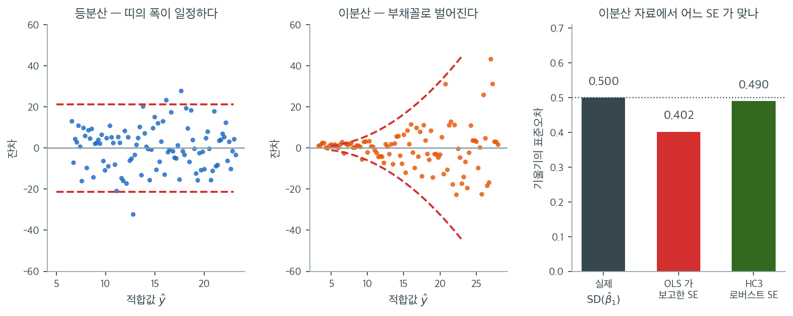
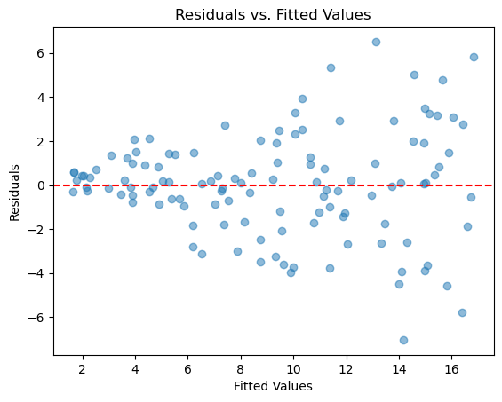
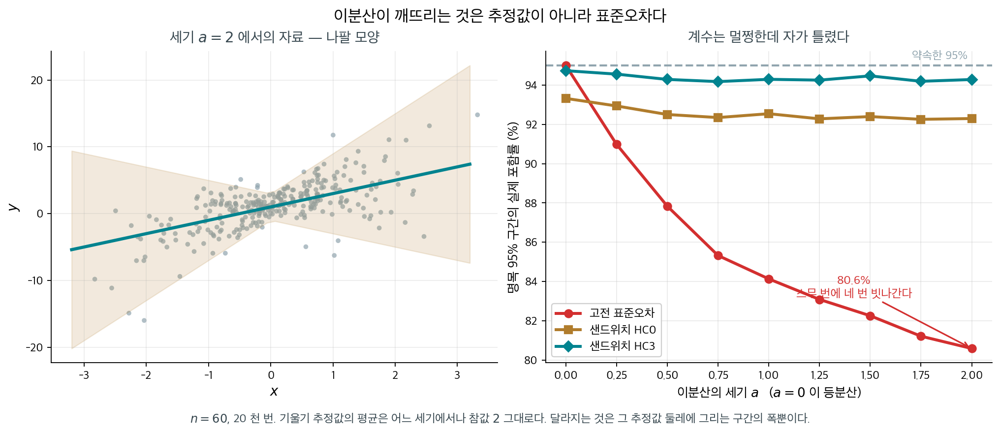
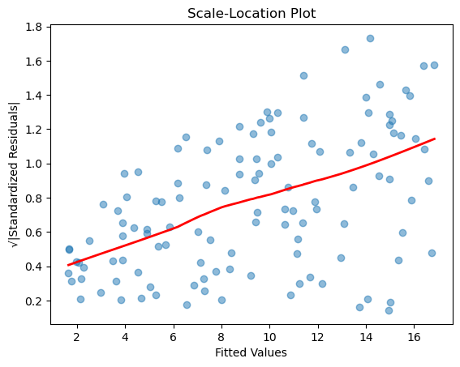

# 선형회귀의 등분산성 확인

선형회귀의 핵심 가정 가운데 하나인 등분산성은 잔차(오차)의 분산이 독립변수의 모든 수준에서 일정하다는 조건을 말한다. 이 가정이 위배되어 잔차의 분산이 일정하지 않으면(이분산) 추정이 비효율적이 되고 표준오차가 편향되며 가설검정을 믿을 수 없게 된다. 이 절은 선형회귀에서 등분산성을 확인하는 방법을 시각적 점검과 통계검정으로 나누어 살펴본다.

---

## 1. 등분산성의 이해

<div class="defn" markdown>

### 정의 1. 등분산성 { .dfn }
등분산성은 잔차의 흩어짐(분산)이 독립변수의 모든 수준에서 같다는 뜻이다. 다시 말해 독립변수의 값이 무엇이든 오차의 분포가 대체로 같아야 한다.

형식적으로

$$
\text{Var}(\epsilon_i \mid X_i) = \sigma^2 \quad \text{(모든 } i \text{에 대해)}
$$
반대 상황인 **이분산**은 오차의 분산이 독립변수의 수준에 따라 체계적으로 변할 때 나타난다.

$$
\text{Var}(\epsilon_i \mid X_i) = \sigma_i^2 \quad \text{(상수가 아님)}
$$

**왜 중요한가:**
등분산성이 위배되면

- **표준오차:** 계수의 표준오차가 편향되어 신뢰구간과 가설검정이 틀리게 된다.
- **모형의 효율성:** 최소제곱(OLS) 추정량은 여전히 불편이지만 더 이상 효율적이지 않으므로 더 정밀한 추정량이 존재할 수 있다. 구체적으로 Gauss-Markov 정리의 의미에서 OLS는 더 이상 최소분산 선형불편추정량(BLUE)이 아니다.

</div>

### 위배하면 무엇이 망가지는가

이분산이 추론을 어떻게 무너뜨리는지는 수로 보는 것이 빠르다. 위에 적은 두 결과에 하나를 더 보태면, t 통계량과 F 통계량이 지나치게 크거나 작아져 **오도하는 p값**을 낳는다.



왼쪽 두 칸이 진단의 출발점이다. 두 자료 모두 참 모형은 $y = 3 + 2x + \varepsilon$ 이고 $n = 100$, $x \in [1, 10]$ 으로 같다. 다른 것은 오차의 크기가 $x$ 에 어떻게 의존하느냐뿐이다. 왼쪽은 $\sigma$ 가 일정해 $\pm 2\sigma$ 띠(붉은 점선)가 수평으로 뻗고, 가운데는 $\sigma_i = 0.3 + 0.22x_i^2$ 로 커져 띠가 나팔처럼 벌어진다. 두 그림의 평균 분산은 같게 맞추었으므로 점의 총 퍼짐은 비슷하다. 달라진 것은 **퍼짐이 어디에 몰려 있는가**뿐인데, 그 차이만으로 추론이 무너진다.

오른쪽 막대가 그 무너짐을 잰 것이다. 이분산 자료로 4000번 회귀를 반복했다. 먼저 계수 자체는 멀쩡하다. $\hat{\beta}_1$ 의 평균이 $1.992$ 로 참값 $2$ 를 맞힌다. 그런데 $\hat{\beta}_1$ 이 실제로 흔들린 폭은 $0.500$ 인 반면, OLS 가 매번 출력표에 찍어 준 표준오차는 평균 $0.402$ 로 **약 20% 작다.** 등분산 자료로 같은 실험을 하면 실제 $0.403$, 보고된 $0.405$ 로 둘이 포개진다. 곧 OLS 의 표준오차 공식이 틀리는 것은 이분산일 때뿐이고, 여기서는 실제보다 작게 나와 계수를 **실제보다 유의해 보이게** 만든다.

세 번째 막대가 처방이다. HC3 로버스트 표준오차는 평균 $0.490$ 으로 실제 $0.500$ 에 거의 닿는다. 검정의 성능으로 옮겨 보면 차이가 더 분명하다. 참인 귀무가설 $\beta_1 = 2$ 를 유의수준 5%로 검정할 때 통상적인 OLS 표준오차를 쓰면 기각률이 $11.5\%$ 로 약속의 두 배가 넘지만, HC3 을 쓰면 $5.6\%$ 로 제자리를 찾는다. 계수 추정값은 세 경우 모두 똑같다는 점이 중요하다. **고치는 것은 추정값이 아니라 그 곁의 표준오차뿐이다.** 그래서 로버스트 표준오차는 해석을 바꾸지 않으면서 추론만 구해 내는, 가장 값싼 처방이 된다.

### 이분산의 흔한 패턴

| 패턴 | 설명 | 예 |
|---------|-------------|---------|
| 부채꼴 | 적합값이 커질수록 분산이 커진다 | 소득 대 지출 자료 |
| 역부채꼴 | 적합값이 커질수록 분산이 작아진다 | 집단 크기가 다른 집계 자료 |
| 나비넥타이 | 분산이 커졌다가 작아진다 | 자연스러운 상·하한이 있는 자료 |
| 집단별 | 집단마다 분산이 다르다 | 다집단 비교 |

---

## 2. 설정

이 페이지의 진단은 모두 아래 자료와 모형 하나를 놓고 수행한다.

<div class="exbox" markdown>

**보기 1.** <span class="diff easy" title="쉬움"></span> 진단에 쓸 모형 준비. 자료는 $x_i \sim U(0,10)$, $y_i = 2 + 1.5x_i + \varepsilon_i$, $\varepsilon_i \sim N(0, \sigma_i^2)$이며 $\sigma_i = 0.5 + 0.35x_i$다. 곧 **이분산이 설계로 들어 있는** 자료다. 잔차 벡터는 모자행렬 $H = X(X^\top X)^{-1}X^\top$로 $\mathbf e = (I - H)\boldsymbol\varepsilon$이다.

**(1)** 오차분산이 관측마다 $\sigma_i^2$일 때

$$
E[s^2] = \frac{1}{n-p}\sum_{i=1}^n (1 - h_{ii})\,\sigma_i^2
$$

임을 보이시오($h_{ii}$는 $H$의 대각 성분). 등분산이면 익숙한 $E[s^2] = \sigma^2$으로 돌아감을 확인하시오.

**(2)** (1)을 모의실험으로 확인하고, OLS와 가중최소제곱의 기울기 분산을 견주어 **OLS가 얼마를 잃는지** 재시오.

</div>

??? success "풀이"

    **(1) 해석적으로.** $\mathbf e = (I-H)\boldsymbol\varepsilon$에서 출발한다. $I - H$는 **대칭이고 멱등**이므로

    $$
    \mathbf e^\top \mathbf e = \boldsymbol\varepsilon^\top (I-H)^\top (I-H) \boldsymbol\varepsilon = \boldsymbol\varepsilon^\top (I-H) \boldsymbol\varepsilon
    $$

    이다. 이차형식의 기댓값은 $E[\boldsymbol\varepsilon^\top A \boldsymbol\varepsilon] = \operatorname{tr}(A\,\Sigma)$이며, 여기서 $\Sigma = \operatorname{Var}(\boldsymbol\varepsilon) = \operatorname{diag}(\sigma_1^2, \ldots, \sigma_n^2)$이다. 대각행렬과의 곱이므로 대각합은 대각 성분만 모으면 된다.

    $$
    E[\mathbf e^\top \mathbf e] = \operatorname{tr}\big((I-H)\Sigma\big) = \sum_{i=1}^n (1 - h_{ii})\,\sigma_i^2
    $$

    양변을 $n - p$로 나누면 구하는 식이다.

    등분산이면 모든 $\sigma_i^2 = \sigma^2$이므로 $\sigma^2$을 밖으로 빼면 $\sum_i (1-h_{ii}) = n - \operatorname{tr}(H)$가 남는다. **$H$가 멱등이라 대각합이 계수와 같아 $\operatorname{tr}(H) = p$이므로** ([A.3절 멱등행렬](../../ch00/linalg_regression/square_matrices/idempotent.md))

    $$
    E[s^2] = \frac{\sigma^2 (n-p)}{n-p} = \sigma^2
    $$

    이다. $n - p$로 나누는 이유가 여기서 나온다.

    **이분산이면 식이 달라진다는 것이 요점이다.** $E[s^2]$은 $\sigma_i^2$의 단순평균이 아니라 $1 - h_{ii}$로 가중한 평균이다. 그리고 OLS가 보고하는 $\widehat{\operatorname{Var}}(\hat\beta_1) = s^2/S_{xx}$는 이 하나의 수로 모든 $\sigma_i^2$을 대신하는데, 참 분산은 $\sum_i c_i^2 \sigma_i^2$($c_i = (x_i - \bar x)/S_{xx}$)이라 **둘이 같을 이유가 없다.**

    **(2) 수치적으로.** 먼저 모형을 적합한다.

    ```python
    import numpy as np
    import pandas as pd
    import statsmodels.api as sm

    rng = np.random.default_rng(7)
    n = 120

    # X는 균등, Y는 X에 선형으로 의존하되 오차의 분산이 X와 함께 커진다.
    # 이렇게 두면 선형성은 성립하고 등분산성만 깨져, 각 진단이 무엇을
    # 잡아내고 무엇을 놓치는지 구분해 볼 수 있다.
    X = rng.uniform(0, 10, n)
    Y = 2.0 + 1.5 * X + rng.normal(0, 0.5 + 0.35 * X, n)

    df = pd.DataFrame({"X": X, "Y": Y})
    model = sm.OLS(Y, sm.add_constant(X)).fit()
    residuals = model.resid
    fitted = model.fittedvalues

    print(f"beta_hat = {model.params.round(4)}")
    print(f"R^2 = {model.rsquared:.4f}")
    ```

    출력:

    ```
    beta_hat = [1.5933 1.5317]
    R^2 = 0.7813
    ```

    기울기 추정값 $1.5317$이 참값 $1.5$에 가깝다. 이분산이 있어도 OLS 추정값 자체는 불편이다. 이제 (1)의 식을 확인한다.

    ```python
    import numpy as np

    # 모자행렬의 대각 h_ii. 멱등성 때문에 합이 계수의 개수 p = 2 다.
    Xd = sm.add_constant(X)
    H = Xd @ np.linalg.inv(Xd.T @ Xd) @ Xd.T
    h = np.diag(H)
    print(f"sum h_ii = {h.sum():.6f}   (p = 2 여야 한다)")
    print(f"h_ii 범위 = [{h.min():.4f}, {h.max():.4f}],  평균 {h.mean():.4f} = p/n")

    # (1) 의 식. 이 자료는 sigma_i 를 우리가 안다.
    sigma = 0.5 + 0.35 * X
    Es2 = ((1 - h) * sigma ** 2).sum() / (n - 2)
    print(f"\nE[s^2] = sum (1-h_ii) sigma_i^2 / (n-2) = {Es2:.4f}")
    print(f"참고: sigma_i^2 의 단순평균            = {(sigma ** 2).mean():.4f}")
    print(f"이번 표본에서 실제로 나온 s^2         = {model.mse_resid:.4f}")

    # 같은 X 를 고정한 채 오차만 20000번 다시 뽑아 E[s^2] 을 직접 재 본다.
    sim = np.random.default_rng(99)
    E = sim.normal(0, 1, (20000, n)) * sigma
    R = E - E @ H.T
    print(f"모의실험이 준 E[s^2]                  = {(R ** 2).sum(axis=1).mean() / (n - 2):.4f}")

    # OLS 와 WLS 의 기울기 분산
    Sxx = ((X - X.mean()) ** 2).sum()
    c = (X - X.mean()) / Sxx
    w = 1 / sigma ** 2
    xbar_w = (w * X).sum() / w.sum()
    var_ols = (c ** 2 * sigma ** 2).sum()
    var_wls = 1 / (w * (X - xbar_w) ** 2).sum()
    print(f"\nSE(b1) OLS = {np.sqrt(var_ols):.6f}")
    print(f"SE(b1) WLS = {np.sqrt(var_wls):.6f}")
    print(f"OLS 의 분산이 WLS 의 {var_ols / var_wls:.3f} 배  (효율 {var_wls / var_ols:.1%})")
    ```

    출력:

    ```
    sum h_ii = 2.000000   (p = 2 여야 한다)
    h_ii 범위 = [0.0083, 0.0329],  평균 0.0167 = p/n

    E[s^2] = sum (1-h_ii) sigma_i^2 / (n-2) = 6.0853
    참고: sigma_i^2 의 단순평균            = 6.0916
    이번 표본에서 실제로 나온 s^2         = 5.5889
    모의실험이 준 E[s^2]                  = 6.0743

    SE(b1) OLS = 0.082525
    SE(b1) WLS = 0.056809
    OLS 의 분산이 WLS 의 2.110 배  (효율 47.4%)
    ```

    **유도한 식이 맞는다.** 공식이 준 $E[s^2] = 6.0853$을 모의실험이 $6.0743$으로 재현한다. 차이 $0.011$은 $20{,}000$회의 몬테카를로 오차 범위다. 대각합도 $\operatorname{tr}(H) = 2.000000$으로 정확히 $p$다.

    $h_{ii}$가 $0.0083$에서 $0.0329$ 사이, 평균이 $p/n = 0.0167$이라 $1 - h_{ii}$가 거의 1이다. 그래서 가중평균 $6.0853$이 단순평균 $6.0916$과 $0.1\%$밖에 차이 나지 않는다. **$n$이 크고 지렛대가 고르면 $1-h_{ii}$ 가중은 거의 무해하다.** 지렛대가 큰 점이 섞이면 사정이 달라지고, 그 이야기가 [13.6절 영향점](../diagnostics/influence.md)이다.

    **OLS가 잃는 것은 효율이다.** 가중치를 $w_i = 1/\sigma_i^2$로 올바로 준 WLS의 기울기 표준오차가 $0.0568$인데 OLS는 $0.0825$다. 분산으로는 $2.11$배이고, 효율로는 $47.4\%$다. **표본의 절반 이상을 버린 것과 같다.** 이것이 "OLS는 더 이상 BLUE가 아니다"라는 말의 크기이며, 이 페이지의 진단들은 모두 이 손실이 일어나고 있는지를 묻는 장치다. 다만 $\sigma_i$를 실제로 아는 일은 드물고, 잘못 추측한 가중치는 오히려 해롭다는 것이 [13.5절 가중회귀](weighted_regression.md)의 주제다.

---

## 3. 잔차-적합값 그림

이 쪽은 그림을 **등분산** 하나만 겨누어 읽는다. 같은 그림으로 **선형성**까지 읽는 법과
일반 잔차그림과의 구분은 13.6절 [잔차 분석](../diagnostics/residuals.md) §3 에 있다.

**잔차-적합값 그림**은 등분산성을 시각적으로 확인하는 가장 흔하고 효과적인 방법이다. 이 그림으로 잔차의 흩어짐에 체계적인 패턴이 있는지 볼 수 있다.

**절차:**

1. **선형회귀 모형 적합:** 모형을 적합하여 잔차와 적합값을 얻는다.
2. **그림 그리기:** $y$축에 잔차, $x$축에 적합값을 두고 그린다.
3. **그림 평가:** 잔차의 흩어짐에 패턴이 있는지 살핀다.

**예시:**

<div class="exbox" markdown>

**보기 2.** <span class="diff easy" title="쉬움"></span> 잔차 대 적합값 그림을 그리시오.

**(1)** 이 그림의 가로축 0 선과 "기울기 없음"이 **왜 자료의 성질이 아닌지** 밝히시오.

**(2)** 눈으로 본 깔때기를 수치로 바꾸어 적으시오.

</div>

??? success "풀이"

    **(1) 해석적으로.** 상수항이 있는 OLS의 정규방정식은 $X^\top \mathbf e = \mathbf 0$이다. 설계행렬의 두 열이 $\mathbf 1$과 $\mathbf x$이므로 이것은 두 등식

    $$
    \sum_i e_i = 0,
    \qquad
    \sum_i x_i e_i = 0
    $$

    을 뜻한다. 적합값 $\hat y_i = \hat\beta_0 + \hat\beta_1 x_i$는 이 두 열의 선형결합이므로 $\sum_i \hat y_i e_i = 0$도 따라오고, 첫째 등식과 합치면

    $$
    \operatorname{cov}(\mathbf e, \hat{\mathbf y}) = 0
    $$

    이다. **곧 잔차는 평균이 정확히 0이고 적합값과 상관이 정확히 0이다.** 그림에 그은 빨간 수평선 주위에 점이 모이는 것도, 전체적인 기울기가 없는 것도 자료가 좋아서가 아니라 **적합이 강제한 결과**다. 이 그림에서 읽을 것은 중심선도 기울기도 아니고 오직 **세로 폭이 가로축을 따라 어떻게 변하는가**뿐이다.

    **(2) 수치적으로.**

    ```python
    import matplotlib.pyplot as plt
    import numpy as np

    plt.rcParams["font.sans-serif"] = ["NanumGothic", "Apple SD Gothic Neo", "Malgun Gothic"]
    plt.rcParams["font.family"] = "sans-serif"
    plt.rcParams["axes.unicode_minus"] = False

    # 앞에서 적합한 model 을 그대로 쓴다.
    residuals = model.resid
    fitted = model.fittedvalues

    # 등분산성 진단의 기본 그림이다. 점들의 세로 폭이 왼쪽부터 오른쪽까지
    # 일정해야 한다. 깔때기처럼 벌어지면 분산이 적합값에 따라 커진다는 뜻이다.
    plt.scatter(fitted, residuals, alpha=0.5)
    plt.axhline(y=0, color='red', linestyle='--')
    plt.xlabel('Fitted Values')
    plt.ylabel('Residuals')
    plt.title('Residuals vs. Fitted Values')
    plt.show()

    # 눈으로 본 깔때기를 수치로 바꾼다. 적합값의 사분위로 잘라 잔차의 폭을 잰다.
    q = np.quantile(fitted, [0, 0.25, 0.5, 0.75, 1.0])
    print(f"{'구간':>6}{'n':>5}{'sd(e)':>9}{'평균 sigma_i':>14}")
    for k in range(4):
        sel = (fitted >= q[k]) & (fitted <= q[k + 1])
        print(f"{'Q' + str(k + 1):>6}{sel.sum():>5}{residuals[sel].std(ddof=1):>9.4f}"
              f"{(0.5 + 0.35 * X[sel]).mean():>14.4f}")

    # 세로축의 0 선은 자료가 아니라 적합이 만든 것이다.
    print(f"\n잔차의 합          = {residuals.sum():+.2e}")
    print(f"잔차와 적합값의 상관 = {np.corrcoef(residuals, fitted)[0, 1]:+.2e}")
    ```

    출력:

    ```
        구간    n    sd(e)    평균 sigma_i
        Q1   30   0.7828        0.9259
        Q2   30   1.6717        1.8428
        Q3   30   2.6705        2.6569
        Q4   30   3.4243        3.5777

    잔차의 합          = +4.23e-13
    잔차와 적합값의 상관 = +7.97e-16
    ```

    

    **(1)이 확인된다.** 잔차의 합이 $4 \times 10^{-13}$, 적합값과의 상관이 $8 \times 10^{-16}$으로 둘 다 부동소수점 찌꺼기만 남았다.

    **깔때기를 수로 적으면 이렇다.** 적합값의 사분위로 자르면 잔차의 표준편차가 $0.78 \to 1.67 \to 2.67 \to 3.42$로 단조증가하며, 가장 넓은 구간이 가장 좁은 구간의 **$4.4$배**다. 옆에 적은 참 $\sigma_i$의 구간별 평균 $0.93, 1.84, 2.66, 3.58$과 거의 나란하다. 보통은 $\sigma_i$를 알 수 없고 왼쪽 열만 손에 쥐게 되는데, **그 열만으로도 "폭이 네 배 넘게 벌어진다"는 진단은 충분히 선다.**

    그림이 **가리는 것**도 있다. 첫째, 세로 폭이 변한다는 사실만 보일 뿐 그것이 $x$의 함수인지 $y$의 함수인지는 구별되지 않는다. 단순회귀에서는 $\hat y$가 $x$의 증가함수($\hat\beta_1 = 1.53 > 0$)라 가로축을 $x$로 바꿔도 같은 그림이지만, 다중회귀에서는 둘이 전혀 다른 그림이 된다. 둘째, 폭의 변화가 **어느 쪽 꼬리에서 오는지**는 점이 겹쳐 읽기 어렵다. 그 둘을 각각 손보는 것이 보기 3의 Breusch-Pagan과 보기 5의 척도-위치 그림이다.

**해석:**

- **등분산성:** 잔차가 수평선(0) 주위에 일정한 폭으로 무작위로 흩어져 있으면 등분산성이 성립할 가능성이 높다.
- **이분산:** 잔차의 흩어짐이 적합값에 따라 커지거나 작아지면(예: 깔때기 모양) 이분산을 나타낸다.

---

## 4. Breusch-Pagan 검정

**Breusch-Pagan 검정**은 이분산을 탐지하는 형식적 통계검정이다. 잔차의 분산이 독립변수에 의존하는지를 평가한다.

**가설:**

- $H_0$: 등분산 — $\text{Var}(\epsilon_i) = \sigma^2$ (상수)
- $H_1$: 이분산 — $\text{Var}(\epsilon_i)$가 하나 이상의 독립변수에 의존한다

**절차:**

이 검정은 제곱잔차 $e_i^2$을 독립변수에 회귀시킨다.

$$
e_i^2 = \gamma_0 + \gamma_1 X_{1i} + \gamma_2 X_{2i} + \cdots + \gamma_p X_{pi} + u_i
$$

검정통계량은 이 보조회귀의 $nR^2$이며, $H_0$ 아래에서 $\chi^2_p$ 분포를 따른다.

**단계:**

1. **선형회귀 모형 적합:** 적합된 모형에서 잔차를 얻는다.
2. **Breusch-Pagan 검정 수행:** 잔차에 기초해 통계량을 계산한다.
3. **결과 해석:** p값이 유의하면(보통 < 0.05) 이분산을 시사한다.

**예시:**

<div class="exbox" markdown>

**보기 3.** <span class="diff easy" title="쉬움"></span> Breusch-Pagan 검정

**(1)** 설명변수가 하나뿐일 때 검정통계량이

$$
\mathrm{LM} = n\,\widehat{\operatorname{corr}}\big(e_i^2,\, x_i\big)^2
$$

으로 적힘을 보이시오.

**(2)** 검정을 돌리고 (1)의 식으로 재현한 뒤, $\chi^2_1$에서 p-값을 직접 계산해 보고값과 맞추시오.

</div>

??? success "풀이"

    **(1) 해석적으로.** Breusch-Pagan의 보조회귀는 제곱잔차를 설명변수에 회귀시키는 것이다.

    $$
    e_i^2 = \gamma_0 + \gamma_1 x_i + u_i
    $$

    검정통계량은 이 보조회귀의 $\mathrm{LM} = n R_{\text{aux}}^2$이다. 그런데 **상수항이 있는 단순회귀에서 $R^2$은 두 변수의 표본상관의 제곱**이다. 반응이 $e_i^2$, 설명변수가 $x_i$이므로

    $$
    R_{\text{aux}}^2 = \widehat{\operatorname{corr}}\big(e_i^2,\, x_i\big)^2
    $$

    이고 따라서 $\mathrm{LM} = n\,\widehat{\operatorname{corr}}(e_i^2, x_i)^2$이다. **검정이 묻는 것은 결국 "잔차의 크기가 $x$와 함께 움직이는가" 하나뿐**이며, 그 움직임을 상관계수 하나로 요약한 것이다.

    여기서 검정의 한계도 보인다. 상관은 **직선 관계**만 잡는다. $\sigma_i^2$이 $x$에 대해 U자로 움직이면 — 가운데서 작고 양끝에서 크면 — $e_i^2$과 $x$의 상관이 0에 가까워 Breusch-Pagan이 아무것도 보지 못한다. 보기 4의 White 검정이 $x^2$을 넣는 이유가 이것이다.

    자유도는 보조회귀의 설명변수 개수, 곧 $p_{\text{aux}} = 1$이므로 $\mathrm{LM} \sim \chi^2_1$이다.

    **(2) 수치적으로.**

    ```python
    from statsmodels.stats.diagnostic import het_breuschpagan

    # Breusch-Pagan 검정: 잔차의 제곱을 설명변수에 회귀해, 설명되는 몫이
    # 있는지를 본다. p-값이 작으면 등분산을 기각한다.
    # 분산이 설명변수의 선형함수로 커지는 경우를 잘 잡아낸다.
    bp_test = het_breuschpagan(model.resid, model.model.exog)
    labels = ['LM Statistic', 'LM p-value', 'F-Statistic', 'F p-value']
    for label, value in zip(labels, bp_test):
        print(f'{label}: {value:.4f}')
    ```

    출력:

    ```
    LM Statistic: 25.4256
    LM p-value: 0.0000
    F-Statistic: 31.7235
    F p-value: 0.0000
    ```

    `:.4f` 로 찍으면 p-값이 그냥 $0.0000$이 된다. 보조회귀를 직접 만들어 (1)의 식과 맞추고 p-값도 제대로 적어 본다.

    ```python
    import numpy as np
    import statsmodels.api as sm
    from scipy.stats import chi2

    e = model.resid
    Xd = model.model.exog

    # 보조회귀: e^2 을 상수와 X 에 회귀시킨다.
    aux = sm.OLS(e ** 2, Xd).fit()
    print(f"보조회귀 R^2      = {aux.rsquared:.10f}")
    print(f"단순회귀이므로 corr(e^2, X)^2 = {np.corrcoef(e ** 2, Xd[:, 1])[0, 1] ** 2:.10f}")
    print(f"LM = n R^2        = {len(e) * aux.rsquared:.10f}")
    print(f"statsmodels 의 LM = {het_breuschpagan(e, Xd)[0]:.10f}")
    print(f"\np = chi2(1).sf(LM) = {chi2.sf(len(e) * aux.rsquared, 1):.4e}")
    print(f"보조회귀의 F       = {aux.fvalue:.4f},  p = {aux.f_pvalue:.4e}")
    ```

    출력:

    ```
    보조회귀 R^2      = 0.2118803813
    단순회귀이므로 corr(e^2, X)^2 = 0.2118803813
    LM = n R^2        = 25.4256457519
    statsmodels 의 LM = 25.4256457519

    p = chi2(1).sf(LM) = 4.5977e-07
    보조회귀의 F       = 31.7235,  p = 1.2258e-07
    ```

    **(1)의 식이 소수점 열째 자리까지 맞는다.** 보조회귀의 $R^2$과 $\widehat{\operatorname{corr}}(e^2, x)^2$이 같은 $0.2118803813$이고, $120 \times 0.21188 = 25.4256$이 `statsmodels`의 LM과 일치한다.

    **p-값은 $4.6 \times 10^{-7}$이다.** $0.0000$이라고 적는 것보다 이렇게 적는 쪽이 낫다. 오차의 표준편차를 $0.5 + 0.35x$로 만들어 넣었으니 기각이 옳은 판정이며, $\mathrm{LM} = 25.43$은 $\chi^2_1$의 기준으로 매우 큰 값이다.

    LM과 F 가운데 어느 것을 쓸까. 둘은 같은 보조회귀의 두 요약이며, $\mathrm{LM}$은 점근 $\chi^2$에 기대고 F는 $u_i$의 정규성을 빌려 유한표본 분포를 쓴다. 제곱잔차 $e_i^2$은 정규와 거리가 멀므로 F의 근거도 정확하지는 않다. 여기서는 $p = 1.2 \times 10^{-7}$과 $4.6 \times 10^{-7}$으로 둘 다 압도적이라 선택이 결론을 바꾸지 않는다. **경계 근처에서 둘이 갈리면 그것 자체가 "표본이 작아 어느 쪽도 믿기 어렵다"는 신호로 읽어야 한다.**

**해석:**

- **p값 > 0.05:** 이분산의 유의한 증거가 없다.
- **p값 < 0.05:** 이분산의 유의한 증거가 있으며 등분산성 가정의 위배를 나타낸다.

---

## 5. White 검정

**White 검정**은 이분산뿐 아니라 비선형성을 포함한 더 일반적인 형태의 모형 오설정까지 확인하는 통계검정이다.

**Breusch-Pagan과의 핵심 차이:**

White 검정은 보조회귀에 원래의 독립변수뿐 아니라 그 **제곱항**과 **교차곱항**도 포함한다.

$$
e_i^2 = \gamma_0 + \gamma_1 X_{1i} + \gamma_2 X_{2i} + \gamma_3 X_{1i}^2 + \gamma_4 X_{2i}^2 + \gamma_5 X_{1i} X_{2i} + u_i
$$

이 때문에 더 일반적이지만 자유도를 더 많이 쓴다.

**단계:**

1. **선형회귀 모형 적합:** 적합된 모형에서 잔차를 얻는다.
2. **White 검정 수행:** 제곱잔차를 독립변수와 그 제곱항, 교차곱항에 회귀시킨다.
3. **결과 해석:** p값이 유의하면 이분산이나 다른 형태의 오설정을 나타낸다.

**예시:**

<div class="exbox" markdown>

**보기 4.** <span class="diff easy" title="쉬움"></span> White 검정. 설명변수가 $x$ 하나뿐이므로 White의 보조회귀는 상수와 $x$에 $x^2$만 더한 것이 된다(교차항을 만들 상대가 없다).

**(1)** White의 보조회귀는 Breusch-Pagan의 보조회귀를 **포함**한다. 그러므로 $R^2_{\text{White}} \ge R^2_{\text{BP}}$이고 $\mathrm{LM}_{\text{White}} \ge \mathrm{LM}_{\text{BP}}$임을 설명하시오. 그런데도 White의 p-값이 더 클 수 있는 까닭은 무엇인가.

**(2)** 두 검정을 나란히 돌려 (1)을 수치로 확인하시오.

</div>

??? success "풀이"

    **(1) 해석적으로.** Breusch-Pagan의 보조회귀는 $e_i^2$을 $\{1, x_i\}$에 회귀시키고, White의 것은 $\{1, x_i, x_i^2\}$에 회귀시킨다. 뒤의 열공간이 앞의 것을 **포함**하므로, 최소제곱이 더 넓은 공간에서 더 가까운 점을 찾는다. 잔차제곱합은 줄 수밖에 없고 총제곱합은 그대로이므로

    $$
    R^2_{\text{White}} \ge R^2_{\text{BP}}
    \quad\Longrightarrow\quad
    \mathrm{LM}_{\text{White}} = nR^2_{\text{White}} \ \ge\ nR^2_{\text{BP}} = \mathrm{LM}_{\text{BP}}
    $$

    이다. **통계량은 항상 커진다.** 변수를 넣어서 $R^2$이 줄어드는 일은 없기 때문이다.

    그런데 **기준도 함께 커진다.** 자유도가 $1$에서 $2$로 늘어 $\chi^2_2$로 재게 되고, $\chi^2_2$는 $\chi^2_1$보다 오른쪽으로 밀린 분포다. 그러므로 통계량이 늘어난 양이 자유도 한 칸의 값어치에 못 미치면 **p-값이 오히려 커진다.** 이것이 "항이 많아지는 만큼 검정력이 흩어진다"는 말의 정확한 내용이다.

    참 분산이 $x$의 **단조**함수인 자료에서는 $x^2$ 항이 보탤 것이 거의 없으므로 이 손해만 남는다. 반대로 $\sigma_i^2$이 U자꼴이면 $x^2$이 결정적이 되어 White만 잡아낸다. **어느 검정이 좋은가는 이분산의 모양에 달려 있고, 그것을 모르는 것이 애초의 문제다.**

    **(2) 수치적으로.**

    ```python
    from statsmodels.stats.diagnostic import het_white

    # White 검정: 설명변수의 제곱과 교차항까지 넣어 회귀한다. 그래서 선형이
    # 아닌 형태의 이분산도 잡지만, 항이 많아지는 만큼 검정력이 흩어진다.
    white_test = het_white(model.resid, model.model.exog)
    labels = ['LM Statistic', 'LM p-value', 'F-Statistic', 'F p-value']
    for label, value in zip(labels, white_test):
        print(f'{label}: {value:.4f}')
    ```

    출력:

    ```
    LM Statistic: 26.2253
    LM p-value: 0.0000
    F-Statistic: 16.3603
    F p-value: 0.0000
    ```

    보조회귀를 직접 만들어 확인하고 두 검정을 나란히 둔다.

    ```python
    import numpy as np
    import statsmodels.api as sm
    from scipy.stats import chi2
    from statsmodels.stats.diagnostic import het_breuschpagan

    e = model.resid
    Xd = model.model.exog

    # White 의 보조회귀는 상수, X, X^2 이다. 설명변수가 하나뿐이라 교차항은 없다.
    Z = np.column_stack([np.ones(len(e)), Xd[:, 1], Xd[:, 1] ** 2])
    auxw = sm.OLS(e ** 2, Z).fit()
    print(f"White 보조회귀 R^2 = {auxw.rsquared:.10f}")
    print(f"LM = n R^2         = {len(e) * auxw.rsquared:.10f}")
    print(f"statsmodels 의 LM  = {het_white(e, Xd)[0]:.10f}")

    bp = het_breuschpagan(e, Xd)[0]
    wh = het_white(e, Xd)[0]
    print(f"\n{'검정':>14}{'LM':>10}{'df':>5}{'p':>13}")
    print(f"{'Breusch-Pagan':>14}{bp:>10.4f}{1:>5}{chi2.sf(bp, 1):>13.3e}")
    print(f"{'White':>14}{wh:>10.4f}{2:>5}{chi2.sf(wh, 2):>13.3e}")
    print(f"\nLM 은 {wh - bp:.4f} 커졌지만 p-값은 {chi2.sf(wh, 2) / chi2.sf(bp, 1):.1f} 배 커졌다")
    ```

    출력:

    ```
    White 보조회귀 R^2 = 0.2185443843
    LM = n R^2         = 26.2253261126
    statsmodels 의 LM  = 26.2253261126

                검정        LM   df            p
     Breusch-Pagan   25.4256    1    4.598e-07
             White   26.2253    2    2.019e-06

    LM 은 0.7997 커졌지만 p-값은 4.4 배 커졌다
    ```

    **(1)의 두 주장이 모두 확인된다.** $R^2$이 $0.21188 \to 0.21854$로 커져 $\mathrm{LM}$이 $25.4256 \to 26.2253$으로 올라갔지만, 자유도가 한 칸 늘어 p-값은 $4.6 \times 10^{-7} \to 2.0 \times 10^{-6}$으로 **$4.4$배 커졌다.** $x^2$ 항이 설명한 추가분이 $R^2$으로 $0.0067$, $\mathrm{LM}$으로 $0.80$인데, $\chi^2$에서 자유도 한 칸은 평균 $1$만큼의 값어치가 있으므로 수지가 맞지 않는다.

    이 자료는 $\sigma_i = 0.5 + 0.35x_i$로 **$x$의 1차함수**라 Breusch-Pagan이 정확히 겨냥한 모양이다. 그러니 White가 손해를 보는 것이 당연하고, 두 검정의 비교로 읽을 일이 아니다. **읽을 것은 둘 다 압도적으로 기각한다는 사실뿐이며**, 이분산의 형태를 모르는 실제 상황에서는 두 검정을 함께 돌려 보는 편이 안전하다.

**해석:**

- **p값 > 0.05:** 이분산이나 다른 오설정의 유의한 증거가 없다.
- **p값 < 0.05:** 이분산이나 다른 모형 문제의 유의한 증거가 있다.

---

<div class="storybox" markdown>

**그림으로 보는 통계학 1.** 검정은 안 쓰이고 표준오차만 남았다

§5 가 다룬 화이트 검정은 $1980$ 년 『에코노메트리카』에 실린 논문에서 왔다. 그런데 그
논문의 제목이 길다 — 「**이분산에 일관된 공분산행렬 추정량**과 이분산에 대한 직접
검정」. 검정은 **뒤에 붙은 쪽**이고, 앞에 놓인 것이 따로 있다.

그 앞쪽이 오늘 경제학 논문의 표 아래마다 적혀 있는 한 줄 — **로버스트 표준오차**다.

먼저 무엇이 깨지는지 분명히 해 두어야 한다. 이분산은 OLS 의 계수를 **치우치게 하지
않는다.** 깨지는 것은 그 계수의 표준오차이고, 표준오차가 틀리면 신뢰구간도 $p$ 값도
통째로 틀린다.

<figure markdown>
  { width=980 }
  <figcaption markdown>$n = 60$ 에서 $2$ 만 번 재었다. **기울기 추정값의 평균은 어느 세기에서나 참값 $2$ 그대로다** — 깨진 것은 자이지 눈금이 아니다. 자료에서 직접 그렸다.</figcaption>
</figure>

오른쪽이 이 상자의 요점이다. 이분산이 세지면 고전 표준오차로 그린 명목 $95\%$ 구간이
실제로는 **$80.6\%$** 만 담는다. 스무 번에 한 번 틀리겠다고 적어 놓고 네 번 틀린다.

화이트가 한 일은 「분산이 모두 같다」는 자리에 **자료가 말하게 두는 것**이었다.

$$
\widehat{\operatorname{Var}}(\hat{\boldsymbol\beta})
= (X^\top X)^{-1}\Bigl(\textstyle\sum_i e_i^2\, \mathbf x_i \mathbf x_i^\top\Bigr)(X^\top X)^{-1}
$$

가운데를 빵 사이의 속처럼 끼운 꼴이라 **샌드위치 추정량**이라 부른다. 고전 공식은 가운데를
$\hat\sigma^2 X^\top X$ 로 놓은 특별한 경우이고, 샌드위치는 관측값마다 제 잔차의
크기를 쓴다. **이분산의 모양을 알 필요가 없다는 것**이 값어치다 — 모형을 세우지 않고
고치는 것이다.

표에서 읽을 것이 하나 더 있다. **등분산일 때 치르는 값이 거의 없다.** $a=0$ 에서 고전이
$95.0\%$ 인데 HC3 이 $94.7\%$ 다. 반면 HC0 은 $93.3\%$ 로 조금 모자라는데, 작은 표본에서
잔차가 참 오차보다 작게 나오는 것을 보정하지 않기 때문이다. 그래서 실무가 권하는 것이
레버리지로 나누어 그 몫을 되돌리는 **HC3** 이다.

그래서 §7 의 검정 표를 읽는 법이 조금 달라진다. 화이트 자신이 검정과 표준오차를 한 논문에
같이 실었는데, **쓰이는 쪽은 뒤엣것이 아니라 앞엣것**이 되었다. 요즘 경제학의 기본값은
「이분산을 검정하고 통과하면 고전 표준오차」가 아니라 **「묻지 말고 처음부터 로버스트」**다.
[5.10절 두 표본분산의 비](../../ch05/applications/var_ratio.md)에서 분산비 검정을 앞세우지 말라고 한 것과 같은 논리다 — 예비 검정이 통과시켜 준
자리에서도 이미 포함률이 깎여 있다.

_확인한 곳 — H. White, 「A Heteroskedasticity-Consistent Covariance Matrix Estimator and a Direct Test for Heteroskedasticity」, 『Econometrica』 $48$권 $4$호($1980$). 한 논문에 샌드위치 추정량과 검정이 함께 실려 있고 앞엣것이 훨씬 널리 쓰이게 되었다는 것, 그 꼴이 후버($1967$)의 것과 이어진다는 것은 계량경제학에서 널리 다루어지는 바다 · 그림의 포함률은 $n=60$ · $2$ 만 번으로 이 쪽이 직접 쟀다_

</div>

## 6. 척도-위치 그림

**척도-위치 그림**(산포-위치 그림)은 이분산을 탐지하는 또 하나의 유용한 시각화이다. 표준화 잔차의 절댓값의 제곱근을 적합값에 대해 그린다.

**왜 제곱근인가?** 표준화 잔차의 절댓값에 제곱근을 취하면 분포의 치우침이 줄어들어 분산의 추세를 눈으로 잡아내기 쉬워진다. 표준화는 평균의 효과를 제거하여 분산 패턴만 분리해 준다.

**절차:**

1. **선형회귀 모형 적합:** 표준화 잔차와 적합값을 얻는다.
2. **그림 그리기:** $y$축에 표준화 잔차 절댓값의 제곱근, $x$축에 적합값을 두고 그린다.
3. **그림 평가:** 잔차의 흩어짐에 패턴이 있는지 살핀다.

**예시:**

<div class="exbox" markdown>

**보기 5.** <span class="diff easy" title="쉬움"></span> 척도-위치 그림

**(1)** 세로축이 $|r_i|$도 $r_i^2$도 아니고 $\sqrt{|r_i|}$인 까닭을 말하고, 표준정규 $Z$에 대해 세 변환의 왜도를 재어 확인하시오.

**(2)** 그림을 그리고, 평활선이 올라간 **크기**를 $\sigma$의 비로 번역해 참값과 맞추시오.

</div>

??? success "풀이"

    **(1) 왜 제곱근인가.** 등분산 아래에서 $r_i$는 대략 표준정규이므로 $|r_i|$는 **반정규**가 되는데, 이 분포는 0에서 잘려 오른쪽으로 치우쳐 있다. 치우친 세로축에 평활선을 얹으면 몇몇 큰 값이 선을 끌어올려 추세를 왜곡한다. $r_i^2$은 사정이 더 나쁘다. $\chi^2_1$이라 치우침이 훨씬 심하다.

    $\sqrt{|r_i|}$를 쓰는 것은 그 치우침을 거의 없애기 위한 변환이며, 추세를 읽기 좋은 쪽으로 바꾸는 것 말고 다른 뜻은 없다. 세로축이 무슨 양을 재는지는 간단하다. $e_i$의 표준편차가 $\sigma_i$면

    $$
    E\big[\sqrt{|r_i|}\big] = E\big[\sqrt{|Z|}\big] \cdot \sqrt{\sigma_i / s}
    $$

    이므로 **세로축은 $\sqrt{\sigma_i}$에 비례한다.** 평활선의 두 값의 비를 제곱하면 그 자리의 $\sigma$의 비가 된다는 뜻이고, (2)에서 그것을 쓴다.

    **(2) 수치적으로.**

    ```python
    import numpy as np
    import matplotlib.pyplot as plt

    plt.rcParams["font.sans-serif"] = ["NanumGothic", "Apple SD Gothic Neo", "Malgun Gothic"]
    plt.rcParams["font.family"] = "sans-serif"
    plt.rcParams["axes.unicode_minus"] = False

    residuals = model.resid
    fitted = model.fittedvalues

    # 척도-위치 그림은 부호를 없애고 크기만 본다. 제곱근을 씌워 큰 값이
    # 그림을 독차지하지 않게 한다.
    standardized_residuals = (residuals - np.mean(residuals)) / np.std(residuals)

    plt.scatter(fitted, np.sqrt(np.abs(standardized_residuals)), alpha=0.5)
    plt.xlabel('Fitted Values')
    plt.ylabel('√|Standardized Residuals|')
    plt.title('Scale-Location Plot')

    # 눈으로만 판단하기 어려우므로 평활선을 얹는다. 이 선이 평평하면
    # 등분산이고, 올라가거나 내려가면 분산이 적합값에 따라 달라진다는 뜻이다.
    from statsmodels.nonparametric.smoothers_lowess import lowess
    smooth = lowess(np.sqrt(np.abs(standardized_residuals)), fitted, frac=0.6)
    plt.plot(smooth[:, 0], smooth[:, 1], color='red', linewidth=2)
    plt.show()

    # (1) 제곱근이 왜 필요한가. 표준정규 Z 로 세 변환의 왜도를 잰다.
    z = np.random.default_rng(0).normal(size=2_000_000)
    from scipy.stats import skew
    print(f"왜도:  |Z| = {skew(np.abs(z)):.4f},  "
          f"sqrt|Z| = {skew(np.sqrt(np.abs(z))):.4f},  Z^2 = {skew(z ** 2):.4f}")

    # (2) 평활선이 얼마나 올라갔는가. 세로축이 sqrt 척도이므로 제곱하면 sd 비가 된다.
    y0, y1 = smooth[0, 1], smooth[-1, 1]
    print(f"\n평활선 왼쪽 끝 {y0:.4f}  →  오른쪽 끝 {y1:.4f}")
    print(f"비 {y1 / y0:.4f},  제곱하면 {(y1 / y0) ** 2:.4f}  (sd 의 비로 읽는다)")

    b0, b1 = model.params
    x0, x1 = (smooth[0, 0] - b0) / b1, (smooth[-1, 0] - b0) / b1
    print(f"같은 자리의 참 sigma = {0.5 + 0.35 * x0:.4f}, {0.5 + 0.35 * x1:.4f}  "
          f"→ 비 {(0.5 + 0.35 * x1) / (0.5 + 0.35 * x0):.4f}")

    # 간단 표준화와 내부 스튜던트화 잔차의 차이
    ri = model.get_influence().resid_studentized_internal
    print(f"\n두 표준화의 최대 차이 = {np.abs(standardized_residuals - ri).max():.4f}")
    ```

    출력:

    ```
    왜도:  |Z| = 0.9971,  sqrt|Z| = 0.0852,  Z^2 = 2.8321

    평활선 왼쪽 끝 0.4066  →  오른쪽 끝 1.1431
    비 2.8111,  제곱하면 7.9021  (sd 의 비로 읽는다)
    같은 자리의 참 sigma = 0.5131, 3.9843  → 비 7.7655

    두 표준화의 최대 차이 = 0.0206
    ```

    

    **제곱근의 효과가 수로 보인다.** 왜도가 $|Z|$에서 $0.997$, $Z^2$에서 $2.832$인데 $\sqrt{|Z|}$에서는 $0.085$로 **거의 대칭**이 된다. 세 변환 가운데 제곱근만이 평활선을 믿을 만하게 만든다.

    **평활선이 $0.4066$에서 $1.1431$로 올라간다.** 비는 $2.81$이고, (1)에서 본 대로 세로축이 $\sqrt{\sigma}$ 척도이므로 제곱한 $7.90$이 $\sigma$의 비다. 같은 자리의 참값이 $0.513$과 $3.984$로 비가 $7.77$이니 **$1.7\%$ 안에서 맞는다.** 남은 차이는 lowess가 끝점에서 가지는 편향과 $n = 120$의 표집 변동이다.

    보기 2의 사분위 표가 $\sigma$의 비를 $4.4$로, 여기서는 $7.9$로 읽은 것이 어긋나 보이지만 둘은 다른 양을 잰 것이다. 사분위 표는 **구간 안의 평균 $\sigma$**를 비교하고(가장 왼쪽 구간의 평균이 이미 $0.93$이다), 평활선은 **양 끝점**을 비교한다. 참값으로 같은 두 양을 재면 $3.578/0.926 = 3.9$와 $7.77$이므로 각각 제 짝에 가깝다. **"몇 배"를 말할 때 어느 지점끼리의 비인지 밝히지 않으면 두 배 가까이 달라진다.**

    마지막으로 표준화 방식. 간단한 $e_i/\hat{\operatorname{sd}}(e)$와 엄밀한 $e_i/(s\sqrt{1-h_{ii}})$의 차이가 이 자료에서 최대 $0.0206$뿐이다. 보기 1에서 본 대로 $h_{ii}$가 $0.0083$–$0.0329$로 작아 $\sqrt{1-h_{ii}}$가 1에 붙어 있기 때문이다. **지렛대가 큰 점이 있으면 이 차이가 커지며**, 그때는 아래 상자의 권고를 따라야 한다.

!!! note "내부 스튜던트화 잔차"
    위 코드는 잔차를 그 표본표준편차로 나누는 간단한 표준화를 쓴다. 엄밀한 표준화는 지렛대를 반영한 $e_i / (s\sqrt{1 - h_{ii}})$이며 `model.get_influence().resid_studentized_internal`로 얻을 수 있다. 지렛대가 큰 관측값이 있으면 두 방식의 차이가 커진다.

**해석:**

- **등분산성:** 점들이 수평선 주위에 뚜렷한 패턴 없이 무작위로 흩어져야 한다. 평활선이 대체로 평평해야 한다.
- **이분산:** 상승 추세나 깔때기 모양 같은 패턴은 분산이 일정하지 않음을, 곧 이분산을 시사한다.

---

## 7. 등분산성 검정의 비교

| 검정 | 유형 | 탐지 대상 | 장점 | 단점 |
|------|------|----------------|------|------|
| 잔차-적합값 | 시각적 | 모든 분산 패턴 | 직관적, 유연함 | 주관적 |
| 척도-위치 | 시각적 | 분산의 추세 | 추세가 뚜렷이 보임 | 주관적 |
| Breusch-Pagan | 형식적 | 선형 이분산 | 간단하고 검정력이 좋음 | 선형 형태를 가정 |
| White | 형식적 | 일반적 이분산 + 비선형성 | 매우 일반적 | 자유도를 많이 씀 |

선형회귀 분석에서 등분산성을 확인하는 일은 모형 추정의 타당성과 효율성을 확보하는 데 필수적이다. 이분산이 탐지되었을 때 무엇을 할 수 있는지는 8절에 모아 적는다.

---

## 8. 이분산에 대한 대책

- **변수변환:** 종속변수에 로그나 제곱근 변환을 적용하면 잔차의 분산을 안정화할 수 있다.
- **가중최소제곱(WLS):** WLS는 관측값마다 다른 가중치를 부여하여 이분산에 대처하며, 분산이 큰 관측값에 더 작은 가중치를 준다.
- **로버스트 표준오차:** 이분산 일치(HC) 표준오차(White의 로버스트 표준오차)는 모형을 변환하지 않고도 타당한 추론을 제공한다.

셋 가운데 **가장 간편하고 안전한 것은 로버스트 표준오차다.** 분산 구조를 몰라도 되고 계수 해석이 바뀌지 않는다. 가중최소제곱은 분산 구조를 알 때 가장 효율적이며, 그 셈은 [가중최소제곱](weighted_regression.md)에서 따로 다룬다.

---

## 연습문제

<div class="drillbox" markdown>

**연습문제 1.** <span class="diff easy" title="쉬움"></span>
1절 그림의 수 읽기

1절의 모의실험에서 $\hat\beta_1$ 의 실제 표준편차는 $0.500$, OLS 가 보고한 표준오차는
평균 $0.402$, HC3 은 $0.490$ 이었다. 기각률은 각각 $11.5\%$ 와 $5.6\%$ 였다.

**(a)** OLS 표준오차가 실제보다 몇 퍼센트 작은가?

**(b)** 표준오차가 그만큼 작으면 기각률이 대략 얼마가 되는지 정규근사로 어림하라.

**(c)** 계수 추정값 자체는 세 경우에 모두 같다. 이 사실이 뜻하는 바를 한 줄로 적어라.

</div>

??? success "풀이"

    **(a)** $0.402/0.500 = 0.804$ 이므로 **약 $20\%$ 작다.**

    **(b)** 보고된 표준오차가 실제의 $0.804$ 배이면, $t$ 통계량이 $1/0.804 = 1.244$ 배로
    부풀어 보인다. 참 귀무가설 아래에서 실제 통계량이 $N(0,1)$ 이라면 기각률은

    $$
    2\,\Phi(-1.96 \times 0.804) = 2\,\Phi(-1.576) = 0.115
    $$

    로 **$11.5\%$** 다. 본문의 모의값과 정확히 맞는다.

    **(c)** **이분산은 추정값을 망치지 않고 그 곁의 표준오차만 망친다.** 그래서 처방도
    추정값을 건드리지 않는 쪽(로버스트 표준오차)이 가장 값싸다. $\square$

<div class="drillbox" markdown>

**연습문제 2.** <span class="diff easy" title="쉬움"></span>
이분산이 건드리는 것과 건드리지 않는 것

다음 각 항목이 이분산 아래에서 **유지되는지** 판정하고 한 줄씩 근거를 적어라.

**(a)** $\hat\beta$ 의 불편성

**(b)** $\hat\beta$ 의 일치성

**(c)** 가우스–마르코프 정리의 "최소분산"

**(d)** 통상적인 $t$ 검정의 유의수준

**(e)** $R^2$ 의 계산

</div>

??? success "풀이"

    | 항목 | 유지되는가 | 근거 |
    |---|---|---|
    | (a) 불편성 | **유지** | $E[\hat\beta] = \beta$ 의 증명은 $E[\varepsilon \mid X] = 0$ 만 쓴다 |
    | (b) 일치성 | **유지** | 같은 이유. 분산이 유한하기만 하면 된다 |
    | (c) 최소분산 | **깨짐** | 가중치를 바꾼 WLS 가 더 작은 분산을 갖는다 |
    | (d) 유의수준 | **깨짐** | 표준오차 공식이 틀려 $t$ 의 분포가 어긋난다 |
    | (e) $R^2$ | **계산은 그대로** | 잔차제곱합의 비일 뿐이라 정의가 바뀌지 않는다 |

    (e)에 단서가 붙는다. $R^2$ **값**은 계산되지만 그 해석("설명된 분산의 비율")은 등분산을
    전제로 한 이야기라 뜻이 흐려진다. 어떤 구간의 관측값이 훨씬 큰 분산을 가지면 $R^2$ 가
    그 구간에 의해 좌우된다. $\square$

<div class="drillbox" markdown>

**연습문제 3.** <span class="diff easy" title="쉬움"></span>
잔차그림의 모양 읽기

1절의 네 패턴(부채꼴, 역부채꼴, 나비넥타이, 집단별)을 쓴다. 다음 상황에서 어느 패턴이
나타날지 고르고 까닭을 적어라.

**(a)** 가구 소득으로 연간 지출을 예측한다.

**(b)** 시·군별 평균 시험점수를 인구로 예측한다(작은 군은 표본이 적다).

**(c)** 백분율(0–100)로 측정한 반응을 예측한다.

**(d)** 세 공장의 제품 무게를 공장 더미로 예측한다.

</div>

??? success "풀이"

    **(a) 부채꼴.** 소득이 높을수록 지출의 자유도가 커져 분산이 커진다. 소득이 낮으면 지출이
    필수 항목에 묶여 흩어질 여지가 작다.

    **(b) 역부채꼴.** 집계된 평균의 분산은 $\sigma^2/n_i$ 이므로 **인구가 큰 쪽에서 분산이
    작다.** 적합값이 커질수록(인구가 클수록) 퍼짐이 줄어든다. 집계자료에서 거의 언제나
    나타나는 구조이고, 가중치 $n_i$ 를 준 WLS 가 정석 처방이다.

    **(c) 나비넥타이.** 반응이 $0$ 과 $100$ 에 갇혀 있으므로 양 끝에서는 흩어질 공간이 없고
    가운데에서 가장 크다. 이항비율의 분산 $p(1-p)/n$ 이 $p = 0.5$ 에서 최대인 것과 같은
    이유다. 로짓 변환이 자연스러운 처방이다.

    **(d) 집단별.** 설명변수가 범주형이므로 적합값이 세 개뿐이고, 각 적합값 위에 세로로 쌓인
    점들의 퍼짐이 공장마다 다르다. 이 경우는 Levene 검정 같은 집단 기반 검정이 더 알맞다.
    $\square$

<div class="drillbox" markdown>

**연습문제 4.** <span class="diff med" title="중간"></span>
잔차-적합값 그림에서 잔차가 오른쪽으로 갈수록 넓어지는 뚜렷한 깔때기 모양을 이룬다. 이 시각적 진단을 확인할 형식적 통계검정의 이름과 그 귀무가설을 말하라.

</div>

??? success "풀이"
    **Breusch-Pagan 검정**이 적절하다. 귀무가설은 $H_0$: 오차의 분산이 일정하다(등분산성)이다. 이 검정은 제곱잔차를 원래의 설명변수에 회귀시키고 그 $R^2$이 0과 유의하게 다른지 검정한다. 유의한 결과는 이분산을 확인해 준다.

    대안으로 **White 검정**을 쓸 수도 있다. 이 검정도 이분산을 검정하지만 제곱항과 교차곱항을 포함하여 비선형성까지 함께 확인한다.

<div class="drillbox" markdown>

**연습문제 5.** <span class="diff med" title="중간"></span>
이분산을 탐지한 뒤 한 연구자가 반응변수에 로그 변환을 적용했더니 깔때기 패턴이 사라졌다. 표준편차가 평균에 비례하는 자료에서 이 방법이 왜 통하는지 설명하라. 분산이 평균에 비례하는 경우에는 어떤 변환이 적절한가?

</div>

??? success "풀이"
    표준편차가 평균에 비례하면, 곧 $\text{SD}(Y|X) \propto E[Y|X] = \mu$이고 따라서 $\text{Var}(Y|X) \propto \mu^2$이면, 적합값이 클수록 잔차의 흩어짐이 커져 깔때기 모양이 생긴다. 로그 변환은 큰 값을 작은 값보다 더 많이 압축한다.

    델타 방법에 따르면

    $$
    \text{Var}(\log Y) \approx \frac{\text{Var}(Y)}{\mu^2}
    $$

    이므로 $\text{Var}(Y) \propto \mu^2$일 때 $\text{Var}(\log Y)$가 상수가 된다. 이것이 분산을 안정화하여 잔차를 근사적으로 등분산으로 만든다. 변동계수가 일정한 자료(예: 소득, 매출)에서 흔히 나타나는 상황이다.

    반면 **분산이 평균에 비례**하는 경우($\text{Var}(Y) \propto \mu$, 예: 포아송 계수 자료)에는 로그가 아니라 **제곱근 변환**이 적절하다. 델타 방법에서 $\text{Var}(\sqrt{Y}) \approx \text{Var}(Y)/(4\mu)$이므로 $\text{Var}(Y) \propto \mu$일 때 상수가 된다.

<div class="drillbox" markdown>

**연습문제 6.** <span class="diff med" title="중간"></span>
이분산에 대한 세 가지 대책 (1) 가중최소제곱, (2) 로버스트 표준오차, (3) 변수변환을 비교·대조하라. 각각은 어떤 상황에서 선호되는가?

</div>

??? success "풀이"

    1. **가중최소제곱(WLS):** 오차분산에 반비례하는 가중치를 준다. 이분산의 형태를 아는 경우(예: 분산이 알려진 변수에 비례)에 선호된다. 효율적인 추정을 낳는다.

    2. **로버스트(HC) 표준오차:** OLS 계수 추정값은 그대로 두고 표준오차만 교정한다. 모형을 바꾸거나 분산 구조에 가정을 두지 않고 타당한 추론만 얻는 것이 목적일 때 선호된다.

    3. **변수변환:** $Y$를 (로그, 제곱근 등으로) 변환하여 분산을 안정화한다. 변환이 선형성이나 정규성까지 개선하여 여러 가정 위배를 동시에 해결할 때 선호된다. 다만 계수의 해석이 달라진다.

<div class="drillbox" markdown>

**연습문제 7.** <span class="diff med" title="중간"></span>
보기 3에서 설명변수가 하나뿐일 때 Breusch-Pagan 통계량이 $\mathrm{LM} = n\,\widehat{\operatorname{corr}}(e_i^2, x_i)^2$으로 적힘을 보았다. 이 쪽의 자료는 $n = 120$이고 보고된 $\mathrm{LM} = 25.4256$이었다.

**(1)** 제곱잔차와 설명변수의 표본상관의 절댓값 $\lvert \widehat{\operatorname{corr}}(e_i^2, x_i) \rvert$을 구하시오.

**(2)** 같은 $n = 120$에서 유의수준 $0.05$로 등분산을 기각하려면 이 상관이 적어도 얼마여야 하는가. $\chi^2_1$의 $0.95$ 분위수는 $3.8415$다.

**(3)** $n = 2000$이면 (2)의 문턱은 얼마가 되는가. 「정리하며」의 "표본이 크면 사소한 이분산도 기각된다"를 이 수로 설명하시오.

</div>

??? success "풀이"

    **(1)** $\mathrm{LM} = n r^2$에서 $r^2$을 되돌린다.

    $$
    r^2 = \frac{25.4256}{120} = 0.211880,
    \qquad
    \lvert r \rvert = \sqrt{0.211880} = 0.46030
    $$

    보기 3이 찍은 보조회귀의 $R^2 = 0.2118803813$과 같은 수다. 제곱잔차와 $x$의 상관이 $0.46$이라는 것이 이 자료의 이분산을 요약하는 하나의 수다.

    **(2)** 기각역은 $\mathrm{LM} > 3.8415$이므로

    $$
    120\,r^2 > 3.8415
    \quad\Longleftrightarrow\quad
    r^2 > 0.032012
    \quad\Longleftrightarrow\quad
    \lvert r \rvert > 0.17892
    $$

    이다. 곧 $n = 120$에서는 상관 $0.179$면 이미 기각이다. 이 자료의 $0.4603$은 문턱의 $2.57$배다.

    **(3)** $r^2 > 3.8415/2000 = 0.00192075$이므로 $\lvert r \rvert > 0.043826$이다. 문턱이 $\sqrt{3.8415/n}$이라 $n^{-1/2}$로 줄어든다. $n$이 $120$에서 $2000$으로 $16.7$배 늘면 문턱은 $\sqrt{16.7} = 4.08$배 낮아져 $0.179 \to 0.0438$이 된다.

    **상관 $0.044$는 산점도에서 눈으로 전혀 보이지 않는 정도다.** 그런데도 Breusch-Pagan은 기각한다. 검정이 묻는 것은 "이분산이 심한가"가 아니라 "이분산이 정확히 0인가"이고, 후자는 표본이 커지면 아주 작은 어긋남으로도 깨진다. 그러므로 p-값과 함께 **크기**를 — 보기 2의 사분위 폭이나 보기 5의 평활선 비처럼 — 반드시 적어야 한다.

<div class="drillbox" markdown>

**연습문제 8.** <span class="diff med" title="중간"></span>
보기 5에서 척도-위치 그림의 세로축이 $E[\sqrt{\lvert r_i \rvert}] = E[\sqrt{\lvert Z \rvert}]\cdot\sqrt{\sigma_i/s}$를 따라 $\sqrt{\sigma_i}$에 비례함을 보았다. 평활선은 왼쪽 끝에서 $0.4066$, 오른쪽 끝에서 $1.1431$이었고 그 두 자리의 참 $\sigma$는 $0.5131$과 $3.9843$이었다.

**(1)** 세로축이 $\sqrt{\sigma}$에 비례한다는 관계만 믿고, 두 끝점을 각각 기준으로 삼아 $x = 5$ 자리의 평활선 값을 예측하시오. 두 예측이 서로 얼마나 다른가.

**(2)** $\sigma$가 두 배로 커지면 이 그림의 세로 폭은 몇 배로 보이는가. 이 쪽에서 $\sigma$가 $7.77$배 벌어진 것이 그림에서는 $2.81$배로만 보인 것과 함께 묶어, 척도-위치 그림에서 "몇 배"를 읽을 때 조심할 것을 말하시오.

</div>

??? success "풀이"

    **(1)** $x = 5$에서 참 $\sigma$는 $0.5 + 0.35 \times 5 = 2.25$다. 세로축의 값을 $v(x)$라 하면 $v \propto \sqrt{\sigma}$이므로 $v(5) = v(\text{끝점}) \times \sqrt{2.25/\sigma(\text{끝점})}$이다.

    왼쪽 끝을 기준으로 삼으면

    $$
    v(5) = 0.4066 \times \sqrt{\frac{2.25}{0.5131}} = 0.4066 \times \sqrt{4.38511} = 0.4066 \times 2.09406 = 0.85145
    $$

    오른쪽 끝을 기준으로 삼으면

    $$
    v(5) = 1.1431 \times \sqrt{\frac{2.25}{3.9843}} = 1.1431 \times \sqrt{0.564722} = 1.1431 \times 0.75148 = 0.85902
    $$

    두 예측의 차이는 $0.00757$, 비로는 $1.0089$이므로 **$0.9\%$ 안에서 일치한다.** 평활선 양 끝 두 수와 $\sqrt{\sigma}$ 법칙만으로 가운데 값을 $1\%$ 정밀도로 맞출 수 있다는 뜻이고, 이 자료에서 그 법칙이 실제로 성립한다는 확인이다.

    **(2)** $v \propto \sqrt{\sigma}$이므로 $\sigma$가 두 배가 되면 세로 폭은 $\sqrt 2 = 1.4142$배로만 보인다. 거꾸로 그림에서 읽은 비는 **제곱해야** $\sigma$의 비가 된다.

    $$
    2.8114^2 = 7.904 \;\approx\; 7.77 = \frac{3.9843}{0.5131}
    $$

    **제곱근 척도는 치우침을 없애 주는 대가로 이분산의 크기를 제곱근만큼 작게 보여 준다.** 평활선이 두 배 오르면 $\sigma$는 네 배, 표준오차의 재료인 $\sigma^2$은 열여섯 배다. 그래서 "평활선이 조금 올라갔을 뿐"이라는 눈대중은 체계적으로 과소평가가 되며, (1)의 계산처럼 값을 읽고 제곱해 $\sigma$의 비로 옮긴 뒤에 심각성을 판단해야 한다.

<div class="drillbox" markdown>

**연습문제 9.** <span class="diff hard" title="어려움"></span>
보기 1은 이 쪽 자료에서 $h_{ii}$가 $0.0083$–$0.0329$로 작아 $1 - h_{ii}$ 가중이 거의 무해하다고 했고, 지렛대가 큰 점이 섞이면 사정이 달라진다고 했다. 그 조건이 깨지는 설계를 하나 만들어 본다. 오차의 구조 $\sigma_i = 0.5 + 0.35x_i$는 그대로 두고 설계만 바꾸어, $n = 10$개의 점 가운데 아홉 개를 $x = 0$에, 하나를 $x = 10$에 둔다. 상수항이 있는 단순회귀($p = 2$)를 적합한다.

**(1)** $h_{ii}$를 모두 구하고 $\operatorname{tr}(H) = 2$를 확인하시오. $x = 10$인 점의 잔차에 대해 무엇을 말할 수 있는가.

**(2)** 보기 1의 공식으로 $E[s^2]$을 구하시오. 답에 $\sigma_{10} = 4.0$이 어떻게 들어가는가.

**(3)** OLS가 보고하는 $\widehat{\operatorname{Var}}(\hat\beta_1) = s^2/S_{xx}$의 기댓값과 참 분산 $\sum_i c_i^2 \sigma_i^2$을 각각 구해 비를 내시오. 표준오차는 몇 배 어긋나는가.

</div>

??? success "풀이"

    **(1)** 단순회귀에서 $h_{ii} = 1/n + (x_i - \bar x)^2/S_{xx}$다. $\bar x = (9 \times 0 + 10)/10 = 1$이고

    $$
    S_{xx} = 9(0-1)^2 + (10-1)^2 = 9 + 81 = 90
    $$

    이므로

    $$
    h_{ii} = \frac{1}{10} + \frac{1}{90} = 0.111111 \ (x_i = 0, \ \text{아홉 개}),
    \qquad
    h_{ii} = \frac{1}{10} + \frac{81}{90} = 1 \ (x_i = 10)
    $$

    이다. 합은 $9 \times 0.111111 + 1 = 1 + 1 = 2 = p$로 멱등성이 지키는 값이다.

    $h_{ii} = 1$이면 $(I-H)$의 그 행이 **영벡터**이므로 $e_{10} = 0$이 항상 성립한다. 적합선이 그 점을 정확히 지난다는 뜻이고, 당연하다. $x = 10$에 점이 하나뿐이어서 기울기를 그 점이 혼자 결정하기 때문이다. **그러므로 이 점은 잔차에 아무 기여도 하지 못한다.**

    **(2)** $\sigma_0 = 0.5$, $\sigma_{10} = 0.5 + 3.5 = 4.0$이다. 보기 1의 식에 넣으면

    $$
    E[s^2] = \frac{1}{10-2}\Big[9(1 - 0.111111)(0.5)^2 + (1 - 1)(4.0)^2\Big]
    = \frac{1}{8}\big(9 \times 0.888889 \times 0.25\big) = \frac{2.0}{8} = 0.25
    $$

    이다. $9 \times 0.888889 = 8 = n - p$가 정확히 나누어떨어져 $E[s^2] = \sigma_0^2 = 0.25$가 된다.

    **$\sigma_{10} = 4.0$은 계수가 $1 - h_{10} = 0$이라 식에서 완전히 사라진다.** $s^2$은 $x = 10$ 자리의 분산을 **전혀 모른다.** 보기 1에서 가중평균 $6.0853$이 단순평균 $6.0916$과 $0.1\%$밖에 다르지 않았던 것과 정반대의 상황이다.

    **(3)** 보고값의 기댓값은

    $$
    \frac{E[s^2]}{S_{xx}} = \frac{0.25}{90} = 0.00277778,
    \qquad
    \sqrt{0.00277778} = 0.052705
    $$

    이다. 참 분산은 $c_i = (x_i - \bar x)/S_{xx}$로 $c = -1/90 = -0.011111$(아홉 개), $c = 9/90 = 0.1$(하나)이므로

    $$
    \sum_i c_i^2 \sigma_i^2 = 9(0.011111)^2(0.25) + (0.1)^2(16) = 0.00027778 + 0.16 = 0.16027778
    $$

    이고 $\sqrt{0.16027778} = 0.400347$이다. 분산의 비는

    $$
    \frac{0.16027778}{0.00277778} = 57.70,
    \qquad
    \sqrt{57.70} = 7.596
    $$

    **보고된 표준오차가 참값의 $1/7.6$이라 $t$ 통계량이 $7.6$배 부풀려진다.** 왜 이렇게까지 어긋나는가. 참 분산의 $99.8\%$인 $0.16$이 $x = 10$의 한 점에서 온다. 그 점은 $c_i = 0.1$로 다른 점의 $9$배 무게를 지고 있고, 하필 분산이 가장 큰 자리($\sigma = 4.0$)다. 그런데 $s^2$은 $h_{10} = 1$ 때문에 그 점을 보지 못하고 $x = 0$의 조용한 구름만 보고 $0.25$를 보고한다. 보기 1의 "$1 - h_{ii}$ 가중은 거의 무해하다"는 **지렛대가 고를 때만** 참이다.

<div class="drillbox" markdown>

**연습문제 10.** <span class="diff hard" title="어려움"></span>
보기 3의 풀이는 $\sigma_i^2$이 $x$에 대해 U자로 움직이면 Breusch-Pagan이 아무것도 보지 못한다고 했다. 그 말을 수로 못 박는다. $x_i \sim U(0,10)$은 그대로 두고 오차의 분산만

$$
\sigma^2(x) = 0.25 + 0.63(x-5)^2
$$

으로 바꾼다.

**(1)** $\sigma$의 최솟값과 최댓값을 구해 이 쪽 자료($\sigma = 0.5 + 0.35x$)와 이분산의 크기가 비슷함을 보이시오. $E[\sigma^2(X)]$도 구해 견주시오. $X \sim U(0,10)$이면 $E[(X-5)^2] = 100/12$, $E[X^2] = 100/3$이다.

**(2)** $E[e_i^2] \approx \sigma^2(x_i)$로 보아도 좋다고 하자. $\operatorname{Cov}(\sigma^2(X), X) = 0$임을 보이고, 여기서 $\mathrm{LM} = n\,\widehat{\operatorname{corr}}(e^2, x)^2$에 무슨 일이 생기는지 말하시오. $n$을 늘리면 검정력이 $1$로 가는가.

**(3)** White의 보조회귀는 왜 사정이 다른가. $\sigma^2(x)$를 $1, x, x^2$으로 펼쳐서 답하시오.

</div>

??? success "풀이"

    **(1)** $(x-5)^2$은 $x = 5$에서 $0$, $x = 0$과 $x = 10$에서 $25$다. 따라서

    $$
    \sigma_{\min} = \sqrt{0.25} = 0.5 \ (x = 5),
    \qquad
    \sigma_{\max} = \sqrt{0.25 + 0.63 \times 25} = \sqrt{16} = 4.0 \ (x = 0, 10)
    $$

    이다. 이 쪽 자료도 $\sigma$가 $0.5$($x=0$)에서 $4.0$($x=10$)으로 움직이므로 **두 설계의 $\sigma$ 범위가 똑같다**($\sigma_{\max}/\sigma_{\min} = 8$).

    평균도 비슷하다. U자 쪽은

    $$
    E[\sigma^2(X)] = 0.25 + 0.63 \times \frac{100}{12} = 0.25 + 5.25 = 5.50
    $$

    이고 이 쪽 자료는 $(0.5+0.35x)^2 = 0.25 + 0.35x + 0.1225x^2$이므로

    $$
    E[\sigma^2(X)] = 0.25 + 0.35 \times 5 + 0.1225 \times \frac{100}{3} = 0.25 + 1.75 + 4.0833 = 6.0833
    $$

    이다. 보기 1의 표본평균 $6.0916$과 맞는다. **두 자료는 이분산의 크기가 같은 급이고 모양만 다르다.**

    **(2)** $X$가 $5$에서 대칭이므로 홀수 차 중심적률이 $0$이다.

    $$
    \operatorname{Cov}(\sigma^2(X), X) = 0.63\,\operatorname{Cov}\big((X-5)^2,\, X\big) = 0.63\,E\big[(X-5)^2 (X-5)\big] = 0.63\,E[(X-5)^3] = 0
    $$

    그러므로 표본상관 $\widehat{\operatorname{corr}}(e^2, x)$는 $0$으로 확률수렴한다. 모집단 공분산이 정확히 $0$인 자리에서 표본상관은 $O_p(n^{-1/2})$이므로

    $$
    \mathrm{LM} = n\,\widehat{\operatorname{corr}}(e^2, x)^2 = O_p(1)
    $$

    곧 **$\mathrm{LM}$이 $n$과 무관하게 유계다.** 표본을 아무리 늘려도 기각확률이 $1$로 가지 않는다. 분산이 $8$배나 벌어져 있는데도 Breusch-Pagan은 이 이분산에 대해 일치검정이 아니다. 이 쪽 자료에서 $\mathrm{LM} = 25.43$이 나온 것은 이분산이 심해서가 아니라 이분산이 **$x$와 단조로 움직여서**다.

    **(3)** 괄호를 펼치면

    $$
    \sigma^2(x) = 0.25 + 0.63(x^2 - 10x + 25) = 0.63x^2 - 6.3x + 16
    $$

    이다. 곧 $\sigma^2(x)$는 $1, x, x^2$의 **정확한** 선형결합이다. White의 보조회귀는 그 세 열을 모두 쓰므로 $E[e^2]$의 변동을 하나도 남기지 않고 설명한다. 보조회귀의 모집단 $R^2$이 $0$에서 떨어진 양수로 고정되고 따라서 $\mathrm{LM}_{\text{White}} = nR^2 \to \infty$이므로 검정력이 $1$로 간다.

    **같은 크기의 이분산인데 한 검정은 결코 보지 못하고 다른 검정은 반드시 본다.** 가르는 것은 이분산의 세기가 아니라 **보조회귀의 열공간이 참 분산함수를 담고 있는가**이며, $x^2$ 열 하나가 "무력"과 "일치검정"을 나눈다. 보기 4가 이 쪽 자료에서 White의 p-값이 더 컸다고 해서 White가 못한 검정인 것이 아니다. 한편 잔차-적합값 그림은 이 자료에서 양 끝이 벌어진 나비넥타이 모양을 보여 주므로 제 할 일을 한다. 7절 표가 그림의 탐지 대상을 "모든 분산 패턴"으로 적은 이유가 이것이다.

<div class="drillbox" markdown>

**연습문제 11.** <span class="diff hard" title="어려움"></span>
보기 4에서 White의 $\mathrm{LM}$이 Breusch-Pagan보다 $0.7997$ 커졌는데도 p-값은 $4.4$배 커졌고, 풀이는 "$\chi^2$에서 자유도 한 칸은 평균 $1$만큼의 값어치가 있다"고 적었다. 그 값어치를 정확히 재 본다. Breusch-Pagan은 $\mathrm{LM} = 25.4256$, $p = 4.5977 \times 10^{-7}$이었다.

**(1)** $P(\chi^2_2 > t) = e^{-t/2}$가 정확히 성립함을 보이시오.

**(2)** White의 p-값이 Breusch-Pagan과 같아지려면 $\mathrm{LM}_{\text{White}}$가 얼마여야 하는가. Breusch-Pagan의 값보다 얼마나 커야 하며, $n = 120$에서 보조회귀의 $R^2$으로는 얼마를 더 설명해야 하는가. 실제로 $x^2$ 항이 보탠 것($\mathrm{LM}$ $0.7997$, $R^2$ $0.21854 - 0.21188$)과 견주시오.

**(3)** 같은 손익분기를 유의수준 $0.05$의 자리에서 재면 얼마인가($\chi^2_1, \chi^2_2$의 $0.95$ 분위수는 $3.8415$, $5.9915$다). 꼬리에서 $P(\chi^2_1 > t) \approx \sqrt{2/(\pi t)}\,e^{-t/2}$를 쓰면 손익분기가 $\ln(\pi t/2)$로 적힘을 보이고, "자유도 한 칸은 $1$"이라는 말이 어디서 어긋나는지 말하시오.

</div>

??? success "풀이"

    **(1)** $\chi^2_2$의 밀도는 $f(t) = \frac{1}{2}e^{-t/2}$ $(t > 0)$으로 평균 $2$의 지수분포다. 따라서

    $$
    P(\chi^2_2 > t) = \int_t^\infty \tfrac{1}{2} e^{-u/2}\,du = e^{-t/2}
    $$

    자유도 $2$에서만 꼬리확률이 초등함수로 닫힌다. $\square$

    **(2)** $e^{-t/2} = 4.5977 \times 10^{-7}$을 풀면

    $$
    \frac{t}{2} = -\ln(4.5977 \times 10^{-7}) = 14.5925,
    \qquad
    t = 29.1851
    $$

    이다. 필요한 증가분은

    $$
    29.1851 - 25.4256 = 3.7595,
    \qquad
    \frac{3.7595}{120} = 0.031329 \ (\text{추가 } R^2)
    $$

    인데 실제로 $x^2$ 항이 보탠 것은 $R^2$으로 $0.2185444 - 0.2118804 = 0.0066640$, $\mathrm{LM}$으로 $120 \times 0.0066640 = 0.7997$이다. **필요한 양의 $1/4.7$밖에 안 된다.** 그래서 p-값이 $4.6 \times 10^{-7}$에서 $2.0 \times 10^{-6}$으로 올라갔다.

    **(3)** $0.05$ 자리의 손익분기는 두 분위수의 차 $5.9915 - 3.8415 = 2.1500$이다. 일반식을 얻으려면 $\chi^2_1$의 꼬리를 $\chi^2_2$의 꼬리와 맞추면 된다. 통계량이 $t$에서 $t + \delta$로 커졌을 때 p-값이 같다는 조건은

    $$
    e^{-(t+\delta)/2} = \sqrt{\frac{2}{\pi t}}\, e^{-t/2}
    \quad\Longleftrightarrow\quad
    e^{-\delta/2} = \sqrt{\frac{2}{\pi t}}
    \quad\Longleftrightarrow\quad
    \delta = \ln\frac{\pi t}{2}
    $$

    이다. $t = 3.8415$면 $\ln(6.035) = 1.80$(정확값 $2.15$), $t = 25.4256$면 $\ln(39.94) = 3.69$(정확값 $3.76$)로 꼬리로 갈수록 근사가 좋아진다.

    **자유도 한 칸의 값은 상수 $1$이 아니라 $\ln(\pi t/2)$로 자란다.** 유의수준 $0.05$ 근처에서 약 $2.2$, $\mathrm{LM}$이 $25$쯤 되는 깊은 꼬리에서 약 $3.8$이다. 보기 4의 "평균 $1$"은 귀무가설 아래에서 자유도 한 칸이 통계량에 더하는 기댓값($E[\chi^2_1] = 1$)을 말한 것이고, **p-값의 손익분기는 그보다 두세 배 비싸다.** 쓸모없는 항을 보조회귀에 끼워 넣는 대가는 흔히 생각하는 것보다 크고, 깊은 꼬리에서 더 크다.

<div class="drillbox" markdown>

**연습문제 12.** <span class="diff hard" title="어려움"></span>
정의 1은 이분산이면 OLS가 더 이상 BLUE가 아니라고 하고, 보기 1은 이 쪽 자료에서 OLS 기울기의 분산이 WLS의 $2.110$배(효율 $47.4\%$)임을 재었다. 그 말이 설계에 달려 있음을 보인다. 아래에서 $\sigma_i = \sigma(x_i)$는 $x$만의 함수라고 한다.

**(1)** 설계에 서로 다른 $x$ 값이 **둘뿐**이면, 양수 가중치를 어떻게 주어도 가중최소제곱의 기울기 추정량이 OLS와 똑같음을 보이시오. 따라서 이 설계에서는 이분산이 아무리 심해도 효율 손실이 $0$이다.

**(2)** $x \in \{0, 10\}$에 $60$개씩 두고 $\sigma(0) = 0.5$, $\sigma(10) = 4.0$(이 쪽 자료의 양 끝 값)으로 할 때 기울기의 분산과 표준오차를 구하시오. 보기 1이 잰 OLS의 $0.082525$와 WLS의 $0.056809$와 견주시오.

**(3)** (2)가 WLS보다도 좋다. 효율 $47.4\%$라는 수가 무엇을 재고 있었던 것인지 다시 말하시오. 또 같은 설계분포에서 $n$만 늘려 OLS가 WLS($n = 120$)를 따라잡으려면 $n$이 얼마여야 하는가.

</div>

??? success "풀이"

    **(1)** 서로 다른 $x$ 값이 $x_A, x_B$ 둘뿐이면 모수가 $2$개, 설계점이 $2$개이므로 모형이 설계를 **포화**한다. 가중최소제곱은 $\sum_i w_i (y_i - b_0 - b_1 x_i)^2$을 최소화하는데, 적합값이 두 설계점에서 자유롭게 정해지므로 최소화는 두 집단에서 따로 일어난다. 집단 $A$에서 적합값 $\hat\mu_A$는

    $$
    \sum_{i \in A} w_i (y_i - \hat\mu_A)^2 \ \text{을 최소화} \quad\Longrightarrow\quad \hat\mu_A = \frac{\sum_{i \in A} w_i y_i}{\sum_{i \in A} w_i}
    $$

    곧 집단 안의 가중평균이다. 그런데 $\sigma_i$가 $x$만의 함수이므로 $w_i = 1/\sigma^2(x_i)$도 집단 안에서 **모두 같고**, 가중평균이 단순평균 $\bar y_A$로 떨어진다. 집단 $B$도 같다. 그러므로 어떤 양수 가중치에서도

    $$
    \hat\beta_1 = \frac{\hat\mu_B - \hat\mu_A}{x_B - x_A} = \frac{\bar y_B - \bar y_A}{x_B - x_A}
    $$

    이고 OLS도 바로 이 추정량이다. 추정량이 **같은 확률변수**이므로 분산도 같고 효율 손실은 $0$이다. 곧 이 설계에서 OLS는 이분산에도 BLUE다. $\square$

    **(2)** $\Delta = x_B - x_A = 10$, 각 집단 $60$개이므로

    $$
    \operatorname{Var}(\hat\beta_1) = \frac{\operatorname{Var}(\bar y_B) + \operatorname{Var}(\bar y_A)}{\Delta^2}
    = \frac{16/60 + 0.25/60}{100} = \frac{0.270833}{100} = 0.00270833
    $$

    이고 $\operatorname{SE}(\hat\beta_1) = 0.052042$다. 보기 1의 공식으로 다시 재도 같다. $\bar x = 5$, $S_{xx} = 60(25) + 60(25) = 3000$, $c_i = \pm 5/3000 = \pm 1/600$이므로

    $$
    \sum_i c_i^2 \sigma_i^2 = \frac{1}{360000}\big(60 \times 0.25 + 60 \times 16\big) = \frac{975}{360000} = 0.00270833
    $$

    WLS 공식으로도 확인된다. $w_A = 4$, $w_B = 0.0625$, $\sum_i w_i = 243.75$, $\bar x_w = 37.5/243.75 = 0.153846$이므로

    $$
    \sum_i w_i (x_i - \bar x_w)^2 = 240(0.153846)^2 + 3.75(9.846154)^2 = 5.6805 + 363.5503 = 369.2308
    $$

    이고 $1/369.2308 = 0.00270833$이다. 세 계산이 모두 같은 수를 준다.

    **이 두 점 설계의 $0.052042$는 균등설계에서 가중치를 올바로 준 WLS의 $0.056809$보다도 작다.**

    **(3)** $47.4\%$는 "주어진 설계행렬 $X$를 고정한 채 가중치만 바르게 주면 얻는 것"을 잰 수다. 설계를 바꿀 수 있다면 셈이 달라진다. 균등설계의 $S_{xx} \approx 120 \times 100/12 = 1000$이 두 점 설계에서 $3000$으로 세 배가 되고, 그 이득이 가중치의 이득보다 크다. **가중치는 설계를 고정했을 때의 둘째 문제다.**

    $n$에 대해서는, OLS와 WLS의 분산이 모두 $1/n$으로 줄어 비 $2.110$이 $n$에 무관하다. 따라서

    $$
    n = 120 \times 2.110 = 253.2 \;\approx\; 253
    $$

    곧 $n \approx 253$에서 OLS가 WLS($n = 120$)를 따라잡는다. 보기 1의 "표본의 절반 이상을 버린 것과 같다"를 수로 적은 것이다.

    정리하면 **"이분산이면 OLS는 BLUE가 아니다"는 설계가 모형을 포화시키지 않을 때의 말이다.** 가중치가 할 일이 남아 있는지는 $1/\sigma_i^2$으로 다시 재가중했을 때 사영이 달라지는가에 달려 있고, 포화설계에서는 달라지지 않는다.

<div class="drillbox" markdown>

**연습문제 13.** <span class="diff hard" title="어려움"></span>
연습문제 5는 $\operatorname{SD}(Y \mid X) \propto \mu$인 자료에서 로그 변환이 분산을 안정시킨다고 했다. 이 쪽 자료는 $\mu(x) = 2 + 1.5x$, $\sigma(x) = 0.5 + 0.35x$다.

**(1)** 변동계수 $\sigma(x)/\mu(x)$가 $[0,10]$에서 단조임을 보이고 그 범위를 구하시오. 로그 변환이 이 자료에 통할 만한가.

**(2)** 델타방법으로 $\operatorname{SD}(\log Y)$의 범위를 구하시오. 원래 자료의 $\sigma$ 비 $8.0$이 로그 눈금에서 몇 배로 줄어드는가.

**(3)** 그런데 공짜가 아니다. $E[\log Y] \approx \log(2 + 1.5x)$는 $x$의 직선이 아니다. 이 곡선을 $[0,10]$에서 균등하게 가중하여 직선으로 가장 잘 맞춘 것이 $1.1887 + 0.18597x$이고, 그 어긋남은 $x = 0$에서 $-0.4956$, $x \approx 4.04$에서 $+0.1469$, $x = 10$에서 $-0.2152$다. 이 어긋남을 (2)의 잡음 크기와 견주고, 로그 변환이 등분산성 진단을 어떻게 바꾸는지 말하시오.

</div>

??? success "풀이"

    **(1)** $\mathrm{CV}(x) = (0.5 + 0.35x)/(2 + 1.5x)$를 미분한다.

    $$
    \mathrm{CV}'(x) = \frac{0.35(2 + 1.5x) - 1.5(0.5 + 0.35x)}{(2+1.5x)^2}
    = \frac{0.7 + 0.525x - 0.75 - 0.525x}{(2+1.5x)^2}
    = \frac{-0.05}{(2+1.5x)^2}
    $$

    $x$ 항이 **정확히 지워져** 분자가 상수 $-0.05 < 0$이다. 그러므로 $\mathrm{CV}$는 $[0,10]$에서 단조감소하고

    $$
    \mathrm{CV}(0) = \frac{0.5}{2} = 0.25,
    \qquad
    \mathrm{CV}(10) = \frac{4.0}{17} = 0.235294
    $$

    이다. 범위는 $[0.2353,\, 0.25]$이고 비는 $0.25 \times 17/4 = 17/16 = 1.0625$다. **$\sigma$를 $x$의 1차함수로 적어 넣었을 뿐인데 변동계수가 $6.25\%$ 안에서 거의 일정하다.** 곧 이 자료는 $\operatorname{SD} \propto \mu$ 모형과 사실상 구별되지 않으므로 연습문제 5의 로그 변환이 통할 자료다.

    **(2)** 델타방법으로

    $$
    \operatorname{Var}(\log Y) \approx \frac{\operatorname{Var}(Y)}{\mu^2} = \mathrm{CV}^2
    \quad\Longrightarrow\quad
    \operatorname{SD}(\log Y) \approx \mathrm{CV} \in [0.2353,\, 0.25]
    $$

    원래 $\sigma$는 $0.5 \to 4.0$으로 $8.0$배였는데 로그 눈금에서는 $1.0625$배다. **$8$배의 이분산이 $6\%$로 줄어든다.** 연습문제 7의 눈금으로 보면 $\widehat{\operatorname{corr}}(e^2, x)$가 거의 $0$이 되어 Breusch-Pagan이 더 이상 기각하지 않는 수준이다. (다만 $\mathrm{CV} = 0.25$는 아주 작은 값이 아니어서 델타방법 자체가 거칠고, $x = 0$에서 $P(Y < 0) = \Phi(-2/0.5) = \Phi(-4) = 3.2 \times 10^{-5}$로 로그를 취할 수 없는 관측이 아주 드물게 나온다.)

    **(3)** 어긋남의 폭은 $-0.4956$에서 $+0.1469$까지 $0.6425$이고, 가장 큰 절댓값 $0.4956$은 (2)의 잡음 표준편차 $0.24$의

    $$
    \frac{0.4956}{0.24} = 2.06 \ \text{배}
    $$

    다. **체계적 편차가 잡음보다 두 배 크다.** 이 정도면 변환 뒤의 잔차-적합값 그림에 깔때기 대신 선명한 곡선이 — 양 끝이 아래로 처지고 가운데가 들리는 모양이 — 나타난다. $n = 120$이면 눈으로도 보이고 어떤 적합결여 검정으로도 잡힌다.

    **로그 변환은 깔때기를 지우는 대신 휨을 만든다.** 등분산성을 사려고 선형성을 팔았다는 뜻이다. 보기 2가 "이 그림에서 읽을 것은 세로 폭뿐"이라고 한 것은 평균구조가 맞을 때의 말이고, 변환 뒤에는 $0$선 주위의 **모양**부터 틀어져 그 읽기가 무효가 된다. 8절이 로버스트 표준오차를 가장 간편하고 안전한 처방으로 꼽는 이유가 여기에 있다. 계수의 뜻도, 평균구조도 건드리지 않기 때문이다.

<div class="drillbox" markdown>

**연습문제 14.** <span class="diff hard" title="어려움"></span>
HC0 에서 HC3 까지

이분산 일치 표준오차는 샌드위치 꼴
$\widehat{\operatorname{Var}}(\hat\beta) = (X^\top X)^{-1} X^\top \hat\Omega X (X^\top X)^{-1}$
이고, 판본마다 $\hat\Omega$ 의 대각원소가 다르다.

$$
\text{HC0}: e_i^2, \qquad
\text{HC1}: \frac{n}{n-p}e_i^2, \qquad
\text{HC2}: \frac{e_i^2}{1-h_{ii}}, \qquad
\text{HC3}: \frac{e_i^2}{(1-h_{ii})^2}
$$

**(a)** $E[e_i^2] = (1-h_{ii})\sigma^2$ (등분산일 때)을 써서 HC0 이 왜 아래쪽으로 치우치는지
설명하라.

**(b)** HC2 와 HC3 의 보정이 각각 무엇을 겨냥하는지 적어라.

**(c)** 지렛대 $h_{ii}$ 가 큰 관측값이 있을 때 어느 판본이 가장 안전한가? 왜인가?

</div>

??? success "풀이"

    **(a)** 잔차는 참 오차보다 **작다.** 최소제곱이 잔차를 줄이는 방향으로 적합하기 때문이고,
    그 축소량이 정확히 $1 - h_{ii}$ 다. HC0 은 $e_i^2$ 을 그대로 쓰므로 $\sigma_i^2$ 을
    평균적으로 과소추정하고, 따라서 표준오차도 작게 나온다. 표본이 작을수록 $h_{ii}$ 가 커져
    치우침이 심해진다.

    **(b)** HC2 는 (a)의 치우침을 **정확히** 되돌린다. $e_i^2/(1-h_{ii})$ 의 기댓값이
    등분산일 때 $\sigma^2$ 이기 때문이다. HC3 은 한 번 더 나누어 **하나 빼기 교차검증(jackknife)**
    근사가 된다. 관측값 $i$ 를 빼고 적합했을 때의 잔차가 대략 $e_i/(1-h_{ii})$ 이므로, 그
    제곱을 쓰는 셈이다. HC3 은 의도적으로 **살짝 보수적**이다.

    **(c)** **HC3 이 가장 안전하다.** 지렛대가 큰 관측값은 자기 자신을 끌어당겨 잔차를 아주
    작게 만드는데($h_{ii} \to 1$ 이면 $e_i \to 0$), HC0 은 그 작은 잔차를 그대로 믿어
    "이 관측은 오차가 거의 없다" 고 잘못 읽는다. $(1-h_{ii})^2$ 으로 나누면 그 관측의 몫이
    크게 복원된다. 모의실험에서도 $n$ 이 작거나 지렛대가 치우친 설계에서 HC3 의 포함률이 가장
    명목값에 가깝다. 그래서 **기본값으로 HC3** 을 권한다. $\square$

<div class="drillbox" markdown>

**연습문제 15.** <span class="diff hard" title="어려움"></span>
로버스트 표준오차로도 못 고치는 것

로버스트 표준오차는 계수의 추론을 구해 준다. 그러나 구해 주지 못하는 것이 있다.

**(a)** 새 관측값에 대한 **예측구간**이 이분산 아래에서 왜 틀리는지 설명하라. 로버스트
표준오차가 이것을 고쳐 주는가?

**(b)** 예측구간을 제대로 만들려면 무엇을 추정해야 하는가? 방법을 둘 들어라.

**(c)** 효율성의 손실은 얼마나 되는가? 분산비가 큰 상황에서 OLS 와 WLS 의 차이를 개념적으로
논하라.

**(d)** 이 모든 것을 종합해, 이분산을 발견했을 때의 결정 흐름을 세 줄로 적어라.

</div>

??? success "풀이"

    **(a)** 예측구간의 폭은 $\sqrt{\operatorname{Var}(\hat y_0) + \sigma^2}$ 에 비례하는데,
    둘째 항 $\sigma^2$ 이 **그 지점의 오차분산** $\sigma_0^2$ 이어야 한다. 이분산이면
    $\sigma_0^2$ 이 $x_0$ 마다 다른데 OLS 는 하나의 $\hat\sigma^2$ 을 쓰므로, 분산이 큰 구간
    에서는 구간이 **너무 좁고** 작은 구간에서는 **너무 넓다.**

    **로버스트 표준오차는 이것을 고치지 못한다.** 샌드위치 추정량이 고치는 것은
    $\operatorname{Var}(\hat\beta)$, 곧 첫째 항뿐이다. 둘째 항은 계수의 불확실성이 아니라
    **개별 관측의 변동**이라 전혀 다른 양이다.

    **(b)** 지점별 분산 $\sigma^2(x)$ 를 추정해야 한다.

    1. **분산 함수를 모형화한다.** 제곱잔차(또는 $\log e_i^2$)를 $x$ 에 회귀해
       $\hat\sigma^2(x)$ 를 얻고 예측구간에 넣는다.
    2. **분위수 회귀** 를 쓴다. $0.025$ 와 $0.975$ 분위수를 직접 적합하면 분산 구조를
       모형화하지 않고도 지점별로 폭이 달라지는 구간을 얻는다. 등각예측(conformal
       prediction)의 국소 판본도 같은 자리를 겨냥한다.

    **(c)** WLS 는 분산이 큰 관측값을 덜 믿으므로 정보를 더 효율적으로 쓴다. 분산비가 클수록
    이득이 커지는데, 극단적으로 일부 관측의 분산이 $100$ 배라면 OLS 는 사실상 그 잡음에 끌려
    다니고 WLS 는 그것을 거의 무시한다. 다만 **가중치가 틀리면 손해**다. 잘못된 분산 모형으로
    가중치를 주면 효율도 잃고 추론도 틀린다. 그래서 분산 구조에 확신이 있을 때만 WLS 로
    가고, 아니면 OLS + HC3 에 머무는 것이 보통이다.

    **(d)** 흐름은 이렇다.

    1. **계수 해석이 목적이면** OLS 추정값 + HC3 표준오차. 가장 값싸고 안전하다.
    2. **예측이 목적이면** 분산 함수를 모형화하거나 분위수 회귀로 간다. 로버스트 표준오차는
       도움이 되지 않는다.
    3. **분산 구조를 믿을 만큼 알고 효율이 중요하면** WLS. 집계자료의 $1/n_i$ 처럼 구조가
       설계에서 나오는 경우가 대표적이다. $\square$

---

## 정리하며

이분산 확인은 **그림과 검정을 함께** 쓴다.

- **적합값 대 잔차 그림의 부채꼴이 전형적 신호다.** 척도–위치 그림($\sqrt{|\text{표준화 잔차}|}$ 대 적합값)은 추세선을 그리기 좋아 더 읽기 쉽다.
- **브로이시–페이건 검정**은 잔차제곱을 설명변수에 회귀해 관계가 있는지 본다. **화이트 검정**은 더 일반적이되 검정력이 분산된다.
- **표본이 크면 사소한 이분산도 기각된다.** 다른 모든 가정 검정과 같은 문제이며, 그림에서 보이는 정도를 함께 판단해야 한다.
- **처방 셋.** 로그 변환, 로버스트(HC3) 표준오차, 가중최소제곱. **가장 간편하고 안전한 것은 로버스트 표준오차**이며, 계수 해석이 바뀌지 않는다.
- **이분산은 계수를 편향시키지 않는다.** 고쳐야 할 것은 표준오차와 그에 기반한 추론이다.

다음 절 **정규성 확인**으로 넘어간다.
