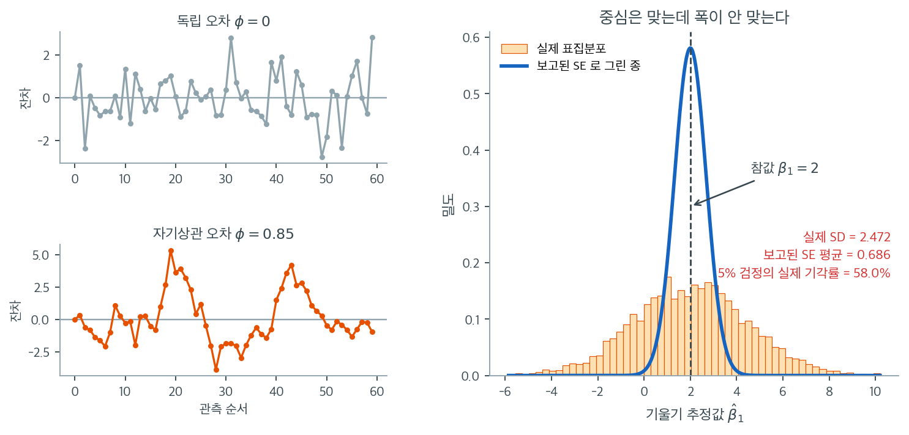
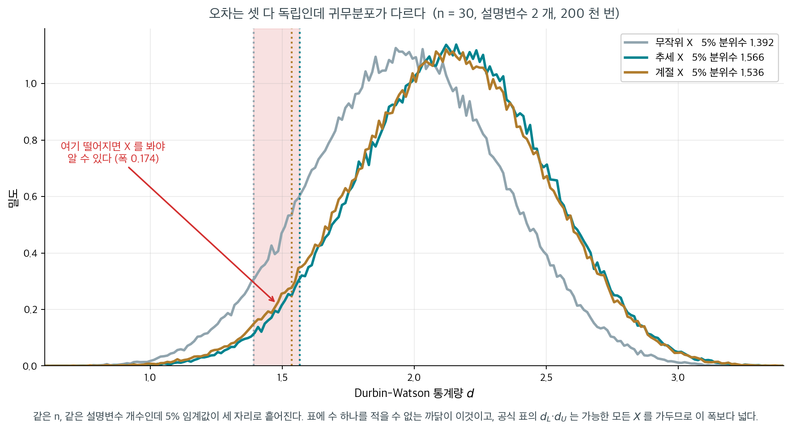
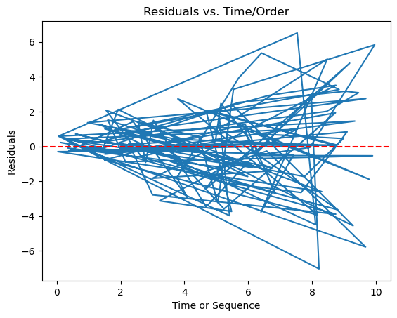
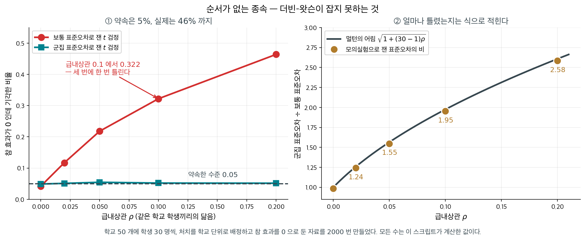

# 선형회귀의 독립성 확인

독립성은 관측값(과 그 잔차)이 서로 상관되어 있지 않음을 보장하는 선형회귀의 핵심 가정이다. 이 가정은 타당한 추론과 정확한 회귀계수 추정에 결정적이다. 독립성이 위배되면 모형의 표준오차가 과소추정되고 유의성 검정이 틀리게 된다. 이 절은 선형회귀에서 독립성을 확인하는 여러 방법을 살펴보며, 자기상관과 그 밖의 종속 형태를 찾아내고 대처하는 데 초점을 맞춘다.

---

## 1. 독립성 가정의 이해

<div class="defn" markdown>

### 정의 1. 독립성 { .dfn }
선형회귀의 맥락에서 독립성 가정은 모형의 잔차(오차)들이 서로 독립이어야 한다는 뜻이다. 시계열 자료에서는 한 시점의 잔차가 다른 시점의 잔차와 상관되어서는 안 된다는 뜻이고, 횡단면 자료에서는 한 관측값의 잔차가 다른 어떤 관측값의 잔차와도 상관되어서는 안 된다는 뜻이다.

형식적으로 이 가정은 다음을 요구한다.

$$
\text{Cov}(\epsilon_i, \epsilon_j) = 0 \quad \text{(모든 } i \neq j \text{에 대해)}
$$

행렬 형태로도 쓸 수 있다. 독립성 가정 아래에서 오차의 분산·공분산 행렬은 대각행렬이다.

$$
\text{Var}(\boldsymbol{\epsilon}) = \sigma^2 \mathbf{I}_n
$$

**어떻게 위배되는가:**
독립성 위배는 보통 다음 두 모습으로 나타난다.

- **자기상관:** 잔차가 시간이나 순서에 걸쳐 상관될 때이며 시계열 자료에서 흔히 보인다. 양의 자기상관은 시점 $t$의 양의 잔차 뒤에 시점 $t+1$의 양의 잔차가 따라오는 경향을 뜻한다.
- **군집 오차:** 특정 집단이나 군집 안의 관측값이 다른 집단의 관측값보다 서로 더 비슷할 때이다.

</div>


### 위배하면 무엇이 망가지는가

독립성 가정을 위배하면 다음이 일어난다.

- **비효율적인 계수 추정** — OLS 추정량은 여전히 불편이지만 더 이상 최소분산 선형불편추정량이 아니다.
- **틀린 표준오차** — 보통 과소추정되어 계수가 실제보다 더 유의해 보이게 만든다.
- **타당하지 않은 가설검정** — t 검정과 F 검정이 오도하는 p값을 내놓는다.

!!! note "자기상관이 계수를 편향시키는가"
    설명변수가 외생적이면($E[\varepsilon \mid X] = 0$) 자기상관이 있어도 OLS 계수 추정량은 **불편**이다. 망가지는 것은 표준오차이지 추정값 자체가 아니다. 다만 예외가 있다. 시차 종속변수($Y_{t-1}$)를 설명변수로 넣은 모형에서 오차가 자기상관되어 있으면 설명변수와 오차가 상관되어 계수 추정 자체가 편향되고 일치성도 잃는다.

독립성은 오차가 시간에 걸쳐 상관될 수 있는 **시계열 자료**에서 특히 결정적이다(이를 **자기상관**이라 한다). 같은 집단 안의 관측값이 다른 집단의 관측값보다 서로 비슷할 수 있는 **군집 자료**에서도 문제가 된다.



왼쪽의 두 작은 그림이 눈으로 보는 독립성 진단이다. 위는 독립 오차($\phi = 0$)를 관측 순서대로 찍은 것으로, 점이 0 위아래를 쉴 새 없이 오간다. 아래는 $\varepsilon_t = 0.85\varepsilon_{t-1} + u_t$ 로 만든 자기상관 오차인데, 한번 위로 올라가면 대여섯 점이 함께 위에 머물고 내려가면 또 한동안 아래에 머문다. 같은 개수의 점이지만 아래쪽 그림이 담고 있는 **독립적인 정보의 양**은 훨씬 적다. 더빈–왓슨 통계량이 재는 것이 바로 이 뭉침이다.

오른쪽은 $n = 60$, 참 기울기 $\beta_1 = 2$ 로 4000번 반복한 결과다. 주황 히스토그램이 $\hat{\beta}_1$ 의 실제 표집분포이고, 파란 종은 매 반복에서 OLS 가 출력표에 찍어 준 표준오차의 평균으로 그린 것이다. **중심은 정확히 맞는다.** 추정값의 평균이 $2.028$ 로 참값에서 벗어나지 않았다. 앞의 상자에서 말한 "자기상관은 계수를 편향시키지 않는다"가 그림으로 확인된 셈이다. 그런데 폭이 전혀 맞지 않는다. 실제 표준편차는 $2.472$ 인데 보고된 표준오차는 평균 $0.686$ 으로, **3.6배나 좁다.** 독립 오차로 같은 실험을 하면 실제 $0.440$, 보고된 $0.438$ 로 둘이 거의 포개진다.

이 어긋남이 그대로 검정의 실패로 이어진다. 참값 $\beta_1 = 2$ 를 귀무가설로 두고 유의수준 5%로 검정하면, 독립 오차에서는 기각률이 정확히 $5.0\%$ 로 나온다. 자기상관 오차에서는 $58.0\%$ 다. **참인 귀무가설을 열 번에 여섯 번 기각한다.** 분산으로 따지면 $2.472^2/0.440^2 \approx 31.6$ 배이니, 관측 60개가 실제로는 몇 개 값어치밖에 못 한다는 뜻이다. 그리고 이 실패는 $n$ 을 키워도 사라지지 않는다. 표준오차 공식이 틀린 것이지 표본이 작은 것이 아니기 때문이다. 뉴이–웨스트 표준오차나 혼합효과 모형처럼 상관 구조를 셈에 넣는 방법으로 **공식을 바꿔야** 한다.

### 어떤 자료에서 흔히 위배되는가

| 자료 유형 | 흔한 위배 | 예 |
|-----------|-----------------|---------|
| 시계열 | 자기상관 | 주식 수익률, 경제지표 |
| 공간 | 공간상관 | 지리 자료, 환경 측정값 |
| 군집 | 군집 내 상관 | 학교 안의 학생, 병원 안의 환자 |
| 반복측정 | 계열상관 | 종단연구, 패널자료 |
---

## 2. 설정

이 페이지의 진단은 모두 아래 자료와 모형 하나를 놓고 수행한다.

<div class="exbox" markdown>

**보기 1.** <span class="diff easy" title="쉬움"></span> 진단에 쓸 모형 준비. 이 페이지의 자료는 관측값을 **서로 독립**으로 만들었다. 그러니 독립이 깨졌을 때 무엇이 얼마나 틀어지는지를 먼저 재어 두자. 오차가 AR(1), 곧 $\varepsilon_t = \rho \varepsilon_{t-1} + u_t$이고 정상상태에서 $\operatorname{Var}(\varepsilon_t) = \sigma^2$, $\operatorname{Cov}(\varepsilon_t, \varepsilon_{t+k}) = \sigma^2 \rho^{\lvert k \rvert}$라 하자.

**(1)** 표본평균 $\bar\varepsilon$의 분산이

$$
\operatorname{Var}(\bar\varepsilon) = \frac{\sigma^2}{n}\left(1 + 2\sum_{k=1}^{n-1}\Big(1 - \frac{k}{n}\Big)\rho^k\right)
$$

임을 보이고, $n \to \infty$에서 이것이 $\dfrac{\sigma^2}{n}\cdot\dfrac{1+\rho}{1-\rho}$에 가까워짐을 보이시오. $\rho = 0.5$면 참 분산이 독립을 가정한 $\sigma^2/n$의 몇 배인가.

**(2)** 모형을 적합하고, (1)의 두 식을 모의실험으로 확인하시오.

</div>

??? success "풀이"

    **(1) 해석적으로.** 이중합을 펼친다.

    $$
    \operatorname{Var}(\bar\varepsilon)
    = \frac{1}{n^2}\sum_{s=1}^n \sum_{t=1}^n \operatorname{Cov}(\varepsilon_s, \varepsilon_t)
    = \frac{\sigma^2}{n^2}\sum_{s=1}^n \sum_{t=1}^n \rho^{\lvert s-t \rvert}
    $$

    $\lvert s - t \rvert = k$인 칸이 몇 개인지 세면 된다. $k = 0$인 대각선 칸이 $n$개이고, $k \ge 1$인 칸은 위아래로 각각 $n - k$개씩이다. 그러므로

    $$
    \operatorname{Var}(\bar\varepsilon)
    = \frac{\sigma^2}{n^2}\left(n + 2\sum_{k=1}^{n-1}(n-k)\rho^k\right)
    = \frac{\sigma^2}{n}\left(1 + 2\sum_{k=1}^{n-1}\Big(1-\frac{k}{n}\Big)\rho^k\right)
    $$

    이다. $\lvert \rho \rvert < 1$이면 $n \to \infty$에서 $1 - k/n \to 1$이고 $\sum_{k\ge1}\rho^k = \rho/(1-\rho)$이므로

    $$
    \operatorname{Var}(\bar\varepsilon) \;\longrightarrow\; \frac{\sigma^2}{n}\left(1 + \frac{2\rho}{1-\rho}\right) = \frac{\sigma^2}{n}\cdot\frac{1+\rho}{1-\rho}
    $$

    이다. $\rho = 0.5$면 배수가 $1.5/0.5 = 3$, 곧 **참 분산이 독립을 가정한 값의 세 배**다. 표준오차로는 $\sqrt 3 = 1.73$배이므로, 독립을 믿고 계산한 신뢰구간은 참 폭의 $58\%$밖에 안 된다.

    뒤집어 읽으면 **유효표본크기**가 된다. $n$개를 모았는데 실제로는

    $$
    n_{\text{eff}} = n \cdot \frac{1-\rho}{1+\rho}
    $$

    개를 모은 것과 같다. $\rho = 0.5$면 $120$개가 $40$개 값어치이고, $\rho = 0.8$이면 $120$개가 $13$개 값어치다. **독립성 위배는 추정값을 비틀지 않고 정보량을 깎는다.** 그래서 계수는 멀쩡해 보이는데 p-값만 터무니없이 작게 나온다.

    **(2) 수치적으로.** 먼저 이 페이지의 모형을 적합한다.

    ```python
    import numpy as np
    import pandas as pd
    import statsmodels.api as sm

    rng = np.random.default_rng(7)
    n = 120

    # X는 균등, Y는 X에 선형으로 의존하되 오차의 분산이 X와 함께 커진다.
    # 이렇게 두면 선형성은 성립하고 등분산성만 깨져, 각 진단이 무엇을
    # 잡아내고 무엇을 놓치는지 구분해 볼 수 있다.
    X = rng.uniform(0, 10, n)
    Y = 2.0 + 1.5 * X + rng.normal(0, 0.5 + 0.35 * X, n)

    df = pd.DataFrame({"X": X, "Y": Y})
    model = sm.OLS(Y, sm.add_constant(X)).fit()
    residuals = model.resid
    fitted = model.fittedvalues

    print(f"beta_hat = {model.params.round(4)}")
    print(f"R^2 = {model.rsquared:.4f}")
    ```

    출력:

    ```
    beta_hat = [1.5933 1.5317]
    R^2 = 0.7813
    ```

    이제 (1)의 두 식을 확인한다. $\sigma = 1$로 두면 독립일 때의 값이 $1/n = 0.008333$이다.

    ```python
    import numpy as np

    def exact_var(rho, n):
        """AR(1) 오차를 가진 표본평균의 분산. sigma = 1 로 둔다."""
        k = np.arange(1, n)
        return (1 + 2 * np.sum((1 - k / n) * rho ** k)) / n

    print(f"{'rho':>5}{'독립이면':>11}{'정확한 식':>12}{'극한식':>11}{'모의실험':>12}{'배수':>8}")
    for rho in (0.0, 0.3, 0.5, 0.8):
        r = np.random.default_rng(2024)
        B = 40_000
        u = r.normal(0, np.sqrt(1 - rho ** 2), (B, n))
        eps = np.empty((B, n))
        eps[:, 0] = r.normal(0, 1, B)
        for t in range(1, n):
            eps[:, t] = rho * eps[:, t - 1] + u[:, t]
        sim = eps.mean(axis=1).var(ddof=1)
        ex = exact_var(rho, n)
        print(f"{rho:>5.1f}{1 / n:>11.6f}{ex:>12.6f}"
              f"{(1 + rho) / (1 - rho) / n:>11.6f}{sim:>12.6f}{ex * n:>8.3f}")
    ```

    출력:

    ```
      rho       독립이면       정확한 식        극한식        모의실험      배수
      0.0   0.008333    0.008333   0.008333    0.008380   1.000
      0.3   0.008333    0.015391   0.015476    0.015479   1.847
      0.5   0.008333    0.024722   0.025000    0.024866   2.967
      0.8   0.008333    0.072222   0.075000    0.072615   8.667
    ```

    **정확한 식이 모의실험과 맞는다.** $\rho = 0.5$에서 공식이 $0.024722$, 모의실험이 $0.024866$이고, $\rho = 0.8$에서 $0.072222$ 대 $0.072615$다. 차이는 모두 $1\%$ 안이며 $40{,}000$회의 몬테카를로 오차 크기다.

    **극한식은 $n = 120$에서 조금 큰 쪽으로 어긋난다.** $\rho = 0.8$에서 정확한 값 $0.0722$ 대 극한값 $0.0750$으로 $4\%$ 차이이고, $\rho = 0.5$에서는 $1.1\%$다. 유한한 $n$에서 $(1-k/n)$ 가중이 뒤쪽 항을 깎기 때문이며, $\rho$가 1에 가까울수록 멀리 있는 항이 중요해져 어긋남이 커진다. **상관이 강할수록 "$n$이 충분히 크다"가 요구하는 $n$도 커진다.**

    배수를 보라. $\rho = 0.3$이라는, 그림으로는 거의 눈에 띄지 않을 약한 상관도 분산을 $1.85$배로 만든다. 표준오차를 $1.36$배 과소평가하고 그만큼 $t$값을 부풀린다는 뜻이다. **독립성은 그림으로 대충 보아 넘길 가정이 아니다.** 이 페이지의 나머지가 그것을 재는 도구들이다.

---

## 3. 자기상관을 위한 Durbin-Watson 검정

**Durbin-Watson(DW) 검정**은 회귀모형 잔차의 1차 자기상관 유무를 탐지하는 데 널리 쓰이는 통계검정이다. 시계열 자료에서 특히 유용하다.

**검정통계량:**

Durbin-Watson 통계량은 다음으로 정의된다.

$$
DW = \frac{\sum_{t=2}^{n}(e_t - e_{t-1})^2}{\sum_{t=1}^{n} e_t^2}
$$

여기서 $e_t$는 시점 $t$의 잔차이다.

DW 통계량은 0과 4 사이의 값을 갖는다.

- $DW \approx 2$: 자기상관 없음
- $DW \to 0$: 강한 양의 자기상관
- $DW \to 4$: 강한 음의 자기상관

**자기상관과의 관계:**

$$
DW \approx 2(1 - \hat{\rho})
$$

여기서 $\hat{\rho}$는 잔차의 추정된 1차 자기상관 계수이다.

**절차:**

1. **선형회귀 모형 적합:** 먼저 모형을 적합하여 잔차를 얻는다.
2. **Durbin-Watson 통계량 계산:** DW 통계량은 보통 0과 4 사이의 값을 갖는다.
3. **통계량 해석:**
   - DW가 2 근처면 자기상관이 없다.
   - 0에 가까울수록 양의 자기상관을 시사한다.
   - 4에 가까울수록 음의 자기상관을 시사한다.

**예시:**

<div class="exbox" markdown>

**보기 2.** <span class="diff easy" title="쉬움"></span> Durbin-Watson 검정. 위에 적은 $DW \approx 2(1-\hat\rho)$는 근사가 아니라 **정확한 항등식에서 작은 항 하나를 버린 것**이다.

**(1)** $\hat\rho_1 = \dfrac{\sum_{t=2}^n e_t e_{t-1}}{\sum_{t=1}^n e_t^2}$이라 두면

$$
DW = 2(1 - \hat\rho_1) - \frac{e_1^2 + e_n^2}{\sum_{t=1}^n e_t^2}
$$

임을 보이시오. 이것으로 $0 \le DW \le 4$도 설명되는가.

**(2)** 검정을 돌려 (1)의 항등식을 소수점 열째 자리까지 확인하고, 버린 항의 크기를 재시오.

</div>

??? success "풀이"

    **(1) 해석적으로.** 분자의 제곱을 펼친다.

    $$
    \sum_{t=2}^n (e_t - e_{t-1})^2
    = \sum_{t=2}^n e_t^2 + \sum_{t=2}^n e_{t-1}^2 - 2\sum_{t=2}^n e_t e_{t-1}
    $$

    앞의 두 합은 전체 제곱합 $S = \sum_{t=1}^n e_t^2$에서 각각 첫 항과 끝 항이 빠진 것이다. 곧 $\sum_{t=2}^n e_t^2 = S - e_1^2$이고 $\sum_{t=2}^n e_{t-1}^2 = S - e_n^2$이다. 따라서

    $$
    \sum_{t=2}^n (e_t - e_{t-1})^2 = 2S - e_1^2 - e_n^2 - 2\sum_{t=2}^n e_t e_{t-1}
    $$

    이고, 양변을 $S$로 나누면

    $$
    DW = 2 - \frac{e_1^2 + e_n^2}{S} - 2\hat\rho_1 = 2(1 - \hat\rho_1) - \frac{e_1^2 + e_n^2}{S}
    $$

    이다. **근사 기호가 하나도 필요 없는 등식**이다. 버린 항은 $n$개의 제곱 가운데 두 개가 차지하는 몫이므로 $O(1/n)$이고, 그래서 표본이 조금만 커지면 $DW \approx 2(1-\hat\rho_1)$이 된다.

    범위는 이 식만으로는 나오지 않는다. $\hat\rho_1$은 보통의 상관계수가 아니라 분모가 $S$로 고정된 양이라 $[-1,1]$에 갇힌다는 보장이 없기 때문이다. 범위는 분자·분모를 직접 보는 쪽이 빠르다. 분자가 제곱합이므로 $DW \ge 0$이고, 한편

    $$
    \sum_{t=2}^n (e_t - e_{t-1})^2 \le \sum_{t=2}^n 2(e_t^2 + e_{t-1}^2) \le 4S
    $$

    이므로 $DW \le 4$다. 첫 부등식은 $(a-b)^2 \le 2(a^2+b^2)$이고, 둘째는 각 $e_t^2$이 많아야 두 번씩 세어지기 때문이다. **$DW = 0$은 모든 잔차가 같을 때, $DW = 4$는 부호가 꼬박꼬박 뒤집히며 크기가 같을 때**에 가까워진다.

    **(2) 수치적으로.**

    ```python
    from statsmodels.stats.stattools import durbin_watson

    # Durbin-Watson 통계량은 0 에서 4 사이이고 2 가 무상관이다. 2 보다 뚜렷이
    # 작으면 양의 자기상관, 크면 음의 자기상관을 뜻한다. 이 검정은 잔차를
    # 주어진 순서 그대로 보므로, 순서가 뜻을 갖는 자료에서만 쓸 수 있다.
    dw_stat = durbin_watson(model.resid)
    print(f'Durbin-Watson statistic: {dw_stat}')
    ```

    출력:

    ```
    Durbin-Watson statistic: 2.16161645652481
    ```

    항등식을 조각으로 나누어 확인한다.

    ```python
    import numpy as np

    e = model.resid
    S = (e ** 2).sum()

    rho1 = (e[1:] * e[:-1]).sum() / S          # 1차 자기상관
    edge = (e[0] ** 2 + e[-1] ** 2) / S        # 끝점 보정

    print(f"rho_hat_1          = {rho1:+.10f}")
    print(f"2(1 - rho_hat_1)   = {2 * (1 - rho1):.10f}")
    print(f"끝점 보정          = {edge:.10f}")
    print(f"2(1-rho) - 보정    = {2 * (1 - rho1) - edge:.10f}")
    print(f"durbin_watson      = {durbin_watson(e):.10f}")

    # 보정항의 크기는 O(1/n) 이다.
    print(f"\n보정항 {edge:.6f} 대 2/n = {2 / len(e):.6f}")
    ```

    출력:

    ```
    rho_hat_1          = -0.0812166815
    2(1 - rho_hat_1)   = 2.1624333631
    끝점 보정          = 0.0008169065
    2(1-rho) - 보정    = 2.1616164565
    durbin_watson      = 2.1616164565

    보정항 0.000817 대 2/n = 0.016667
    ```

    **항등식이 소수점 열째 자리까지 맞는다.** $2(1-\hat\rho_1) = 2.1624333631$에서 보정 $0.0008169065$를 빼면 `durbin_watson`이 돌려준 $2.1616164565$가 정확히 나온다.

    **보정항이 $0.000817$로 아주 작다.** $2/n = 0.016667$보다도 스무 배 작은데, 하필 첫 잔차와 끝 잔차가 둘 다 작았기 때문이다. $e_1 = 0.727$, $e_{120} = 0.102$로 잔차의 표준편차 $2.34$에 견주면 거의 0이다. 이 항의 기댓값은 대략 $2/n$이고, 끝점에 큰 잔차가 걸리면 그보다 훨씬 커진다. **$DW$를 $2(1-\hat\rho_1)$로 환산해 읽을 때 소수 둘째 자리까지 믿지는 말라는 뜻이다.**

    $\hat\rho_1 = -0.081$로 0 근처이고 $DW = 2.16$이 2 근처다. 자기상관의 증거가 없으며, 관측값을 서로 독립으로 생성했으니 옳은 판정이다.

    다만 여기서 "순서"는 자료를 만든 순서일 뿐이다. 실제 연구에서는 측정 시각이나 공간 위치처럼 의미 있는 순서로 정렬해야 이 진단이 뜻을 갖는다. **그 점을 보기 3에서 수치로 확인한다.**

**해석 지침:**

| DW 값 | 해석 |
|----------|---------------|
| $DW \approx 2$ | 유의한 자기상관 없음 |
| $DW < 1.5$ | 양의 자기상관 (독립성 위배) |
| $DW > 2.5$ | 음의 자기상관 (독립성 위배) |

---

<div class="storybox" markdown>

**그림으로 보는 통계학 1.** 답을 못 적은 칸이 있는 표

$DW$ 는 $0$ 과 $4$ 사이에 있고 $2$ 근처면 괜찮다고 했다. 그러면 얼마나 작아야 기각인가.
표를 펴면 당황스러운 것이 보인다 — **칸마다 수가 두 개**이고, 그 사이에 떨어지면 표가
「모르겠다」고 적어 두었다.

까닭은 이렇다. $t$ 나 $F$ 는 귀무가설 아래에서 분포가 자유도만으로 정해진다. 그런데
$DW$ 는 **잔차**로 만든 양이고, 잔차는 $X$ 에 사영하고 남은 것이라 그 분포가 **설명변수가
무엇이었는지에 매여 있다.** $n$ 과 설명변수 개수가 같아도 $X$ 가 다르면 분포가 다르다.

<figure markdown>
  { width=960 }
  <figcaption markdown>세 경우 모두 오차를 **독립인 정규**로 만들었다 — 곧 $H_0$ 가 참이다. 그런데 $5\%$ 임계값이 $1.392$ 에서 $1.566$ 까지 흩어진다. 붉은 띠에 떨어진 $d$ 값은 $X$ 를 보기 전에는 기각인지 아닌지 말할 수 없다. 자료에서 직접 그렸다.</figcaption>
</figure>

**더빈과 왓슨이 한 일이 그 띠를 가두는 것이었다.** $1950$–$51$ 년의 두 논문에서 그들은,
$X$ 가 무엇이든 $DW$ 의 임계값이 $n$ 과 설명변수 개수만으로 정해지는 두 수 $d_L$ 과 $d_U$
**사이에** 있음을 보였다. 그래서 표에 둘을 나란히 싣고 이렇게 읽게 했다.

- $d < d_L$ 이면 **기각** — 어떤 $X$ 였어도 임계값보다 작다
- $d > d_U$ 이면 **기각하지 않음** — 어떤 $X$ 였어도 임계값보다 크다
- 그 사이면 **판정 불가** — $X$ 를 알아야 한다

셋째 줄이 이 표의 특이한 점이다. **통계표가 모른다고 적어 놓은 칸**은 흔하지 않다.
$p$ 값 하나를 돌려주는 요즘 감각으로는 어색하지만, 손으로 표를 찍던 시절에 할 수 있는
가장 정직한 일이기도 했다. 모르는 것을 모른다고 적어 둔 셈이다.

지금은 사정이 다르다. 이차형식의 분포를 수치적으로 구하는 방법이 있어서, $X$ 를 그대로
넣고 **정확한 $p$ 값**을 계산할 수 있다. 다만 소프트웨어가 다 그렇게 해 주지는 않는다 —
`statsmodels` 의 `durbin_watson` 은 통계량 하나만 돌려주고 $p$ 값을 주지 않으므로, $2$
근처인지 눈대중하거나 표를 따로 보아야 한다.

그리고 한 가지 더. 판정 불가 구간이 **넓어지는** 자리가 있다. 설명변수가 많아질수록, 그리고
$n$ 이 작을수록 $d_L$ 과 $d_U$ 가 벌어진다. 자료가 적고 변수가 많은 회귀에서 자기상관을
묻는 일이 특히 미덥지 못한 까닭이 그것이고, §5 의 브로이슈–갓프리 검정처럼 $\chi^2$
근사로 $p$ 값을 바로 내주는 쪽으로 옮겨 간 동기이기도 하다.

_확인한 곳 — 더빈과 왓슨이 『Biometrika』에 「Testing for serial correlation in least squares regression」을 $1950$·$1951$ 년에 나누어 싣고 $1971$ 년에 한 편을 더 보탰다는 것, 그 표가 $d_L$·$d_U$ 두 경계와 그 사이의 판정 불가 구간으로 되어 있다는 것, 귀무분포가 설계행렬에 의존해서 그렇게 할 수밖에 없었다는 것은 널리 알려진 사실이다 · 그림의 세 귀무분포와 $5\%$ 분위수 $1.392 / 1.566 / 1.536$ 은 $n=30$ · $20$ 만 번으로 이 쪽이 직접 쟀다. 공식 표의 $d_L$·$d_U$ 는 **가능한 모든** $X$ 를 가두므로 이 폭보다 넓다_

</div>

## 4. 패턴 탐지를 위한 잔차그림

**잔차그림**은 독립성 가정을 확인하는 또 하나의 효과적인 도구이다. 잔차를 (시계열 자료에서는) 시간에 대해, (횡단면 자료에서는) 자료 수집 순서에 대해 그리면 종속을 시사하는 패턴을 눈으로 확인할 수 있다.

**절차:**

1. **잔차 그리기:** 잔차를 시간이나 관측 순서에 대해 그린다.
2. **패턴 평가:** 추세, 주기, 군집 같은 체계적 패턴을 찾는다.

**예시:**

<div class="exbox" markdown>

**보기 3.** <span class="diff easy" title="쉬움"></span> 순서에 대한 잔차 그림. 아래 코드는 가로축에 `X`를 두고 `plt.plot`으로 **점을 선으로 잇는다.**

**(1)** 그림을 그려 보고, 이 그림이 왜 아무것도 읽을 수 없는 모양이 되었는지 설명하시오. 가로축 이름이 `Time or Sequence`인데 실제로 놓인 것은 무엇인가.

**(2)** 독립성 진단이 **순서에 전적으로 의존한다**는 것을 수치로 보이시오. 같은 잔차를 순서만 바꾸어 $DW$를 다시 재고, 순서가 아무 뜻도 없을 때 $DW$가 어떤 분포를 갖는지 알아보시오.

</div>

??? success "풀이"

    **(1) 그림이 왜 엉킨 실타래가 되었는가.** `plt.plot(X, model.resid)`는 가로 좌표를 `X`에 두고, **배열에 담긴 차례대로** 점을 선분으로 잇는다. 그런데 `X`는 균등난수라 정렬되어 있지 않다. 그래서 1번 점이 $x = 6.25$에, 2번 점이 $x = 8.97$에, 3번 점이 $x = 7.76$에, 4번 점이 $x = 2.25$에 놓이는 식으로 선이 좌우를 마구 가로지른다. 점 $120$개를 잇는 선분 $119$개가 겹쳐 아무 무늬도 읽히지 않는다.

    가로축 이름 `Time or Sequence`가 말하는 것은 관측 **순번** $1, 2, \ldots, 120$인데 실제로 놓인 것은 **설명변수의 값**이다. 둘은 전혀 다른 양이다. 순번에 대해 그리려면 `plt.plot(model.resid)`처럼 가로 좌표를 생략하거나 `np.arange(n)`을 주어야 한다.

    이 그림이 보여 주는 것이 하나 있기는 하다. **왼쪽에서 오른쪽으로 갈수록 실타래가 세로로 벌어진다.** 가로축이 $x$이므로 그것은 이분산이며, 독립성과는 무관하다.

    **(2) 수치적으로.**

    ```python
    import matplotlib.pyplot as plt
    import numpy as np
    from statsmodels.stats.stattools import durbin_watson

    plt.rcParams["font.sans-serif"] = ["NanumGothic", "Apple SD Gothic Neo", "Malgun Gothic"]
    plt.rcParams["font.family"] = "sans-serif"
    plt.rcParams["axes.unicode_minus"] = False

    # 잔차를 시간 순서대로 잇는다. 위아래로 무작위하게 오가야 하고, 같은 쪽에
    # 여러 점이 몰려 다니면 독립이 깨진 것이다.
    plt.plot(X, model.resid)
    plt.xlabel('Time or Sequence')
    plt.ylabel('Residuals')
    plt.title('Residuals vs. Time/Order')
    plt.axhline(y=0, color='red', linestyle='--')
    plt.show()

    e = model.resid

    # 같은 잔차를 순서만 바꾸어 DW 를 다시 잰다.
    print(f"생성 순서 그대로        DW = {durbin_watson(e):.4f}")
    print(f"X 로 정렬한 뒤          DW = {durbin_watson(e[np.argsort(X)]):.4f}")

    # 순서가 아무 뜻이 없다면 DW 는 어떤 분포를 갖는가
    perm = np.random.default_rng(42)
    dws = np.array([durbin_watson(e[perm.permutation(len(e))]) for _ in range(20_000)])
    print(f"\n무작위로 20000번 섞었을 때  평균 {dws.mean():.4f},  표준편차 {dws.std():.4f}")
    print(f"비교:  2/sqrt(n) = {2 / np.sqrt(len(e)):.4f}")
    print(f"생성 순서의 DW 는 그 분포의 {(dws < durbin_watson(e)).mean():.1%} 분위에 있다")
    ```

    출력:

    ```
    생성 순서 그대로        DW = 2.1616
    X 로 정렬한 뒤          DW = 2.0797

    무작위로 20000번 섞었을 때  평균 1.9995,  표준편차 0.1826
    비교:  2/sqrt(n) = 0.1826
    생성 순서의 DW 는 그 분포의 81.2% 분위에 있다
    ```

    

    **같은 잔차 $120$개인데 순서만 바꾸면 $DW$가 달라진다.** 생성 순서로는 $2.1616$, $x$로 정렬하면 $2.0797$이다. 잔차 집합은 한 치도 바뀌지 않았고 늘어놓은 차례만 바뀌었다. **$DW$는 잔차의 성질이 아니라 "잔차 + 순서"의 성질**이며, 순서가 자료에 내재하지 않으면 재는 값에 뜻이 없다.

    순서를 완전히 무작위로 섞은 분포가 그 사실을 분명히 해 준다. 평균이 $1.9995$로 2이고 표준편차가 $0.1826$인데, 이 값이 $2/\sqrt n = 0.1826$과 소수점 넷째 자리까지 같다. **무상관인 수열에서 $DW$의 표준편차가 $2/\sqrt n$이라는 것**은 보기 2의 항등식에서 바로 나온다. $DW \approx 2(1-\hat\rho_1)$이고 $\hat\rho_1$의 표준오차가 $1/\sqrt n$이기 때문이다.

    생성 순서의 $2.1616$은 그 분포의 $81$번째 백분위수다. 양측으로 보면 흔한 자리이므로 자기상관의 증거가 없다. 수치로 적으면 $2.1616$은 2에서 $0.88$ 표준편차 떨어져 있을 뿐이다.

    **실제 연구에서 지켜야 할 것은 하나다.** 자료에 측정 시각이나 공간 좌표처럼 **의미 있는 순서**가 있으면 그것으로 정렬한 뒤 $DW$를 재고 그 순서로 잔차를 그린다. 순서가 없으면 $DW$는 아예 돌리지 말아야 한다. 돌리면 위 분포에서 뽑은 난수 하나가 나올 뿐인데, 스무 번에 한 번은 그 난수가 "유의"하게 나온다.

**해석:**

- **뚜렷한 패턴 없음:** 0 주위의 무작위 흩어짐은 독립성을 나타낸다.
- **눈에 띄는 패턴:** 추세, 주기, 군집은 독립성의 위배를 시사하며 자기상관이나 다른 형태의 종속 가능성을 나타낸다.

**흔한 패턴과 그 의미:**

| 패턴 | 유력한 원인 |
|---------|-------------|
| 매끄러운 파동 | 계절성 또는 주기적 자기상관 |
| 상승/하강 추세 | 모형에 추세 변수가 빠짐 |
| 부호가 번갈아 나타남 | 음의 자기상관 |
| 같은 부호가 이어짐 | 양의 자기상관 |

---

## 5. 고차 자기상관을 위한 Breusch-Godfrey 검정

**Breusch-Godfrey 검정**은 Durbin-Watson 검정의 확장으로, (1차만이 아니라) 고차 자기상관을 탐지하는 데 더 유연하다. 자기상관이 인접 관측값을 넘어 이어진다고 의심될 때 유용하다.

**가설:**

- $H_0$: 시차 $p$까지 자기상관이 없다
- $H_1$: 어떤 시차 $\leq p$에서 자기상관이 존재한다

이 검정은 잔차를 원래의 설명변수와 시차 잔차에 회귀시킨다.

$$
e_t = \alpha_0 + \alpha_1 X_{1t} + \cdots + \rho_1 e_{t-1} + \rho_2 e_{t-2} + \cdots + \rho_p e_{t-p} + u_t
$$

검정통계량은 이 보조회귀의 $nR^2$이며, $H_0$ 아래에서 $\chi^2_p$ 분포를 따른다.

**절차:**

1. **선형회귀 모형 적합:** 적합된 모형에서 잔차를 얻는다.
2. **Breusch-Godfrey 검정 수행:** 검정이 통계량과 p값을 준다.
3. **결과 해석:** p값이 유의하면(보통 < 0.05) 자기상관의 존재를 시사한다.

**예시:**

<div class="exbox" markdown>

**보기 4.** <span class="diff easy" title="쉬움"></span> Breusch-Godfrey 검정

**(1)** 보조회귀를 직접 만들어 $\mathrm{LM} = nR^2$을 재현하고 $\chi^2_2$에서 p-값을 계산하시오. 앞쪽의 없는 시차를 어떻게 다루어야 `statsmodels`와 맞는가.

**(2)** 시차 하나만 보는 $\mathrm{BG}$와 $\hat\rho_1$로 계산한 $n\hat\rho_1^2$을 견주시오. 둘이 정확히 같지 않은 까닭은 무엇인가.

</div>

??? success "풀이"

    **(1) 보조회귀를 그대로 만든다.** 보조회귀는

    $$
    e_t = \alpha_0 + \alpha_1 x_t + \rho_1 e_{t-1} + \rho_2 e_{t-2} + u_t
    $$

    인데 $t = 1$에는 $e_0$도 $e_{-1}$도 없고 $t = 2$에는 $e_0$이 없다. 두 가지 관례가 있다. 앞의 두 관측을 **버리는** 것과 없는 시차를 **0으로 채우는** 것이다. `statsmodels`는 뒤쪽을 쓰며, 그래야 $n$이 그대로 $120$으로 남아 $\mathrm{LM} = nR^2$의 $n$이 바뀌지 않는다.

    **원래 모형의 설명변수 $x_t$를 보조회귀에 반드시 넣어야 한다.** $e$는 $x$와 직교하므로 $x$ 하나만으로는 아무것도 설명하지 못하지만, 시차 잔차와 함께 들어가면 $e_{t-1}$에 섞여 있는 $x$ 성분을 걷어 내는 몫을 한다. 이 항을 빼면 다른 수가 나온다.

    ```python
    from statsmodels.stats.diagnostic import acorr_breusch_godfrey

    # Breusch-Godfrey 검정은 Durbin-Watson 과 달리 시차를 여럿 한꺼번에 본다.
    # nlags=2 는 한 시점 전과 두 시점 전의 잔차를 함께 살핀다는 뜻이다.
    # 설명변수에 시차 종속변수가 들어 있어도 쓸 수 있다는 점이 이점이다.
    bg_test = acorr_breusch_godfrey(model, nlags=2)
    print(f'Breusch-Godfrey LM statistic: {bg_test[0]}')
    print(f'Breusch-Godfrey p-value: {bg_test[1]}')
    ```

    출력:

    ```
    Breusch-Godfrey LM statistic: 1.584101499228634
    Breusch-Godfrey p-value: 0.4529150269303661
    ```

    직접 만들어 맞춰 본다.

    ```python
    import numpy as np
    import statsmodels.api as sm
    from scipy.stats import chi2

    e = model.resid
    n = len(e)

    # 보조회귀: e_t 를 상수, X_t, e_{t-1}, e_{t-2} 에 회귀시킨다.
    # 앞쪽에서 없는 시차는 0 으로 채운다 (statsmodels 의 방식).
    lag1 = np.concatenate(([0.0], e[:-1]))
    lag2 = np.concatenate(([0.0, 0.0], e[:-2]))
    Z = np.column_stack([np.ones(n), X, lag1, lag2])
    aux = sm.OLS(e, Z).fit()

    print(f"보조회귀 R^2 = {aux.rsquared:.10f}")
    print(f"LM = n R^2   = {n * aux.rsquared:.10f}")
    print(f"statsmodels  = {acorr_breusch_godfrey(model, nlags=2)[0]:.10f}")
    print(f"p = chi2(2).sf(LM) = {chi2.sf(n * aux.rsquared, 2):.10f}")

    # 시차 하나만 보면 Durbin-Watson 과 무엇이 다른가
    bg1 = acorr_breusch_godfrey(model, nlags=1)
    rho1 = (e[1:] * e[:-1]).sum() / (e ** 2).sum()
    print(f"\nBG(nlags=1) LM = {bg1[0]:.6f},  p = {bg1[1]:.6f}")
    print(f"비교:  n * rho_hat_1^2 = {n * rho1 ** 2:.6f}")
    ```

    출력:

    ```
    보조회귀 R^2 = 0.0132008458
    LM = n R^2   = 1.5841014992
    statsmodels  = 1.5841014992
    p = chi2(2).sf(LM) = 0.4529150269

    BG(nlags=1) LM = 0.797528,  p = 0.371834
    비교:  n * rho_hat_1^2 = 0.791538
    ```

    **보조회귀가 소수점 열째 자리까지 재현된다.** $R^2 = 0.01320$이 작은데, 두 시차가 잔차 변동의 $1.3\%$밖에 설명하지 못한다는 뜻이다. $\mathrm{LM} = 120 \times 0.01320 = 1.584$이고 $\chi^2_2$에서 $p = 0.4529$다. 자기상관의 증거가 없다.

    **(2) 시차 하나일 때.** $\mathrm{BG}$의 $\mathrm{LM}$이 $0.797528$, $n\hat\rho_1^2$이 $0.791538$로 **가깝지만 같지 않다.** 차이가 나는 이유는 둘이다. 첫째, $\mathrm{BG}$의 보조회귀에는 상수와 $x_t$가 함께 들어가 $e_{t-1}$의 기여가 그 둘을 걷어 낸 뒤의 몫으로 재어진다. 둘째, $\hat\rho_1$은 분모가 $\sum_t e_t^2$으로 고정된 양이라 보조회귀의 최소제곱 계수와 정확히 같지 않다. 두 수의 차이가 $0.8\%$인 것은 $x$와 $e_{t-1}$이 거의 직교했기 때문이며, 설명변수가 여럿이거나 시차 종속변수가 끼어 있으면 둘은 크게 갈린다.

    $\mathrm{BG}$와 $DW$의 관계도 같은 자리에서 보인다. $DW = 2.1616$은 $\hat\rho_1 = -0.081$을 말하고, 그 제곱에 $n$을 곱한 $0.79$가 바로 $\mathrm{BG}(1)$ 통계량의 크기다. **$DW$와 $\mathrm{BG}(1)$은 사실상 같은 것을 다른 눈금으로 적은 것**이고, $\mathrm{BG}$가 더 나은 점은 시차를 여럿 묶을 수 있다는 것과 설명변수에 시차 종속변수가 있어도 분포가 흐트러지지 않는다는 것이다.

    시차를 몇 개까지 볼 것인가는 공짜가 아니다. $\mathrm{nlags}$를 늘리면 자유도가 그만큼 늘어 [13.5절](checking_homoscedasticity.md)의 White 검정에서 본 것과 같은 희석이 일어난다. 자료의 주기를 짐작할 수 있으면 그만큼만 — 월별 자료면 $12$, 분기별이면 $4$ — 잡는 것이 보통이다.

**해석:**

- **p값 > 0.05:** 유의한 자기상관이 탐지되지 않았다.
- **p값 < 0.05:** 유의한 자기상관이 존재하며 독립성 위배를 나타낸다.

**Durbin-Watson보다 나은 점:**

- 고차 자기상관(시차 2, 3 등)을 탐지할 수 있다.
- 시차 종속변수를 설명변수로 쓴 모형에서도 쓸 수 있다(이 경우 DW 검정은 타당하지 않다).
- 더 일반적이고 유연하다.

---

## 6. 자료 수집 과정 살피기

관측값 사이의 종속은 때때로 자료 수집 과정 자체에서 비롯되며, 군집 또는 위계 구조를 갖는 자료(예: 학교 안의 학생, 병원 안의 환자)에서 특히 그렇다. 자료의 구조를 이해하고 군집 가능성을 확인하는 것이 중요하다.

**절차:**

1. **자료 구조 이해:** 자료가 집단이나 군집 단위로 수집되었는지 확인한다.
2. **군집 확인:** 군집이 의심되면 위계 모형이나 혼합효과 모형을 쓴다. 표준적인 선형회귀는 군집 내 상관을 반영하지 못한다.

**흔한 군집 자료 구조:**

| 구조 | 1수준 | 2수준 | 예 |
|-----------|---------|---------|---------|
| 교육 | 학생 | 학교 | 학교별 시험 점수 |
| 의료 | 환자 | 병원 | 병원별 치료 결과 |
| 지리 | 관측값 | 지역 | 주별 경제 자료 |
| 종단 | 시점 | 대상자 | 개인별 반복측정 |

**해석:**

- **군집 없음:** 자료가 군집화되어 있지 않으면 독립성이 성립할 수 있다.
- **군집 탐지:** 자료가 군집화되어 있으면 독립성이 위배될 수 있으므로 대안적 모형화(예: 혼합효과 모형, 군집 표준오차)를 고려해야 한다.

---

## 7. 독립성 진단 요약

| 방법 | 유형 | 탐지 대상 | 적합한 상황 |
|--------|------|---------|----------|
| Durbin-Watson | 형식적 검정 | 1차 자기상관 | 시계열 자료 |
| 잔차–시간 그림 | 시각적 | 모든 시간 패턴 | 시계열, 순서가 있는 자료 |
| Breusch-Godfrey | 형식적 검정 | 고차 자기상관 | 복잡한 시간 종속 |
| 자료 구조 검토 | 개념적 | 군집, 위계적 종속 | 군집화된 횡단면 자료 |

선형회귀에서 독립성을 확보하는 일은 타당한 통계적 추론과 신뢰할 만한 예측에 결정적이다. Durbin-Watson 검정, Breusch-Godfrey 검정, 잔차그림을 함께 써서 독립성 가정의 위배 가능성을 진단할 수 있다. 독립성이 위배된 경우에 무엇을 할 수 있는지는 8절에 모아 적는다.

---

## 8. 비독립성에 대한 대책

- **시차 변수 도입:** 시계열 모형에서 시차 변수(예: $Y_{t-1}$)를 넣으면 자기상관을 설명할 수 있다.
- **일반화최소제곱(GLS):** GLS는 회귀계수의 표준오차를 조정하여 자기상관에 대처한다.
- **혼합효과모형:** 군집 자료에서는 혼합효과(위계) 모형이 군집 내 상관을 반영할 수 있다.
- **Newey-West 표준오차:** 이분산·자기상관 일치(HAC) 표준오차는 독립성이 위배되어도 타당한 추론을 제공한다.

<div class="storybox" markdown>

**그림으로 보는 통계학 2.** 순서가 없는 종속 — 그리고 틀린 정도의 크기

$1$ 절은 독립성 위배의 하나로 **군집 오차**를 들었고 $6$ 절도 「학교 안의 학생, 병원 안의 환자」를 다시 짚었다. 그런데 이 쪽이 가르친 도구는 전부 **순서**를 쓴다. 더빈–왓슨은 $e_t$ 와 $e_{t-1}$ 을 견주고 브로이슈–고드프리는 시차 잔차를 보조회귀에 넣는다. **군집 자료에는 「이전」이 없다.** 학생에게 번호를 어떻게 매기든 같은 자료이므로, 번호 순서로 잰 자기상관은 번호를 바꾸면 사라진다.

그래서 남는 물음은 「검정이 있는가」가 아니라 **「얼마나 틀리는가」**다. 그리고 이것은 식으로 적힌다. 군집 크기가 $m$, 같은 군집 안의 상관(**급내상관**)이 $\rho$ 이면, 올바른 분산은 보통의 OLS 가 적는 것의 대략 $1 + (m-1)\rho$ 배다 — **멀턴의 어림**이다. $m$ 이 곱해진다는 것이 요점이다. 군집이 크면 작은 $\rho$ 로도 망가진다.

학교 $50$ 개에 학생을 $30$ 명씩 두고, **처치를 학교 단위로** 배정한 뒤 참 효과를 $0$ 으로 두었다. $t$ 검정이 $5\%$ 수준에서 얼마나 기각하는지를 $2000$ 번 세어 본다.

| 급내상관 $\rho$ | 보통 표준오차 | 군집 표준오차 | 표준오차의 비 | 멀턴의 어림 |
|---|---|---|---|---|
| $0.00$ | $0.042$ | $0.049$ | $0.99$ | $1.00$ |
| $0.02$ | $0.117$ | $0.051$ | $1.24$ | $1.26$ |
| $0.05$ | $0.218$ | $0.054$ | $1.55$ | $1.57$ |
| $0.10$ | $\mathbf{0.322}$ | $0.052$ | $1.95$ | $1.97$ |
| $0.20$ | $\mathbf{0.464}$ | $0.051$ | $2.58$ | $2.61$ |



**급내상관이 $0.10$ 이면 스무 번에 한 번 틀리기로 한 검정이 세 번에 한 번 틀린다.** 같은 학교 학생끼리 $0.1$ 쯤 닮는 것은 교육 자료에서 드문 일이 아니다. 오른쪽 판이 보이듯 표준오차의 비는 멀턴의 어림과 소수 둘째 자리까지 맞으므로, **망가지는 정도를 미리 셈할 수 있다.** 군집 표준오차로 바꿔 끼우면(위 목록의 혼합효과모형과 같은 자리를 겨냥한다) 기각률이 어떤 $\rho$ 에서도 $0.05$ 에 붙는다.

이것이 책 안의 이야기만은 아니다. $2004$ 년에 **마리안 버트런드·에스테르 뒤플로·센딜 멀레이너선**이 「이중차분 추정값을 얼마나 믿어야 하는가」를 『Quarterly Journal of Economics』에 실었다. 그들은 미국 인구조사 자료에 **있지도 않은 법률**을 무작위로 만들어 넣고 그 「효과」를 검정했는데, 효과가 $0$ 인 것이 분명한데도 $5\%$ 수준에서 **최대 $45\%$ 가 유의하게** 나왔다. 위 표의 $\rho = 0.20$ 줄이 내놓은 $0.464$ 와 같은 종류의 수다.

다만 군집 표준오차도 공짜는 아니다. **군집의 개수가 적으면** 그 추정 자체가 아래로 치우쳐 같은 병이 작은 규모로 되돌아온다. 버트런드·뒤플로·멀레이너선도 부트스트랩이 「주의 수가 충분히 많을 때」 잘 듣는다고 적었다. 세어야 할 것은 관측 수가 아니라 **군집 수**다.

_확인한 곳 — 마리안 버트런드·에스테르 뒤플로·센딜 멀레이너선, 「How Much Should We Trust Differences-In-Differences Estimates?」, 『The Quarterly Journal of Economics』 $119$ 권 $1$ 호($2004$) $249$–$275$ 쪽이라는 서지는 [Crossref 의 기록](https://doi.org/10.1162/003355304772839588)에서 확인했다 · 그 논문이 인구조사 자료에 무작위 가짜 법률을 만들어 넣어 「효과」를 검정했더니 $5\%$ 수준에서 최대 $45\%$ 가 유의하게 나왔다는 것, 그리고 부트스트랩이 주의 수가 충분히 많을 때 잘 듣는다고 적은 것은 그 논문의 초록 요약에서 읽었다. **논문 본문은 읽지 못했다** · 위 표와 그림의 수는 모두 직접 모의실험해 얻은 값이고 그 논문의 결과가 아니다_

</div>

---

## 연습문제

<div class="drillbox" markdown>

**연습문제 1.** <span class="diff easy" title="쉬움"></span>
분기별 매출 자료에 대한 회귀모형에서 Durbin-Watson 통계량 $d = 0.95$를 얻었다. 이 결과를 해석하고 적절한 대책을 제안하라.

</div>

??? success "풀이"
    Durbin-Watson 통계량 $d = 0.95$는 2보다 상당히 작으므로 잔차에 **양의 1차 자기상관**이 있음을 나타낸다($\hat{\rho} \approx 1 - d/2 = 0.53$). 인접한 분기의 관측값이 비슷한 잔차를 갖는다는 뜻이며 시계열 자료에서 흔한 일이다.

    이는 독립성 가정을 위배하여 표준오차를 과소추정하게 만든다. 권장 대책:

    1. **시차 변수 포함:** $Y_{t-1}$ 같은 시차 변수를 설명변수로 넣어 시간 종속을 포착한다.
    2. **Newey-West(HAC) 표준오차 사용:** 자기상관에 로버스트한 표준오차를 쓴다.
    3. **자기회귀 모형 적합:** 일반화최소제곱으로 AR(1) 오차 모형 등을 적합한다.

<div class="drillbox" markdown>

**연습문제 2.** <span class="diff med" title="중간"></span>
독립성 가정을 자료만 보고 검증할 수 없고 연구 설계로 확보해야 하는 이유를 설명하라. 독립성을 보장하는 연구 설계의 예를 두 가지 들어라.

</div>

??? success "풀이"
    독립성은 관측된 자료가 아니라 **자료생성과정**의 성질이다. 상관된 자료도 우연히 무작위처럼 보이는 잔차그림을 낼 수 있고, 독립인 자료도 표집변동 때문에 겉보기 패턴을 보일 수 있다.

    독립성을 보장하는 연구 설계:

    1. **단순무작위추출:** 각 개체가 같은 확률로 독립적으로 뽑히는 모집단에서의 추출.
    2. **무작위대조실험:** 반복측정 없이 대상자를 처치 조건에 무작위로 배정하는 설계.

<div class="drillbox" markdown>

**연습문제 3.** <span class="diff med" title="중간"></span>
학급 안에 중첩된 학생 자료는 독립성 가정을 위배한다. 회귀 추론에 미치는 구체적인 영향을 설명하고 이 문제를 다루는 모형화 접근을 말하라.

</div>

??? success "풀이"
    같은 학급의 학생들은 같은 교사, 교육과정, 교실 환경을 공유하므로 **군집 내 상관**이 생긴다. 그 결과

    - 실효 표본크기가 명목상의 $n$보다 작아진다.
    - 표준오차가 과소추정되어 $t$ 통계량이 부풀려지고 p값이 인위적으로 작아진다.
    - 신뢰구간이 지나치게 좁아진다.

    적절한 접근은 학급을 확률효과로 포함하는 **혼합효과(위계/다수준) 모형**이다. 군집 내 상관을 반영하면서 고정효과의 표준오차를 올바르게 추정한다.

<div class="drillbox" markdown>

**연습문제 4.** <span class="diff med" title="중간"></span>
보기 3에서 순서가 아무 뜻도 없을 때 $DW$의 표준편차가 $2/\sqrt n$임을 확인했다($n = 120$에서 $0.1826$). 이 사실을 3절의 해석 지침 표, 곧 "$DW < 1.5$면 양의 자기상관, $DW > 2.5$면 음의 자기상관"과 맞추어 보자. $DW$가 평균 $2$, 표준편차 $2/\sqrt n$의 정규분포를 따른다고 어림한다.

**(1)** $n = 120$, $n = 20$, $n = 1000$에서 경계 $1.5$가 평균에서 몇 표준편차 떨어져 있는지 구하고, 각 경우의 양측 p-값을 구하시오.

**(2)** 세 경우에서 양측 $5\%$ 수준의 참 경계값(평균에서 $1.96$ 표준편차 떨어진 아래쪽 값)을 구하시오. 고정된 숫자 $1.5$를 모든 $n$에 쓰면 작은 표본과 큰 표본에서 각각 어떤 잘못이 생기는가. $n = 1000$에서 $DW = 1.8$인 자료를 예로 들어 설명하시오.

</div>

??? success "풀이"
    **(1) 경계가 몇 표준편차인가.** 표준편차가 $2/\sqrt n$이므로 경계까지의 거리는 $(2 - 1.5)/(2/\sqrt n) = 0.25\sqrt n$이다.

    | $n$ | 표준편차 $2/\sqrt n$ | $1.5$까지의 거리 | 양측 p-값 |
    |---|---|---|---|
    | $20$ | $0.4472$ | $1.12$ | $0.264$ |
    | $120$ | $0.1826$ | $2.74$ | $0.0062$ |
    | $1000$ | $0.0632$ | $7.91$ | $2.7 \times 10^{-15}$ |

    같은 숫자 $1.5$가 $n = 20$에서는 "흔한 값", $n = 1000$에서는 "천문학적으로 드문 값"이다.

    **(2) 참 경계값.** 아래쪽 $5\%$ 경계는 $2 - 1.96 \cdot 2/\sqrt n$이다.

    $$
    n = 20:\ 1.124, \qquad n = 120:\ 1.642, \qquad n = 1000:\ 1.876
    $$

    고정된 $1.5$는 **작은 표본에서 너무 느슨한 쪽이 아니라 너무 엄한 쪽으로 틀린다.** $n = 20$에서 참 경계가 $1.124$인데 $1.5$를 쓰면, 사실은 양측 p-값이 $0.26$인 평범한 값을 "독립성 위배"로 선고한다. 자기상관이 없는 자료에서도 이런 일이 꽤 자주 일어난다.

    **큰 표본에서는 거꾸로 너무 느슨하다.** $n = 1000$에서 $DW = 1.8$이면 표에 따라 "유의한 자기상관 없음"이 되지만, $(2 - 1.8)/0.0632 = 3.16$ 표준편차로 양측 p-값이 $0.0016$이다. $\hat\rho_1 \approx 1 - 1.8/2 = 0.1$이라는 작은 상관인데도, 보기 1의 배수 $(1+\rho)/(1-\rho) = 1.22$만큼 분산이 부풀어 표준오차를 $1.10$배 과소평가한다. 표본이 크면 작은 상관도 검정에서 또렷하게 잡힌다.

    **$DW$의 경계는 숫자가 아니라 $n$의 함수다.** 표의 $1.5$, $2.5$는 $n$이 $100$ 전후일 때의 어림이며, 실제로는 $2 \pm 2z/\sqrt n$으로 읽거나 Durbin-Watson 표의 임계값을 써야 한다. 덧붙여 여기서 쓴 정규 어림은 "순서가 무작위"일 때의 것이고, $DW$의 정확한 영분포는 설명변수 행렬에도 의존한다. 그래서 원래의 Durbin-Watson 표에는 임계값이 두 개($d_L$, $d_U$)씩 실려 있고 그 사이는 판정 불능 구간이다.

<div class="drillbox" markdown>

**연습문제 5.** <span class="diff med" title="중간"></span>
어떤 논문이 $n = 120$인 월별 시계열에 회귀를 적합해 기울기의 $t$값 $3.00$, p-값 $0.003$을 보고했다. 그런데 오차가 보기 1처럼 $\rho = 0.5$인 AR(1)이고 저자는 그것을 무시했다.

**(1)** 보기 1의 결과를 써서 올바른 $t$값과 양측 p-값을 구하시오. 유의수준 $5\%$에서 결론이 바뀌는가.

**(2)** 보고된 $t = 3.00$이 참 $t$값으로는 $1.96$ 아래로 내려가게 되는 $\rho$의 최솟값을 구하고, 그 $\rho$에 대응하는 $DW$값을 구하시오. 이 값을 3절의 해석 지침 표와 견주시오.

</div>

??? success "풀이"
    **(1) $t$값은 $\sqrt{(1+\rho)/(1-\rho)}$배로 부풀려진다.** 보기 1에서 참 분산이 독립을 가정한 값의 $(1+\rho)/(1-\rho)$배다. 추정값 자체는 비뚤어지지 않고 분산만 깎여 있으므로, 참 표준오차는 보고된 것의 $\sqrt{(1+\rho)/(1-\rho)}$배이고 $t$값은 그만큼 작아진다. $\rho = 0.5$이면 배수가 $\sqrt{1.5/0.5} = \sqrt 3 = 1.7321$이므로

    $$
    t_{\text{참}} = \frac{3.00}{\sqrt 3} = 1.7321
    $$

    이다. 자유도 $120 - 2 = 118$에서 양측 p-값은 $0.086$이다(정규로 어림하면 $0.083$). **결론이 뒤집힌다.** 보고된 $p = 0.003$은 "매우 유의"였는데 참값은 $0.086$으로 $5\%$ 수준에서 유의하지 않다. 보기 1의 말대로 $n = 120$이 실제로는 $n_{\text{eff}} = 120 \cdot (0.5/1.5) = 40$ 값어치뿐이기 때문이다.

    **(2) 경계가 되는 $\rho$.** $3.00/\sqrt{(1+\rho)/(1-\rho)} = 1.96$을 풀면

    $$
    \frac{1+\rho}{1-\rho} = \left(\frac{3.00}{1.96}\right)^2 = 2.3428
    \quad\Longrightarrow\quad
    \rho = \frac{2.3428 - 1}{2.3428 + 1} = 0.4017
    $$

    이다. 이에 대응하는 $DW$는 $2(1 - 0.4017) = 1.197$이다.

    **표를 보면 이 값은 이미 "양의 자기상관(독립성 위배)" 칸에 들어 있다.** $DW < 1.5$가 경계인데 $1.20$은 그보다 훨씬 작다. 뒤집어 말하면, $DW$가 $1.5$에 턱걸이하는 ($\rho \approx 0.25$) 정도로도 $t$값은 $\sqrt{1.25/0.75} = 1.29$배 부풀고, $t = 3.00$은 $2.32$($p = 0.022$)로 내려간다. 유의성이 겨우 살아남는다. **"$DW$가 $1.5$보다 조금 크니 괜찮다"는 판단은, 보고된 $t$값이 $3$ 근처일 때는 결론을 지킬 만큼 안전하지 않다.**

<div class="drillbox" markdown>

**연습문제 6.** <span class="diff med" title="중간"></span>
보기 2는 "$DW = 0$은 모든 잔차가 같을 때, $DW = 4$는 부호가 꼬박꼬박 뒤집히며 크기가 같을 때에 **가까워진다**"고 했다. 왜 "가까워진다"인지, 곧 두 끝값이 왜 도달되지 않는지를 $n = 120$에서 수치로 확인한다. 아래의 두 잔차열은 모두 합이 0이므로 상수항이 있는 회귀의 잔차가 될 수 있다.

**(1)** $e_t = (-1)^t$, 곧 $-1, +1, -1, \ldots$을 넣어 $DW$, $\hat\rho_1$, 끝점 보정항을 각각 구하고 보기 2의 항등식이 맞음을 확인하시오. 일반적인 $n$에서 이 수열의 $DW$는 얼마인가. $4$에 얼마나 모자라는가.

**(2)** 이번에는 잔차에 완벽한 선형 추세가 남아 있다고 하자. $e_t = t - 60.5$이다. $\sum_{t=1}^n (t - \frac{n+1}{2})^2 = \frac{n(n^2-1)}{12}$을 써서 $DW$를 구하고, 항등식으로 $\hat\rho_1$을 구하시오. 4절의 "흔한 패턴과 그 의미" 표에서 이 경우에 해당하는 줄은 무엇인가.

</div>

??? success "풀이"
    **(1) 부호가 번갈아 나타나는 잔차.** $e_t^2 = 1$이므로 $S = n = 120$이다. 이웃한 두 값의 차는 늘 $\pm 2$이고 그런 항이 $n - 1 = 119$개이므로 분자는 $119 \times 4 = 476$이다. 따라서

    $$
    DW = \frac{476}{120} = 3.966667
    $$

    이다. 일반적으로는 $DW = \dfrac{4(n-1)}{n} = 4\left(1 - \dfrac 1n\right)$이고, $4$에 $4/n = 0.0333$ 모자란다.

    항등식도 확인된다. $e_t e_{t-1} = -1$이 $119$개이므로

    $$
    \hat\rho_1 = \frac{-119}{120} = -0.991667,
    \qquad
    \frac{e_1^2 + e_n^2}{S} = \frac{2}{120} = 0.016667
    $$

    이고 $2(1 + 0.991667) - 0.016667 = 3.983333 - 0.016667 = 3.966667$로 $DW$와 같다. **$4$에 도달하지 못하게 막는 것이 바로 끝점 보정항과 $\hat\rho_1$이 $-1$에 $1/n$만큼 못 미치는 몫이다.** 두 결손이 합쳐 $4/n$이 된다.

    **(2) 선형 추세가 남은 잔차.** 이웃한 두 값의 차가 늘 $1$이므로 분자는 $n - 1 = 119$다. 분모는

    $$
    S = \frac{n(n^2-1)}{12} = \frac{120 \times 14399}{12} = 143{,}990
    $$

    이므로

    $$
    DW = \frac{119}{143{,}990} = 0.000826
    $$

    이다. 끝점 보정항은 $(59.5^2 + 59.5^2)/143{,}990 = 7080.5/143{,}990 = 0.049174$이고, 항등식을 $\hat\rho_1$에 대해 풀면

    $$
    \hat\rho_1 = 1 - \frac{DW + (e_1^2+e_n^2)/S}{2} = 1 - \frac{0.000826 + 0.049174}{2} = 1 - 0.025 = 0.975
    $$

    이다. 1차 자기상관이 $0.975$로 거의 $1$이다.

    표에서 해당하는 줄은 **"상승/하강 추세 — 모형에 추세 변수가 빠짐"**이다. 처방은 자기상관을 고치는 것이 아니라 빠진 변수를 넣는 것이다. 여기서 눈여겨볼 것이 하나 더 있다. $DW = 0.0008$은 $0$에 거의 붙었는데 $\hat\rho_1$은 $1$이 아니라 $0.975$다. 차이의 대부분이 끝점 보정항 $0.049$에서 온다. **잔차가 추세를 가지면 양 끝에 가장 큰 잔차가 놓이므로 보정항이 보기 2의 $0.000817$보다 $60$배나 커진다.** 보기 2에서 "소수 둘째 자리까지 믿지 말라"고 한 경고가 가장 세게 들어맞는 자리다.

<div class="drillbox" markdown>

**연습문제 7.** <span class="diff hard" title="어려움"></span>
5절은 Breusch-Godfrey 검정이 Durbin-Watson보다 나은 점으로 "고차 자기상관을 탐지할 수 있다"를 들었다. 이 말이 빈말이 아님을 보이는 반례를 만든다. $n = 120$인 분기별 자료에 주기 4의 계절성이 남아, 잔차가 정확히

$$
e_t = \cos\frac{\pi t}{2} = 0,\, -1,\, 0,\, +1,\, 0,\, -1,\, \ldots \qquad (t = 1, \ldots, 120)
$$

이라고 하자. 합이 0이므로 상수항이 있는 회귀의 잔차가 될 수 있다.

**(1)** $S$, $\hat\rho_1$, 끝점 보정항, $DW$를 구하시오. $DW$만 보는 사람은 어떤 판정을 내리는가.

**(2)** 시차 4의 자기상관 $\hat\rho_4 = \dfrac{\sum_{t=5}^{n} e_t e_{t-4}}{\sum_{t=1}^n e_t^2}$을 구하시오.

**(3)** 보조회귀에서 계수를 $\rho_4 = 1$, 나머지를 0으로 둔 특수한 선택만으로도 잔차제곱합이 $2$임을 보여, $\mathrm{BG}(4)$의 $R^2 \ge 1 - 2/S$임을 논하시오. 이로부터 $\mathrm{LM}$의 하한과 $\chi^2_4$에서의 결론을 말하시오.

</div>

??? success "풀이"
    **(1) $DW$는 아무것도 보지 못한다.** $t$가 짝수일 때 $e_t = \pm 1$, 홀수일 때 $e_t = 0$이므로 $S = 60$이다. 이웃한 두 값 중 하나는 늘 $0$이므로

    $$
    \hat\rho_1 = \frac{\sum_{t=2}^{120} e_t e_{t-1}}{S} = \frac{0}{60} = 0
    $$

    이다. 끝점 보정항은 $e_1 = 0$, $e_{120} = \cos(60\pi) = 1$이므로 $(0 + 1)/60 = 0.016667$이고, 항등식에서

    $$
    DW = 2(1 - 0) - 0.016667 = 1.983333
    $$

    이다. 직접 세어도 같다. 이웃한 두 값의 차는 늘 $\pm 1$이고 그런 항이 $119$개이므로 $DW = 119/60 = 1.983333$이다.

    $DW = 1.98$은 $2$에서 $0.09$ 표준편차($2/\sqrt{120} = 0.1826$ 기준)밖에 떨어져 있지 않다. **$DW$만 보는 사람은 "자기상관 없음, 독립성 이상 없음"이라고 쓴다.** 그런데 이 잔차열은 난수가 아니라 완전히 결정된 주기함수다.

    **(2) 시차 4에서는 상관이 거의 $1$이다.** 주기가 4이므로 $t \ge 5$에서 $e_{t-4} = e_t$, 곧 $e_t e_{t-4} = e_t^2$이다. $t = 5, \ldots, 120$ 가운데 $e_t \ne 0$인 것은 짝수 $t = 6, 8, \ldots, 120$으로 $58$개이므로

    $$
    \hat\rho_4 = \frac{58}{60} = 0.966667
    $$

    이다.

    **(3) $\mathrm{BG}(4)$는 곧바로 잡아낸다.** 보조회귀에서 $\rho_4 = 1$, 상수와 $x_t$와 나머지 시차의 계수를 모두 $0$으로 둔다. 없는 시차를 $0$으로 채우는 관례에서 이 선택의 잔차는 $t \ge 5$에서 $e_t - e_{t-4} = 0$이고, $t = 1,2,3,4$에서는 $e_t - 0 = 0, -1, 0, 1$이다. 따라서 잔차제곱합이 $0 + 1 + 0 + 1 = 2$다. 최소제곱은 이보다 나쁠 수 없으므로

    $$
    R^2 \ge 1 - \frac{2}{S} = 1 - \frac{2}{60} = 0.966667
    $$

    이고

    $$
    \mathrm{LM} = nR^2 \ge 120 \times 0.966667 = 116.0
    $$

    이다. $\chi^2_4$의 $5\%$ 임계값이 $9.49$이므로 $p < 10^{-20}$이다(정확히는 $\mathrm{LM} = 116$에서 $p \approx 4 \times 10^{-24}$). **$DW$가 $1.98$로 "이상 없음"이라고 말하는 똑같은 잔차에서 $\mathrm{BG}(4)$가 $116$을 내놓는다.**

    왜 이런 일이 생기는가. $DW$는 **시차 1 하나만** 본다. 주기가 짝수인 계절성은 시차 1에서 상관을 $0$으로 만들면서 시차 4에 몰아넣을 수 있다. 5절 끝에서 "월별 자료면 $12$, 분기별이면 $4$"를 잡으라고 한 것이 바로 이 때문이다. **분기별 자료에서 $\mathrm{nlags} = 4$를 잡지 않으면 계절성을 통째로 놓칠 수 있다.**

<div class="drillbox" markdown>

**연습문제 8.** <span class="diff hard" title="어려움"></span>
보기 3에서 잔차 $120$개의 순서를 $20{,}000$번 무작위로 섞어 $DW$의 평균 $1.9995$, 표준편차 $0.1826$을 얻었다. 이 두 수를 이론으로 설명한다. 잔차 $e_1, \ldots, e_n$은 고정하고 순서만 균등하게 무작위로 섞는다. 상수항이 있으므로 $\sum_t e_t = 0$이고 $S = \sum_t e_t^2$도 섞어도 바뀌지 않는다.

**(1)** 무작위로 섞을 때 $\mathrm{E}[\hat\rho_1] = -1/n$임을 보이시오. 힌트: $i \ne j$인 두 자리에 놓이는 값의 곱의 기댓값은 $\dfrac{1}{n(n-1)}\sum_{i \ne j} e_i e_j$이고, 이것을 $(\sum_i e_i)^2$과 $S$로 쓸 수 있다.

**(2)** 끝점 보정항의 기댓값을 구하고, 보기 2의 항등식에 (1)과 함께 넣어 $\mathrm{E}[DW]$를 구하시오. 두 개의 $O(1/n)$ 항에 무슨 일이 일어나는가. 관찰값 $1.9995$가 몬테카를로 오차로 설명되는지 확인하시오.

**(3)** $DW$의 분포를 평균 $2$, 표준편차 $0.1826$의 정규분포로 어림하면, 생성 순서의 $DW = 2.1616$은 몇 번째 백분위수인가. 보기 3이 보고한 $81.2\%$와 맞는가.

</div>

??? success "풀이"
    **(1) 1차 자기상관의 기댓값.** 섞은 뒤 $t$번째 자리에 놓인 값을 $e_{\pi(t)}$라 쓰면

    $$
    \mathrm{E}\!\left[\sum_{t=2}^n e_{\pi(t)} e_{\pi(t-1)}\right]
    = (n-1)\,\mathrm{E}\!\left[e_{\pi(2)} e_{\pi(1)}\right]
    = (n-1) \cdot \frac{1}{n(n-1)}\sum_{i \ne j} e_i e_j
    $$

    이다. 서로 다른 두 자리에 놓이는 값의 짝은 모든 순서쌍 $(i,j)$, $i \ne j$에 대해 균등하기 때문이다. 그런데

    $$
    \sum_{i \ne j} e_i e_j = \Big(\sum_i e_i\Big)^2 - \sum_i e_i^2 = 0 - S = -S
    $$

    이므로 기댓값은 $-S/n$이고, 양변을 $S$로 나누면

    $$
    \mathrm{E}[\hat\rho_1] = -\frac{1}{n} = -\frac{1}{120} = -0.008333
    $$

    이다. **무상관인 순서에서도 $\hat\rho_1$의 중심은 $0$이 아니라 $-1/n$으로 조금 음수다.**

    **(2) 두 결손이 정확히 상쇄된다.** 첫 자리와 끝 자리에는 각 잔차가 확률 $1/n$로 놓이므로 $\mathrm{E}[e_{\pi(1)}^2] = \mathrm{E}[e_{\pi(n)}^2] = S/n$이고

    $$
    \mathrm{E}\!\left[\frac{e_{\pi(1)}^2 + e_{\pi(n)}^2}{S}\right] = \frac{2S/n}{S} = \frac{2}{n}
    $$

    이다. 보기 2의 항등식 $DW = 2(1 - \hat\rho_1) - (e_1^2 + e_n^2)/S$는 등식이므로 기댓값을 그대로 취할 수 있고

    $$
    \mathrm{E}[DW] = 2\left(1 + \frac 1n\right) - \frac 2n = 2 + \frac 2n - \frac 2n = 2
    $$

    이다. **$\mathrm{E}[DW] = 2$가 근사가 아니라 정확하다.** $\hat\rho_1$이 $-1/n$만큼 음수로 치우쳐 $DW$를 $2/n$ 올리는 몫과, 끝점 보정항이 평균 $2/n$만큼 $DW$를 내리는 몫이 한 치도 남지 않고 맞아떨어진다. $n$을 쓰지 않는 깔끔한 결론이 나오는 까닭이 여기 있다.

    관찰값 $1.9995$를 확인한다. 표준편차 $0.1826$으로 $20{,}000$번 반복했으니 평균의 표준오차가

    $$
    \frac{0.1826}{\sqrt{20{,}000}} = 0.001291
    $$

    이고, $\lvert 1.9995 - 2 \rvert = 0.0005$는 그것의 $0.39$배다. **몬테카를로 오차 안이다.**

    **(3) 백분위수.** 표준화하면

    $$
    z = \frac{2.1616 - 2}{0.1826} = 0.885
    $$

    이고 $\Phi(0.885) = 0.8119$, 곧 $81.2$번째 백분위수다. **보기 3이 보고한 $81.2\%$와 소수 첫째 자리까지 맞는다.** 섞기 분포가 정규에 아주 가깝다는 뜻이고(합이 $n-1$개 항의 평균 꼴이므로 당연하다), 그래서 연습문제 4에서 쓴 정규 어림이 쓸 만하다. 양측으로 보면 $2 \times (1 - 0.8119) = 0.376$이므로 자기상관의 증거는 없다.

<div class="drillbox" markdown>

**연습문제 9.** <span class="diff hard" title="어려움"></span>
논문에는 보통 $DW$값만 실리고 잔차는 실리지 않는다. 그럴 때 우리가 할 수 있는 역산이 얼마나 정확한지 재어 본다.

**(1)** 보기 2에서 $DW = 2.1616164565$였다. $\hat\rho_1 \approx 1 - DW/2$로 역산한 값과 참값 $-0.0812166815$를 비교하고, 그 차가 보기 2의 끝점 보정항 $0.0008169065$와 어떤 관계인지 식으로 쓰시오. 이 역산은 $\hat\rho_1$을 늘 어느 쪽으로 밀어 넣는가. 양의 자기상관일 때와 음의 자기상관일 때 그 뜻이 어떻게 다른가.

**(2)** 두 $\hat\rho_1$로 각각 $n\hat\rho_1^2$을 계산해 보기 4의 $\mathrm{BG}(1)$ 비교값 $0.791538$과 견주시오.

**(3)** 연습문제 1은 $d = 0.95$에서 $\hat\rho \approx 1 - d/2 = 0.53$을 얻었다. 그 자료가 $n = 40$이고 끝점 보정항이 연습문제 8에서 구한 기댓값 $2/n$과 같았다고 하자. 보정한 $\hat\rho_1$을 구하고, 두 $\hat\rho$로 각각 보기 1의 분산 배수와 $n_{\text{eff}}$를 계산해 비교하시오. 연습문제 1의 판정이 뒤집히는가.

</div>

??? success "풀이"
    **(1) 역산은 늘 위로 밀린다.** 항등식 $DW = 2(1 - \hat\rho_1) - c$($c$는 끝점 보정항)를 $\hat\rho_1$에 대해 풀면

    $$
    \hat\rho_1 = 1 - \frac{DW}{2} - \frac c2
    $$

    이므로, 보정항을 무시한 역산은 참값보다 정확히 $c/2$만큼 큰 값을 준다. 수치로 확인하면

    $$
    1 - \frac{2.1616164565}{2} = -0.0808082283,
    \qquad
    -0.0808082283 - (-0.0812166815) = 0.0004084532
    $$

    이고 이것이 $c/2 = 0.0008169065/2 = 0.0004084533$과 같다.

    $c \ge 0$이므로 **역산은 언제나 $\hat\rho_1$을 위쪽으로 민다.** 뜻은 부호에 따라 갈린다. 참 $\hat\rho_1$이 양수면 역산이 그것을 **더 크게** 보여 양의 자기상관을 과장하고, 음수면 크기를 **더 작게** 보여 음의 자기상관을 과소평가한다. 여기서는 $\hat\rho_1 < 0$이므로 뒤쪽이며, $-0.0812$가 $-0.0808$로 $0$에 조금 더 가까이 읽혔다.

    **(2) 제곱하면 오차가 두 배로 보인다.**

    $$
    120 \times (-0.0812166815)^2 = 0.791538,
    \qquad
    120 \times (-0.0808082283)^2 = 0.783596
    $$

    참값이 보기 4가 적은 $0.791538$과 정확히 맞고, 역산값은 $0.783596$으로 $1.0\%$ 작다. $\hat\rho_1$의 상대오차가 $0.5\%$였는데 제곱에서 $1.0\%$로 커진다. **$\chi^2$ 통계량은 $\hat\rho_1$의 제곱 눈금에 있으므로 역산 오차가 두 배로 들어온다.** 다만 $0.7836$이든 $0.7915$든 $\chi^2_1$의 임계값 $3.84$에는 한참 못 미치므로 판정은 같다.

    **(3) 연습문제 1을 다시 읽는다.** $n = 40$, $c = 2/40 = 0.05$이므로

    $$
    \hat\rho_1 = 1 - \frac{0.95}{2} - \frac{0.05}{2} = 1 - 0.475 - 0.025 = 0.500
    $$

    이다. 보정하지 않은 값은 $0.525$였다($1 - 0.475$, 연습문제 1에서 $0.53$으로 어림한 것). 보기 1의 배수 $(1+\rho)/(1-\rho)$와 $n_{\text{eff}} = n(1-\rho)/(1+\rho)$를 계산하면

    | $\hat\rho$ | 분산 배수 | 표준오차 배수 | $n_{\text{eff}}$ |
    |---|---|---|---|
    | $0.525$ (보정 없음) | $3.211$ | $1.792$ | $12.5$ |
    | $0.500$ (보정) | $3.000$ | $1.732$ | $13.3$ |

    **판정은 뒤집히지 않는다.** 어느 쪽으로 읽어도 양의 자기상관이 뚜렷하고, 분산이 세 배 남짓이며 $40$개 표본이 $13$개 값어치다. 연습문제 1이 권한 대책(시차 변수, Newey-West 표준오차, GLS)도 그대로다.

    **그래서 실무의 규칙은 이렇다.** $DW$에서 $\hat\rho_1$을 역산해 **방향과 대략의 크기**를 읽는 것은 안전하고 유용하다. 반면 소수 둘째 자리나 $n_{\text{eff}}$의 한두 개 차이를 다투려면 잔차 자체가 필요하다. 보정항이 $2/n$ 정도라 $n$이 작을 때 특히 크다는 점도 기억할 일이다. $n = 40$에서 $c/2 = 0.025$는 $\hat\rho$의 둘째 자리를 바꾼다.

<div class="drillbox" markdown>

**연습문제 10.** <span class="diff hard" title="어려움"></span>
보기 1은 AR(1) 오차에 대해 이중합을 세어 유효표본크기를 얻었다. 똑같은 셈을 6절의 군집 자료에 적용한다. 크기가 모두 $k$인 군집 $m$개가 있어 $n = mk$이고, 같은 군집 안의 두 오차는 상관 $\rho$를, 다른 군집의 오차끼리는 상관 $0$을 가진다고 하자. 곧 $\operatorname{Var}(\varepsilon_i) = \sigma^2$이고 $i \ne j$에서 $\operatorname{Cov}(\varepsilon_i, \varepsilon_j) = \sigma^2 \rho$(같은 군집), $0$(다른 군집)이다.

**(1)** $\operatorname{Var}(\bar\varepsilon) = \dfrac{\sigma^2}{n}\big(1 + (k-1)\rho\big)$임을 보이고 $n_{\text{eff}}$를 쓰시오. 보기 1의 AR(1) 결과와 달리 $n$이 식 안에 남지 않는 것이 왜 중요한가.

**(2)** 학급 $40$개에서 학생 $30$명씩, 모두 $n = 1200$명을 모았고 $\rho = 0.2$라 하자. 분산 배수, $n_{\text{eff}}$, 표준오차를 과소평가하는 배수, 그리고 참 신뢰구간 폭에 대한 비율을 구하시오. $\rho = 0.05$로 줄이면 어떻게 되는가.

**(3)** (2)의 분산 배수와 같은 배수를 내는 AR(1)의 $\rho$를 구하시오. 그런데 이 군집 자료에 Durbin-Watson 검정을 돌리면 어떤 값이 나오는가. 보기 3과 연습문제 8을 근거로 답하시오.

</div>

??? success "풀이"
    **(1) 쌍을 센다.** 보기 1과 같이 이중합을 펼친다.

    $$
    \operatorname{Var}(\bar\varepsilon)
    = \frac{1}{n^2}\sum_{i=1}^n \sum_{j=1}^n \operatorname{Cov}(\varepsilon_i, \varepsilon_j)
    $$

    대각의 $n$개 칸이 각각 $\sigma^2$이다. 비대각 칸 가운데 $0$이 아닌 것은 같은 군집에 속한 순서쌍뿐인데, 군집 하나에 $k(k-1)$개씩 있고 군집이 $m$개이므로 $mk(k-1) = n(k-1)$개다. 그러므로

    $$
    \operatorname{Var}(\bar\varepsilon)
    = \frac{1}{n^2}\Big(n\sigma^2 + n(k-1)\sigma^2\rho\Big)
    = \frac{\sigma^2}{n}\big(1 + (k-1)\rho\big)
    $$

    이고

    $$
    n_{\text{eff}} = \frac{n}{1 + (k-1)\rho}
    $$

    이다.

    **배수가 $n$에 의존하지 않고 군집 크기 $k$에만 의존한다.** AR(1)에서는 멀리 있는 관측끼리 상관이 $\rho^{\lvert k \rvert}$로 줄어들어 유한한 합으로 수렴했지만, 군집에서는 같은 군집 안의 어느 두 명이든 상관이 똑같이 $\rho$다. 그래서 표본을 늘려도(학급을 더 모아도) **배수가 줄지 않는다.** $n \to \infty$에서 배수가 $1$로 가지 않으므로, 자료를 아무리 많이 모아도 독립을 가정한 표준오차는 끝까지 틀린 값을 준다. 반대로 학급 수는 그대로 두고 한 학급에서 더 많은 학생을 뽑으면 $k$가 커져 배수가 **더 나빠진다.**

    **(2) 수치.** $k = 30$, $\rho = 0.2$이면 $1 + 29 \times 0.2 = 6.80$이다.

    $$
    n_{\text{eff}} = \frac{1200}{6.80} = 176.5,
    \qquad
    \sqrt{6.80} = 2.608
    $$

    표준오차를 $2.608$배 과소평가하고 $t$값을 그만큼 부풀린다. 독립을 믿고 그린 신뢰구간의 폭은 참 폭의 $1/2.608 = 38.3\%$다. **학생 $1200$명을 모았는데 정보량은 $176$명 값어치**이고, 이는 "학급마다 학생 하나씩만 보고 나머지는 거의 덤"이라는 말에 가깝다.

    $\rho = 0.05$로 줄이면 $1 + 29 \times 0.05 = 2.45$, $n_{\text{eff}} = 1200/2.45 = 489.8$, 표준오차 배수 $\sqrt{2.45} = 1.565$다. **군집 내 상관이 $0.05$밖에 안 되는데도 표본의 $60\%$가 날아간다.** $k - 1 = 29$가 곱해지기 때문이다. 군집 자료에서 "상관이 작으니 무시해도 된다"가 통하지 않는 까닭이 이것이다.

    **(3) 같은 배수를 내는 AR(1)과, $DW$의 침묵.** $(1+\rho)/(1-\rho) = 6.80$을 풀면

    $$
    \rho = \frac{6.80 - 1}{6.80 + 1} = \frac{5.80}{7.80} = 0.744
    $$

    이다. 곧 학급 내 상관 $0.2$는 시계열에서 $\rho = 0.74$인 강한 자기상관과 같은 정도로 정보량을 깎는다. 3절의 눈금으로는 $DW = 2(1 - 0.744) = 0.51$에 해당하는, 누구나 "심각한 위배"라고 쓸 값이다.

    **그런데 이 자료에 $DW$를 돌리면 $2$ 근처가 나온다.** 학생 자료에는 시간이나 공간 같은 내재적 순서가 없다. 자료가 어떤 순서로 저장되어 있든 그것은 임의의 한 배열이고, 연습문제 8에서 본 대로 임의 순서에서 $DW$의 기댓값은 정확히 $2$, 표준편차는 $2/\sqrt{1200} = 0.058$이다. 보기 3의 결론 그대로 **$DW$가 돌려주는 것은 그 분포에서 뽑은 난수 하나**다. 학급 순서로 정렬해 두었다면 운이 좋으면 작은 값이 나올 수도 있지만, 그것은 진단이 아니라 정렬 방식의 부산물이다.

    **독립성 위배는 하나가 아니다.** $DW$와 $\mathrm{BG}$는 "순서를 따라 번지는 종속"을 재는 도구이고, 군집 종속은 7절의 표가 말하듯 **자료 구조를 검토하는 개념적 진단**으로만 잡힌다. 자료가 어떻게 모였는지 묻지 않으면, 모든 형식적 검정을 통과하면서도 표준오차가 $2.6$배 틀린 결과를 얻는다.

<div class="drillbox" markdown>

**연습문제 11.** <span class="diff med" title="중간"></span>
독립성 가정의 위배가 정규성이나 등분산성의 위배보다 더 심각하다고 여겨지는 이유를 설명하라. 왜 고치기가 더 어려운가?

</div>

??? success "풀이"
    독립성 위배는 통계적 추론의 **핵심 구조**에 영향을 주기 때문에 더 심각하다.

    - 표준오차가 편향되므로(단지 비효율적인 것이 아니다) 모든 $t$ 검정과 $F$ 검정이 무효가 된다.
    - 실효 표본크기가 명목상의 $n$보다 작아지므로 신뢰구간이 오도할 만큼 좁아진다.
    - 이분산은 로버스트 표준오차로, 비정규성은 중심극한정리로 완화할 수 있지만, 독립성 위배는 상관 구조를 반영하는 근본적으로 다른 모형(혼합효과, 시계열, GEE)을 요구한다.

<div class="drillbox" markdown>

**연습문제 12.** <span class="diff med" title="중간"></span>
2절 보기 1 은 양의 자기상관이 있으면 관측 $n$ 개가 독립 $n(1-\phi)/(1+\phi)$ 개 값어치임을 보았다.

**(a)** $n = 60$ 일 때 $\phi = 0.5,\ 0.85,\ 0.95$ 각각에서 유효표본크기를 구하라.

**(b)** $\phi \to 1^-$ 에서 이 값은 어떻게 되는가. 1절 그림 왼쪽 아래의 "한번 위로 올라가면 대여섯 점이 함께 위에 머문다"는 서술과 어떻게 이어지는가.

**(c)** 본문은 $\phi = 0.85$ 에서 분산이 $31.6$ 배라고 했다. 이를 유효표본크기로 번역하면 $60/31.6$ 이다. (a) 의 답과 같은가. 다르다면 두 수가 꼭 같을 이유가 없는 까닭을 말하라.

</div>

??? success "풀이"
    **(a)** 축소배수는 $(1-\phi)/(1+\phi)$ 다.

    $$
    \phi = 0.5: \ \frac{0.5}{1.5} = \frac{1}{3} \Rightarrow 60 \times \tfrac13 = 20.0, \qquad \phi = 0.85: \ \frac{0.15}{1.85} = 0.0811 \Rightarrow 4.86, \qquad \phi = 0.95: \ \frac{0.05}{1.95} = 0.0256 \Rightarrow 1.54
    $$

    관측 60 개가 각각 독립 $20$ 개, $4.9$ 개, $1.5$ 개 값어치다.

    **(b)** $\phi \to 1^-$ 이면 $(1-\phi)/(1+\phi) \to 0$ 이므로 유효표본크기가 $0$ 으로 간다. 극단에서는 모든 관측이 같은 값을 반복하므로 새 정보가 전혀 쌓이지 않는다. 그림의 뭉침이 이것을 눈으로 보여 준다. 축소배수의 역수인 $(1+\phi)/(1-\phi) = 1.85/0.15 = 12.3$ 이 대략 한 덩어리의 길이이고, $60/12.3 \approx 4.9$ 가 (a) 의 답과 맞는다. 같은 부호로 뭉쳐 다니는 열두 점이 사실상 한 점 값어치라는 뜻이다.

    **(c)** $60/31.6 = 1.90$ 이고 (a) 의 답은 $4.86$ 이다. 같지 않다. 공식은 가중이 모두 같은 선형결합(표본평균)에 대해 유도된 것이고, $\hat\beta_1$ 은 가중이 $x_t - \bar{x}$ 로 부호가 바뀌는 다른 선형결합이므로 부풀림 배수가 같을 이유가 없다. 게다가 본문의 $31.6$ 배는 $\phi = 0$ 모의와 $\phi = 0.85$ 모의를 맞댄 비율인데, 두 모의가 혁신항의 분산을 맞춰 놓았으므로 $\phi = 0.85$ 쪽 오차의 주변분산 자체가 $1/(1-\phi^2) = 3.60$ 배 크다. 이 몫을 덜어내면 상관구조가 더한 몫은 $31.6/3.60 = 8.8$ 배이고, 이 값은 $n$ 이 커지면 $(1+\phi)/(1-\phi) = 12.3$ 으로 올라가 공식과 맞아 들어간다. 즉 공식은 큰 $n$ 의 어림이다. 어느 셈으로도 결론은 하나다. 관측 60 개가 사실상 한 줌이다.

<div class="drillbox" markdown>

**연습문제 13.** <span class="diff med" title="중간"></span>
어떤 분석자가 1절 그림 오른쪽의 자기상관 자료에서 OLS 출력표를 그대로 믿고 $\beta_1$ 의 $95\%$ 신뢰구간 $\hat\beta_1 \pm t_{0.975,58}\cdot \mathrm{SE}$ 를 만들었다. 보고되는 표준오차는 평균값 $0.686$ 에 고정되어 있고 $\hat\beta_1$ 은 평균 $2$, 표준편차 $2.472$ 인 정규분포를 따른다고 보자. $t_{0.975,58} = 2.002$ 다.

**(a)** 이 구간의 반폭을 구하라.

**(b)** 참값 $\beta_1 = 2$ 가 이 구간에 들어갈 확률을 구하라. $\Phi(0.556) = 0.711$ 을 쓰라.

**(c)** (b) 의 답을 본문이 보고한 기각률 $58.0\%$ 와 맞대어 보라. 두 수가 왜 맞아떨어져야 하는가.

</div>

??? success "풀이"
    **(a)** 반폭은 $2.002 \times 0.686 = 1.373$ 이다.

    **(b)** $\hat\beta_1 \sim N(2,\ 2.472^2)$ 이므로

    $$
    P\bigl(\lvert \hat\beta_1 - 2\rvert < 1.373\bigr) = 2\Phi\!\left(\frac{1.373}{2.472}\right) - 1 = 2\Phi(0.556) - 1 = 2(0.711) - 1 = 0.422
    $$

    명목 $95\%$ 구간이 실제로는 $42.2\%$ 만 덮는다.

    **(c)** 본문의 기각률이 $58.0\%$ 이므로 비기각률은 $1 - 0.580 = 0.420$ 이고 (b) 의 $0.422$ 와 맞는다. 맞아떨어져야 하는 까닭은 두 사건이 같은 사건이기 때문이다. $H_0\colon \beta_1 = 2$ 의 $t$ 검정이 기각하지 않는다는 것은 $\lvert \hat\beta_1 - 2\rvert < t_{0.975,58}\cdot\mathrm{SE}$ 라는 것이고, 이것이 바로 $95\%$ 신뢰구간이 $2$ 를 덮는다는 조건이다. 그러므로 포함확률 $=1-$ 기각률이 항등식으로 성립한다. 계산에서 $\mathrm{SE}$ 를 평균값에 고정했는데도 두 수가 맞은 것은, 구간이 빗나가는 주된 이유가 $\mathrm{SE}$ 의 요동이 아니라 $\mathrm{SE}$ 의 **수준** 자체가 $3.6$ 배 작다는 데 있기 때문이다.

<div class="drillbox" markdown>

**연습문제 14.** <span class="diff hard" title="어려움"></span>
1절은 독립성을 위배하면 표준오차가 "**보통** 과소추정된다"고 했다. '보통' 이 왜 붙었는지를 음의 자기상관 $\phi = -0.5$ 로 따져 보자.

**(a)** 연습문제 12 의 공식에 $n = 60$, $\phi = -0.5$ 를 넣고 결과를 해석하라.

**(b)** 3절의 $DW \approx 2(1-\hat\rho)$ 근사로 더빈–왓슨 통계량을 구하고 3절의 판정 기준과 맞추어 보라.

**(c)** 이때 OLS 출력표의 표준오차는 실제 표집 산포보다 큰가 작은가. $5\%$ 검정의 실제 기각률은 $5\%$ 보다 클까 작을까. (그림의 모의실험을 $\phi = -0.5$ 로 바꾸어 돌리면 실제 SD $0.306$, 보고된 SE 평균 $0.510$, 기각률 $0.3\%$ 가 나온다.)

**(d)** 그래도 이것이 "위배"인 이유는 무엇인가.

</div>

??? success "풀이"
    **(a)** 공식에 음수를 그대로 넣는다.

    $$
    60 \times \frac{1 - (-0.5)}{1 + (-0.5)} = 60 \times \frac{1.5}{0.5} = 180
    $$

    명목 60 개가 독립 **180** 개 값어치다. 유효표본크기가 $n$ 보다 커졌다. 음의 자기상관에서는 한 점이 위로 가면 다음 점이 아래로 가서 서로를 상쇄하므로, 독립일 때보다 평균이 더 빨리 안정된다. 즉 뭉치는 것이 아니라 번갈아 뛰는 것이고, 번갈아 뜀은 정보를 깎지 않고 더한다.

    **(b)** $d \approx 2(1 - (-0.5)) = 3.0$ 으로 2 보다 뚜렷이 크다. 본문의 "2보다 뚜렷이 크면 음의 자기상관"과 맞는다.

    **(c)** 실제 표집 산포가 독립일 때보다 **작아졌는데** 출력표의 표준오차는 독립을 가정한 $\sigma^2/S_{xx}$ 꼴이므로 산포를 **과대**추정한다. 주어진 수치가 그대로다. $\mathrm{SD} = 0.306 < \mathrm{SE} = 0.510$. 분모가 지나치게 크니 $t$ 가 작아지고 기각률은 $5\%$ 아래로 내려간다. 실제 $0.3\%$ 다. $\phi = 0.85$ 에서 $58.0\%$ 였던 것과 방향이 정반대다. 그래서 본문은 "보통"이라고 단서를 달았다. 과소추정은 양의 자기상관일 때이고, 실무에서 마주치는 지속성(경기, 체온, 주가)이 거의 다 양이라 그쪽이 '보통'이다.

    **(d)** 보수적인 쪽으로 틀리는 것도 틀리는 것이다. 명목 $5\%$ 검정의 실제 크기가 $0.3\%$ 라면 그 검정의 $p$ 값은 더 이상 자기가 말하는 뜻이 아니고, 신뢰구간은 쓸데없이 넓어 실재하는 효과를 놓친다(검정력 손실). 1절 첫 항목대로 OLS 는 더 이상 최소분산 선형불편추정량이 아니어서, 상관 구조를 쓰는 GLS 는 같은 자료에서 더 좁은 구간을 뽑아낸다. 처방도 방향과 무관하게 같다. 상관 구조를 셈에 넣는 것이다.

<div class="drillbox" markdown>

**연습문제 15.** <span class="diff hard" title="어려움"></span>
본문은 "이 실패는 $n$ 을 키워도 사라지지 않는다"고 했다. 이를 확인하자. 보고된 표준오차와 실제 표집 표준편차가 **둘 다** $1/\sqrt{n}$ 로 줄어든다고 보아 $\mathrm{SE} = a/\sqrt{n}$, $\mathrm{SD} = b/\sqrt{n}$ 로 쓰고, $n = 60$ 에서 $\mathrm{SE} = 0.686$, $\mathrm{SD} = 2.472$ 라고 하자.

**(a)** $n$ 이 얼마든 $\mathrm{SD}/\mathrm{SE}$ 가 변하지 않음을 보이고 그 값을 구하라.

**(b)** 연습문제 13 의 계산을 일반 $n$ 에 대해 다시 하여(큰 $n$ 이므로 임계값은 $1.96$), 명목 $95\%$ 구간의 실제 포함확률이 $n$ 에 의존하지 않음을 보이라. $\Phi(0.544) = 0.707$ 을 쓰라.

**(c)** $n = 600$ 에서 $\mathrm{SE}$ 와 $\mathrm{SD}$ 는 각각 얼마로 예측되는가. 기각률은 어떻게 되는가.

**(d)** 그러면 무엇을 바꿔야 하는가. 8절의 네 처방을 "표준오차 공식만 고치는 것"과 "모형을 바꾸는 것"으로 가르고, 둘이 각각 1절의 세 가지 폐해 중 무엇을 고치는지 말하라.

</div>

??? success "풀이"
    **(a)** 비를 쓰면 $\sqrt{n}$ 이 약분된다.

    $$
    \frac{\mathrm{SD}}{\mathrm{SE}} = \frac{b/\sqrt{n}}{a/\sqrt{n}} = \frac{b}{a} = \frac{2.472}{0.686} = 3.60
    $$

    $n$ 이 사라진다. 두 수가 같은 속도로 줄어드니 어긋남의 **비율**은 영원히 그대로다.

    **(b)** 반폭은 $1.96\,\mathrm{SE}$ 이고 $\hat\beta_1$ 의 표준편차는 $\mathrm{SD}$ 이므로

    $$
    P\bigl(\lvert\hat\beta_1 - \beta_1\rvert < 1.96\,\mathrm{SE}\bigr) = 2\Phi\!\left(\frac{1.96\,\mathrm{SE}}{\mathrm{SD}}\right) - 1 = 2\Phi\!\left(\frac{1.96}{3.60}\right) - 1 = 2\Phi(0.544) - 1 = 0.414
    $$

    식에 $n$ 이 들어 있지 않다. 포함확률은 $n$ 과 무관하게 $41.4\%$, 기각률은 $58.6\%$ 로 못 박힌다.

    **(c)** 예측은 $\mathrm{SE} = 0.686/\sqrt{10} = 0.217$, $\mathrm{SD} = 2.472/\sqrt{10} = 0.782$ 다. 둘 다 좁아지지만 비는 $3.60$ 그대로이므로 기각률은 $58\%$ 근처에 머문다. 실제로 그림의 모의실험을 $n = 600$ 으로 돌리면 $\mathrm{SD} = 0.927$, $\mathrm{SE} = 0.262$, 기각률 $58.0\%$ 가 나온다. 수준의 예측값이 약간 작게 나온 것은 부풀림 배수가 $n$ 이 커질수록 $8.8$ 에서 극한 $(1+\phi)/(1-\phi) = 12.3$ 쪽으로 더 올라가기 때문이다. 그러나 비 $0.927/0.262 = 3.54$ 와 기각률 $58.0\%$ 는 $n = 60$ 과 사실상 같다. 표본을 열 배로 늘려 얻은 것은 "더 좁은 구간으로 똑같이 자주 틀리는" 것뿐이다.

    **(d)** 뉴이–웨스트(HAC) 표준오차와 군집 강건 표준오차는 $\hat\beta_{\mathrm{OLS}}$ 를 그대로 두고 분모만 바꾼다. 1절의 **틀린 표준오차**와 **타당하지 않은 가설검정**은 고쳐져 기각률이 $5\%$ 로 돌아오지만, 표집분포의 폭 $2.472$ 자체는 그대로여서 첫 항목인 **비효율적 추정**은 남는다. GLS, 혼합효과모형, 시차 변수 도입은 가중과 모형 자체를 바꾸므로 폭까지 줄여 독립 오차의 $0.440$ 쪽으로 데려간다. 세 폐해를 다 고치는 쪽은 뒤쪽이고, 앞쪽은 추론만 구제하는 응급처치다.

<div class="drillbox" markdown>

**연습문제 16.** <span class="diff hard" title="어려움"></span>
1절의 주의 상자는 시차 종속변수를 넣은 모형에서 오차가 자기상관되어 있으면 계수 추정 자체가 편향된다고 했다. 그 공분산을 직접 계산하자.

$$
Y_t = \beta_0 + \beta_1 Y_{t-1} + \varepsilon_t, \qquad \varepsilon_t = \phi\,\varepsilon_{t-1} + u_t
$$

여기서 $\lvert\beta_1\rvert < 1$, $\lvert\phi\rvert < 1$, $u_t$ 는 분산 $\sigma_u^2$ 의 백색잡음이고 $\sigma_\varepsilon^2 = \sigma_u^2/(1-\phi^2)$ 다.

**(a)** $Y_{t-1}$ 을 과거 $\varepsilon$ 들의 무한급수로 쓰라.

**(b)** $\mathrm{Cov}(Y_{t-1},\varepsilon_t) = \phi\sigma_\varepsilon^2/(1-\beta_1\phi)$ 를 보이라. $\phi = 0$ 이면 어떻게 되는가.

**(c)** $\mathrm{Var}(Y_t) = \sigma_\varepsilon^2(1+\beta_1\phi)/\bigl[(1-\beta_1^2)(1-\beta_1\phi)\bigr]$ 를 쓸 수 있다고 하자. $\hat\beta_1$ 의 확률극한이 $\beta_1 + \mathrm{Cov}(Y_{t-1},\varepsilon_t)/\mathrm{Var}(Y_t)$ 라면, 이 극한을 간단히 하고 $\beta_1 = 0.5$, $\phi = 0.85$ 에서 값을 구하라.

**(d)** 왜 여기서는 "계수 추정량은 여전히 불편"이라는 1절의 말이 깨지는가. 표본을 키우면 나아지는가.

</div>

??? success "풀이"
    **(a)** 식을 거꾸로 거듭 대입하면

    $$
    Y_{t-1} = \frac{\beta_0}{1-\beta_1} + \sum_{k\ge0}\beta_1^{\,k}\,\varepsilon_{t-1-k}
    $$

    **(b)** AR(1) 오차의 자기공분산은 $\gamma_\varepsilon(j) = \phi^{\,j}\sigma_\varepsilon^2$ 다. 상수항은 공분산에 기여하지 않으므로

    $$
    \mathrm{Cov}(Y_{t-1},\varepsilon_t) = \sum_{k\ge0}\beta_1^{\,k}\,\gamma_\varepsilon(k+1) = \sigma_\varepsilon^2\sum_{k\ge0}\beta_1^{\,k}\phi^{\,k+1} = \phi\sigma_\varepsilon^2\sum_{k\ge0}(\beta_1\phi)^k = \frac{\phi\sigma_\varepsilon^2}{1-\beta_1\phi}
    $$

    $\lvert\beta_1\phi\rvert < 1$ 이라 급수가 수렴한다. $\phi = 0$ 이면 이 값이 0 이다. 즉 오차가 백색잡음이면 설명변수 $Y_{t-1}$ 과 $\varepsilon_t$ 가 무상관이고 외생성이 회복된다. 문제를 일으키는 것은 시차 변수 자체가 아니라 **시차 변수와 자기상관 오차의 조합**이다.

    **(c)** 두 식을 나눈다.

    $$
    \frac{\mathrm{Cov}}{\mathrm{Var}} = \frac{\phi\sigma_\varepsilon^2}{1-\beta_1\phi}\cdot\frac{(1-\beta_1^2)(1-\beta_1\phi)}{\sigma_\varepsilon^2(1+\beta_1\phi)} = \frac{\phi(1-\beta_1^2)}{1+\beta_1\phi}
    $$

    $\beta_1 = 0.5$, $\phi = 0.85$ 를 넣으면

    $$
    \frac{0.85 \times (1-0.25)}{1 + 0.5\times0.85} = \frac{0.6375}{1.425} = 0.4474, \qquad \operatorname{plim}\hat\beta_1 = 0.5 + 0.4474 = 0.9474
    $$

    참값이 $0.5$ 인데 OLS 는 $0.947$ 로 수렴한다. 거의 두 배다. ($\sigma_u^2 = 1$ 로 두면 $\sigma_\varepsilon^2 = 1/(1-0.85^2) = 3.60$, $\mathrm{Cov} = 5.33$, $\mathrm{Var}(Y_t) = 11.91$ 이고 $5.33/11.91 = 0.447$ 로 같은 값이다.)

    **(d)** 1절의 불편성은 설명변수의 외생성 $E[\varepsilon \mid X] = 0$ 을 전제로 한다. 여기서 설명변수 $Y_{t-1}$ 은 (a) 에서 보듯 $\varepsilon_{t-1}$ 을 품고 있고, $\varepsilon_{t-1}$ 과 $\varepsilon_t$ 는 $\phi \ne 0$ 으로 상관되어 있다. 그러므로 설명변수와 오차가 상관되고 전제가 깨진다. (b) 의 공분산이 0 이 아니라는 것이 바로 그 깨짐의 양이다. 표본을 키워도 나아지지 않는다. (c) 가 보인 것은 **확률극한**이 $0.947$ 이라는 것이므로, 편향은 $n \to \infty$ 에서 사라지는 대신 그 값으로 굳는다. 일치성까지 잃는 것이다. 지속성이 실제보다 과장되게 추정되고, 이 경우에는 연습문제 15(d) 의 응급처치(뉴이–웨스트)로도 구제되지 않는다. 표준오차가 아니라 추정값이 틀린 것이기 때문이다.

<div class="drillbox" markdown>

**연습문제 17.** <span class="diff hard" title="어려움"></span>
8절의 첫 처방은 "시차 변수 도입 — 시차 변수를 넣으면 자기상관을 설명할 수 있다"다. 그런데 1절의 주의 상자는 시차 종속변수를 넣은 모형에서 오차가 자기상관되어 있으면 추정이 편향된다고 경고한다. 두 서술은 모순인가.

**(a)** 두 서술이 각각 어떤 상황을 말하는지 가려내고, 연습문제 16 의 공분산 공식으로 모순이 아님을 보이라.

**(b)** 그러므로 이 처방에는 반드시 어떤 절차가 따라붙어야 하는가. 3~5절의 세 진단 가운데 어느 것이 알맞은가.

**(c)** 시차를 넣기 전 오차가 $\phi = 0.85$ 로 자기상관되어 있었다. 시차를 넣은 뒤 잔차의 더빈–왓슨이 $1.98$ 로 나왔다면 어떤 결론을 내려야 하는가. $0.90$ 이 나왔다면?

</div>

??? success "풀이"
    **(a)** 모순이 아니다. 두 서술은 같은 공식의 두 경우를 말한다. 연습문제 16(b) 의 공분산은

    $$
    \mathrm{Cov}(Y_{t-1},\varepsilon_t) = \frac{\phi\sigma_\varepsilon^2}{1-\beta_1\phi}
    $$

    이고, 여기서 $\phi$ 는 **시차를 넣은 뒤 남은** 오차의 자기상관이다. 8절은 처방이 성공한 경우를 말한다. 자료의 지속성이 전부 $Y_{t-1}$ 로 설명되어 남은 오차가 백색잡음이 되면 $\phi = 0$ 이고 위 공분산이 0 이므로, 외생성이 성립해 OLS 는 일치추정이고 표준오차도 타당하다. 1절의 경고는 처방이 실패한 경우를 말한다. 시차를 넣고도 남은 오차가 여전히 자기상관이면 $\phi \ne 0$ 이고 같은 공분산이 0 이 아니어서 편향이 생긴다. 갈림길은 딱 하나다. 넣은 뒤에 $\phi = 0$ 이 되었는가.

    **(b)** 갈림길이 사후에 결정되므로, 시차를 넣은 **뒤의 잔차**에 자기상관 검정을 다시 걸어 남은 자기상관이 없음을 확인하는 절차가 반드시 따라붙어야 한다. 확인 없이 쓰면 처방인지 독인지 알 수 없다. 알맞은 것은 브로이슈–고드프리 검정이고, 이유가 둘이다. 하나, 남은 자기상관이 1차에 머물 이유가 없다. 연습문제 7 처럼 고차에 숨어 있으면 더빈–왓슨은 놓친다. 둘, 설명변수에 시차 종속변수가 들어 있으면 더빈–왓슨의 분포가 표준 표에서 벗어나 2 쪽으로 끌리는 성향이 있어, 남은 양의 자기상관을 없다고 판정하기 쉽다.

    **(c)** $d = 1.98$ 이면 3절의 $DW \approx 2(1-\hat\rho)$ 근사로 $\hat\phi \approx 1 - 1.98/2 = 0.01$ 이다. 남은 1차 자기상관이 사실상 없으므로 처방이 통한 쪽으로 읽는다. 넣기 전의 $0.85$ 가 $Y_{t-1}$ 로 흡수된 것이다. 단 (b) 의 두 이유 때문에 이것만으로 안심할 수 없고, 고차까지 브로이슈–고드프리로 확인해야 한다. $d = 0.90$ 이면 $\hat\phi \approx 1 - 0.45 = 0.55$ 로 남은 자기상관이 여전히 크고, 이것이 1절 경고의 상황이다. 연습문제 16 을 그대로 적용하면 $\hat\beta_1$ 은 편향되고 일치성도 없으므로, 뉴이–웨스트로 표준오차만 고치는 것은 소용이 없다. 시차 차수를 더 늘려 지속성을 다 흡수하든지, 오차의 상관 구조를 함께 추정하는 모형(GLS, ARMA 오차 회귀)으로 가야 한다.

---

## 정리하며

독립성 확인은 **자료의 구조를 아는 데서 시작한다.**

- **더빈–왓슨 통계량이 1차 자기상관을 잰다.** $2$ 근처면 무상관, $0$ 에 가까우면 양의 상관, $4$ 에 가까우면 음의 상관이다. **1차만 본다는 한계**가 있다.
- **잔차를 순서대로 그린다.** 시간 순서나 공간 순서로 그려 패턴이 보이는지 확인하며, 그림이 검정보다 많은 것을 보여 준다.
- **자기상관함수(ACF)가 더 일반적이다.** 여러 시차의 상관을 한꺼번에 보므로 고차 구조도 잡아낸다.
- **횡단면 자료에서는 군집을 의심한다.** 같은 학교·병원·지역의 관측은 서로 닮아 있으며, 순서가 없어도 종속이 있다.
- **처방은 표준오차를 고치거나 모형을 바꾸는 것이다.** 뉴이–웨스트, 군집 강건 표준오차, 혼합효과 모형, 시계열 모형. **변환으로는 해결되지 않는다** — 정규성이나 등분산성과 달리 $Y$ 를 주무르는 것으로는 종속이 사라지지 않는다.

다음 절 **[등분산성 확인](checking_homoscedasticity.md)**으로 넘어간다.
