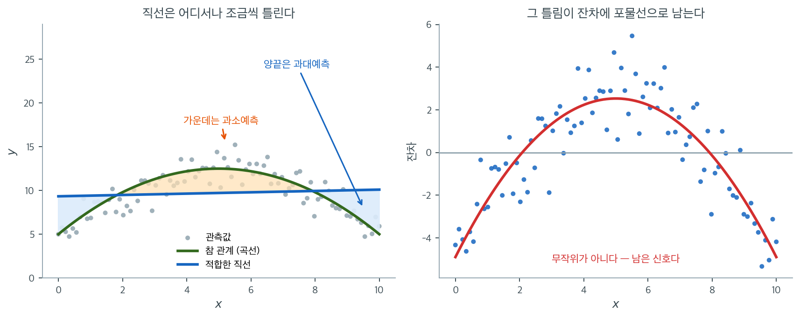
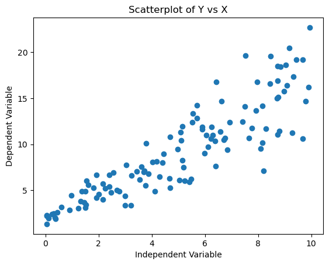
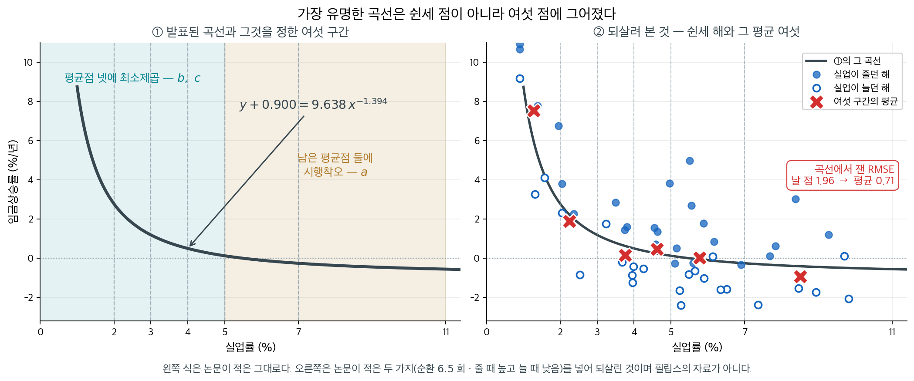
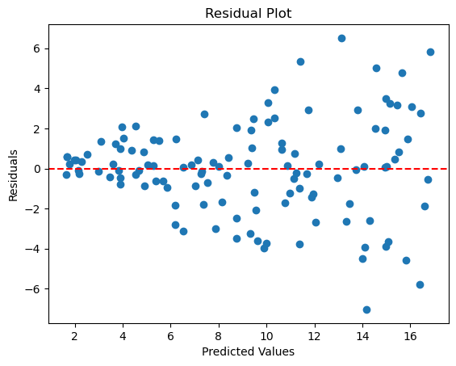
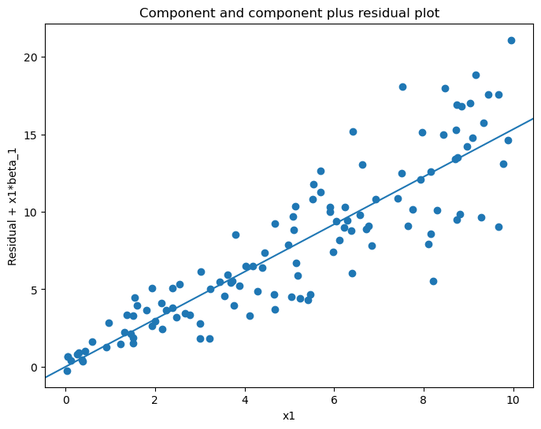

# 선형회귀의 선형성 확인

이 쪽은 선형성 가정을 적고, 그것이 깨졌을 때 무엇이 망가지는지 수로 보이고, 확인하는 방법 네 가지를 차례로 다룬다.

---

## 1. 선형성 가정

<div class="defn" markdown>

### 정의 1. 선형성 { .dfn }

선형성 가정은 종속변수와 각 독립변수 사이에 직선 관계가 있다고 상정한다. 곧 종속변수의 변화가 독립변수의 변화에 비례한다는 뜻이다.

</div>

### 수학적 표현

독립변수가 하나인 단순선형회귀 모형에서 관계는 다음과 같이 쓸 수 있다.

$$
Y = \beta_0 + \beta_1 X + \epsilon
$$

여기서

- $Y$는 종속변수,
- $\beta_0$은 절편,
- $\beta_1$은 회귀직선의 기울기,
- $X$는 독립변수,
- $\epsilon$은 오차항이다.

설명변수가 $p$개인 다중선형회귀에서는

$$
Y = \beta_0 + \beta_1 X_1 + \beta_2 X_2 + \cdots + \beta_p X_p + \epsilon
$$

선형성 가정은 $Y$의 기댓값이 $X$ 변수들의 선형함수임을 요구한다.

$$
E[Y \mid X_1, \ldots, X_p] = \beta_0 + \beta_1 X_1 + \cdots + \beta_p X_p
$$

### 위배하면 무엇이 망가지는가

선형성은 결정적으로 중요하다. 변수들 사이의 관계가 선형이 아니면 모형이 참 관계를 과대 또는 과소 추정하게 되어 다음을 낳는다.

- **편향된 예측** — 예측값에 체계적인 오차가 생긴다.
- **타당하지 않은 통계적 추론** — 신뢰구간과 가설검정을 믿을 수 없게 된다.
- **나쁜 모형 적합** — 모형이 자료의 참된 패턴을 포착하지 못한다.



왼쪽 그림의 참 관계는 $y = 5 + 3x - 0.30x^2$ 이고 잡음의 표준편차는 $1.4$ 다. 여기에 직선 하나를 적합했다. 최소제곱은 제 일을 충실히 해서 잔차제곱합을 가장 작게 만들었지만, 그 대가로 **어느 구간에서도 맞지 않는** 직선을 내놓았다. 주황으로 칠한 가운데 구간에서는 직선이 참 곡선 아래에 놓여 체계적으로 과소예측하고, 파랗게 칠한 양 끝에서는 위에 놓여 과대예측한다. 표본이 작아서 생긴 우연이 아니다. 표본을 아무리 키워도 색칠된 두 덩어리는 그대로 남는다.

오른쪽은 같은 적합의 잔차를 $x$ 에 대해 찍은 것이다. 구간별로 잔차 평균을 재 보면 $x < 2$ 에서 $-2.16$, $4 < x < 6$ 에서 $+2.80$, $x > 8$ 에서 $-2.42$ 다. 잡음의 표준편차가 $1.4$ 였으니 이 체계적인 치우침은 잡음보다 두 배가량 크다. 잔차란 정의상 모형이 설명하지 못하고 남긴 것인데, 그 남은 것에 이렇게 또렷한 모양이 있다면 그것은 **잡음이 아니라 아직 꺼내지 못한 신호**다. 잔차그림에서 곡선을 찾는 일이 선형성 진단의 거의 전부인 이유가 여기에 있다.

이 그림이 말해 주는 손해가 무엇인지도 분명히 해 두자. 망가지는 것은 표준오차가 아니라 **계수의 뜻 자체**다. 적합된 직선의 기울기는 $0.08$ 로 거의 $0$ 이다. 출력표만 보면 "$x$ 는 $y$ 와 관계가 없다"고 읽게 되지만, 그림 속 관계는 아주 강하다. 다만 방향이 도중에 뒤집힐 뿐이다. 이런 손해는 로버스트 표준오차 같은 사후 보정으로는 고칠 수 없고, $x^2$ 항을 넣거나 변수를 변환해서 **모형 자체를 고쳐야** 사라진다. 그리고 앞서 보았듯 $x^2$ 항을 넣은 모형도 여전히 선형회귀다.

---

## 2. 설정

이 페이지의 진단은 모두 아래 자료와 모형 하나를 놓고 수행한다.

<div class="exbox" markdown>

**보기 1.** <span class="diff easy" title="쉬움"></span> 진단에 쓸 모형 준비. 자료는 $X \sim U(0,10)$, $Y = 2 + 1.5X + \varepsilon$이고 $\varepsilon \mid X \sim N\big(0,\, \sigma(X)^2\big)$, $\sigma(x) = 0.5 + 0.35x$다. **선형성은 성립하고 등분산성만 깨져 있다.**

**(1)** 이 모형의 **모집단 $R^2$**

$$
R^2_{\text{pop}} = \frac{\operatorname{Var}\big(E[Y \mid X]\big)}{\operatorname{Var}(Y)}
$$

를 닫힌 꼴로 구하시오.

**(2)** 모형을 적합해 표본 $R^2$을 얻고, (1)의 값과 견주시오. 어긋난다면 그 크기가 설명되는가.

</div>

??? success "풀이"

    **(1) 해석적으로.** $E[Y \mid X] = 2 + 1.5X$이므로 분자는

    $$
    \operatorname{Var}(2 + 1.5X) = 1.5^2 \operatorname{Var}(X) = 2.25 \cdot \frac{10^2}{12} = 2.25 \cdot \frac{25}{3} = 18.75
    $$

    이다. 분모는 전분산 분해로 가른다.

    $$
    \operatorname{Var}(Y) = \operatorname{Var}\big(E[Y\mid X]\big) + E\big[\operatorname{Var}(Y \mid X)\big] = 18.75 + E\big[\sigma(X)^2\big]
    $$

    남은 것은 $E[\sigma(X)^2]$ 하나다. $X \sim U(0,10)$이므로 $E[X] = 5$, $E[X^2] = \operatorname{Var}(X) + 25 = \tfrac{25}{3} + 25 = \tfrac{100}{3}$이고

    $$
    E[(0.5 + 0.35X)^2] = 0.25 + 0.35 E[X] + 0.1225\, E[X^2]
    = 0.25 + 1.75 + 0.1225 \cdot \tfrac{100}{3} = \frac{73}{12} = 6.08\overline{3}
    $$

    이다(가운데 항의 계수는 $2 \cdot 0.5 \cdot 0.35 = 0.35$다). 따라서

    $$
    R^2_{\text{pop}} = \frac{18.75}{18.75 + 6.0833} = \frac{18.75}{24.8333} = 0.7550
    $$

    이다. **이 $0.755$가 자료를 아무리 많이 모아도 넘을 수 없는 천장이다.** 모형이 완벽하게 옳아도 $R^2$이 1이 되지 않는 것은 오차가 있기 때문이며, **$R^2$은 모형이 맞는지를 재는 수가 아니라 신호 대 잡음의 비를 재는 수**라는 뜻이다. 이 페이지의 진단들이 $R^2$이 아니라 잔차의 **무늬**를 보는 이유가 여기 있다.

    **(2) 수치적으로.**

    ```python
    import numpy as np
    import pandas as pd
    import statsmodels.api as sm

    rng = np.random.default_rng(7)
    n = 120

    # X는 균등, Y는 X에 선형으로 의존하되 오차의 분산이 X와 함께 커진다.
    # 이렇게 두면 선형성은 성립하고 등분산성만 깨져, 각 진단이 무엇을
    # 잡아내고 무엇을 놓치는지 구분해 볼 수 있다.
    X = rng.uniform(0, 10, n)
    Y = 2.0 + 1.5 * X + rng.normal(0, 0.5 + 0.35 * X, n)

    df = pd.DataFrame({"X": X, "Y": Y})
    model = sm.OLS(Y, sm.add_constant(X)).fit()
    residuals = model.resid
    fitted = model.fittedvalues

    print(f"beta_hat = {model.params.round(4)}")
    print(f"R^2 = {model.rsquared:.4f}")
    ```

    출력:

    ```
    beta_hat = [1.5933 1.5317]
    R^2 = 0.7813
    ```

    (1)의 값과 견주고, 표본을 키우면 어디로 가는지 본다.

    ```python
    import numpy as np
    import statsmodels.api as sm

    # (1) 의 두 조각
    var_signal = 1.5 ** 2 * (10 ** 2 / 12)
    e_sigma2 = 0.25 + 0.35 * 5 + 0.35 ** 2 * (100 / 3)
    print(f"Var(E[Y|X]) = {var_signal:.4f}")
    print(f"E[sigma(X)^2] = {e_sigma2:.4f}   (= 73/12)")
    print(f"R^2_pop = {var_signal / (var_signal + e_sigma2):.4f}")
    print(f"표본 R^2 (n = 120) = {model.rsquared:.4f}")

    # 같은 모형에서 40만 개를 뽑으면 어디로 가는가
    big = np.random.default_rng(5)
    Xb = big.uniform(0, 10, 400_000)
    Yb = 2 + 1.5 * Xb + big.normal(0, 0.5 + 0.35 * Xb)
    print(f"표본 R^2 (n = 400000) = {sm.OLS(Yb, sm.add_constant(Xb)).fit().rsquared:.4f}")

    # 기울기가 참값에서 얼마나 떨어져 있는가 (참 SE 로 재면)
    Sxx = ((X - X.mean()) ** 2).sum()
    c = (X - X.mean()) / Sxx
    se_true = np.sqrt((c ** 2 * (0.5 + 0.35 * X) ** 2).sum())
    print(f"\nb1 = {model.params[1]:.4f},  참 SE = {se_true:.4f},  "
          f"(b1 - 1.5)/SE = {(model.params[1] - 1.5) / se_true:+.3f}")
    ```

    출력:

    ```
    Var(E[Y|X]) = 18.7500
    E[sigma(X)^2] = 6.0833   (= 73/12)
    R^2_pop = 0.7550
    표본 R^2 (n = 120) = 0.7813
    표본 R^2 (n = 400000) = 0.7542

    b1 = 1.5317,  참 SE = 0.0825,  (b1 - 1.5)/SE = +0.384
    ```

    **유도한 $R^2_{\text{pop}} = 0.7550$이 맞는다.** $n = 400{,}000$에서 표본 $R^2$이 $0.7542$로 수렴하는 것이 그 확인이다. $n = 120$에서의 $0.7813$은 그보다 $0.026$ 높은데, 표본 $R^2$이 위로 치우치는 추정량이라 그렇다. 표본 하나에서 나온 값이니 이 정도 흔들림은 당연하다.

    기울기도 멀쩡하다. $\hat\beta_1 = 1.5317$이 참값 $1.5$에서 참 표준오차의 $0.38$배 떨어져 있을 뿐이다. **이분산이 있어도 추정값 자체는 치우치지 않는다**는 것을 다시 확인하는 셈이며, 이 페이지가 묻는 선형성은 멀쩡하다는 뜻이기도 하다. 이제 그 멀쩡함을 **진단으로** 확인할 수 있는지, 그리고 멀쩡하지 않을 때 진단이 잡아내는지를 차례로 본다.

---

## 3. 산점도를 이용한 시각적 점검

**산점도**는 선형성을 확인하는 가장 간단하고 직관적인 방법이다. 각 독립변수를 종속변수에 대해 그려 관계가 직선처럼 보이는지 눈으로 확인할 수 있다.

**절차:**

1. **자료 그리기:** 각 독립변수에 대해 $y$축에 종속변수, $x$축에 독립변수를 두고 산점도를 그린다.
2. **모양 평가:** 자료점들의 전반적인 모양을 관찰한다. 선형 관계라면 대체로 직선 주위에 모인 점구름으로 나타난다.
3. **패턴 찾기:** 자료점이 곡선이나 그 밖의 비선형 패턴을 이루면 선형성 가정이 위배되었을 가능성이 높다.

**예시:**

<div class="exbox" markdown>

**보기 2.** <span class="diff easy" title="쉬움"></span> 산점도로 보기

**(1)** 산점도를 그려 읽히는 것을 수치와 함께 적으시오.

**(2)** 산점도가 **놓치는 크기의 곡률**이 있는지 알아보시오. 자료에 $a(x-5)^2$을 더해 가며, 산점도에 보이기 전에 형식적 검정이 먼저 반응하는지 확인하시오.

</div>

??? success "풀이"

    **(1) 수치적으로.**

    ```python
    import matplotlib.pyplot as plt
    import numpy as np

    plt.rcParams["font.sans-serif"] = ["NanumGothic", "Apple SD Gothic Neo", "Malgun Gothic"]
    plt.rcParams["font.family"] = "sans-serif"
    plt.rcParams["axes.unicode_minus"] = False

    # 설명변수가 하나뿐이면 산점도가 선형성을 보는 가장 곧은 방법이다.
    # 변수가 여럿이면 다른 변수의 효과가 섞이므로 아래 잔차 그림으로 가야 한다.
    plt.scatter(X, Y)
    plt.xlabel('Independent Variable')
    plt.ylabel('Dependent Variable')
    plt.title('Scatterplot of Y vs X')
    plt.show()

    print(f"corr(X, Y) = {np.corrcoef(X, Y)[0, 1]:.4f}")
    print(f"그 제곱    = {np.corrcoef(X, Y)[0, 1] ** 2:.4f}   (= 단순회귀의 R^2)")
    ```

    출력:

    ```
    corr(X, Y) = 0.8839
    그 제곱    = 0.7813   (= 단순회귀의 R^2)
    ```

    

    점들이 직선 주위에 모여 있고 굽은 자리가 없다. 상관이 $0.8839$, 그 제곱이 보기 1의 $R^2 = 0.7813$과 같다(상수항이 있는 단순회귀에서는 늘 그렇다). 오른쪽으로 갈수록 세로 폭이 넓어지는 것도 이미 보이는데, **그것은 선형성이 아니라 등분산성의 문제**다. 한 그림이 두 가정을 동시에 보여 주는 셈이며, 폭의 변화를 수로 적는 일은 [13.3절](checking_homoscedasticity.md)의 몫이다.

    **(2) 산점도가 못 보는 곡률.** 자료에 $a(x-5)^2$을 더해 $a$를 키워 가며 세 가지를 나란히 잰다. 산점도가 눈으로 말해 주는 상관계수, 이차항의 $t$값, 그리고 AIC의 변화다.

    ```python
    import numpy as np
    import statsmodels.api as sm

    print(f"{'a':>6}{'corr(X,Y)':>11}{'선형 R^2':>11}{'t(x^2)':>9}{'p':>11}{'dAIC':>9}")
    for a in (0.00, 0.05, 0.10, 0.20):
        Yc = Y + a * (X - 5) ** 2
        m1 = sm.OLS(Yc, sm.add_constant(X)).fit()
        m2 = sm.OLS(Yc, sm.add_constant(np.column_stack((X, X ** 2)))).fit()
        print(f"{a:>6.2f}{np.corrcoef(X, Yc)[0, 1]:>11.4f}{m1.rsquared:>11.4f}"
              f"{m2.tvalues[2]:>9.3f}{m2.pvalues[2]:>11.2e}{m2.aic - m1.aic:>+9.2f}")
    ```

    출력:

    ```
         a  corr(X,Y)     선형 R^2   t(x^2)          p     dAIC
      0.00     0.8839     0.7813    1.380   1.70e-01    +0.06
      0.05     0.8770     0.7691    3.161   2.00e-03    -7.83
      0.10     0.8653     0.7487    4.941   2.61e-06   -20.74
      0.20     0.8295     0.6881    8.502   7.04e-14   -55.73
    ```

    **$a = 0.05$ 줄이 이 보기의 요점이다.** 상관계수가 $0.8839$에서 $0.8770$으로 $0.007$ 움직였을 뿐이고 $R^2$도 $0.781 \to 0.769$라 산점도를 나란히 놓고 보아도 어느 쪽이 굽었는지 가려낼 수 없다. $x$의 범위가 $0$에서 $10$이고 기울기가 $1.5$라 $Y$가 $15$가량 움직이는데, 곡률이 더하는 양은 양끝에서 $0.05 \times 25 = 1.25$에 지나지 않는다. **점구름의 세로 폭(잔차의 표준편차 $2.4$)보다도 작은 휘어짐이다.**

    그런데 이차항의 $t$값은 $1.380$에서 $3.161$로 뛰고 p-값이 $0.002$가 되며 AIC도 $7.8$ 좋아진다. **눈이 못 보는 곡률을 검정은 본다.** 산점도는 1차 점검이지 결론이 아니며, 그래서 보기 3의 잔차 그림과 보기 5의 이차항 검정이 뒤따라야 한다.

    반대 방향도 기억할 일이다. $a$를 키우면 상관계수와 $R^2$이 **내려간다.** 실제 관계가 굽어 있을수록 직선 적합의 설명력이 떨어지는 것인데, $R^2$만 보는 사람은 이것을 "잡음이 늘었다"로 읽기 쉽다. 잡음이 아니라 **모형이 틀린 것**이고, 그 둘을 가르는 것은 $R^2$이 아니라 잔차의 무늬다.

**해석:**

- 직선 패턴은 선형성 가정이 충족되었을 가능성이 높음을 나타낸다.
- 곡선, 군집, 그 밖의 비선형 패턴은 선형성 가정의 위배 가능성을 시사한다.

<div class="storybox" markdown>

**그림으로 보는 통계학 1.** 쉰세 점을 찍어 놓고 여섯 점에 그었다

위 절차는 「자료를 그리고 모양을 보라」로 시작한다. $1958$ 년에 한 사람은 그 첫 줄까지는 했다. 그리고 곡선을 그을 때 **찍어 둔 점을 쓰지 않았다.**

$1958$ 년 $11$ 월 『Economica』에 **A. W. 필립스**가 「영국의 실업과 화폐임금 변화율의 관계, $1861$–$1957$」을 실었다. 그 논문의 그림 1 이 오늘 교과서마다 실리는 **필립스 곡선**이다. 그림 1 은 $1861$ 년부터 $1913$ 년까지 **해마다 한 점**, 곧 쉰세 점을 찍은 산점도이고 그 위로 곡선이 하나 지나간다.

**그 곡선은 쉰세 점에 맞춘 것이 아니다.**

필립스는 실업률이 $0$–$2$, $2$–$3$, $3$–$4$, $4$–$5$, $5$–$7$, $7$–$11$ 퍼센트에 든 해들끼리 묶어 묶음마다 평균을 냈다(위쪽 끝은 포함한다). 그림 1 의 ✕ 표 여섯이 그것이다. 까닭도 적어 두었다 — 한 구간에는 실업이 **늘던** 해와 **줄던** 해가 섞여 있으니 평균을 내면 경기순환의 효과가 상쇄되고, 그래서 각 ✕ 는 「실업률을 그 수준에 **묶어 두었다면** 임금이 얼마나 올랐을까」에 대한 근사가 된다는 것이다.

곡선은 그 ✕ 여섯에 맞췄다. 그나마 한 번에 맞춘 것도 아니다.



**모수 셋 가운데 둘은 점 넷에서, 하나는 시행착오에서 나왔다.** 꼴을 $y + a = b\,x^{c}$ 로 잡고, $b$ 와 $c$ 는 실업률 $5$ 퍼센트 아래의 ✕ **넷**에 최소제곱으로 맞췄다. 남은 $a$ 는 $5$–$11$ 퍼센트의 ✕ **둘**에 곡선이 되도록 가깝게 지나가게끔 **시행착오로** 골랐다고 논문이 적는다. 그렇게 나온 식이 왼쪽 판의

$$
y + 0.900 = 9.638\,x^{-1.394}
$$

이다.

오른쪽 판은 필립스가 적어 둔 두 가지 — 그 쉰세 해에 경기순환이 $6.5$ 회 있었고 평균 주기가 $8$ 년쯤이라는 것, 그리고 같은 실업 수준에서 실업이 줄던 해의 임금상승이 그 수준의 평균보다 높고 늘던 해는 낮다는 것 — 을 넣어 쉰세 해를 **되살려 본 것**이다. 그의 자료가 아니다. 그래도 평균이 하는 일은 그대로 보인다. 곡선에서 잰 RMSE 가 날 점에서는 $1.96$, ✕ 여섯에서는 $0.71$ 로 **흩어짐이 $2.8$ 분의 일로 줄어든다.** 묶음마다 해가 넷에서 열여덟이니 $\sqrt{n}$ 만큼 줄어드는 것이 당연한데, **당연한 만큼 그림은 설득력을 얻는다.**

**✕ 가 곡선에 붙어 있는 것은 적합이 좋다는 증거가 아니다.** 어떤 곡선을 그어 놓아도 구간 평균은 그 곡선에 붙는다. 적합을 판정하려면 평균이 아니라 날 점에서 잰 잔차를 보아야 하고, 그것이 다음 절이 하는 일이다. 되살린 판에서 가장 왼쪽 ✕ 는 한 가지를 더 보여 준다. 그 자리의 평균 임금상승률은 $7.52$ 인데 평균 실업률에서 읽은 곡선값은 $5.98$ 이다. **구간이 넓고 곡선이 가파른 곳에서는 평균점 자체가 곡선 위에 있지 않다.** 굽은 함수의 평균은 평균의 함수가 아니기 때문이다.

끝을 적어 둔다. $2011$ 년에 **A. G. 슬리먼**이 『Journal of Economic Perspectives』에 정황 증거를 모아, 필립스가 이 논문에 만족하지 않았고 $1958$ 년에 발표할 생각이 아니었으며 **제임스 미드가 설득해서** 실리게 되었다고 주장했다. 같은 글이 옮긴 바로는 『Economica』 쪽이 이 논문을 「$20$ 세기 거시경제학에서 가장 많이 인용된 글」이라 적는다. **여섯 점에 그은 곡선이 그렇게 되었다.**

_확인한 곳 — 필립스 「The Relation between Unemployment and the Rate of Change of Money Wage Rates in the United Kingdom, 1861–1957」(『Economica』 신판 제$25$ 권 $100$ 호, $1958$ 년 $11$ 월, $283$–$299$ 쪽, [JSTOR 2550759](https://www.jstor.org/stable/2550759))의 본문에서 직접 읽었다 — 그림 1 이 $1861$–$1913$ 년의 해마다 한 점이라는 것, ✕ 여섯이 실업률 $0$–$2$·$2$–$3$·$3$–$4$·$4$–$5$·$5$–$7$·$7$–$11$ 퍼센트 구간의 평균이라는 것(위쪽 끝 포함), 평균을 낸 까닭, $b$ 와 $c$ 를 $0$–$5$ 퍼센트의 ✕ 넷에 최소제곱으로 맞추고 $a$ 를 나머지 둘에 시행착오로 골랐다는 것, 적합된 식 $y + 0.900 = 9.638\,x^{-1.394}$, 그 기간에 경기순환이 $6.5$ 회 있었고 평균 주기가 $8$ 년쯤이라는 것, 임금지수는 펠프스 브라운과 홉킨스의 것이고 실업률은 상무부·노동부 집계를 베버리지 『Full Employment in a Free Society』 표 $22$ 에서 가져왔다는 것 · 슬리먼 「Retrospectives: The Phillips Curve: A Rushed Job?」(『Journal of Economic Perspectives』 제$25$ 권 $1$ 호, $2011$, $223$–$238$ 쪽)의 초록에서 「필립스가 논문에 만족하지 않았고 $1958$ 년에 발표할 생각이 아니었다」, 「제임스 미드가 설득했다고 본다」, 「『Economica』 쪽이 $20$ 세기 거시경제학에서 가장 많이 인용된 글이라 적는다」를 읽었다. 「급하게 한 일」은 슬리먼이 제목에 쓴 말이고 필립스의 말로 확인된 것은 아니다 · 오른쪽 판의 쉰세 해와 그 수는 모두 직접 계산한 값이며 필립스의 자료가 아니다_

</div>

---

## 4. 잔차그림

**잔차그림**은 선형성을 확인하는 또 하나의 강력한 도구이다. 잔차는 관측값과 회귀모형이 예측한 값의 차이이다. 잔차를 예측값에 대해 그리면 선형성 가정이 성립하는지 평가할 수 있다.

**절차:**

1. **선형회귀 모형 적합:** 먼저 모형을 적합하여 예측값을 얻는다.
2. **잔차 그리기:** $x$축에 예측값, $y$축에 잔차를 두고 그린다.
3. **잔차 평가:** 잔차가 수평축 주위에 무작위로 흩어져 있는지 확인한다.

**예시:**

<div class="exbox" markdown>

**보기 3.** <span class="diff easy" title="쉬움"></span> 잔차 그림으로 보기

**(1)** 잔차 그림에 **직선 추세가 나타나는 일은 원리상 없다**는 것을 보이시오. 그러므로 이 그림에서 찾을 것은 곡률뿐이다.

**(2)** 그 곡률을 재는 올바른 방법은 $e$를 $x^2$에 그냥 회귀시키는 것이 아니라 **$x^2$에서 $1$과 $x$로 설명되는 몫을 걷어 낸 나머지**에 회귀시키는 것이다. 그 계수가 보기 5에서 얻을 완전모형의 $\hat\beta_2$와 **정확히 같음**을 확인하시오.

</div>

??? success "풀이"

    **(1) 해석적으로.** 보기 1에서 쓴 설계행렬의 두 열이 $\mathbf 1$과 $\mathbf x$이고 정규방정식이 $X^\top \mathbf e = \mathbf 0$이므로

    $$
    \sum_i e_i = 0,
    \qquad
    \sum_i x_i e_i = 0
    $$

    이다. 적합값 $\hat y_i$는 이 두 열의 선형결합이므로 $\mathbf e$와 $\hat{\mathbf y}$ 역시 직교하고, 평균이 0이라는 조건과 합치면 두 벡터의 표본상관이 **정확히 0**이다. 곧 잔차 그림에 **기울어진 직선 추세는 넣으려야 넣을 수 없다.** 그런 추세가 보인다면 계산을 잘못한 것이다.

    그러므로 이 그림에서 읽을 것은 둘뿐이다. **세로 폭의 변화**(등분산성)와 **휘어짐**(선형성)이다. 휘어짐이 걸리는 자리는 $x^2$이며, $\sum_i x_i^2 e_i$는 위 두 등식에 매이지 않아 자유롭게 0에서 떨어질 수 있다.

    **(2) 해석적으로.** 완전모형 $\mathbf y = \beta_0 \mathbf 1 + \beta_1 \mathbf x + \beta_2 \mathbf x^2 + \mathbf u$를 생각하자. $M$을 $\{\mathbf 1, \mathbf x\}$ 위로의 사영을 빼는 행렬이라 하면 $\mathbf e = M\mathbf y$이고, Frisch–Waugh–Lovell 정리에 따라

    $$
    \hat\beta_2 = \frac{(M\mathbf x^2)^\top \mathbf y}{(M\mathbf x^2)^\top (M\mathbf x^2)}
    $$

    이다. $M$이 대칭이고 멱등이므로 분자는 $(\mathbf x^2)^\top M \mathbf y = (M\mathbf x^2)^\top \mathbf e$로도 적힌다. 곧

    $$
    \hat\beta_2 = \frac{(M\mathbf x^2)^\top \mathbf e}{\lVert M\mathbf x^2 \rVert^2}
    $$

    이고, 이것은 **잔차 $\mathbf e$를 $M\mathbf x^2$에 (상수항 없이) 회귀시킨 계수**다. $\mathbf x^2$을 그냥 쓰면 안 되는 까닭도 분명하다. $\mathbf x^2$에는 $\mathbf 1$과 $\mathbf x$ 방향의 성분이 섞여 있고 $\mathbf e$는 그 두 방향과 직교하므로, 그 성분들이 분모만 키워 계수를 끌어내린다.

    ```python
    import numpy as np
    import statsmodels.api as sm

    e = model.resid
    predictions = model.fittedvalues

    # 그림이 아니라 수로 확인한다. 직교 조건 두 개는 적합이 강제한다.
    print(f"sum e_i      = {e.sum():+.2e}")
    print(f"sum x_i e_i  = {(X * e).sum():+.2e}")
    print(f"sum x_i^2 e_i = {(X ** 2 * e).sum():+.4f}   (이것만 자유롭다)")

    # x^2 에서 1 과 x 로 설명되는 몫을 걷어 낸 나머지
    x2_resid = sm.OLS(X ** 2, sm.add_constant(X)).fit().resid
    fwl = sm.OLS(e, x2_resid).fit()
    full = sm.OLS(Y, sm.add_constant(np.column_stack((X, X ** 2)))).fit()
    print(f"\nFWL 로 구한 beta2   = {fwl.params[0]:.15f}")
    print(f"완전모형의 beta2    = {full.params[2]:.15f}")
    print(f"\nFWL 의 t  = {fwl.tvalues[0]:.4f}  (자유도 {int(fwl.df_resid)})")
    print(f"완전모형의 t = {full.tvalues[2]:.4f}  (자유도 {int(full.df_resid)})")
    print(f"두 t 의 비 = {fwl.tvalues[0] / full.tvalues[2]:.6f},  "
          f"sqrt(119/117) = {np.sqrt(119 / 117):.6f}")
    ```

    출력:

    ```
    sum e_i      = +4.23e-13
    sum x_i e_i  = +2.79e-12
    sum x_i^2 e_i = +272.5912   (이것만 자유롭다)

    FWL 로 구한 beta2   = 0.038757372543221
    완전모형의 beta2    = 0.038757372543221

    FWL 의 t  = 1.3919  (자유도 119)
    완전모형의 t = 1.3802  (자유도 117)
    두 t 의 비 = 1.008511,  sqrt(119/117) = 1.008511
    ```

    

    **유도가 맞는다.** 두 등식이 $10^{-12}$ 수준으로 0이고, FWL이 준 $\hat\beta_2$가 완전모형의 값과 소수점 열다섯째 자리까지 같다.

    **$t$값은 미세하게 다르다.** $1.3919$ 대 $1.3802$인데, 두 회귀의 잔차제곱합은 같지만 자유도가 $119$와 $117$로 다르기 때문이다. 보조회귀는 이미 써 버린 두 모수를 세지 않아 $s^2$을 작게 잡고, 그만큼 $t$를 부풀린다. 비가 정확히 $\sqrt{119/117} = 1.008511$이다. **계수를 FWL로 구하는 것은 안전하지만 유의성은 완전모형에서 읽어야 한다**는 뜻이다.

    그림 자체로 돌아오면, 잔차가 0 주위에 흩어져 있고 휘어진 무늬가 없다. 곡률을 수로 재면 $\hat\beta_2 = 0.0388$, $t = 1.38$로 유의하지 않다. 다만 오른쪽으로 갈수록 세로 폭이 커지는 것이 뚜렷한데, (1)에서 말한 대로 **같은 그림이 읽어 주는 두 가지 가운데 둘째**이고 선형성이 아니라 등분산성의 문제다.

**해석:**

- **무작위 흩어짐:** 잔차가 뚜렷한 패턴 없이 0 주위에 무작위로 흩어져 있으면 선형성 가정이 충족되었을 가능성이 높다.
- **잔차의 패턴:** 잔차에 곡선 패턴, 체계적인 군집, 그 밖의 구조가 있으면 비선형성을 나타내며 선형모형이 적절하지 않을 수 있음을 시사한다.

---

## 5. 성분+잔차 그림(부분잔차 그림)

**성분+잔차(CPR) 그림**은 **부분잔차 그림**이라고도 하며, 잔차그림의 개념을 확장하여 다중회귀에서 개별 설명변수의 선형성을 평가하게 해 준다.

**수학적 정의:**

다중회귀 모형의 설명변수 $X_j$에 대해 부분잔차는 다음으로 정의된다.

$$
e_j^{(\text{부분})} = \hat{\beta}_j X_j + e
$$

여기서 $\hat{\beta}_j$는 $X_j$의 추정된 계수이고 $e$는 완전모형의 통상적인 잔차이다.

**절차:**

1. **완전모형 적합:** 다중선형회귀 모형을 적합한다.
2. **부분잔차 계산:** 각 독립변수에 대해 잔차에 추정계수와 설명변수의 곱을 더한 부분잔차를 그린다.
3. **선형성 평가:** 부분잔차와 설명변수의 관계가 선형인지 확인한다.

**예시:**

<div class="exbox" markdown>

**보기 4.** <span class="diff easy" title="쉬움"></span> 성분-잔차 그림. 부분잔차는 $\hat\beta_j x_{ji} + e_i$다.

**(1)** 설명변수가 $x$ 하나뿐일 때 부분잔차가 $y_i - \hat\beta_0$과 **정확히 같음**을 보이시오. 그러므로 이 그림은 보기 2의 산점도를 세로로 평행이동한 것일 뿐이다. 또 부분잔차에 그은 최소제곱 직선의 기울기가 **언제나 정확히 $\hat\beta_j$**임을 보이시오.

**(2)** 두 사실을 확인하고, 설명변수가 둘일 때 이 그림이 비로소 무엇을 해 주는지 수치로 보이시오.

</div>

??? success "풀이"

    **(1) 해석적으로.** 설명변수가 하나면 $\hat y_i = \hat\beta_0 + \hat\beta_1 x_i$이고 $e_i = y_i - \hat y_i$이므로

    $$
    \hat\beta_1 x_i + e_i = \hat\beta_1 x_i + y_i - \hat\beta_0 - \hat\beta_1 x_i = y_i - \hat\beta_0
    $$

    이다. **세로축이 $y_i$에서 상수 $\hat\beta_0$을 뺀 것일 뿐**이므로 점의 배치가 산점도와 한 치도 다르지 않다. 단순회귀에서 CCPR 그림은 새 정보를 주지 않는다.

    기울기는 일반적인 경우에도 깔끔하다. 부분잔차 $\mathbf r_j = \hat\beta_j \mathbf x_j + \mathbf e$를 $\mathbf x_j$에 (상수항과 함께) 회귀시키면 기울기는

    $$
    \frac{\widehat{\operatorname{cov}}(\mathbf r_j, \mathbf x_j)}{\widehat{\operatorname{var}}(\mathbf x_j)}
    = \hat\beta_j + \frac{\widehat{\operatorname{cov}}(\mathbf e, \mathbf x_j)}{\widehat{\operatorname{var}}(\mathbf x_j)}
    = \hat\beta_j
    $$

    이다. 둘째 항이 사라지는 것은 정규방정식 $\mathbf x_j^\top \mathbf e = 0$ 때문이다. **그림에 그어지는 직선의 기울기는 자료를 보고 정한 것이 아니라 이미 $\hat\beta_j$로 정해져 있다.** 그러므로 이 그림에서 읽을 것은 기울기가 아니라 **점들이 그 직선에서 체계적으로 벗어나는 모양**이다.

    **(2) 수치적으로.**

    ```python
    import statsmodels.api as sm
    from statsmodels.graphics.regressionplots import plot_ccpr
    import matplotlib.pyplot as plt

    # 성분-잔차 그림(CCPR)은 다른 변수의 효과를 걷어 낸 뒤, 관심 있는 변수
    # 하나와 반응의 관계만 남겨 보여 준다. 설명변수가 여럿일 때 선형성을
    # 변수별로 확인하는 방법이다. exog_idx 로 볼 변수를 고른다.
    results = sm.OLS(Y, sm.add_constant(X)).fit()

    fig, ax = plt.subplots(figsize=(8, 6))
    plot_ccpr(results, exog_idx=1, ax=ax)
    plt.show()
    ```

    

    세로축 이름이 `Residual + x1*beta_1`로 적혀 있고, 점의 배치가 보기 2의 산점도와 같은 모양이다. 세로 눈금만 $0$–$20$으로 바뀌었는데 $\hat\beta_0 = 1.59$만큼 내려간 것이다. 수로 확인한다.

    ```python
    import numpy as np
    import statsmodels.api as sm

    b0, b1 = model.params
    partial = b1 * X + model.resid          # CCPR 의 세로축

    print(f"max |부분잔차 - (Y - b0)| = {np.abs(partial - (Y - b0)).max():.2e}")
    print(f"부분잔차에 그은 최소제곱 기울기 = "
          f"{sm.OLS(partial, sm.add_constant(X)).fit().params[1]:.12f}")
    print(f"원래 모형의 b1                 = {b1:.12f}")

    # 변수가 둘일 때 비로소 쓸모가 생긴다. X2 가 X1 과 섞여 있는 자료.
    r = np.random.default_rng(11)
    x1 = r.uniform(0, 10, 300)
    x2 = x1 + r.normal(0, 1.0, 300)
    y = 1 + 2.0 * x1 - 1.5 * x2 + r.normal(0, 2.0, 300)
    mm = sm.OLS(y, sm.add_constant(np.column_stack((x1, x2)))).fit()

    marg = sm.OLS(y, sm.add_constant(x2)).fit().params[1]
    part = mm.params[2] * x2 + mm.resid
    cc = sm.OLS(part, sm.add_constant(x2)).fit().params[1]
    print(f"\n참 계수            = -1.5")
    print(f"y 를 x2 에만 회귀   = {marg:+.4f}   (산점도가 보여 주는 기울기)")
    print(f"완전모형의 beta_2   = {mm.params[2]:+.4f}")
    print(f"부분잔차 그림의 기울기 = {cc:+.4f}")
    ```

    출력:

    ```
    max |부분잔차 - (Y - b0)| = 3.55e-15
    부분잔차에 그은 최소제곱 기울기 = 1.531654179791
    원래 모형의 b1                 = 1.531654179791

    참 계수            = -1.5
    y 를 x2 에만 회귀   = +0.2369   (산점도가 보여 주는 기울기)
    완전모형의 beta_2   = -1.5705
    부분잔차 그림의 기울기 = -1.5705
    ```

    **두 주장이 모두 확인된다.** 부분잔차와 $y - \hat\beta_0$의 최대 차이가 $3.6 \times 10^{-15}$이고, 그림의 기울기가 $\hat\beta_1 = 1.531654179791$과 소수점 열두째 자리까지 같다.

    **변수가 둘이 되면 사정이 완전히 달라진다.** $x_2 = x_1 + \text{잡음}$으로 두 변수를 섞어 놓고 $y = 1 + 2x_1 - 1.5x_2 + \varepsilon$을 만들었다. $y$를 $x_2$에만 회귀시키면 기울기가 $+0.2369$로 **부호부터 틀린다.** $x_2$가 $x_1$을 업고 들어와 $x_1$의 양의 효과를 대신 받기 때문이다. $y$ 대 $x_2$ 산점도를 그렸다면 "약한 양의 관계"라고 읽었을 것이다.

    부분잔차 그림의 기울기는 $-1.5705$로 완전모형의 $\hat\beta_2$와 같고 참값 $-1.5$에 가깝다. **$x_1$의 몫을 이미 걷어 낸 잔차 $\mathbf e$ 위에 $\hat\beta_2 \mathbf x_2$만 되얹었기 때문**이며, 이것이 CCPR 그림이 다중회귀에서 하는 일이다. 선형성을 변수별로 보려면 산점도가 아니라 이 그림을 보아야 한다는 말의 내용이 이것이다.

!!! note "`plot_ccpr`와 `plot_partregress`는 다르다"
    성분+잔차(부분잔차) 그림은 `plot_ccpr`이다. 이름이 비슷한 `plot_partregress`는 **부분회귀 그림**(추가변수 그림)으로, $Y$를 나머지 설명변수에 회귀시킨 잔차를 $X_j$를 나머지 설명변수에 회귀시킨 잔차에 대해 그린 것이다. 둘 다 유용하지만 서로 다른 그림이며, `plot_partregress`의 인자 이름도 `exog`가 아니라 `exog_i`이다.

**해석:**

- **선형 추세:** CPR 그림에 직선 추세가 보이면 그 설명변수에 대한 선형성 가정이 충족된다.
- **비선형 추세:** 곡선이나 비선형 추세가 보이면 그 설명변수와 종속변수의 관계가 선형이 아님을 시사한다.

---

## 6. 다항 항 추가하기

종속변수와 독립변수의 관계가 선형이 아니라면 회귀모형에 **다항 항**(제곱항이나 세제곱항 등)을 추가하여 비선형 관계를 포착할 수 있다. 이 방법은 선형회귀의 틀을 유지하면서 곡률을 반영하게 해 준다.

**수학적 정식화:**

설명변수가 하나인 이차 다항 모형:

$$
Y = \beta_0 + \beta_1 X + \beta_2 X^2 + \epsilon
$$

삼차 다항 모형:

$$
Y = \beta_0 + \beta_1 X + \beta_2 X^2 + \beta_3 X^3 + \epsilon
$$

이들도 모수 $\beta_0, \beta_1, \beta_2, \beta_3$에 대해 선형이므로 여전히 **선형회귀** 모형임에 유의하라.

**절차:**

1. **다항 항 포함:** 독립변수의 고차 항을 회귀모형에 추가한다.
2. **모형 재적합:** 다항 항을 포함하여 모형을 적합한다.
3. **선형성 평가:** 다항 항 추가가 모형의 적합을 개선하는지 확인한다(예: $R^2$ 비교, AIC/BIC 사용).

**예시:**

<div class="exbox" markdown>

**보기 5.** <span class="diff easy" title="쉬움"></span> 이차항을 넣어 견주기. 두 모형이 포함관계이고 항이 하나만 늘었다.

**(1)** 변수를 하나 더할 때 AIC의 변화가 그 변수의 $t$값만으로 적힘을 보이시오. 곧

$$
\Delta\mathrm{AIC} = n \log\!\left(1 - \frac{t^2}{t^2 + \nu}\right) + 2,
\qquad \nu = n - p - 1
$$

임을 보이고, $n$이 크면 **AIC가 좋아지는 조건이 $\lvert t \rvert > \sqrt 2$** 임을 결론하시오. BIC라면 문턱이 얼마가 되는가.

**(2)** 이차항을 넣어 적합하고 (1)의 식을 확인하시오.

</div>

??? success "풀이"

    **(1) 해석적으로.** 정규가능도를 쓰면 AIC는 상수를 빼고

    $$
    \mathrm{AIC} = n \log\frac{\mathrm{SSE}}{n} + 2k
    $$

    이다($k$는 모수 개수, 분산을 세는 방식은 두 모형에서 같으므로 차에서 상쇄된다). 항을 하나 더해 $k$가 1 늘고 잔차제곱합이 $\mathrm{SSE}_1 \to \mathrm{SSE}_2$로 바뀌면

    $$
    \Delta\mathrm{AIC} = n \log\frac{\mathrm{SSE}_2}{\mathrm{SSE}_1} + 2
    $$

    이다. 이제 $\mathrm{SSE}$의 비를 $t$값으로 바꾼다. 항을 하나 더하는 경우 $F = t^2$이고

    $$
    t^2 = F = \frac{\mathrm{SSE}_1 - \mathrm{SSE}_2}{\mathrm{SSE}_2 / \nu},
    \qquad \nu = n - p - 1
    $$

    이므로 $\mathrm{SSE}_1 = \mathrm{SSE}_2 (1 + t^2/\nu)$, 곧

    $$
    \frac{\mathrm{SSE}_2}{\mathrm{SSE}_1} = \frac{1}{1 + t^2/\nu} = 1 - \frac{t^2}{t^2 + \nu}
    $$

    이다. 이것을 넣으면 구하는 식이 나온다.

    $n$이 크면 $\log(1 - u) \approx -u$이고 $t^2/(t^2+\nu) \approx t^2/n$이므로

    $$
    \Delta\mathrm{AIC} \approx -t^2 + 2
    $$

    이다. 따라서 **AIC가 좋아지는($\Delta < 0$) 조건은 $t^2 > 2$, 곧 $\lvert t \rvert > \sqrt 2 = 1.414$** 다. 유의성의 관례인 $\lvert t \rvert > 1.96$보다 **무른 문턱**이라는 데 유의하라. AIC는 예측을 겨냥하므로 유의하지 않은 변수도 더러 받아들인다.

    BIC는 벌점이 $2k$ 대신 $k \log n$이므로 같은 계산에서 $\Delta\mathrm{BIC} \approx -t^2 + \log n$이고 문턱이 $\lvert t \rvert > \sqrt{\log n}$이다. $n = 120$이면 $\sqrt{\log 120} = 2.188$로 $1.96$보다 **엄하다.** **같은 자료를 놓고 AIC는 넣자 하고 BIC는 빼자 하는 구간이 $1.414 < \lvert t \rvert < 2.188$로 꽤 넓다.**

    **(2) 수치적으로.**

    ```python
    import numpy as np
    import statsmodels.api as sm

    # 곡선이 의심되면 이차항을 넣어 견준다. R^2 는 항을 더하면 반드시 오르므로
    # 판단 근거가 되지 못한다. 벌점이 붙는 AIC 로 보아야 한다.
    X_poly = np.column_stack((X, X**2))
    model_quad = sm.OLS(Y, sm.add_constant(X_poly)).fit()

    # summary()는 실행 날짜와 시각을 함께 찍으므로 계수 표만 인쇄한다.
    print(model_quad.summary().tables[1])
    print(f"R^2: 선형 {model.rsquared:.4f}  →  이차 {model_quad.rsquared:.4f}")
    print(f"AIC: 선형 {model.aic:.2f}  →  이차 {model_quad.aic:.2f}")
    ```

    출력:

    ```
    ==============================================================================
                     coef    std err          t      P>|t|      [0.025      0.975]
    ------------------------------------------------------------------------------
    const          2.2252      0.628      3.545      0.001       0.982       3.468
    x1             1.1466      0.289      3.971      0.000       0.575       1.718
    x2             0.0388      0.028      1.380      0.170      -0.017       0.094
    ==============================================================================
    R^2: 선형 0.7813  →  이차 0.7848
    AIC: 선형 549.02  →  이차 549.08
    ```

    (1)의 식과 맞춰 본다.

    ```python
    import numpy as np

    t = model_quad.tvalues[2]
    nu = model_quad.df_resid          # n - p - 1 = 117
    dAIC_t = n * np.log(1 - t ** 2 / (t ** 2 + nu)) + 2
    dAIC_sse = n * np.log(model_quad.ssr / model.ssr) + 2

    print(f"t(x^2) = {t:.4f},  t^2 = {t ** 2:.4f},  nu = {int(nu)}")
    print(f"\ndAIC  (t 로)       = {dAIC_t:+.6f}")
    print(f"dAIC  (SSE 비로)   = {dAIC_sse:+.6f}")
    print(f"dAIC  (실제)       = {model_quad.aic - model.aic:+.6f}")
    print(f"큰 n 근사 -t^2 + 2 = {-t ** 2 + 2:+.6f}")

    print(f"\nAIC 문턱 sqrt(2)      = {np.sqrt(2):.4f}")
    print(f"BIC 문턱 sqrt(log n)  = {np.sqrt(np.log(n)):.4f}")
    print(f"dBIC (실제)           = {model_quad.bic - model.bic:+.6f}")
    ```

    출력:

    ```
    t(x^2) = 1.3802,  t^2 = 1.9048,  nu = 117

    dAIC  (t 로)       = +0.062043
    dAIC  (SSE 비로)   = +0.062043
    dAIC  (실제)       = +0.062043
    큰 n 근사 -t^2 + 2 = +0.095152

    AIC 문턱 sqrt(2)      = 1.4142
    BIC 문턱 sqrt(log n)  = 2.1880
    dBIC (실제)           = +2.849535
    ```

    **유도한 식이 소수점 여섯째 자리까지 맞는다.** $t$만으로 계산한 $\Delta\mathrm{AIC}$, $\mathrm{SSE}$ 비로 계산한 것, `statsmodels`가 보고한 실제 차이가 모두 $+0.062043$이다. 큰 $n$ 근사 $-t^2 + 2 = +0.095$는 $n = 120$에서 $0.03$쯤 어긋나는데, $\log(1-u) \approx -u$의 이차 오차이므로 예상된 크기다.

    **$\lvert t \rvert = 1.3802$가 문턱 $1.4142$ 바로 아래다.** 그래서 AIC가 $0.06$만큼 나빠진다. 간발의 차이이며, 이 자료에 이차항이 **거의 필요할 뻔했다**는 뜻이 아니라 **잡음이 우연히 이차항 모양을 조금 흉내 냈다**는 뜻이다. 자료를 실제로 직선으로 만들었으니 참말은 $\beta_2 = 0$이고, 진단이 거짓 양성을 내지 않은 것이 옳은 결과다. BIC는 $+2.85$로 훨씬 단호하게 거절한다.

    $R^2$을 보라. $0.7813 \to 0.7848$로 **올랐다.** 포함관계인 모형에 항을 더하면 $R^2$은 결코 내려가지 않으므로 이 상승은 아무것도 말해 주지 않는다. 보기 2에서 본 $a = 0.05$의 자료에서는 $t$가 $3.161$이어서 $\Delta\mathrm{AIC} = -7.83$으로 뚜렷이 좋아졌다. **같은 $R^2$의 상승이라도 그것이 벌점을 넘느냐가 판단의 기준**이고, 그 기준을 $t$ 하나로 읽는 법이 (1)의 식이다.

**해석:**

- **적합 개선:** 다항 모형이 적합을 유의하게 개선하면(예: $R^2$ 상승, 제곱항 계수가 유의) 원래 관계가 비선형이었음을 시사한다.
- **개선 없음:** 유의한 개선이 없으면 원래의 선형성 가정이 여전히 타당할 수 있다.

---

## 7. 선형성 진단 요약

| 방법 | 유형 | 적합한 상황 | 핵심 지표 |
|--------|------|----------|---------------|
| 산점도 | 시각적 | 단순회귀, 1차 평가 | 점구름의 비선형 패턴 |
| 잔차그림 | 시각적 | 모든 회귀모형 | 잔차의 곡선 패턴 |
| CPR 그림 | 시각적 | 다중회귀 | 부분잔차의 비선형 추세 |
| 다항 항 | 형식적 | 특정 비선형 관계의 검정 | 유의한 고차 계수 |

선형회귀에서 선형성 가정을 확인하는 일은 정확하고 해석 가능한 모형을 만드는 데 결정적이다. 여기서 다룬 방법들은 이 가정의 위배 가능성을 진단하고 대처하는 견실한 도구를 제공한다. 선형성을 신중히 확인하고 필요한 조정을 하면 선형회귀 모형의 신뢰성과 그로부터 끌어낸 결론의 타당성을 높일 수 있다.

---
## 8. 비선형성에 대한 대책

- **변수변환:** 로그, 제곱근, 다항 변환 등을 종속변수나 독립변수에 적용해 선형성을 얻는다.
- **다항 항:** 독립변수의 제곱항이나 세제곱항을 넣어 선형회귀 틀 안에서 곡률을 포착한다.
- **비선형 모형:** 변환으로 해결되지 않으면 비선형 회귀모형을 고려한다.

셋 가운데 다항 항은 **여전히 선형회귀 안에 머문다**(1절 수학적 표현이 요구하는 것은 모수에 대한 선형성이다). 변환은 해석의 척도를 바꾸므로 무엇을 얻고 무엇을 잃는지 따져야 한다. 매끄러운 곡선을 자료가 정하게 두는 길은 13.9절 [스플라인과 일반화가법모형](../splines_gams/index.md)에 있다.

---


## 연습문제

<div class="drillbox" markdown>

**연습문제 1.** <span class="diff med" title="중간"></span>
다중회귀에서 설명변수 $X_2$의 성분+잔차(CPR) 그림에 뚜렷한 U자 곡선이 나타났다. 이 비선형성에 대처하기 위해 모형을 수정하는 두 가지 방법을 기술하라.

</div>

??? success "풀이"

    1. **다항 항 추가:** $X_2^2$을 설명변수로 추가하여 모형을 $Y = \beta_0 + \beta_1 X_1 + \beta_2 X_2 + \beta_3 X_2^2 + \varepsilon$으로 바꾼다. 선형회귀의 틀 안에서 이차 관계를 포착한다.

    2. **변수변환:** 회귀를 적합하기 전에 $\log(X_2)$, $\sqrt{X_2}$ 등 관계를 선형화하는 단조 변환을 $X_2$에 적용한다.

<div class="drillbox" markdown>

**연습문제 2.** <span class="diff med" title="중간"></span>
다중회귀에서 $Y$ 대 $X_j$의 산점도와 $X_j$의 부분잔차 그림이 어떻게 다른지 설명하라. 두 그림이 선형성에 대해 서로 다른 결론을 줄 때는 언제인가?

</div>

??? success "풀이"
    $Y$ 대 $X_j$의 **산점도**는 주변 관계를 보여주며, 다른 설명변수의 효과에 의해 교란되어 있을 수 있다. **부분잔차 그림**(성분+잔차 그림)은 $e + \hat{\beta}_j X_j$를 $X_j$에 대해 그려, 다른 모든 설명변수의 효과를 제거한 뒤 $Y$와 $X_j$의 관계를 분리해 보여준다.

    두 그림은 다른 설명변수가 $X_j$와 상관되어 있을 때 달라진다. 예를 들어 $X_1$과 $X_2$가 양의 상관을 가지며 둘 다 $Y$에 영향을 준다면, $Y$ 대 $X_2$의 산점도는 ($X_1$의 효과가 $X_2$의 효과를 강화하여) 선형으로 보일 수 있지만, $X_1$을 조정한 부분잔차 그림에서는 비선형 부분관계가 드러날 수 있다.

<div class="drillbox" markdown>

**연습문제 3.** <span class="diff med" title="중간"></span>
집값을 면적에 회귀시켰을 때 산점도에서는 선형으로 보이는데 잔차-적합값 그림에는 미묘한 곡률이 보인다. 두 진단이 어긋날 수 있는 이유와 어느 쪽을 믿어야 하는지 설명하라.

</div>

??? success "풀이"
    산점도는 원자료를 보여주므로 분산이 크면 미묘한 비선형성이 가려질 수 있다. 잔차-적합값 그림은 선형 추세를 제거하고 $y$축 눈금을 잔차 범위로 압축하므로 남아 있는 곡률이 훨씬 잘 보인다.

    **잔차-적합값 그림**을 믿어야 한다. 모형의 선형성 가정이 적절한지를 직접 평가하기 때문이다. 산점도는 1차 탐색에는 유용하지만 신호 대 잡음비가 낮을 때 선형성에서의 미묘한 이탈을 탐지하지 못한다.

<div class="drillbox" markdown>

**연습문제 4.** <span class="diff med" title="중간"></span>
보기 1의 모형에서 오차의 표준편차만 바꾸어 본다. 자료생성은 그대로 $X \sim U(0,10)$, $Y = 2 + 1.5X + \varepsilon$이고 $\varepsilon \mid X \sim N\big(0, \sigma(X)^2\big)$다.

**(1)** $\sigma(x) \equiv c$로 **상수**를 쓰면서 보기 1과 똑같은 $R^2_{\text{pop}} = 0.7550$이 나오게 하는 $c$를 구하시오.

**(2)** 이번에는 $\sigma(x) = 0.5 + bx$로 두고 $R^2_{\text{pop}}$을 $b$의 닫힌 꼴로 적으시오. $R^2_{\text{pop}} = 0.5$가 되는 $b$를 구하고, $b \to \infty$에서의 극한을 말하시오.

**(3)** (1)과 (2)가 $R^2$을 선형성 진단으로 쓸 수 없다는 주장에 무엇을 보태는가.

</div>

??? success "풀이"

    **(1)** 보기 1의 분자는 오차의 모양과 무관하게

    $$
    \operatorname{Var}\big(E[Y \mid X]\big) = 1.5^2 \cdot \frac{100}{12} = 18.75
    $$

    이고, 분모의 둘째 조각만 $E[\sigma(X)^2]$로 바뀐다. 상수 $\sigma \equiv c$면 $E[\sigma(X)^2] = c^2$이므로 보기 1의 값과 같아지는 조건은

    $$
    c^2 = E\big[(0.5 + 0.35X)^2\big] = \frac{73}{12} = 6.08\overline{3}
    $$

    이다. 따라서

    $$
    c = \sqrt{73/12} = 2.4664
    $$

    다. 이것이 **보기 1의 이분산 자료와 꼭 같은 $R^2_{\text{pop}}$을 주는 등분산 자료**다.

    **(2)** $X \sim U(0,10)$에서 $E[X] = 5$, $E[X^2] = 100/3$이므로

    $$
    E\big[(0.5 + bX)^2\big] = 0.25 + 2 \cdot 0.5 \cdot b \cdot 5 + b^2 \cdot \frac{100}{3}
    = 0.25 + 5b + \frac{100}{3}b^2
    $$

    이고(보기 1은 $b = 0.35$인 경우로 $0.25 + 1.75 + 4.0833 = 6.0833$이다) 따라서

    $$
    R^2_{\text{pop}}(b) = \frac{18.75}{19 + 5b + \tfrac{100}{3}b^2}
    $$

    다. $R^2_{\text{pop}} = 0.5$ 조건은 분모가 $37.5$라는 것이므로

    $$
    \frac{100}{3}b^2 + 5b - 18.5 = 0
    \quad\Longrightarrow\quad
    b = \frac{-5 + \sqrt{25 + 4 \cdot \tfrac{100}{3} \cdot 18.5}}{2 \cdot \tfrac{100}{3}}
    = \frac{-5 + \sqrt{2491.667}}{66.667}
    = \frac{44.9166}{66.667} = 0.6737
    $$

    이다. $b \to \infty$에서는 분모가 $b^2$으로 커지므로

    $$
    R^2_{\text{pop}}(b) \approx \frac{18.75 \cdot 3}{100\, b^2} = \frac{0.5625}{b^2} \longrightarrow 0
    $$

    이다.

    **(3)** (1)은 **$R^2$이 같아도 오차의 모양은 완전히 다를 수 있음**을 보인다. $\sigma \equiv 2.4664$인 자료와 $\sigma(x) = 0.5 + 0.35x$인 자료는 $R^2_{\text{pop}}$이 소수점 넷째 자리까지 같지만, 전자는 등분산성이 성립하고 후자는 깨져 있다. (2)는 반대쪽을 보인다. **선형성은 $b$와 무관하게 늘 성립하는데도 $R^2$은 $0.755$에서 $0$까지 자유롭게 움직인다.** 두 방향을 합치면 $R^2$은 가정의 위배에 대해 올라가지도 내려가지도 않는 수, 곧 진단으로 쓸 수 없는 수다. 보기 1의 결론이 그것이고, 이 쪽이 $R^2$ 대신 잔차의 무늬를 보는 이유가 그것이다.

<div class="drillbox" markdown>

**연습문제 5.** <span class="diff med" title="중간"></span>
보기 5는 큰 $n$ 근사로 AIC의 문턱이 $\lvert t \rvert > \sqrt 2$라고 했다. 근사하지 말고 정확히 풀어 보자.

**(1)** $\Delta\mathrm{AIC} = n \log\!\big(1 - t^2/(t^2+\nu)\big) + 2 < 0$을 $t^2$에 대해 정확히 풀어

$$
t_*^2 = \nu\big(e^{2/n} - 1\big)
$$

임을 보이시오.

**(2)** $n = 120$, $\nu = 117$에서 $t_*$를 소수점 넷째 자리까지 구하고 $\sqrt 2$와 견주시오. 보기 5의 $\lvert t \rvert = 1.3802$에 대해 두 문턱이 같은 결론을 주는가.

**(3)** BIC에 대해서도 같은 일을 하여 정확한 문턱을 구하고 보기 5의 $\sqrt{\log n} = 2.1880$과 견주시오.

</div>

??? success "풀이"

    **(1)** 보기 5의 중간 단계로 돌아가면 $\Delta\mathrm{AIC} = n \log(\mathrm{SSE}_2/\mathrm{SSE}_1) + 2$이므로 $\Delta\mathrm{AIC} < 0$은

    $$
    \frac{\mathrm{SSE}_2}{\mathrm{SSE}_1} < e^{-2/n}
    $$

    와 동치다. 왼쪽이 $1 - t^2/(t^2+\nu) = (1 + t^2/\nu)^{-1}$이므로 양변의 역수를 취하면 부등호가 뒤집혀

    $$
    1 + \frac{t^2}{\nu} > e^{2/n}
    \quad\Longleftrightarrow\quad
    t^2 > \nu\big(e^{2/n} - 1\big)
    $$

    이다. 곧 $t_*^2 = \nu(e^{2/n}-1)$이다. $\square$

    큰 $n$ 근사와의 관계도 바로 보인다. $e^{2/n} - 1 = \tfrac{2}{n} + \tfrac{2}{n^2} + O(n^{-3})$이므로

    $$
    t_*^2 = 2 \cdot \frac{\nu}{n}\left(1 + \frac{1}{n}\right) + O(n^{-2})
    $$

    이고, $\nu = n - p - 1 < n$이므로 **정확한 문턱은 $\sqrt 2$보다 약간 낮다.**

    **(2)** $n = 120$이면 $e^{2/120} = e^{1/60} = 1.0168065$이므로

    $$
    t_*^2 = 117 \cdot 0.0168065 = 1.96634,
    \qquad t_* = 1.4023
    $$

    다. $\sqrt 2 = 1.4142$보다 $0.0120$ 낮다. 위 근사식으로도 $2 \cdot \tfrac{117}{120} \cdot \tfrac{121}{120} = 1.96625$로 셋째 자리까지 맞는다.

    보기 5의 $\lvert t \rvert = 1.3802$는 $1.4023$보다도 작으므로 **두 문턱이 같은 결론을 준다.** 이차항은 어느 쪽 기준으로도 탈락이다. 다만 여유가 넉넉하지는 않다. 두 문턱이 가르는 구간 $1.4023 < \lvert t \rvert < 1.4142$가 좁기는 해도, 실제 $t$가 그 안에 들면 $\sqrt 2$ 어림은 "넣지 말라"고 하고 정확한 계산은 "넣으라"고 한다. 보기 5의 $t$는 그 구간 아래로 $0.022$ 떨어져 있다.

    **(3)** BIC는 벌점이 $2$ 대신 $\log n$이므로 (1)의 계산에서 $e^{2/n}$만 $e^{\log n / n} = n^{1/n}$으로 바뀐다. 곧

    $$
    t_*^2 = \nu\big(n^{1/n} - 1\big)
    $$

    이다. $n = 120$이면 $\log 120 = 4.78749$, $120^{1/120} = e^{0.0398958} = 1.0407023$이므로

    $$
    t_*^2 = 117 \cdot 0.0407023 = 4.76217,
    \qquad t_* = 2.1822
    $$

    다. 보기 5의 $\sqrt{\log 120} = 2.1880$보다 $0.0058$ 낮다. **AIC 쪽과 같은 방향으로 어긋난다**는 데 유의하라. 두 경우 모두 근사 문턱이 정확한 문턱보다 높으므로, $\sqrt 2$와 $\sqrt{\log n}$을 쓰는 쪽은 변수를 넣는 데 아주 조금 더 인색하다. $n$이 커질수록 $\nu/n \to 1$이라 차이는 사라진다.

<div class="drillbox" markdown>

**연습문제 6.** <span class="diff med" title="중간"></span>
보기 3의 출력에는 $\sum_i x_i^2 e_i = 272.5912$와 $\hat\beta_2 = 0.038757372543221$이 함께 적혀 있다.

**(1)** 이 두 수만으로 $\lVert M\mathbf x^2 \rVert^2$을 구하시오. ($M$은 $\{\mathbf 1, \mathbf x\}$ 위로의 사영을 빼는 행렬이다.)

**(2)** 보기 5가 보고한 두 $R^2$ 값 $0.7813$과 $0.7848$만으로 $\mathrm{SSE}_2/\mathrm{SSE}_1$을 계산하고, 보기 5의 $t = 1.3802$, $\nu = 117$로 계산한 $1 - t^2/(t^2+\nu)$와 견주시오. 그 비로 $\Delta\mathrm{AIC}$를 다시 계산하면 보기 5의 $+0.062043$에서 얼마나 벗어나는가. 왜 그만큼 벗어나는가.

</div>

??? success "풀이"

    **(1)** 보기 3에서 얻은 식은

    $$
    \hat\beta_2 = \frac{(M\mathbf x^2)^\top \mathbf e}{\lVert M \mathbf x^2 \rVert^2}
    $$

    이다. 분자를 손에 있는 수로 바꾸는 것이 요점이다. $M$이 대칭이고 $\mathbf e$는 이미 $\{\mathbf 1, \mathbf x\}$와 직교하므로 $M\mathbf e = \mathbf e$이고

    $$
    (M\mathbf x^2)^\top \mathbf e = (\mathbf x^2)^\top M \mathbf e = (\mathbf x^2)^\top \mathbf e = \sum_i x_i^2 e_i = 272.5912
    $$

    다. 따라서

    $$
    \lVert M\mathbf x^2 \rVert^2 = \frac{272.5912}{0.038757372543221} = 7033.27
    $$

    이고 $\lVert M \mathbf x^2 \rVert = 83.865$다.

    어림으로 맞는지 보아 두면 좋다. $Z = X - 5 \sim U(-5,5)$라 두면 $\mathbf x^2$에서 $\mathbf 1$과 $\mathbf x$의 몫을 걷어 낸 나머지의 모분산은 $\operatorname{Var}(Z^2) - \operatorname{Cov}(Z^2, Z)^2/\operatorname{Var}(Z) = 500/9 - 0 = 55.56$이므로 $n = 120$이면 $120 \times 55.56 = 6667$쯤이 기대되고, 실제값 $7033$은 표본 하나의 흔들림 안이다.

    **(2)** $\mathrm{SSE} = (1 - R^2)\,\mathrm{SST}$이고 두 모형의 $\mathrm{SST}$가 같으므로

    $$
    \frac{\mathrm{SSE}_2}{\mathrm{SSE}_1} = \frac{1 - 0.7848}{1 - 0.7813} = \frac{0.2152}{0.2187} = 0.983996
    $$

    이다. 한편 $t = 1.3802$에서 $t^2 = 1.904952$이고

    $$
    1 - \frac{t^2}{t^2 + \nu} = 1 - \frac{1.904952}{118.904952} = 1 - 0.0160217 = 0.983978
    $$

    이다. **넷째 자리까지 $0.9840$으로 일치한다.**

    그런데 이것으로 $\Delta\mathrm{AIC}$를 다시 계산하면

    $$
    \Delta\mathrm{AIC} = 120 \log(0.983996) + 2 = 120 \times (-0.0161331) + 2 = +0.0640
    $$

    으로, 보기 5의 $+0.062043$에서 $0.002$ 벗어난다. 벗어나는 크기가 설명된다. $\Delta\mathrm{AIC} = n \log r + 2$를 $r$에 대해 미분하면 $n/r$이므로, $r$의 오차가 $n$배로 증폭된다.

    $$
    \delta(\Delta\mathrm{AIC}) \approx \frac{n}{r}\,\delta r = \frac{120}{0.984} \times 1.6 \times 10^{-5} = 0.0020
    $$

    $R^2$을 넷째 자리까지만 적은 탓에 $r$에 $1.6 \times 10^{-5}$의 오차가 들어왔고, 그것이 $120$배로 불어 $0.002$가 된 것이다. **$\Delta\mathrm{AIC}$를 소수점 아래까지 믿으려면 $R^2$ 네 자리로는 부족하다**는 뜻이며, 보기 5가 $R^2$ 대신 $t$값이나 $\mathrm{SSE}$를 거쳐 계산한 것이 옳다. 부호를 가리는 데에는 넉넉하지만($+0.064$와 $+0.062$는 둘 다 양수다) 보기 5의 $t = 1.3802$가 문턱 $1.4023$에 이만큼 가까운 자료에서는 자리수 관리가 곧 결론 관리다.

<div class="drillbox" markdown>

**연습문제 7.** <span class="diff med" title="중간"></span>
시험 점수를 공부 시간에 회귀시킨 단순선형회귀에서 잔차그림에 뚜렷한 포물선 패턴이 나타났다. 이 비선형성을 포착할 수학적 모형을 쓰고, 그것이 어떻게 여전히 선형회귀의 틀 안에 있는지 설명하라.

</div>

??? success "풀이"
    적절한 모형은

    $$
    Y = \beta_0 + \beta_1 X + \beta_2 X^2 + \varepsilon
    $$

    $X^2$ 항이 있음에도 이것은 여전히 **선형회귀** 모형이다. "선형"이란 설명변수가 아니라 **모수**($\beta_0, \beta_1, \beta_2$)에 대한 선형성을 뜻하기 때문이다. 새 변수 $X_2 = X^2$을 만들어 $Y = \beta_0 + \beta_1 X_1 + \beta_2 X_2 + \varepsilon$을 적합하면 OLS로 추정할 수 있다.

<div class="drillbox" markdown>

**연습문제 8.** <span class="diff med" title="중간"></span>
선형성의 위배와 올바른 함수 형태의 위배가 어떻게 다른지 설명하라. 선형성 가정을 만족하면서도 모형이 잘못 설정될 수 있는가?

</div>

??? success "풀이"
    **선형성 가정**은 $E[Y|X]$가 모수의 선형함수라는 것이다. **함수 형태의 오설정**은 포함된 항들이 선형으로 들어가더라도 모형이 관련 설명변수나 변환을 빠뜨렸다는 뜻이다.

    그렇다. 모형이 선형성을 만족하면서도 잘못 설정될 수 있다. 예를 들어 $Y = \beta_0 + \beta_1 X + \varepsilon$은 모수에 대해 선형이지만, 참 관계가 $Y = \beta_0 + \beta_1 X + \beta_2 Z + \varepsilon$인데 $Z$를 빠뜨렸다면 선형성 가정은 위배되지 않았어도 누락변수 편향으로 모형이 잘못 설정된 것이다.

<div class="drillbox" markdown>

**연습문제 9.** <span class="diff med" title="중간"></span>
1절 그림의 참 관계는 $f(x) = 5 + 3x - 0.30x^2$ 이고 $x$ 는 구간 $[0, 10]$ 에 고르게 퍼져 있다.

(a) $f$ 가 최대가 되는 $x$ 와 그때의 값을 구하라.

(b) $f(0)$ 과 $f(10)$ 을 구하고, 구간 전체에서 $f$ 의 평균값 $\frac{1}{10}\int_0^{10} f(x)\,dx$ 를 구하라.

(c) 적합된 직선의 기울기가 $0.08$ 로 보고된 것이 이 표본에서 우연히 생긴 일이 아님을 (a) 와 (b) 의 값으로 설명하라.

</div>

??? success "풀이"
    (a) $f'(x) = 3 - 0.6x = 0$ 에서 $x = 5$ 이고 $f''(x) = -0.6 < 0$ 이므로 이 점이 최대다.

    $$
    f(5) = 5 + 3(5) - 0.30(25) = 5 + 15 - 7.5 = 12.5
    $$

    (b) $f(0) = 5$ 이고 $f(10) = 5 + 30 - 30 = 5$ 다. 평균값은

    $$
    \frac{1}{10}\int_0^{10}\left(5 + 3x - 0.30x^2\right)dx = \frac{1}{10}\Big[\,5x + 1.5x^2 - 0.1x^3\,\Big]_0^{10} = \frac{50 + 150 - 100}{10} = 10
    $$

    (c) 양 끝에서 참 평균이 같다. $x$ 가 $0$ 에서 $10$ 으로 가는 동안 $E[Y \mid x]$ 는 $5 \to 12.5 \to 5$ 로 올라갔다 내려와 제자리로 돌아온다. 직선 하나가 담을 수 있는 것은 "전체적으로 올라가는가 내려가는가"뿐인데 여기서는 그 총변화가 정확히 $0$ 이다. 그러므로 기울기가 거의 $0$ 으로 나온 것은 표본이 작아서가 아니라 설계가 꼭짓점 $x = 5$ 를 가운데 두고 대칭이어서 생긴 구조적인 결과다. 보고된 $0.08$ 은 그 $0$ 주위의 잡음일 뿐이다. 연습문제 5 에서 이 $0$ 을 정확히 계산한다.

<div class="drillbox" markdown>

**연습문제 10.** <span class="diff med" title="중간"></span>
정의 1 과 연습문제 7 에서 "선형"은 변수가 아니라 모수에 대한 선형을 뜻한다고 했다. 다음 네 모형 가운데 어느 것이 (필요하면 변수나 모수를 바꿔 쓴 뒤) 최소제곱으로 적합할 수 있는 선형모형인지 판정하고, 아닌 것은 왜 아닌지 밝혀라. $\varepsilon$ 은 오차항이고 $X > 0$ 이라고 보아도 된다.

(a) $Y = \beta_0 + \beta_1 \log X + \varepsilon$

(b) $Y = \beta_0 X^{\beta_1} e^{\varepsilon}$

(c) $Y = \beta_0 + X^{\beta_1} + \varepsilon$

(d) $Y = \beta_0 + \beta_1 X + \beta_1^2 X^2 + \varepsilon$

</div>

??? success "풀이"
    (a) **선형모형이다.** $X_1 = \log X$ 로 두면 $Y = \beta_0 + \beta_1 X_1 + \varepsilon$ 이고 계수는 그대로 일차로 들어온다. 변수에 대한 비선형성은 선형성 가정과 아무 상관이 없다.

    (b) **변환하면 선형모형이다.** 양변에 로그를 취하면

    $$
    \log Y = \log \beta_0 + \beta_1 \log X + \varepsilon
    $$

    이므로 $\gamma_0 = \log\beta_0$ 로 두고 $\log Y$ 를 $\log X$ 에 회귀시키면 된다. 여기서 오차가 **곱셈형** $e^{\varepsilon}$ 이라는 것이 결정적이다. 덧셈형 $Y = \beta_0 X^{\beta_1} + \varepsilon$ 이었다면 $\log(\beta_0X^{\beta_1} + \varepsilon)$ 이 쪼개지지 않아 로그가 아무것도 해 주지 못한다. 또 적합한 뒤의 해석도 바뀐다. 최소제곱이 맞추는 대상은 $E[\log Y \mid X]$ 이고 $E[Y \mid X]$ 가 아니다.

    (c) **선형모형이 아니다.** $\beta_1$ 이 자료의 지수 자리에 있어서 "알고 있는 설명변수 $\times$ 모르는 계수"의 합으로 분해되지 않는다. $\beta_0$ 을 모르는 상태에서는 $Y - \beta_0$ 에 로그를 취할 수도 없으므로 어떤 변수변환으로도 선형이 되지 않는다. 비선형최소제곱이 필요하다.

    (d) **선형모형이 아니다.** $X$ 의 이차다항식이라 연습문제 1 의 모형과 닮아 보이지만, 두 계수가 $\beta_2 = \beta_1^2$ 으로 묶여 있어 자유로운 모수는 $\beta_0, \beta_1$ 둘뿐이고 $\beta_1$ 이 제곱으로 들어온다. $X$ 와 $X^2$ 을 그냥 OLS 에 넣으면 제약이 없는 모형 $\beta_0 + \beta_1X + \beta_2X^2$ 을 적합하는 것이어서 다른 모형이다.

    판정 기준은 언제나 **계수가 들어오는 방식** 하나다. (a) 는 변수가 휘어도 선형이고 (d) 는 변수가 다항식이어도 선형이 아니다.

<div class="drillbox" markdown>

**연습문제 11.** <span class="diff hard" title="어려움"></span>
보기 3에서 FWL 보조회귀의 $t$값과 완전모형의 $t$값의 비가 정확히 $\sqrt{119/117}$이었다. 이것을 일반화한다. 기저모형이 상수항을 포함해 모수 $k$개를 쓰고(보기 3은 $\{\mathbf 1, \mathbf x\}$로 $k = 2$), 거기에 항 하나를 더해 완전모형을 만든다고 하자.

**(1)** 보조회귀(기저모형 잔차 $\mathbf e$를 $M\mathbf x^2$에 상수항 없이 회귀)의 잔차벡터가 완전모형의 잔차벡터와 **같다**는 것을 보이시오. 따라서 두 회귀의 $\mathrm{SSE}$가 같다.

**(2)** 그러므로 두 $t$값의 비가

$$
\frac{t_{\text{보조}}}{t_{\text{완전}}} = \sqrt{\frac{n-1}{n-k-1}}
$$

임을 보이고, 보기 3의 $\sqrt{119/117}$을 되얻으시오.

**(3)** $k = 2$일 때 이 부풀림이 $1\%$ 미만이 되는 가장 작은 $n$을 구하시오. $n = 30$이라면 보조회귀의 $t$를 $1.96$과 견주는 사람이 완전모형의 어떤 $t$ 구간에서 결론을 뒤집게 되는가.

</div>

??? success "풀이"

    **(1)** $M$을 기저모형의 열공간 위로의 사영을 빼는 행렬이라 하자. 기저모형 잔차는 $\mathbf e = M\mathbf y$다. FWL 정리에 따라 완전모형의 잔차 $\hat{\mathbf u}$는

    $$
    \hat{\mathbf u} = M\mathbf y - \hat\beta_2 \, M\mathbf x^2 = \mathbf e - \hat\beta_2\, M\mathbf x^2
    $$

    로 적힌다. 한편 보조회귀 $\mathbf e \sim M\mathbf x^2$의 계수는 보기 3에서 본 대로 같은 $\hat\beta_2$이므로 그 잔차는

    $$
    \mathbf e - \hat\beta_2 \, M\mathbf x^2
    $$

    로 **글자 그대로 같은 벡터**다. 따라서 $\mathrm{SSE}_{\text{보조}} = \mathrm{SSE}_{\text{완전}} =: S$다. $\square$

    **(2)** 두 회귀는 계수 $\hat\beta_2$도 같고 그 계수에 붙는 설계 벡터 $M\mathbf x^2$도 같으므로 표준오차는 오차분산 추정값에서만 갈린다.

    $$
    \mathrm{se} = \frac{s}{\lVert M\mathbf x^2 \rVert},
    \qquad
    s_{\text{보조}}^2 = \frac{S}{n-1},
    \qquad
    s_{\text{완전}}^2 = \frac{S}{n-k-1}
    $$

    보조회귀는 설명변수 하나에 상수항이 없으니 자유도가 $n-1$이고, 완전모형은 $k+1$개를 썼으니 $n-k-1$이다. $t = \hat\beta_2/\mathrm{se}$이므로

    $$
    \frac{t_{\text{보조}}}{t_{\text{완전}}}
    = \frac{\mathrm{se}_{\text{완전}}}{\mathrm{se}_{\text{보조}}}
    = \frac{s_{\text{완전}}}{s_{\text{보조}}}
    = \sqrt{\frac{n-1}{n-k-1}}
    $$

    다. $\square$ 보기 3은 $n = 120$, $k = 2$이므로 $\sqrt{119/117} = 1.008511$이고, 출력의 $1.3919/1.3802 = 1.008511$과 같다.

    **(3)** $k = 2$면 비가 $\sqrt{(n-1)/(n-3)}$이다. 이것이 $1.01$ 미만이려면

    $$
    \frac{n-1}{n-3} < 1.0201
    \quad\Longleftrightarrow\quad
    n - 1 < 1.0201n - 3.0603
    \quad\Longleftrightarrow\quad
    n > \frac{2.0603}{0.0201} = 102.50
    $$

    이므로 **$n = 103$**이 가장 작다. 보기 3의 $n = 120$은 이미 그 위라서 부풀림이 $0.85\%$에 그쳤다.

    $n = 30$이면 비가 $\sqrt{29/27} = 1.03638$로 올라간다. 보조회귀의 $t$가 $1.96$을 넘는다는 것은

    $$
    t_{\text{완전}} > \frac{1.96}{1.03638} = 1.8912
    $$

    라는 뜻이므로, **완전모형의 $\lvert t \rvert$가 $1.8912$와 $1.96$ 사이에 있는 자료에서 결론이 뒤집힌다.** 작은 표본에서는 이 구간이 결코 좁지 않다. 보기 3의 결론, 곧 계수는 FWL로 구해도 안전하지만 유의성은 완전모형에서 읽어야 한다는 말이 $n$이 작아질수록 무거워진다.

<div class="drillbox" markdown>

**연습문제 12.** <span class="diff hard" title="어려움"></span>
보기 2는 자료에 $a(X-5)^2$을 더해 가며 선형적합의 $R^2$이 내려가는 것을 보았다($a = 0, 0.05, 0.10, 0.20$에서 $0.7813, 0.7691, 0.7487, 0.6881$). 이 하락을 모집단 수준에서 계산한다. 자료생성은 $Y_a = 2 + 1.5X + a(X-5)^2 + \varepsilon$, $X \sim U(0,10)$, $\varepsilon$은 보기 1과 같다.

**(1)** $\operatorname{Cov}\big(X, (X-5)^2\big) = 0$임을 보이고, 따라서 모집단 최소제곱 직선의 **기울기가 $a$와 무관하게 $1.5$**임을 결론하시오. 절편은 어떻게 되는가.

**(2)** 그 직선의 모집단 $R^2$을 $a$의 닫힌 꼴로 구하고 $a = 0.05, 0.10, 0.20$에서 값을 계산하시오. $R^2$이 $0.5$로 떨어지는 $a$는 얼마인가.

**(3)** (2)의 하락폭과 보기 2의 표본 하락폭을 견주면 표본 쪽이 두어 배 크다. 보기 3의 $\sum_i x_i^2 e_i = 272.5912$와 연습문제 6의 $\lVert M\mathbf x^2 \rVert^2 = 7033.27$을 써서 그 까닭을 설명하시오.

</div>

??? success "풀이"

    **(1)** $Z = X - 5$라 두면 $Z \sim U(-5,5)$로 $0$에 대해 대칭이다. 대칭성에서 $E[Z] = E[Z^3] = 0$이므로

    $$
    \operatorname{Cov}(X, Z^2) = \operatorname{Cov}(Z, Z^2) = E[Z^3] - E[Z]E[Z^2] = 0 - 0 = 0
    $$

    이다. 모집단 최소제곱 기울기는 $\operatorname{Cov}(Y_a, X)/\operatorname{Var}(X)$이고

    $$
    \operatorname{Cov}(Y_a, X) = 1.5 \operatorname{Var}(X) + a \operatorname{Cov}(Z^2, X) + \operatorname{Cov}(\varepsilon, X) = 1.5 \operatorname{Var}(X)
    $$

    이므로 기울기가 **정확히 $1.5$**다. 절편은 $E[Y_a] - 1.5 E[X] = (2 + a E[Z^2]) - 0 = 2 + \tfrac{25}{3}a$로, $a$와 함께 올라간다. **곡률을 $X$의 평균에 맞춰 중심화해 두었기 때문에** 곡률이 기울기를 건드리지 못하고 절편으로만 흘러간 것이다.

    **(2)** 기울기가 $1.5$로 고정이므로 설명되는 분산은 $18.75$ 그대로다. 분모만 커진다. $\operatorname{Cov}(X, Z^2) = 0$이고 $\varepsilon$이 독립이므로 세 조각이 깨끗이 갈린다.

    $$
    \operatorname{Var}(Y_a) = 1.5^2 \operatorname{Var}(X) + a^2 \operatorname{Var}(Z^2) + E\big[\sigma(X)^2\big]
    = 18.75 + a^2 \operatorname{Var}(Z^2) + \frac{73}{12}
    $$

    $Z \sim U(-5,5)$에서 $E[Z^4] = \tfrac{1}{10}\int_{-5}^{5} z^4\,dz = 125$, $E[Z^2] = \tfrac{25}{3}$이므로

    $$
    \operatorname{Var}(Z^2) = 125 - \left(\frac{25}{3}\right)^2 = 125 - \frac{625}{9} = \frac{500}{9} = 55.5556
    $$

    다. 따라서

    $$
    R^2_{\text{pop}}(a) = \frac{18.75}{24.8333 + 55.5556\,a^2}
    $$

    이고 값은 다음과 같다.

    | $a$ | $R^2_{\text{pop}}$ | 모집단 하락폭 | 보기 2의 표본 $R^2$ | 표본 하락폭 |
    |---|---|---|---|---|
    | $0$ | $0.7550$ | — | $0.7813$ | — |
    | $0.05$ | $0.7508$ | $-0.0042$ | $0.7691$ | $-0.0122$ |
    | $0.10$ | $0.7385$ | $-0.0165$ | $0.7487$ | $-0.0326$ |
    | $0.20$ | $0.6930$ | $-0.0620$ | $0.6881$ | $-0.0932$ |

    $R^2_{\text{pop}} = 0.5$는 분모가 $37.5$라는 뜻이므로

    $$
    55.5556\,a^2 = 37.5 - 24.8333 = 12.6667,
    \qquad a^2 = 0.228,
    \qquad a = 0.4775
    $$

    다. 그때 양 끝에서 곡률이 더하는 양은 $0.4775 \times 25 = 11.9$로, 직선이 훑는 폭 $1.5 \times 10 = 15$에 맞먹는다. **$R^2$을 반으로 떨어뜨리려면 곡률이 직선만큼 커져야 한다**는 것이니, 보기 2가 쓴 $a = 0.05$ 따위는 $R^2$ 쪽에서 보면 거의 아무것도 아니다.

    **(3)** 표본에서는 모집단에 없는 항이 하나 더 붙는다. $\mathbf q = (\mathbf x - 5)^2$이라 두면 $M\mathbf q = M(\mathbf x^2 - 10\mathbf x + 25) = M\mathbf x^2$이고, 선형적합의 잔차제곱합은

    $$
    \mathrm{SSE}(a) = \lVert M(\mathbf y + a\mathbf q)\rVert^2 = \lVert \mathbf e + a M\mathbf x^2\rVert^2
    = \mathrm{SSE}(0) + 2a\,(M\mathbf x^2)^\top\mathbf e + a^2 \lVert M\mathbf x^2\rVert^2
    $$

    이다. 연습문제 6에서 본 대로 $(M\mathbf x^2)^\top \mathbf e = \sum_i x_i^2 e_i = 272.5912$이므로

    $$
    \mathrm{SSE}(a) = \mathrm{SSE}(0) + 545.18\,a + 7033.27\,a^2
    $$

    다. **$a$에 대해 일차인 항이 있다.** 모집단 계산에서는 $\operatorname{Cov}(\varepsilon, Z^2) = 0$이라 이 항이 사라져 $a^2$만 남았는데, 표본에서는 $\sum_i x_i^2 e_i$가 정확히 $0$이 아니고(보기 3이 "이것만 자유롭다"고 한 바로 그 양이다) 이 표본에서는 하필 **양수**다. $a = 0.05$에서 일차항은 $545.18 \times 0.05 = 27.3$을 더하고 이차항은 $7033.27 \times 0.0025 = 17.6$을 더하니, 일차항이 오히려 더 크다. 그래서 표본 $R^2$이 모집단보다 빠르게 내려간다.

    두 가지를 함께 기억할 일이다. 하락의 **방향**은 모집단 공식이 옳게 말해 주지만, 하락의 **크기**는 한 표본에서 $\sum_i x_i^2 e_i$의 부호와 크기에 매여 있다. 표본이 우연히 반대 부호를 가졌다면 작은 $a$에서 $R^2$이 잠깐 **올라가는** 것도 가능하다. $R^2$으로 곡률을 재지 말라는 말의 또 한 겹이다.

<div class="drillbox" markdown>

**연습문제 13.** <span class="diff hard" title="어려움"></span>
보기 2의 표에서 이차항의 $t$값이 $a = 0, 0.05, 0.10, 0.20$에 대해 $1.380, 3.161, 4.941, 8.502$였다. 이 네 수가 하나의 직선 위에 있다.

**(1)** 자료 $\mathbf y$에 $a(\mathbf x - 5)^2$을 더하면 이차모형의 적합에서 $\hat\beta_2$는 **정확히 $a$만큼** 커지고, 잔차벡터와 $\mathrm{se}(\hat\beta_2)$는 **전혀 바뀌지 않음**을 보이시오.

**(2)** 그러므로 $t$는 $a$의 일차함수다. $a = 0$인 줄의 $\hat\beta_2 = 0.038757$과 $t = 1.3802$만으로 $a = 0.05, 0.10, 0.20$의 $t$값을 예측하고 표와 견주시오.

**(3)** 이 자료에서 AIC가 이차항을 받아들이기 시작하는 $a$를 구하시오(연습문제 5의 정확한 문턱 $1.4023$을 쓰시오). 그 $a$에서 양 끝의 휘어짐은 잔차 표준편차 $2.4$의 몇 배인가. 이 결과를 어떻게 읽어야 하는가.

</div>

??? success "풀이"

    **(1)** $\mathbf q = (\mathbf x - 5)^2 = \mathbf x^2 - 10\mathbf x + 25 \cdot \mathbf 1$은 이차모형의 열공간 $\operatorname{span}\{\mathbf 1, \mathbf x, \mathbf x^2\}$ **안에** 있다. 사영 $P$는 선형이고 그 공간 위에서 항등이므로

    $$
    P(\mathbf y + a\mathbf q) = P\mathbf y + a\mathbf q
    $$

    이고, 따라서 잔차는

    $$
    (I - P)(\mathbf y + a \mathbf q) = (I-P)\mathbf y
    $$

    로 **$a$와 무관하다.** 계수 쪽을 보면 $a\mathbf q$가 더해진 것이 좌표로는 $a(25, -10, 1)^\top$만큼 더해진 것이므로

    $$
    \hat\beta_0(a) = \hat\beta_0 + 25a,
    \qquad
    \hat\beta_1(a) = \hat\beta_1 - 10a,
    \qquad
    \hat\beta_2(a) = \hat\beta_2 + a
    $$

    다. 끝으로 $\mathrm{se}(\hat\beta_2) = s\sqrt{[(X^\top X)^{-1}]_{33}}$에서 설계행렬 $X$는 손대지 않았고 $s^2 = \mathrm{SSE}/117$도 잔차가 그대로이니 그대로다. $\square$

    **(2)** 따라서

    $$
    t(a) = \frac{\hat\beta_2 + a}{\mathrm{se}}, \qquad
    \mathrm{se} = \frac{0.038757}{1.3802} = 0.0280810
    $$

    이다. 이 하나로 나머지 줄이 모두 나온다.

    | $a$ | $\hat\beta_2 + a$ | 예측 $t$ | 보기 2의 표 |
    |---|---|---|---|
    | $0.05$ | $0.088757$ | $3.1608$ | $3.161$ |
    | $0.10$ | $0.138757$ | $4.9413$ | $4.941$ |
    | $0.20$ | $0.238757$ | $8.5024$ | $8.502$ |

    **세 줄이 소수점 셋째 자리까지 맞는다.** 보기 2의 표는 네 번 회귀를 돌려 얻은 것이지만, 실제로는 첫 줄 하나에서 산술로 나오는 값이었다.

    **(3)** $t(a) = 1.4023$을 풀면

    $$
    a = 1.4023 \times 0.0280810 - 0.038757 = 0.039377 - 0.038757 = 0.00062
    $$

    다($\sqrt 2 = 1.4142$를 문턱으로 쓰면 $a = 0.00096$으로, 어느 쪽이든 $0.001$ 안쪽이다). 그 $a$에서 양 끝의 휘어짐은

    $$
    a \cdot 25 = 0.00062 \times 25 = 0.0155
    $$

    로 잔차 표준편차 $2.4$의 **$0.0065$배**, 곧 백분의 일에도 못 미친다. 산점도든 잔차 그림이든 이것을 볼 길은 전혀 없다. 참고로 $\lvert t \rvert = 1.96$에 이르려면 $a = 1.96 \times 0.0280810 - 0.038757 = 0.0163$이 필요하다.

    **읽는 법이 중요하다.** 이 결과는 "AIC가 곡률을 $0.0006$까지 잡아낸다"는 뜻이 **아니다.** $t$는 참 $\beta_2$가 아니라 추정값 $\hat\beta_2$를 재고, 이 표본은 참값이 $\beta_2 = 0$인데도 잡음 때문에 $\hat\beta_2 = 0.0388$이라는 값을 이미 들고 있다. 문턱까지의 거리가 $0.00062$뿐인 것은 자료가 예민해서가 아니라 **표본이 우연히 문턱 바로 아래에 서 있어서**다. $\mathrm{se} = 0.0281$이 말해 주듯 이 자료가 실제로 분간할 수 있는 곡률의 크기는 $a \approx 0.028$ 수준이며, 그것이 보기 2에서 $a = 0.05$가 눈에는 안 보이면서 검정에는 걸린 까닭이다. **AIC의 판정은 모집단의 곡률에 대한 진술이 아니라 이 표본의 $\hat\beta_2$에 대한 진술이다.**

<div class="drillbox" markdown>

**연습문제 14.** <span class="diff hard" title="어려움"></span>
보기 4 (2)의 둘째 자료를 모집단 수준에서 따져 본다. $x_1 \sim U(0,10)$, $x_2 = x_1 + u$, $u \sim N(0, v)$가 $x_1$과 독립, $y = 1 + 2x_1 - 1.5x_2 + \varepsilon$이고 $\varepsilon$은 둘과 독립이다.

**(1)** $y$를 $x_2$에만 회귀시킬 때의 모집단 기울기를 $v$의 함수로 구하시오. $v = 1$에서의 값이 보기 4의 $+0.2369$와 맞는가.

**(2)** 그 기울기가 **정확히 $0$**이 되는 $v$를 구하시오. $v = 0$과 $v \to \infty$에서의 값도 구하고, 기울기가 $v$에 대해 단조인지 말하시오.

**(3)** 부분잔차 그림은 $v$가 얼마든 $\hat\beta_2$를 보여 준다. (1)–(2)를 근거로, 다중회귀에서 산점도로 선형성을 보려 할 때 **가장 위험한 $v$ 근방**은 어디이며 무엇을 잘못 읽게 되는지 적으시오.

</div>

??? success "풀이"

    **(1)** $\operatorname{Var}(x_1) = 100/12 = 25/3$이고 $u$가 $x_1$과 독립이므로

    $$
    \operatorname{Cov}(x_1, x_2) = \operatorname{Var}(x_1) = \frac{25}{3},
    \qquad
    \operatorname{Var}(x_2) = \frac{25}{3} + v
    $$

    다. $\varepsilon$이 독립이므로

    $$
    \operatorname{Cov}(y, x_2) = 2\operatorname{Cov}(x_1, x_2) - 1.5 \operatorname{Var}(x_2)
    = 2 \cdot \frac{25}{3} - 1.5\left(\frac{25}{3} + v\right)
    = \frac{25}{6} - 1.5 v
    $$

    이고 따라서 주변 기울기는

    $$
    \beta^{\text{주변}}(v) = \frac{\tfrac{25}{6} - 1.5v}{\tfrac{25}{3} + v}
    = -1.5 + \frac{2 \cdot \tfrac{25}{3}}{\tfrac{25}{3} + v}
    $$

    다. 둘째 꼴이 생략변수 공식 그대로여서 읽기 좋다. 참 계수 $-1.5$에 $x_1$의 효과 $2$가 $\operatorname{Cov}(x_1,x_2)/\operatorname{Var}(x_2)$만큼 섞여 들어온다.

    $v = 1$이면

    $$
    \beta^{\text{주변}}(1) = \frac{4.16667 - 1.5}{9.33333} = \frac{2.66667}{9.33333} = \frac{2}{7} = 0.2857
    $$

    이다. 보기 4의 표본값 $+0.2369$($n = 300$)와 **같은 자리에 있다.** 중요한 것은 부호이며, 둘 다 참값 $-1.5$와 반대인 양수다.

    **(2)** 분자가 $0$이면 되므로

    $$
    \frac{25}{6} = 1.5 v
    \quad\Longrightarrow\quad
    v = \frac{25}{9} = 2.7778,
    \qquad \sqrt v = \frac{5}{3} = 1.6667
    $$

    이다. 양끝은

    $$
    \beta^{\text{주변}}(0) = -1.5 + 2 = 0.5,
    \qquad
    \lim_{v \to \infty} \beta^{\text{주변}}(v) = -1.5
    $$

    다. $v = 0$은 $x_2 = x_1$인 완전공선이어서 주변 기울기가 두 효과의 합 $\beta_1 + \beta_2 = 0.5$가 되는 것이 맞고, $v \to \infty$는 $x_2$가 $x_1$과 사실상 무관해져 주변 기울기가 참값 $-1.5$로 간다. 둘째 꼴에서 $v$가 커질수록 더해지는 항이 단조감소하므로 기울기는 **$0.5$에서 $-1.5$로 단조감소**한다.

    **(3)** 가장 위험한 자리는 **$v = 25/9$ 근방**이다. 거기서 $y$ 대 $x_2$ 산점도는 기울기가 $0$인 평평한 점구름을 보여 준다. 읽는 사람은 "$x_2$는 $y$와 아무 관계가 없다"고 결론하고 변수를 빼려 하겠지만, 참말은 $\beta_2 = -1.5$로 모형 안에서 **가장 큰 효과 가운데 하나**다. 부호가 뒤집히는 $v < 25/9$ 구간도 나쁘지만, 거기서는 적어도 "관계가 있다"는 것은 맞게 읽는다. $v = 25/9$에서는 관계의 존재 자체를 놓친다.

    선형성 진단의 말로 바꾸면 이렇다. 산점도가 평평하면 곡률을 볼 바탕 자체가 사라진다. 기울기를 $0$으로 깎아 놓은 그림에서는 $x_2$와 $y$ 사이의 휘어짐도 함께 가려지므로, **곡률이 있는지조차 물을 수 없다.** 보기 4가 보인 대로 부분잔차 그림은 $v$와 무관하게 기울기를 $\hat\beta_2$로 되돌려 놓고 그 위의 벗어남을 드러내므로, 다중회귀에서 변수별 선형성은 산점도가 아니라 그 그림에서 읽어야 한다.

<div class="drillbox" markdown>

**연습문제 15.** <span class="diff hard" title="어려움"></span>
참 평균함수가 $f(x) = \beta_0 + \beta_1 x + \beta_2 x^2$ 인데 $Y$ 를 $X$ 에 직선으로 회귀시킨다고 하자. 표본이 커질 때 최소제곱 추정값이 수렴하는 값은 최선의 선형근사의 계수, 곧

$$
b_1 = \frac{\operatorname{Cov}(X, Y)}{\operatorname{Var}(X)}, \qquad b_0 = E[Y] - b_1 E[X]
$$

다. $E[\epsilon \mid X] = 0$ 을 가정한다.

(a) $b_1 = \beta_1 + \beta_2 \dfrac{\operatorname{Cov}(X, X^2)}{\operatorname{Var}(X)}$ 임을 보여라.

(b) $X$ 의 분포가 평균 $\mu$ 에 대해 대칭이면 $\operatorname{Cov}(X, X^2) = 2\mu\operatorname{Var}(X)$ 임을 보이고, 따라서 $b_1 = f'(\mu)$ 임을 확인하라.

(c) 2 절 그림의 값 $(\beta_0, \beta_1, \beta_2) = (5,\, 3,\, -0.30)$ 과 $X \sim U(0, 10)$ 에 대해 $b_1$ 과 $b_0$ 를 구하라.

</div>

??? success "풀이"
    (a) $Y = f(X) + \epsilon$ 이고 $E[\epsilon \mid X] = 0$ 이므로 $\operatorname{Cov}(X, \epsilon) = 0$ 이다. 따라서

    $$
    \operatorname{Cov}(X, Y) = \operatorname{Cov}\!\left(X,\ \beta_0 + \beta_1 X + \beta_2 X^2\right) = \beta_1 \operatorname{Var}(X) + \beta_2 \operatorname{Cov}(X, X^2)
    $$

    양변을 $\operatorname{Var}(X)$ 로 나누면 주어진 식이 된다.

    (b) $X = \mu + Z$ 로 쓰면 $Z$ 는 $0$ 에 대해 대칭이므로 $E[Z] = 0$, $E[Z^3] = 0$ 이다. $X^2 = \mu^2 + 2\mu Z + Z^2$ 이고 상수는 공분산에 영향이 없으므로

    $$
    \operatorname{Cov}(X, X^2) = \operatorname{Cov}\!\left(Z,\ 2\mu Z + Z^2\right) = 2\mu\operatorname{Var}(Z) + E[Z^3] = 2\mu\operatorname{Var}(X)
    $$

    이를 (a) 에 넣으면 $b_1 = \beta_1 + 2\mu\beta_2$ 이고, $f'(x) = \beta_1 + 2\beta_2 x$ 이므로 $b_1 = f'(\mu)$ 다. 대칭설계에서 직선이 보고하는 기울기는 **$X$ 의 평균에서의 접선 기울기**다.

    (c) $X \sim U(0,10)$ 이면 $E[X^k] = 10^k/(k+1)$ 이므로 $\mu = 5$, $E[X^2] = 100/3 \approx 33.33$, $E[X^3] = 250$ 이고

    $$
    \operatorname{Var}(X) = \frac{100}{3} - 25 = \frac{100}{12} \approx 8.333, \qquad \operatorname{Cov}(X, X^2) = 250 - 5\cdot\frac{100}{3} \approx 83.33
    $$

    비는 $83.33 / 8.333 = 10 = 2\mu$ 로 (b) 와 맞는다. 그러므로

    $$
    b_1 = 3 + (-0.30)(10) = 0, \qquad b_0 = E[Y] - 0 = E[f(X)] = 10
    $$

    여기서 $E[f(X)] = 10$ 은 연습문제 3(b) 에서 이미 구한 값이다. 기울기의 수렴값이 **정확히 $0$** 이므로 표본을 키워도 $0.08$ 은 $0$ 근처를 맴돌 뿐이다. 더 나쁜 것은 $n$ 이 커지면 신뢰구간이 **틀린 값 $0$** 주위로 좁아져 "관계가 없다"는 오독이 점점 더 확신에 차게 된다는 점이다. 로버스트 표준오차가 못 고친다는 본문의 말이 바로 이 뜻이다.

<div class="drillbox" markdown>

**연습문제 16.** <span class="diff hard" title="어려움"></span>
연습문제 15 에서 모집단 적합선이 $\hat y = 10$ (기울기 $0$, 절편 $10$) 임을 얻었다. 잡음을 평균으로 지운 **체계적 잔차**를 $r(x) = f(x) - 10$ 이라 하자.

(a) $r(x)$ 를 쓰고 그 부호가 바뀌는 두 $x$ 값을 구하라.

(b) 구간 $x < 2$, $4 < x < 6$, $x > 8$ 에서 $r$ 의 평균값을 각각 구하라.

(c) (b) 의 값을 본문이 보고한 $-2.16$, $+2.80$, $-2.42$ 와 잡음의 표준편차 $1.4$ 에 비교하라. 또 $2 < x < 4$ 와 $6 < x < 8$ 에서 잔차 평균의 부호를 예측하라.

</div>

??? success "풀이"
    (a) $r(x) = 5 + 3x - 0.30x^2 - 10 = -5 + 3x - 0.30x^2$ 이다. $r(x) = 0$ 은 $0.30x^2 - 3x + 5 = 0$ 과 같으므로

    $$
    x = \frac{3 \pm \sqrt{9 - 4(0.30)(5)}}{2(0.30)} = \frac{3 \pm \sqrt{3}}{0.6} = 2.113 \ \text{ 또는 } \ 7.887
    $$

    따라서 $r < 0$ 인 구간은 $[0,\, 2.113)$ 과 $(7.887,\, 10]$ 이고, $r > 0$ 인 구간은 $(2.113,\, 7.887)$ 이다. 양 끝에서 과대예측, 가운데에서 과소예측이라는 본문 그림의 색칠과 정확히 맞는다.

    (b) $R(x) = 1.5x^2 - 0.1x^3 - 5x$ 가 $r$ 의 원시함수다. $R(0) = 0$, $R(2) = 6 - 0.8 - 10 = -4.8$, $R(4) = 24 - 6.4 - 20 = -2.4$, $R(6) = 54 - 21.6 - 30 = 2.4$, $R(8) = 96 - 51.2 - 40 = 4.8$, $R(10) = 150 - 100 - 50 = 0$ 이므로

    $$
    \frac{R(2) - R(0)}{2} = -2.4, \qquad \frac{R(6) - R(4)}{2} = \frac{4.8}{2} = +2.4, \qquad \frac{R(10) - R(8)}{2} = \frac{-4.8}{2} = -2.4
    $$

    세 구간의 평균이 각각 $-2.4$, $+2.4$, $-2.4$ 다.

    (c) 본문의 $-2.16$, $+2.80$, $-2.42$ 는 모두 이론값 $\pm 2.4$ 주위에 있다. 차이는 유한표본의 잡음과, 실제 적합선이 $\hat y = 10$ 이 아니라 절편 $9.34$ 기울기 $0.08$ 이었던 데서 온다. 크기를 잡음과 비교하면 $2.4 / 1.4 \approx 1.7$ 이고 본문의 $2.80$ 은 $2.0$ 배다. 곧 체계적인 치우침이 잡음보다 크다. 이것이 핵심이다. 표본을 키우면 잡음의 평균은 $0$ 으로 사라지지만 $\pm 2.4$ 는 그대로 남는다. 잔차의 모양이 "아직 꺼내지 못한 신호"라는 말의 정량적 내용이다.

    남은 두 구간은 모두 $(2.113,\, 7.887)$ 안에 들어 있으므로 $r > 0$ 이고 평균도 양수다. 실제로

    $$
    \frac{R(4) - R(2)}{2} = \frac{-2.4 + 4.8}{2} = +1.2, \qquad \frac{R(8) - R(6)}{2} = \frac{4.8 - 2.4}{2} = +1.2
    $$

    로 둘 다 $+1.2$ 다. 본문이 이 두 구간을 꼽지 않은 것은 치우침이 없어서가 아니라 양 끝과 가운데보다 작기 때문이다.

<div class="drillbox" markdown>

**연습문제 17.** <span class="diff hard" title="어려움"></span>
같은 참 곡선 $f(x) = 5 + 3x - 0.30x^2$ 에서 자료를 모으는데 $x$ 의 범위만 바꾼다고 하자. $X \sim U(0,5)$, $X \sim U(5,10)$, $X \sim U(2,8)$ 세 경우에 연습문제 5 의 $b_1$ 을 각각 구하라. 그 결과를 보고, "출력표의 기울기가 $0$ 에 가까우니 $x$ 는 $y$ 와 관계가 없다"는 결론이 대체 무엇에 대한 진술인지 말하라.

</div>

??? success "풀이"
    세 분포 모두 각각의 평균에 대해 대칭이므로 연습문제 5(b) 를 그대로 쓸 수 있다. $f'(x) = 3 - 0.6x$ 이므로 $b_1 = f'(\mu) = 3 - 0.6\mu$ 다.

    | $X$ 의 범위 | $\mu$ | $b_1 = 3 - 0.6\mu$ |
    |---|---|---|
    | $U(0,5)$ | $2.5$ | $+1.5$ |
    | $U(5,10)$ | $7.5$ | $-1.5$ |
    | $U(2,8)$ | $5$ | $0$ |

    같은 자연법칙, 같은 잡음, 같은 추정법인데 기울기가 $+1.5$, $-1.5$, $0$ 으로 갈린다. 부호까지 뒤집힌다. 그러므로 적합된 기울기는 $x$ 와 $y$ 의 관계에 대한 진술이 아니라 **자료를 모은 구간이 어디였는지**에 대한 진술이다. 범위를 $[0,10]$ 에서 $[2,8]$ 로 좁혀도 꼭짓점 $x=5$ 를 가운데 두는 한 여전히 $0$ 이라는 점도 중요하다. 표본 범위를 줄이는 것은 해결책이 아니다. 이 손해는 모형에 $x^2$ 항을 넣어야 사라진다.

<div class="drillbox" markdown>

**연습문제 18.** <span class="diff hard" title="어려움"></span>
4절은 잔차그림을 첫 진단으로 꼽는다. 산점도만으로는 왜 모자라는지 수치로 보자. 참 곡선을 $g(x) = 5 + 30x - 0.30x^2$ 로 바꾼다. $x \in [0,10]$ 이고 곡률항은 그대로이며 직선 추세만 커졌다.

(a) 절편을 포함한 최소제곱의 잔차는 $y$ 에 $x$ 의 일차식을 더해도 변하지 않음을 보여라. 곧 $y' = y + c + dx$ 로 바꿔 적합한 잔차가 원래 잔차와 같다.

(b) 그 결과 $g$ 에 대한 체계적 잔차가 연습문제 6 의 $r(x)$ 와 **같음**을 확인하고, $r$ 의 최댓값과 최솟값을 구하라.

(c) 산점도의 $y$ 축이 담아야 하는 범위와 (b) 의 진폭을 비교해, 왜 같은 곡률이 산점도에서는 안 보이고 잔차그림에서는 보이는지 설명하라.

</div>

??? success "풀이"
    (a) 적합값은 $y$ 를 $\{\mathbf{1}, x\}$ 가 생성하는 평면 위로 정사영한 것이다. 그 정사영을 $P$ 라 하자. 벡터 $c\mathbf{1} + dx$ 는 바로 그 평면 안에 있으므로 $P(c\mathbf{1} + dx) = c\mathbf{1} + dx$ 이고, $P$ 가 선형이므로

    $$
    y' - Py' = (y + c\mathbf{1} + dx) - \left(Py + c\mathbf{1} + dx\right) = y - Py
    $$

    즉 잔차가 그대로다. $\square$

    (b) $g(x) = f(x) + 27x$ 이고 $27x$ 는 $x$ 의 일차식이므로 (a) 에 의해 체계적 잔차가 바뀌지 않는다. 직접 확인해도 같다. 연습문제 5(b) 로 $b_1 = g'(5) = 30 - 3 = 27$ 이고 $E[g(X)] = 5 + 30(5) - 0.30(100/3) = 145$ 이므로 $b_0 = 145 - 27(5) = 10$ 이다. 따라서

    $$
    g(x) - (10 + 27x) = 5 + 30x - 0.30x^2 - 10 - 27x = -5 + 3x - 0.30x^2 = r(x)
    $$

    최댓값은 꼭짓점 $x=5$ 에서 $r(5) = -5 + 15 - 7.5 = 2.5$, 최솟값은 양 끝에서 $r(0) = r(10) = -5$ 다. 진폭은 $7.5$ 다.

    (c) $g$ 는 $g(0) = 5$ 에서 $g(10) = 5 + 300 - 30 = 275$ 까지 올라가므로 산점도의 $y$ 축은 적어도 $270$ 을 담아야 한다. 그 안에서 $7.5$ 짜리 휘어짐은 축 길이의 $7.5/270 \approx 2.8\%$ 이고, 잡음의 표준편차 $1.4$ 로 생기는 점의 흩어짐과 섞여 눈에 보이지 않는다. 직선을 빼내면 세로축이 담을 것은 잔차의 범위뿐이다. 체계적 부분 $7.5$ 에 잡음 $\pm 1.4$ 의 몇 배를 더해도 $13$ 정도이므로 같은 휘어짐이 축의 절반을 넘게 차지한다. 비율로 스무 배가량 확대된 셈이다.

    직선을 빼는 일 자체가 확대경이다. 본문 그림은 기울기가 $0$ 이어서 산점도에서도 곡률이 보였지만, 그것은 운이 좋은 경우다. 추세가 센 자료에서 산점도는 어떤 곡률도 직선처럼 보이게 만들고, 잔차그림만 그 곡률을 축의 눈금에 맞게 키워 준다.

<div class="drillbox" markdown>

**연습문제 19.** <span class="diff hard" title="어려움"></span>
$X \sim U(0,10)$, $Y = f(X) + \epsilon$, $f(x) = 5 + 3x - 0.30x^2$ 이고 $\epsilon$ 은 $X$ 와 독립이며 표준편차가 $1.4$ 라 하자.

(a) $\operatorname{Var}(f(X))$ 를 구하라. $E[X^k] = 10^k/(k+1)$ 을 쓰라.

(b) $x$ 만 쓰는 직선 모형의 모집단 $R^2$ 과, $x$ 와 $x^2$ 을 모두 쓰는 모형의 모집단 $R^2$ 을 각각 구하라.

(c) 두 값을 나란히 놓고, 2 절의 "망가지는 것은 표준오차가 아니라 계수의 뜻 자체다"라는 말을 $R^2$ 의 말로 다시 하라.

</div>

??? success "풀이"
    (a) $E[X] = 5$, $E[X^2] = 100/3$, $E[X^3] = 250$, $E[X^4] = 2000$ 이다. 먼저 $f$ 를 제곱해 전개하면

    $$
    f(x)^2 = 25 + 30x + 6x^2 - 1.8x^3 + 0.09x^4
    $$

    이므로

    $$
    E[f(X)^2] = 25 + 30(5) + 6\left(\tfrac{100}{3}\right) - 1.8(250) + 0.09(2000) = 25 + 150 + 200 - 450 + 180 = 105
    $$

    연습문제 3(b) 에서 $E[f(X)] = 10$ 이었으므로

    $$
    \operatorname{Var}(f(X)) = 105 - 100 = 5
    $$

    (b) $\epsilon$ 이 $X$ 와 독립이므로 $\operatorname{Var}(Y) = \operatorname{Var}(f(X)) + 1.4^2 = 5 + 1.96 = 6.96$ 이다.

    직선 모형이 설명하는 분산은 $b_1^2\operatorname{Var}(X)$ 인데 연습문제 5(c) 에서 $b_1 = 0$ 이었다. 따라서

    $$
    R^2_{\text{직선}} = \frac{0}{6.96} = 0
    $$

    $\operatorname{Cov}(X,Y) = 0$ 이니 상관계수가 $0$ 이라는 말과 같다. 반면 $x$ 와 $x^2$ 을 모두 넣으면 모형이 참 평균함수를 그대로 담으므로 설명되는 분산이 $\operatorname{Var}(f(X)) = 5$ 전부이고

    $$
    R^2_{\text{이차}} = \frac{5}{6.96} = 0.718
    $$

    (c) 꺼낼 수 있는 몫이 $71.8\%$ 나 있는데 직선 모형은 $0\%$ 를 보고한다. 2 절 그림의 표본에서도 직선의 $R^2$ 은 $0.008$ 이다. 사라진 것은 추정의 정밀도가 아니라 **신호 그 자체**다. 표준오차를 로버스트로 바꿔도 $0$ 은 $0$ 이고, 표본을 백 배 키워도 $0$ 은 $0$ 이다. 그 $71.8\%$ 는 $x^2$ 항을 모형에 넣는 순간 돌아온다. 그리고 $\operatorname{Cov}(X,Y) = 0$ 이면서 $X$ 와 $Y$ 가 이토록 강하게 얽혀 있다는 사실은 무상관이 무관계가 아니라는 오래된 교훈의 가장 깔끔한 예이기도 하다.

<div class="drillbox" markdown>

**연습문제 20.** <span class="diff hard" title="어려움"></span>
8절은 비선형성의 대책으로 변수변환을 먼저 꼽는다. 그런데 1절의 곡선에는 **종속변수** 변환이 통하지 않는다. $h$ 를 순증가(또는 순감소)하는 함수라 할 때, $f(x) = 5 + 3x - 0.30x^2$ 에 대해

$$
h(f(x)) = a + bx \quad \text{가 모든 } x \in [0,10] \text{ 에서 성립}
$$

하게 하는 $h$, $a$, $b$ 가 없음을 보여라. 그리고 이 결론이 변환이라는 처방 일반에 대해 말해 주는 것을 한 줄로 쓰라.

</div>

??? success "풀이"
    그런 $h, a, b$ 가 있다고 하자. $x = 0$ 과 $x = 10$ 을 넣으면

    $$
    h(f(0)) = a, \qquad h(f(10)) = a + 10b
    $$

    연습문제 3(b) 에서 $f(0) = f(10) = 5$ 이므로 두 좌변이 같은 수 $h(5)$ 다. 따라서 $a = a + 10b$, 곧 $b = 0$ 이다. 그러면 가정은 $h(f(x)) = a$ 가 모든 $x \in [0,10]$ 에서 성립한다는 뜻이 된다. 그런데 $f(0) = 5$ 이고 $f(5) = 12.5$ 이며 $h$ 는 순단조라 단사이므로 $h(5) \neq h(12.5)$ 다. 모순이다. $\square$

    더 짧게 보아도 같다. $b \neq 0$ 인 $a + bx$ 는 $x$ 의 단조함수이고, 단조함수 $h$ 를 합성해도 단조성은 보존되므로 $h \circ f$ 는 $f$ 처럼 $x = 5$ 에서 꺾인 비단조함수로 남는다. $b = 0$ 이면 상수여야 하는데 $f$ 는 상수가 아니다.

    한 줄로 하면, 종속변수 변환은 $y$ 축에 눈금을 다시 매기는 일이어서 $y$ 가 $x$ 에 대해 **오르다 내리는 순서**를 바꾸지 못한다. 그러므로 방향이 도중에 뒤집히는 관계는 $y$ 를 로그로 바꾸든 제곱근으로 바꾸든 직선이 되지 않는다. 반면 설명변수 쪽 변환은 사정이 다르다. $x^2$ 을 변수로 추가하는 것은 단조성에 묶이지 않아서 곡률을 그대로 담아낸다. 본문이 이 그림의 처방으로 로그가 아니라 $x^2$ 항을 든 이유가 여기에 있다.

---

## 정리하며

선형성 확인의 **구체적 도구들**을 모았다.

- **적합값 대 잔차 그림이 첫 단계다.** 무작위 구름이면 좋고, 곡선·U 자 패턴이 보이면 관계가 선형이 아니다.
- **부분잔차 그림이 변수별로 본다.** 다중회귀에서 전체 잔차 그림이 깨끗해도 개별 변수와는 곡선 관계일 수 있으며, 이 그림이 그것을 드러낸다.
- **형식적 검정도 있다.** 램지 RESET 검정이 적합값의 거듭제곱을 넣어 개선되는지 본다.
- **처방이 여럿이다.** 다항항, 로그·제곱근 변환, 스플라인, GAM. **변환은 해석의 척도를 바꾸므로** 무엇을 얻고 무엇을 잃는지 따져야 한다.
- **자료 범위 안에서만 판단한다.** 관측이 드문 영역의 곡률은 근거가 약하다.

다음 절 **독립성 확인**으로 넘어간다.
