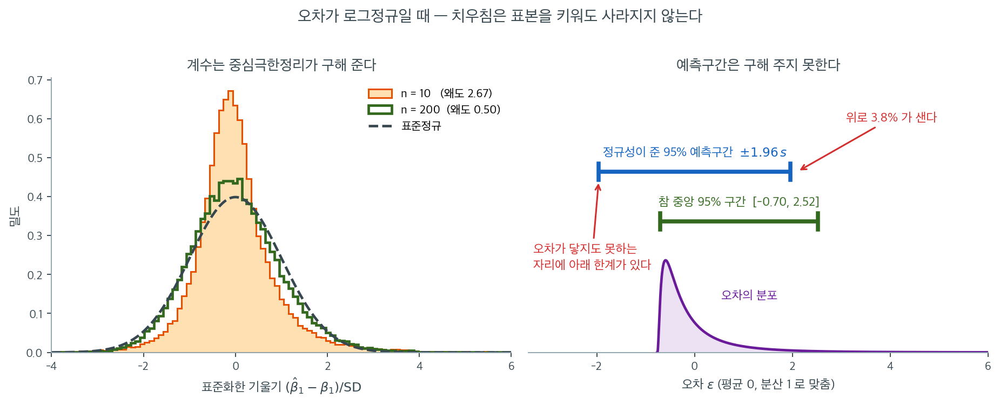

# 정규성 가정

### 정의 1. 정규성 { .dfn }

정규성 가정은 회귀모형의 잔차가 평균 0인 정규분포를 따른다는 것이다.

$$
\epsilon_i \sim N(0, \sigma^2)
$$

곧 잔차를 그렸을 때 0을 중심으로 하는 종 모양(Gauss) 곡선을 이루어야 한다는 뜻이다.

---

## 1. 중요성

선형회귀의 여러 추론 통계가 이 가정에 의존하므로 잔차의 정규성은 결정적으로 중요하다.

- **계수의 t-검정** — 개별 회귀계수가 0과 유의하게 다른지 검정하려면 오차가 정규분포를 따라야 한다.
- **전체 유의성의 F-검정** — 모형 유의성에 대한 전체 F 검정은 정규 오차를 가정한다.
- **신뢰구간** — 계수의 신뢰구간은 정규성 가정 아래에서 유도된 t 분포를 쓴다.
- **예측구간** — 새 관측값에 대한 예측구간이 타당하려면 정규성이 필요하다.

**중요한 단서:** 정규성 가정은 회귀계수의 불편추정에는 **필요하지 않다**. OLS 추정량 $\hat{\beta}$는 오차의 분포와 무관하게 불편이다. 다만 정규성이 없으면 추론에 쓰는 정확한 분포 결과(t 검정, F 검정)가 중심극한정리를 통해 점근적으로만 타당해진다.

위 표가 말하는 "표본이 크면 덜 중요하다"와 "예측구간에는 표본크기와 무관하게 중요하다"가 왜 함께 성립하는지를 한 그림에 담았다. 오차를 평균 0, 분산 1 로 맞춘 **로그정규**로 두었다. 왜도가 $6.18$ 로 정규에서 아주 멀고, 왼쪽으로는 $-0.76$ 아래로 내려갈 수 없는 반면 오른쪽 꼬리는 길게 늘어진다. 설명변수도 일부러 한쪽으로 치우친 설계점을 썼다.

왼쪽 칸이 계수 쪽 이야기다. $n = 10$ 일 때 $\hat{\beta}_1$ 의 표집분포는 왜도 $2.67$ 로 뚜렷이 오른쪽으로 끌려 있고, 봉우리는 표준정규보다 높고 좁다. 이런 상태에서 $t$ 분포표를 읽는 것은 맞지 않는 자를 대는 일이다. 그런데 $n = 200$ 으로만 키워도 왜도가 $0.50$ 으로 떨어지고 히스토그램이 표준정규 곡선(검은 점선) 위에 거의 포개진다. $\hat{\beta}_1$ 은 오차들의 **가중평균**이므로 중심극한정리가 그대로 작동한 것이다. 오차 자체는 여전히 왜도 $6.18$ 의 괴물인데도 그렇다. 정규성을 "네 가정 중 가장 덜 중요한 것"으로 두는 근거가 이것이다.

오른쪽 칸이 구해 주지 못하는 쪽이다. 예측구간은 $\hat{\beta}$ 의 흔들림뿐 아니라 **앞으로 뽑힐 오차 한 개**를 그대로 품어야 한다. 그 오차 한 개에는 중심극한정리가 적용될 자리가 없다. 정규성을 믿고 만든 구간은 $\pm 1.96s$, 곧 $[-1.96, 1.96]$ 으로 좌우대칭인데, 참으로 중앙 95%를 담는 구간은 $[-0.70, 2.52]$ 로 오른쪽으로 밀려 있다. 그 결과 아래쪽 한계는 오차가 **닿을 수조차 없는 자리**에 놓여 한 푼도 쓰이지 않고, 새는 것은 전부 위쪽이다. 실제로 모의실험을 해 보면 $n = 20$ 에서 포함률 $93.4\%$(아래로 $0.0\%$, 위로 $6.6\%$), $n = 100$ 에서 $95.6\%$($0.0\%$, $4.4\%$), $n = 640$ 에서 $96.3\%$($0.0\%$, $3.7\%$)이다. 총량만 보면 95%에 가까워 멀쩡해 보이지만, **빗나감이 전부 한쪽에 몰려 있다는 사실은 표본을 32배로 키워도 그대로다.**

그러므로 정규성 점검의 실전 규칙은 이렇게 갈린다. 계수의 $p$ 값과 신뢰구간만 쓸 것이고 $n$ 이 충분히 크다면 Q-Q 그림이 조금 휘어도 넘어갈 수 있다. 그러나 개별 관측값을 예측하고 그 구간을 보고할 작정이라면, $n$ 이 아무리 커도 잔차의 모양을 정면으로 다루어야 한다. 변환하거나, 붓스트랩으로 비대칭 구간을 만들거나, 분위수회귀처럼 대칭을 강요하지 않는 방법으로 가는 것이 옳다.

---

## 2. 정규성이 가장 중요한 경우

| 상황 | 정규성의 중요도 |
|-----------|---------------------|
| 작은 표본 ($n < 30$) | 결정적 — 중심극한정리의 근사가 충분하지 않다 |
| 큰 표본 ($n > 100$) | 덜 중요 — 중심극한정리가 검정통계량의 근사 정규성을 보장한다 |
| 예측구간을 만들 때 | 표본크기와 무관하게 항상 중요 |
| 두꺼운 꼬리 자료 | 중요 — 이상점이 OLS 추정에 강한 영향을 줄 수 있다 |

---

## 3. 진단

- **Q-Q 그림(분위수-분위수 그림):** 잔차의 분위수를 정규분포의 분위수와 비교한다. 점들이 대략 직선을 따라 놓이면 잔차가 정규분포를 따를 가능성이 높다.
- **Shapiro-Wilk 검정:** 정규성에 대한 형식적 통계검정이다. 유의하지 않은 결과는 잔차가 정규분포를 따름을 시사한다.
- **잔차의 히스토그램:** 간단한 시각적 확인이다. 히스토그램이 0을 중심으로 하는 종 모양을 닮아야 한다.
- **Jarque-Bera 검정:** 잔차의 왜도와 첨도가 정규분포와 일치하는지 검정한다.

---

## 4. 비정규성에 대한 대책

- **변수변환:** 종속변수에 로그, 제곱근, Box-Cox 변환 등을 적용하면 비정규성이 교정되기도 한다.
- **로버스트 회귀:** 정규성을 얻을 수 없을 때 로버스트 회귀 기법이 이상점의 영향을 낮춰 타당한 결과를 제공한다.
- **붓스트랩:** 붓스트랩 방법은 분포 가정에 기대지 않고 타당한 추론을 제공한다.
- **더 큰 표본:** 표본이 충분히 크면 오차가 정규가 아니어도 중심극한정리에 의해 검정통계량이 근사적으로 정규분포를 따른다.

자세한 진단 방법은 [정규성 확인](checking_normality.md)을 보라.

---

## 연습문제

**연습문제 1.** 
한 연구자가 관측값 $n = 15$개로 회귀모형을 적합했다. 잔차의 Q-Q 그림에서 오른쪽으로 상당히 치우친 모습이 보인다. 왜 이 상황에서 $n = 500$일 때보다 정규성이 더 중요한지 설명하라.

??? success "풀이"
    $n = 15$밖에 안 되면 **중심극한정리**가 좋은 근사를 제공하지 못한다. 개별 계수의 $t$ 통계량과 전체 유의성의 $F$ 통계량의 정확한 분포는 오차의 정규성에 의존한다. 잔차가 오른쪽으로 치우쳤다는 것은 실제 표집분포가 가정된 $t$ 분포와 다르다는 뜻이고, 따라서 p값과 신뢰구간이 부정확해진다.

    $n = 500$이면 오차의 분포와 무관하게 중심극한정리가 표집분포의 근사 정규성을 보장하므로 정규성에서 어느 정도 벗어나도 추론에 미치는 영향이 미미하다.

**연습문제 2.** 
$\hat{\beta}$의 불편추정에는 정규성이 필요하지 않지만 계수의 $t$ 검정이 정확히 타당하려면 정규성이 필요한 이유를 설명하라.

??? success "풀이"
    OLS 추정량 $\hat{\beta} = (X^\top X)^{-1} X^\top Y$는 $Y$의 선형함수이다. 그 기댓값은

    $$
    E[\hat{\beta}] = (X^\top X)^{-1} X^\top E[Y] = (X^\top X)^{-1} X^\top X \beta = \beta
    $$

    이 유도에는 $E[\varepsilon] = 0$만 쓰였고 정규성은 쓰이지 않았다. 따라서 $\hat{\beta}$는 오차의 분포와 무관하게 불편이다.

    반면 $t$ 검정통계량 $t = \hat{\beta}_j / \text{SE}(\hat{\beta}_j)$가 정확한 $t$ 분포를 따르는 것은 $\varepsilon \sim N(0, \sigma^2 I)$일 때뿐이다. 정규성이 없으면 유한표본에서 이 비는 정확한 $t$ 분포를 갖지 않으므로 $t$ 분포표에서 읽은 p값은 근삿값에 지나지 않는다.

**연습문제 3.** 
어떤 사람이 "정규성을 확인하려고 종속변수 $Y$ 의 히스토그램을 그렸더니 봉우리가 두 개여서 정규성 가정이 깨졌다"고 결론을 내렸다.

(a) 정의 1 의 정규성 가정이 **완벽히** 성립하면서도 $Y$ 의 히스토그램이 쌍봉이 되는 자료를 하나 만들어 이 결론이 틀렸음을 보여라. 만든 예에서 $Y \mid x$ 의 분포와 $Y$ 의 주변분포를 각각 적어라.

(b) 반대 방향, 곧 $Y$ 의 히스토그램은 종 모양인데 정규성 가정이 깨지는 예도 만들 수 있는가? 하나 들라.

??? success "풀이"
    (a) 설계점을 $x_i \in \{0, 1\}$ 로 반씩 두고

    $$
    Y = 1 + 5x + \epsilon, \qquad \epsilon \sim N(0, 1)
    $$

    을 쓴다. 조건부분포는 $Y \mid x = 0 \sim N(1, 1)$, $Y \mid x = 1 \sim N(6, 1)$ 이고, 주변분포는 두 정규의 혼합

    $$
    Y \sim \tfrac{1}{2} N(1, 1) + \tfrac{1}{2} N(6, 1)
    $$

    이다. 두 중심이 $5\sigma$ 떨어져 있으므로 $Y$ 의 히스토그램은 뚜렷한 쌍봉이다. 그런데 오차는 정확히 $N(0, 1)$ 이므로 정의 1 은 글자 그대로 성립하고, 잔차의 히스토그램과 Q-Q 그림은 흠이 없다. 쌍봉은 오차가 아니라 **평균구조** $1 + 5x$ 가 만든 것이다.

    (b) 가능하다. $x \sim N(0, 1)$ 로 널리 퍼뜨리고

    $$
    Y = 3x + \epsilon, \qquad \epsilon \sim U(-\sqrt{3},\, \sqrt{3})
    $$

    을 쓰면 오차는 분산 1 이지만 유계이고 첨도가 $1.8$ 인 균등분포라 정규가 아니다. 반면 $Y$ 는 분산 $9$ 의 정규와 분산 $1$ 의 균등을 더한 것이라 초과첨도가

    $$
    \frac{9^2 \cdot 0 + 1^2 \cdot (-1.2)}{10^2} = -0.012
    $$

    로 사실상 0 이고, 히스토그램은 완벽한 종 모양으로 보인다.

    두 예가 함께 말하는 것은 하나다. 정규성은 $\epsilon$ 에 대한 가정이고 $Y$ 나 $X$ 에 대한 가정이 아니므로, $Y$ 의 히스토그램은 어느 방향으로도 증거가 되지 못한다. 보아야 할 것은 잔차다.

**연습문제 4.** 
이 쪽의 모의실험에서 오차는 평균 0, 분산 1 로 맞춘 로그정규이고 그 분위수함수는

$$
q_\epsilon(p) = \frac{e^{z_p} - e^{1/2}}{\sqrt{e^2 - e}}, \qquad z_p = \Phi^{-1}(p)
$$

이다(이 식은 연습문제 6 에서 유도한다). $p = 0.01, 0.05, 0.25, 0.50, 0.75, 0.95, 0.99$ 에서 $q_\epsilon(p)$ 와 $z_p$ 를 비교하여, 이 오차에서 나온 잔차의 Q-Q 그림(가로축 $z_p$, 세로축 잔차 분위수, 기준선 $y = x$)이 어떤 모양으로 휘는지 말하라. 특히 "오른쪽으로 치우쳤으면 오른쪽 끝만 위로 뜬다"는 흔한 말이 맞는지 판정하라.

또 $n = 640$ 일 때 가장 작은 잔차가 그림의 왼쪽 끝에서 어디쯤 놓이는지 $q_\epsilon\!\left(\tfrac{1}{641}\right)$ 로 가늠하고, $n$ 을 더 키우면 그 모양이 어떻게 되는지 말하라.

??? success "풀이"
    $q_\epsilon$ 은 $z_p$ 의 증가함수이므로 분위수를 그대로 대입하면 된다. $e^{1/2} = 1.64872$, $\sqrt{e^2 - e} = 2.16120$ 을 쓴다.

    | $p$ | $z_p$ | $q_\epsilon(p)$ | $q_\epsilon(p) - z_p$ |
    |---|---|---|---|
    | 0.01 | $-2.326$ | $-0.718$ | $+1.609$ |
    | 0.05 | $-1.645$ | $-0.674$ | $+0.971$ |
    | 0.25 | $-0.674$ | $-0.527$ | $+0.147$ |
    | 0.50 | $0.000$ | $-0.300$ | $-0.300$ |
    | 0.75 | $0.674$ | $0.145$ | $-0.529$ |
    | 0.95 | $1.645$ | $1.634$ | $-0.011$ |
    | 0.99 | $2.326$ | $3.975$ | $+1.649$ |

    차이의 부호가 $+,+,+,-,-,-,+$ 로 두 번 바뀐다($p = 0.95$ 에서는 $-0.011$ 로 거의 0 이다). 곧 Q-Q 곡선은 **아래로 볼록**(convex)해서 왼쪽 끝이 기준선 위로 뜨고, 가운데에서 선 아래로 처지고, 오른쪽 끝에서 다시 크게 위로 뜬다.

    따라서 "오른쪽 끝만 위로 뜬다"는 말은 **틀렸다**. 오른쪽 치우침의 서명은 **양 끝이 모두 위로 뜨는 것**이다. 왼쪽도 위로 뜨는 까닭은 이 오차가 $-0.76287$ 아래로 내려갈 수 없어 왼쪽 꼬리가 정규보다 **짧다**는 데 있다. 정규보다 덜 내려가는 것은 Q-Q 에서 기준선 위에 놓인다. 가운데가 처지는 것은 평균이 0 이어도 중앙값이 $q_\epsilon(0.5) = -0.300$ 으로 0 보다 낮기 때문이다(잔차의 절반 이상이 0 아래에 있다).

    $n = 640$ 의 왼쪽 끝: $z = \Phi^{-1}(1/641) = -2.956$ 인데

    $$
    q_\epsilon\!\left(\tfrac{1}{641}\right) = \frac{e^{-2.956} - 1.64872}{2.16120} = -0.739
    $$

    로 기준선보다 $2.2$ 나 위에 떠 있다. 하한 $-0.76287$ 에 이미 거의 닿았으므로 $n$ 을 더 키우면 왼쪽 끝의 $z_p$ 만 $-3, -4$ 로 내려가고 세로 좌표는 $-0.76$ 근처에 머문다. 곧 Q-Q 그림의 왼쪽 끝은 점점 더 **수평으로 눕는다**. 바닥이 있는 오차의 이 모양은 표본을 키워서 없앨 수 있는 것이 아니다.

**연습문제 5.** 
설계점 $x_0$ 에서 새 관측값의 예측오차는 $Y_0 - \hat{Y}_0 = \bigl(m(x_0) - \hat{Y}_0\bigr) + \epsilon_0$ 으로 쪼개지고, 그 분산은

$$
\operatorname{Var}\bigl(Y_0 - \hat{Y}_0\bigr) = \sigma^2 \bigl(1 + h_0\bigr), \qquad h_0 = x_0^\top (X^\top X)^{-1} x_0
$$

이다. 여기서 $m(x) = \beta_0 + \beta_1 x$ 이다.

(a) $n \to \infty$ 에서 두 항이 각각 어떻게 되는가.

(b) 그 결과 명목 95% 예측구간은 어떤 구간으로 수렴하는가.

(c) 이 쪽의 모의실험에서 $n = 20, 100, 640$ 모두 아래로 새는 비율이 $0.0\%$ 로 고정된 것을 (b) 로 설명하라. 왜 중심극한정리는 이 상황을 구해 주지 못하는가.

??? success "풀이"
    (a) 설계점이 한 분포에서 나오는 보통의 경우 $X^\top X$ 는 $n$ 에 비례해 커지므로 $h_0 = O(1/n)$ 이고 $h_0 \to 0$ 이다(설계 중심 근처라면 $h_0 \approx 1/n$). 따라서 **추정 불확실성** $\sigma^2 h_0$ 는 0 으로 사라지고, **새 오차 한 개**의 몫 $\sigma^2$ 는 줄지 않고 그대로 남는다.

    (b) 폭이 $\sigma \sqrt{1 + h_0} \to \sigma$ 로 가고 중심 $\hat{Y}_0 \to m(x_0)$ 이므로 구간은

    $$
    m(x_0) \pm 1.96\,\sigma
    $$

    로 수렴한다. 이것은 **오차 한 개 자신의** $\pm 1.96\sigma$ 구간, 곧 $\epsilon_0$ 에 대한 좌우대칭 구간이다.

    (c) $\sigma = 1$ 이므로 그 극한 구간은 $\epsilon$ 척도에서 $[-1.96,\ 1.96]$ 이다. 그런데 이 오차는 $\epsilon \ge -0.76287$ 이므로 아래 한계 $-1.96$ 은 오차가 **닿을 수조차 없는 자리**에 있다. 따라서 아래로 새는 확률은 근사적으로 0 이 아니라 **정확히** 0 이고, 이는 $n$ 에 전혀 의존하지 않는다. 쪽에서 보고한 $(0.0\%, 6.6\%)$, $(0.0\%, 4.4\%)$, $(0.0\%, 3.7\%)$ 가 왼쪽 자리에서 모두 같은 이유다. 참으로 중앙 95% 를 담는 구간은 $[-0.70,\ 2.52]$ 로 오른쪽으로 밀려 있으니, 좌우대칭 구간은 아래쪽에 쓰이지 않는 여유를 두고 그만큼을 위쪽에서 잃는다.

    중심극한정리는 **합과 평균**에만 작동한다. 첫 항 $m(x_0) - \hat{Y}_0$ 는 오차들의 가중평균이므로 중심극한정리가 정규로 밀어 주지만, 둘째 항 $\epsilon_0$ 은 표본 **한 개**라서 $n$ 과 무관하게 원래 분포를 그대로 유지한다. $n$ 을 키우면 중심극한정리가 돕는 항만 사라지고 돕지 못하는 항만 남으므로, 비정규성은 가려지는 대신 오히려 **더 드러난다**.

**연습문제 6.** 
이 쪽은 오차를 "평균 0, 분산 1 로 맞춘 로그정규"로 두고 왜도 $6.18$, 하한 $-0.76$, 참 중앙 95% 구간 $[-0.70,\ 2.52]$ 라는 세 숫자를 보고했다. 이 셋이 모두 **하나의** 모수에서 나온다는 것을 확인하자.

$Z \sim N(0,1)$, $W = e^{\sigma Z}$ 로 두고 $\epsilon$ 을 $W$ 의 표준화라 하자. 로그정규의 왜도가 $(e^{\sigma^2} + 2)\sqrt{e^{\sigma^2} - 1}$ 임은 주어진 것으로 쓴다(표준화는 왜도를 바꾸지 않는다).

(a) 왜도가 $6.18$ 이라는 사실에서 $\sigma$ 를 구하라.

(b) 그 $\sigma$ 에서 $\epsilon$ 의 하한을 구하고 $-0.76$ 과 맞는지 보라.

(c) $\epsilon$ 의 중앙 95% 구간을 구하고 $[-0.70,\ 2.52]$ 와 맞는지 보라. $\Phi^{-1}(0.975) = 1.95996$, $e = 2.71828$ 을 쓰라.

??? success "풀이"
    (a) $u = e^{\sigma^2}$ 로 두면 $(u + 2)\sqrt{u - 1} = 6.18$ 을 풀면 된다. 왼변은 $u > 1$ 에서 증가하므로 해가 하나다. 몇 점을 대어 보면

    $$
    u = 2.5: \ 4.5 \times 1.2247 = 5.51, \qquad u = 2.7: \ 4.7 \times 1.3038 = 6.13, \qquad u = 2.72: \ 4.72 \times 1.3115 = 6.19
    $$

    이므로 $u \approx 2.718 = e$ 이다. 곧 $\sigma^2 = 1$, $\sigma = 1$ 이다. 되짚어 보면

    $$
    (e + 2)\sqrt{e - 1} = 4.71828 \times 1.31083 = 6.1849
    $$

    로 보고된 $6.18$ 과 맞는다. 쪽의 오차는 표준 로그정규 $e^Z$ 였다.

    (b) $W = e^Z$ 의 평균과 분산은

    $$
    E[W] = e^{1/2} = 1.64872, \qquad \operatorname{Var}(W) = e^2 - e = 4.67077, \qquad \operatorname{sd}(W) = 2.16120
    $$

    이므로

    $$
    \epsilon = \frac{e^Z - 1.64872}{2.16120}
    $$

    이다. $e^Z > 0$ 이고 $e^Z \to 0$ 이 가능하므로 하한(도달하지 못하는 하계)은

    $$
    \frac{0 - 1.64872}{2.16120} = -0.76287
    $$

    로 쪽의 $-0.76$ 과 일치한다.

    (c) $\epsilon$ 은 $Z$ 의 증가함수이므로 분위수가 보존된다. $z = \pm 1.95996$ 에서 $e^{-1.95996} = 0.14086$, $e^{1.95996} = 7.09921$ 이므로

    $$
    \frac{0.14086 - 1.64872}{2.16120} = -0.6977, \qquad \frac{7.09921 - 1.64872}{2.16120} = 2.5219
    $$

    이고, 참 중앙 95% 구간은 $[-0.698,\ 2.522]$ 로 쪽의 $[-0.70,\ 2.52]$ 와 일치한다.

    세 숫자가 서로 독립적인 정보가 아니었다. $\sigma = 1$ 하나만 정하면 왜도 $6.18$, 하한 $-0.76$, 비대칭 구간 $[-0.70, 2.52]$ 가 모두 따라 나온다. $\square$

**연습문제 7.** 
연습문제 6 의 오차 $\epsilon = (e^Z - e^{1/2})/\sqrt{e^2 - e}$ 를 쓴다. $\sigma = 1$ 을 안다고 보고 만든 명목 95% 예측구간 $\pm 1.96$ 의 **참** 포함확률을 구하라. 아래로 새는 확률과 위로 새는 확률을 따로 적어라. $\ln 5.88467 = 1.77235$, $\Phi(1.77235) = 0.96183$ 을 쓰라.

이 값을 쪽이 보고한 $n = 20$: $93.4\%$ $(0.0,\ 6.6)$, $n = 100$: $95.6\%$ $(0.0,\ 4.4)$, $n = 640$: $96.3\%$ $(0.0,\ 3.7)$ 과 비교하여 모의실험 수치가 어디로 수렴하는지 말하라. 그리고 포함률이 $n$ 과 함께 $93.4 \to 95.6 \to 96.3$ 으로 **올라간** 까닭을 설명하라.

??? success "풀이"
    위쪽 먼저. $\epsilon \le 1.96$ 은

    $$
    e^Z \le 1.96 \times 2.16120 + 1.64872 = 4.23595 + 1.64872 = 5.88467
    $$

    곧 $Z \le \ln 5.88467 = 1.77235$ 와 같다. 따라서

    $$
    P(\epsilon \le 1.96) = \Phi(1.77235) = 0.96183, \qquad P(\epsilon > 1.96) = 0.03817
    $$

    이다. 아래쪽은 $\epsilon \ge -0.76287 > -1.96$ 이므로 $P(\epsilon < -1.96) = 0$ 이다. 그러므로 참 포함확률은

    $$
    0.96183 - 0 = 0.96183
    $$

    곧 $96.18\%$ 이고, 빗나감의 배분은 아래 $0.00\%$, 위 $3.82\%$ 다.

    모의실험 수치는 이 극한으로 간다. $n = 640$ 의 $96.3\%$ $(0.0,\ 3.7)$ 은 $96.18\%$ $(0.0,\ 3.82)$ 와 소수 첫째 자리까지 사실상 같다. 연습문제 5 에서 보았듯 $h_0 \to 0$ 이면 예측구간이 $\epsilon$ 자신의 $\pm 1.96$ 구간으로 수렴하기 때문이다.

    포함률이 올라간 까닭은 작은 $n$ 에서 $\sigma$ 가 아니라 $s$ 를 쓴다는 데 있다. $E[s^2] = \sigma^2 = 1$ 은 어느 $n$ 에서나 맞지만, 왜도 $6.18$ 의 오차에서 $s^2$ 의 분포 자체가 심하게 오른쪽으로 치우쳐 **중앙값이 평균보다 훨씬 낮다**. 이 오차로 모의해 보면 $s^2$ 의 중앙값은 $n = 20$ 에서 $0.54$, $n = 100$ 에서 $0.77$, $n = 640$ 에서 $0.92$ 이고 $P(s^2 < 1)$ 은 각각 $0.74$, $0.68$, $0.62$ 다. 곧 작은 $n$ 에서는 구간이 **너무 좁게** 나오는 일이 훨씬 흔하다. $\sqrt{1 + h_0}$ 와 $t$ 배수는 반대로 구간을 넓히지만 $n = 20$ 에서는 $s$ 가 작게 나오는 효과가 이겨 포함률이 $93.4\%$ 로 내려간다. $n$ 이 커지면 $s \to \sigma$ 로 안정되어 극한 $96.18\%$ 로 올라붙는다.

    포함률이 95% 를 **넘어선** 것은 좋은 소식이 아니다. 아래쪽 2.5% 를 쓸 수 없어 생긴 잉여가 위쪽의 과소보호($3.82\%$ 는 명목 $2.5\%$ 의 1.5 배다)를 총량 뒤에 숨긴 것이다.

**연습문제 8.** 
단순회귀 $y_i = \beta_0 + \beta_1 x_i + \epsilon_i$ 에서 $w_i = x_i - \bar{x}$ 라 하고, 오차의 왜도를 $\gamma$ 라 하자.

(a) $\hat{\beta}_1 - \beta_1 = \sum_i w_i \epsilon_i \big/ \sum_i w_i^2$ 를 써서

$$
\operatorname{skew}(\hat{\beta}_1) = \gamma \cdot \frac{\sum_i w_i^3}{\bigl(\sum_i w_i^2\bigr)^{3/2}}
$$

임을 보여라.

(b) 같은 설계점 묶음을 $k$ 번 똑같이 반복해 표본을 $k$ 배로 늘리면 이 왜도가 $1/\sqrt{k}$ 배가 됨을 보여라.

(c) 쪽의 $n = 10$ 에서 $\operatorname{skew}(\hat{\beta}_1) = 2.67$ 이었다. (b) 의 법칙으로 $n = 200$ 의 값을 예측하고 실제 $0.50$ 과 비교하라.

(d) 모든 설계에서 $\lvert \operatorname{skew}(\hat{\beta}_1) \rvert \le \lvert \gamma \rvert$ 임을 보여라. 또 설계점이 $\bar{x}$ 에 대해 좌우대칭이면 이 왜도가 **정확히** 0 임을 보이고, 쪽이 "설명변수도 일부러 한쪽으로 치우친 설계점을 썼다"고 밝힌 까닭을 말하라.

??? success "풀이"
    (a) $S = \sum w_i^2$ 로 두고 $D = \hat{\beta}_1 - \beta_1 = \sum_i w_i \epsilon_i / S$ 라 하자. $\epsilon_i$ 가 독립이고 평균 0, 분산 $\sigma^2$, 3차 중심적률 $\mu_3 = \gamma \sigma^3$ 이므로 교차항이 모두 사라져

    $$
    \operatorname{Var}(D) = \frac{\sigma^2 S}{S^2} = \frac{\sigma^2}{S}, \qquad E[D^3] = \frac{1}{S^3} \sum_i w_i^3 \, E[\epsilon_i^3] = \frac{\mu_3 \sum_i w_i^3}{S^3}
    $$

    이다. 따라서

    $$
    \operatorname{skew}(\hat{\beta}_1) = \frac{E[D^3]}{\operatorname{Var}(D)^{3/2}} = \frac{\mu_3 \sum_i w_i^3}{S^3} \cdot \frac{S^{3/2}}{\sigma^3} = \gamma \cdot \frac{\sum_i w_i^3}{S^{3/2}}
    $$

    이다.

    (b) 같은 묶음을 $k$ 번 반복하면 $\bar{x}$ 가 그대로이므로 $w$ 값들의 목록만 $k$ 벌로 늘어난다. 그러면 $\sum w_i^3 \to k \sum w_i^3$, $S \to kS$ 이므로

    $$
    \frac{k \sum w_i^3}{(kS)^{3/2}} = k^{-1/2} \cdot \frac{\sum w_i^3}{S^{3/2}}
    $$

    로 비가 $1/\sqrt{k}$ 배가 된다. 오차의 왜도 $\gamma$ 는 손대지 않았는데도 $\hat{\beta}_1$ 의 왜도만 줄어드는 것이 중심극한정리가 계수 쪽에서 작동하는 모습이다.

    (c) $k = 200/10 = 20$ 이므로 예측값은

    $$
    \frac{2.67}{\sqrt{20}} = \frac{2.67}{4.472} = 0.597
    $$

    이고 실제는 $0.50$ 이다. 자릿수와 감소 배율($2.67/0.50 = 5.34$ 대 $\sqrt{20} = 4.47$)은 맞게 나오지만 정확히 일치하지는 않는다. (b) 의 $1/\sqrt{k}$ 법칙은 설계점의 **모양을 그대로 유지하며** 복제할 때만 성립하는데, 두 모의실험의 설계점 집합은 $n$ 에 따라 다르기 때문이다. 유효표본크기로 읽으면 $(\gamma/\operatorname{skew})^2$ 가 $n = 10$ 에서 $(6.18/2.67)^2 = 5.4$(명목의 54%), $n = 200$ 에서 $(6.18/0.50)^2 = 152.8$(명목의 76%) 이니, $n = 200$ 의 설계가 상대적으로 덜 치우쳐 있었다는 뜻이다.

    (d) $\ell^3$ 노름이 $\ell^2$ 노름보다 작다는 사실로 바로 나온다. $M = \max_i \lvert w_i \rvert$ 라 하면

    $$
    \sum_i \lvert w_i \rvert^3 \le M \sum_i w_i^2 \le \Bigl(\sum_i w_i^2\Bigr)^{1/2} \sum_i w_i^2 = S^{3/2}
    $$

    이므로 $\lvert \sum w_i^3 \rvert \big/ S^{3/2} \le 1$ 이고, 따라서 $\lvert \operatorname{skew}(\hat{\beta}_1) \rvert \le \lvert \gamma \rvert$ 다. 실제로 $2.67 \le 6.18$ 로 지켜졌다.

    설계점이 $\bar{x}$ 에 대해 좌우대칭이면 $w$ 값들이 $\pm$ 쌍으로 짝지어지므로 $\sum_i w_i^3 = 0$ 이고 왜도가 정확히 0 이다. 오차의 왜도가 $6.18$ 이든 $10^6$ 이든 상관없다. 그러므로 치우친 오차만으로는 $\hat{\beta}_1$ 의 표집분포를 비틀 수 없고, **설계점이 함께 치우쳐야** 비틀린다. 쪽이 $n = 10$ 에서 왜도 $2.67$ 이라는 눈에 보이는 치우침을 만들어 보이려고 설계점까지 한쪽으로 몰아 둔 이유가 이것이다. $\square$

**연습문제 9.** 
이 쪽은 두 가지를 함께 말한다. 2 절의 표는 $n > 100$ 이면 정규성이 "덜 중요"하다고 하고, 정리하며는 "형식적 정규성 검정은 표본크기에 좌우되므로 참고만 한다"고 한다.

오차가 쪽의 로그정규(왜도 $6.18$)로 **고정되어** 있을 때, $n$ 을 키우면 (i) Shapiro-Wilk 검정이 기각할 확률과 (ii) 그 비정규성이 추론에 끼치는 해악이 각각 어느 방향으로 움직이는지 쓰고, 그래서 검정의 $p$ 값만으로는 "무엇을 해야 하는가"를 정할 수 없음을 설명하라.

쪽의 내용으로 (a) $p$ 값이 아주 작은데도 그냥 넘어가도 되는 경우와 (b) $p$ 값이 크지만 넘어가서는 안 되는 경우를 하나씩 들라.

??? success "풀이"
    (i) 기각확률은 $n$ 과 함께 **1 로 올라간다**. 참 분포가 정규가 아니면 이탈의 크기가 고정되어 있어도 $n$ 만 키우면 어떤 유의수준에서도 거의 확실히 기각된다. 검정의 귀무가설은 "정규다"이고 그것이 그냥 거짓이므로, 표본이 커지는 것은 거짓을 탐지할 힘만 키운다.

    (ii) 계수 추론에 끼치는 해악은 $n$ 과 함께 **0 으로 내려간다**. 오차의 왜도가 $6.18$ 로 그대로인데도 $\hat{\beta}_1$ 의 왜도는 $n = 10$ 의 $2.67$ 에서 $n = 200$ 의 $0.50$ 으로 떨어지고 히스토그램이 표준정규에 포개진다.

    두 양이 **반대 방향으로** 움직이므로 $p$ 값의 크기와 조치의 필요성 사이에 단조 관계가 없다. $p$ 값이 작다는 것은 "이탈이 있다"는 말이고, 실무가 묻는 것은 "이 이탈이 내가 보고할 양을 망치는가"다. 후자의 답은 $n$ 과 **무엇을 쓸 것인가**(계수냐 예측이냐)에 달려 있고, Shapiro-Wilk 는 그 둘을 모른다.

    (a) $n = 200$ 에서 계수의 $p$ 값과 신뢰구간만 보고하는 경우. 왜도 $6.18$ 의 오차라면 Shapiro-Wilk 는 사실상 확실히 기각하지만, $\hat{\beta}_1$ 의 표집분포는 이미 표준정규에 거의 포개져 있어 $t$ 분포표를 읽어도 무리가 없다. 쪽이 "Q-Q 그림이 조금 휘어도 넘어갈 수 있다"고 한 자리다.

    (b) 두 경우가 있다. 첫째로 $n = 20$ 처럼 작은 표본에서 검정력이 낮아 왜도 $6.18$ 조차 자주 놓치는데, 바로 그 구간($n < 30$)이 표가 "결정적"이라고 적은 구간이다. 불기각을 "정규성 확인됨"으로 읽으면 가장 위험한 곳에서 안심하게 된다. 둘째로 예측구간을 보고할 작정이라면 $n = 640$ 의 $96.3\%$ $(0.0,\ 3.7)$ 처럼 빗나감이 한쪽에 몰리는 문제가 $p$ 값과 무관하게 남으므로, 어느 $n$ 에서도 넘어가서는 안 된다.

**연습문제 10.** 
4 절은 비정규성의 대책으로 "종속변수에 로그를 적용하면 비정규성이 교정되기도 한다"를 든다. 이 처방을 이 쪽의 설정에 그대로 대어 보자. $\lambda = 1/\sqrt{e^2 - e}$, $\kappa = e^{1/2}/\sqrt{e^2 - e}$ 로 두면 연습문제 6 의 오차는 $\epsilon = \lambda e^Z - \kappa$ 이고 모형은

$$
Y = m(x) + \lambda e^Z - \kappa, \qquad m(x) = \beta_0 + \beta_1 x, \quad Z \sim N(0,1)
$$

이다.

(a) $\log Y$ 를 $Z$ 와 $m(x)$ 로 쓰고, 그것이 "$x$ 의 함수 + $x$ 와 무관한 오차" 꼴로 쪼개지는 것이 $\beta_1 = 0$ 일 때뿐임을 보여라.

(b) $\beta_1 \ne 0$ 일 때 로그변환이 깨뜨리는 것은 네 가정 중 어느 것인가.

(c) 그렇다면 로그변환은 오차가 **어떤 구조**로 들어와 있을 때 맞는 처방인가. 가법 오차인 이 쪽의 설정에서는 4 절의 네 대책 중 무엇이 맞는지 고르고 이유를 대라.

??? success "풀이"
    (a) $c(x) = m(x) - \kappa$ 로 두면 $Y = \lambda e^Z + c(x)$ 이므로(로그를 쓰려면 $Y > 0$ 이어야 한다)

    $$
    \log Y = \log\bigl(\lambda e^Z + c(x)\bigr) = Z + \log \lambda + \log\Bigl(1 + \frac{c(x)}{\lambda} e^{-Z}\Bigr)
    $$

    이다. 앞의 두 항은 이미 "오차 + 상수" 꼴이니 문제는 마지막 항 $g(x, Z) = \log(1 + a e^{-Z})$, $a = c(x)/\lambda$ 다. 어떤 함수가 $f(x) + h(Z)$ 로 쪼개지려면 혼합편도함수가 0 이어야 한다. 그런데

    $$
    \frac{\partial g}{\partial a} = \frac{e^{-Z}}{1 + a e^{-Z}}, \qquad \frac{\partial^2 g}{\partial Z \, \partial a} = -\frac{e^{-Z}}{(1 + a e^{-Z})^2} \ne 0
    $$

    이고 $a$ 는 $x$ 의 1차함수라 $\partial a/\partial x = \beta_1/\lambda$ 이므로

    $$
    \frac{\partial^2 g}{\partial Z \, \partial x} = -\frac{\beta_1}{\lambda} \cdot \frac{e^{-Z}}{(1 + a e^{-Z})^2}
    $$

    이다. 이것이 모든 $(x, Z)$ 에서 0 이 되는 것은 $\beta_1 = 0$ 일 때뿐이다. $\beta_1 = 0$ 이면 $a$ 가 상수이므로 $\log Y$ 가 "상수 + $Z$ 의 함수"로 쪼개지고, 게다가 $\beta_0 = \kappa$ 까지 맞으면 $\log Y = Z + \log \lambda$ 로 오차가 **정확히** 정규가 된다. 그러나 $\beta_1 = 0$ 은 $x$ 가 $Y$ 에 아무 영향도 주지 않는 경우, 곧 회귀를 할 이유가 없는 경우다. $\square$

    (b) **선형성과 등분산성**이다. $\log Y$ 의 조건부평균 $E[\log Y \mid x]$ 는 $x$ 의 비선형함수가 되고, 조건부 오차 $\log Y - E[\log Y \mid x]$ 의 분포 자체가 $x$ 에 따라 달라진다(위의 혼합편도함수가 0 이 아니라는 말이 바로 이 뜻이다). 특히 $c(x)$ 가 커질수록 $\log$ 가 $\lambda e^Z$ 의 흔들림을 더 강하게 눌러 분산이 작아진다. 정규성 하나를 고치려고 더 중요한 두 가정을 내주는 거래다.

    또 가법 모형에서는 $m(x)$ 가 작은 설계점에서 $Y \le 0$ 이 될 수 있어 $\log Y$ 가 아예 정의되지 않는다. 가법 오차에 로그를 씌우는 것은 시작부터 성립하지 않을 수 있다.

    (c) 로그변환은 오차가 **곱으로** 들어와 있을 때 맞는 처방이다. $Y = e^{\beta_0 + \beta_1 x} U$ 이고 $U$ 가 로그정규이면

    $$
    \log Y = \beta_0 + \beta_1 x + \log U, \qquad \log U \sim N(\cdot, \cdot)
    $$

    로 선형성·등분산성·정규성이 한꺼번에 성립한다. 이때 비정규성은 척도를 잘못 골라 생긴 겉모습이었고 로그가 그것을 걷어낸다.

    이 쪽의 설정에는 그런 곱 구조가 없으므로(오차가 평균구조에 더해져 있다) 맞는 대책은 **붓스트랩**이다. 붓스트랩은 분포 가정에 기대지 않고, 특히 잔차의 경험분포에서 뽑아 **비대칭** 예측구간을 만들 수 있어 참 구간 $[-0.70,\ 2.52]$ 처럼 한쪽으로 밀린 모양을 재현한다. 나머지 둘은 듣지 않는다. "더 큰 표본"은 연습문제 5, 7 에서 보았듯 예측구간의 한쪽 쏠림을 없애지 못하고, "로버스트 회귀"는 이상치의 영향을 줄이지만 역시 좌우대칭 구간을 내놓는다. 1 절 마지막 문단이 "붓스트랩으로 비대칭 구간을 만들거나, 분위수회귀처럼 대칭을 강요하지 않는 방법으로" 라고 적은 것이 이 결론이다.

---

## 정리하며

정규성은 **네 가정 중 가장 덜 중요하다.**

- **무엇에 필요한가.** 계수의 불편성에는 필요 없고, 가우스–마르코프에도 필요 없다. **$t$ 와 $F$ 의 정확한 분포**에만 필요하다.
- **대표본에서는 중심극한정리가 보호한다.** $\hat\beta$ 가 근사적으로 정규가 되므로 $n$ 이 크면 완만한 이탈은 문제가 되지 않는다.
- **잔차에 대한 가정이다.** $Y$ 나 $X$ 의 분포가 아니라 $\varepsilon$ 의 분포다. 이 혼동이 매우 흔하다.
- **Q-Q 그림이 주된 도구다.** 14장에서 보듯 형식적 정규성 검정은 표본크기에 좌우되므로 참고만 한다.
- **진짜 문제는 이상치와 심한 치우침이다.** 그때는 변환하거나 로버스트 회귀로 가며, **예측구간은 정규성에 훨씬 민감하다**는 점도 기억할 일이다.

다음 절부터 각 가정의 **구체적인 확인 절차**로 넘어간다.
