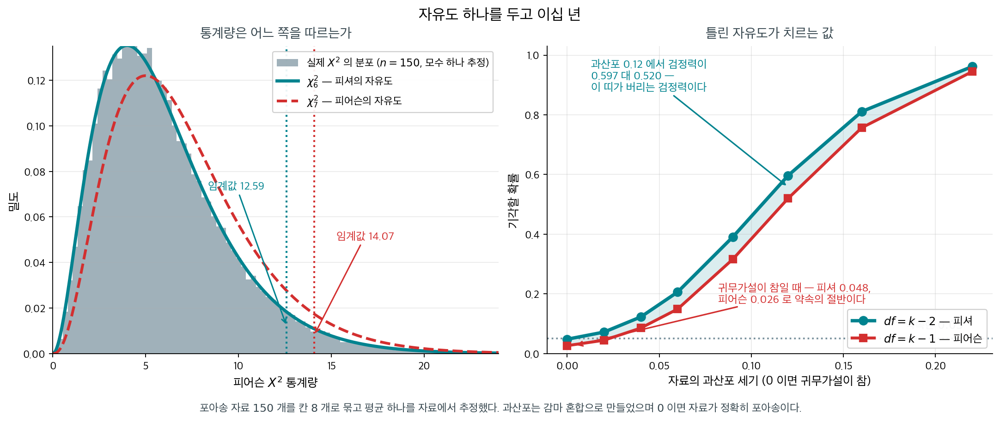
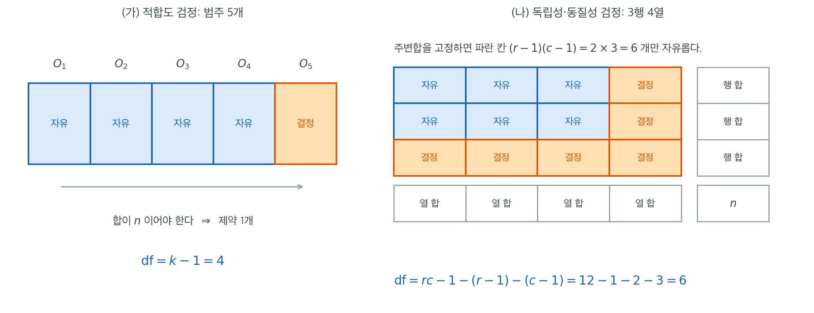

# 자유도와 점근 이론

## 1. 카이제곱 검정의 자유도

「자유도」는 세어서 빼는 수처럼 생겼다 — 범주가 $k$ 개면 $k-1$, 모수를 하나 추정했으면 하나 더. 그런데 이 쪽은 그 수를 **재어서** 보인다. 범주 넷인 다항 도수를 표준화한 벡터의 공분산행렬을 추정하면 고윳값이 $0, 1, 1, 1$ 이고 대각합이 $3.0000$ 이다. 그래서 제곱합의 평균이 $3.0029$, 분산이 $6.0014$ 로 $\chi^2_3$ 에 내려앉는다. 자유도는 범주의 개수가 아니라 **사영의 계수**라는 뜻인데, 그렇다면 자료에서 추정한 모수 하나가 왜 그 계수를 하나 깎는가.

자유도는 카이제곱 검정의 귀무분포, 곧 카이제곱분포의 모양을 결정한다. 계산 방식은 어떤 카이제곱 검정을 하는지에 따라 달라진다.

### 적합도 검정

범주가 $k$개인 적합도 검정에서는

$$
\text{df} = k - 1
$$

이다. 제약이 하나 생기는 것은 관측도수의 합이 전체 표본크기 $n$이어야 하기 때문이다.

$$
\sum_{i=1}^{k} O_i = n = \sum_{i=1}^{k} E_i
$$

따라서 편차 $O_i - E_i$ 중 $k - 1$개만 자유롭게 변할 수 있고 마지막 하나는 나머지로 결정된다.

<div class="storybox" markdown>

**그림으로 보는 통계학 1.** 자유도 하나를 두고 이십 년

위의 $k-1$ 은 기대도수를 **미리 알고 있을 때**의 값이다. 자료에서 모수를 추정했다면 하나씩 더 빼야 한다.

$$
\text{df} = k - 1 - p
$$

이 한 글자 $p$ 가 통계학사에서 가장 길고 가장 험했던 다툼의 주제였다.

**칼 피어슨**이 $1900$ 년에 카이제곱 적합도 검정을 내놓았다. 현대 통계학의 출발점으로 꼽히는 논문이다. 그는 자유도가 **언제나** $k-1$ 이라고 보았다 — 기대도수를 자료에서 추정했더라도.

$1922$ 년과 $1924$ 년에 **피셔**가 그것이 틀렸음을 보였다. 모수를 하나 추정할 때마다 분포가 한 차원씩 줄어든다는 것이다.

피어슨은 받아들이지 않았다. 당시 그는 『바이오메트리카』의 편집자였고 통계학계의 중심이었으며, 피셔보다 서른세 살 위였다. 논쟁은 공개적이었고, 피셔는 결국 그 학술지에 논문을 내지 않게 되었다. 두 사람은 끝내 화해하지 않았다.

**피셔가 옳았다.** 그리고 어느 쪽을 쓰는지가 실제로 무엇을 바꾸는지는 잴 수 있다.

<figure markdown>
{ width="900" }
  <figcaption markdown>포아송 자료 $150$ 개를 칸 $8$ 개로 묶고 평균 **하나**를 자료에서 추정했다. 옳은 자유도는 $8-1-1 = 6$ 이다.</figcaption>
</figure>

왼쪽 회색 히스토그램이 통계량의 실제 분포다. **$\chi^2_6$ 위에 정확히 포개지고 $\chi^2_7$ 과는 어긋난다.** 눈으로 봐도 분명하다.

오른쪽이 그 대가다. 귀무가설이 참인데도 — 자료가 **정말로** 포아송인데도 —

| | 기각률 |
|---|---|
| $df = k-1-p = 6$ (피셔) | $0.048$ |
| $df = k-1 = 7$ (피어슨) | $\mathbf{0.026}$ |

**「$5\%$ 검정」이 실제로는 $2.6\%$ 검정이다.** 틀린 쪽이 보수적인 쪽이라 위험하지는 않다. 대신 **검정력으로 값을 치른다** — 과산포가 $0.12$ 인 자료에서 옳은 자유도는 $59.7\%$ 를 잡아내는데 피어슨의 자유도로는 $52.0\%$ 다. 그림의 청록 띠가 그냥 버려지는 검정력이다.

여러 칸짜리 표를 다룰 때 **기대도수를 어디서 가져왔는지** 반드시 물어야 하는 까닭이 이것이다. 「이론값이다」와 「자료에서 맞췄다」는 자유도가 다르고, 그 차이는 이십 년을 다툴 만한 것이었다.

_확인한 곳 — 피어슨의 $1900$ 년 논문 뒤에야 추정한 모수를 자유도에 반영하는 문제가 다루어졌다는 것, 피셔가 $1922$·$1924$ 년 논문에서 **효율적으로 추정한 모수 하나마다 자유도를 하나 빼는** 지금의 관점을 세운 것, 다툼이 $1$ 차 대전 무렵 피셔가 『바이오메트리카』에 보낸 원고에서 시작되어 피어슨이 피셔의 반박문 게재를 거부하자 **피셔가 다시는 그 학술지에 보내지 않겠다고 하고 실제로 그렇게 한** 것, 피어슨이 끝내 받아들이지 않은 채 세상을 떠난 것. 그림과 표의 수는 모두 직접 모의실험한 값이다_

</div>

### 독립성 검정과 동질성 검정

$r \times c$ 분할표에서는

$$
\text{df} = (r - 1) \times (c - 1)
$$

이며, 여기서 $r$은 행의 수, $c$는 열의 수이다.

제약은 다음과 같다.

- 행 합계가 일치해야 한다: 행에서 나오는 독립인 제약 $r - 1$개.
- 열 합계가 일치해야 한다: 열에서 나오는 독립인 제약 $c - 1$개.
- 제약 하나(총합)는 중복이다.

따라서 표에서 자유로운 칸의 수는

$$
rc - 1 - (r - 1) - (c - 1) = (r - 1)(c - 1)
$$

이다.

### 자유로운 칸을 직접 세어 보자



자유도 공식은 외울 것이 아니라 세는 것이다. 왼쪽 (가)에서 범주가 5개인 적합도 검정을 보자. 앞의 네 칸에는 어떤 값이든 넣을 수 있다. 그러나 $O_1 + \dots + O_5 = n$이 고정되어 있으므로 다섯 번째 칸은 $n$에서 앞의 넷을 뺀 값으로 **결정**된다. 고를 수 있는 칸이 4개, 즉 $\text{df} = k - 1 = 4$이다.

오른쪽 (나)의 3행 4열 분할표에서도 같은 일을 한다. 행 합 3개와 열 합 4개가 모두 고정되어 있다고 하자. 왼쪽 위 $2 \times 3$ 구역의 파란 칸 6개를 자유롭게 채우고 나면, 각 행의 마지막 칸은 그 행의 합에서 채운 값들을 빼면 나오고, 마지막 행 전체는 각 열의 합에서 위의 값들을 빼면 나온다. 주황 칸 6개는 한 번도 고를 기회가 없다. 그래서 $\text{df} = (r-1)(c-1) = 2 \times 3 = 6$이다.

이 그림은 앞의 뺄셈식이 왜 맞는지도 보여 준다. 칸이 $rc = 12$개, 총합 제약으로 1개, 행 제약으로 $r - 1 = 2$개, 열 제약으로 $c - 1 = 3$개를 빼서 $12 - 1 - 2 - 3 = 6$이다. 행 제약이 $r$개가 아니라 $r-1$개인 이유가 그림에 그대로 있다. 행 합 3개와 열 합 4개를 모두 알면 총 7개의 수를 아는 것 같지만, 두 묶음의 합이 똑같이 $n$이어야 하므로 실제로 독립인 정보는 6개뿐이다. 오른쪽 아래 구석의 $n$ 칸이 그 중복을 담당한다.

주의할 점은 이 세기가 "기대도수를 무엇으로부터 계산했는가"에 달려 있다는 것이다. 위의 분할표에서는 기대도수를 자료의 주변합으로 추정했기 때문에 주변합이 제약이 되었다. 만약 확률이 이론으로 완전히 주어져 아무것도 추정하지 않았다면 잃을 자유도는 총합 제약 하나뿐이고 $\text{df} = rc - 1 = 11$이 된다. 추정한 모수 하나마다 칸 하나가 주황색으로 바뀐다고 생각하면 된다.

---

## 2. 점근 이론

### 핵심 결과

$H_0$ 아래에서 표본크기가 크면 카이제곱 검정통계량은 알맞은 자유도의 카이제곱 확률변수로 **분포수렴한다.** 유한 표본에서는 근사이고, 표본이 커질수록 근사가 좋아진다.

여기서 할 일은 그 자유도가 **왜** $k-1$ 인지를 $\S 1$ 의 세기가 아닌 다른 길로 확인하는 것이다. $\S 1$ 은 자유로운 칸을 세었다. 이제는 **극한분포에서 직접** 읽는다. 그러면 앞 절 [피어슨 통계량은 어디서 오는가](distribution.md) $\S 6$ 이 수로만 보여 준 것 — 분모를 $\sqrt{E_i}$ 로 두는 쪽이 이기고 참된 표준편차로 두는 쪽이 지는 것 — 의 **이유**가 함께 나온다.

### 정리 1. 피어슨 통계량의 극한분포 { .thm }

도수 $(O_1, \ldots, O_k)$ 가 모수 $n$, $(p_1, \ldots, p_k)$ 인 다항분포를 따르고 모든 $p_i > 0$ 이라 하자. 표준화 벡터를

$$
\mathbf{U}_n = \left(\frac{O_1 - np_1}{\sqrt{np_1}}, \ldots, \frac{O_k - np_k}{\sqrt{np_k}}\right)^\top
$$

로 두면 $n \to \infty$ 일 때

$$
\mathbf{U}_n \Rightarrow N_k\!\left(\mathbf{0},\ \mathbf{P}\right),
\qquad
\mathbf{P} = \mathbf{I}_k - \sqrt{\mathbf{p}}\,\sqrt{\mathbf{p}}^\top,
\qquad
\sqrt{\mathbf{p}} = (\sqrt{p_1}, \ldots, \sqrt{p_k})^\top
$$

이고, $\mathbf{P}$ 는 계수 $k-1$ 인 직교사영이다. 따라서

$$
\chi^2 = \sum_{i=1}^k \frac{(O_i - E_i)^2}{E_i} = \lVert \mathbf{U}_n \rVert^2 \Rightarrow \chi^2_{k-1}.
$$

??? proof "증명"

    **1단계 — 공분산이 정확히 $\mathbf{P}$ 다.** 다항분포에서 $\operatorname{Var}(O_i) = np_i(1-p_i)$ 이고 $i \ne j$ 이면 $\operatorname{Cov}(O_i, O_j) = -np_ip_j$ 이다. $\mathbf{U}_n$ 의 성분은 $O_i$ 를 $\sqrt{np_i}$ 로 나눈 것이므로

    $$
    \operatorname{Var}(U_i) = \frac{np_i(1-p_i)}{np_i} = 1 - p_i,
    \qquad
    \operatorname{Cov}(U_i, U_j) = \frac{-np_ip_j}{\sqrt{np_i}\sqrt{np_j}} = -\sqrt{p_ip_j}
    $$

    이다. 이것을 행렬로 모으면 $(i,i)$ 성분이 $1 - p_i$, $(i,j)$ 성분이 $-\sqrt{p_i}\sqrt{p_j}$ 이므로 정확히 $\mathbf{I}_k - \sqrt{\mathbf{p}}\sqrt{\mathbf{p}}^\top$ 이다. **근사가 아니라 모든 $n$ 에서 등식이다** — $n$ 이 약분되어 사라졌다.

    **2단계 — 다변량 중심극한정리.** $O_i = \sum_{j=1}^n \mathbf{1}\{X_j = i\}$ 이므로 $\mathbf{U}_n$ 은 독립이고 같은 분포를 갖는 벡터 $n$ 개의 합을 $\sqrt{n}$ 으로 나눈 것이다. 각 항의 공분산이 유한하므로 다변량 중심극한정리가 $\mathbf{U}_n \Rightarrow N_k(\mathbf{0}, \mathbf{P})$ 를 준다.

    **3단계 — $\mathbf{P}$ 가 사영이다.** $\sum_i p_i = 1$ 이므로 $\sqrt{\mathbf{p}}^\top \sqrt{\mathbf{p}} = 1$ 이고, $\sqrt{\mathbf{p}}$ 는 **단위벡터**다. 그러면

    $$
    \mathbf{P}^2 = \mathbf{I} - 2\sqrt{\mathbf{p}}\sqrt{\mathbf{p}}^\top + \sqrt{\mathbf{p}}\,(\sqrt{\mathbf{p}}^\top\sqrt{\mathbf{p}})\,\sqrt{\mathbf{p}}^\top = \mathbf{I} - \sqrt{\mathbf{p}}\sqrt{\mathbf{p}}^\top = \mathbf{P}
    $$

    이고 $\mathbf{P}^\top = \mathbf{P}$ 이므로 $\mathbf{P}$ 는 직교사영이다. 계수는 대각합이고

    $$
    \operatorname{tr}(\mathbf{P}) = k - \sum_i p_i = k - 1
    $$

    이다. $\sqrt{\mathbf{p}}$ 가 생성하는 직선 **하나**를 죽이고 그 직교여공간 $k-1$ 차원을 남기는 사영이다.

    **4단계 — 이차형식.** $\lVert \mathbf{U}_n \rVert^2$ 은 극한에서 $N_k(\mathbf{0}, \mathbf{P})$ 의 노름제곱이다. $\mathbf{Z} \sim N_k(\mathbf{0}, \mathbf{I})$ 로 쓰면 $\mathbf{P}\mathbf{Z}$ 가 그 분포를 갖고 $\lVert \mathbf{P}\mathbf{Z} \rVert^2 = \mathbf{Z}^\top \mathbf{P} \mathbf{Z}$ 이므로, A.4절 [카이제곱분포와 이차형식](../../ch00/linalg_regression/linalg_statistics/chi_squared_quadratic.md) 정리 1 에 의해 멱등행렬의 이차형식은 그 계수를 자유도로 갖는 카이제곱이다. 계수가 $k-1$ 이다. $\square$

**제약을 「하나 잃는다」고 말한 것의 정체가 3단계다.** $\S 1$ 에서 $\sum_i (O_i - E_i) = 0$ 이라 적은 그 한 줄이, 여기서는 $\mathbf{U}_n$ 이 $\sqrt{\mathbf{p}}$ 방향 성분을 갖지 않는다는 말로 나타난다 — 실제로 $\sqrt{\mathbf{p}}^\top \mathbf{U}_n = \sum_i (O_i - np_i)/\sqrt{n} = 0$ 이다. 자유도를 **세어서** 얻는 것과 **사영의 계수로** 얻는 것이 같은 일이다.

**그리고 분모가 왜 $\sqrt{E_i}$ 인지가 1단계에 있다.** $\sqrt{np_i}$ 로 나누었을 때 공분산행렬이 **멱등**이 된다. 참된 표준편차 $\sqrt{np_i(1-p_i)}$ 로 나누면 대각이 모두 $1$ 로 깔끔해지는 대신 멱등성이 깨지고, 그러면 4단계를 쓸 수 없다. **대각을 맞추는 정규화와 사영을 만드는 정규화가 다르고, 카이제곱이 필요한 쪽은 뒤쪽이다.** 앞 절 [피어슨 통계량은 어디서 오는가](distribution.md) $\S 6$ 의 반전이 이것이다.

<div class="exbox" markdown>

**보기 1.** <span class="diff easy" title="쉬움"></span> 공분산이 사영인지 직접 보기. $k = 4$, $n = 200$, $p = (0.4, 0.3, 0.2, 0.1)$ 인 다항분포에서 $20$ 만 번 뽑아 $\mathbf{U}_n$ 의 표본공분산을 구한다. 앞 절 [피어슨 통계량은 어디서 오는가](distribution.md) $\S 6$ 과 같은 설정이다.

**(1)** 표본공분산이 $\mathbf{I} - \sqrt{\mathbf{p}}\sqrt{\mathbf{p}}^\top$ 에 맞는지 보고, 그 행렬이 멱등인지와 고윳값·대각합이 무엇인지 확인하시오.

**(2)** 분모만 참된 표준편차 $\sqrt{np_i(1-p_i)}$ 로 갈아 끼우고 같은 것을 재시오. 어느 성질이 깨지는지, 그 결과 $\lVert \cdot \rVert^2$ 의 평균과 분산이 어떻게 되는지 적으시오.

</div>

??? success "풀이"

    **(1) 이론값.** 1단계가 $\operatorname{Var}(U_i) = 1 - p_i$ 와 $\operatorname{Cov}(U_i,U_j) = -\sqrt{p_ip_j}$ 를 준다. $p = (0.4,0.3,0.2,0.1)$ 이면 대각이 $(0.6, 0.7, 0.8, 0.9)$ 이고, 예컨대 $(1,2)$ 성분이 $-\sqrt{0.12} = -0.3464$ 다. 3단계가 고윳값이 $0$ 하나와 $1$ 셋, 대각합이 $3$ 이라고 말한다. 그러면 $\lVert\mathbf{U}_n\rVert^2$ 의 평균은 $3$, 분산은 $6$ 이다.

    ```python
    import numpy as np
    from scipy import stats

    rng = np.random.default_rng(10)
    p = np.array([0.4, 0.3, 0.2, 0.1])
    k, n, M = len(p), 200, 200_000
    O = rng.multinomial(n, p, size=M).astype(float)

    # ① 피어슨의 정규화: 분모가 sqrt(E_i)
    U = (O - n * p) / np.sqrt(n * p)
    P = np.eye(k) - np.sqrt(p)[:, None] * np.sqrt(p)[None, :]

    print("U 의 표본공분산 (200,000 회)과 I - √p√pᵀ")
    for i in range(k):
        print("   " + " ".join(f"{v:+7.4f}" for v in np.cov(U.T)[i])
              + "     " + " ".join(f"{v:+7.4f}" for v in P[i]))
    print(f"\n  최대 차이 = {np.abs(np.cov(U.T) - P).max():.4f}")
    print(f"  P 가 멱등인가: ‖P² - P‖ = {np.abs(P @ P - P).max():.2e}")
    print(f"  P 의 고윳값 = {np.round(np.linalg.eigvalsh(P), 4)}")
    print(f"  대각합 = 계수 = {np.trace(P):.4f}   (k-1 = {k-1})")

    X2 = (U ** 2).sum(1)
    print(f"\n  ‖U‖² : 평균 {X2.mean():.4f} (k-1 = {k-1}), "
          f"분산 {X2.var():.4f} (2(k-1) = {2*(k-1)}), "
          f"KS = {stats.kstest(X2, 'chi2', args=(k-1,)).statistic:.4f}")
    ```

    출력:

    ```text
    U 의 표본공분산 (200,000 회)과 I - √p√pᵀ
       +0.5989 -0.3437 -0.2809 -0.2052     +0.6000 -0.3464 -0.2828 -0.2000
       -0.3437 +0.6976 -0.2474 -0.1709     -0.3464 +0.7000 -0.2449 -0.1732
       -0.2809 -0.2474 +0.8002 -0.1412     -0.2828 -0.2449 +0.8000 -0.1414
       -0.2052 -0.1709 -0.1412 +0.9061     -0.2000 -0.1732 -0.1414 +0.9000

      최대 차이 = 0.0061
      P 가 멱등인가: ‖P² - P‖ = 2.78e-17
      P 의 고윳값 = [0. 1. 1. 1.]
      대각합 = 계수 = 3.0000   (k-1 = 3)

      ‖U‖² : 평균 3.0029 (k-1 = 3), 분산 6.0014 (2(k-1) = 6), KS = 0.0088
    ```

    **열여섯 성분이 모두 맞는다.** 가장 크게 어긋난 자리가 $0.0061$ 이고, $20$ 만 회의 몬테카를로 오차가 그 정도다. 고윳값이 $0, 1, 1, 1$ 이라는 것이 **사영이라는 말 그대로**다 — $\sqrt{\mathbf{p}}$ 방향은 완전히 죽고 나머지 세 방향은 손대지 않는다. 그래서 평균이 $3.0029$, 분산이 $6.0014$ 로 $\chi^2_3$ 과 소수 둘째 자리까지 맞고, KS 거리도 $0.0088$ 이다.

    **(2) 분모를 바꾸면 멱등성이 깨진다.**

    ```python
    # ② 참된 표준편차로 나누면 — 공분산이 사영이 아니다
    V = (O - n * p) / np.sqrt(n * p * (1 - p))
    Q = np.cov(V.T)
    print("V 의 표본공분산 (분모를 √(np_i(1-p_i)) 로 바꾼 것)")
    for i in range(k):
        print("   " + " ".join(f"{v:+7.4f}" for v in Q[i]))
    print(f"  ‖Q² - Q‖ = {np.abs(Q @ Q - Q).max():.4f}   (사영이면 0 이어야 한다)")
    print(f"  고윳값 = {np.round(np.linalg.eigvalsh(Q), 4)}")
    S2 = (V ** 2).sum(1)
    print(f"  ‖V‖² : 평균 {S2.mean():.4f} (k = {k}), 분산 {S2.var():.4f} "
          f"(2k = {2*k}), KS = {stats.kstest(S2, 'chi2', args=(k,)).statistic:.4f}")
    ```

    출력:

    ```text
    V 의 표본공분산 (분모를 √(np_i(1-p_i)) 로 바꾼 것)
       +0.9982 -0.5304 -0.4055 -0.2793
       -0.5304 +0.9965 -0.3306 -0.2153
       -0.4055 -0.3306 +1.0002 -0.1664
       -0.2793 -0.2153 -0.1664 +1.0068
      ‖Q² - Q‖ = 0.5220   (사영이면 0 이어야 한다)
      고윳값 = [0.     1.1448 1.3144 1.5426]
      ‖V‖² : 평균 4.0019 (k = 4), 분산 10.7998 (2k = 8), KS = 0.0597
    ```

    **대각은 완벽해졌다.** 넷 다 $1$ 이다. 각 성분을 자기 표준편차로 나누었으니 당연하고, 그래서 $\lVert\mathbf{V}\rVert^2$ 의 평균이 정확히 $k = 4$ 다($4.0019$). **평균만 보면 $\chi^2_4$ 가 맞는 것처럼 보인다.**

    **그런데 멱등성이 깨졌다.** $\lVert \mathbf{Q}^2 - \mathbf{Q}\rVert = 0.5220$ 이고 고윳값이 $0,\ 1.14,\ 1.31,\ 1.54$ 로 $0$ 과 $1$ 이 아니다. 사영이 아니면 증명의 4단계를 쓸 수 없고, 실제로 분산이 $10.80$ 으로 $\chi^2_4$ 의 $8$ 을 크게 넘는다. KS 거리는 $0.0597$ — (1)의 $0.0088$ 보다 **일곱 배**다. 어느 카이제곱분포에도 맞지 않는다는 말이 이 수들이다.

    **$\chi^2$ 은 $0$ 과 $1$ 만 고윳값으로 갖는 행렬에서 나온다.** 고윳값 $\lambda_1, \ldots, \lambda_k$ 를 갖는 공분산의 노름제곱은 $\sum_i \lambda_i \chi^2_1$ 꼴의 **가중 합**이고, 평균은 $\sum \lambda_i$, 분산은 $2\sum \lambda_i^2$ 이다. (2)에서 $\sum\lambda_i = 4.0018$ 이라 평균이 맞고 $2\sum\lambda_i^2 = 10.80$ 이라 분산이 어긋난다. 가중치가 전부 $0$ 이나 $1$ 일 때만 그 합이 다시 카이제곱이 되고, **$\sqrt{E_i}$ 로 나누는 것이 바로 그렇게 만드는 정규화다.**

### 수렴 속도

카이제곱 근사는 $n$ 이 클수록 좋아진다. 그런데 **무엇이 근사를 깨뜨리는지**는 흔히 쓰이는 어림 규칙이 말하는 것과 다르다.

교과서가 주는 규칙은 「모든 기대도수가 $5$ 이상」이다. 안전한 쪽으로 넉넉하게 잡힌 **충분조건**이지만 필요조건은 아니다. 앞 절 [피어슨 통계량은 어디서 오는가](distribution.md)의 상자가 칸 $200$ 개로 쪼개 칸마다 기대도수를 $1$ 로 만들어도 기각률이 $0.0504$ 임을 재어 놓았고, 아래 연습문제 8 은 기대도수 최솟값이 $0.5$ 인 자리에서도 수준이 $0.0524$ 로 멀쩡한 것을 본다.

**깨뜨리는 것은 기대도수의 최솟값이 아니라 칸들 사이의 불균형이다.** 연습문제 8 에서 가장 나쁜 자리는 $p = (0.97, 0.01, 0.01, 0.01)$, $n = 100$ 의 $0.0658$ 인데, 최솟값은 $1$ 로 다른 경우와 같고 다른 것은 $97$ 대 $1$ 이라는 치우침뿐이다. 큰 항들 틈에 끼인 작은 항 하나는 **평균될 상대를 찾지 못한다.** 그래서 정리하면

- 전체 표본크기 $n$ 이 클수록 좋다.
- **기대도수가 고를수록** 좋다. 고르면 작아도 대체로 버틴다.
- 큰 칸들 사이에 **드문 범주 하나**가 끼어 있으면 나쁘다. 그 칸을 합치거나 정확검정·순열로 가는 편이 낫다.

코크런$(1954)$ 의 더 정교한 제안과 그 대안들은 아래 연습문제 8 과 13.3절 [기대 칸 도수와 타당성 조건](../practice/validity_conditions.md)에 있다.

---

## 3. 세 번째 길 — 회귀로 보면

$\S 1$ 은 **자유로운 칸을 세어** 자유도를 얻었고, $\S 2$ 는 **사영의 계수로** 읽었다.
세 번째 길이 있고, 그것은 자유도만 주는 것이 아니라 **이 검정이 무엇인지**를 말한다.

$r \times c$ 표의 도수를 **반응변수로** 두고 포아송 회귀를 세운다. 연결함수를 로그로 잡으면

$$
\ln E[O_{ij}] = \mu + \alpha_i + \beta_j + (\alpha\beta)_{ij}
$$

이고, 이것을 **로그선형모형**이라 한다. 행 효과 $\alpha_i$ 와 열 효과 $\beta_j$ 는 주변합을
맞추는 항이고, **$(\alpha\beta)_{ij}$ 가 곧 두 변수의 연관**이다. 그러면

$$
H_0:\ \text{두 변수가 독립이다} \quad\Longleftrightarrow\quad H_0:\ (\alpha\beta)_{ij} = 0 \ \ \text{모든 } i, j
$$

다. **독립성 검정은 교호작용 항이 $0$ 인지 묻는 회귀의 검정이다.**

### 자유도는 교호작용 모수의 개수다

모수를 세면 끝난다. 포화 모형은 칸마다 하나씩이니 $rc$ 개이고, 독립 모형은
$1 + (r-1) + (c-1)$ 개다. 차가

$$
rc - 1 - (r-1) - (c-1) = (r-1)(c-1)
$$

이다. $\S 1$ 의 뺄셈식과 **글자 하나까지 같다.** 거기서는 제약을 세었고 여기서는 모수를
세었는데, 중첩된 두 모형의 모수 차가 곧 그 제약의 수이기 때문이다.

### 적합할 것이 없다

로그선형 독립 모형의 최대가능도 적합값은 **닫힌 꼴**이다.

$$
\hat E_{ij} = \frac{R_i C_j}{N}
$$

$\S 1$ 에서 아무 설명 없이 쓴 그 식이 여기서는 **유도된다.** 포아송 가능도의 점수방정식이
행 합과 열 합을 맞추라고만 말하고, 그 조건을 만족하는 곱꼴이 저것 하나뿐이다. 반복 적합이
필요 없는 까닭이고, 피어슨이 $1900$ 년에 계산기 없이 이 검정을 쓸 수 있었던 까닭이기도 하다.

### 두 통계량이 삼위일체의 두 모서리다

중첩 모형을 견주는 길은 셋이다 — **왈드**(추정값이 $0$ 에서 얼마나 먼가), **점수**(귀무가설
자리에서 가능도의 기울기가 얼마나 가파른가), **가능도비**(두 모형의 적합이 얼마나 다른가).
셋은 점근적으로 같은 카이제곱으로 가지만 유한 표본에서는 다른 수다. 그리고

- **피어슨 $X^2$ 이 점수통계량**이다. 독립 모형의 피어슨 잔차제곱합과 같은 수다
- **$G^2$ 이 가능도비통계량**이다. 독립 모형과 포화 모형의 **이탈도 차**와 같은 수다

13.2절 [독립성 검정](../test/independence.md)이 「$X^2$ 은 유한표본 성질이 낫고 $G^2$ 은
로그선형모형에서 분해 가능하다」고 적은 것이 이 말이다. **분해되는 것은 이탈도**이고,
이탈도는 가능도비 쪽의 양이다.

<div class="exbox" markdown>

**보기 2.** <span class="diff med" title="중간"></span> 같은 수가 양쪽에서 나오는지. 타이타닉 $2\times2$ 표($233 / 81 / 109 / 468$)를 **로그선형모형**으로 한 번, **로지스틱 회귀**로 한 번 다룬다.

**(1)** 로그선형 쪽에서 $X^2$ 과 $G^2$ 을 구하시오. 적합을 돌리지 않고 구할 수 있는 까닭을 말하시오.

**(2)** 같은 표에 성별 더미 하나를 넣은 로지스틱 회귀를 세우고 $\beta_1 = 0$ 의 **점수·가능도비·왈드** 셋을 구하시오. 앞의 둘과 어느 것이 짝인가. 셋이 얼마나 벌어지는가.

</div>

??? success "풀이"

    **(1) 적합이 필요 없다.** 독립 모형의 MLE 가 $\hat E_{ij} = R_iC_j/N$ 으로 닫혀 있으므로
    표에서 바로 계산된다. 포화 모형의 적합값은 관측도수 자신이다.

    **(2) 점수 ↔ 피어슨, 가능도비 ↔ 이탈도 차**다. 로지스틱 쪽의 세 통계량은 모두 손으로
    적을 수 있다 — $H_0$ 아래의 적합값이 전체 비율 $\hat p_0$ 하나이고, 포화 모형의 적합값은
    집단별 비율 둘이며, 왈드는 로그 오즈비를 그 표준오차 $\sqrt{\sum 1/n_{ij}}$ 로 나눈 것이다.

    ```python
    import numpy as np
    from scipy import stats

    tab = np.array([[233.0, 81.0], [109.0, 468.0]])      # 타이타닉: 행 여성/남성, 열 생존/사망
    R, C, N = tab.sum(1), tab.sum(0), tab.sum()
    E = np.outer(R, C) / N                                # 독립 로그선형모형의 MLE — 닫힌 꼴이다

    X2 = ((tab - E) ** 2 / E).sum()                       # 피어슨 = 독립 모형의 잔차제곱합
    G2 = 2 * (tab * np.log(tab / E)).sum()                # 이탈도 차 (독립 - 포화)

    # 같은 표를 로지스틱 회귀로 — 성별 더미 하나를 넣는다
    y = np.r_[np.ones(233), np.zeros(81), np.ones(109), np.zeros(468)]
    x = np.r_[np.ones(314), np.zeros(577)]
    X = np.column_stack([np.ones(len(y)), x])

    p0 = y.mean()                                         # H0: 기울기가 0 이면 적합값이 전체 비율
    U = X.T @ (y - p0)                                    # 점수벡터
    I = p0 * (1 - p0) * (X.T @ X)                         # H0 아래의 정보행렬
    score = U @ np.linalg.solve(I, U)

    def loglik(p):                                        # 왈드와 가능도비를 위해
        p = np.clip(p, 1e-12, 1 - 1e-12)
        return (y * np.log(p) + (1 - y) * np.log(1 - p)).sum()
    p1, p2 = 233 / 314, 109 / 577                         # 포화 모형의 적합값
    LR = 2 * (loglik(np.where(x == 1, p1, p2)) - loglik(np.full(len(y), p0)))
    b1 = np.log(p1 / (1 - p1)) - np.log(p2 / (1 - p2))    # 로그 오즈비
    se = np.sqrt((1 / tab).sum())
    wald = (b1 / se) ** 2

    # 한글은 고정폭에서 두 칸을 차지하므로 f-string 자리맞춤이 보이는 열과 어긋난다
    print("  로그선형 쪽            로지스틱 쪽")
    print(f"  피어슨 X²  {X2:10.6f}   점수검정   {score:10.6f}   차이 {abs(X2-score):.1e}")
    print(f"  이탈도 차 G² {G2:8.6f}   가능도비   {LR:10.6f}   차이 {abs(G2-LR):.1e}")
    print(f"                           왈드 z²    {wald:10.6f}")
    r, c = tab.shape
    print(f"\n  자유도: 포화 {r*c} - 독립 {1+(r-1)+(c-1)} = {r*c-(1+(r-1)+(c-1))}"
          f"   =  (r-1)(c-1) = {(r-1)*(c-1)}")
    ```

    출력:

    ```text
      로그선형 쪽            로지스틱 쪽
      피어슨 X²  263.050574   점수검정   263.050574   차이 2.2e-12
      이탈도 차 G² 268.851212   가능도비   268.851212   차이 3.4e-13
                               왈드 z²    226.084280

      자유도: 포화 4 - 독립 3 = 1   =  (r-1)(c-1) = 1
    ```

    **두 쪽이 자릿수까지 같다.** 차이가 $10^{-12}$ 와 $10^{-13}$ 으로 부동소수점 오차뿐이다.
    도수를 반응으로 둔 포아송 회귀와, 개인을 반응으로 둔 로지스틱 회귀가 **같은 표에서 같은
    검정을 한다.**

    **셋이 벌어지는 폭이 크다.** $226.08 / 263.05 / 268.85$ 로 왈드가 가장 작고 가능도비가
    가장 크다. 자유도 $1$ 의 $\chi^2$ 로 보면 셋 다 $p$ 값이 $0$ 에 붙어 판정은 같지만,
    **경계 근처라면 어느 모서리를 쓰느냐가 결론을 가른다.** 왈드가 뒤처지는 것은 로그 오즈비가
    $2.3$ 으로 커서 가능도의 모양이 이차식에서 많이 벗어났기 때문이다 — 왈드는 그 이차 근사에
    기대고, 다른 둘은 기대지 않는다.

### 12장과 견주면

12장이 분산분석을 회귀로 다시 적은 것과 이 절이 하는 일은 **같은 꼴이되 세기가 다르다.**

| | 회귀로 다시 적으면 | 등식인가 |
|---|---|---|
| 12장 분산분석 | 범주형 설명변수를 더미로 | **항등식.** $F$ 도 $R^2$ 도 같은 수다 |
| 13장 카이제곱 | 도수를 반응으로, 로그 연결로 | **점근적.** 삼위일체가 유한 표본에서 갈린다 |

분산분석은 **같은 모형을 다른 이름으로** 부른 것이라 갈릴 것이 없다. 카이제곱은 모형은 같되
**검정을 고르는 자유**가 남아 있고, 피어슨이 고른 것이 점수검정이다. $\S 2$ 에서 분모가
$\sqrt{E_i}$ 여야 했던 까닭도 여기서 다시 읽힌다 — 점수통계량은 **귀무가설 자리의** 정보로
표준화하고, 그 자리의 분산이 $E_i$ 다.

---

## 연습문제

<div class="drillbox" markdown>

**연습문제 1.** <span class="diff easy" title="쉬움"></span>
어떤 분할표가 4행 3열이다. 카이제곱 독립성 검정의 자유도는 얼마인가? 공식을 설명하라.

</div>

??? success "풀이"
    자유도는

    $$
    df = (r-1)(c-1) = (4-1)(3-1) = 3 \times 2 = 6
    $$

    이다. 이 공식이 나오는 것은 기대도수를 주변 합계로부터 계산하기 때문이다. $r$행 $c$열이면 주변 합계가 $r + c$개인데, 행 주변합과 열 주변합이 모두 $n$으로 합해져야 한다는 제약이 있어 제약은 $r + c - 1$개가 된다. 자유로운 모수의 수는 $(r \times c) - 1 - (r + c - 1) = rc - r - c + 1 = (r-1)(c-1)$이다.

---

<div class="drillbox" markdown>

**연습문제 2.** <span class="diff easy" title="쉬움"></span>
정규분포에 대한 적합도 검정에서 구간을 8개 쓰고 두 모수($\mu$와 $\sigma$)를 자료로부터 추정했다. 자유도는 얼마인가?

</div>

??? success "풀이"
    구간이 $k$개이고 추정한 모수가 $p$개인 적합도 검정에서는

    $$
    df = k - 1 - p = 8 - 1 - 2 = 5
    $$

    이다. 추정한 모수 하나마다 자유도가 1씩 줄어드는 것은 제약이 하나씩 더 생기기 때문이다. 기대도수를 (가설로 주어진 값이 아니라) 추정된 모수값으로 계산하므로 관측과 기대 사이의 어긋남이 줄어든다.

---

<div class="drillbox" markdown>

**연습문제 3.** <span class="diff easy" title="쉬움"></span>
어떤 카이제곱 검정에서 관측값이 $n = 50$개이고 범주가 10개이며 기대도수가 모두 같다. 경험 법칙 조건(모든 기대도수가 적어도 5)이 만족되는지 확인하라.

</div>

??? success "풀이"
    $n = 50$이고 같은 크기의 범주가 $k = 10$개이면 각 기대도수는

    $$
    E_i = \frac{n}{k} = \frac{50}{10} = 5
    $$

    이다. 조건 $E_i \geq 5$가 (정확히 경계에서) 만족된다. 카이제곱 근사가 적절할 것이나, 일부 통계학자는 $E_i \geq 5$를 최소 기준으로 보고 더 안전하게는 $E_i \geq 10$을 권한다.

---

<div class="drillbox" markdown>

**연습문제 4.** <span class="diff easy" title="쉬움"></span>
자유도 계산의 **점검 목록**을 만들어라.

</div>

??? success "풀이"

    **계산 절차.**

    ```text
    자유도 = (자유로운 칸의 수) - (자료로 추정한 모수의 수)
        │
        ├─ 적합도 검정 (범주 k 개)
        │      자유로운 칸 = k - 1        ← 합이 n 으로 고정
        │      모수 r 개 추정 → df = k - 1 - r
        │      ※ 원자료에서 추정했으면 이 값이 정확하지 않다 (연습문제 9)
        │
        ├─ 독립성·동질성 (r × c)
        │      df = (r-1)(c-1)
        │      ※ 행·열 합이 모두 고정되므로
        │
        ├─ 맥니마 검정 (2×2 대응)
        │      df = 1                     ← 불일치 쌍만 본다
        │
        └─ 코크런의 Q (k 개 조건, 대응)
               df = k - 1
    ```

    **점검 목록.**

    - [ ] **모수를 자료에서 추정했는가?** 추정한 개수만큼 뺀다.
    - [ ] **추정을 원자료에서 했는가, 집단화 도수에서 했는가?** 전자면 $k-1-r$가 근사일 뿐이다.
    - [ ] **범주를 병합했는가?** 병합 **후**의 $k$로 계산한다.
    - [ ] **기대도수가 0인 칸이 있는가?** 그 행·열이 통째로 비었다면 표의 크기를 줄여 다시 센다.
    - [ ] **통계량의 평균이 자유도와 맞는가?** 모의실험으로 확인할 수 있는 가장 쉬운 점검이다(연습문제 6).

    **자주 하는 실수 다섯.**

    | 실수 | 결과 |
    |---|---|
    | 모수 추정 후 $k-1$ 사용 | **보수적** — 모형을 통과시키기 쉬워짐 |
    | 병합 전의 $k$ 사용 | 보수적 |
    | $r\times c$에서 $rc-1$ 사용 | 크게 보수적 |
    | 빈 행·열을 세어 넣음 | 보수적 |
    | 자료를 보고 범주를 나눔 | **과대기각** |

    **네 개가 모두 보수적인 방향**이라는 점이 흥미롭다. 자유도를 과대 계산하는 실수가 훨씬 흔하기 때문이다. 그래서 **"카이제곱 검정이 유의하지 않다"는 결과를 볼 때 자유도를 먼저 확인**하는 습관이 유용하다.

    **마지막 하나만 반대 방향**이고, 이것이 가장 위험하다. 어느 칸이 튀는지 본 뒤에 범주를 나누거나 합치면 수준이 크게 부풀어 오른다.

    **자유도를 확인하는 가장 확실한 방법.** $H_0$가 참인 자료를 모의로 만들어 통계량의 평균을 재 본다. **카이제곱분포의 평균은 자유도와 같으므로**, 평균이 5.996이면 자유도가 6이다. 이론을 못 믿겠으면 세어 보면 된다.

---

<div class="drillbox" markdown>

**연습문제 5.** <span class="diff med" title="중간"></span>
연습문제 3의 10개 범주 중 하나의 기대도수가 2뿐이라면 어떤 보완 조치를 취할 수 있는가?

</div>

??? success "풀이"
    기대도수가 너무 작을 때 흔히 쓰는 대처는 다음과 같다:

    1. **인접한 범주 병합**: 도수가 낮은 범주를 이웃 범주와 합쳐 기대도수가 큰 범주를 만든다. $k$가 줄고 합쳐진 칸의 기대도수가 커진다.

    2. **정확검정 사용**: Fisher의 정확검정이나 순열검정은 카이제곱 근사에 의존하지 않으므로 작은 기대도수도 다룰 수 있다.

    3. **자료 추가 수집**: 가능하다면 $n$을 늘리면 모든 기대도수가 비례하여 커진다.

    실무에서는 첫 번째 선택지(범주 병합)가 가장 흔하다. 다만 합치는 범주는 과학적으로 의미가 있어야 한다. 임의로 고르지 말고 인접하거나 성격이 비슷한 범주를 합쳐야 한다.

---

<div class="drillbox" markdown>

**연습문제 6.** <span class="diff med" title="중간"></span>
"정리하며"는 모수를 추정하고도 자유도를 줄이지 않으면 **$p$ 값이 체계적으로 커진다**고 했다. 포아송 적합도 검정으로 이를 확인하라.

</div>

??? success "풀이"
    ```python
    import numpy as np
    from scipy import stats

    rng = np.random.default_rng(1010)
    lam, n, M, K = 3.0, 200, 20_000, 8      # 범주: 0,1,...,6 그리고 7 이상

    def chi2_stat(x):
        """λ를 자료에서 추정한 포아송 적합도 통계량."""
        obs = np.bincount(np.minimum(x, K - 1), minlength=K).astype(float)
        lam_hat = x.mean()                   # ← 모수를 추정했다
        p = stats.poisson.pmf(np.arange(K - 1), lam_hat)
        p = np.r_[p, 1 - p.sum()]
        exp = n * p
        return ((obs - exp)**2 / exp).sum(), exp.min()

    stat = np.empty(M)
    emin = np.empty(M)
    for i in range(M):
        stat[i], emin[i] = chi2_stat(rng.poisson(lam, n))

    print(f"기대도수 최솟값의 평균  {emin.mean():.3f}")
    print(f"통계량의 평균          {stat.mean():.4f}")
    print(f"  (자유도가 df 이면 평균이 df 여야 한다: k-1={K - 1}, k-2={K - 2})\n")
    for df, label in [(K - 1, "df = k-1  (조정 안 함)"), (K - 2, "df = k-2  (올바름)")]:
        print(f"{label:24s} 기각률 {np.mean(stat > stats.chi2.ppf(0.95, df)):.4f}")
    ```

    ```text
    기대도수 최솟값의 평균  6.665
    통계량의 평균          5.9963
      (자유도가 df 이면 평균이 df 여야 한다: k-1=7, k-2=6)

    df = k-1  (조정 안 함)       기각률 0.0273
    df = k-2  (올바름)          기각률 0.0471
    ```

    **통계량의 평균이 5.996으로 $k-2=6$에 정확히 맞는다.** 카이제곱분포의 평균이 자유도와 같으므로, 이 한 줄만으로도 올바른 자유도가 6임을 알 수 있다.

    **조정을 빠뜨리면 수준이 0.0273으로 떨어진다.** 명목의 **55%**다. 자유도를 크게 잡으면 임계값도 커지므로 기각을 덜 하게 된다.

    | 자유도 | 임계값 $\chi^2_{0.95}$ | 실제 수준 |
    |---|---|---|
    | 7 (잘못) | 14.07 | 0.0273 |
    | 6 (올바름) | 12.59 | 0.0471 |

    **방향이 중요하다.** 이 실수는 **보수적**이다. 즉 있지도 않은 이탈을 만들어 내지는 않지만, **진짜 이탈을 놓친다.** 적합도 검정은 대개 "모형이 맞다"를 보이려는 목적이므로, 보수적인 검정은 **모형을 통과시키기 쉽게** 만든다. 그런 점에서는 오히려 위험한 방향이다.

    **왜 자유도가 하나 줄어드는가.** $\hat\lambda=\bar X$로 기대도수를 맞추면 관측과 기대의 어긋남이 **한 방향으로 더 줄어든다.** 자료가 스스로에게 맞춰졌기 때문이다. 잃어버린 그 한 방향이 자유도 1에 해당한다.

    **일반 규칙.** 적합도 검정에서 자료로 추정한 모수가 $r$개면

    $$
    \text{df}=k-1-r
    $$

    - 포아송($\lambda$ 하나) → $k-2$
    - 정규($\mu,\sigma$ 둘) → $k-3$
    - 이항($p$ 하나, $n$은 알려짐) → $k-2$

    **다만 이 규칙에도 조건이 있다.** 다음 문제에서 본다.

---

<div class="drillbox" markdown>

**연습문제 7.** <span class="diff med" title="중간"></span>
연습문제 5는 기대도수가 작을 때 **범주를 병합**하라고 했다. 병합의 대가가 무엇인지 모의실험으로 재어라.

</div>

??? success "풀이"
    ```python
    import numpy as np
    from scipy import stats

    rng = np.random.default_rng(3030)
    M, n = 20_000, 100
    p0 = np.array([.70, .10, .08, .07, .05])     # H0
    p1 = np.array([.60, .10, .08, .12, .10])     # 대립: 작은 범주들이 커짐

    def run(p_true, merge):
        obs = rng.multinomial(n, p_true, size=M).astype(float)
        if merge is None:
            exp = n * p0
        else:
            obs = np.column_stack([obs[:, s].sum(1) for s in merge])
            exp = n * np.array([p0[s].sum() for s in merge])
        k = len(exp)
        stat = ((obs - exp)**2 / exp).sum(1)
        return np.mean(stat > stats.chi2.ppf(0.95, k - 1)), exp.min(), k

    plans = [
        ("병합 없음", None),
        ("뒤 2개 병합", [np.array([0]), np.array([1]), np.array([2]), np.array([3, 4])]),
        ("뒤 3개 병합", [np.array([0]), np.array([1]), np.array([2, 3, 4])]),
    ]
    print(f"{'설정':>12s} {'k':>3s} {'E_min':>7s} {'수준':>8s} {'검정력':>8s}")
    for label, merge in plans:
        lvl, emin, k = run(p0, merge)
        pw, _, _ = run(p1, merge)
        print(f"{label:>12s} {k:3d} {emin:7.2f} {lvl:8.4f} {pw:8.4f}")
    ```

    ```text
              설정   k   E_min       수준      검정력
           병합 없음   5    5.00   0.0469   0.7053
         뒤 2개 병합   4    8.00   0.0505   0.7029
         뒤 3개 병합   3   10.00   0.0491   0.6034
    ```

    **적게 병합하면 거의 공짜다.** 뒤 2개만 합치면 $E_{\min}$이 5에서 8로 올라가는데 검정력은 0.705에서 0.703으로 사실상 그대로다.

    **많이 병합하면 크게 잃는다.** 뒤 3개를 합치면 검정력이 0.603으로 **10%포인트** 떨어진다.

    **왜 그런가 — 비중심 모수를 계산해 보면 분명하다.**

    $$
    \lambda=n\sum_i\frac{(p_{1i}-p_{0i})^2}{p_{0i}}
    $$

    | 설정 | $\lambda$ |
    |---|---|
    | 병합 없음 | $100(\tfrac{0.01}{0.7}+\tfrac{0.0025}{0.07}+\tfrac{0.0025}{0.05})=10.00$ |
    | 뒤 3개 병합 | $100(\tfrac{0.01}{0.7}+\tfrac{0.01}{0.20})=6.43$ |

    **병합하면 서로 다른 범주의 이탈이 한 칸에 뭉쳐진다.** 여기서는 이탈이 모두 같은 방향(증가)이라 일부만 남았지만, **방향이 반대인 이탈을 합치면 서로 상쇄되어 아예 사라진다.**

    ```python
    # 이탈의 방향이 반대인 경우
    p2 = np.array([.70, .10, .08, .12, .00])     # 4번 ↑, 5번 ↓
    for label, merge in plans:
        pw, _, k = run(p2, merge)
        print(f"{label:>12s} (k={k})  검정력 {pw:.4f}")
    ```

    ```text
           병합 없음 (k=5)  검정력 0.5988
         뒤 2개 병합 (k=4)  검정력 0.0471
         뒤 3개 병합 (k=3)  검정력 0.0470
    ```

    **검정력이 0.599에서 0.047로 무너진다.** 0.047은 곧 유의수준이므로, **검정이 아무것도 탐지하지 못하는 상태**다.

    4번 범주가 $0.07\to0.12$, 5번이 $0.05\to0.00$이라 둘을 합치면 $0.12\to0.12$로 **순변화가 정확히 0**이 된다. 두 범주를 합치는 순간 이탈이 통째로 사라진다.

    **이것이 병합의 가장 큰 위험**이다. 기대도수를 키우려다 **탐지하려던 신호 자체를 지워 버릴 수 있다.**

    **병합의 원칙 넷.**

    1. **최소한으로 병합**한다. $E_{\min}\ge5$를 겨우 넘기는 정도면 충분하다.
    2. **과학적으로 인접한 범주**를 합친다. "기타"로 뭉뚱그리지 않는다.
    3. **자료를 보고 병합 방식을 고르지 않는다.** 어느 칸이 이탈했는지 본 뒤 합치면 수준이 무너진다.
    4. **병합 계획을 사전에 정한다.** 예: "기대도수가 5 미만이면 인접한 상위 범주와 합친다"를 미리 써 둔다.

---

<div class="drillbox" markdown>

**연습문제 8.** <span class="diff med" title="중간"></span>
연습문제 3의 "모든 기대도수가 5 이상" 규칙이 실제로 얼마나 잘 맞는지 모의실험으로 검증하라.

</div>

??? success "풀이"
    ```python
    import numpy as np
    from scipy import stats

    rng = np.random.default_rng(2020)
    M = 40_000
    cases = [
        (np.ones(5) / 5, 25), (np.ones(5) / 5, 10),
        (np.array([.90, .05, .04, .01]), 50),
        (np.array([.90, .05, .04, .01]), 100),
        (np.array([.90, .05, .04, .01]), 500),
        (np.array([.97, .01, .01, .01]), 100),
        (np.array([.97, .01, .01, .01]), 500),
        (np.array([.50, .30, .15, .04, .01]), 100),
    ]
    print(f"{'p0':>32s} {'n':>5s} {'E_min':>7s} {'실제 수준':>10s}")
    for p, n in cases:
        k, exp = len(p), n * p
        obs = rng.multinomial(n, p, size=M).astype(float)
        stat = ((obs - exp)**2 / exp).sum(1)
        lvl = np.mean(stat > stats.chi2.ppf(0.95, k - 1))
        print(f"{str(np.round(p, 3)):>32s} {n:5d} {exp.min():7.2f} {lvl:10.4f}")
    ```

    ```text
                                  p0     n   E_min      실제 수준
               [0.2 0.2 0.2 0.2 0.2]    25    5.00     0.0481
               [0.2 0.2 0.2 0.2 0.2]    10    2.00     0.0394
               [0.9  0.05 0.04 0.01]    50    0.50     0.0524
               [0.9  0.05 0.04 0.01]   100    1.00     0.0526
               [0.9  0.05 0.04 0.01]   500    5.00     0.0498
               [0.97 0.01 0.01 0.01]   100    1.00     0.0658
               [0.97 0.01 0.01 0.01]   500    5.00     0.0491
          [0.5  0.3  0.15 0.04 0.01]   100    1.00     0.0556
    ```

    **규칙이 대체로 잘 맞지만, 이유는 생각과 다르다.**

    **1 — $E_{\min}\ge5$이면 안전하다.** 세 경우 모두 0.048~0.050이다. **충분조건으로서는 훌륭하다.**

    **2 — 그러나 필요조건은 아니다.** $E_{\min}=0.5$인 경우(둘째 묶음의 $n=50$)에도 수준이 0.0524다. 균등 5범주 $n=10$($E_{\min}=2$)은 0.0394로 **오히려 보수적**이다.

    **3 — 문제는 최솟값이 아니라 치우침이다.** 가장 나쁜 경우는 $p_0=(0.97,0.01,0.01,0.01)$, $n=100$의 **0.0658**(명목의 1.32배)이다. $E_{\min}$은 1로 다른 경우와 같지만, **기대도수의 불균형**(97 대 1)이 훨씬 심하다.

    **왜 치우침이 문제인가.** 카이제곱 근사는 각 칸의 $(O_i-E_i)/\sqrt{E_i}$가 정규에 가깝다는 데 기댄다. $E_i$가 작으면 이 양이 이산적이고 오른쪽으로 치우쳐 **정규와 멀어진다.** 그런 칸이 여럿이면 오차가 누적된다.

    **더 정교한 지침들.**

    | 제안 | 내용 |
    |---|---|
    | 코크런(1954) | $E_i<1$인 칸이 없고, $E_i<5$인 칸이 20% 이하 |
    | 로스코·박스 | $k>2$이면 $E_i\ge2$로 충분 |
    | 보수적 | 모든 $E_i\ge5$ |

    **같은 결론을 앞 절 [피어슨 통계량은 어디서 오는가](distribution.md)의 상자가 다른 각도에서 낸다.** 거기서는 칸 수 $k$ 를 늘려 기대도수를 **고르게** 깎고(칸 $200$ 개, 기대도수 $1$ → $0.0504$), 여기서는 치우침을 키웠다. 두 실험이 함께 말하는 것이 「최솟값이 아니라 불균형」이다. 조건과 대안을 한자리에 모은 것은 13.3절 [기대 칸 도수와 타당성 조건](../practice/validity_conditions.md)이다.

    **위 결과는 코크런의 제안과 잘 맞는다.** $(0.97,0.01,0.01,0.01)$·$n=100$은 $E_i<5$인 칸이 75%로 코크런 기준을 위반하고, 실제로 수준이 어긋났다.

    **가장 안전한 실무 지침.**

    1. **의심스러우면 모의실험으로 확인**한다. 위 코드 열 줄이면 된다.
    2. **정확검정을 쓴다.** `scipy.stats.chisquare`에 대응하는 **다항 정확검정**이나 순열검정을 쓰면 근사가 필요 없다.
    3. **$p$가 경계 근처면(0.03~0.08) 특히 조심**한다. 근사 오차가 결론을 바꿀 수 있는 구간이다.

---

<div class="drillbox" markdown>

**연습문제 9.** <span class="diff hard" title="어려움"></span>
연습문제 6의 규칙 $\text{df}=k-1-r$는 **모수를 집단화된 도수로부터 추정했을 때**만 정확하다. **원자료에서 추정하면** 어떻게 되는지 확인하라.

</div>

??? success "풀이"
    **문제의 소재.** 정규성 적합도 검정에서 $\mu,\sigma$를 추정하는 방법이 둘이다.

    | 방법 | 쓰는 정보 | 극한분포 |
    |---|---|---|
    | 집단화 자료의 최대가능도 | 각 구간의 도수만 | 정확히 $\chi^2_{k-1-r}$ |
    | **원자료의 $\bar x,\ s$** | 관측값 전부 | **$\chi^2_{k-1-r}$와 $\chi^2_{k-1}$ 사이** |

    실무에서는 거의 언제나 뒤쪽을 쓴다. **더 많은 정보를 썼으므로 통계량이 더 커지고, 자유도 $k-1-r$짜리 분포보다 오른쪽으로 밀린다**(체르노프·레만).

    ```python
    import numpy as np
    from scipy import stats

    rng = np.random.default_rng(4040)
    M, n, K = 20_000, 200, 8
    qs = np.linspace(0, 1, K + 1)[1:-1]      # 등확률 구간의 경계 분위수

    stat = np.empty(M)
    for i in range(M):
        x = rng.standard_normal(n)           # H0 가 참 (정규자료)
        mu, sd = x.mean(), x.std(ddof=1)     # ← 원자료에서 추정
        edges = np.r_[-np.inf, mu + sd * stats.norm.ppf(qs), np.inf]
        obs = np.histogram(x, bins=edges)[0].astype(float)
        exp = np.full(K, n / K)
        stat[i] = ((obs - exp)**2 / exp).sum()

    print(f"통계량의 평균 {stat.mean():.4f}   "
          f"(k-1 = {K - 1},  k-1-2 = {K - 3})\n")
    for df in [K - 1, K - 3]:
        print(f"  df={df} 를 쓰면 실제 수준 "
              f"{np.mean(stat > stats.chi2.ppf(0.95, df)):.4f}")
    ```

    ```text
    통계량의 평균 5.4538   (k-1 = 7,  k-1-2 = 5)

      df=7 를 쓰면 실제 수준 0.0195
      df=5 를 쓰면 실제 수준 0.0605
    ```

    **통계량의 평균 5.45가 5와 7 **사이**에 있다.** 어느 쪽 자유도도 정확하지 않다.

    | 자유도 | 실제 수준 | 판정 |
    |---|---|---|
    | 7 ($k-1$) | 0.0195 | **지나치게 보수적** |
    | 5 ($k-1-r$) | 0.0605 | **과대기각**(명목의 1.21배) |

    **체르노프·레만 정리.** 원자료의 최대가능도추정량을 쓰면 극한분포가

    $$
    \chi^2_{k-1-r}+\sum_{j=1}^{r}\lambda_j Z_j^2,\qquad 0\le\lambda_j\le1
    $$

    로, **두 카이제곱분포 사이에 낀다.** $\lambda_j$는 구간 나누기와 모형에 의존하므로 일반적인 임계값표를 만들 수 없다.

    **실무의 대처.**

    1. **정규성 검정에는 카이제곱을 쓰지 않는다.** 샤피로·윌크, 앤더슨·달링, 콜모고로프·스미르노프(릴리포스 보정)가 모두 낫다. 구간을 어떻게 나눌지 고민할 필요도 없다.
    2. **꼭 써야 한다면 모의실험으로 임계값을 얻는다.** 위 코드가 그대로 그 작업이다.
    3. **$k-1-r$를 쓰되 과대기각을 감수**한다. 여기서는 0.06 정도로, 치명적이지는 않다.
    4. **집단화 자료만 있으면** 집단화 최대가능도로 추정한다. 그러면 $k-1-r$가 정확하다.

    **이 문제가 주는 더 큰 교훈.** "자유도는 제약의 개수"라는 직관적 규칙은 **추정량이 무엇이냐에 따라 달라진다.** 같은 모형, 같은 구간이라도 $\mu,\sigma$를 어떻게 추정했는지가 극한분포를 바꾼다.

**여기 이름만 든 세 검정은 14장이 세운다** — 14.4절 [Lilliefors 검정](../../ch14/formal_tests/lilliefors_test.md) · 14.4절 [Anderson-Darling 검정](../../ch14/formal_tests/anderson_darling.md) · 14.4절 [Shapiro-Wilk 검정](../../ch14/formal_tests/shapiro_wilk.md).

---

<div class="drillbox" markdown>

**연습문제 10.** <span class="diff hard" title="어려움"></span>
자유도가 클수록 같은 통계량 값의 $p$가 커진다. 그렇다면 **범주를 잘게 나눌수록 검정력이 떨어지는가**? 모의실험으로 확인하라.

</div>

??? success "풀이"
    ```python
    import numpy as np
    from scipy import stats

    rng = np.random.default_rng(5050)
    M, n = 5_000, 200

    print(f"{'범주 k':>7s} {'df':>4s} {'E_min':>7s} {'수준':>8s} "
          f"{'검정력(평균 이동)':>17s} {'검정력(두꺼운 꼬리)':>19s}")
    for K in [2, 4, 8, 16, 32]:
        qs = np.linspace(0, 1, K + 1)[1:-1]
        edges = np.r_[-np.inf, stats.norm.ppf(qs), np.inf]   # 등확률 구간
        exp = np.full(K, n / K)
        crit = stats.chi2.ppf(0.95, K - 1)
        out = []
        for gen in [lambda: rng.standard_normal(n),                 # H0
                    lambda: rng.standard_normal(n) + 0.3,           # 위치 이동
                    lambda: rng.standard_t(4, n) / np.sqrt(2.0)]:   # 분산 1 로 맞춘 t(4)
            hit = 0
            for _ in range(M):
                obs = np.histogram(gen(), bins=edges)[0].astype(float)
                hit += ((obs - exp)**2 / exp).sum() > crit
            out.append(hit / M)
        print(f"{K:7d} {K - 1:4d} {n / K:7.2f} {out[0]:8.4f} "
              f"{out[1]:17.4f} {out[2]:19.4f}")
    ```

    ```text
       범주 k   df   E_min       수준        검정력(평균 이동)         검정력(두꺼운 꼬리)
          2    1  100.00   0.0574            0.9190              0.0626
          4    3   50.00   0.0510            0.9174              0.7114
          8    7   25.00   0.0526            0.8690              0.6354
         16   15   12.50   0.0470            0.7708              0.4952
         32   31    6.25   0.0538            0.6234              0.3698
    ```

    **답은 "그렇다, 그러나 조건이 있다"이다.**

    **1 — 범주를 늘리면 검정력이 떨어진다.** 두 대립가설 모두에서 $k$가 커질수록 검정력이 단조 감소한다. 평균 이동에서는 0.919 → 0.623, 두꺼운 꼬리에서는 0.711 → 0.370이다.

    **왜.** 비중심 모수 $\lambda$는 범주를 쪼개도 크게 늘지 않는데, **임계값은 자유도와 함께 계속 커진다.** 신호는 그대로인데 기준만 높아지는 셈이다.

    **2 — 그러나 너무 적으면 아무것도 못 본다.** $k=2$일 때 두꺼운 꼬리에 대한 검정력이 **0.0626**으로 수준과 다를 바 없다. 중앙값을 기준으로 둘로 나누면 대칭인 분포의 꼬리 차이가 **완전히 사라진다.**

    **3 — 최적은 대립가설에 달려 있다.**

    | 대립가설 | 최적 $k$ |
    |---|---|
    | 평균 이동 | **2**(또는 4) |
    | 꼬리 두께 | **4** |

    **요약하면 "이탈을 담아낼 만큼만, 그러나 그 이상은 말라"**다. 관례적으로 $k$를 $n^{2/5}$ 정도로 잡는 규칙(만의 규칙)이 있는데, $n=200$이면 $k\approx8$이다. 위 표에서 $k=8$은 어느 대립가설에서도 최선은 아니지만 **둘 다에서 나쁘지 않다.** 목표 대립가설을 모를 때의 타협으로 합리적이다.

    **더 근본적인 교훈.** 카이제곱 적합도 검정은 **모든 방향의 이탈을 조금씩** 본다. 특정 방향(위치, 산포, 꼬리)을 알고 있다면 그 방향에 맞춘 검정이 훨씬 강력하다.

    | 관심 | 더 나은 검정 |
    |---|---|
    | 위치 | $t$ 검정, 부호검정 |
    | 정규성 전반 | 샤피로·윌크 |
    | 꼬리 | 앤더슨·달링 |
    | 분포 전체 | 콜모고로프·스미르노프 |

    **카이제곱은 범주형 자료에 쓰는 검정**이지, 연속형 자료를 억지로 구간화해 쓰는 도구가 아니다.

---

## 정리하며

자유도는 **제약의 개수를 세어** 정한다.

| 검정 | 자유도 |
|---|---|
| 적합도 (범주 $k$) | $k-1$ |
| 적합도 (모수 $p$ 개 추정) | $k-1-p$ |
| 독립성·동질성 ($r\times c$) | $(r-1)(c-1)$ |

- **같은 수를 세 길로 얻는다.** 자유로운 칸을 세고($\S 1$), 극한 공분산이 만드는 사영의 계수로 읽고($\S 2$), **교호작용 모수의 개수**로 센다($\S 3$). 셋째 길은 자유도만이 아니라 **이 검정이 로그선형모형의 점수검정**이라는 것까지 말해 준다.
- **적합도의 $-1$ 은 합의 제약이다.** $\sum O_j=n$ 이므로 마지막 칸은 나머지로 정해진다. $\S 2$ 는 같은 것을 **사영의 계수**로 읽는다 — 극한 공분산 $\mathbf{I} - \sqrt{\mathbf{p}}\sqrt{\mathbf{p}}^\top$ 의 대각합이 $k-1$ 이다.
- **모수를 추정할 때마다 하나씩 더 잃는다.** 포아송 적합도에서 $\lambda$ 를 자료에서 추정했다면 $k-2$ 다($p = 1$ 이다. 이 $p$ 는 추정한 모수의 수이고 분할표의 행 수 $r$ 과는 다른 글자다). **이 조정을 빠뜨리면 $p$ 값이 체계적으로 커져 기각을 못 하게 된다.**
- **$(r-1)(c-1)$ 도 같은 논리다.** 행 합과 열 합이 고정되므로 자유롭게 채울 수 있는 칸이 그만큼이다. $2\times2$ 표의 자유도가 $1$ 인 것이 그래서다.
- **자유도가 클수록 분포가 오른쪽으로 이동하고 넓어진다.** 평균이 $\text{df}$, 분산이 $2\,\text{df}$ 이므로, 같은 통계량 값이라도 자유도에 따라 $p$ 값이 크게 달라진다.
- **점근 결과다.** 4.2절 [카이제곱분포](../../ch04/continuous_distributions/chi_square.md) 연습문제에서 재어 보았듯 처음 두 적률은 소표본에서도 맞지만 꼬리는 그렇지 않다. 그것이 기대도수 규칙의 근거이고, $\S 2$ 가 본 대로 그 규칙에서 실제로 중요한 것은 최솟값이 아니라 **불균형**이다.

다음 절 **[적합도 검정](../test/gof.md)**부터 구체적인 검정으로 들어간다.
