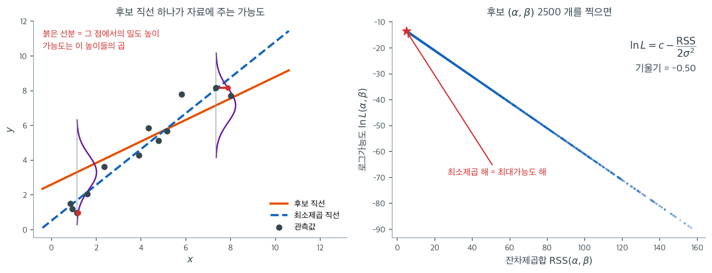

# 최소제곱 추정

이 절은 선형회귀의 최적 모수를 세 관점 — 최소제곱(OLS) 기준, 정규오차 아래의 최대가능도 원리, 그리고 벡터 미적분으로 증명하는 정규방정식 — 에서 유도한다.

---

## 1. 선형회귀의 최대가능도 추정

### 자료와 모형

선형회귀 모형을 따르는 자료 $\{(x^{(i)}, y^{(i)}): i = 1, \ldots, m\}$가 주어졌다고 하자.

$$
y^{(i)} = \alpha + \beta x^{(i)} + \varepsilon^{(i)}
$$

여기서 $\varepsilon^{(i)} \sim N(0, \sigma^2)$이고 $\sigma^2$은 고정되어 있다.

### 가능도함수

각 $y^{(i)}$가 $y^{(i)} \sim N(\alpha + \beta x^{(i)}, \sigma^2)$을 따르므로 가능도함수는 다음과 같다.

$$
L(\alpha, \beta) = \prod_{i=1}^m \frac{1}{\sqrt{2\pi\sigma^2}} \exp\left(-\frac{1}{2\sigma^2} \left(y^{(i)} - \alpha - \beta x^{(i)}\right)^2\right)
$$

### 로그가능도함수

자연로그를 취하면

$$
l(\alpha, \beta) = -\frac{1}{2\sigma^2} \sum_{i=1}^m \left(y^{(i)} - \alpha - \beta x^{(i)}\right)^2 + \text{상수}
$$

### 비용함수(제곱손실)

비용함수를 다음과 같이 정의한다.

$$
J(\alpha, \beta) = \frac{1}{m} \sum_{i=1}^m \left(y^{(i)} - \alpha - \beta x^{(i)}\right)^2
$$

### MLE와 OLS의 동등성

상수와 $\sigma^2$이 $\alpha$나 $\beta$에 의존하지 않으므로, 가능도를 최대화하는 것은 제곱손실을 최소화하는 것과 동등하다.

$$
\text{argmax}_{\alpha, \beta}\ L \quad \Leftrightarrow \quad \text{argmax}_{\alpha, \beta}\ l \quad \Leftrightarrow \quad \text{argmin}_{\alpha, \beta}\ J
$$

이는 기본이 되는 결과이다. **정규오차 가정 아래에서 OLS와 MLE는 같은 모수 추정값을 준다.**



왼쪽 그림이 "가능도"라는 말의 그림판이다. 관측값 $m = 12$개에 $\sigma = 1$인 자료를 놓고, 주황색 후보 직선 하나를 그었다. 이 직선이 옳다면 각 $x^{(i)}$에서 $y^{(i)}$는 직선 위의 점을 중심으로 하는 정규분포를 따라야 하고, 그 분포가 보라색 종 모양으로 옆으로 누워 있다. 실제로 관측된 $y^{(i)}$가 그 종의 어느 높이에 걸리는지가 붉은 선분의 길이다. 가능도 $L(\alpha, \beta)$는 이 높이 12개의 **곱**이다. 관측점이 직선에서 멀수록 종의 꼬리 쪽에 걸려 높이가 짧아지고, 곱은 작아진다. 곧 가능도는 "이 직선이 자료를 얼마나 그럴듯하게 만드는가"를 재는 수다.

오른쪽이 앞 식의 증명을 눈으로 확인한 것이다. $(\alpha, \beta)$를 2500쌍 무작위로 뽑아 각각의 잔차제곱합과 로그가능도를 계산해 찍었다. 점들이 흩어지지 않고 **완벽한 직선** 하나 위에 놓인다. 실제로 두 값의 상관계수는 $-1.000000$이다. 직선의 기울기는 $-1/(2\sigma^2) = -0.50$이며, 이것이 로그가능도 식의 $-\mathrm{RSS}/(2\sigma^2)$ 항 그대로다. RSS를 줄이는 방향과 $\ln L$을 키우는 방향은 같은 방향이므로, 한쪽의 최적점이 다른 쪽의 최적점이다. 붉은 별이 그 공통 최적점이고 이 자료에서 $\mathrm{RSS} = 4.80$, 적합 직선은 $y = 0.51 + 1.03x$이다.

이 동등성이 **어디까지** 가는지도 그림에서 읽을 수 있다. 직선이 되려면 $\sigma^2$이 $(\alpha, \beta)$에 의존하지 않아야 한다. 오차가 정규가 아니면 로그가능도는 RSS의 선형함수가 아니게 되고 두 방법이 갈라진다. 예컨대 오차가 라플라스분포면 로그가능도는 잔차의 **절댓값 합**에 대한 식이 되어 MLE는 최소제곱이 아니라 최소절대편차 회귀가 된다. 그러니 "제곱을 최소화한다"는 관행은 하늘에서 떨어진 것이 아니라 정규 가정이 준 것이다. 다만 뒤에서 볼 가우스–마르코프 정리는 정규성 없이도 최소제곱을 따로 정당화해 준다.

---

## 2. 정규방정식(단순한 경우)

L2 손실의 편미분을 0으로 둔다.

$$
l = \frac{1}{n} \sum_{i=1}^n (\alpha + \beta x_i - y_i)^2
$$

$$
\begin{array}{lll}
\displaystyle \frac{\partial l}{\partial \alpha} = \frac{2}{n} \sum_{i=1}^n \left((\alpha + \beta x_i) - y_i\right) = 0
& \Rightarrow &
2\alpha + 2\beta \bar{x} - 2\bar{y} = 0 \\[8pt]
\displaystyle \frac{\partial l}{\partial \beta} = \frac{2}{n} \sum_{i=1}^n \left((\alpha + \beta x_i) - y_i\right) x_i = 0
& \Rightarrow &
2\alpha \bar{x} + 2\beta \overline{x^2} - 2\overline{xy} = 0
\end{array}
$$

풀면

$$
\begin{array}{lll}
\beta &=& \displaystyle \frac{\overline{xy} - \bar{x}\bar{y}}{\overline{x^2} - (\bar{x})^2}
= \frac{s_{xy}}{s_x^2}
= \frac{\rho\, s_x\, s_y}{s_x^2}
= \rho \frac{s_y}{s_x} \\[8pt]
\alpha &=& \displaystyle -\rho \frac{s_y}{s_x} \bar{x} + \bar{y}
\end{array}
$$

---

<div class="aibox" markdown>

**AI로 보는 통계학 1.** 가장 잘 맞는 직선은 연립방정식 하나로 끝난다

미지수가 둘인 일차연립방정식 $ax+by=c$, $a'x+b'y=c'$ 은 판정식 $D=ab'-a'b$ 가 $0$ 이
아닐 때에만 답을 하나로 준다. 기계가 자료에서 무언가를 배우는 가장 작은 보기 —
**점들에 가장 잘 맞는 직선을 찾는 일** — 이 바로 그 판정 위에 서 있다. 자료
$(x_1,\ y_1),\ \dots,\ (x_n,\ y_n)$ 이 있을 때 $y=ax+b$ 가 얼마나 어긋나는지를

$$
E(a,\ b)=\sum_{i=1}^{n}\left(y_i-ax_i-b\right)^2
$$

으로 재고, 이 값을 가장 작게 하는 $a$ 와 $b$ 를 고른다. 흔히 「조금씩 고쳐 가며 찾는다」고
말하지만, 적어도 이 꼴에서는 그럴 것 없이 **답이 두 미지수 연립일차방정식의 해로 딱 떨어진다.**
그 두 식이 바로 위 §2 의 정규방정식이고, 기울기를 $a$, 절편을 $b$ 라 쓰면 이렇게 적힌다.

$$
\begin{cases}
\left(\sum x_i^2\right)a+\left(\sum x_i\right)b=\sum x_iy_i\\
\left(\sum x_i\right)a+n\,b=\sum y_i
\end{cases}
$$

§2 가 $\alpha$, $\beta$ 로 푼 그 두 식이다. 한 미지수를 소거하면 나머지 하나가 나오고,
그렇게 해도 되는지는 판정식이 정한다. 다만 글자가 겹치는 것에 조심해야 한다 —
판정식의 $a$, $b$, $a'$, $b'$ 은 **계수**에 붙인 이름이고, 지금 구하려는 직선의 $a$, $b$ 는
**미지수**다. 계수를 판정식의 이름으로 읽으면

$$
ab'-a'b=n\sum x_i^2-\left(\sum x_i\right)^2
$$

인데, 이 값은 $x_i$ 들이 **모두 같을 때에만** $0$ 이다. 같은 자리에서 몇 번을 재든 직선의
기울기는 정해지지 않는다는 당연한 말이, 「$D=0$ 이면 해가 하나로 정해지지 않는다」와
같은 말이 된다. 그리고 이 $D$ 는 다음 절 §3 의 $\det\left(\mathbf{X}^\top\mathbf{X}\right)$
바로 그것이다 — 설계행렬이 $\mathbf{X}=\left[\mathbf{1}\ \ \mathbf{x}\right]$ 이면
$\mathbf{X}^\top\mathbf{X}$ 의 행렬식이 $n\sum x_i^2-\left(\sum x_i\right)^2$ 이다.

```python
import numpy as np

x = np.array([1., 2., 3., 4., 5., 6.])
y = np.array([2.1, 3.9, 6.2, 7.8, 10.1, 12.2])      # 대체로 y = 2x 에 가깝다
n = float(len(x))

# 정규방정식 — 오차제곱합을 가장 작게 하는 a, b 가 반드시 만족하는 두 일차식
a1, b1, c1 = (x * x).sum(), x.sum(), (x * y).sum()  # a1*a + b1*b = c1
a2, b2, c2 = x.sum(), n, y.sum()                    # a2*a + b2*b = c2
print(f"  {a1:5.0f} a + {b1:4.0f} b = {c1:7.2f}")
print(f"  {a2:5.0f} a + {b2:4.0f} b = {c2:7.2f}")

det = a1 * b2 - a2 * b1                 # 판정식 ab' - a'b = det(XᵀX)
print(f"\nab' - a'b = {det:.0f}  →  0 이 아니므로 해가 꼭 하나")

a = (c1 * b2 - c2 * b1) / det           # b 를 없애고 a 를 얻는다 (소거)
b = (a1 * c2 - a2 * c1) / det           # a 를 없애고 b 를 얻는다
print(f"소거로 푼 답   a = {a:.6f},  b = {b:.6f}")

fit = np.polyfit(x, y, 1)               # 널리 쓰는 도구의 답과 맞추어 본다
print(f"np.polyfit    a = {fit[0]:.6f},  b = {fit[1]:.6f}")

# x 들이 서로 가까우면 어떻게 되는가 — 판정식이 말한 「갈림」의 문턱이다
for xs in (x, np.array([100., 100.2, 100.4, 100.6, 100.8, 101.])):
    d = (xs * xs).sum() * len(xs) - xs.sum() ** 2
    print(f"x 가 {xs[0]:.1f}~{xs[-1]:.1f} 일 때   ab' - a'b = {d:.2f}")
```

실행하면 다음이 나온다.

```text
     91 a +   21 b =  183.40
     21 a +    6 b =   42.30

ab' - a'b = 105  →  0 이 아니므로 해가 꼭 하나
소거로 푼 답   a = 2.020000,  b = -0.020000
np.polyfit    a = 2.020000,  b = -0.020000
x 가 1.0~6.0 일 때   ab' - a'b = 105.00
x 가 100.0~101.0 일 때   ab' - a'b = 4.20
```

손으로 소거해 얻은 두 수가 널리 쓰이는 도구의 답과 소수 여섯째 자리까지 같다. 도구가 속으로
하는 일이 **§2 의 소거**라는 뜻이다. 자료가 $y=2x$ 에서 조금씩 흔들렸으므로 기울기가
$2$ 가 아니라 $2.02$ 로 나온 것도 그럴듯하다.

마지막 두 줄이 이 방법이 어디서 위태로워지는지를 보여 준다. $x$ 들을 $100$ 둘레에 모아 놓기만
했는데 $ab'-a'b$ 가 $105$ 에서 $4.2$ 로 떨어졌다. $0$ 은 아니니 「해가 하나」는
그대로지만, 나누는 수가 작아진 만큼 **자료의 작은 흔들림이 답에서는 크게 벌어진다**. 미지수가
수백만 개인 요즘 모형에서 $\left(\mathbf{X}^\top\mathbf{X}\right)^{-1}$ 을 그대로 쓰지 않는
까닭이 여기에 있다.

</div>

---

## 3. 정규방정식(행렬 형태)

설명변수가 $d$개인 일반적인 경우:

$$
\text{argmin}_{\boldsymbol{\theta}} \; J(\boldsymbol{\theta})
\quad \Rightarrow \quad
\mathbf{X}^\top \mathbf{X} \boldsymbol{\theta} = \mathbf{X}^\top \mathbf{y}
\quad \Rightarrow \quad
\hat{\boldsymbol{\theta}} = (\mathbf{X}^\top \mathbf{X})^{-1} \mathbf{X}^\top \mathbf{y}
$$

### 벡터 미적분 항등식

유도에 다음 항등식들을 쓴다.

$$
\begin{aligned}
(1) \quad & \frac{\partial (\mathbf{a}^\top \mathbf{b})}{\partial \mathbf{a}} = \mathbf{b} \\[4pt]
(2) \quad & \frac{\partial (\mathbf{a}^\top \mathbf{b})}{\partial \mathbf{b}} = \mathbf{a} \\[4pt]
(3) \quad & \frac{\partial \text{tr}(\mathbf{A}\mathbf{B})}{\partial \mathbf{A}} = \mathbf{B}^\top \\[4pt]
(4) \quad & \frac{\partial \text{tr}(\mathbf{A}\mathbf{B})}{\partial \mathbf{B}} = \mathbf{A}^\top \\[4pt]
(5) \quad & \frac{\partial |\mathbf{A}|}{\partial \mathbf{A}} = \mathbf{C} \quad \text{($\mathbf{C}$는 $\mathbf{A}$의 여인수 행렬)} \\[4pt]
(6) \quad & \frac{\partial \log|\mathbf{A}|}{\partial \mathbf{A}} = \mathbf{A}^{-T} := (\mathbf{A}^{-1})^\top
\end{aligned}
$$

### 정규방정식의 증명

비용함수에서 출발한다.

$$
\begin{aligned}
J(\boldsymbol{\theta})
&= \frac{1}{2m} \| \mathbf{X}\boldsymbol{\theta} - \mathbf{y} \|^2 \\[4pt]
&= \frac{1}{2m} (\mathbf{X}\boldsymbol{\theta} - \mathbf{y})^\top (\mathbf{X}\boldsymbol{\theta} - \mathbf{y}) \\[4pt]
&= \frac{1}{2m} \left( \boldsymbol{\theta}^\top \mathbf{X}^\top \mathbf{X} \boldsymbol{\theta} - \boldsymbol{\theta}^\top \mathbf{X}^\top \mathbf{y} - \mathbf{y}^\top \mathbf{X} \boldsymbol{\theta} + \mathbf{y}^\top \mathbf{y} \right)
\end{aligned}
$$

$\boldsymbol{\theta}$에 대해 미분하면

$$
\begin{aligned}
\frac{\partial J}{\partial \boldsymbol{\theta}}
&= \frac{1}{2m} \left( \mathbf{X}^\top \mathbf{X} \boldsymbol{\theta} + (\boldsymbol{\theta}^\top \mathbf{X}^\top \mathbf{X})^\top - \mathbf{X}^\top \mathbf{y} - (\mathbf{y}^\top \mathbf{X})^\top \right) \\[4pt]
&= \frac{1}{m} \left( \mathbf{X}^\top \mathbf{X} \boldsymbol{\theta} - \mathbf{X}^\top \mathbf{y} \right) \\[4pt]
&= \mathbf{0}
\end{aligned}
$$

이로부터 **정규방정식** $\mathbf{X}^\top \mathbf{X} \boldsymbol{\theta} = \mathbf{X}^\top \mathbf{y}$를 얻고, 닫힌 형태의 해는 다음과 같다.

$$
\hat{\boldsymbol{\theta}} = (\mathbf{X}^\top \mathbf{X})^{-1} \mathbf{X}^\top \mathbf{y}
$$

!!! note "역행렬은 언제 존재하는가"
    행렬 $\mathbf{X}^\top\mathbf{X}$가 가역인 것은 $\mathbf{X}$가 완전 열계수를 가질 때, 곧 어떤 설명변수도 나머지의 완전한 선형결합이 아닐 때에 한한다. 이 조건이 무너지면(다중공선성) 릿지 회귀 같은 정칙화 기법을 쓸 수 있다.

---

## 4. 예측

### 일반적인 경우

새 입력 $\mathbf{x}$가 주어지면 절편을 위해 1을 앞에 붙인 뒤 계수벡터와 곱한다.

$$
\mathbf{x}
\quad \Rightarrow \quad
\tilde{\mathbf{x}} = [1, \mathbf{x}]
\quad \Rightarrow \quad
\hat{y} = \tilde{\mathbf{x}} \hat{\boldsymbol{\theta}}
$$

### 단순선형회귀

설명변수가 하나인 특수한 경우, 예측 공식은 우아한 표준화 형태로 줄어든다.

$$
\frac{y - \bar{y}}{s_y} = \rho \frac{x - \bar{x}}{s_x}
$$

**증명**: 단순한 경우의 정규방정식에서 $\beta = \rho\, s_y / s_x$와 $\alpha = \bar{y} - \beta \bar{x}$를 얻었으므로

$$
\begin{aligned}
y &= \alpha + \beta x \\
  &= \bar{y} - \rho \frac{s_y}{s_x} \bar{x} + \rho \frac{s_y}{s_x} x \\
  &= \rho \frac{s_y}{s_x}(x - \bar{x}) + \bar{y}
\end{aligned}
$$

정리하면 $\displaystyle \frac{y - \bar{y}}{s_y} = \rho \frac{x - \bar{x}}{s_x}$이다.

---

## 5. 종합 보기: 최대가능도에서 행렬 표현까지

앞의 내용을 하나로 꿰는 완결된 유도 보기이다.

선형회귀 모형을 따르는 자료 $\{(x^{(i)}, y^{(i)}): i = 1, \ldots, m\}$가 주어졌다고 하자.

$$
y^{(i)} = \alpha + \beta x^{(i)} + \varepsilon^{(i)}
$$

여기서 $\varepsilon^{(i)} \sim N(0, \sigma^2)$이고 $\sigma^2$은 고정되어 있다.

**(a)** 이 모형의 가능도함수 $L(\alpha, \beta)$를 유도하라.

**(b)** 로그가능도함수 $l(\alpha, \beta)$를 유도하라.

**(c)** 비용함수(제곱손실)를 다음과 같이 정의할 때,

$$
J(\alpha, \beta) = \frac{1}{2} \sum_{i=1}^m \left(y^{(i)} - \alpha - \beta x^{(i)}\right)^2
$$

제곱손실을 최소화하는 것과 가능도함수를 최대화하는 것의 관계를 설명하라.

**(d)** 제곱손실을 최소화하는 모수 $\hat{\alpha}$, $\hat{\beta}$가 만족해야 하는 정규방정식을 유도하라.

**(e)** 정규방정식을 풀어 $\hat{\alpha}$와 $\hat{\beta}$를 구하라.

**(f)** 설명변수가 $d$개인 다변수 경우로 모형을 확장하라.

$$
\mathbf{x}^{(i)} = (x_1^{(i)}, x_2^{(i)}, \ldots, x_d^{(i)}), \quad 1 \leq i \leq m
$$

설계행렬 $\mathbf{X}$, 모수벡터 $\boldsymbol{\theta}$, 반응벡터 $\mathbf{y}$를 써서 제곱손실함수를 행렬 연산으로 나타내라.

??? success "풀이"

    **(a) 가능도함수**

    $\varepsilon^{(i)} \sim N(0, \sigma^2)$이라 가정하면 각 $y^{(i)}$는 $y^{(i)} \sim N(\alpha + \beta x^{(i)}, \sigma^2)$을 따른다. 가능도함수는

    $$
    L(\alpha, \beta) = \prod_{i=1}^m \frac{1}{\sqrt{2\pi\sigma^2}} \exp\left(-\frac{1}{2\sigma^2} \left(y^{(i)} - \alpha - \beta x^{(i)}\right)^2\right)
    $$

    **(b) 로그가능도함수**

    $$
    l(\alpha, \beta) = \ln L(\alpha, \beta) = -\frac{1}{2\sigma^2} \sum_{i=1}^m \left(y^{(i)} - \alpha - \beta x^{(i)}\right)^2 + \text{상수}
    $$

    **(c) MLE와 OLS의 동등성**

    제곱손실함수는

    $$
    J(\alpha, \beta) = \frac{1}{2} \sum_{i=1}^m \left(y^{(i)} - \alpha - \beta x^{(i)}\right)^2
    $$

    상수와 $\sigma^2$이 $\alpha$나 $\beta$에 의존하지 않으므로 로그가능도를 최대화하는 것은 잔차제곱합을 최소화하는 것과 동등하다.

    $$
    \text{argmax}_{\alpha, \beta}\ L(\alpha, \beta) \quad \Leftrightarrow \quad \text{argmax}_{\alpha, \beta}\ l(\alpha, \beta) \quad \Leftrightarrow \quad \text{argmin}_{\alpha, \beta}\ J(\alpha, \beta)
    $$

    **(d) 정규방정식**

    편미분을 취해 0으로 두면

    1. $\displaystyle \frac{\partial J}{\partial \alpha} = \sum_{i=1}^m \left(\alpha + \beta x^{(i)} - y^{(i)}\right) = 0$

    2. $\displaystyle \frac{\partial J}{\partial \beta} = \sum_{i=1}^m \left(\alpha + \beta x^{(i)} - y^{(i)}\right) x^{(i)} = 0$

    이로부터 정규방정식을 얻는다.

    $$
    \begin{aligned}
    \alpha + \beta \bar{x} &= \bar{y} \\
    \beta \overline{x^2} + \alpha \bar{x} &= \overline{xy}
    \end{aligned}
    $$

    **(e) 정규방정식 풀기**

    $$
    \beta = \frac{\overline{xy} - \bar{x}\bar{y}}{\overline{x^2} - (\bar{x})^2} = \frac{\text{Cov}(X, Y)}{\text{Var}(X)} = \rho \frac{\sigma_y}{\sigma_x}
    $$

    $$
    \alpha = \bar{y} - \beta \bar{x}
    $$

    **(f) 행렬 표현**

    설계행렬 $\mathbf{X}$, 모수벡터 $\boldsymbol{\theta}$, 출력벡터 $\mathbf{y}$를 만든다.

    $$
    \mathbf{X} =
    \begin{bmatrix}
    1 & x_1^{(1)} & \cdots & x_d^{(1)} \\
    \vdots & \vdots & \ddots & \vdots \\
    1 & x_1^{(m)} & \cdots & x_d^{(m)}
    \end{bmatrix}, \quad
    \boldsymbol{\theta} =
    \begin{bmatrix}
    \beta_0 \\ \beta_1 \\ \vdots \\ \beta_d
    \end{bmatrix}, \quad
    \mathbf{y} =
    \begin{bmatrix}
    y^{(1)} \\ \vdots \\ y^{(m)}
    \end{bmatrix}
    $$

    제곱손실함수는

    $$
    J(\boldsymbol{\theta}) = \frac{1}{2m} \| \mathbf{X}\boldsymbol{\theta} - \mathbf{y} \|^2 = \frac{1}{2m} (\mathbf{X}\boldsymbol{\theta} - \mathbf{y})^\top (\mathbf{X}\boldsymbol{\theta} - \mathbf{y})
    $$

---

## 연습문제

<div class="drillbox" markdown>

**연습문제 1.** <span class="diff med" title="중간"></span>
$\sum_{i=1}^n (y_i - \beta_0 - \beta_1 x_i)^2$을 최소화하여 단순선형회귀의 OLS 추정량 $\hat{\beta}_1 = \sum(x_i - \bar{x})(y_i - \bar{y}) / \sum(x_i - \bar{x})^2$을 유도하라.

</div>

??? success "풀이"
    $S(\beta_0, \beta_1) = \sum_{i=1}^n (y_i - \beta_0 - \beta_1 x_i)^2$이라 하자. 편미분을 취해 0으로 두면

    $$
    \frac{\partial S}{\partial \beta_0} = -2\sum(y_i - \beta_0 - \beta_1 x_i) = 0 \implies \hat{\beta}_0 = \bar{y} - \hat{\beta}_1 \bar{x}
    $$

    $$
    \frac{\partial S}{\partial \beta_1} = -2\sum x_i(y_i - \beta_0 - \beta_1 x_i) = 0
    $$

    $\hat{\beta}_0 = \bar{y} - \hat{\beta}_1 \bar{x}$를 대입하면

    $$
    \sum x_i(y_i - \bar{y} + \hat{\beta}_1 \bar{x} - \hat{\beta}_1 x_i) = 0
    $$

    $$
    \sum x_i(y_i - \bar{y}) = \hat{\beta}_1 \sum x_i(x_i - \bar{x})
    $$

    $\sum x_i(y_i - \bar{y}) = \sum(x_i - \bar{x})(y_i - \bar{y})$이고 $\sum x_i(x_i - \bar{x}) = \sum(x_i - \bar{x})^2$이므로

    $$
    \hat{\beta}_1 = \frac{\sum(x_i - \bar{x})(y_i - \bar{y})}{\sum(x_i - \bar{x})^2}
    $$

    $\square$

<div class="drillbox" markdown>

**연습문제 2.** <span class="diff med" title="중간"></span>
OLS 잔차의 합이 0임을 보여라. 곧 $e_i = y_i - \hat{y}_i$일 때 $\sum_{i=1}^n e_i = 0$이다.

</div>

??? success "풀이"
    첫 번째 정규방정식($\partial S / \partial \beta_0 = 0$)에서

    $$
    \sum_{i=1}^n (y_i - \hat{\beta}_0 - \hat{\beta}_1 x_i) = 0
    $$

    $e_i = y_i - \hat{\beta}_0 - \hat{\beta}_1 x_i$이므로 이 식이 바로 $\sum_{i=1}^n e_i = 0$이다.

    이 결과는 절편항이 있는 모든 회귀모형에서 성립한다. 반대로 절편을 강제로 0으로 둔 모형에서는 성립하지 않는다. $\square$

<div class="drillbox" markdown>

**연습문제 3.** <span class="diff med" title="중간"></span>
최소제곱 해가 설계행렬 $X$의 열공간에서 무엇을 뜻하는지 기하학적으로 설명하라. 적합값 $\hat{Y}$와 잔차 $e$의 관계는 무엇인가?

</div>

??? success "풀이"
    적합값 $\hat{Y} = X\hat{\beta} = X(X^TX)^{-1}X^TY = HY$는 $Y$를 $X$의 열공간 위로 **직교사영**한 것이다. 잔차벡터 $e = Y - \hat{Y} = (I - H)Y$는 열공간과 직교한다.

    기하학적으로 OLS는 $X$의 열공간에서 유클리드 거리로 $Y$에 가장 가까운 점을 찾는다. 피타고라스 정리에서 분해 $\|Y\|^2 = \|\hat{Y}\|^2 + \|e\|^2$을 얻으며, 이는 ($Y$와 $\hat{Y}$를 중심화하면) $\text{SST} = \text{SSR} + \text{SSE}$에 해당한다.

<div class="drillbox" markdown>

**연습문제 4.** <span class="diff hard" title="어려움"></span>
1절 그림의 오른쪽 판은 $(\alpha, \beta)$ 2500쌍에 대해 $(\mathrm{RSS}, \ln L)$을 찍은 것이고, 점들이 기울기 $-1/(2\sigma^2) = -0.50$인 직선 위에 정확히 놓인다. 자료는 $m = 12$, $\sigma = 1$이며 최적점에서 $\mathrm{RSS} = 4.80$이다.

**(a)** 상수를 생략하지 말고 $\ln L(\alpha, \beta)$를 $\mathrm{RSS}$의 함수로 적어라. 그 직선이 $\mathrm{RSS} = 0$에서 가지는 값은 얼마인가?

**(b)** 최대 로그가능도 $\ln L(\hat\alpha, \hat\beta)$의 값을 소수 넷째 자리까지 구하라.

**(c)** 이제 $\sigma^2$도 추정해야 하는 모수라고 하자. $\hat\sigma^2$의 MLE와 그때의 최대 로그가능도를 구하라. $\sigma = 1$로 고정했을 때보다 값이 커지는가 작아지는가?

**(d)** (c)의 설정에서 그림의 오른쪽 판을 다시 그리면 점들은 여전히 직선 위에 놓이는가? 그래도 "가능도 최대 = RSS 최소"는 유지되는가?

</div>

??? success "풀이"
    **(a)** 1절의 가능도함수에 로그를 취하면 상수까지 포함해

    $$
    \ln L(\alpha, \beta) = -\frac{m}{2}\ln(2\pi\sigma^2) - \frac{\mathrm{RSS}(\alpha,\beta)}{2\sigma^2},
    \qquad \mathrm{RSS}(\alpha,\beta) = \sum_{i=1}^m \left(y^{(i)} - \alpha - \beta x^{(i)}\right)^2
    $$

    이다. 이것은 $\mathrm{RSS}$의 **일차함수**이고 기울기가 $-1/(2\sigma^2) = -0.50$이다. $\mathrm{RSS} = 0$에서의 값은 절편

    $$
    -\frac{m}{2}\ln(2\pi\sigma^2) = -6\ln(2\pi) = -11.0273
    $$

    이다. 곧 그림의 직선은 $\ln L = -11.0273 - 0.50\,\mathrm{RSS}$이다.

    **(b)** $\mathrm{RSS} = 4.80$을 넣으면

    $$
    \ln L(\hat\alpha, \hat\beta) = -11.0273 - 0.50 \times 4.80 = -13.4273
    $$

    **(c)** $\sigma^2$까지 모수로 보면 $(\alpha, \beta)$에 대한 최대화는 $\sigma^2$과 무관하게 여전히 $\mathrm{RSS}$ 최소화이므로 $\hat\alpha, \hat\beta$는 그대로다. $\mathrm{RSS} = 4.80$을 고정한 뒤 $\sigma^2$에 대해 미분하면

    $$
    \frac{\partial}{\partial \sigma^2}\left(-\frac{m}{2}\ln(2\pi\sigma^2) - \frac{\mathrm{RSS}}{2\sigma^2}\right)
    = -\frac{m}{2\sigma^2} + \frac{\mathrm{RSS}}{2(\sigma^2)^2} = 0
    \quad\Longrightarrow\quad
    \hat\sigma^2 = \frac{\mathrm{RSS}}{m} = \frac{4.80}{12} = 0.40
    $$

    이를 되넣으면

    $$
    \ln L(\hat\alpha, \hat\beta, \hat\sigma^2)
    = -\frac{m}{2}\ln\!\left(2\pi \cdot 0.40\right) - \frac{m}{2}
    = -6 \times 0.9216 - 6 = -11.5295
    $$

    $-11.5295 > -13.4273$이므로 **커진다**. 자유 모수를 하나 더 풀어 주었으니 최대가능도는 줄어들 수 없다. 여기서는 $\hat\sigma = \sqrt{0.40} = 0.6325$가 참값 $\sigma = 1$보다 작게 나왔고(불편추정값으로 보아도 $\mathrm{RSS}/(m-2) = 0.48$), 가능도는 "자료가 실제보다 더 촘촘하다"고 믿는 쪽에서 더 높아진다.

    **(d)** $\sigma^2$을 프로파일링하면 로그가능도는

    $$
    \ln L_{\text{prof}}(\mathrm{RSS}) = -\frac{m}{2}\ln\!\left(\frac{2\pi\,\mathrm{RSS}}{m}\right) - \frac{m}{2}
    $$

    로 $\mathrm{RSS}$의 **로그함수**가 된다. 따라서 점들은 직선이 아니라 아래로 볼록한(감소하는) 곡선 위에 놓이고 피어슨 상관계수도 $-1$이 아니다. 그러나 이 함수는 $\mathrm{RSS}$에 대해 **강하게 감소**하므로 순서는 완전히 뒤집힌 채 보존되어, 가능도를 최대로 만드는 $(\alpha, \beta)$는 여전히 $\mathrm{RSS}$를 최소로 만드는 점이다. 곧 MLE $=$ OLS에 필요한 것은 "직선"이 아니라 "단조"이고, $\sigma^2$이 $(\alpha,\beta)$에 의존하지 않는다는 점이다. $\square$

<div class="drillbox" markdown>

**연습문제 5.** <span class="diff hard" title="어려움"></span>
4절의 표준화 예측식 $\dfrac{y - \bar y}{s_y} = \rho \dfrac{x - \bar x}{s_x}$를 쓴다.

**(a)** 같은 자료에서 역할을 바꾸어 $x$를 $y$로 회귀한 직선의 식을 같은 꼴로 적고, 두 직선의 기울기(둘 다 $x$–$y$ 평면에서 재어) $b_{y\mid x}$와 $1/b_{x\mid y}$의 비가 $\rho^2$임을 보여라.

**(b)** $\rho = 0.5$라 하자. $x = \bar x + 2 s_x$에서 $y$를 예측하고, 그 예측값 $y$를 다시 $x$–on–$y$ 직선에 넣어 $x$를 예측하라. 처음의 $x$로 돌아오는가?

**(c)** (b)가 모순이 아닌 이유를 설명하고, 두 직선이 일치하는 $\rho$를 구하라. $\rho \to 0$일 때 두 직선은 각각 무엇이 되는가?

</div>

??? success "풀이"
    **(a)** 역할을 바꾸면 같은 유도가 글자만 바꾸어 되풀이되므로

    $$
    \frac{x - \bar x}{s_x} = \rho \frac{y - \bar y}{s_y}
    $$

    이다. $x$–$y$ 평면에서 두 직선의 기울기는

    $$
    b_{y\mid x} = \rho \frac{s_y}{s_x}, \qquad
    b_{x\mid y} = \rho \frac{s_x}{s_y} \ \Rightarrow\ \frac{1}{b_{x\mid y}} = \frac{1}{\rho}\frac{s_y}{s_x}
    $$

    이고, 따라서

    $$
    \frac{b_{y\mid x}}{1/b_{x\mid y}} = b_{y\mid x}\, b_{x\mid y} = \rho^2
    $$

    이다. 두 직선은 모두 $(\bar x, \bar y)$를 지난다(각 식에 $x = \bar x$ 또는 $y = \bar y$를 넣으면 다른 쪽도 평균이 된다).

    **(b)** $\rho = 0.5$, $x = \bar x + 2s_x$이면 표준화 좌표에서 $(x - \bar x)/s_x = 2$이므로

    $$
    \frac{y - \bar y}{s_y} = 0.5 \times 2 = 1
    \quad\Longrightarrow\quad
    y = \bar y + s_y
    $$

    이 $y$를 $x$–on–$y$ 직선에 넣으면

    $$
    \frac{x - \bar x}{s_x} = 0.5 \times 1 = 0.5
    \quad\Longrightarrow\quad
    x = \bar x + 0.5\, s_x
    $$

    처음의 $\bar x + 2 s_x$로 돌아오지 **않는다**.

    **(c)** 두 식은 같은 직선을 두 방향으로 푼 것이 아니라, **서로 다른 조건부 평균**을 재는 두 직선이다. 각 회귀는 자기 쪽 반응변수의 평균으로 예측을 끌어당긴다. 표준화 좌표에서 예측은 항상 $\rho$배로 줄어들므로, 두 번 예측하면 $\rho^2 = 0.25$배가 되어 $2 \to 1 \to 0.5$가 된다. 두 직선이 일치하는 것은 기울기의 곱 $\rho^2 = 1$, 곧 $\rho = \pm 1$일 때뿐이고 그때는 점들이 한 직선 위에 놓여 끌어당길 여지가 없다. $\rho \to 0$이면 $y$–on–$x$ 직선은 수평선 $y = \bar y$, $x$–on–$y$ 직선은 수직선 $x = \bar x$가 되어 두 직선이 직각으로 갈라진다. 이것이 "평균으로의 회귀"이며, 되돌아오지 않는 것은 결함이 아니라 $\lvert \rho \rvert < 1$의 필연적 결과다. $\square$

<div class="drillbox" markdown>

**연습문제 6.** <span class="diff hard" title="어려움"></span>
1절 끝에서 "오차가 라플라스분포면 MLE는 최소절대편차 회귀가 된다"고 했다. 이를 확인하고 끝까지 밀어붙여 보자. 오차의 밀도가 $f(\varepsilon) = \dfrac{1}{2b}\exp\!\left(-\dfrac{\lvert \varepsilon \rvert}{b}\right)$라 하자.

**(a)** 로그가능도함수를 적고, MLE가 $\sum_i \lvert y^{(i)} - \alpha - \beta x^{(i)} \rvert$를 최소화하는 것과 같음을 보여라.

**(b)** 설명변수가 없는 모형 $y^{(i)} = \alpha + \varepsilon^{(i)}$, 자료 $y = (0, 1, 10)$에서 정규오차의 MLE(= OLS)와 라플라스오차의 MLE를 각각 구하라. 뒤쪽은 미분 대신 조각마다의 기울기를 세어 구하라.

**(c)** 두 추정값을 두 기준에 각각 넣어 네 값을 비교하라.

**(d)** $y^{(3)} = t$로 두고 $t \to \infty$를 보내면 두 추정값은 어떻게 되는가?

</div>

??? success "풀이"
    **(a)** $y^{(i)} - \alpha - \beta x^{(i)} = \varepsilon^{(i)}$이 독립이므로

    $$
    L = \prod_{i=1}^m \frac{1}{2b}\exp\!\left(-\frac{\lvert y^{(i)} - \alpha - \beta x^{(i)} \rvert}{b}\right),
    \qquad
    l = -m\ln(2b) - \frac{1}{b}\sum_{i=1}^m \left\lvert y^{(i)} - \alpha - \beta x^{(i)} \right\rvert
    $$

    $b > 0$과 $-m\ln(2b)$는 $(\alpha, \beta)$에 의존하지 않으므로 $l$을 최대화하는 것은 절댓값 합을 최소화하는 것과 같다. 정규오차에서 지수가 제곱이었던 자리에 절댓값이 들어온 것이 전부이며, "제곱"은 정규 가정이 준 것임을 다시 확인한다.

    **(b)** 정규오차: $J(\alpha) = \sum (y^{(i)} - \alpha)^2$의 미분을 0으로 두면 $\hat\alpha = \bar y = \dfrac{0 + 1 + 10}{3} = \dfrac{11}{3} \approx 3.6667$.

    라플라스오차: $g(\alpha) = \lvert 0 - \alpha \rvert + \lvert 1 - \alpha \rvert + \lvert 10 - \alpha \rvert$는 조각마다 일차함수이고, 꺾이지 않는 구간에서의 기울기는

    $$
    g'(\alpha) = \#\{i: y^{(i)} < \alpha\} - \#\{i: y^{(i)} > \alpha\}
    $$

    이다. $\alpha \in (0, 1)$에서는 $1 - 2 = -1 < 0$, $\alpha \in (1, 10)$에서는 $2 - 1 = +1 > 0$이므로 $g$는 $\alpha = 1$에서 내려오던 것을 멈추고 올라간다. 따라서 유일한 최소점은 **중앙값** $\hat\alpha = 1$이다($\alpha < 0$에서는 기울기 $-3$, $\alpha > 10$에서는 $+3$이므로 바깥은 볼 필요가 없다).

    **(c)** 두 기준의 값은 다음과 같다.

    $$
    \begin{array}{lcc}
     & \textstyle\sum (y^{(i)} - \alpha)^2 & \textstyle\sum \lvert y^{(i)} - \alpha \rvert \\
    \alpha = \bar y = 11/3 & 546/9 \approx 60.67 & 38/3 \approx 12.67 \\
    \alpha = \text{중앙값} = 1 & 82 & 10
    \end{array}
    $$

    각 추정값은 자기 기준에서만 이긴다. 평균은 제곱합을, 중앙값은 절댓값합을 최소화하므로 두 열의 승자가 서로 바뀌는 것이 당연하다.

    **(d)** $y = (0, 1, t)$, $t \ge 1$에서 $\bar y = (1 + t)/3 \to \infty$이지만 중앙값은 $t \ge 1$인 동안 언제나 $1$로 **변하지 않는다**. 한 점 하나가 OLS 추정값을 원하는 어디로든 끌고 갈 수 있는 반면 중앙값은 꿈쩍하지 않는다. 그래서 라플라스 꼬리를 가정하는 것(= 최소절대편차)이 이상점에 강건하다. $\square$

<div class="drillbox" markdown>

**연습문제 7.** <span class="diff hard" title="어려움"></span>
연습문제 2는 $\sum_i e_i = 0$을 얻었고 연습문제 3은 $\|Y\|^2 = \|\hat Y\|^2 + \|e\|^2$에서 $\mathrm{SST} = \mathrm{SSR} + \mathrm{SSE}$를 읽었다. 두 결론이 어디까지 가는지 절편 없는 모형으로 시험한다. 모형 $y = \beta x$(절편을 0으로 강제)와 자료 $(x, y) = (1, 0), (2, 3)$을 쓴다.

**(a)** 정규방정식 $\mathbf X^\top \mathbf X \beta = \mathbf X^\top \mathbf y$에서 $\hat\beta$, 적합값, 잔차를 구하고 $\sum_i e_i \ne 0$임을 확인하라.

**(b)** 그런데도 $\sum_i x_i e_i = 0$과 $\sum_i \hat y_i e_i = 0$, 따라서 $\|y\|^2 = \|\hat y\|^2 + \|e\|^2$은 성립한다. 수치로 확인하고, 행렬식 $\mathbf X^\top e = \mathbf 0$으로 (a)와 (b)를 함께 설명하라.

**(c)** 이 자료에서 $\mathrm{SST}$, $\mathrm{SSR}$, $\mathrm{SSE}$를 평균을 빼고 계산하라. $\mathrm{SST} = \mathrm{SSR} + \mathrm{SSE}$가 성립하는가? $R^2$을 $1 - \mathrm{SSE}/\mathrm{SST}$로 재느냐 $\mathrm{SSR}/\mathrm{SST}$로 재느냐에 따라 값이 어떻게 갈리는가?

</div>

??? success "풀이"
    **(a)** 설계행렬은 열이 하나인 $\mathbf X = \begin{bmatrix} 1 \\ 2 \end{bmatrix}$, $\mathbf y = \begin{bmatrix} 0 \\ 3 \end{bmatrix}$이다. $\mathbf X^\top \mathbf X = 5$, $\mathbf X^\top \mathbf y = 1\cdot 0 + 2 \cdot 3 = 6$이므로

    $$
    \hat\beta = \frac{6}{5} = 1.2, \qquad
    \hat y = (1.2,\ 2.4), \qquad
    e = (0 - 1.2,\ 3 - 2.4) = (-1.2,\ 0.6)
    $$

    $\sum_i e_i = -1.2 + 0.6 = -0.6 \ne 0$이다.

    **(b)** 직접 재면

    $$
    \sum_i x_i e_i = 1(-1.2) + 2(0.6) = 0, \qquad
    \sum_i \hat y_i e_i = 1.2(-1.2) + 2.4(0.6) = -1.44 + 1.44 = 0
    $$

    $$
    \|y\|^2 = 0 + 9 = 9, \qquad
    \|\hat y\|^2 = 1.44 + 5.76 = 7.2, \qquad
    \|e\|^2 = 1.44 + 0.36 = 1.8, \qquad 7.2 + 1.8 = 9
    $$

    설명은 정규방정식을 $\mathbf X^\top(\mathbf y - \mathbf X\hat{\boldsymbol\theta}) = \mathbf X^\top e = \mathbf 0$으로 다시 쓰는 데 있다. 이 식이 말하는 것은 "잔차가 **설계행렬의 각 열**과 직교한다"는 것뿐이다. 연습문제 2의 $\sum_i e_i = 0$은 1로만 채워진 **절편 열**에 대응하는 한 줄이므로, 그 열이 없으면 아무것도 $\sum_i e_i = 0$을 강제하지 않는다. 반면 $\hat y = \mathbf X \hat{\boldsymbol\theta}$는 언제나 열공간 안에 있으므로 $\hat y^\top e = \hat{\boldsymbol\theta}^\top \mathbf X^\top e = 0$이고, 중심화하지 않은 피타고라스 분해는 절편 없이도 그대로 성립한다.

    **(c)** $\bar y = 1.5$, $\bar{\hat y} = 1.8$이다($\bar{\hat y} \ne \bar y$인 것이 이미 경고다).

    $$
    \mathrm{SST} = (0 - 1.5)^2 + (3 - 1.5)^2 = 4.5, \qquad
    \mathrm{SSR} = (1.2 - 1.5)^2 + (2.4 - 1.5)^2 = 0.9, \qquad
    \mathrm{SSE} = 1.8
    $$

    $\mathrm{SSR} + \mathrm{SSE} = 2.7 \ne 4.5 = \mathrm{SST}$이므로 **성립하지 않는다**. 따라서

    $$
    1 - \frac{\mathrm{SSE}}{\mathrm{SST}} = 1 - \frac{1.8}{4.5} = 0.6,
    \qquad
    \frac{\mathrm{SSR}}{\mathrm{SST}} = \frac{0.9}{4.5} = 0.2
    $$

    로 두 $R^2$ 정의가 어긋난다. 간극의 정체는 교차항이다. $y_i - \bar y = (\hat y_i - \bar y) + e_i$를 제곱해 더하면

    $$
    \mathrm{SST} = \mathrm{SSR} + \mathrm{SSE} + 2\sum_i (\hat y_i - \bar y) e_i,
    \qquad
    \sum_i (\hat y_i - \bar y) e_i = \underbrace{\sum_i \hat y_i e_i}_{= 0} - \bar y \sum_i e_i = -1.5 \times (-0.6) = 0.9
    $$

    이고 실제로 $0.9 + 1.8 + 2(0.9) = 4.5$로 맞는다. 절편이 있을 때 이 교차항을 0으로 만들어 주던 것이 바로 $\sum_i e_i = 0$이었다. 절편 없는 회귀의 $R^2$을 보고할 때 어느 정의를 썼는지 반드시 밝혀야 하는 이유다. $\square$

<div class="drillbox" markdown>

**연습문제 8.** <span class="diff hard" title="어려움"></span>
3절의 주석은 $\mathbf X^\top \mathbf X$가 가역인 것이 $\mathbf X$가 완전 열계수를 가질 때뿐이라고 했다. 그 경계에서 무엇이 무너지고 무엇이 살아남는지 본다. 설명변수가 $d = 2$개이고 $x_2^{(i)} = 2x_1^{(i)}$인 자료

$$
x_1 = (1, 2, 3), \qquad x_2 = (2, 4, 6), \qquad \mathbf y = (1, 2, 4)
$$

를 절편을 포함한 설계행렬 $\mathbf X = [\mathbf 1, x_1, x_2]$로 다룬다.

**(a)** $\mathbf X^\top \mathbf X$와 $\mathbf X^\top \mathbf y$를 계산하고 $\det(\mathbf X^\top \mathbf X) = 0$임을 확인하라.

**(b)** 정규방정식을 만족하는 $\boldsymbol\theta$ 전체를 구하라.

**(c)** (b)의 어느 해를 골라도 적합값 $\hat{\mathbf y}$와 $\mathrm{RSS}$가 같음을 보여라. 왜 그런가?

**(d)** (b)의 해 가운데 $\theta_1^2 + \theta_2^2$이 가장 작은 것을 구하라. 주석이 말한 릿지 회귀가 $\lambda \to 0^+$에서 고르는 해가 이것이다.

</div>

??? success "풀이"
    **(a)** $\sum x_1 = 6$, $\sum x_2 = 12$, $\sum x_1^2 = 14$, $\sum x_1 x_2 = 28$, $\sum x_2^2 = 56$이므로

    $$
    \mathbf X^\top \mathbf X =
    \begin{bmatrix}
    3 & 6 & 12 \\
    6 & 14 & 28 \\
    12 & 28 & 56
    \end{bmatrix},
    \qquad
    \mathbf X^\top \mathbf y =
    \begin{bmatrix} 7 \\ 17 \\ 34 \end{bmatrix}
    $$

    셋째 열이 둘째 열의 정확히 2배이므로 $\det(\mathbf X^\top \mathbf X) = 0$이다. $\mathbf X$의 셋째 열이 둘째 열의 2배였던 것이 그대로 옮겨 온 것이다.

    **(b)** $\theta_1 x_1 + \theta_2 x_2 = (\theta_1 + 2\theta_2) x_1$이므로 적합값은 $\theta_1$과 $\theta_2$를 따로 보지 않고 $\gamma := \theta_1 + 2\theta_2$만 본다. 곧 문제는 $\mathbf 1$과 $x_1$ 위에서의 단순회귀로 줄고, 2절의 공식에서

    $$
    \gamma = \frac{\sum (x_{1i} - \bar x_1)(y_i - \bar y)}{\sum (x_{1i} - \bar x_1)^2} = \frac{3}{2} = 1.5,
    \qquad
    \theta_0 = \bar y - \gamma \bar x_1 = \frac{7}{3} - 3 = -\frac{2}{3}
    $$

    (여기서 $\bar x_1 = 2$, $\bar y = 7/3$, 분자 $= (-1)(-4/3) + 0 + (1)(5/3) = 3$, 분모 $= 2$.) 따라서 해집합은 직선

    $$
    \boldsymbol\theta = \left(-\tfrac{2}{3},\ \tfrac{3}{2} - 2t,\ t\right), \qquad t \in \mathbb{R}
    $$

    이다. 실제로 $t = 0$인 $(-2/3, 3/2, 0)$을 넣으면 $3(-\frac23) + 6(\frac32) = 7$, $6(-\frac23) + 14(\frac32) = 17$, $12(-\frac23) + 28(\frac32) = 34$로 세 정규방정식이 모두 맞는다.

    **(c)** 적합값은 $\hat y_i = \theta_0 + \gamma x_{1i}$로 $t$가 사라진 꼴이므로

    $$
    \hat{\mathbf y} = \left(\tfrac{5}{6},\ \tfrac{7}{3},\ \tfrac{23}{6}\right), \qquad
    e = \left(\tfrac{1}{6},\ -\tfrac{1}{3},\ \tfrac{1}{6}\right), \qquad
    \mathrm{RSS} = \frac{1 + 4 + 1}{36} = \frac{1}{6}
    $$

    로 $t$와 무관하다. 이유는 기하다. 비용함수는 $\boldsymbol\theta$를 $\mathbf X \boldsymbol\theta$로만 보고, $\mathbf X$의 영공간 방향 $(0, -2, 1)$로 아무리 움직여도 $\mathbf X \boldsymbol\theta$는 변하지 않는다. 열공간 위로의 사영 $\hat{\mathbf y}$는 유일하고, 그것을 만들어 내는 좌표 $\boldsymbol\theta$만 유일하지 않다. 바꾸어 말해 **예측은 멀쩡하고 계수 해석만 무너진다**.

    **(d)** $\theta_1 + 2\theta_2 = 3/2$ 아래에서 $\theta_1^2 + \theta_2^2$을 최소화한다. 제약평면에 수직인 방향이 $(1, 2)$이므로 최소점은 $(\theta_1, \theta_2) = c(1, 2)$ 꼴이고 $c + 4c = 3/2$에서 $c = 3/10$이다. 곧

    $$
    (\theta_1, \theta_2) = (0.3,\ 0.6), \qquad \theta_1^2 + \theta_2^2 = 0.45
    $$

    ($t = 0$인 해의 $1.5^2 = 2.25$보다 훨씬 작다.) 릿지는 같은 $\mathrm{RSS}$를 주는 해들 가운데 계수 노름이 작은 쪽을 고르므로, 완전공선인 두 변수에 계수를 $\theta_1 : \theta_2 = 1 : 2$ 비율로 **나누어** 싣는다. 가역성이 무너진 자리에서 유일한 답을 되돌려 주는 것이 바로 이 추가 기준이다. $\square$

<div class="drillbox" markdown>

**연습문제 9.** <span class="diff hard" title="어려움"></span>
3절은 $J(\boldsymbol\theta) = \frac{1}{2m}\|\mathbf X \boldsymbol\theta - \mathbf y\|^2$의 일차조건으로 정규방정식을 얻었다. 일차조건만으로는 그 점이 최솟값인지 안장점인지 알 수 없다. 미분 없이 결론을 내는 항등식을 만든다.

**(a)** $\hat{\boldsymbol\theta}$가 정규방정식의 해이면 모든 $\boldsymbol\theta$에 대해

$$
J(\boldsymbol\theta) = J(\hat{\boldsymbol\theta}) + \frac{1}{2m}\left\|\mathbf X(\boldsymbol\theta - \hat{\boldsymbol\theta})\right\|^2
$$

임을 보여라.

**(b)** (a)에서 $\hat{\boldsymbol\theta}$가 전역최소점이라는 것, 그리고 최소점이 유일한 것이 $\mathbf X$가 완전 열계수를 가질 때뿐이라는 것을 읽어라. 연습문제 8의 $\boldsymbol\theta = (-\frac23, \frac32 - 2t, t)$에 (a)를 적용하면 무엇이 보이는가?

**(c)** $J$의 헤세행렬을 구해 (b)와 같은 결론을 미분으로도 확인하라.

**(d)** 1절 그림의 오른쪽 판에서 2500개 점이 모두 $\mathrm{RSS} \ge 4.80$, $\ln L \le -13.4273$ 쪽에만 놓이는 이유를 (a)로 설명하라.

</div>

??? success "풀이"
    **(a)** $r := \mathbf y - \mathbf X \hat{\boldsymbol\theta}$라 두면 정규방정식은 $\mathbf X^\top r = \mathbf 0$이다. $\mathbf u := \boldsymbol\theta - \hat{\boldsymbol\theta}$로 쓰면

    $$
    \mathbf X \boldsymbol\theta - \mathbf y = \mathbf X(\hat{\boldsymbol\theta} + \mathbf u) - \mathbf y = \mathbf X \mathbf u - r
    $$

    이므로

    $$
    \|\mathbf X\boldsymbol\theta - \mathbf y\|^2
    = \|\mathbf X \mathbf u\|^2 - 2\, (\mathbf X \mathbf u)^\top r + \|r\|^2
    = \|\mathbf X \mathbf u\|^2 - 2\, \mathbf u^\top (\mathbf X^\top r) + \|r\|^2
    = \|\mathbf X \mathbf u\|^2 + \|r\|^2
    $$

    이다. 가운데 항이 사라지는 것이 정규방정식 그 자체다. 양변을 $2m$으로 나누면 구하는 항등식을 얻는다.

    **(b)** 둘째 항은 제곱노름이라 항상 $\ge 0$이므로 모든 $\boldsymbol\theta$에서 $J(\boldsymbol\theta) \ge J(\hat{\boldsymbol\theta})$이다. 미분도 볼록성 언급도 필요 없이 $\hat{\boldsymbol\theta}$는 **전역최소점**이다. 등호는 $\mathbf X \mathbf u = \mathbf 0$일 때뿐이므로, 최소점이 유일한 것은 $\mathbf X \mathbf u = \mathbf 0 \Rightarrow \mathbf u = \mathbf 0$, 곧 $\mathbf X$가 완전 열계수를 가질 때에 한한다. 연습문제 8에서는 $\mathbf u = t(0, -2, 1)$이고 $\mathbf X \mathbf u = t(-2 x_1 + x_2) = \mathbf 0$이므로 둘째 항이 모든 $t$에서 0이다. 그래서 $J$가 그 직선 위에서 **완전히 평평**하고, 거기 놓인 모든 $\boldsymbol\theta$가 똑같이 최소점이다.

    **(c)** 3절의 미분 결과 $\dfrac{\partial J}{\partial \boldsymbol\theta} = \dfrac{1}{m}(\mathbf X^\top \mathbf X \boldsymbol\theta - \mathbf X^\top \mathbf y)$를 한 번 더 미분하면

    $$
    \frac{\partial^2 J}{\partial \boldsymbol\theta \, \partial \boldsymbol\theta^\top} = \frac{1}{m}\mathbf X^\top \mathbf X
    $$

    이다. 임의의 $\mathbf u$에 대해 $\mathbf u^\top \mathbf X^\top \mathbf X \mathbf u = \|\mathbf X\mathbf u\|^2 \ge 0$이므로 헤세행렬은 준양정부호이고 $J$는 볼록하다. 완전 열계수이면 $\mathbf u \ne \mathbf 0$에서 $\|\mathbf X \mathbf u\|^2 > 0$이라 양정부호가 되어 강볼록, 최소점이 유일하다. 계수가 모자라면 $\mathbf X^\top \mathbf X$의 고윳값 0에 해당하는 방향이 (b)의 평평한 방향이다. 안장점은 애초에 생길 수 없다.

    **(d)** 그 그림의 $\mathrm{RSS}(\alpha, \beta) = 2m\,J(\alpha,\beta)$에 (a)를 적용하면

    $$
    \mathrm{RSS}(\alpha, \beta) = 4.80 + \left\|\mathbf X\left(\boldsymbol\theta - \hat{\boldsymbol\theta}\right)\right\|^2 \ \ge\ 4.80
    $$

    이다. 무작위로 뽑은 $(\alpha, \beta)$가 무엇이든 $\mathrm{RSS}$는 최적점 값보다 작아질 수 없고, $\ln L = -11.0273 - 0.50\,\mathrm{RSS}$가 $\mathrm{RSS}$의 감소함수이므로 $\ln L \le -13.4273$이다. 붉은 별이 직선의 **오른쪽 아래가 아니라 왼쪽 위 끝**에 놓이는 것이 이 때문이다. $\square$

<div class="drillbox" markdown>

**연습문제 10.** <span class="diff hard" title="어려움"></span>
1절은 동등성이 "어디까지" 가는지 물으며 $\sigma^2$이 $(\alpha, \beta)$에 의존하지 않아야 한다고 했다. 이번에는 $\sigma^2$이 관측마다 다른 경우를 본다. $\varepsilon^{(i)} \sim N(0, \sigma^2 / w_i)$이고 가중값 $w_i > 0$은 알려져 있으며 서로 독립이라 하자.

**(a)** 로그가능도함수를 적고, MLE가 **가중** 잔차제곱합 $\sum_i w_i (y^{(i)} - \alpha - \beta x^{(i)})^2$을 최소화하는 것과 같음을 보여라.

**(b)** 행렬 표기로 $\mathbf W = \mathrm{diag}(w_1, \ldots, w_m)$을 두고 가중 정규방정식을 유도하라. 모든 $w_i$가 같으면 3절의 결과로 돌아오는가?

**(c)** 각 행에 $\sqrt{w_i}$를 곱하는 변환으로 (b)가 3절의 유도를 글자 그대로 되쓴 것임을 설명하라.

**(d)** $x = (0, 1, 2)$, $y = (0, 2, 2)$, $w = (1, 1, 4)$에서 OLS 적합과 가중 적합을 모두 구하라. 두 적합의 가중 $\mathrm{RSS}$와 보통 $\mathrm{RSS}$를 비교하라.

</div>

??? success "풀이"
    **(a)** $y^{(i)} \sim N(\alpha + \beta x^{(i)},\ \sigma^2/w_i)$이므로

    $$
    L = \prod_{i=1}^m \sqrt{\frac{w_i}{2\pi\sigma^2}}\,
    \exp\!\left(-\frac{w_i}{2\sigma^2}\left(y^{(i)} - \alpha - \beta x^{(i)}\right)^2\right)
    $$

    $$
    l = -\frac{m}{2}\ln(2\pi\sigma^2) + \frac12 \sum_{i=1}^m \ln w_i
    - \frac{1}{2\sigma^2}\sum_{i=1}^m w_i \left(y^{(i)} - \alpha - \beta x^{(i)}\right)^2
    $$

    앞의 두 항은 $(\alpha, \beta)$에 의존하지 않으므로 $l$의 최대화는 가중 잔차제곱합의 최소화와 같다. 분산이 큰 관측은 $w_i$가 작아 덜 믿어 주는 것이 가능도가 저절로 하는 일이다.

    **(b)** 가중 비용함수는

    $$
    J_{\mathbf W}(\boldsymbol\theta) = \frac{1}{2m}(\mathbf X\boldsymbol\theta - \mathbf y)^\top \mathbf W (\mathbf X\boldsymbol\theta - \mathbf y)
    = \frac{1}{2m}\left(\boldsymbol\theta^\top \mathbf X^\top \mathbf W \mathbf X \boldsymbol\theta - 2\boldsymbol\theta^\top \mathbf X^\top \mathbf W \mathbf y + \mathbf y^\top \mathbf W \mathbf y\right)
    $$

    이고($\mathbf W$가 대칭이라 가운데 두 항이 합쳐진다), 3절과 같은 항등식으로 미분하면

    $$
    \frac{\partial J_{\mathbf W}}{\partial \boldsymbol\theta} = \frac{1}{m}\left(\mathbf X^\top \mathbf W \mathbf X \boldsymbol\theta - \mathbf X^\top \mathbf W \mathbf y\right) = \mathbf 0
    \quad\Longrightarrow\quad
    \hat{\boldsymbol\theta}_{\mathbf W} = \left(\mathbf X^\top \mathbf W \mathbf X\right)^{-1}\mathbf X^\top \mathbf W \mathbf y
    $$

    $\mathbf W = c\mathbf I$이면 $c$가 분자와 분모에서 약분되어 $\hat{\boldsymbol\theta} = (\mathbf X^\top \mathbf X)^{-1}\mathbf X^\top \mathbf y$로 돌아온다. 곧 **가중값이 모두 같으면 가중 자체가 아무 일도 하지 않는다**.

    **(c)** $\mathbf W^{1/2} = \mathrm{diag}(\sqrt{w_1}, \ldots, \sqrt{w_m})$으로 $\tilde{\mathbf X} = \mathbf W^{1/2}\mathbf X$, $\tilde{\mathbf y} = \mathbf W^{1/2}\mathbf y$를 만들면

    $$
    (\mathbf X\boldsymbol\theta - \mathbf y)^\top \mathbf W (\mathbf X\boldsymbol\theta - \mathbf y) = \|\tilde{\mathbf X}\boldsymbol\theta - \tilde{\mathbf y}\|^2
    $$

    이다. 변환된 자료의 오차는 $\sqrt{w_i}\,\varepsilon^{(i)} \sim N(0, \sigma^2)$으로 등분산이 되었으므로, 3절의 유도를 글자 하나 바꾸지 않고 적용해 $\tilde{\mathbf X}^\top \tilde{\mathbf X}\boldsymbol\theta = \tilde{\mathbf X}^\top \tilde{\mathbf y}$, 곧 $\mathbf X^\top \mathbf W \mathbf X \boldsymbol\theta = \mathbf X^\top \mathbf W \mathbf y$를 얻는다. 가중최소제곱은 새 방법이 아니라 **좌표를 바꾼 최소제곱**이다.

    **(d)** OLS: $\bar x = 1$, $\bar y = 4/3$, $\sum (x_i - \bar x)^2 = 2$, $\sum (x_i - \bar x)(y_i - \bar y) = (-1)(-\tfrac43) + 0 + (1)(\tfrac23) = 2$이므로

    $$
    \hat\beta = 1, \qquad \hat\alpha = \frac43 - 1 = \frac13, \qquad
    \hat y = \left(\tfrac13,\ \tfrac43,\ \tfrac73\right), \qquad
    e = \left(-\tfrac13,\ \tfrac23,\ -\tfrac13\right)
    $$

    가중 적합: 가중평균이 $\bar x_w = \dfrac{0 + 1 + 8}{6} = 1.5$, $\bar y_w = \dfrac{0 + 2 + 8}{6} = \dfrac53$이고

    $$
    \sum w_i (x_i - \bar x_w)^2 = 2.25 + 0.25 + 1 = 3.5, \qquad
    \sum w_i (x_i - \bar x_w)(y_i - \bar y_w) = 2.5 - \tfrac16 + \tfrac23 = 3
    $$

    이므로

    $$
    \hat\beta_{\mathbf W} = \frac{3}{3.5} = \frac67 \approx 0.8571, \qquad
    \hat\alpha_{\mathbf W} = \frac53 - \frac67 \cdot \frac32 = \frac{35 - 27}{21} = \frac{8}{21} \approx 0.3810
    $$

    $$
    \hat y_{\mathbf W} = \left(\tfrac{8}{21},\ \tfrac{26}{21},\ \tfrac{44}{21}\right), \qquad
    e_{\mathbf W} = \left(-\tfrac{8}{21},\ \tfrac{16}{21},\ -\tfrac{2}{21}\right)
    $$

    두 기준의 값은

    $$
    \begin{array}{lcc}
     & \textstyle\sum w_i e_i^2 & \textstyle\sum e_i^2 \\
    \text{OLS 적합} & 1 & 6/9 \approx 0.6667 \\
    \text{가중 적합} & 336/441 \approx 0.7619 & 324/441 \approx 0.7347
    \end{array}
    $$

    각 적합이 자기 기준에서만 이긴다. 가중 적합은 네 배로 믿는 셋째 점($x = 2$)의 잔차를 $-1/3$에서 $-2/21 \approx -0.095$로 줄이는 대신 첫째 점의 잔차를 키웠다. 가중값이 맞다면 이쪽이 MLE이며, 여기서 OLS를 쓰면 추정량은 여전히 불편이지만 최소분산은 아니다. 가우스–마르코프 정리가 요구하는 등분산 가정이 깨졌기 때문이다. $\square$

---

## 정리하며

같은 추정량이 **세 가지 길**에서 나온다.

- **최소제곱 기준.** 잔차제곱합을 최소화한다. 분포 가정이 전혀 없다.
- **최대가능도.** 오차가 정규라고 가정하면 로그가능도의 최대화가 잔차제곱합의 최소화와 같아진다. **정규 가정 아래에서 두 원리가 만나는 것**이며, 제곱을 쓰는 관행에 근거를 준다.
- **정규방정식.** $\mathbf X^\top\mathbf X\hat{\boldsymbol\beta}=\mathbf X^\top\mathbf y$ 이며, 기하적으로는 **잔차가 열공간과 직교**한다는 조건이다.
- **세 번째 관점이 가장 일반적이다.** 정규성도 필요 없고, 0장의 사영 그림으로 곧바로 읽힌다.
- **가우스–마르코프 정리가 최소제곱을 정당화한다.** 오차가 무상관이고 등분산이면(정규성 없이도) 최소제곱이 **선형 불편추정량 중 최소분산**이다.

다음 절 **표집분포**로 넘어간다. 추정값의 불확실성을 다룬다.
