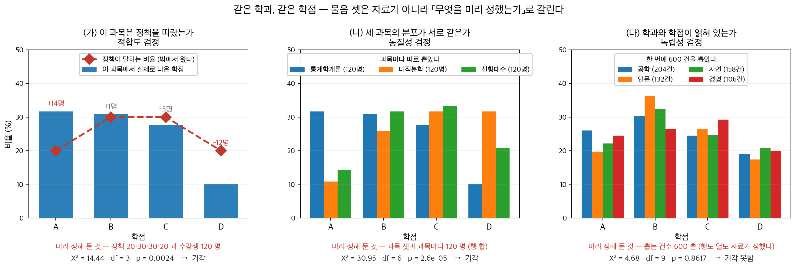

# 13장: 카이제곱 검정

## 개요

**들어가는 이야기** — 같은 성적표를 놓고 묻는 세 가지

어느 학교가 학점 비율을 정해 두었다고 하자. **A $20\%$ · B $30\%$ · C $30\%$ ·
D $20\%$.** 권고이지 강제는 아니지만, 학기가 끝나면 누군가는 이 표를 들고 와서 묻는다.
물음은 하나처럼 들리는데 **실제로는 셋이고, 셋은 서로 다른 검정을 부른다.**

**하나.** 통계학개론 한 과목을 연다. 수강생 $120$ 명의 학점이 A $38$, B $37$, C $33$,
D $12$ 로 나왔다. **이 강사는 정책을 따랐는가.** 견주는 상대가 자료 바깥에 있다 —
$20 \cdot 30 \cdot 30 \cdot 20$ 은 누가 잰 값이 아니라 **미리 정해진 비율**이다.

**둘.** 같은 학과가 연 세 과목을 모은다. 과목마다 $120$ 명씩. **세 과목의 학점분포가
서로 같은가.** 이번에는 바깥의 기준이 없다. 셋을 서로 맞대는 것뿐이고, 과목이 셋이라는
것과 과목마다 몇 명인지는 **내가 정했다.**

**셋.** 학교 전체 수강 기록에서 무작위로 $600$ 건을 뽑아 학과와 학점을 적는다.
**학과와 학점이 서로 얽혀 있는가.** 내가 정한 것은 $600$ 이라는 숫자 하나뿐이다.
어느 학과가 몇 건일지도, 어느 학점이 몇 건일지도 **뽑고 나서야 알았다.**

<figure markdown>
  { width="900" }
  <figcaption markdown>붉은 글씨가 **설계가 미리 정한 것**이다. 왼쪽은 바깥의 기준과 인원, 가운데는 과목 셋과 행 합, 오른쪽은 총 $600$ 건뿐이다. 그래서 자유도가 $3 \cdot 6 \cdot 9$ 로 갈린다. 가운데의 파란 막대는 왼쪽의 그 과목과 **같은 자료**다. 오른쪽에서 네 줄이 포개지는 것이 「얽혀 있지 않다」의 모습이고, 셋 가운데 여기서만 기각하지 못한다. 세 자료는 모두 이 책이 지어내어 돌린 것이다.</figcaption>
</figure>

셋은 같은 자리에서 나왔고 세는 방식도 거의 같다. 특히 **둘째와 셋째는 산술이 완전히
같다** — 같은 통계량, 같은 기대도수 공식, 같은 자유도. 계산만 보아서는 어느 검정을 하고
있는지 **구분할 수 없다.** 가른 것은 과목이냐 학과냐가 아니라 **무엇을 미리 정해
두었는가**다. 그것은 표에 적혀 있지 않고 자료를 모은 사람만 안다.

이 장이 그 셋을 차례로 세운다 — 13.2절 [적합도 검정](test/gof.md),
[독립성 검정](test/independence.md), [동질성 검정](test/homogeneity.md).

카이제곱 검정은 범주형 자료를 분석하는 대표적인 도구이다. 이 장에서는 카이제곱분포와 범주형 도수 자료 사이의 연결을 세운 뒤, 위의 세 물음에 각각 답하는 검정을 만든다. 기대도수 요건이나 Cramér의 V를 이용한 효과크기 측정 같은 실무적 고려사항도 함께 다룬다.

---

## 1. 장의 구성

### 13.1 피어슨 통계량과 자유도

카이제곱분포를 범주형 자료 분석에 잇는 이론적 토대:

- **[피어슨 통계량은 어디서 오는가](distribution/distribution.md)** --- 다항 도수를 다변량 중심극한정리로 정규근사하고, 제약 때문에 자유도 하나를 잃는 자리를 짚어 피어슨 카이제곱 통계량을 유도한다. 분모가 참된 표준편차가 아니라 기대도수의 제곱근인 까닭 — 그 「근사」가 잃은 자유도를 정확히 상쇄한다는 것 — 이 이 쪽의 반전이다.
- **[자유도를 얻는 세 가지 길](distribution/degrees_of_freedom.md)** --- 같은 자유도를 세 길로 얻는다. 자유로운 칸을 세고(적합도 k − 1, 모수를 p 개 추정하면 k − 1 − p, 독립성·동질성 (r − 1)(c − 1)), 극한 공분산이 만드는 사영의 계수로 읽고, 로그선형모형의 교호작용 모수를 센다. 셋째 길이 이 검정을 회귀의 점수검정으로 세우고, 카이제곱 근사가 언제 믿을 만한지도 여기서 따진다.

### 13.2 범주형 자료에 대한 카이제곱 검정

카이제곱 검정을 범주형 도수 자료에 적용하는 방식들, 그리고 기각한 뒤에 할 일과 대응 자료를 위한 변형:

- **[적합도 검정](test/gof.md)** --- 관측된 도수분포가 k개 범주에 걸쳐 가설의 분포와 맞는지를, 관측도수 대 기대도수의 도수표와 피어슨 카이제곱 통계량으로 검정한다.
- **[독립성 검정](test/independence.md)** --- 하나의 표본 안에서 두 범주형 변수가 관련되어 있는지를, 분할표를 써서 관측 칸 도수와 독립 가정 아래 계산한 기대도수를 비교하여 검정한다.
- **[동질성 검정](test/homogeneity.md)** --- 여러 독립인 모집단이 어떤 범주형 변수에 대해 같은 분포를 공유하는지를 검정한다. 계산은 독립성 검정과 같지만 표집 설계와 해석이 다르다.
- **[기각한 뒤: 칸별 잔차 분석](test/homogeneity_residuals.md)** --- 검정은 "어느 하나가 다르다"까지만 말한다. 표준화 잔차로 **어느 칸이** 어긋났는지 찾고, 칸마다 보는 일이 다중검정이 되므로 본페로니 보정을 붙인다.
- **[타이타닉 생존과 성별: 설계 판별부터 완전한 보고까지](test/independence_titanic.md)** --- 2.2절이 탐색까지만 하고 남겨 둔 "이 차이가 우연인가"에 답한다. 같은 자료로 독립성인지 동질성인지를 먼저 가리고, 검정통계량부터 효과크기와 완전한 보고까지 한 바퀴를 끝낸다.
- **[McNemar 검정 (대응된 이진 자료)](test/mcnemar_test.md)** --- 같은 대상을 두 번 재어 얻은 2×2 표에서는 독립성 검정을 쓸 수 없다. 바뀐 쌍만 세는 것이 왜 옳은지와, 바뀌지 않은 쌍이 왜 정보를 주지 않는지를 다룬다.
- **[Cochran의 Q 검정 (관련된 k개의 결과)](test/cochran_q.md)** --- McNemar 를 조건 셋 이상으로 넓힌 것이다. $k = 2$ 에서 McNemar 로 돌아간다는 것과, 정보를 주는 피험자의 수가 검정력을 정한다는 것을 보인다.

### 13.3 실무적 고려사항

카이제곱 검정 결과의 타당성과 해석 가능성을 확보하기 위한 지침:

- **[기대 칸 도수와 타당성 조건](practice/validity_conditions.md)** --- 모든 기대 칸 도수가 적어도 5 이상이어야 한다는 경험 법칙을 제시하고, 이 조건이 (관측도수가 아니라) 기대도수에 적용되는 이유를 설명하며, 조건이 어긋날 때의 대안(범주 병합, 피셔의 정확검정)을 기술한다.
- **[효과크기와 Cramér의 V](practice/effect_size.md)** --- 연관의 강도를 재는 표준화된 척도로 Cramér의 V를 소개한다. 0(연관 없음)부터 1(완전한 연관)까지의 값을 가지며, 작은·중간·큰 효과크기의 해석 지침을 제공한다.
- **[피셔의 정확검정 (2×2)](practice/fisher_exact.md)** --- 기대도수가 작아 카이제곱 근사를 믿을 수 없을 때 쓴다. 주변합을 고정하고 초기하분포로 확률을 직접 세므로 근사가 아예 필요 없다.

### 13.4 연습문제

분포 가정에 대한 적합도 검정, 분할표에 대한 독립성 검정, 타당성 조건 확인, 검정통계량 계산을 다루는 연습문제.

---

## 2. 선행 지식

이 장은 다음 내용 위에 세워진다:

- **5장** (추정량과 표집분포) --- 카이제곱분포와 그 성질, 그리고 표집분포로서의 역할.
- **9장** (가설검정) --- 귀무가설과 대립가설, 검정통계량, p-값, 판정 규칙이라는 일반적 틀.

---

## 3. 핵심 요점

1. 피어슨 카이제곱 통계량은 관측된 범주 도수와 기대 도수 사이의 어긋남을 재며, 기대도수가 충분히 클 때 귀무가설 아래에서 근사적으로 카이제곱분포를 따른다.
2. 적합도 검정은 하나의 범주형 변수가 가설의 분포를 따르는지 평가하고, 독립성 검정과 동질성 검정은 서로 다른 표집 설계 아래에서 두 범주형 변수 사이의 관계를 평가한다.
3. 독립성 검정과 동질성 검정은 계산이 완전히 같지만 연구 질문과 자료 수집 설계가 다르다. 한쪽은 두 변수로 분류된 하나의 표본이고, 다른 쪽은 하나의 변수에 대해 비교하는 여러 표본이다.
4. 카이제곱 근사의 타당성 조건으로 가장 널리 인용되는 것은 「모든 기대 칸 도수가 적어도 5 이상」이라는 경험 법칙이다. 다만 **어긋났을 때 무엇으로 갈아타느냐는 공짜가 아니다** — 13.3절 [기대 칸 도수와 타당성 조건](practice/validity_conditions.md)이 재어 둔 대로 예이츠 보정과 피셔 정확검정은 **어느 자리에서도 명목 $0.05$ 에 닿지 못하고**(기대도수가 15 인 자리에서도 $0.031$), 그만큼 검정력을 내준다. 「작으니까 일단 피셔」가 아니라 **무엇을 사고 무엇을 내주는지**를 보고 고른다.
5. 통계적 유의성만으로는 실질적 중요성을 알 수 없다. Cramér의 V는 표본크기와 무관하게 연관의 강도를 재는 표준화된 효과크기를 제공한다.
