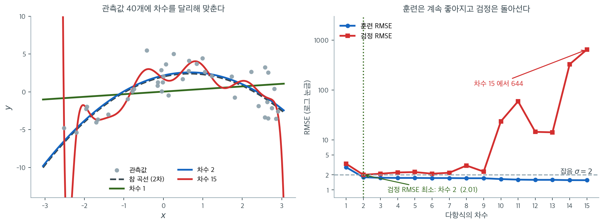
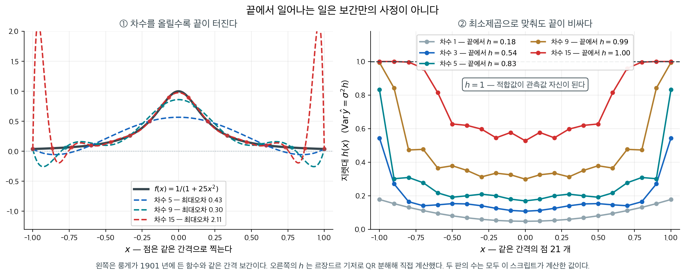

# 다항회귀

## 1. 왜 다항회귀를 쓰는가

**다항회귀**는 설명변수의 거듭제곱을 회귀식에 넣어 비선형 관계를 모형화한다. 직선 관계를 가정하는 단순선형회귀와 달리 다양한 모양의 곡선을 모형화할 수 있다.

비선형 관계는 실무에서 자주 나타난다.

- 물리학에서 가속하는 물체의 거리와 시간의 관계는 이차식이다: $y = ax^2 + bx + c$.
- 경제학에서 수익체감은 흔히 투입과 산출 사이의 다항 관계를 따른다.
- 금융에서 변동성 스마일은 옵션 행사가와 내재변동성 사이의 굽은 관계를 시사한다.

---

## 2. 수학적 정식화

다항회귀는 설명변수의 다항 항을 넣어 선형회귀를 확장한다.

$$
Y = \beta_0 + \beta_1 X + \beta_2 X^2 + \beta_3 X^3 + \cdots + \beta_d X^d + \epsilon
$$

여기서 $X^2, X^3, \ldots, X^d$는 설명변수 $X$의 다항 항이고 $d$는 다항식의 **차수**이다.

!!! info "여전히 선형모형이다"
    $X$와 $Y$ 사이의 관계는 비선형이지만, 다항회귀는 모수 $\beta_0, \beta_1, \ldots, \beta_d$에 대해서는 여전히 **선형** 모형이다. 따라서 $X, X^2, \ldots, X^d$를 각각 별개의 설명변수로 취급하면 최소제곱법(OLS)을 그대로 적용할 수 있다.

다항식의 차수가 곡선의 유연성을 결정한다.

| 차수 | 이름 | 모양 |
|---|---|---|
| 1 | 선형 | 직선 |
| 2 | 이차 | 포물선(굽이 하나) |
| 3 | 삼차 | S자 곡선(굽이 둘) |
| $d$ | $d$차 | 최대 $d - 1$개의 굽이 |

<div class="aibox" markdown>

**AI로 보는 통계학 1.** 중심을 옮기지 않으면 계산이 무너진다

다항식에서 $x$ 를 $x+m$ 으로 알맞게 옮기면 한 차수 아래의 항을 지울 수 있다 — 사차식 $ax^{4}+bx^{3}+\cdots$ 이면 $m=-\dfrac{b}{4a}$ 에서 삼차항이 사라진다. 손으로 풀 때는 「항이 하나 줄어 보기 좋다」 정도지만, 기계가 자료를 다항식으로 맞출 때는 이 치환이 **계산이 무너지지 않게 하는 일**이 된다.

까닭은 이렇다. 자료가 원점에서 멀리 떨어져 있으면 $x^{4}$ 같은 항의 값이 터무니없이 커진다. 그래도 참값이 제대로 나오려면 큰 항들이 서로 거의 상쇄되어야 하는데, 컴퓨터가 쓰는 소수는 자릿수가 유한하므로 **큰 수끼리 빼는 순간 유효숫자가 날아간다.** 같은 치환으로 중심을 자료 한가운데로 옮겨 두면 그 상쇄 자체가 사라진다.

같은 자료를 두 좌표에서 맞추어 보자.

```python
import numpy as np

xs = np.arange(1000.0, 1010.0)                 # 자료가 원점에서 멀리 떨어져 있다
ys = 3.0 + 0.5*(xs-1004.5) - 0.02*(xs-1004.5)**3   # 참값 — 삼차곡선

for name, t in (("그대로 (x)", xs), ("중심을 옮겨 (x - 평균)", xs - xs.mean())):
    c = np.polyfit(t, ys, 4)                   # 사차로 맞춘다
    resid = np.max(np.abs(np.polyval(c, t) - ys))
    print(f"{name:24s} 최대잔차 {resid:12.3e}   계수 크기 {np.max(np.abs(c)):10.3e}")
```

실행하면 다음이 나온다.

```text
그대로 (x)                  최대잔차    2.772e-08   계수 크기  2.027e+07
중심을 옮겨 (x - 평균)          최대잔차    4.885e-15   계수 크기  3.000e+00
```

자료도 같고 차수도 같은데 잔차가 **일곱 자리** 차이가 난다. 계수의 크기를 보면 까닭이 보인다 — 그대로 맞추면 계수가 $2\times10^{7}$ 까지 치솟는다. 그렇게 큰 수들이 서로 상쇄되어야 $3$ 남짓한 값이 나오는 것이다. 중심을 옮기면 가장 큰 계수가 $3$ 이고, 뺄 것이 없으니 잃을 자릿수도 없다.

「삼차항이 사라진다」고 할 때의 그 치환이, 여기서는 **계수를 작게 만들어 상쇄를 없애는** 일을 한다. 그 $m$ 이 $f'$ 의 근들의 평균이라는 것도 같은 방향이다 — 중심은 곡선이 실제로 움직이는 자리의 한가운데다. 위 §2 의 $X,\ X^2,\ \dots,\ X^d$ 를 만들기 전에 $X$ 를 $X-\bar X$ 로 바꾸어 두라는 말이고, 다항회귀를 쓸 때 거의 언제나 먼저 하는 일이 그것이다.

다만 중심을 옮겨도 차수가 높아지면 여전히 무너지고, 자료 밖에서 끝이 달아나는 것은 그대로다([Patsy를 이용한 스플라인](../splines_gams/splines_patsy_examples.md)에서 B-스플라인이 경계 밖으로 폭주하던 것이 그 이야기다). 그리고 중심을 자료가 정하므로 자료가 바뀌면 계수가 통째로 바뀐다. 바로 아래 §3 은 계수의 부호와 크기로 곡률을 읽는데, 중심을 어디로 두었는지에 따라 그 계수가 달라진다는 뜻이다. 계수 하나하나에 뜻을 붙이기 어려워지는 것이 이 편리함의 값이다.

</div>

---

## 3. 다항 항의 해석

계수의 부호와 크기가 곡률의 방향과 강도를 나타낸다.

- **$\beta_2 > 0$** (이차항): 곡선이 **U자 모양**(볼록)이다. $X$가 커질수록 $Y$는 줄었다가 늘어난다.
- **$\beta_2 < 0$** (이차항): 곡선이 **뒤집힌 U자 모양**(오목)이다. $Y$는 늘었다가 줄어든다.
- **고차 항**($X^3$, $X^4$ 등)은 변곡점이 더 많은 복잡한 패턴을 포착한다.

!!! warning "과적합의 위험"
    고차 다항 항은 모형의 유연성을 높이지만 **과적합**의 위험도 함께 키운다. 자료가 적을 때 특히 그렇다. 차수가 높은 다항식은 훈련자료에는 잘 맞지만 새 관측값에는 일반화가 잘 안 될 수 있다. AIC나 BIC 같은 모형선택 기준으로 적절한 차수를 골라야 한다.



참 곡선이 $y = 2 + 1.2x - 0.9x^2$인 자료 $40$개를 만들고(잡음 $\sigma = 2$) 차수를 $1$부터 $15$까지 바꿔 가며 적합했다. 왼쪽 그림에서 초록 직선(차수 $1$)은 곡률을 통째로 놓친다. 파란 곡선(차수 $2$)은 검은 점선인 참 곡선과 거의 포개진다. 붉은 곡선(차수 $15$)은 점들 사이를 구불구불 누비며 지나가다가 자료의 양끝에서 화면 밖으로 튀어 나간다. 고차 다항식의 고질적인 버릇인데, 자료가 없는 가장자리에서 항들이 서로 상쇄되지 못하고 폭주하기 때문이다.

오른쪽이 그 결과를 수로 잰 것이다. 파란 선(훈련 RMSE)은 차수가 오를수록 **한 번도 내려가지 않고** 계속 줄어든다. 차수 $1$에서 $2.850$, 차수 $2$에서 $1.792$, 차수 $15$에서 $1.565$다. 모수를 더 주면 최소제곱이 언제나 더 잘 맞춘다는, 앞 절에서 본 $R^2$의 단조성과 같은 이야기다. 붉은 선(따로 만든 새 자료에서 잰 검정 RMSE)은 전혀 다르게 움직인다. 차수 $1$의 $3.341$에서 차수 $2$의 $2.009$로 떨어졌다가, 그 뒤로는 계속 오른다. 차수 $10$에서 $23.6$, 차수 $15$에서 $644$다. 세로축이 로그 눈금이라는 점에 주의하라.

검정 RMSE의 최솟값 $2.009$가 잡음의 표준편차 $\sigma = 2$와 거의 같다는 사실이 이 그림의 핵심이다. **$\sigma$가 그 어떤 모형도 넘어설 수 없는 바닥**이며, 참 차수인 $2$가 그 바닥에 닿는다. 차수 $3$ 이후로 훈련 RMSE가 계속 줄어드는 것은 모형이 신호를 더 찾아내서가 아니라 **잡음을 외우고 있기** 때문이다. 훈련자료만 보면 이 두 가지를 구별할 수 없다. 그래서 다항 차수를 고를 때는 수정 $R^2$, AIC, BIC, 교차검증처럼 복잡도에 값을 매기는 기준이 반드시 필요하다.

---

<div class="exbox" markdown>

**보기 1.** <span class="diff easy" title="쉬움"></span> 나이와 소득. 나이와 소득의 관계를 연구할 때 선형모형은 소득이 어느 시점까지는 나이와 함께 늘다가 이후 정체하거나 (은퇴 후처럼) 줄어드는 현실을 놓칠 수 있다. 이차 모형이 이를 포착한다.

</div>

??? success "풀이"
    $$
    \text{Income} = \beta_0 + \beta_1 \cdot \text{Age} + \beta_2 \cdot \text{Age}^2 + \epsilon
    $$

    $\beta_1 > 0$이고 $\beta_2 < 0$이면 모형은 소득이 나이와 함께 오르다가 정점에 이른 뒤 떨어지는, 곧 뒤집힌 U자 관계를 기술한다.

---

## 4. 다항 항과 교호작용 항 결합하기

더 복잡한 관계를 포착하기 위해 교호작용 항과 다항회귀를 함께 쓸 수 있다. 예를 들어 선형 설명변수와 다항 항 사이에 교호작용 항을 넣을 수 있다.

$$
Y = \beta_0 + \beta_1 X_1 + \beta_2 X_2 + \beta_3 X_1^2 + \beta_4 (X_1 \times X_2) + \epsilon
$$

이는 $X_1$과 $Y$의 비선형 관계가 $X_2$의 수준에 의존하는 상황을 모형화한다.

**보기(농업):** 비료 사용량($X_1$)과 작물 수확량($Y$)의 관계는 이차식일 수 있다(수익체증 뒤 수익체감). 그런데 이 관계가 강수량($X_2$)에도 의존할 수 있다. 다항 항과 교호작용 항을 함께 쓰면 이를 더 정확히 포착한다.

---

## 5. 모형 적합도 평가

다항 항을 넣을 때는 늘어난 복잡도가 정말로 모형을 개선하는지 평가하는 것이 중요하다.

- **수정 $R^2$**는 항의 개수에 벌점을 주므로 차수가 다른 모형들을 비교하는 데 유용하다.
- **AIC와 BIC**는 적합도와 복잡도 사이의 원칙 있는 절충을 제공한다. BIC의 더 강한 벌점은 고차 다항식의 과적합을 막는 데 특히 유용하다.
- **F 검정**으로 내포된 모형들(예: 이차 모형 대 선형 모형)을 비교해 추가된 다항 항이 통계적으로 유의한지 검정할 수 있다.

<div class="storybox" markdown>

**그림으로 보는 통계학 1.** 가운데를 보고 고른 차수가 끝에서 하는 일

위의 세 기준 — 수정 $R^2$, AIC·BIC, $F$ 검정 — 은 모두 **적합 전체**를 하나의 수로 줄여 차수를 고른다. 그런데 차수가 올라갈 때 나빠지는 곳은 고르게 퍼져 있지 않다. **끝이 먼저 무너진다.** 이것을 처음 또렷이 보인 사람은 통계학자가 아니었다.

$1901$ 년 독일의 수학자 **카를 룽게**가 「경험적 함수와 등간격 세로좌표 사이의 보간에 관하여」라는 논문을 『Zeitschrift für Mathematik und Physik』 제$46$ 권에 실었다. 거기서 그는 아주 순한 함수 하나를 들었다.

$$
f(x) = \frac{1}{1 + 25x^2}, \qquad x \in [-1, 1]
$$

봉우리가 하나뿐이고 어디서나 매끄럽다. 이 함수 위에 **같은 간격으로** 점을 찍고 그 점들을 모두 지나는 다항식을 그려 차수를 올려 보면, 가운데는 점점 좋아지는데 **끝에서는 오히려 나빠진다.** 차수를 올릴수록 오차가 **끝없이 커진다**는 것이 룽게가 보인 것이다.



왼쪽 판에서 최대오차가 차수 $5$ 에서 $0.43$, 차수 $9$ 에서 $0.30$ 으로 조금 나아지는 듯하다가 차수 $15$ 에서 $2.11$ 로 뛴다. 차수를 $21$ 까지 올리면 **$17.60$** 이다. 함수 자신의 최댓값이 $1$ 이니 오차가 함수의 **열일곱 배**이고, 그 자리는 언제나 $x = \pm 0.98$ 언저리, 곧 구간의 끝이다.

**이것이 보간만의 사정이라고 생각하기 쉽다.** 회귀는 점을 다 지나지 않고 최소제곱으로 눌러 맞추니 사정이 낫지 않겠는가. 오른쪽 판이 그 생각을 재어 본 것이다. 같은 간격의 점 $21$ 개에 $d$ 차 다항식을 최소제곱으로 맞출 때 적합값의 분산은 $\operatorname{Var}(\hat y_i) = \sigma^2 h_i$ 이고, 그 **지렛대** $h$ 를 차수마다 계산했다.

| 차수 | $h$ (가운데) | $h$ (끝) |
|---|---|---|
| $1$ | $0.05$ | $0.18$ |
| $3$ | $0.11$ | $0.54$ |
| $5$ | $0.17$ | $0.83$ |
| $9$ | $0.30$ | $0.99$ |
| $15$ | $0.53$ | $1.00$ |

차수 $9$ 에서 이미 끝점의 $h$ 가 $0.99$ 다. **$h = 1$ 은 그 자리의 적합값이 관측값 자신이라는 뜻**이고, 평활이 하나도 남지 않았다는 뜻이다. 끝의 잡음이 고스란히 적합값으로 들어간다. 가운데에서는 같은 차수에서 $h = 0.30$ 이라 열 점 몫의 평균이 아직 작동하고 있다. **같은 모형 안에서 끝과 가운데가 전혀 다른 일을 겪는다.**

눈여겨볼 것은 그 자리가 어림과 맞는다는 점이다. 점이 $m$ 개일 때 최소제곱 다항적합이 안정적이려면 차수가 $2\sqrt{m}$ 보다 작아야 한다는 어림이 알려져 있는데, $m = 21$ 이면 $2\sqrt{21} = 9.17$ 이다. 바로 그 차수에서 끝의 지렛대가 $1$ 에 닿는다.

그래서 차수를 고를 때 수 하나로는 부족하다. 수정 $R^2$ 가 올랐다고 끝의 외삽이 믿을 만해진 것이 아니다. **적합값의 분산을 $x$ 에 따라 그려 보고**, 끝에서 $h$ 가 $1$ 에 가까워졌다면 거기서 읽은 값은 모형이 말하는 것이 아니라 그 점 하나가 말하는 것이다. 룽게의 답은 지금도 같다 — 차수를 올리는 대신 **구간을 나눈다.** 다음 절의 스플라인이 그 길이다.

_확인한 곳 — 룽게의 논문 「Über empirische Funktionen und die Interpolation zwischen äquidistanten Ordinaten」(『Zeitschrift für Mathematik und Physik』 제$46$ 권 $224$–$243$ 쪽, $1901$), 보기로 든 함수 $1/(1+25x^2)$ 와 구간 $[-1,1]$, 「등간격 점으로 보간하면 차수를 올릴 때 오차가 한없이 커진다」, 대책으로 쓰이는 체비쇼프 점·조각별 다항식(스플라인)·최소제곱과 그 어림 $N < 2\sqrt{m}$ 은 [Wikipedia 「Runge's phenomenon」](https://en.wikipedia.org/wiki/Runge%27s_phenomenon)에서 읽었다. **논문 원문은 읽지 못했다** · 최대오차 넷과 지렛대 표의 수는 모두 직접 계산한 값이다_

</div>

---

## 연습문제

<div class="drillbox" markdown>

**연습문제 1.** <span class="diff med" title="중간"></span>
어떤 연구자가 $Y = \beta_0 + \beta_1 X + \beta_2 X^2 + \varepsilon$을 적합하여 $\hat{\beta}_2 = -0.03$, $p = 0.01$을 얻었다. $\hat{\beta}_2$의 부호와 유의성을 해석하라.

</div>

??? success "풀이"
    유의한 음의 $\hat{\beta}_2$는 $X$와 $Y$ 사이의 **오목한(뒤집힌 U자)** 관계를 나타낸다. $X$가 커지면 ($\hat{\beta}_1 > 0$이라 할 때) 처음에는 $Y$가 늘지만 결국 이차항이 지배하여 $Y$가 줄어든다.

    전환점은 $X^* = -\hat{\beta}_1 / (2\hat{\beta}_2)$에서 나타난다. 이 점을 넘어서면 $X$가 더 늘어날수록 $Y$가 줄어든다. $p = 0.01$은 이 곡률이 우연이 아니라 통계적으로 유의함을 확인해 준다.

<div class="drillbox" markdown>

**연습문제 2.** <span class="diff med" title="중간"></span>
다항회귀를 적합하기 전에 설명변수 $X$를 중심화하는($X$를 $X - \bar{X}$로 바꾸는) 것이 왜 권장되는지 설명하라. 어떤 문제를 해결하는가?

</div>

??? success "풀이"
    중심화하지 않으면 $X$와 $X^2$은 (특히 $X > 0$일 때) 대체로 강하게 상관되며, 이 **다중공선성**이 $\hat{\beta}_1$과 $\hat{\beta}_2$의 표준오차를 부풀린다.

    중심화는 $X$를 $X_c = X - \bar{X}$로 바꾸므로 $X_c^2 = (X - \bar{X})^2$이 된다. $X_c$의 평균이 0이므로 $X_c$와 $X_c^2$의 상관이 크게 줄어들고(대칭분포라면 정확히 0이 된다) 계수 추정이 더 안정적이고 해석 가능해진다. 모형의 적합도($R^2$, 예측값)는 바뀌지 않는다.

<div class="drillbox" markdown>

**연습문제 3.** <span class="diff med" title="중간"></span>
관측값이 $n = 50$개인 자료에 차수가 높은 다항식(예: 8차)을 적합할 때의 위험은 무엇인가? 편향-분산 절충과 연결지어 답하라.

</div>

??? success "풀이"
    8차 다항식은 (절편을 포함해) 모수 9개로 관측값 50개를 적합하므로 오차에 남는 자유도는 41개뿐이다. 위험은 다음과 같다.

    1. **과적합:** 모형이 참된 근본 관계가 아니라 훈련자료의 잡음을 포착하여 새 자료에 대한 예측이 나빠진다.
    2. **큰 분산:** 자료가 조금만 달라져도 적합된 다항식이 크게 흔들리며, 특히 경계 근처에서 심하다(Runge 현상).
    3. **나쁜 외삽:** 차수가 높은 다항식은 자료 범위 밖에서 격렬하게 진동한다.

    편향-분산 절충의 관점에서 고차 다항식은 편향이 작지만(거의 어떤 패턴이든 적합할 수 있다) 분산이 매우 크다. 더 단순한 모형(2차나 3차)이 대개 예측 성능이 낫다. 분산의 감소가 편향의 증가를 능가하기 때문이다.

<div class="drillbox" markdown>

**연습문제 4.** <span class="diff med" title="중간"></span>
2절의 표는 $d$차 다항식의 모양을 "최대 $d - 1$개의 굽이"라고 적었다. 삼차 모형의 적합곡선 $\hat{y} = \hat{\beta}_0 + \hat{\beta}_1 x + \hat{\beta}_2 x^2 + \hat{\beta}_3 x^3$($\hat{\beta}_3 \neq 0$)을 생각하자.

여기서 굽이란 곡선의 국소 극대 또는 극소를 말한다. 굽이가 정확히 둘이 되기 위한 계수들의 조건을 구하라. 또 굽이가 하나도 없는 삼차 적합곡선의 예를 하나 들고, 표가 "최대"라고 쓴 까닭을 설명하라.

</div>

??? success "풀이"
    굽이는 $\hat{y}'(x) = 0$이면서 그 점에서 $\hat{y}'$의 부호가 바뀌는 곳이다.

    $$
    \hat{y}'(x) = \hat{\beta}_1 + 2\hat{\beta}_2 x + 3\hat{\beta}_3 x^2
    $$

    $\hat{\beta}_3 \neq 0$이므로 이는 이차식이고, 판별식은 다음과 같다.

    $$
    D = (2\hat{\beta}_2)^2 - 4 \cdot 3\hat{\beta}_3 \cdot \hat{\beta}_1 = 4\hat{\beta}_2^2 - 12 \hat{\beta}_1 \hat{\beta}_3
    $$

    $D > 0$이면 서로 다른 실근이 둘이고 각 근에서 $\hat{y}'$의 부호가 바뀌므로 굽이가 둘이다. 따라서 조건은 다음과 같다.

    $$
    \hat{\beta}_2^2 > 3 \hat{\beta}_1 \hat{\beta}_3
    $$

    $D = 0$이면 중근 하나인데 그 점에서 $\hat{y}'$는 부호를 바꾸지 않고 $0$에 닿기만 하므로(기울기가 $0$인 변곡점) 곡선은 여전히 단조이고 굽이는 없다. $D < 0$이면 $\hat{y}'$의 부호가 늘 일정하여 역시 굽이가 없다. 즉 굽이의 개수는 $2$ 아니면 $0$이고, $1$은 불가능하다.

    굽이가 없는 예로 $\hat{y} = x^3$을 들 수 있다. 이때 $\hat{\beta}_1 = \hat{\beta}_2 = 0$, $\hat{\beta}_3 = 1$이므로 $D = 0$이고, 실제로 $x^3$은 단조증가한다. $\hat{y} = x^3 + x$도 $D = -12 < 0$이라 단조증가다.

    차수는 굽이 개수의 **상한**만 정한다. 실제 굽이가 몇 개인지는 계수가 정하므로 표에는 "최대"라고 써야 옳다. 거꾸로 말하면, 삼차항을 넣었다고 해서 적합곡선이 S자가 되는 것은 아니다.

<div class="drillbox" markdown>

**연습문제 5.** <span class="diff med" title="중간"></span>
3절 그림의 자료($n = 40$)에서 훈련 RMSE는 차수 $1$에서 $2.850$, 차수 $2$에서 $1.792$였다. RMSE를 $\sqrt{\mathrm{SSE}/n}$으로 계산했다고 하자.

5절이 말한 F 검정으로 선형 모형($d = 1$)과 이차 모형($d = 2$)을 비교하라. 유의수준은 $0.05$이고 $F_{0.05}(1, 37) = 4.11$이다.

</div>

??? success "풀이"
    먼저 두 모형의 잔차제곱합을 되살린다.

    $$
    \mathrm{SSE}_1 = 40 \times 2.850^2 = 324.90, \qquad \mathrm{SSE}_2 = 40 \times 1.792^2 = 128.45
    $$

    이차 모형은 모수가 $3$개($\beta_0, \beta_1, \beta_2$)이므로 오차자유도는 $40 - 3 = 37$이고, 두 모형의 모수 개수 차이는 $1$이다. 내포된 모형의 F 통계량은 다음과 같다.

    $$
    F = \frac{(\mathrm{SSE}_1 - \mathrm{SSE}_2) / 1}{\mathrm{SSE}_2 / 37} = \frac{324.90 - 128.45}{128.45 / 37} = \frac{196.45}{3.472} = 56.6
    $$

    $F = 56.6 > 4.11$이므로 귀무가설 $\beta_2 = 0$을 기각한다($p \approx 6 \times 10^{-9}$). 이차항을 넣는 것은 통계적으로 유의한 개선이다.

    자유도가 $1$인 F 검정이므로 $t = \sqrt{56.6} = 7.52$인 $\hat{\beta}_2$의 t 검정과 같은 결론이다. 참 곡선이 $y = 2 + 1.2x - 0.9x^2$이니 당연한 결과인데, 중요한 것은 이 판정이 **훈련자료만으로** 내려졌다는 점이다. 다음 문제에서 보듯 같은 검정이 늘 이렇게 관대하지는 않다.

<div class="drillbox" markdown>

**연습문제 6.** <span class="diff hard" title="어려움"></span>
같은 자료에서 차수 $15$의 훈련 RMSE는 $1.565$였다. 연습문제 5와 같은 방식으로 차수 $15$ 모형과 차수 $2$ 모형을 F 검정으로 비교하라. $F_{0.05}(13, 24) = 2.15$다.

훈련 RMSE가 $1.792$에서 $1.565$로 "한 번도 내려가지 않고" 줄었는데도 검정 결과가 그렇게 나오는 까닭을 설명하라.

</div>

??? success "풀이"
    차수 $15$ 모형의 모수는 $16$개이므로 오차자유도는 $40 - 16 = 24$이고, 추가된 항은 $X^3, \ldots, X^{15}$의 $13$개다.

    $$
    \mathrm{SSE}_{15} = 40 \times 1.565^2 = 97.97
    $$

    $$
    F = \frac{(\mathrm{SSE}_2 - \mathrm{SSE}_{15}) / 13}{\mathrm{SSE}_{15} / 24} = \frac{(128.45 - 97.97)/13}{97.97/24} = \frac{2.345}{4.082} = 0.574
    $$

    $F = 0.574 < 2.15$이므로 기각하지 못한다. 사실 $F < 1$이면 어떤 유의수준에서도 기각되지 않는다($p = 0.85$). 즉 $13$개 항을 더 넣어 얻은 개선은 아무 것도 아니다.

    까닭은 분자가 **항 하나당** 줄어든 양이기 때문이다. 줄어든 총량 $\mathrm{SSE}_2 - \mathrm{SSE}_{15} = 30.48$을 항 $13$개로 나누면 항 하나가 사 온 몫은 $2.345$뿐인데, 이는 잔차분산의 추정값 $\mathrm{SSE}_{15}/24 = 4.082$보다도 작다. 쓸모없는 항 하나라도 최소제곱은 $\mathrm{SSE}$를 평균적으로 $\sigma^2$만큼 깎아 주므로, 그 몫이 $\sigma^2$ 수준에 못 미치면 신호가 아니라 잡음을 깎은 것이다.

    훈련 RMSE가 단조감소하는 것과 F 검정이 기각하지 않는 것은 서로 모순이 아니다. 전자는 $\mathrm{SSE}$의 **크기**만 보고 후자는 자유도로 **나눈** 값을 본다. 검정 RMSE가 차수 $2$의 $2.009$에서 차수 $15$의 $644$로 치솟은 것이 F 검정의 판정과 같은 방향이다.

<div class="drillbox" markdown>

**연습문제 7.** <span class="diff hard" title="어려움"></span>
연습문제 2의 중심화를 따라 두 모형을 적합한다고 하자.

$$
\text{(원래)} \quad Y = \beta_0 + \beta_1 X + \beta_2 X^2 + \epsilon, \qquad \text{(중심화)} \quad Y = \gamma_0 + \gamma_1 X_c + \gamma_2 X_c^2 + \epsilon
$$

여기서 $X_c = X - \bar{X}$다. $\gamma$들로 $\beta$들을 나타내고, 연습문제 1의 전환점 공식 $X^* = -\beta_1 / (2\beta_2)$와 $X_c^* = -\gamma_1 / (2\gamma_2)$가 같은 점을 가리킴을 보이라.

이어서, 중심화가 $\hat{\beta}_2$의 표준오차를 줄여 주는지 답하라.

</div>

??? success "풀이"
    중심화 모형의 평균함수를 $X$에 대해 펼친다.

    $$
    \gamma_0 + \gamma_1 (X - \bar{X}) + \gamma_2 (X - \bar{X})^2 = (\gamma_0 - \gamma_1 \bar{X} + \gamma_2 \bar{X}^2) + (\gamma_1 - 2\gamma_2 \bar{X}) X + \gamma_2 X^2
    $$

    원래 모형과 항별로 맞추면 다음을 얻는다.

    $$
    \beta_0 = \gamma_0 - \gamma_1 \bar{X} + \gamma_2 \bar{X}^2, \qquad \beta_1 = \gamma_1 - 2 \gamma_2 \bar{X}, \qquad \beta_2 = \gamma_2
    $$

    이제 전환점을 계산한다.

    $$
    X^* = -\frac{\beta_1}{2\beta_2} = -\frac{\gamma_1 - 2\gamma_2 \bar{X}}{2 \gamma_2} = \bar{X} - \frac{\gamma_1}{2\gamma_2} = \bar{X} + X_c^*
    $$

    $X_c^*$는 중심화된 눈금에서 잰 전환점이므로 원래 눈금으로 되돌리면 $\bar{X} + X_c^*$다. 두 공식은 같은 점을 가리킨다.

    두 모형의 설명변수 $\{1, X, X^2\}$와 $\{1, X_c, X_c^2\}$는 서로의 선형결합이므로 같은 열공간을 생성한다. 따라서 적합값, $\mathrm{SSE}$, $R^2$, F 통계량이 모두 똑같다. 연습문제 2가 "모형의 적합도는 바뀌지 않는다"고 한 것이 이 뜻이다.

    마지막 물음의 답은 **아니다**다. 위에서 $\beta_2 = \gamma_2$로 두 모수가 아예 같은 양이므로 $\hat{\beta}_2 = \hat{\gamma}_2$이고 표준오차도, t 값도, p 값도 같다. 중심화가 고쳐 주는 것은 $\hat{\beta}_1$ 쪽이다. $\hat{\beta}_1 = \hat{\gamma}_1 - 2 \hat{\gamma}_2 \bar{X}$이므로 $\bar{X}$가 클 때 $\hat{\beta}_1$은 두 추정량의 뒤섞임이 되어 분산이 부풀고, 게다가 "$X$가 $1$ 늘 때의 효과"가 아니라 "$X = 0$에서의 접선 기울기"라는 자료 밖의 양을 가리킨다. 곡률 자체는 눈금을 옮겨도 변하지 않는다.

<div class="drillbox" markdown>

**연습문제 8.** <span class="diff hard" title="어려움"></span>
3절 그림의 참 곡선은 $y = 2 + 1.2x - 0.9x^2$이고 잡음의 표준편차는 $\sigma = 2$다.

(a) 연습문제 1의 전환점 공식으로 참 곡선의 정점 $(x^*, y^*)$를 구하라.

(b) 적합곡선 $\hat{f}$를 하나 고정하고 새 자료에서 예측오차를 재면 $\mathbb{E}[(Y - \hat{f}(X))^2] = \sigma^2 + \mathbb{E}[(f(X) - \hat{f}(X))^2]$로 갈라진다. 둘째 항의 제곱근을 **모형오차**라 부르자. 차수 $1$(검정 RMSE $3.341$)과 차수 $2$(검정 RMSE $2.009$)의 모형오차를 각각 구하라.

(c) 두 값을 $\sigma = 2$와 견주어, 3절이 그림을 설명하며 "참 차수인 $2$가 그 바닥에 닿는다"고 한 말을 수로 뒷받침하라.

</div>

??? success "풀이"
    **(a)** $\beta_1 = 1.2$, $\beta_2 = -0.9$이므로 다음과 같다.

    $$
    x^* = -\frac{\beta_1}{2\beta_2} = -\frac{1.2}{2(-0.9)} = \frac{2}{3} = 0.667
    $$

    $$
    y^* = 2 + 1.2 \cdot \frac{2}{3} - 0.9 \cdot \left(\frac{2}{3}\right)^2 = 2 + 0.8 - 0.4 = 2.4
    $$

    $\beta_2 < 0$이니 뒤집힌 U자이고 $(0.667,\ 2.4)$가 최대점이다.

    **(b)** 분해식에서 모형오차는 $\sqrt{\mathrm{RMSE}^2 - \sigma^2}$다.

    차수 $1$: $\sqrt{3.341^2 - 2^2} = \sqrt{11.162 - 4} = \sqrt{7.162} = 2.68$

    차수 $2$: $\sqrt{2.009^2 - 2^2} = \sqrt{4.036 - 4} = \sqrt{0.036} = 0.19$

    **(c)** 차수 $1$의 모형오차 $2.68$은 잡음의 $\sigma = 2$보다도 크다. 직선이 포물선의 곡률을 통째로 놓쳐서 생기는 편향이 잡음보다 더 큰 오차원이라는 뜻이다. 이 편향은 $\lvert \beta_2 \rvert = 0.9$와 $x$ 범위의 폭으로 정해지므로 자료를 더 모아도 줄지 않는다.

    차수 $2$의 모형오차는 $0.19$로 $\sigma$의 $10$분의 $1$도 안 된다. 검정 RMSE $2.009$에서 잡음이 아닌 몫은 $\sqrt{4.036} - 2$가 아니라 제곱 눈금에서 $0.036$, 곧 전체의 $0.9\%$뿐이다. 참 차수를 맞히면 남는 오차가 사실상 $\sigma$ 하나뿐이므로 검정 RMSE가 바닥 $2$와 구별되지 않는다. 차수를 더 올려도 이 바닥을 깰 수 없고, 올리면 $\hat{f}$의 흔들림이 커져 모형오차가 되살아난다(차수 $15$에서는 $\sqrt{644^2 - 4} = 644$다).

<div class="drillbox" markdown>

**연습문제 9.** <span class="diff hard" title="어려움"></span>
4절의 결합 모형을 비료($X_1$)와 강수량($X_2$)에 대한 수확량 모형으로 읽는다.

$$
Y = \beta_0 + \beta_1 X_1 + \beta_2 X_2 + \beta_3 X_1^2 + \beta_4 (X_1 \times X_2) + \epsilon, \qquad \beta_3 < 0
$$

(a) $X_2$를 고정했을 때 수확량을 최대로 하는 비료량 $X_1^*(X_2)$를 구하고, 그것이 $X_2$에 어떻게 의존하는지 말하라.

(b) 곡률 $\partial^2 Y / \partial X_1^2$를 구하라. 4절의 "$X_1$과 $Y$의 비선형 관계가 $X_2$의 수준에 의존한다"는 말이 이 모형에서 정확히 어디까지 참인가?

(c) 곡률까지 $X_2$에 의존하게 하려면 어떤 항을 더해야 하는가?

</div>

??? success "풀이"
    **(a)** $X_2$를 상수로 보고 $X_1$에 대해 미분한다.

    $$
    \frac{\partial Y}{\partial X_1} = \beta_1 + 2\beta_3 X_1 + \beta_4 X_2
    $$

    $0$으로 두고 풀면 다음을 얻는다.

    $$
    X_1^*(X_2) = -\frac{\beta_1 + \beta_4 X_2}{2 \beta_3} = \frac{\beta_1 + \beta_4 X_2}{2 \lvert \beta_3 \rvert}
    $$

    $\beta_3 < 0$이므로 이 점은 최대점이다. $X_1^*$는 $X_2$의 **일차함수**이고 기울기는 $\beta_4 / (2\lvert \beta_3 \rvert)$다. $\beta_4 > 0$이면 비가 많은 해일수록 최적 비료량이 선형으로 늘고, $\beta_4 < 0$이면 줄며, $\beta_4 = 0$이면 강수량과 무관하게 같은 자리에 머문다. 이때의 최대 수확량은 다음과 같다.

    $$
    Y^*(X_2) = \beta_0 + \beta_2 X_2 - \frac{(\beta_1 + \beta_4 X_2)^2}{4\beta_3}
    $$

    $-1/(4\beta_3) > 0$이므로 $Y^*$는 $X_2$에 대해 위로 열린 이차식이다.

    **(b)** 곡률은 다음과 같다.

    $$
    \frac{\partial^2 Y}{\partial X_1^2} = 2\beta_3
    $$

    $X_2$가 들어 있지 않다. 따라서 4절의 문장은 **정점의 위치**에 대해서만 참이다. 포물선이 $X_2$에 따라 좌우로 평행이동하고 높이가 달라지지만, 굽은 **세기**는 모든 강수량에서 똑같다. 교호작용 항 $X_1 X_2$는 $X_1$에 대해 일차이므로 두 번 미분하면 사라지고, 기울기만 $\beta_4 X_2$만큼 옮길 수 있다.

    **(c)** 이차항과 $X_2$의 교호작용, 곧 $\beta_5 X_1^2 X_2$를 넣어야 한다. 그러면

    $$
    \frac{\partial^2 Y}{\partial X_1^2} = 2(\beta_3 + \beta_5 X_2)
    $$

    가 되어 곡률도 강수량에 따라 달라진다. 가령 $\beta_5 > 0$이면 비가 많을수록 곡률이 $0$에 가까워져 수익체감이 완만해진다. 교호작용은 "어느 항과" 맺는지에 따라 뜻이 달라진다는 것이 이 문제의 요점이다. 다만 항을 하나 더 늘리는 일이므로 5절의 기준으로 값을 치를 만한지 따져야 한다.

<div class="drillbox" markdown>

**연습문제 10.** <span class="diff hard" title="어려움"></span>
3절 그림의 자료는 $n = 40$개이고 $x$ 값은 모두 서로 다르다. 여기에 차수 $d = 39$인 다항식을 최소제곱으로 적합한다.

(a) 훈련 $\mathrm{SSE}$, $R^2$, 훈련 RMSE를 구하고 그 까닭을 말하라.

(b) 수정 $R^2 = 1 - \dfrac{\mathrm{SSE}/(n - d - 1)}{\mathrm{SST}/(n-1)}$에 이 결과를 넣으면 어떤 일이 일어나는가?

(c) 연습문제 6처럼 F 검정으로 차수 $39$ 모형을 차수 $2$ 모형과 비교하려 하면 어떤 일이 일어나는가?

(d) 훈련 RMSE가 $0$인데도 3절의 "$\sigma$가 그 어떤 모형도 넘어설 수 없는 바닥"이라는 말이 깨지지 않는 까닭을 밝히고, 그 절이 교차검증을 함께 든 이유를 (b)·(c)와 묶어 설명하라.

</div>

??? success "풀이"
    **(a)** 서로 다른 $40$개의 $x$ 값에 대해 그 $40$개의 $y$ 값을 모두 지나는 $39$차 다항식이 유일하게 존재한다(라그랑주 보간, 또는 Vandermonde 행렬이 가역이라는 사실). 그 다항식이 $\mathrm{SSE} = 0$을 주므로 최소제곱 해도 바로 그것이다. 따라서

    $$
    \mathrm{SSE} = 0, \qquad R^2 = 1 - \frac{\mathrm{SSE}}{\mathrm{SST}} = 1, \qquad \mathrm{RMSE} = \sqrt{0/40} = 0
    $$

    이다. 설계행렬이 $40 \times 40$ 가역행렬이니 잔차가 들어앉을 공간이 아예 없다.

    **(b)** 오차자유도가 $n - d - 1 = 40 - 39 - 1 = 0$이다. 분자가 $0/0$이 되어 수정 $R^2$는 **정의되지 않는다**. 벌점을 무한히 크게 주는 것도 아니고 그냥 계산이 안 된다.

    **(c)** F 통계량의 분모는 큰 모형의 평균제곱오차 $\mathrm{SSE}_{39}/(n - 40) = 0/0$이다. 역시 정의되지 않아 검정을 할 수 없다. 연습문제 6에서 분모였던 $4.082$가 여기서는 존재하지 않는다.

    **(d)** $\sigma$가 바닥이라는 말은 **새 자료**에서 잰 예측오차에 대한 것이다. 연습문제 8의 분해 $\mathbb{E}[(Y - \hat{f}(X))^2] = \sigma^2 + \mathbb{E}[(f - \hat{f})^2] \geq \sigma^2$에서 $\sigma^2$은 새로 뽑은 $Y$에 붙는 잡음이라 어떤 $\hat{f}$로도 건드릴 수 없다. 반면 훈련오차에는 이미 본 잡음이 들어 있고, 모수가 관측값만큼 많으면 그 잡음을 글자 그대로 외워 $0$까지 내려간다. 훈련 RMSE $0$은 바닥을 깬 것이 아니라 바닥을 재는 자리가 아닌 데서 잰 값이다.

    묶어 보면, 훈련자료에 기댄 벌점 기준은 $n - d - 1 \geq 1$, 곧 $d \leq n - 2$에서만 정의된다. 더 나쁜 것은 그 한계에 다가가면 $\mathrm{SSE}/(n-d-1)$의 분모가 한두 개 자유도로 줄어 값이 몇 안 되는 잔차에 휘둘린다는 점이다. 반면 따로 떼어 둔 자료나 교차검증은 차수가 몇이든 늘 계산되고, 차수 $15$의 검정 RMSE $644$처럼 과적합을 숨기지 못한다. 그래서 3절은 수정 $R^2$·AIC·BIC와 **함께** 교차검증을 든다.

---

## 정리하며

다항회귀는 설명변수와 반응변수 사이의 굽은 관계를 모형화하도록 선형 틀을 확장한다. 강력하지만 차수가 높아질수록 과적합의 위험이 커진다. 모형선택 기준을 신중히 써야 다항 항이 잡음을 적합하는 대신 실질적인 예측 가치를 더하게 된다.
