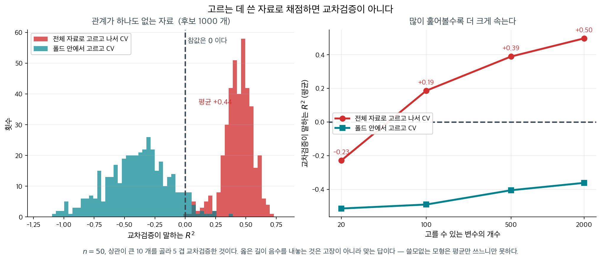
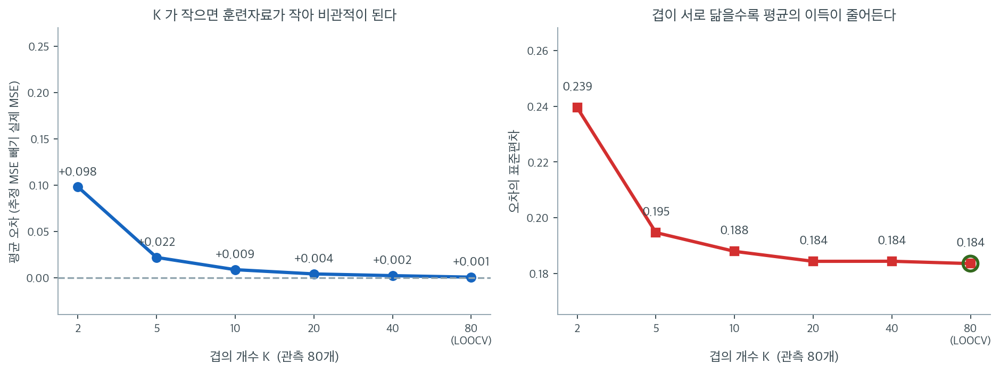

# 모형선택을 위한 교차검증

AIC나 BIC 같은 정보기준은 수학적 근사로 표본 밖 성능을 추정한다. 교차검증은 더 직접적인 접근을 취한다. 자료를 훈련 부분집합과 검증 부분집합으로 반복해 나누고, 훈련자료로 모형을 적합한 뒤 남겨 둔 자료에서 예측을 평가한다. 이렇게 하면 모형이 새 관측값에 얼마나 잘 일반화되는지에 대한 구체적인 추정값을 얻는다.

---

## 1. 검증집합 방법

가장 단순한 전략은 자료를 서로 겹치지 않는 두 부분집합, 곧 모형을 적합할 **훈련집합**과 평가할 **검증집합**(홀드아웃 집합)으로 나누는 것이다.

관측값 $n$개가 있을 때 일정 비율(보통 50–80%)을 무작위로 훈련에 배정하고 나머지를 검증에 배정한다. 훈련집합으로 모형을 적합하고 검증집합에서 예측오차를 계산한다.

$$
\text{CV}_{\text{val}} = \frac{1}{n_{\text{val}}} \sum_{i \in \text{val}} (y_i - \hat{y}_i)^2
$$

여기서 $\hat{y}_i$는 훈련집합만으로 적합한 모형이 내놓은 관측값 $i$의 예측값이다.

### 한계

- **큰 분산**: 추정값이 어떤 관측값이 훈련에 가고 어떤 것이 검증에 가느냐에 크게 좌우된다. 무작위 분할이 달라지면 오차 추정값이 상당히 달라질 수 있다.
- **줄어든 훈련자료**: 모형이 쓸 수 있는 것보다 적은 관측값으로 훈련되므로 오차 추정값에 비관적 편향이 생긴다.

---

## 2. K-겹 교차검증

**K-겹 교차검증**은 모든 관측값을 훈련과 검증에 모두 쓰게 하여 검증집합 방법의 한계를 극복한다.

### 절차

1. $n$개의 관측값을 크기가 대략 같은 $K$개의 묶음(겹) $C_1, C_2, \ldots, C_K$으로 무작위로 나눈다.
2. 각 겹 $k = 1, \ldots, K$에 대해:
    - 겹 $C_k$에 속한 관측값을 제외한 모든 관측값으로 모형을 적합한다.
    - $C_k$의 남겨 둔 관측값을 예측하고 오차를 기록한다.
3. 모든 겹의 예측오차를 평균낸다.

### 공식

$n_k = |C_k|$를 겹 $k$의 관측값 개수라 하고, $\hat{y}_i^{(-k)}$를 겹 $k$ 없이 훈련한 모형이 내놓은 관측값 $i$의 예측값이라 하자. 예측오차의 K-겹 교차검증 추정값은

$$
\text{CV}_{(K)} = \frac{1}{n} \sum_{k=1}^{K} \sum_{i \in C_k} (y_i - \hat{y}_i^{(-k)})^2
$$

모든 겹의 크기가 같다면 이는 다음과 동등하다.

$$
\text{CV}_{(K)} = \frac{1}{K} \sum_{k=1}^{K} \text{MSE}_k
$$

여기서 $\text{MSE}_k = \frac{1}{n_k} \sum_{i \in C_k} (y_i - \hat{y}_i^{(-k)})^2$는 겹 $k$의 평균제곱오차이다.

흔한 선택은 $K = 5$와 $K = 10$이다. 두 값 모두 교차검증 추정값의 편향과 분산 사이에서 좋은 절충을 이룬다는 것이 경험적으로 확인되었다.

---

## 3. 하나 빼기 교차검증

**하나 빼기 교차검증(LOOCV)**은 $K = n$인 K-겹 교차검증의 특수한 경우로, 각 겹이 정확히 관측값 하나를 담는다.

$$
\text{CV}_{(n)} = \frac{1}{n} \sum_{i=1}^{n} (y_i - \hat{y}_i^{(-i)})^2
$$

여기서 $\hat{y}_i^{(-i)}$는 $i$를 제외한 모든 관측값으로 훈련한 모형이 내놓은 관측값 $i$의 예측값이다.

### 선형회귀에서의 지름길

선형회귀에서 LOOCV에는 놀라운 계산 지름길이 있다. $n$개의 모형을 따로 적합하는 대신, **모자행렬** $\mathbf{H} = \mathbf{X}(\mathbf{X}^\top\mathbf{X})^{-1}\mathbf{X}^\top$를 이용해 한 번의 적합으로 LOOCV 오차를 계산할 수 있다.

$$
\text{CV}_{(n)} = \frac{1}{n} \sum_{i=1}^{n} \left(\frac{e_i}{1 - h_{ii}}\right)^2
$$

여기서 $e_i = y_i - \hat{y}_i$는 통상적인 잔차이고 $h_{ii}$는 $\mathbf{H}$의 $i$번째 대각원소이다. 이 공식은 관측값 $i$의 하나 빼기 예측오차가 통상적인 잔차를 $1 - h_{ii}$로 나눈 것에 지나지 않음을 보여준다. 여기서 $h_{ii}$는 관측값 $i$의 지렛대를 잰다.

??? note "LOOCV 지름길의 유도"
    관측값 $i$를 제거하면 Sherman-Morrison-Woodbury 공식이 $\hat{\boldsymbol{\beta}}$의 변화를 주며, $x_i$에서의 예측값은 정확히 $e_i \cdot h_{ii} / (1 - h_{ii})$만큼 바뀐다. 따라서 하나 빼기 잔차는 $y_i - \hat{y}_i^{(-i)} = e_i / (1 - h_{ii})$이다.

---

**그림으로 보는 통계학 1.** 폴드 밖에서 고르면 교차검증이 아니다

교차검증의 생각은 한 줄이다 — **고르는 데 쓴 자료와 채점하는 데 쓰는 자료를 떼어
놓는다.** 그런데 실무에서 이 한 줄이 가장 자주 깨지는 자리가 있고, 깨지는 줄도 모르고
깨진다.

변수가 많을 때 흔히 이렇게 한다. 먼저 $y$ 와 상관이 큰 변수 몇 개를 **전체 자료에서**
고르고, 그 변수들로 모형을 세운 뒤, 그 모형을 교차검증한다. 순서가 자연스러워 보인다.
그런데 **고르는 단계에서 이미 $y$ 를 전부 보았다.** 폴드로 떼어 놓은 자료가 이미 선택에
한 번 쓰였으므로, 그 폴드는 더 이상 「처음 보는 자료」가 아니다.

얼마나 어긋나는지는 **관계가 하나도 없는 자료**에 걸어 보면 선명하다.

<figure markdown>
  { width=980 }
  <figcaption markdown>$n = 50$ 에 설명변수를 모두 난수로, 반응변수도 난수로 만들었다. **참 $R^2$ 은 $0$ 이다.** 그런데 전체 자료로 고른 뒤 교차검증하면 $400$ 번 가운데 **$400$ 번 모두** 양수가 나왔다. 자료에서 직접 그렸다.</figcaption>
</figure>

왼쪽 두 봉우리가 $0$ 을 사이에 두고 갈라져 있다. 잘못된 길은 평균 $+0.44$ 를 내놓고
**한 번도 음수를 내지 않았다** — 어느 자료를 받아도 「설명력 $44\%$ 짜리 모형을
찾았다」고 보고하게 된다. 옳은 길은 평균 $-0.39$ 이고, 이 음수가 **맞는 답**이다.
쓸모없는 모형은 그냥 평균을 쓰느니만 못하므로 $R^2$ 이 음수로 나오는 것이 정상이다.

오른쪽은 이 거짓말이 어디서 오는지 보여 준다. 고를 수 있는 변수가 $20$ 개일 때는 잘못된
길도 음수인데, $2000$ 개가 되면 $+0.50$ 까지 오른다. **훑어본 것이 많을수록 우연히 잘
맞는 것을 찾을 확률이 커지고**, 그 우연이 선택을 통해 폴드 안으로 새어 든다.

같은 병이 §$5$ 의 라쏘 경로 쪽과 [단계적 선택](stepwise_subset.md) 쪽에서도 나왔다.
프리드먼이 보인 것은 「고르고 나서 $F$ 검정을 하면」이었고, 여기서는 「고르고 나서
교차검증을 하면」이다. **고르는 일도 추정의 일부**라는 같은 말이다.

고치는 법은 간단하지만 번거롭다. **폴드 안으로 집어넣는 것**이다. 변수 선택, 결측값
채우기, 표준화, 초모수 탐색 — $y$ 를 한 번이라도 들여다보는 단계는 전부 훈련 쪽에서만
하고 폴드마다 다시 해야 한다. `scikit-learn` 의 `Pipeline` 이 있는 까닭이 그것이다.
전처리를 파이프라인 안에 넣어 두면 `cross_val_score` 가 폴드마다 알아서 다시 돌린다.

_확인한 곳 — 변수 선택을 교차검증 밖에서 하면 오차가 크게 낙관적으로 나온다는 것은 『The Elements of Statistical Learning』 $7.10.2$ 절이 「교차검증의 옳은 길과 그른 길」로 다루는 유명한 예다 · 그림의 수치는 $n=50$ · $400$ 번(오른쪽은 $150$ 번)으로 이 쪽이 직접 쟀다_

## 4. 교차검증의 편향-분산 절충

$K$의 선택에는 절충이 따른다.

**편향**: K-겹 교차검증에서 각 훈련집합의 크기는 대략 $n(K-1)/K$이다. $K$가 작으면(예: $K = 2$) 각 훈련집합이 전체 자료보다 훨씬 작아, 모든 자료로 훈련한 모형에 비해 성능이 떨어지는 모형이 나온다. 이는 교차검증 오차 추정값에 위쪽 편향을 만든다. LOOCV($K = n$)는 각 훈련집합이 $n - 1$개의 관측값을 가지므로 이 편향을 최소화한다.

**분산**: LOOCV의 $K$개 훈련집합은 거의 완전히 겹치므로($n - 2$개의 관측값을 공유한다) $K$개의 적합된 모형이 강하게 상관되어 있다. 상관된 양들을 평균내는 것은 무상관인 양들을 평균내는 것보다 분산을 덜 줄인다. 그 결과 LOOCV는 분산이 클 수 있다. $K$가 작으면(예: $K = 5$나 $K = 10$) 추정값들의 상관이 덜해 분산이 보통 더 작다.

| $K$의 선택 | 교차검증 추정값의 편향 | 교차검증 추정값의 분산 | 계산량 |
|----------------|---------------------|-------------------------|-------------|
| $K = 5$       | 중간(위쪽)   | 작음                     | 모형 5회 적합 |
| $K = 10$      | 작음               | 중간                | 모형 10회 적합 |
| $K = n$ (LOOCV) | 거의 불편 | 클 수 있음          | 1회 적합(선형회귀의 지름길을 쓸 때) |

위 표를 모의실험으로 확인해 보자. 관측값 $n = 80$, 설명변수 $5$개의 회귀를 $600$번 되풀이하면서, 매번 **전체 자료로 적합한 모형의 진짜 표본밖 MSE**를 아주 큰 검정자료에서 따로 재 두었다. 교차검증이 추정하려는 목표가 그 값이고, 그림은 (교차검증 추정값 $-$ 실제값)을 정리한 것이다.

왼쪽이 편향이다. $K = 2$에서 평균 오차가 $+0.098$로 뚜렷하게 **위로 치우친다.** 훈련집합이 $40$개뿐이라 전체 $80$개로 적합한 모형보다 나쁜 모형을 평가하게 되기 때문이다. $K = 5$에서 $+0.022$, $K = 10$에서 $+0.009$로 급격히 줄고, LOOCV($K = 80$)에서는 $+0.001$로 사실상 사라진다. 훈련집합이 $79$개여서 전체와 거의 같기 때문이다. 표의 "편향" 열이 그대로 재현되었다.

오른쪽이 분산이다. $K = 2$에서 오차의 표준편차가 $0.239$로 가장 크고, $K = 5$에서 $0.195$, $K = 10$에서 $0.188$까지 줄어든 뒤 **$K = 20$ 이후로는 $0.184$ 언저리에서 더 이상 내려가지 않는다.** $K$를 $20$에서 $80$으로 네 배 늘려도 얻는 것이 없다는 뜻이다. 겹이 많아질수록 각 훈련집합이 서로 거의 같아져(LOOCV에서는 $78$개의 관측값을 공유한다) $K$개의 추정값이 강하게 상관되고, 상관된 값을 평균해서는 분산이 줄지 않기 때문이다.

두 그림을 겹쳐 보면 $K = 5$에서 $K = 10$ 사이가 답이라는 것이 보인다. 그보다 작으면 편향이 눈에 띄게 커지고, 그보다 크면 계산만 늘 뿐 편향도 분산도 거의 개선되지 않는다. 아래 권장이 경험칙이 아니라 이 두 곡선의 교차점에서 나온 결론이다.

!!! tip "기본 권장"
    실무에서는 $K = 5$나 $K = 10$이 권장된다. James 등(2013)은 이 값들이 편향도 분산도 지나치게 크지 않은 교차검증 오차 추정값을 준다는 것이 경험적으로 확인되었다고 지적한다.

---

## 5. 모형선택을 위한 교차검증

K-겹 교차검증으로 $M$개의 후보 모형 가운데 고르려면

1. 각 모형 $j = 1, \ldots, M$에 대해 $\text{CV}_{(K)}^{(j)}$를 계산한다.
2. 교차검증 오차가 가장 작은 모형을 고른다: $\hat{j} = \arg\min_j \text{CV}_{(K)}^{(j)}$.

### 1 표준오차 규칙

절대적으로 가장 낮은 교차검증 오차를 갖는 모형을 고르는 대신, **1 표준오차 규칙**은 교차검증 오차가 최솟값의 1 표준오차 안에 드는 가장 단순한 모형을 고른다. 과적합에 대한 추가 방어책이 된다.

$\text{SE}(\text{CV}_{(K)}^{(j)})$를 모형 $j$의 교차검증 추정값의 표준오차라 하자. 이는 $K$개 겹별 MSE의 표준편차를 $\sqrt{K}$로 나눈 값이다. 1 표준오차 규칙은 다음을 만족하는 가장 단순한 모형 $j$를 고른다.

$$
\text{CV}_{(K)}^{(j)} \leq \text{CV}_{(K)}^{(\hat{j})} + \text{SE}(\text{CV}_{(K)}^{(\hat{j})})
$$

---

## 6. AIC와의 관계

Stone(1977)은 선형회귀에서 AIC에 의한 모형선택이 LOOCV와 점근적으로 동등함을 증명했다. 곧 큰 표본에서 AIC와 LOOCV는 같은 모형을 고르는 경향이 있다. $K$가 작은 K-겹 교차검증은 AIC와 동등하지 않다. 훈련집합이 작아 생기는 위쪽 편향 때문에 더 단순한 모형을 고르는 경향이 있어 오히려 BIC에 가깝다.

!!! warning "교차검증에도 가정이 있다"
    교차검증은 관측값이 교환 가능하다고(대략 순서가 중요하지 않다고) 가정한다. 시계열 자료에서 표준적인 무작위 겹 교차검증은 시간 구조를 위배하여 오도할 만큼 낙관적인 추정값을 낸다. 시계열 자료에는 이동창이나 확장창 교차검증 같은 전용 전략이 필요하다.

---

## 연습문제

**연습문제 1.** 
k-겹 교차검증과 하나 빼기 교차검증(LOOCV)의 차이를 설명하라. 추정된 검정오차의 편향과 분산에는 어떤 절충이 있는가?

??? success "풀이"
    **k-겹 교차검증**은 자료를 크기가 대략 같은 $k$개의 겹으로 나누고 $k-1$개 겹으로 훈련한 뒤 남겨 둔 겹에서 검정하며, 모든 겹을 돌아가면서 반복한다. 교차검증 추정값은 겹들의 검정오차 평균이다. 흔한 선택은 $k = 5$나 $10$이다.

    **LOOCV**는 $k = n$인 특수한 경우로, 각 관측값이 자기 자신의 검정집합이 된다. 모형을 $n$번 훈련하며 매번 $n-1$개의 관측값을 쓴다.

    **편향-분산 절충:**

    - LOOCV는 편향이 작지만(훈련집합이 거의 전체 자료이다) 분산이 크다($n$개의 훈련집합이 크게 겹쳐 $n$개의 오차 추정값이 강하게 상관된다).
    - 5-겹이나 10-겹은 편향이 조금 더 크지만(훈련집합이 더 작다) 분산이 더 작다(훈련집합이 덜 겹쳐 추정값 사이의 상관이 줄어든다).

    실무에서는 분산 감소가 작은 편향 증가를 능가하므로 5-겹이나 10-겹이 검정오차를 더 잘 추정하는 편이다.

**연습문제 2.** 
한 데이터 과학자가 다항회귀를 적합하고 훈련자료로 훈련오차를 최소화하는 차수를 골랐다. 그 결과 15차가 최선이라고 나왔다. 무엇이 문제이며 교차검증은 어떻게 도움이 되는가?

??? success "풀이"
    훈련오차로 모형 복잡도를 고르면 언제나 가장 복잡한 모형이 선택된다. 모형이 유연해질수록 훈련오차가 단조롭게 줄어들기 때문이다. 15차 다항식은 훈련자료를 과적합하여 잡음까지 외워 버리고 새 자료에서 성능이 나쁠 가능성이 높다.

    교차검증은 (보지 않은 자료에서의 성능인) 검정오차를 추정하여 이 문제에 대처한다. 각 후보 차수 $d$에 대해

    1. 자료를 $k$개의 겹으로 나눈다.
    2. 각 겹에 대해 나머지 자료로 $d$차 다항식을 적합하고 남겨 둔 겹에서 예측오차를 계산한다.
    3. 겹들의 오차를 평균낸다.

    교차검증 오차를 최소화하는 차수가 적합과 복잡도의 균형을 이룬다. 보통 교차검증은 훨씬 낮은 차수(예: 2–4차)를 고르며 이쪽이 더 잘 일반화된다.

**연습문제 3.** 
층화 k-겹 교차검증에서 층화의 기준은 무엇이며 언제 중요한가?

??? success "풀이"
    층화 k-겹 교차검증에서는 각 겹이 전체 자료와 대략 같은 반응변수 분포를 갖도록 겹을 구성한다. 분류 문제에서는 각 겹이 각 범주를 대략 같은 비율로 담는다는 뜻이다.

    층화가 중요한 경우:

    1. **범주 불균형:** 소수 범주가 관측값의 5%뿐이라면 무작위로 만든 겹에 소수 범주 사례가 하나도 없을 수 있어 검정오차 추정을 믿을 수 없게 된다.
    2. **작은 자료:** 자료가 적을 때는 각 겹이 대표성을 가져야 교차검증 추정값의 분산이 커지지 않는다.
    3. **순서형이거나 묶인 반응변수:** 각 겹이 결과변수의 범위를 고루 담도록 한다.

    회귀에서는 $Y$를 구간으로 나눈 값을 기준으로 층화할 수 있다. 다만 scikit-learn의 `StratifiedKFold`는 이산 라벨을 요구하므로, 회귀에서는 먼저 $Y$를 직접 구간화하여 라벨을 만든 뒤 그 라벨로 `StratifiedKFold`를 써야 한다.

**연습문제 4.** 
교차검증을 이용한 모형선택에서 "1 표준오차 규칙"과 그 근거를 설명하라.

??? success "풀이"
    1 표준오차 규칙은 교차검증 오차가 최소 교차검증 오차의 1 표준오차 안에 드는 가장 단순한 모형을 고른다. 곧

    1. 각 모형 $d$에 대해 평균 교차검증 오차 $\overline{\text{CV}}_d$와 그 표준오차 $\text{SE}_d$를 계산한다.
    2. $\overline{\text{CV}}_{d^*}$가 최소인 모형 $d^*$를 찾는다.
    3. $\overline{\text{CV}}_d \leq \overline{\text{CV}}_{d^*} + \text{SE}_{d^*}$를 만족하는 가장 단순한 모형 $d$를 고른다.

    **근거:** 교차검증 오차 추정값은 잡음이 있고, 절대 최솟값을 갖는 모형이 필요 이상으로 복잡할 수 있다. 최솟값의 1 표준오차 안에 있는 모형들은 예측 성능에서 통계적으로 구별되지 않는다. 그중에서는 절약성, 해석 가능성, 로버스트성을 위해 가장 단순한 모형을 선호한다.

    이 규칙은 Breiman 등(1984)이 CART의 맥락에서 널리 알렸으며 정칙화(예: LASSO 교차검증)에서도 널리 쓰인다.

**연습문제 5.** 
2 절은 K-겹 교차검증의 두 공식

$$
\text{CV}_{(K)} = \frac{1}{n} \sum_{k=1}^{K} \sum_{i \in C_k} (y_i - \hat{y}_i^{(-k)})^2
\qquad\text{와}\qquad
\text{CV}_{(K)} = \frac{1}{K} \sum_{k=1}^{K} \text{MSE}_k
$$

이 "모든 겹의 크기가 같다면" 동등하다고 했다. 크기가 다르면 어디가 어긋나는지 보자.

$n = 5$, $K = 2$, $C_1 = \{1,2,3\}$, $C_2 = \{4,5\}$ 이고 하나 빼기 제곱오차 $(y_i - \hat{y}_i^{(-k)})^2$ 가 $C_1$ 에서 $1, 1, 1$, $C_2$ 에서 $4, 4$ 라 하자.

(a) 두 공식의 값을 모두 구하라.

(b) 각 공식에서 관측값 하나가 받는 무게를 $n_k$ 로 나타내고, 어느 쪽이 어떤 관측값을 더 무겁게 세는지 말하라.

(c) $n = 100$, $K = 3$ 으로 겹 크기가 $34, 33, 33$ 일 때 관측값별 무게를 구하고, 두 공식의 차이가 실무에서 왜 문제가 되지 않는지 설명하라.

??? success "풀이"
    **(a)** 첫 공식은 관측값을 다 더해 $n$ 으로 나눈다.

    $$
    \text{CV}_{(2)} = \frac{1 + 1 + 1 + 4 + 4}{5} = \frac{11}{5} = 2.2
    $$

    둘째 공식은 겹별 MSE 를 먼저 만든다. $\text{MSE}_1 = 3/3 = 1$, $\text{MSE}_2 = 8/2 = 4$ 이므로

    $$
    \text{CV}_{(2)} = \frac{1 + 4}{2} = 2.5
    $$

    같은 자료에서 $2.2$ 와 $2.5$ 로 갈린다.

    **(b)** 첫 공식에서 관측값 $i$ 의 무게는 겹과 상관없이 $1/n$ 이다. 둘째 공식에서는 겹 $k$ 의 관측값이 $\frac{1}{K}\cdot\frac{1}{n_k} = \frac{1}{K n_k}$ 를 받는다. 위 예에서 $C_1$ 의 관측값은 $\frac{1}{2\cdot 3} = \frac{1}{6}$, $C_2$ 의 관측값은 $\frac{1}{2\cdot 2} = \frac{1}{4}$ 를 받는다. 곧 **둘째 공식은 작은 겹에 든 관측값을 더 무겁게 센다.** 여기서는 오차가 큰 쪽($C_2$)이 작은 겹이었으므로 추정값이 $2.2$ 에서 $2.5$ 로 올라갔다.

    $n_k$ 가 모두 같아 $n_k = n/K$ 이면 $\frac{1}{K n_k} = \frac{1}{n}$ 이 되어 두 무게가 일치하고, 이것이 본문이 말한 동등 조건이다.

    **(c)** 무게는 $\frac{1}{3 \cdot 34} = \frac{1}{102} \approx 0.00980$ 과 $\frac{1}{3 \cdot 33} = \frac{1}{99} \approx 0.01010$ 이고, 첫 공식의 무게는 모두 $1/100 = 0.01000$ 이다. 어긋남이 $2\%$ 안이다. 일반적으로 겹 크기가 $\lfloor n/K \rfloor$ 와 $\lceil n/K \rceil$ 로만 갈리면 무게의 상대오차가 $O(K/n)$ 이어서, $n$ 이 $K$ 보다 훨씬 클 때는 어느 공식을 써도 같은 수가 나온다.

    실무에서 조심해야 할 자리는 겹 크기가 **의도적으로** 크게 달라지는 경우다. 집단 단위로 겹을 자르거나(집단 크기가 다르면 겹 크기도 달라진다) $n$ 이 작은데 층화를 걸면, 겹별 평균을 보고하는 관행이 자료를 조용히 재가중한다.

**연습문제 6.** 
설명변수가 없고 절편만 있는 모형, 곧 $\mathbf{X} = \mathbf{1}_n$ (원소가 모두 1 인 $n \times 1$ 행렬)을 생각하자. 예측값은 $\hat{y}_i = \bar{y}$ 이다.

(a) 정의 $\mathbf{H} = \mathbf{X}(\mathbf{X}^\top\mathbf{X})^{-1}\mathbf{X}^\top$ 에서 $h_{ii}$ 를 구하라.

(b) 3 절의 지름길 공식으로 $\text{CV}_{(n)}$ 을 훈련 MSE $\frac{1}{n}\sum_i e_i^2$ 로, 그리고 표본분산 $s^2 = \frac{1}{n-1}\sum_i (y_i - \bar{y})^2$ 로 각각 나타내라.

(c) $y = (2, 4, 4, 6, 9)$ 에서 훈련 MSE 와 $\text{CV}_{(n)}$ 을 구하고, 하나 빼기 예측을 다섯 번 직접 해서 지름길 공식이 맞는지 확인하라.

(d) 훈련 MSE 는 $\text{CV}_{(n)}$ 을 몇 배로 과소평가하는가. $n \to \infty$ 에서 이 배수는 어떻게 되는가.

??? success "풀이"
    **(a)** $\mathbf{X}^\top\mathbf{X} = n$ (스칼라)이므로 $\mathbf{H} = \frac{1}{n}\mathbf{1}_n\mathbf{1}_n^\top$ 이고, 모든 $i$ 에 대해

    $$
    h_{ii} = \frac{1}{n}
    $$

    지렛대가 관측값마다 똑같다. 설명변수가 없으니 "특이한 $x$" 라는 것이 있을 수 없다.

    **(b)** $e_i = y_i - \bar{y}$ 이고 $1 - h_{ii} = 1 - 1/n = (n-1)/n$ 은 $i$ 와 무관하므로 분모를 밖으로 뺄 수 있다.

    $$
    \text{CV}_{(n)} = \frac{1}{n}\sum_{i=1}^{n}\left(\frac{e_i}{1 - 1/n}\right)^2 = \left(\frac{n}{n-1}\right)^2 \cdot \frac{1}{n}\sum_{i=1}^{n} e_i^2
    $$

    또 $\sum_i e_i^2 = (n-1)s^2$ 이므로

    $$
    \text{CV}_{(n)} = \frac{1}{n}\left(\frac{n}{n-1}\right)^2 (n-1)s^2 = \frac{n}{n-1}\,s^2
    $$

    **(c)** $\bar{y} = 25/5 = 5$, $e = (-3, -1, -1, 1, 4)$, $\sum e_i^2 = 9+1+1+1+16 = 28$. 따라서 훈련 MSE 는 $28/5 = 5.6$ 이고 $s^2 = 28/4 = 7$ 이다. 공식으로는

    $$
    \text{CV}_{(5)} = \left(\frac{5}{4}\right)^2 \times 5.6 = 1.5625 \times 5.6 = 8.75
    = \frac{5}{4}\times 7
    $$

    직접 확인한다. 관측값 하나를 빼면 남은 네 개의 평균이 예측값이다.

    | 뺀 관측값 | 남은 넷의 평균 | 하나 빼기 오차 | 제곱 |
    |---|---|---|---|
    | $y_1 = 2$ | $23/4 = 5.75$ | $-3.75$ | $14.0625$ |
    | $y_2 = 4$ | $21/4 = 5.25$ | $-1.25$ | $1.5625$ |
    | $y_3 = 4$ | $21/4 = 5.25$ | $-1.25$ | $1.5625$ |
    | $y_4 = 6$ | $19/4 = 4.75$ | $1.25$ | $1.5625$ |
    | $y_5 = 9$ | $16/4 = 4.00$ | $5.00$ | $25.0000$ |

    합이 $43.75$ 이고 $43.75/5 = 8.75$ 로 공식과 같다. 각 하나 빼기 오차가 통상 잔차의 $1/(1-1/5) = 1.25$ 배임도 보인다($-3 \times 1.25 = -3.75$, $4 \times 1.25 = 5$).

    **(d)** 배수는

    $$
    \frac{\text{CV}_{(n)}}{\frac{1}{n}\sum_i e_i^2} = \left(\frac{n}{n-1}\right)^2
    $$

    $n = 5$ 에서 $1.5625$ 배, 곧 훈련 MSE 는 참값의 $64\%$ 밖에 안 된다. $n \to \infty$ 에서는 $1$ 로 가므로 차이가 사라진다.

    모수가 하나뿐인 모형에서는 과적합 보정이 모든 관측값에 똑같이 걸리는 상수 하나로 끝난다. 과적합의 양이 $n$ 에만 달려 있고 자료의 모양에는 달려 있지 않은 것이 이 모형의 특수함이다.

**연습문제 7.** 
$5$-겹 교차검증으로 다항회귀의 차수 $d \in \{1, 2, 3\}$ 중 하나를 고른다. 겹별 MSE 가 다음과 같이 나왔다.

| 모형 | $\text{MSE}_1$ | $\text{MSE}_2$ | $\text{MSE}_3$ | $\text{MSE}_4$ | $\text{MSE}_5$ |
|---|---|---|---|---|---|
| $d = 1$ | $4.0$ | $5.0$ | $4.5$ | $5.5$ | $6.0$ |
| $d = 2$ | $3.0$ | $4.0$ | $5.0$ | $4.0$ | $4.0$ |
| $d = 3$ | $3.0$ | $3.2$ | $4.8$ | $3.8$ | $4.2$ |

(a) 세 모형의 $\text{CV}_{(5)}$ 와 그 표준오차를 구하라(표준오차는 겹별 MSE 의 표본표준편차를 $\sqrt{K}$ 로 나눈 값이다).

(b) 교차검증 오차를 최소화하는 모형과 1 표준오차 규칙이 고르는 모형을 각각 말하라.

(c) $d = 3$ 의 겹별 MSE 가 평균은 그대로인 $3.4, 3.6, 4.4, 3.6, 4.0$ 이었다면 (b) 의 답이 어떻게 바뀌는가. 규칙의 문턱이 **후보 모형의 흔들림이 아니라 최소 모형의 흔들림**에만 달려 있다는 사실을 어떻게 읽어야 하는가.

??? success "풀이"
    **(a)** 평균부터 구한다. $d=1$: $25/5 = 5.0$. $d=2$: $20/5 = 4.0$. $d=3$: $19/5 = 3.8$.

    편차제곱합을 차례로 구한다.

    - $d = 1$: 편차 $-1, 0, -0.5, 0.5, 1$ → 제곱합 $2.5$ → 표본분산 $2.5/4 = 0.625$ → 표준편차 $0.7906$.
    - $d = 2$: 편차 $-1, 0, 1, 0, 0$ → 제곱합 $2$ → 표본분산 $0.5$ → 표준편차 $0.7071$.
    - $d = 3$: 편차 $-0.8, -0.6, 1.0, 0, 0.4$ → 제곱합 $2.16$ → 표본분산 $0.54$ → 표준편차 $0.7348$.

    표준오차는 이를 $\sqrt{5} = 2.2361$ 로 나눈 값이다.

    | 모형 | $\text{CV}_{(5)}$ | 겹별 표준편차 | 표준오차 |
    |---|---|---|---|
    | $d = 1$ | $5.00$ | $0.7906$ | $0.3536$ |
    | $d = 2$ | $4.00$ | $0.7071$ | $0.3162$ |
    | $d = 3$ | $3.80$ | $0.7348$ | $0.3286$ |

    **(b)** 최솟값은 $d = 3$ 의 $3.80$ 이므로 $\hat{j}$ 가 고르는 것은 $d = 3$ 이다. 1 표준오차 규칙의 문턱은 최소 모형의 표준오차로 잰다.

    $$
    \text{CV}_{(5)}^{(\hat{j})} + \text{SE}(\text{CV}_{(5)}^{(\hat{j})}) = 3.80 + 0.3286 = 4.1286
    $$

    $d = 2$ 는 $4.00 \leq 4.1286$ 이므로 문턱 안이고, $d = 1$ 은 $5.00 > 4.1286$ 이므로 밖이다. 문턱 안의 가장 단순한 모형은 $d = 2$ 이므로 **1 표준오차 규칙은 $d = 2$ 를 고른다.**

    **(c)** 평균은 $3.8$ 로 같지만 편차가 $-0.4, -0.2, 0.6, -0.2, 0.2$ 로 제곱합 $0.64$, 표본분산 $0.16$, 표준편차 $0.4$, 표준오차 $0.4/\sqrt{5} = 0.1789$ 로 작아진다. 문턱은

    $$
    3.80 + 0.1789 = 3.9789
    $$

    이고 $d = 2$ 의 $4.00$ 은 이제 문턱 밖이다. 따라서 1 표준오차 규칙도 $d = 3$ 을 고른다.

    평균 교차검증 오차 셋($5.00, 4.00, 3.80$)이 하나도 바뀌지 않았는데 답이 $d=2$ 에서 $d=3$ 으로 뒤집혔다. 규칙이 보는 것은 모형들 사이의 간격이 아니라 **최솟값 자체가 잡음인지**다. 최소 모형의 겹별 MSE 가 들쭉날쭉하면 그 $3.80$ 을 믿지 않고 더 단순한 쪽으로 물러서고, 겹마다 고르게 $3.8$ 근처가 나오면 최솟값을 믿고 그대로 고른다. 표준오차를 후보마다 따로 쓰면 모형마다 문턱이 달라져 "가장 단순한" 이라는 비교가 성립하지 않으므로, 본문 공식처럼 기준은 반드시 $\hat{j}$ 의 것 하나로 고정한다.

**연습문제 8.** 
단순선형회귀에서 설명변수가 $x = (0, 0, 0, 9)$, 반응변수가 $y = (1, 3, 2, 7)$ 이다. 설계행렬은 $\mathbf{X}$ 의 첫 열이 $1$, 둘째 열이 $x$ 인 $4 \times 2$ 행렬이다.

(a) $\mathbf{H} = \mathbf{X}(\mathbf{X}^\top\mathbf{X})^{-1}\mathbf{X}^\top$ 의 대각원소 $h_{11}, \ldots, h_{44}$ 를 정의에서 직접 구하라.

(b) 최소제곱 적합선과 잔차 $e_i$ 를 구하고, 지름길 공식을 $i = 1, 2, 3$ 에 적용하라.

(c) $i = 4$ 에서 지름길 공식에 무슨 일이 생기는가. 관측값 $4$ 를 실제로 빼고 적합을 해 보아, 이것이 공식만의 탈인지 LOOCV 자체의 탈인지 판정하라.

(d) 지름길 공식이 $n$ 번의 적합과 같은 값을 준다고 말하려면 설계행렬에 무슨 조건이 필요한가. $h_{ii} = 0.99$ 인 관측값이 있으면 $\text{CV}_{(n)}$ 이 어떻게 되는가.

??? success "풀이"
    **(a)** 먼저

    $$
    \mathbf{X}^\top\mathbf{X} = \begin{pmatrix} 4 & 9 \\ 9 & 81 \end{pmatrix}, \qquad
    \det = 4\cdot 81 - 81 = 243, \qquad
    (\mathbf{X}^\top\mathbf{X})^{-1} = \frac{1}{243}\begin{pmatrix} 81 & -9 \\ -9 & 4 \end{pmatrix}
    $$

    $h_{ii} = \mathbf{x}_i^\top(\mathbf{X}^\top\mathbf{X})^{-1}\mathbf{x}_i$ 이고 $\mathbf{x}_i = (1, x_i)^\top$ 이므로 $i = 1,2,3$ 에서 $\mathbf{x}_i = (1,0)^\top$ 이고

    $$
    h_{11} = h_{22} = h_{33} = \frac{81}{243} = \frac{1}{3}
    $$

    $i = 4$ 에서는 $\mathbf{x}_4 = (1,9)^\top$ 이므로

    $$
    h_{44} = \frac{1}{243}\left(81 - 9\cdot 9 - 9\cdot 9 + 4\cdot 81\right) = \frac{81 - 81 - 81 + 324}{243} = \frac{243}{243} = 1
    $$

    (대각합이 $3\cdot\frac13 + 1 = 2$ 로 모수 개수와 같다.)

    **(b)** $x$ 값이 $0$ 과 $9$ 두 종류뿐이므로 최소제곱 직선은 각 $x$ 에서 그 집단의 $y$ 평균을 지난다. $x=0$ 의 평균은 $(1+3+2)/3 = 2$, $x=9$ 의 "평균" 은 $7$ 이므로

    $$
    \hat{y} = 2 + \frac{7-2}{9}x = 2 + \frac{5}{9}x
    $$

    잔차는 $e = (-1, 1, 0, 0)$ 이다($\sum e_i = 0$, $\sum x_i e_i = 0$ 으로 정규방정식이 확인된다). $i = 1,2,3$ 에서 $1 - h_{ii} = 2/3$ 이므로

    $$
    \frac{e_1}{1-h_{11}} = \frac{-1}{2/3} = -1.5, \qquad
    \frac{e_2}{1-h_{22}} = 1.5, \qquad
    \frac{e_3}{1-h_{33}} = 0
    $$

    실제로 관측값 $1$ 을 빼면 $x=0$ 의 평균이 $(3+2)/2 = 2.5$ 가 되어 $\hat{y}_1^{(-1)} = 2.5$, 하나 빼기 오차가 $1 - 2.5 = -1.5$ 로 일치한다.

    **(c)** $e_4 = 0$ 이고 $1 - h_{44} = 0$ 이므로 지름길 공식은 $0/0$ 이 되어 값을 내지 못한다. 관측값 $4$ 를 빼면 남은 설명변수가 모두 $0$ 이어서

    $$
    \mathbf{X}_{(-4)}^\top\mathbf{X}_{(-4)} = \begin{pmatrix} 3 & 0 \\ 0 & 0 \end{pmatrix}
    $$

    이고 이는 역행렬이 없다. 기울기가 식별되지 않으므로 $x = 9$ 에서의 예측값이 아무 값이나 될 수 있다. 곧 $\hat{y}_4^{(-4)}$ 가 애초에 정의되지 않으며, $0/0$ 은 공식의 흠이 아니라 **LOOCV 자체가 이 설계에서 정의되지 않는다는 정직한 신호**다. 이 자료에서는 $\text{CV}_{(n)}$ 이 존재하지 않는다.

    **(d)** 모든 $i$ 에서 $h_{ii} < 1$ 이어야 한다. 이는 "어느 관측값 하나를 빼도 $\mathbf{X}^\top\mathbf{X}$ 가 여전히 가역" 이라는 말과 같다. $\mathbf{H}$ 가 사영행렬이어서 $h_{ii} = \sum_j h_{ij}^2$ 이므로 $h_{ii} = 1$ 이면 그 행의 나머지가 모두 $0$ 이고 $\hat{y}_i = y_i$ 가 된다. $y_i$ 가 무엇이든 정확히 맞혀 버리는 관측값, 곧 모수 하나를 그 점 하나에 다 써 버린 관측값이다.

    $h_{ii} = 0.99$ 라면 그 항의 배수가

    $$
    \frac{1}{(1-h_{ii})^2} = \frac{1}{0.01^2} = 10{,}000
    $$

    이다. 잔차가 작아도 이 한 항이 $\text{CV}_{(n)}$ 의 합을 지배할 수 있다. 지렛대가 큰 점이 있으면 LOOCV 는 사실상 그 점 하나의 예측오차를 재는 셈이 되며, 이것이 4 절에서 말한 LOOCV 의 큰 분산이 극단적으로 나타나는 모습이다.

**연습문제 9.** 
4 절의 모의실험($n = 80$, 설명변수 $5$ 개, $600$ 회)에서 (교차검증 추정값 $-$ 실제값)의 표준편차가 $K = 2$ 에서 $0.239$, $K = 5$ 에서 $0.195$, $K = 10$ 에서 $0.188$, $K \geq 20$ 에서 $0.184$ 였다. 이 바닥이 왜 생기는지 수로 따져 보자.

겹별 오차 $Z_1, \ldots, Z_K$ 가 각각 분산 $\tau^2$ 을 갖고 서로 상관계수 $\rho$ 로 같게 상관되어 있다고 두면

$$
\operatorname{Var}\!\left(\frac{1}{K}\sum_{k=1}^{K} Z_k\right) = \frac{\tau^2\{1 + (K-1)\rho\}}{K}
$$

(a) $K \to \infty$ 에서 이 분산의 극한을 구하고, 왜 표준편차가 $0$ 으로 가지 않는지 설명하라.

(b) 바닥 $0.184$ 와 $K = 10$ 의 $0.188$ 두 수로 $\tau^2$ 과 $\rho$ 를 풀어라.

(c) 그 $\tau^2, \rho$ 로 $K = 5$ 의 표준편차를 예측하고 보고된 $0.195$ 와 비교하라.

(d) 같은 식으로 $K = 2$ 를 예측해 보고 보고된 $0.239$ 와 비교하라. 어긋난다면 모형의 어느 가정이 깨졌는가.

??? success "풀이"
    **(a)** 분산을 $\frac{\tau^2}{K} + \frac{(K-1)\rho\tau^2}{K}$ 로 쓰면 첫 항은 $0$ 으로 가고 둘째 항은 $\rho\tau^2$ 으로 간다.

    $$
    \lim_{K\to\infty} \operatorname{Var} = \rho\tau^2, \qquad \text{표준편차} \to \tau\sqrt{\rho}
    $$

    겹 추정값들이 공유하는 부분은 평균을 내도 사라지지 않는다. $\rho > 0$ 이면 아무리 겹을 늘려도 표준편차가 $\tau\sqrt{\rho}$ 아래로 내려가지 못한다. 4 절이 "상관된 값을 평균해서는 분산이 줄지 않는다" 고 한 것이 이 극한이다.

    **(b)** 바닥에서 $\rho\tau^2 = 0.184^2 = 0.033856$ 이다. $K = 10$ 에서는

    $$
    \frac{\tau^2(1 + 9\rho)}{10} = 0.188^2 = 0.035344
    $$

    왼쪽을 $\frac{\tau^2}{10} + \frac{9}{10}\rho\tau^2$ 으로 쪼개고 $\rho\tau^2$ 을 대입하면

    $$
    \frac{\tau^2}{10} = 0.035344 - 0.9 \times 0.033856 = 0.035344 - 0.030470 = 0.004874
    $$

    따라서 $\tau^2 = 0.04874$, $\tau = 0.2208$ 이고

    $$
    \rho = \frac{0.033856}{0.04874} = 0.695
    $$

    겹 사이 상관이 $0.7$ 가까이다. 4 절의 "강하게 상관되어 있다" 에 수를 붙인 것이다.

    **(c)** $K = 5$ 에서

    $$
    \operatorname{Var} = \frac{0.04874\,(1 + 4\times 0.695)}{5} = \frac{0.04874 \times 3.779}{5} = \frac{0.18419}{5} = 0.036837
    $$

    표준편차는 $\sqrt{0.036837} = 0.192$ 로 보고된 $0.195$ 와 $2\%$ 안에서 맞는다. $K = 5$ 와 $K = 10$ 사이에서는 등상관 모형이 잘 듣는다.

    **(d)** $K = 2$ 에서

    $$
    \operatorname{Var} = \frac{0.04874\,(1 + 0.695)}{2} = \frac{0.08259}{2} = 0.041296, \qquad \sqrt{\cdot} = 0.203
    $$

    보고값 $0.239$ 보다 $15\%$ 작다. 깨진 가정은 **$\tau^2$ 이 $K$ 와 무관하다는 것**이다. $K = 2$ 에서는 각 모형이 관측값 $40$ 개로만 적합되므로 겹별 MSE 자체가 훨씬 들쭉날쭉해져 $\tau^2$ 이 커진다. 훈련집합이 작아지는 바로 그 효과가 왼쪽 그림의 $+0.098$ 편향도 만들었다. 다시 말해 작은 $K$ 에서는 편향과 분산이 같은 원인에서 함께 나빠진다.

    덧붙여, 만약 겹들이 무상관($\rho = 0$)이었다면 $K = 80$ 에서 표준편차가 $\tau/\sqrt{80} = 0.2208/8.944 = 0.0247$ 까지 내려갔을 것이다. 실제 바닥 $0.184$ 는 그보다 $7$ 배 이상 크다. $K$ 를 키워 얻을 것이 없다는 본문의 결론이 이 비교에 다 들어 있다.

**연습문제 10.** 
4 절의 표는 LOOCV 가 "거의 불편" 이라고 적었다. 그 말이 크게 틀어지는 자료를 만들어 보자.

측정을 집단마다 두 번씩 되풀이한 자료가 있다. 집단이 $5$ 개, 관측값이 $n = 10$ 이고 모형은 집단별 평균(가변수 $5$ 개, 절편 없음)이라서 모수가 $p = 5$ 이다. 관측값은 집단 순으로

$$
y = (4,\; 6 \mid 9,\; 11 \mid 16,\; 20 \mid 23,\; 25 \mid 30,\; 34)
$$

(a) 정의에서 $h_{ii}$ 를 구하라.

(b) 훈련 MSE 와 지름길 공식에 의한 $\text{CV}_{(n)}$ 을 구하고, 하나 빼기 예측을 직접 해서 확인하라.

(c) $y_i = \mu_{g(i)} + \varepsilon_i$, $\operatorname{Var}(\varepsilon_i) = \sigma^2$ 이라 하자. $\hat{\sigma}^2 = \sum_i e_i^2/(n-p)$ 를 구하고, $\text{CV}_{(n)}$ 이 추정하는 양과 **전체 자료로 적합한 모형**이 기존 집단의 새 관측값에서 내는 기대제곱오차를 각각 $\sigma^2$ 의 배수로 구하라.

(d) 두 값을 비교하라. 4 절 표의 "거의 불편" 은 무엇을 암묵적으로 가정하고 있었는가.

??? success "풀이"
    **(a)** $\mathbf{X}$ 의 각 열이 집단 지시변수이고 집단마다 관측값이 둘이므로 $\mathbf{X}^\top\mathbf{X} = 2\mathbf{I}_5$, 따라서 $(\mathbf{X}^\top\mathbf{X})^{-1} = \tfrac12\mathbf{I}_5$ 이다. $\mathbf{x}_i$ 는 원소 하나만 $1$ 인 벡터이므로 모든 $i$ 에 대해

    $$
    h_{ii} = \mathbf{x}_i^\top \left(\tfrac12 \mathbf{I}_5\right) \mathbf{x}_i = \frac{1}{2}
    $$

    (대각합은 $10 \times \tfrac12 = 5 = p$ 로 맞는다.) 지렛대가 $1/2$ 이라는 것은 관측값 하나가 자기 집단 평균의 절반을 혼자 떠받치고 있다는 뜻이다.

    **(b)** 집단별 평균은 $5, 10, 18, 24, 32$ 이고 잔차는

    $$
    e = (-1,\; 1,\; -1,\; 1,\; -2,\; 2,\; -1,\; 1,\; -2,\; 2)
    $$

    $\sum e_i^2 = 1+1+1+1+4+4+1+1+4+4 = 22$ 이므로 훈련 MSE 는 $22/10 = 2.2$ 이다. $1 - h_{ii} = 1/2$ 이 모든 $i$ 에서 같으므로

    $$
    \text{CV}_{(10)} = \frac{1}{10}\sum_{i=1}^{10}\left(\frac{e_i}{1/2}\right)^2 = 4 \times 2.2 = 8.8
    $$

    직접 확인한다. 관측값 하나를 빼면 그 집단에는 쌍둥이 하나만 남으므로 예측값은 **쌍둥이의 값 그대로**다. 따라서 하나 빼기 오차는 쌍 안의 차이이고, 쌍별 차이는 $2, 2, 4, 2, 4$ 이다.

    $$
    \text{CV}_{(10)} = \frac{2(2^2) + 2(2^2) + 2(4^2) + 2(2^2) + 2(4^2)}{10} = \frac{8 + 8 + 32 + 8 + 32}{10} = \frac{88}{10} = 8.8
    $$

    지름길 공식과 정확히 같다.

    **(c)** $\hat{\sigma}^2 = 22/(10-5) = 22/5 = 4.4$ 이다.

    LOOCV 쪽: 관측값 $i$ 의 하나 빼기 오차는 $y_i - y_{\text{쌍둥이}} = \varepsilon_i - \varepsilon_{\text{쌍둥이}}$ 이고 둘이 독립이므로

    $$
    \mathbb{E}\left[(y_i - \hat{y}_i^{(-i)})^2\right] = 2\sigma^2
    $$

    추정값으로는 $2 \times 4.4 = 8.8$ 이고, 위에서 얻은 $8.8$ 과 일치한다.

    참값 쪽: 전체 자료로 적합한 모형은 집단 $j$ 를 평균 $\bar{y}_j$ (관측값 둘의 평균)로 예측한다. 그 집단의 새 관측값 $y_{\text{new}} = \mu_j + \varepsilon_{\text{new}}$ 에 대해 오차는 $\varepsilon_{\text{new}} - \bar{\varepsilon}_j$ 이고 $\operatorname{Var}(\bar{\varepsilon}_j) = \sigma^2/2$ 이므로

    $$
    \mathbb{E}\left[(y_{\text{new}} - \bar{y}_j)^2\right] = \sigma^2 + \frac{\sigma^2}{2} = 1.5\sigma^2 = 1.5 \times 4.4 = 6.6
    $$

    **(d)** LOOCV 는 $8.8$ 을 주는데 목표는 $6.6$ 이다. $8.8/6.6 = 4/3$ 으로 **$33\%$ 나 위로 치우쳤다.** 모의실험의 $K = 2$ 가 만든 편향이 $+0.098$ 로 참값의 몇 퍼센트 수준이었던 것에 비하면 비교가 안 되게 크다.

    이유는 분명하다. 관측값 하나를 빼면 그 집단의 훈련자료가 둘에서 하나로 **절반**이 된다. LOOCV 가 불편하게 추정하는 것은 언제나 $n-1$ 개로 훈련한 모형의 오차($2\sigma^2$)이고, 우리가 알고 싶은 것은 $n$ 개로 훈련한 모형의 오차($1.5\sigma^2$)다. 4 절 표의 "거의 불편" 은 이 둘이 거의 같다는 것, 곧 **학습곡선이 $n-1$ 과 $n$ 사이에서 평평하다**는 것을 암묵적으로 가정한다. 모수 개수 $p$ 가 고정되고 $n$ 이 크면 평균 지렛대가 $p/n \to 0$ 이라 그 가정이 성립한다.

    여기서는 $p = n/2$ 로 모수가 $n$ 과 함께 늘어나고 $h_{ii} = 1/2$ 이 전혀 작지 않다. 지름길 공식의 배수 $1/(1-h_{ii})^2 = 4$ 가 바로 그 증상이다. $h_{ii}$ 가 작지 않은 자료에서는 "LOOCV 는 거의 불편" 을 "LOOCV 는 $n-1$ 개로 훈련한 모형에 대해 불편" 으로 고쳐 읽어야 한다.

---

## 정리하며

교차검증은 표본 밖 성능을 **근사하지 않고 직접 잰다.**

- **검증집합 방법이 가장 단순하다.** 한 번 나누면 되지만 **어떻게 나뉘었느냐에 따라 결과가 크게 흔들리고**, 훈련자료가 줄어 성능이 비관적으로 나온다.
- **LOOCV 는 편향이 작다.** $n-1$ 개로 훈련하므로 거의 전체 자료를 쓰지만, **$n$ 번 적합해야 하고 추정값의 분산이 크다**(훈련집합들이 거의 같아 상관이 높다).
- **$k$-겹이 실용적 균형이다.** $k=5$ 나 $10$ 이 관례이며, 편향과 분산과 계산 비용 셋을 적당히 맞춘다.
- **선형회귀에서는 LOOCV 에 닫힌 형태가 있다.** 모자값을 쓰면 한 번의 적합으로 계산되므로 비용 문제가 사라진다.
- **누출을 조심한다.** 표준화·변수선택 같은 전처리를 **각 겹 안에서** 해야 하며, 전체 자료에서 먼저 하면 검증자료가 훈련에 새어든다. **가장 흔한 실수다.**

다음 절 **단계적·부분집합 선택**으로 넘어간다.
