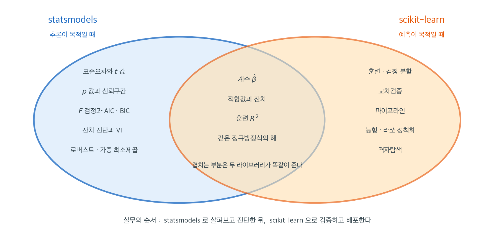
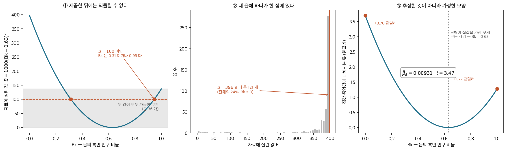

# sklearn과 statsmodels 비교

## 개요

Python에는 회귀 모형화를 위한 주요 라이브러리가 둘 있다. **scikit-learn**(`sklearn`)과 **statsmodels**이다. 둘은 목적이 다르며 서로 다른 작업 흐름에 적합하다.

---

## 1. 한눈에 보기

| 기능 | `statsmodels` | `sklearn` |
|---|---|---|
| 주된 초점 | 통계적 추론 | 예측과 기계학습 |
| 모형 요약 | 상세함(계수, $p$값, $R^2$, AIC, BIC) | 최소한(직접 계산해야 함) |
| 가설검정 | 내장($t$ 검정, $F$ 검정, Wald 검정) | 없음 |
| 신뢰구간 | 계수와 예측에 대해 내장 | 없음 |
| 진단 | 풍부함(VIF, 영향 그림, 잔차 검정) | 제한적 |
| 교차검증 | 내장되어 있지 않음 | 내장(`cross_val_score`, 파이프라인) |
| 정칙화 | 제한적 | 릿지, 라쏘, 엘라스틱넷 내장 |
| 절편 처리 | `add_constant()`로 직접 추가해야 함 | 자동(기본 `fit_intercept=True`) |
| 식 인터페이스 | 있음(`smf.ols('y ~ x1 + x2', data=df)`) | 없음 |



위 표를 한 장으로 옮기면 이렇게 된다. 가장 먼저 붙잡아야 할 것은 **가운데 겹치는 부분**이다. 두 라이브러리는 같은 정규방정식 $\mathbf{X}^\top\mathbf{X}\hat{\boldsymbol\beta} = \mathbf{X}^\top\mathbf{y}$를 푼다. 그래서 계수도, 적합값도, 잔차도, 훈련 $R^2$도 똑같이 나온다. 아래 보기에서 두 라이브러리의 계수가 $4.5154$, $-0.5718$, $-0.9307$로 소수점까지 일치하는 것이 그 확인이다. 어느 쪽이 "더 정확한 회귀"인가 하는 물음은 성립하지 않는다.

갈리는 것은 **그 곁에 무엇을 얹어 주느냐**다. 왼쪽 파란 영역은 "이 계수를 얼마나 믿을 수 있는가"에 답하는 도구들이다. 표준오차, $t$ 값, $p$ 값, 신뢰구간, $F$ 검정, AIC·BIC, 잔차 진단, VIF가 모두 여기 있다. `sklearn`에는 이 가운데 **하나도 없다.** 오른쪽 주황 영역은 "이 모형이 새 자료에서 얼마나 맞힐 것인가"에 답하는 도구들이다. 훈련·검정 분할, 교차검증, 파이프라인, 정칙화, 격자탐색이 하나의 일관된 API로 묶여 있고, `statsmodels`에는 이것이 없다.

이 그림이 실무의 순서도 말해 준다. 먼저 `statsmodels`로 계수를 보고, 가정을 진단하고, 어떤 변수가 필요한지 판단한다. 그다음 `sklearn`으로 그 모형을 교차검증하고 파이프라인으로 감싸 배포한다. 아래 보기의 두 수를 나란히 놓으면 왜 두 단계가 다 필요한지 분명해진다. 훈련 $R^2$은 $0.679$이지만 5겹 교차검증 $R^2$은 $0.430 \pm 0.300$이다. `statsmodels`만 보았다면 $0.679$를 모형의 성능으로 보고했을 것이고, 겹마다 점수가 이렇게 크게 흔들린다는 사실은 끝내 몰랐을 것이다.

---

## 2. 각각을 언제 쓰는가

### `statsmodels`를 쓸 때:

- **계수 추론**이 필요할 때: $p$값, 신뢰구간, 유의성 검정.
- **모형 진단**을 수행할 때: 잔차 분석, 이분산 검정, 다중공선성 확인.
- **AIC나 BIC**로 모형을 비교하고 싶을 때.
- 보고를 위한 **상세한 회귀 요약표**가 필요할 때.
- **고전 통계학**이나 **계량경제학** 맥락에서 작업할 때.

### `sklearn`을 쓸 때:

- 주된 목표가 **예측**과 새 자료로의 일반화일 때.
- **교차검증**과 **훈련/검정 분할**이 필요할 때.
- 전처리 단계(척도화, 부호화, 특성 선택)를 포함한 **파이프라인**을 만들 때.
- **정칙화 모형**(릿지, 라쏘, 엘라스틱넷)이 필요할 때.
- 여러 모형 유형(회귀, 분류, 군집)에 걸쳐 일관된 API를 원할 때.

---

<div class="exbox" markdown>

**보기 1.** <span class="diff easy" title="쉬움"></span> 자료 읽기. 두 라이브러리를 같은 자료에 적용해 비교하려고, Boston 주택 자료에서 방 개수(RM), 저소득층 비율(LSTAT), 학생–교사 비율(PTRATIO), 주택 중앙값(PRICE) 네 열만 남긴다.

**(1)** `PRICE` 의 최댓값이 정확히 $50.000$ 이다. 그 값을 갖는 건수를 세어 자료에 무슨 일이 있었는지 말하시오.

**(2)** 네 변수의 평균과 중앙값을 견주어 치우침의 **방향**을 읽으시오. `PTRATIO` 가 다른 셋과 다른 점은 무엇인가.

</div>

??? success "풀이"

    **유도할 식이 없는 보기다.** 요약표에서 읽히는 것이 전부이므로, 수를 하나씩 따라간다.

    ```python
    import pandas as pd

    # MASS 패키지의 Boston 자료 (Rdatasets 미러). sklearn에서는 1.2판에 제거되었다.
    url = ("https://raw.githubusercontent.com/vincentarelbundock/Rdatasets/"
           "1dcc2bf5f955cc1224a3e1307256e1fe86b68dae/csv/MASS/Boston.csv")
    boston = pd.read_csv(url)
    df = boston.rename(columns={"rm": "RM", "lstat": "LSTAT",
                                "ptratio": "PTRATIO", "medv": "PRICE"})
    df = df[["RM", "LSTAT", "PTRATIO", "PRICE"]]

    print(df.describe().round(3).to_string())
    ```

    출력:

    ```
                RM    LSTAT  PTRATIO    PRICE
    count  506.000  506.000  506.000  506.000
    mean     6.285   12.653   18.456   22.533
    std      0.703    7.141    2.165    9.197
    min      3.561    1.730   12.600    5.000
    25%      5.885    6.950   17.400   17.025
    50%      6.208   11.360   19.050   21.200
    75%      6.624   16.955   20.200   25.000
    max      8.780   37.970   22.000   50.000
    ```

    몇 가지를 더 세어 본다.

    ```python
    from scipy import stats

    print(f"PRICE 의 최댓값 = {df['PRICE'].max()},  정확히 50 인 건수 = {(df['PRICE'] == 50).sum()},  45 이상 = {(df['PRICE'] >= 45).sum()}")
    for c in ["RM", "LSTAT", "PTRATIO", "PRICE"]:
        print(f"{c:8s} 평균 {df[c].mean():7.3f}  중앙값 {df[c].median():7.3f}  "
              f"평균-중앙값 {df[c].mean() - df[c].median():+7.3f}  왜도 {stats.skew(df[c]):+.3f}")
    print(f"PTRATIO 의 서로 다른 값 = {df['PTRATIO'].nunique()}개,  최빈값 20.2 가 {(df['PTRATIO'] == 20.2).sum()}건")
    ```

    출력:

    ```
    PRICE 의 최댓값 = 50.0,  정확히 50 인 건수 = 16,  45 이상 = 22
    RM       평균   6.285  중앙값   6.208  평균-중앙값  +0.076  왜도 +0.402
    LSTAT    평균  12.653  중앙값  11.360  평균-중앙값  +1.293  왜도 +0.904
    PTRATIO  평균  18.456  중앙값  19.050  평균-중앙값  -0.594  왜도 -0.800
    PRICE    평균  22.533  중앙값  21.200  평균-중앙값  +1.333  왜도 +1.105
    PTRATIO 의 서로 다른 값 = 46개,  최빈값 20.2 가 140건
    ```

    **(1) 반응변수가 50 에서 잘렸다.** `PRICE` 가 정확히 $50.0$ 인 집이 **$16$ 채**다. $45$ 이상인 집이 모두 $22$ 채이니 그 가운데 $16$ 채가 한 값에 몰려 있다. 연속변수에서 이런 일은 일어나지 않는다. **원래 자료가 "50 천 달러 이상" 을 모두 $50$ 으로 기록한 것**이다. 상한절단이다.

    이것이 회귀에 미치는 영향은 분명하다. 비싼 집의 참 가격이 $50$ 보다 큰데 $50$ 으로 적혀 있으므로, 적합선이 비싼 쪽에서 아래로 끌린다. 그런데도 적합값은 $50$ 에 닿지 못하므로 그 $16$ 채의 잔차는 체계적으로 **양수**가 되고, **잔차 그림에서 적합값이 큰 쪽에 직선 모양의 띠가 나타난다.** 보기 2 의 Jarque-Bera $p \approx 10^{-222}$ 와 왜도 $1.700$ 에 이 $16$ 채가 적지 않게 기여한다.

    제대로 다루려면 절단회귀(토빗)를 쓰거나 그 $16$ 채를 떼어 놓아야 한다. 이 쪽의 목적은 두 라이브러리를 견주는 것이므로 그대로 두지만, **자료에 결함이 있다는 것을 알고 쓰는 것과 모르고 쓰는 것은 다르다.**

    **(2) 셋은 오른쪽, 하나는 왼쪽으로 치우쳤다.**

    | 변수 | 평균 $-$ 중앙값 | 왜도 | 방향 |
    |---|---|---|---|
    | `RM` | $+0.076$ | $+0.402$ | 오른쪽(약함) |
    | `LSTAT` | $+1.293$ | $+0.904$ | 오른쪽 |
    | `PTRATIO` | $-0.594$ | $-0.800$ | **왼쪽** |
    | `PRICE` | $+1.333$ | $+1.105$ | 오른쪽 |

    평균이 중앙값보다 크면 오른쪽 꼬리, 작으면 왼쪽 꼬리다. 네 변수 모두 두 눈금(평균 $-$ 중앙값, 왜도)이 같은 부호를 주므로 읽기가 어렵지 않다. `LSTAT` 은 저소득층 비율이니 대부분의 지역이 낮고 일부가 매우 높아 오른쪽 꼬리가 생긴다. `PRICE` 의 오른쪽 꼬리는 (1)에서 본 절단 때문에 **실제보다 짧게** 보일 것이다.

    `PTRATIO` 가 유별난 점은 두 가지다. 첫째, 혼자 **왼쪽**으로 치우쳤다. 둘째, 그리고 더 중요하게, **서로 다른 값이 $46$ 개뿐이고 $20.2$ 라는 한 값에 $140$ 건, 곧 전체의 $28\%$ 가 몰려 있다.** 연속변수가 아니라는 신호다.

    까닭은 변수의 정의에 있다. 학생–교사 비율은 **학군 단위**로 정해지는 양이지 집마다 다른 양이 아니다. 그러므로 같은 지역의 집들은 `PTRATIO` 가 모두 같다. 이것이 두 가지를 예고한다. 자료가 지역 순으로 정렬되어 있다면 **이웃한 행들이 서로 닮았을 것**(보기 2 의 Durbin-Watson $0.901$)이고, 겹을 섞지 않고 나누면 **겹마다 다른 지역이 들어갈 것**(보기 3 의 교차검증 $R^2 = 0.43$)이다. 요약표 한 줄에 그 두 결함의 씨앗이 들어 있다.

<div class="storybox" markdown>

**그림으로 보는 통계학 1.** 그 자료를 부르면 오류 메시지가 뜬다

보기 1 의 코드에 주석 한 줄이 달려 있다 — 「`sklearn` 에서는 $1.2$ 판에 제거되었다」.
지금 그 적재 함수를 부르면 자료 대신 **오류 메시지**가 온다. 그 메시지가 이 상자의
이야기다.

이 자료는 하버드의 해리슨과 루빈펠드가 $1978$ 년에 **대기질에 대한 지불의사**를 재려고
만든 것이다($\text{NOX}$ 가 설명변수로 들어 있는 까닭이다). 그때 만든 열 가운데 하나가
이것이다. 카네기멜런의 자료 설명은 변수 목록에서 그 열을 이렇게 적는다.

> **`B  1000(Bk - 0.63)^2  where Bk is the proportion of blacks by town`**

곧 읍의 흑인 인구 비율 $\mathrm{Bk}$ 를 **$0.63$ 에서 뺀 뒤 제곱해서** 실었다. 자료에
남은 것은 $\mathrm{Bk}$ 가 아니라 $B$ 다.



- **①** 제곱한 뒤에는 되돌릴 수 없다. $B = 100$ 이면 $\mathrm{Bk}$ 는 $0.31$ 일 수도
  $0.95$ 일 수도 있다. 두 값이 모두 $[0, 1]$ 에 드는 구간($B \le 136.9$)에 읍 $36$ 개가
  들어 있다. 나머지는 작은 쪽 뿌리만 가능하므로 되돌릴 수 있지만, **되돌리는 사람이
  있어야 되돌아간다.**
- **②** 자료에 실린 $B$ 는 한쪽으로 심하게 몰려 있다. 최댓값 $396.9$ — $\mathrm{Bk} = 0$
  에 해당하는 값 — 에 읍 $121$ 개, 전체의 $24\%$ 가 정확히 같은 수로 앉아 있다.
- **③** 그 열을 그대로 회귀에 넣으면 무슨 말을 하는 것인가. 흔히 쓰는 $13$ 변수
  최소제곱에서 $\hat\beta_B = 0.00931$ 이고 $t = 3.47$ 이다. 「유의하다」. 그런데 그
  계수가 뜻하는 모양은 **$\mathrm{Bk} = 0.63$ 에서 집값이 가장 낮고 양쪽으로 오른다**
  는 것이다. $\mathrm{Bk} = 0$ 인 읍에 $+3.70$ 천달러, $\mathrm{Bk} = 1$ 인 읍에
  $+1.27$ 천달러를 더해 준다.

**그 모양은 추정된 것이 아니라 가정된 것이다.** 자료가 정하는 것은 $\beta_B$ 라는 수
하나뿐이고, $0.63$ 이라는 꼭짓점과 제곱이라는 꼴은 자료를 만들 때 이미 박아 넣은 것이다.
설계행렬에 변환을 넣는 일이 언제나 그렇다 — $\log$ 든 제곱이든, 넣는 순간 그것은
모형의 가정이 되고 **회귀는 가정된 모양의 크기만 잰다.**

`scikit-learn` 은 $1.2$ 판에서 이 자료의 적재 함수를 지웠다. 지금 그것을 부르면 오는
메시지에 까닭이 적혀 있다.

> **「이 자료에는 윤리적 문제가 있다. [1] 에서 조사된 바와 같이, 이 자료를 만든 이들은
> 인종적 자기분리가 집값에 긍정적인 영향을 준다고 가정하여 되돌릴 수 없는 변수 "B" 를
> 설계했다 [2]. 게다가 이 자료를 낳은 연구의 목표는 대기질의 영향을 연구하는 것이었는데,
> 그 가정의 타당성을 제대로 입증하지 못했다. ⋯ 따라서 scikit-learn 관리자들은 자료과학과
> 기계학습의 윤리적 문제를 공부하고 가르치려는 목적이 아니라면 이 자료를 쓰지 말 것을
> 강력히 권고한다.」**

이 자료가 널리 퍼진 경로도 같은 설명에 적혀 있다. 벨슬리·쿠·웰시의 『회귀 진단』($1980$)
예제로 쓰였고 — **$13$ 장이 다루는 그 진단이다** — 거기서 교과서와 패키지로 옮겨 갔다.
한 번 예제가 된 자료는 수십 년 동안 아무도 열의 정의를 읽지 않은 채 쓰인다.

이 쪽도 그 자료를 쓴다. 두 라이브러리의 계수가 소수점까지 같다는 것을 보이는 데에는
어떤 자료든 되지만, 쓰는 김에 **열의 유래를 한 번은 보고 지나가는 편**이 낫다.
보기 1 이 찾아낸 $50.0$ 에 몰린 $16$ 채와 이 상자의 $B$ 는 같은 종류의 사실이다 —
**요약표에는 나오지 않고, 자료 설명을 읽어야만 보인다.**

_확인한 곳 — `scikit-learn` $1.4.2$ 의 `sklearn/datasets/__init__.py` 가 `load_boston`
을 부를 때 내는 오류 메시지 전문(인용한 두 대목과, 그 안의 참고문헌 [1] M. Carlisle,
[2] Harrison·Rubinfeld, "Hedonic housing prices and the demand for clean air",
『Journal of Environmental Economics and Management』 $5$ 권 $1$ 호 $81$–$102$ 쪽($1978$)).
변수 정의 「B 1000(Bk - 0.63)^2 where Bk is the proportion of blacks by town」과 이
자료가 벨슬리·쿠·웰시의 『Regression Diagnostics』($1980$)에 쓰였다는 것은 카네기멜런
StatLib 의 자료 설명에서 확인했다. 그림과 본문의 수는 이 쪽이 쓰는 것과 같은 자료로
직접 계산한 값이다_

</div>

---

## 3. 나란히 놓고 보기

### statsmodels

<div class="exbox" markdown>

**보기 2.** <span class="diff easy" title="쉬움"></span> statsmodels — 추론이 목적일 때. 세 설명변수로 집값을 회귀하고 요약표·$p$-값·신뢰구간을 꺼낸다.

**(1)** `Durbin-Watson: 0.901` 을 식으로 적고, 그 값에서 잔차의 **1차 자기상관** $\hat\rho$ 를 되찾으시오.

**(2)** 그 자기상관이 사실이라면 표 가운데 블록의 `std err` 와 $p$-값을 믿을 수 없다. **얼마나** 믿을 수 없는지 자기상관에 강건한 표준오차와 견주어 수로 보이시오.

</div>

??? success "풀이"

    **(1) 더빈–왓슨은 이웃한 잔차의 차이를 잰다.** 정의가

    $$
    d = \frac{\sum_{i=2}^{n}(e_i - e_{i-1})^2}{\sum_{i=1}^{n} e_i^2}
    $$

    다. 분자를 펼치면

    $$
    \sum_{i=2}^n (e_i^2 - 2e_ie_{i-1} + e_{i-1}^2)
    \;\approx\; 2\sum_i e_i^2 - 2\sum_{i=2}^n e_ie_{i-1}
    $$

    이고(양 끝의 $e_1^2$, $e_n^2$ 한 개씩만 어긋난다), 잔차의 1차 자기상관을

    $$
    \hat\rho = \frac{\sum_{i=2}^n e_i e_{i-1}}{\sum_i e_i^2}
    $$

    로 적으면

    $$
    d \approx 2(1 - \hat\rho)
    \qquad\Longleftrightarrow\qquad
    \hat\rho \approx 1 - \frac{d}{2}
    $$

    이다. 따라서 $d = 0.901$ 은

    $$
    \hat\rho \approx 1 - \frac{0.901}{2} = 0.5495
    $$

    를 뜻한다. **잔차가 이웃끼리 $0.55$ 의 상관을 갖는다.** $d$ 가 $2$ 면 $\hat\rho = 0$, $d$ 가 $0$ 에 가까우면 $\hat\rho \to 1$, $d$ 가 $4$ 에 가까우면 $\hat\rho \to -1$ 이다. $d$ 의 범위가 $[0, 4]$ 인 것이 여기서 나온다.

    **(2) 표준오차가 얼마나 작게 나왔는가.** `nonrobust` 표준오차는 $\operatorname{Var}(\boldsymbol\varepsilon) = \sigma^2\mathbf{I}$ 를 가정한다. 자기상관이 있으면 그 가정이 깨지고, **양의 자기상관은 표준오차를 작게** 만든다. 서로 닮은 관측값을 독립인 것처럼 세었으므로 실효 표본크기가 $n$ 보다 작기 때문이다.

    크기를 어림해 보자. 오차가 AR(1) 이면 표본평균의 분산이

    $$
    \frac{1 + \rho}{1 - \rho}
    $$

    배로 부푼다. $\hat\rho = 0.55$ 면 $3.41$ 배이고, 표준오차는 그 제곱근인 **$1.85$ 배**다. 회귀계수에 그대로 적용되는 식은 아니지만 자리 수를 알려 준다. 곧 표의 `std err` 가 참값의 절반쯤일 수 있다.

    정확히 보려면 자기상관에 강건한 **HAC(뉴이–웨스트) 표준오차**를 계산해 견주면 된다. `cov_type='HAC'` 한 줄이면 된다.
    ```python
    import statsmodels.api as sm
    import pandas as pd

    # statsmodels 는 추론이 목적일 때 쓴다. 표준오차·p-값·신뢰구간이
    # 출력표에 한꺼번에 나온다.
    X = sm.add_constant(df[['RM', 'LSTAT', 'PTRATIO']])
    y = df['PRICE']

    def print_summary(res):
        """summary()에서 실행 날짜와 시각만 지우고 인쇄한다(재현 가능한 출력을 위해)."""
        lines = []
        for line in str(res.summary()).split("\n"):
            if line.startswith(("Date:", "Time:")):
                lines.append(line[:19].ljust(38) + line[38:])
            else:
                lines.append(line)
        print("\n".join(lines))


    model = sm.OLS(y, X).fit()
    print_summary(model)

    # 필요한 값은 속성으로 바로 꺼낼 수 있다.
    print(f"R²: {model.rsquared:.4f}")
    print(f"Adj. R²: {model.rsquared_adj:.4f}")
    print(f"AIC: {model.aic:.2f}")
    print(f"BIC: {model.bic:.2f}")
    print(model.pvalues)
    print(model.conf_int())
    ```

    출력:

    ```
                                OLS Regression Results                            
    ==============================================================================
    Dep. Variable:                  PRICE   R-squared:                       0.679
    Model:                            OLS   Adj. R-squared:                  0.677
    Method:                 Least Squares   F-statistic:                     353.3
    Date:                                   Prob (F-statistic):          2.69e-123
    Time:                                   Log-Likelihood:                -1553.0
    No. Observations:                 506   AIC:                             3114.
    Df Residuals:                     502   BIC:                             3131.
    Df Model:                           3                                         
    Covariance Type:            nonrobust                                         
    ==============================================================================
                     coef    std err          t      P>|t|      [0.025      0.975]
    ------------------------------------------------------------------------------
    const         18.5671      3.913      4.745      0.000      10.879      26.255
    RM             4.5154      0.426     10.603      0.000       3.679       5.352
    LSTAT         -0.5718      0.042    -13.540      0.000      -0.655      -0.489
    PTRATIO       -0.9307      0.118     -7.911      0.000      -1.162      -0.700
    ==============================================================================
    Omnibus:                      202.072   Durbin-Watson:                   0.901
    Prob(Omnibus):                  0.000   Jarque-Bera (JB):             1022.153
    Skew:                           1.700   Prob(JB):                    1.10e-222
    Kurtosis:                       9.076   Cond. No.                         402.
    ==============================================================================

    Notes:
    [1] Standard Errors assume that the covariance matrix of the errors is correctly specified.
    R²: 0.6786
    Adj. R²: 0.6767
    AIC: 3114.10
    BIC: 3131.00
    const      2.725808e-06
    RM         7.734793e-24
    LSTAT      7.944208e-36
    PTRATIO    1.644660e-14
    dtype: float64
                     0          1
    const    10.878841  26.255382
    RM        3.678711   5.352131
    LSTAT    -0.654775  -0.488836
    PTRATIO  -1.161877  -0.699568
    ```

    ```python
    import numpy as np
    from statsmodels.stats.stattools import durbin_watson

    e = np.asarray(model.resid)
    dw_hand = (np.diff(e) ** 2).sum() / (e ** 2).sum()
    rho = np.corrcoef(e[:-1], e[1:])[0, 1]
    print(f"DW 손계산 = {dw_hand:.6f},  durbin_watson() = {durbin_watson(e):.6f}")
    print(f"잔차의 1차 자기상관 rho = {rho:.6f},  2(1 - rho) = {2 * (1 - rho):.6f}")
    print(f"분산 부풀림 (1+rho)/(1-rho) = {(1 + rho) / (1 - rho):.4f},  "
          f"표준오차 쪽은 그 제곱근 {np.sqrt((1 + rho) / (1 - rho)):.4f}")

    # 자기상관에 강건한 표준오차와 견준다.
    hac = sm.OLS(y, X).fit(cov_type='HAC', cov_kwds={'maxlags': 10})
    tab = pd.DataFrame({'nonrobust': model.bse, 'HAC(10)': hac.bse})
    tab['비'] = tab['HAC(10)'] / tab['nonrobust']
    print(tab.round(4).to_string())
    print("HAC 의 t 값:", hac.tvalues.round(3).tolist())
    print("HAC 의 p 값:", ["%.2e" % v for v in hac.pvalues])
    ```

    출력:

    ```
    DW 손계산 = 0.901236,  durbin_watson() = 0.901236
    잔차의 1차 자기상관 rho = 0.546931,  2(1 - rho) = 0.906137
    분산 부풀림 (1+rho)/(1-rho) = 3.4143,  표준오차 쪽은 그 제곱근 1.8478
             nonrobust  HAC(10)       비
    const       3.9132   9.9983  2.5550
    RM          0.4259   1.4322  3.3629
    LSTAT       0.0422   0.1108  2.6244
    PTRATIO     0.1177   0.1682  1.4299
    HAC 의 t 값: [1.857, 3.153, -5.159, -5.532]
    HAC 의 p 값: ['6.33e-02', '1.62e-03', '2.48e-07', '3.16e-08']
    ```

    **(1) 식과 되찾은 값이 맞는다.** 손계산 $d = 0.901236$ 이 `durbin_watson()` 과 소수 여섯째 자리까지 같고 표의 $0.901$ 과 같다. 실제 1차 자기상관은 $\hat\rho = 0.546931$ 이고 $2(1 - \hat\rho) = 0.906137$ 이다. $d$ 와 $0.005$ 차이인데, 그것이 유도에서 버린 양 끝 항의 몫이다. 어림식 $\hat\rho \approx 1 - d/2 = 0.5495$ 도 참값 $0.5469$ 와 $0.0026$ 차이다.

    **(2) 표준오차가 $1.4$ 배에서 $3.4$ 배까지 작게 나와 있었다.** `const` 가 $2.56$ 배, `RM` 이 $3.36$ 배, `LSTAT` 이 $2.62$ 배, `PTRATIO` 가 $1.43$ 배다. 어림한 $1.85$ 배가 그 범위 안에 들어 있으니 자리 수는 맞혔다. 계수마다 배수가 다른 것은 그 설명변수가 지역 안에서 얼마나 비슷한 값을 갖는지에 달려 있다. `PTRATIO` 의 배수가 가장 작은 $1.43$ 인 것은 그 변수가 **지역마다 거의 상수**여서 이미 지역 효과를 많이 흡수했기 때문으로 보인다(보기 1 에서 서로 다른 값이 $46$ 개뿐이었다).

    **결론이 하나 뒤집힌다.** 절편의 $t$ 가 $4.745$ 에서 $1.857$ 로, $p$-값이 $2.7 \times 10^{-6}$ 에서 **$0.0633$** 으로 올라간다. 유의수준 $5\%$ 에서 유의하지 않다. `RM` 도 $t = 10.603$ 에서 $3.153$ 으로 떨어진다. 여전히 유의하지만 $p$-값이 $7.7 \times 10^{-24}$ 에서 $1.6 \times 10^{-3}$ 으로 **스무 자리** 올라갔다.

    $R^2 = 0.679$ 이고 표에서 세 계수 모두 $p < 10^{-13}$ 로 강하게 유의하다. 방이 하나 늘면 가격이 $4.5$(천 달러) 오르고, 저소득층 비율이 $1$ 퍼센트포인트 늘면 $0.57$ 내린다. **계수의 값 자체는 믿을 만하다.** OLS 추정량은 자기상관이 있어도 여전히 불편이다.

    믿을 수 없는 것은 그 곁의 수들이다. 아래 진단 블록이 그것을 알려 준다. Durbin-Watson $0.901$ 은 잔차에 강한 양의 자기상관이 있다는 뜻이고, Jarque-Bera $p \approx 10^{-222}$ 는 정규성이 심하게 깨졌다는 뜻이다. 공간자료라 이웃한 관측값끼리 닮았기 때문이며, 위에서 보았듯 **$p$-값과 신뢰구간은 글자 그대로 받아들이면 안 된다.**

    바로잡는 길은 셋이다. HAC 나 군집 표준오차를 쓰는 것, 지역을 모형에 넣는 것(고정효과), 공간 상관을 명시적으로 모형화하는 것이다. 아무것도 하지 않고 $p < 0.001$ 을 보고하는 것이 가장 나쁘다.

### sklearn

<div class="exbox" markdown>

**보기 3.** <span class="diff easy" title="쉬움"></span> sklearn — 예측이 목적일 때. 같은 자료를 `LinearRegression`으로 적합하고 5겹 교차검증 $R^2$ 를 구한다.

**(1)** 두 라이브러리가 같은 계수를 준다는 말을 **몇 자리까지** 믿을 수 있는지 수로 확인하시오.

**(2)** 훈련 $R^2 = 0.679$ 에서 교차검증 $R^2 = 0.430$ 으로 내려간 것을 "훈련 성능은 낙관적이다" 로 설명할 수 있는가. 낙관의 크기를 어림해 보고, 겹마다의 점수를 들여다보아 참 원인을 찾으시오.

</div>

??? success "풀이"

    **(1) 부동소수점 한계까지 같다.** 두 라이브러리 모두 같은 정규방정식

    $$
    \mathbf{X}^\top\mathbf{X}\hat{\boldsymbol\beta} = \mathbf{X}^\top\mathbf{y}
    $$

    를 푼다. 다만 푸는 **경로**가 조금 다르다. statsmodels 는 기본적으로 `pinv` 를 쓰고 sklearn 은 `scipy.linalg.lstsq` 를 쓰며, sklearn 은 절편을 위해 평균을 뺀 뒤 되살린다. 그러므로 **수학적으로는 같고 마지막 몇 자리는 다를 수 있다.** 어느 자리까지인지는 수로 본다.

    **(2) 낙관의 크기를 먼저 어림한다.** 훈련 $R^2$ 가 부풀는 양은 모수의 개수가 표본에 비해 얼마나 큰지로 정해진다. 거친 어림으로

    $$
    E[R^2_{\text{train}}] - R^2_{\text{true}} \;\approx\; \frac{2p}{n}(1 - R^2)
    \;\le\; \frac{2p}{n} = \frac{2 \cdot 4}{506} = 0.0158
    $$

    이다. **$0.016$ 이다.** 관측된 간격 $0.679 - 0.430 = 0.249$ 는 그보다 **열다섯 배 넘게 크다.** 그러므로 "훈련 성능이 낙관적이어서" 로는 설명되지 않는다. 다른 원인이 있다.

    남은 용의자는 **겹을 나누는 방식**이다. `cv=5` 는 `KFold(shuffle=False)` 이므로 자료를 들어온 순서대로 다섯 토막으로 끊는다. Boston 자료는 **읍 단위로 정렬되어 있다.** 그러면 각 겹이 특정 지역에 뭉치므로, 어떤 겹을 검증에 쓸 때 훈련자료에는 그 지역이 거의 없다. 곧 "서울 자료로 배워 부산 자료를 맞히라" 는 문제가 다섯 번 풀리는 셈이다.

    그렇다면 겹마다 점수가 크게 다를 것이고, 겹마다 `PRICE` 의 평균도 다를 것이다. 섞어서 다시 나누면 점수가 올라가야 한다. 이것을 확인한다.
    ```python
    from sklearn.linear_model import LinearRegression
    from sklearn.model_selection import cross_val_score
    from sklearn.metrics import r2_score, mean_squared_error
    import numpy as np

    # sklearn 은 예측이 목적일 때 쓴다. 표준오차나 p-값은 아예 제공하지 않는
    # 대신, 교차검증·파이프라인·정규화가 한 틀로 묶여 있다.
    X = df[['RM', 'LSTAT', 'PTRATIO']]
    y = df['PRICE']

    model = LinearRegression()
    model.fit(X, y)

    y_pred = model.predict(X)
    print(f"R²: {r2_score(y, y_pred):.4f}")
    print(f"RMSE: {np.sqrt(mean_squared_error(y, y_pred)):.4f}")
    print(f"Coefficients: {model.coef_}")
    print(f"Intercept: {model.intercept_:.4f}")

    # 훈련자료에서 잰 R^2 는 언제나 후하다. 교차검증 값이 실제 성능에 가깝다.
    cv_scores = cross_val_score(model, X, y, cv=5, scoring='r2')
    print(f"CV R² (mean ± std): {cv_scores.mean():.4f} ± {cv_scores.std():.4f}")
    ```

    출력:

    ```
    R²: 0.6786
    RMSE: 5.2087
    Coefficients: [ 4.51542094 -0.57180569 -0.93072256]
    Intercept: 18.5671
    CV R² (mean ± std): 0.4300 ± 0.2997
    ```

    ```python
    from sklearn.model_selection import KFold

    sm_fit = sm.OLS(df['PRICE'], sm.add_constant(df[['RM', 'LSTAT', 'PTRATIO']])).fit()
    print(f"계수의 최대 차이   = {np.abs(np.r_[model.intercept_, model.coef_] - sm_fit.params.values).max():.3e}")
    print(f"적합값의 최대 차이 = {np.abs(model.predict(X) - sm_fit.fittedvalues).max():.3e}")
    print(f"훈련 R^2 = {r2_score(y, y_pred):.4f},  낙관의 어림값 2p/n = {2 * 4 / len(df):.4f}")

    print("섞지 않은 CV:", cv_scores.round(4), f" 평균 {cv_scores.mean():.4f}  표준편차 {cv_scores.std():.4f}")
    shuffled = cross_val_score(LinearRegression(), X, y,
                               cv=KFold(5, shuffle=True, random_state=0), scoring='r2')
    print("섞은 CV     :", shuffled.round(4), f" 평균 {shuffled.mean():.4f}  표준편차 {shuffled.std():.4f}")
    for i, (_, te) in enumerate(KFold(5).split(X)):
        print(f"  겹 {i}: 색인 {te.min():3d}~{te.max():3d}  PRICE 평균 {y.iloc[te].mean():.2f}")
    ```

    출력:

    ```
    계수의 최대 차이   = 7.105e-14
    적합값의 최대 차이 = 8.660e-14
    훈련 R^2 = 0.6786,  낙관의 어림값 2p/n = 0.0158
    섞지 않은 CV: [ 0.7269  0.7149  0.5482  0.1819 -0.0219]  평균 0.4300  표준편차 0.2997
    섞은 CV     : [0.4882 0.7613 0.6543 0.6005 0.7952]  평균 0.6599  표준편차 0.1111
      겹 0: 색인   0~101  PRICE 평균 22.40
      겹 1: 색인 102~202  PRICE 평균 24.42
      겹 2: 색인 203~303  PRICE 평균 29.70
      겹 3: 색인 304~404  PRICE 평균 20.04
      겹 4: 색인 405~505  PRICE 평균 16.10
    ```

    **(1) 열세 자리까지 같다.** 계수의 최대 차이가 $7.1 \times 10^{-14}$, 적합값의 최대 차이가 $8.7 \times 10^{-14}$ 다. 계수의 크기가 $10^0 \sim 10^1$ 이니 상대오차가 $10^{-14}$ 수준이고, 이는 배정밀도의 한계다. 쪽 위에서 "$4.5154$, $-0.5718$, $-0.9307$ 로 소수점까지 일치한다" 고 적은 것의 정확한 뜻이 이것이다. **어느 쪽이 더 정확한 회귀인가 하는 물음은 성립하지 않는다.**

    **(2) 낙관이 아니라 겹이 문제다.**

    겹마다의 점수가 $0.7269,\ 0.7149,\ 0.5482,\ 0.1819,\ -0.0219$ 다. **마지막 겹이 음수**다. $R^2 < 0$ 은 "그 겹의 평균값으로 예측하는 것보다 못하다" 는 뜻이다. 앞의 두 겹은 $0.72$ 로 훈련 $R^2$ 보다 높다. 곧 겹들이 **같은 모집단에서 뽑힌 것처럼 행동하지 않는다.**

    그 까닭이 마지막 줄에 있다. 겹별 `PRICE` 평균이 $22.40,\ 24.42,\ 29.70,\ 20.04,\ 16.10$ 으로 **$13.6$ 만큼 벌어진다.** `PRICE` 의 전체 표준편차가 $9.197$ 이니 겹 사이의 차이가 표준편차의 $1.5$ 배다. 자료가 지역 순으로 정렬되어 있다는 증거다.

    섞어서 나누면 결론이 뒤집힌다. $R^2$ 가 $0.4300 \pm 0.2997$ 에서 **$0.6599 \pm 0.1111$** 로 올라가고 흩어짐이 세 분의 일로 줄며, 음수 점수가 사라진다. 그리고 $0.6599$ 와 훈련 $0.6786$ 의 간격은 $0.019$ 로 **유도한 낙관의 어림값 $0.016$ 과 거의 같다.** 이것이 "훈련 성능이 낙관적이다" 가 실제로 뜻하는 크기다.

    **그러면 어느 쪽이 맞는 성능인가.** 질문에 따라 다르다. 같은 지역의 다른 집값을 맞히는 것이 목적이면 섞은 $0.66$ 이 맞고, **처음 보는 지역**의 집값을 맞히는 것이 목적이면 섞지 않은 $0.43$ 이 맞다. 후자가 더 어려운 문제이고 현실의 질문일 때가 많다. 지역이 열로 있다면 `GroupKFold` 를 쓰는 것이 정석이다.

    요점은 **섞지 않은 $0.43$ 을 "교차검증값" 이라고 무심히 보고하면 안 된다**는 것이다. 그 수에는 과적합의 몫($0.02$)과 지역 외삽의 몫($0.23$)이 섞여 있고, 둘은 전혀 다른 이야기다.

    다른 것은 무엇을 덤으로 주느냐다. statsmodels 는 $p$-값과 신뢰구간을, sklearn 은 교차검증 점수를 쉽게 준다. 그리고 위에서 보았듯 **그 점수를 해석하려면 겹이 어떻게 나뉘었는지까지 물어야 한다.** 편한 API 가 생각을 대신해 주지는 않는다.

---

## 4. 둘을 함께 쓰기

실무에서 많은 분석가가 한 프로젝트에서 두 라이브러리를 모두 쓴다.

1. `statsmodels`로 **탐색하고 진단한다**: OLS 모형을 적합하고, 요약을 살피고, VIF를 확인하고, 잔차 가정을 검정한다.
2. `sklearn`으로 **예측하고 검증한다**: 교차검증, 정칙화 모형, 파이프라인으로 배포 가능한 예측을 만든다.

<div class="exbox" markdown>

**보기 4.** <span class="diff easy" title="쉬움"></span> 둘을 함께 쓰기. statsmodels 로 요약표와 VIF 를 보고, sklearn 으로 표준화 + 릿지 파이프라인을 교차검증한다.

**(1)** 요약표의 `Cond. No.`는 $402$ 인데 VIF 는 모두 $1.7$ 보다 작다. 둘이 어긋나는 것처럼 보이는 까닭을 밝히고 수로 확인하시오.

**(2)** 릿지의 교차검증 점수가 OLS 와 사실상 같다. `alpha=1.0` 이 표준화된 설계행렬에 **얼마나** 작은 벌점인지 특이값으로 계산하여 설명하시오.

</div>

??? success "풀이"

    **(1) 조건수는 공선성만 재는 양이 아니다.** statsmodels 가 찍는 `Cond. No.` 는 설계행렬 $\mathbf{X}$ 를 **그대로** 둔 채 계산한 특이값의 비

    $$
    \kappa(\mathbf{X}) = \frac{d_{\max}}{d_{\min}}
    $$

    다. 그런데 이 양은 **열의 눈금이 다르기만 해도 커진다.** 예를 들어 어떤 열을 $100$ 배 하면 그 열의 특이값도 대략 $100$ 배가 되어 조건수가 $100$ 배 가까이 커지는데, 열공간은 전혀 바뀌지 않았고 공선성도 늘지 않았다.

    VIF 는 다르다. $\mathrm{VIF}_j = 1/(1 - R_j^2)$ 이고 $R_j^2$ 는 결정계수이므로 **열의 눈금에 전혀 영향받지 않는다.** 그래서 두 지표가 어긋날 수 있고, 어긋나면 **VIF 를 믿어야 한다.**

    이 자료에서 어긋날 이유는 분명하다. 절편 열의 노름은 $\sqrt{506} = 22.5$ 인데 `PTRATIO` 는 값이 $18$ 쯤이라 노름이 $400$ 을 넘는다. 열의 노름을 $1$ 로 맞추거나 중심화·표준화한 뒤 조건수를 다시 재면 작아져야 한다.

    **(2) 릿지의 축소량.** 표준화된 설계행렬 $\mathbf{Z}$ 의 특이값분해를 $\mathbf{Z} = \mathbf{U}\mathbf{D}\mathbf{V}^\top$ 라 하면, 릿지의 적합값은 주성분 방향마다

    $$
    \hat{\mathbf{y}}_{\text{ridge}} = \sum_{j} \mathbf{u}_j \frac{d_j^2}{d_j^2 + \alpha}\,\mathbf{u}_j^\top \mathbf{y}
    $$

    로 쪼개진다. 곧 $j$ 번째 방향이 $d_j^2/(d_j^2 + \alpha)$ 배로 **축소**된다. $\alpha = 0$ 이면 모두 $1$ 로 OLS 다.

    **표준화한 열의 $d_j^2$ 는 $n$ 규모다.** 표준화하면 각 열의 제곱합이 $n$ 이고 $\sum_j d_j^2 = \|\mathbf{Z}\|_F^2 = np$ 이므로, 열들이 서로 거의 직교하면 $d_j^2 \approx n$ 이다. 교차검증의 각 겹은 훈련 $405$ 행을 쓰므로 $d_j^2$ 가 수백이고

    $$
    \frac{d_j^2}{d_j^2 + 1} \approx \frac{400}{401} = 0.9975
    $$

    이다. **$\alpha = 1$ 은 $0.25\%$ 짜리 축소**이고 그래서 OLS 와 구별되지 않는다. 릿지가 뜻을 가지려면 $\alpha$ 가 $d_{\min}^2$ 와 견줄 만해야 한다.
    ```python
    # 실무에서는 둘을 함께 쓴다. 먼저 statsmodels 로 무엇이 유의한지,
    # 가정이 지켜지는지를 살핀다.
    import pandas as pd
    import statsmodels.api as sm
    from statsmodels.stats.outliers_influence import variance_inflation_factor

    X_sm = sm.add_constant(df[['RM', 'LSTAT', 'PTRATIO']])
    model_sm = sm.OLS(df['PRICE'], X_sm).fit()
    print_summary(model_sm)

    # 다중공선성 점검. 상수항은 셈에서 뺀다.
    vif = pd.DataFrame({
        'Feature': X_sm.columns[1:],
        'VIF': [variance_inflation_factor(X_sm.values, i) for i in range(1, X_sm.shape[1])]
    })
    print(vif)

    # 그다음 sklearn 으로 예측 파이프라인을 세운다. 표준화와 능형회귀를
    # 하나로 묶으면, 교차검증의 각 겹에서 표준화가 훈련 부분만 보고 이뤄진다.
    # 이렇게 해야 검증자료의 정보가 새어 들어가지 않는다.
    from sklearn.linear_model import Ridge
    from sklearn.model_selection import cross_val_score
    from sklearn.preprocessing import StandardScaler
    from sklearn.pipeline import Pipeline

    pipe = Pipeline([
        ('scaler', StandardScaler()),
        ('ridge', Ridge(alpha=1.0))
    ])

    X_sk = df[['RM', 'LSTAT', 'PTRATIO']]
    cv_scores = cross_val_score(pipe, X_sk, df['PRICE'], cv=5, scoring='r2')
    print(f"Ridge CV R²: {cv_scores.mean():.4f} ± {cv_scores.std():.4f}")
    ```

    출력:

    ```
                                OLS Regression Results                            
    ==============================================================================
    Dep. Variable:                  PRICE   R-squared:                       0.679
    Model:                            OLS   Adj. R-squared:                  0.677
    Method:                 Least Squares   F-statistic:                     353.3
    Date:                                   Prob (F-statistic):          2.69e-123
    Time:                                   Log-Likelihood:                -1553.0
    No. Observations:                 506   AIC:                             3114.
    Df Residuals:                     502   BIC:                             3131.
    Df Model:                           3                                         
    Covariance Type:            nonrobust                                         
    ==============================================================================
                     coef    std err          t      P>|t|      [0.025      0.975]
    ------------------------------------------------------------------------------
    const         18.5671      3.913      4.745      0.000      10.879      26.255
    RM             4.5154      0.426     10.603      0.000       3.679       5.352
    LSTAT         -0.5718      0.042    -13.540      0.000      -0.655      -0.489
    PTRATIO       -0.9307      0.118     -7.911      0.000      -1.162      -0.700
    ==============================================================================
    Omnibus:                      202.072   Durbin-Watson:                   0.901
    Prob(Omnibus):                  0.000   Jarque-Bera (JB):             1022.153
    Skew:                           1.700   Prob(JB):                    1.10e-222
    Kurtosis:                       9.076   Cond. No.                         402.
    ==============================================================================

    Notes:
    [1] Standard Errors assume that the covariance matrix of the errors is correctly specified.
       Feature       VIF
    0       RM  1.653419
    1    LSTAT  1.679425
    2  PTRATIO  1.198101
    Ridge CV R²: 0.4304 ± 0.2994
    ```

    ```python
    import numpy as np

    Xv = X_sm.values
    for i in range(1, X_sm.shape[1]):
        others = [j for j in range(X_sm.shape[1]) if j != i]
        aux = sm.OLS(Xv[:, i], Xv[:, others]).fit()
        print(f"  {X_sm.columns[i]:8s} VIF = {variance_inflation_factor(Xv, i):.6f},  "
              f"1/(1 - R^2) = {1 / (1 - aux.rsquared):.6f}")

    print(f"조건수 그대로         = {model_sm.condition_number:.2f}")
    print(f"열별 노름             = {np.linalg.norm(Xv, axis=0).round(2)}")
    print(f"열 노름을 1 로 맞추면  = {np.linalg.cond(Xv / np.linalg.norm(Xv, axis=0)):.3f}")
    Z = (Xv[:, 1:] - Xv[:, 1:].mean(0)) / Xv[:, 1:].std(0)
    print(f"중심화·표준화 뒤       = {np.linalg.cond(np.column_stack([np.ones(len(Z)), Z])):.3f}")

    d = np.linalg.svd(Z[:405], compute_uv=False)
    print(f"표준화 열의 특이값(훈련 405행) = {d.round(1)},  d^2 = {(d ** 2).round(0)}")
    print(f"릿지의 축소율 d^2/(d^2 + 1)    = {(d ** 2 / (d ** 2 + 1)).round(5)}")
    ols_cv = cross_val_score(LinearRegression(), X_sk, df['PRICE'], cv=5, scoring='r2')
    print(f"Ridge CV {cv_scores.mean():.4f} +- {cv_scores.std():.4f},  "
          f"OLS CV {ols_cv.mean():.4f} +- {ols_cv.std():.4f}")
    ```

    출력:

    ```
      RM       VIF = 1.653419,  1/(1 - R^2) = 1.653419
      LSTAT    VIF = 1.679425,  1/(1 - R^2) = 1.679425
      PTRATIO  VIF = 1.198101,  1/(1 - R^2) = 1.198101
    조건수 그대로         = 401.61
    열별 노름             = [ 22.49 142.25 326.75 417.99]
    열 노름을 1 로 맞추면  = 39.888
    중심화·표준화 뒤       = 2.224
    표준화 열의 특이값(훈련 405행) = [28.3 17.9 12.1],  d^2 = [803. 320. 146.]
    릿지의 축소율 d^2/(d^2 + 1)    = [0.99876 0.99688 0.99319]
    Ridge CV 0.4304 +- 0.2994,  OLS CV 0.4300 +- 0.2997
    ```

    **(1) 조건수 $402$ 는 거의 전부 눈금 탓이다.** 세 VIF 가 $1.653419$, $1.679425$, $1.198101$ 로 모두 $1/(1-R_j^2)$ 와 소수 여섯째 자리까지 같고, 가장 큰 것이 $1.68$ 이다. 흔히 쓰는 눈금 $\mathrm{VIF} > 10$ 에 한참 못 미친다. **공선성 문제는 없다.**

    조건수가 왜 큰지는 열별 노름이 말해 준다. $(22.49,\ 142.25,\ 326.75,\ 417.99)$ 로 $19$ 배 차이가 난다. 노름을 $1$ 로 맞추면 조건수가 $401.61$ 에서 **$39.888$** 로 떨어지고, 중심화·표준화까지 하면 **$2.224$** 가 된다. 유도한 대로다.

    그러므로 `Cond. No.` 가 $30$ 을 넘으면 공선성을 의심하라는 흔한 규칙은 **열의 눈금을 맞춘 뒤에만** 쓸 수 있다. 눈금을 맞추지 않은 $402$ 를 보고 공선성을 진단하면 거짓 경보다. VIF 를 함께 보는 것이 이 보기가 `variance_inflation_factor` 를 부르는 까닭이다.

    **(2) 릿지의 축소율이 $0.993$ 보다 크다.** 세 특이값의 제곱이 $803, 320, 146$ 이므로 축소율이 $0.99876$, $0.99688$, $0.99319$ 다. 가장 심하게 눌린 방향도 $0.7\%$ 밖에 줄지 않았다. 그래서 교차검증 점수가 $0.4304$ 대 $0.4300$ 으로 소수 넷째 자리에서만 다르다.

    **이것이 릿지가 쓸모없다는 뜻은 아니다.** 설명변수가 셋뿐이고 서로 거의 직교하므로 $d_{\min}^2 = 146$ 이 크고, 벌점이 걸릴 자리가 없는 것이다. 설명변수가 수십 개이고 서로 강하게 얽혀 있으면 $d_{\min}^2$ 가 $1$ 근처까지 내려와 $\alpha = 1$ 이 절반을 깎는다. 요점은 **$\alpha$ 를 고정된 수로 쓰지 말고 교차검증으로 고르라**는 것이며, `RidgeCV` 가 그 일을 한다.

    두 라이브러리를 이어 쓰는 전형적인 흐름이다. statsmodels 로 계수의 유의성과 VIF 를 확인하고, sklearn 으로 교차검증 성능을 잰다. 위 두 물음이 보여 주듯 **어느 한쪽만 보면 틀린 결론에 이른다.** 조건수만 보면 있지도 않은 공선성을 고치려 들고, 교차검증 점수만 보면 그 점수가 왜 낮은지(보기 3) 알 수 없다.

!!! note "VIF 계산에서 상수 열 제외하기"
    `sm.add_constant`가 만든 0번 열은 절편을 위한 상수이므로 그에 대한 VIF는 의미가 없다. 위 코드처럼 `range(1, ...)`로 실제 설명변수만 계산해야 한다.

---

## 연습문제

<div class="drillbox" markdown>

**연습문제 1.** <span class="diff med" title="중간"></span>
어떤 데이터 과학자가 선형회귀 모형을 적합하고 각 계수의 p값, 95% 신뢰구간, 종합적인 모형 요약을 얻어야 한다. `sklearn`과 `statsmodels` 가운데 무엇을 써야 하는가? 답을 정당화하라.

</div>

??? success "풀이"
    **`statsmodels`**가 명백한 선택이다. `OLS` 클래스의 `.summary()` 메서드는 계수 추정값, 표준오차, $t$ 통계량, p값, 신뢰구간, $R^2$, 수정 $R^2$, $F$ 통계량, AIC, BIC, 잔차 진단을 하나의 출력에 담아 준다.

    `sklearn`의 `LinearRegression`은 어떤 추론 통계량도 제공하지 않는다(p값도, 표준오차도, 신뢰구간도 없다). 추론이 아니라 예측을 위해 설계되었기 때문이다.

<div class="drillbox" markdown>

**연습문제 2.** <span class="diff med" title="중간"></span>
교차검증과 파이프라인 같은 기법을 쓸 때, 예측 모형을 만드는 데 `sklearn`이 `statsmodels`보다 나은 점 하나를 설명하라.

</div>

??? success "풀이"
    `sklearn`은 `.fit()`, `.predict()`, `.score()` 메서드로 이루어진 일관된 API를 제공하며, 이는 그 생태계의 도구들과 매끄럽게 통합된다. 교차검증을 위한 `cross_val_score`, 전처리와 모형화 단계를 엮는 `Pipeline`, 초모수 조정을 위한 `GridSearchCV`, 특성 척도화를 위한 `StandardScaler` 등이 그것이다.

    `statsmodels`에는 이런 표준화된 인터페이스가 없고 교차검증 파이프라인을 기본으로 지원하지 않으므로, 예측 모형화 작업 흐름에서 모형선택과 평가를 하기에는 번거롭다.

<div class="drillbox" markdown>

**연습문제 3.** <span class="diff med" title="중간"></span>
보기 2 의 요약표에는 `Log-Likelihood: -1553.0`, `AIC: 3114.10`, `BIC: 3131.00` 이 함께 찍혀 있다. `sklearn` 은 비교표의 '모형 요약' 줄대로 이 셋 가운데 아무것도 주지 않는다.

**(1)** $\mathrm{AIC} = -2\ln L + 2k$, $\mathrm{BIC} = -2\ln L + k\ln n$ 에 표의 세 수를 넣어 **statsmodels 가 세는 모수의 개수** $k$ 를 정하시오. 오차분산 $\sigma^2$ 가 그 셈에 들어 있는가.

**(2)** 이 자료에서 설명변수를 하나 더 넣는 것이 정당해지려면 잔차제곱합이 **몇 퍼센트** 줄어야 하는지 AIC 기준과 BIC 기준으로 각각 구하시오. 정규오차 OLS 의 로그가능도가

$$
\ln L = -\frac{n}{2}\left(\ln 2\pi + 1 + \ln\frac{\mathrm{RSS}}{n}\right)
$$

임을 써도 된다.

</div>

??? success "풀이"
    **(1) $k = 4$ 이고 $\sigma^2$ 는 세지 않는다.** 두 식을 빼면 $\ln L$ 이 사라지므로 $k$ 를 깨끗하게 꺼낼 수 있다.

    $$
    \mathrm{BIC} - \mathrm{AIC} = k(\ln n - 2)
    $$

    표의 값으로 $3131.00 - 3114.10 = 16.90$ 이고 $\ln 506 = 6.226537$ 이므로

    $$
    k = \frac{16.90}{6.226537 - 2} = \frac{16.90}{4.226537} = 3.998
    $$

    곧 $k = 4$ 다. 되넣어 확인한다. $\ln L = -1553.05$ 에서 $-2\ln L = 3106.10$ 이고

    $$
    \mathrm{AIC} = 3106.10 + 2(4) = 3114.10,
    \qquad
    \mathrm{BIC} = 3106.10 + 4(6.226537) = 3106.10 + 24.91 = 3131.01
    $$

    로 표와 맞는다. $4$ 는 `const`, `RM`, `LSTAT`, `PTRATIO` 의 계수 넷이다. **$\sigma^2$ 는 들어 있지 않다.** 만약 셌다면 $k = 5$ 로 $\mathrm{AIC} = 3116.10$, $\mathrm{BIC} = 3137.23$ 이 찍혔을 것이다. 표의 `Df Residuals: 502` $= 506 - 4$ 도 같은 셈이다.

    모형을 **견주는** 데는 어느 관례를 쓰든 상관없다. 공통 상수가 차에서 상쇄되기 때문이다. 다른 소프트웨어가 찍은 AIC 값과 수 자체를 맞대어 보려 할 때만 문제가 된다.

    **(2) AIC 는 $0.395\%$, BIC 는 $1.223\%$ 를 요구한다.** 주어진 식에서 상수항을 빼면

    $$
    -2\ln L = n(\ln 2\pi + 1) + n\ln\frac{\mathrm{RSS}}{n}
    $$

    이므로 설명변수를 하나 더 넣어 잔차제곱합이 $\mathrm{RSS} \to \mathrm{RSS}'$ 로 바뀔 때

    $$
    \Delta(-2\ln L) = n\ln\frac{\mathrm{RSS}'}{\mathrm{RSS}}
    $$

    다. $k$ 가 $1$ 늘므로 AIC 가 줄어들 조건은 $n\ln r + 2 < 0$, 곧

    $$
    r < e^{-2/n} = e^{-2/506} = 0.996055
    \qquad\Longrightarrow\qquad
    \mathrm{RSS}\ \text{가}\ 0.395\%\ \text{이상 줄어야 한다}
    $$

    이고, BIC 가 줄어들 조건은 $n\ln r + \ln n < 0$, 곧

    $$
    r < e^{-\ln n / n} = e^{-6.226537/506} = 0.987770
    \qquad\Longrightarrow\qquad
    1.223\%\ \text{이상}
    $$

    이다. 절대 크기로 옮겨 보자. 보기 3 의 `RMSE: 5.2087` 에서 $\mathrm{RSS} = n \cdot \mathrm{RMSE}^2 = 506 \times 27.1306 = 13728.1$ 이므로 AIC 는 $54.2$, BIC 는 $167.9$ 만큼의 잔차제곱합 감소를 요구한다.

    두 기준의 비는 $\ln n / 2 = 3.11$ 이다. **BIC 는 같은 자료에서 AIC 보다 세 배 넘는 개선을 요구한다.** 두 기준이 갈리는 지점은 $\ln n = 2$, 곧 $n = e^2 = 7.39$ 이고 그보다 큰 모든 표본에서 BIC 가 더 깐깐하다. 그리고 이 수들은 `sklearn` 쪽에서는 로그가능도부터 손으로 만들어야 나온다.

<div class="drillbox" markdown>

**연습문제 4.** <span class="diff med" title="중간"></span>
보기 2 의 표에 `F-statistic: 353.3`, `Prob (F-statistic): 2.69e-123` 이 있다. `sklearn` 은 $F$ 를 주지 않는다.

**(1)** 표의 $R^2 = 0.6786$ 과 $p = 3$, $n = 506$ 만으로 $F = 353.3$ 을 되찾으시오.

**(2)** 어떤 사람이 "그러면 교차검증 $R^2$ 를 같은 식에 넣어 '교차검증 $F$' 를 만들면 되겠다" 며 보기 3 의 $0.4300$ 을 넣었다. 그가 얻는 값을 구하고, 같은 식에 겹 $5$ 의 점수 $-0.0219$ 를 넣어 그 계산이 왜 뜻을 갖지 못하는지 보이시오.

</div>

??? success "풀이"
    **(1) $R^2$ 만으로 $F$ 가 정해진다.** 절편만 있는 모형을 귀무가설로 하는 $F$ 는

    $$
    F = \frac{\mathrm{SSR}/p}{\mathrm{SSE}/(n-p-1)}
    $$

    이고, 분자와 분모를 모두 $\mathrm{TSS}$ 로 나누면 $\mathrm{SSR}/\mathrm{TSS} = R^2$, $\mathrm{SSE}/\mathrm{TSS} = 1 - R^2$ 이므로

    $$
    F = \frac{R^2/p}{(1-R^2)/(n-p-1)}
    = \frac{0.6786/3}{0.3214/502}
    = \frac{0.226208}{0.000640}
    = 353.3
    $$

    이다. 자유도도 표와 맞는다. $\mathrm{Df\ Model} = 3$, $\mathrm{Df\ Residuals} = 502$ 가 각각 $p$ 와 $n - p - 1$ 이다.

    **(2) 같은 식에 넣으면 음수 $F$ 가 나온다.** 먼저 $0.4300$ 을 넣으면

    $$
    \frac{0.4300/3}{0.5700/502} = \frac{0.143333}{0.001135} = 126.2
    $$

    로, 겉보기에는 여전히 거대하고 $p$-값도 $0$ 에 가깝게 나올 것이다. 그러나 보기 3 의 겹별 점수 가운데 겹 $5$ 의 $-0.0219$ 를 같은 식에 넣으면

    $$
    \frac{-0.0219/3}{(1+0.0219)/502} = \frac{-0.00730}{0.002036} = -3.59
    $$

    다. **$F$ 는 두 제곱합의 비이므로 음수가 될 수 없다.** 식이 정의되는 범위 밖에서 쓰였다는 증거다.

    까닭은 분명하다. $F$ 식은 $R^2$ 가 **적합에 쓴 바로 그 자료** 에서 계산되어 $\mathrm{TSS} = \mathrm{SSR} + \mathrm{SSE}$ 로 쪼개질 때만 성립한다. 그 직교분해가 있어야 분자와 분모가 독립인 카이제곱이 되고 귀무분포가 $F_{3, 502}$ 가 된다. 교차검증 $R^2$ 는 적합에 **쓰지 않은** 자료에서 재므로 그 분해가 성립하지 않고, 그래서 $1 - R^2$ 가 $1$ 을 넘을 수 있다. 자유도도 틀렸다. 각 겹의 검증 부분은 $101$ 행뿐이라 $502$ 를 쓸 근거가 없다.

    비교표의 '가설검정: statsmodels 내장 / sklearn 없음' 은 **sklearn 이 주는 수로 손수 검정량을 조립하면 된다는 뜻이 아니다.** 두 라이브러리가 재는 양은 애초에 다른 질문에 답하며, 한쪽 공식에 다른 쪽 수를 꽂으면 부호부터 깨진다.

<div class="drillbox" markdown>

**연습문제 5.** <span class="diff med" title="중간"></span>
표의 `Adj. R-squared: 0.677` 과 보기 3 의 낙관 어림 $\frac{2p}{n}(1 - R^2)$ 을 견준다.

**(1)** $R^2_{\text{adj}} = 1 - (1 - R^2)\dfrac{n-1}{n-p-1}$ 로 $0.6767$ 을 확인하고, $R^2 - R^2_{\text{adj}}$ 를 $p$, $n$, $R^2$ 로 적으시오.

**(2)** 그 보정량을 보기 3 의 낙관 어림과, 그리고 섞은 교차검증이 실제로 보인 간격 $0.6786 - 0.6599$ 와 견주시오. 수정 $R^2$ 를 교차검증 대신 쓸 수 있는가.

</div>

??? success "풀이"
    **(1) 보정량은 $0.00192$ 다.** $1 - R^2 = 0.3213759$, $(n-1)/(n-p-1) = 505/502 = 1.0059761$ 이므로

    $$
    R^2_{\text{adj}} = 1 - 0.3213759 \times 1.0059761 = 1 - 0.3232965 = 0.6767
    $$

    로 표와 맞는다. 두 양의 차는

    $$
    R^2 - R^2_{\text{adj}} = (1 - R^2)\left(\frac{n-1}{n-p-1} - 1\right) = (1 - R^2)\frac{p}{n-p-1}
    = 0.3213759 \times \frac{3}{502} = 0.0019206
    $$

    이다.

    **(2) 쓸 수 없다. 세 가지 이유가 차례로 세진다.**

    첫째, **크기가 절반이다.** 보기 3 의 어림은 $\frac{2p}{n}(1-R^2)$ 이고 거기서 $p$ 는 절편까지 센 $4$ 이므로 $\frac{8}{506} \times 0.3213759 = 0.005081$ 이다. 같은 $p = 3$ 으로 맞추어 견주면 $\frac{6}{506} \times 0.3213759 = 0.003811$ 이고, (1)의 $0.0019206$ 의 꼭 두 배다.

    $$
    \frac{0.003811}{0.0019206} = 1.98
    $$

    그 $2$ 는 AIC 와 Mallows 의 $C_p$ 에 있는 $2$ 와 같은 $2$ 다. 모수를 자료에서 **추정하는** 데 한 몫, 그 추정값으로 **예측하는** 데 또 한 몫이 든다. 수정 $R^2$ 는 그 가운데 한 몫만 뺀다. 애초에 $\sigma^2$ 의 불편추정을 돌려주려고 만든 양이지 예측오차의 추정이 아니기 때문이다.

    둘째, **실제 간격과는 자리 수가 다르다.** 섞은 교차검증과 훈련의 간격은 $0.6786 - 0.6599 = 0.0187$ 이고 보정량 $0.0019206$ 의 $9.7$ 배다. 다만 이 비교는 조심해야 한다. 섞은 점수의 겹 사이 표본표준편차가 $0.1111\sqrt{5/4} = 0.1241$ 이어서 평균의 표준오차가 $0.1241/\sqrt{5} = 0.0555$ 이고, $0.0187$ 은 그 안에 들어간다. 곧 $0.0187$ 과 $0.0051$ 은 통계적으로 구별되지 않으므로 어림이 틀렸다고 말할 수는 없다.

    셋째, 그리고 이것이 결정적이다. **수정 $R^2$ 는 행의 순서에 전혀 의존하지 않는다.** $R^2$, $n$, $p$ 만으로 정해지는 양이므로 자료를 섞든 말든 언제나 $0.6767$ 이다. 그런데 보기 3 에서 섞지 않은 교차검증은 $0.4300$ 이었고 훈련과의 간격이 $0.2486$ 이었다. 수정 $R^2$ 는 그 $0.2486$ 가운데 $0.0019$ 만 가리킬 뿐 아니라, **나머지 $0.247$ 이 존재한다는 사실 자체를 원리적으로 볼 수 없다.**

    요점은 이렇다. 수정 $R^2$ 는 모수 개수에 대한 벌점이고, 교차검증은 자료가 어떻게 나뉘는지에 대한 질문이다. 전자가 후자를 대신할 수 없고, 비교표의 '교차검증: statsmodels 없음' 이 뜻하는 것이 바로 이 공백이다.

<div class="drillbox" markdown>

**연습문제 6.** <span class="diff hard" title="어려움"></span>
비교표의 '절편 처리' 줄은 statsmodels 가 `add_constant()` 를 요구한다고만 적고 있다. 그 한 줄을 잊으면 어떻게 되는지 끝까지 따라간다. 세 설명변수를 절편 없이 적합하면 계수가 $(6.2433,\ -0.4919,\ -0.5714)$ 이고 잔차제곱합이 $14343.63$ 이다(절편을 넣은 적합은 $13727.99$). 또 이 자료에서 $\sum_i (y_i - \bar y)^2 = 42716.30$, $\sum_i y_i^2 = 299626.34$ 다.

**(1)** statsmodels 는 절편이 없으면 $R^2$ 의 분모를 $\sum_i y_i^2$ 로 바꾸어(비중심 $R^2$) 찍고, `sklearn` 의 `r2_score` 는 언제나 $\sum_i (y_i - \bar y)^2$ 를 분모로 쓴다. 두 라이브러리가 **똑같은 계수와 똑같은 잔차** 를 손에 들고 찍는 두 $R^2$ 를 계산하시오.

**(2)** 쪽 위의 "계수도, 적합값도, 잔차도, 훈련 $R^2$ 도 똑같이 나온다" 는 말이 어느 조건에서 깨지는지 밝히고, 절편을 뺀 모형이 실제로 더 나쁜지 수로 판정하시오.

</div>

??? success "풀이"
    **(1) $0.952$ 와 $0.664$ 다.** 분모만 다르다.

    $$
    R^2_{\text{statsmodels}} = 1 - \frac{14343.63}{299626.34} = 1 - 0.047872 = 0.9521
    $$

    $$
    R^2_{\text{sklearn}} = 1 - \frac{14343.63}{42716.30} = 1 - 0.335788 = 0.6642
    $$

    같은 적합, 같은 잔차인데 두 라이브러리가 찍는 수가 **$0.288$ 이나 다르다.** 겹치는 영역에 있어야 할 양이 갈라진 것이다.

    **(2) 깨지는 조건은 "양쪽 모형이 같은 열공간을 적합할 때" 다.** $R^2 = 1 - \mathrm{RSS}/\mathrm{TSS}$ 에서 분모를 고르는 일은 **기준 모형** 을 고르는 일이다. 중심화한 $\mathrm{TSS} = \sum (y_i - \bar y)^2$ 는 "$\hat y = \bar y$ 로만 예측하는 모형" 을 기준으로 삼는다. 그런데 절편 없는 모형의 열공간에는 상수벡터가 들어 있지 않으므로 그 기준 모형을 **포함하지 않는다.** 그래서 중심화 $R^2$ 가 음수까지 내려갈 수 있고, statsmodels 는 분모를 $\sum y_i^2$(기준 모형이 $\hat y = 0$)으로 바꿔 $[0, 1]$ 에 들게 만든다. 어느 쪽도 버그가 아니다. 기준이 다를 뿐이다.

    그러므로 그림의 겹치는 부분에 "훈련 $R^2$" 를 적을 수 있는 것은 **두 라이브러리가 같은 열공간을 적합할 때** 뿐이다. `add_constant` 를 잊으면 그 전제가 깨진다. 더 흔한 사고는 한쪽만 절편을 갖는 것이다. `sklearn` 은 `fit_intercept=True` 가 기본이므로, 같은 호출을 나란히 쓰면 **계수부터 달라진다.**

    **실제로는 나빠졌다.** 세 눈금이 모두 같은 방향을 가리킨다.

    | 눈금 | 절편 있음 | 절편 없음 | 방향 |
    |---|---|---|---|
    | 잔차제곱합 | $13727.99$ | $14343.63$ | $+4.48\%$ 나빠짐 |
    | 중심화 $R^2$ | $0.6786$ | $0.6642$ | 나빠짐 |
    | AIC | $3114.10$ | $3134.30$ | $+20.20$ 나빠짐 |
    | 요약표가 찍는 $R^2$ | $0.679$ | $0.952$ | **좋아 보임** |

    AIC 의 변화는 연습문제 3 의 식으로 바로 나온다. 모수를 하나 **빼면서** 잔차제곱합이 $4.48\%$ 늘었으므로

    $$
    \Delta \mathrm{AIC} = n\ln\frac{14343.63}{13727.99} - 2 = 506 \times 0.043873 - 2 = 22.20 - 2 = 20.20
    $$

    이다. 모수 하나를 빼는 것이 정당해지려면 잔차제곱합 증가가 $0.395\%$ 안에 들어야 했는데 그 열한 배가 늘었다.

    한 줄 해석. **요약표의 $R^2$ 한 칸만 보고 모형을 고르면 정확히 반대로 간다.** 비교표의 '절편 처리' 줄은 손이 하나 더 가는 불편이 아니라 수의 뜻이 바뀌는 자리다.

<div class="drillbox" markdown>

**연습문제 7.** <span class="diff hard" title="어려움"></span>
보기 3 의 두 교차검증을 통계적으로 견주어 본다. 섞지 않은 겹별 점수가 $0.7269,\ 0.7149,\ 0.5482,\ 0.1819,\ -0.0219$(평균 $0.4300$, 보기에 찍힌 표준편차 $0.2997$)이고, 섞은 겹별 점수가 $0.4882,\ 0.7613,\ 0.6543,\ 0.6005,\ 0.7952$(평균 $0.6599$, 표준편차 $0.1111$)다.

**(1)** 보기에 찍힌 두 표준편차는 `numpy` 의 기본값이라 $n$ 으로 나눈 것이다. 표본표준편차($n-1$)로 고쳐 두 평균의 표준오차를 구하고, 평균의 차 $0.2299$ 에 대한 두 표본 $t$ 값을 구하시오.

**(2)** (1)의 $t$ 로는 유의수준 $5\%$ 에서 두 교차검증이 다르다고 말할 수 없다. 그런데도 보기 3 이 "결론이 뒤집힌다" 고 단언할 수 있는 근거를 셋 들고, (1)의 계산이 무엇을 잘못 세고 있는지 밝히시오.

</div>

??? success "풀이"
    **(1) $t = 1.44$ 로 유의하지 않다.** 보기의 표준편차에 $\sqrt{n/(n-1)} = \sqrt{5/4} = 1.11803$ 을 곱해 표본표준편차로 고친다.

    $$
    s_{\text{섞지 않음}} = 0.2997 \times 1.11803 = 0.3351,
    \qquad
    s_{\text{섞음}} = 0.1111 \times 1.11803 = 0.1242
    $$

    평균의 표준오차는 각각 $0.3351/\sqrt{5} = 0.1498$ 과 $0.1242/\sqrt{5} = 0.0555$ 이고, 차의 표준오차는

    $$
    \sqrt{0.1498^2 + 0.0555^2} = \sqrt{0.022440 + 0.003081} = \sqrt{0.025521} = 0.1598
    $$

    이다. 따라서

    $$
    t = \frac{0.6599 - 0.4300}{0.1598} = \frac{0.2299}{0.1598} = 1.44
    $$

    다. 자유도를 넉넉히 $8$ 로 보아도 $t_{0.975,\,8} = 2.31$ 이라 기각하지 못한다. 겹을 짝지어 차만 보아도 더 나아지지 않는다. 차가 $-0.2387,\ 0.0464,\ 0.1061,\ 0.4186,\ 0.8171$ 이므로 평균 $0.2299$, 표준오차 $0.1801$, $t = 1.28$ 로 **오히려 나빠진다.**

    **(2) 단언의 근거 셋.**

    첫째, **음수 점수와 완전한 분리.** 섞지 않은 쪽 겹 $5$ 의 $-0.0219$ 는 "그 겹의 평균값으로 예측하는 것보다 못하다" 는 뜻이다. 섞은 쪽의 최솟값은 $0.4882$ 이고, 섞지 않은 쪽의 아래 두 점수 $0.1819$, $-0.0219$ 보다 크다. 선형모형이 자기 평균보다 못해지는 일은 잡음으로 일어나지 않는다.

    둘째, **원인이 직접 보인다.** 겹별 `PRICE` 평균이 $22.40,\ 24.42,\ 29.70,\ 20.04,\ 16.10$ 으로 $13.6$ 벌어진다. `PRICE` 의 표준편차 $9.197$ 의 $1.5$ 배다. 점수가 흔들리는 까닭이 우연이 아니라 **겹마다 다른 모집단에서 왔기 때문** 이라는 증거이고, 이것은 점수의 평균을 견주는 검정이 아니라 자료의 구조를 본 결과다.

    셋째, **이론과의 대조.** 섞은 뒤의 간격 $0.6786 - 0.6599 = 0.0187$ 은 유도한 낙관 $\frac{2p}{n}(1-R^2) = 0.0051$(상한으로는 $0.0158$)과 자리 수가 맞는다. 곧 섞은 쪽은 이론이 예측하는 만큼만 떨어졌고, 섞지 않은 쪽의 나머지 $0.23$ 은 **어떤 이론으로도 설명되지 않은 채 남는다.**

    **(1)이 무엇을 잘못 세었나.** 두 표본 $t$ 검정은 다섯 점수를 같은 분포에서 독립으로 뽑은 표본으로 본다. 둘 다 사실이 아니다. 다섯 모형은 같은 $506$ 행에서 나왔고 훈련집합이 서로 $3/4$ 씩 겹치므로 점수가 강하게 **의존** 한다. 짝지은 $t$ 가 더 나빠진 것도 겹끼리 짝지을 근거가 없기 때문이다.

    더 중요한 잘못은 분모에 있다. 섞지 않은 쪽의 큰 표준편차 $0.2997$ 은 **우리가 찾아내려는 결함 그 자체** 다. 그것을 표준오차의 분자로 올리면 "겹마다 다르다" 는 신호가 "잡음이 커서 아무 말도 못 한다" 로 바뀐다. 결함을 분모에 넣어 스스로를 지워 버리는 셈이다.

    한 줄 해석. **교차검증 점수에 붙는 $\pm$ 는 평균의 오차막대가 아니라 겹 사이 이질성의 눈금이다.** 섞지 않은 $0.2997$ 은 오차막대가 아니라 경고등이다.

<div class="drillbox" markdown>

**연습문제 8.** <span class="diff hard" title="어려움"></span>
보기 2 의 `비` 열은 HAC 표준오차가 `nonrobust` 의 몇 배인지를 계수마다 적은 것이다. `const` $2.5550$, `RM` $3.3629$, `LSTAT` $2.6244$, `PTRATIO` $1.4299$. 한편 AR(1) 어림은 분산을 $(1+\hat\rho)/(1-\hat\rho) = 3.4143$ 배로 부풀렸다.

**(1)** 표준오차가 $\sqrt{n}$ 에 반비례하는 것에서 **실효 표본크기** $n_{\text{eff}} = n/(\text{비})^2$ 를 정의하고 네 계수에 대해 구하시오. AR(1) 어림이 주는 하나의 값도 함께 구하시오.

**(2)** $n_{\text{eff}}$ 가 가장 작은 계수의 값이 보기 1 에 나온 어떤 수와 가까운지 말하고 그 뜻을 쓰시오. 또 AR(1) 어림이 **왜 계수마다 다른 배수를 줄 수 없는지** 밝히시오.

</div>

??? success "풀이"
    **(1) $45$ 에서 $248$ 까지 벌어진다.** $\mathrm{se} \propto n^{-1/2}$ 이므로 표준오차가 $c$ 배라는 것은 실효 표본크기가 $c^{-2}$ 배라는 뜻이다. $n = 506$ 에서

    | 계수 | 비 | $n_{\text{eff}} = 506/(\text{비})^2$ |
    |---|---|---|
    | `const` | $2.5550$ | $77.5$ |
    | `RM` | $3.3629$ | $44.7$ |
    | `LSTAT` | $2.6244$ | $73.5$ |
    | `PTRATIO` | $1.4299$ | $247.5$ |

    예컨대 `RM` 은 $506/3.3629^2 = 506/11.3091 = 44.7$ 이다. AR(1) 어림은 분산 배수를 바로 나누면 되므로

    $$
    n_{\text{eff}}^{\text{AR(1)}} = \frac{506}{3.4143} = 148.2
    $$

    로 **하나의 값** 을 준다. 세 계수가 그보다 작고 하나가 크며, 가장 작은 것과 가장 큰 것이 $5.5$ 배 차이다. 하나의 수로 담을 수 있는 폭이 아니다.

    **(2) 가장 작은 것은 `RM` 의 $44.7$ 이고, 보기 1 의 $46$ 과 가깝다.** 보기 1 에서 `PTRATIO` 의 서로 다른 값이 $46$ 개였고, 학생–교사 비율은 학군 단위로 정해지는 양이므로 그 $46$ 은 사실상 **학군(읍)의 개수** 다. 평균 군집 크기는 $506/46 = 11$ 채다.

    그러므로 `RM` 의 계수는 $506$ 채에서 잰 것이 아니라 **$45$ 개 지역에서 잰 것만큼의 정보** 밖에 갖고 있지 않다. 같은 지역의 열한 채가 `RM` 에 관해서는 거의 한 채처럼 행동한다는 뜻이다. 대가는 보기 2 에 그대로 나와 있다. $t$ 값이 $10.603$ 에서 $3.153$ 으로 떨어졌고 그 비 $3.36$ 이 바로 $\sqrt{11.3}$ 이다.

    **왜 하나의 수로 안 되는가.** 샌드위치 분산의 중심에 오는 것은 잔차 $e_i$ 자체가 아니라 **점수** 다. 다른 설명변수에 회귀시켜 남긴 $\tilde x_{ij}$ 를 쓰면

    $$
    \widehat{\operatorname{Var}}(\hat\beta_j)
    = \frac{1}{\left(\sum_i \tilde x_{ij}^2\right)^2}
      \sum_{i}\sum_{k} \widehat{\operatorname{Cov}}\!\left(\tilde x_{ij}e_i,\ \tilde x_{kj}e_k\right)
    $$

    이고, 부풀림은 수열 $\{\tilde x_{ij}e_i\}_i$ 의 자기공분산으로 정해진다. 그 수열은 **$j$ 마다 다르다.** 반면 $\hat\rho = 0.5469$ 는 $\{e_i\}$ 만의 양이어서 $j$ 에 대한 정보를 아예 담고 있지 않다. 설명변수의 값이 행 순서와 무관하게 흩어져 있으면 $\tilde x_{ij}e_i$ 의 상관은 $e_i$ 의 상관보다 작아지고, 이웃한 행끼리 닮아 있으면 더 커진다.

    그래서 보기 2 에서 어림한 $1.85$ 배는 **자리 수를 가늠하는 데만** 쓸 수 있다. 어느 계수가 가장 크게 부풀지조차 $\hat\rho$ 로는 알 수 없고, 실제로 $1.43$ 에서 $3.36$ 까지 벌어졌다. 계수마다의 배수는 HAC 든 군집이든 실제로 계산해야 나온다.

    한 줄 해석. **표에 찍힌 `No. Observations: 506` 은 자료의 행 수일 뿐 추론의 표본크기가 아니다.** 추론의 표본크기는 계수마다 다르고, 여기서는 그 가운데 가장 작은 것이 $45$ 였다.

<div class="drillbox" markdown>

**연습문제 9.** <span class="diff hard" title="어려움"></span>
보기 1 은 `PRICE` 가 $50$ 에서 잘린 집이 $16$ 채라는 것을 보였고, 보기 2 는 `Skew: 1.700`, `Kurtosis: 9.076`, `Jarque-Bera (JB): 1022.153` 을 보였다. 둘을 잇는다.

**(1)** 적합식 $\widehat{\text{PRICE}} = 18.5671 + 4.5154\,\text{RM} - 0.5718\,\text{LSTAT} - 0.9307\,\text{PTRATIO}$ 와 보기 1 의 요약표(`RM` 최댓값 $8.780$, `LSTAT` 최솟값 $1.730$, `PTRATIO` 최솟값 $12.600$)만으로 이 모형이 자료 안에서 낼 수 있는 적합값의 **상한** 을 구하시오. 그 수로 `PRICE` $= 50$ 인 $16$ 채의 잔차 **부호** 를 정하고, 잔차 대 적합값 그림에서 그 $16$ 채가 그리는 띠의 기울기를 말하시오.

**(2)** $\mathrm{JB} = \dfrac{n}{6}\left(S^2 + \dfrac{(K-3)^2}{4}\right)$ 로 표의 $1022.153$ 을 확인하시오. 그 $16$ 채를 빼면 같은 잔차의 왜도가 $1.700$ 에서 $0.783$, 첨도가 $9.076$ 에서 $4.914$ 로 내려간다. 새 JB 를 계산하고 "절단된 $16$ 채만 치우면 정규성이 회복된다" 가 맞는지 판정하시오.

</div>

??? success "풀이"
    **(1) 상한이 $45.51$ 이므로 $16$ 채의 잔차는 모두 양수다.** 계수의 부호가 $+,\,-,\,-$ 이므로 적합값은 `RM` 이 가장 크고 `LSTAT` 과 `PTRATIO` 가 가장 작을 때 가장 크다. 그 모서리가 자료 안에 함께 있지는 않겠지만 **상한** 으로는 쓸 수 있다.

    $$
    18.5671 + 4.5154(8.780) - 0.5718(1.730) - 0.9307(12.600)
    = 18.5671 + 39.6552 - 0.9892 - 11.7268 = 45.5063
    $$

    곧 이 모형은 자료 안의 어떤 행에서도 $45.51$ 을 넘는 값을 예측할 수 없다(반올림하지 않은 계수로는 $45.50$, 실제 적합값의 최댓값은 $42.84$). 따라서 `PRICE` $= 50$ 인 $16$ 채의 잔차는

    $$
    e_i = 50 - \hat y_i \ \ge\ 50 - 45.51 = 4.49 \ > \ 0
    $$

    으로 **하나도 빠짐없이 양수** 다(실제 최솟값은 $50 - 42.84 = 7.16$, 최댓값은 $29.66$).

    띠의 기울기는 $-1$ 이다. 그 $16$ 채는 $y_i$ 가 모두 정확히 $50$ 이므로 $e_i = 50 - \hat y_i$ 이고, 가로축을 $\hat y$ 로 놓으면 기울기 $-1$ 의 **직선** 위에 놓인다. 보기 1 이 말한 "적합값이 큰 쪽에 나타나는 직선 모양의 띠" 가 이것이다.

    여기서 한 가지 헷갈리기 쉬운 것이 있다. 절단된 집들 때문에 적합선이 비싼 쪽에서 아래로 끌리지만, 그렇다고 그 $16$ 채의 잔차가 음수가 되는 것은 아니다. 끌어내려도 $50$ 에 닿지 못하므로 그 점들은 선 **위** 에 남아 잔차가 모두 양수다. 표의 `Skew: 1.700` 이 양수인 것이 같은 사실을 가리킨다. 오른쪽 꼬리가 긴 잔차분포다.

    **(2) JB 는 $1022$ 에서 $125$ 로 떨어지지만 정규성은 여전히 기각된다.** 먼저 표의 값을 확인한다. $S = 1.700$, $K = 9.076$, $n = 506$ 이므로

    $$
    \mathrm{JB} = \frac{506}{6}\left(1.700^2 + \frac{(9.076-3)^2}{4}\right)
    = 84.333\,(2.8900 + 9.2295) = 84.333 \times 12.1195 = 1022.07
    $$

    로 표의 $1022.153$ 과 맞는다(차이는 $S$ 와 $K$ 를 소수 셋째 자리에서 끊은 몫이다). $16$ 채를 뺀 뒤에는 $n = 490$, $S = 0.783$, $K = 4.914$ 이므로

    $$
    \mathrm{JB} = \frac{490}{6}\left(0.783^2 + \frac{(4.914-3)^2}{4}\right)
    = 81.667\,(0.6131 + 0.9158) = 81.667 \times 1.5289 = 124.8
    $$

    이다. 통계량의 $1 - 124.8/1022.2 = 88\%$ 가 그 $16$ 채의 몫이었다. 그러나 $\mathrm{JB} \sim \chi^2_2$ 이므로 $5\%$ 임계값이 $5.99$ 이고 $124.8$ 은 그 **스무 배** 다. $p$-값은 $7.8 \times 10^{-28}$ 이다. 따라서 **아니다.** 절단만 치워도 정규성은 압도적으로 기각된다. 남은 왜도 $0.783$ 과 첨도 $4.914$ 는 보기 1 에서 본 `PRICE` 자체의 오른쪽 치우침과 이분산에서 온다.

    그 $16$ 채의 무게를 한 번 더 재 둔다. 잔차제곱합에서 차지하는 몫이 $4699.05/13727.99 = 34.2\%$ 인데 행으로는 $16/506 = 3.2\%$ 뿐이다. **열 배 넘게 무겁다.** 같은 잔차에서 그 $16$ 채를 빼고 다시 재면 RMSE 가 $5.209$ 에서 $4.293$ 으로 떨어지고, 아예 떼어 놓고 다시 적합하면 `RM` 계수가 $4.5154 \to 3.9111$($13\%$ 감소), $R^2$ 는 $0.6786 \to 0.7126$ 이 된다.

    한 줄 해석. 자료의 결함 하나가 **계수와 적합도와 진단 세 군데에 동시에** 나타났다. 그리고 그 흔적을 보여 준 것은 전부 statsmodels 쪽 출력이다. `sklearn` 의 $R^2$ 와 RMSE 만 보았다면 $16$ 채는 아무 흔적도 남기지 않았을 것이다.

<div class="drillbox" markdown>

**연습문제 10.** <span class="diff hard" title="어려움"></span>
보기 4 는 훈련 $405$ 행에서 표준화한 설계행렬의 특이값 제곱이 $d^2 = (803,\ 320,\ 146)$ 이고 $\alpha = 1$ 의 축소율이 $(0.99876,\ 0.99688,\ 0.99319)$ 임을 보였다.

**(1)** 릿지의 **유효 자유도** $\mathrm{df}(\alpha) = \sum_j \dfrac{d_j^2}{d_j^2 + \alpha}$ 를 $\alpha = 1$ 에서 구하시오. 이어 가장 약한 방향을 $10\%$ 줄이는 $\alpha$ 와 반으로 줄이는 $\alpha$ 를 구하고, 그 두 $\alpha$ 에서의 $\mathrm{df}$ 도 구하시오.

**(2)** 릿지가 섞지 않은 교차검증 $R^2$ 를 끌어올릴 수 있는 양의 **상한** 을 보기 3 의 어림으로 가늠하고, 훈련 $0.6786$ 과 교차검증 $0.4300$ 의 간격 $0.2486$ 을 릿지로 메울 수 있는지 판정하시오.

</div>

??? success "풀이"
    **(1) $\mathrm{df}(1) = 2.9888$ 이고, 자유도를 $1$ 깎으려면 $\alpha$ 를 $146$ 까지 올려야 한다.** 보기 4 가 준 축소율을 더하면

    $$
    \mathrm{df}(1) = 0.99876 + 0.99688 + 0.99319 = 2.98883
    $$

    이다. 모수 셋(절편은 벌점에서 빠진다) 가운데 $0.0112$ 만 깎였다. 가장 약한 방향은 $d_{\min}^2 = 146$ 이므로

    $$
    \frac{146}{146 + \alpha} = 0.9 \ \Longrightarrow\ \alpha = 146\left(\frac{1}{0.9} - 1\right) = \frac{146}{9} = 16.22,
    \qquad
    \frac{146}{146 + \alpha} = 0.5 \ \Longrightarrow\ \alpha = 146
    $$

    다. 세 $\alpha$ 를 나란히 놓는다.

    | $\alpha$ | 축소율 $d_j^2/(d_j^2+\alpha)$ | $\mathrm{df}(\alpha)$ |
    |---|---|---|
    | $1$ | $0.9988,\ 0.9969,\ 0.9932$ | $2.989$ |
    | $16.22$ | $0.9802,\ 0.9518,\ 0.9001$ | $2.832$ |
    | $146$ | $0.8462,\ 0.6867,\ 0.5000$ | $2.033$ |

    $\alpha$ 를 $146$ 배 올려도 유효 자유도는 $3$ 에서 $2$ 로밖에 내려가지 않는다. 벌점이 들으려면 $\alpha$ 가 $d_j^2$ 와 견줄 크기여야 한다는 것, 곧 보기 4 가 말한 "$\alpha = 1$ 은 $0.25\%$ 짜리 축소" 의 까닭이 여기서 다시 보인다.

    **(2) 상한이 $0.005$ 쯤이므로 메울 수 없다.** 축소가 벌어 주는 것은 **계수를 추정하면서 생기는 분산의 몫** 이고, 그 크기는 보기 3 에서 이미 어림되었다.

    $$
    \frac{2p}{n}(1 - R^2) = \frac{8}{506} \times 0.3214 = 0.0051
    $$

    릿지가 그 분산을 **전부** 없앤다 해도(그러려면 편향이 무한히 커지므로 실제로는 불가능하다) 교차검증 $R^2$ 는 $0.005$ 쯤밖에 오를 수 없다. 메워야 할 간격은 $0.2486$ 이니 **오십 배** 차이다.

    실제로 재 보면 그대로다. $\alpha = 1,\ 16.22,\ 146,\ 803$ 에서 섞지 않은 $5$ 겹 교차검증 $R^2$ 가 각각 $0.4304,\ 0.4357,\ 0.4273,\ 0.1572$ 다. 가장 좋은 $\alpha \approx 16$ 이 $0.4300$ 을 $0.4357$ 로, 곧 $0.0057$ 만큼 올린다. **어림한 상한 $0.005$ 와 같은 자리다.** 그보다 $\alpha$ 를 올리면 편향이 이겨 점수가 무너진다($\alpha = 803$ 에서 $0.1572$).

    한 줄 해석. 보기 3 이 분해한 대로 그 간격은 과적합의 몫 $0.02$ 와 지역 외삽의 몫 $0.23$ 으로 되어 있고, **정칙화는 앞쪽에만 듣는 약이다.** 비교표의 '정칙화: sklearn 내장' 은 성능이 낮을 때 꺼내 쓰는 해법 목록이 아니다. 뒤쪽을 다루려면 벌점이 아니라 겹을 바꾸어야 한다(`GroupKFold`).

---

## 정리하며

`statsmodels`는 통계적 추론과 진단에, `sklearn`은 예측과 모형 배포에 뛰어나다. 두 라이브러리는 상호보완적이며, 회귀 작업 흐름에서 둘을 함께 쓰면 가장 완전한 분석을 얻을 수 있다.

다음 장 **[정규성 검정](../../ch14/index.md)**으로 넘어간다. 이 장에서 여러 번 마주친 "잔차가 정규인가"라는 물음을 정면으로 다룬다. 첫 쪽은 [정규성이란 무엇이며 왜 중요한가](../../ch14/introduction/normality.md)다.
