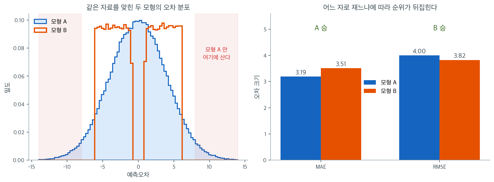
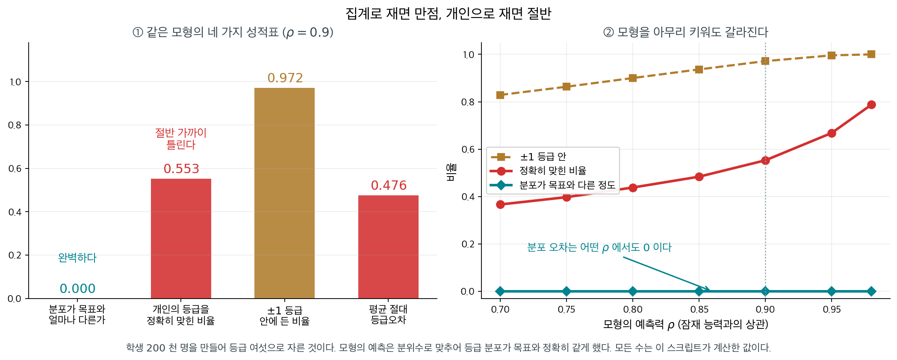

# 성능 척도

회귀의 성능을 재는 자는 여럿이고, 각각을 전개한 쪽이 따로 있다. 결정계수와 수정 결정계수는 [결정계수와 수정 결정계수](r_squared.md)에, 절대·제곱오차 척도는 [평균절대오차, 평균제곱오차, 제곱근평균제곱오차](mae_mse_rmse.md)에, 척도무관 측도는 [평균절대백분율오차와 그 밖의 상대 척도](relative_metrics.md)에 있다.

이 쪽이 하는 일은 하나다. **네 자를 같은 자료에 한꺼번에 대 보고, 그 자들이 서로 엇갈릴 때 무엇을 믿어야 하는지 따지는 것이다.**

---

## 1. 네 척도를 한자리에서

$$
\begin{array}{lll}
\text{MAE} && \displaystyle\frac{1}{n}\sum_{i=1}^n|y_i-\hat{y}_i| \\[10pt]
\text{MSE} && \displaystyle\frac{1}{n}\sum_{i=1}^n(y_i-\hat{y}_i)^2 \\[10pt]
\text{RMSE} && \displaystyle\sqrt{\frac{1}{n}\sum_{i=1}^n(y_i-\hat{y}_i)^2}
\end{array}
$$

<div class="exbox" markdown>

**보기 1.** <span class="diff easy" title="쉬움"></span> 네 성능 측도 한자리에. 광고 자료에 `TV`, `Radio`, `TV:Radio` 세 설명변수로 회귀하고 $R^2$, MAE, MSE, RMSE 를 훈련·시험에서 각각 잰다.

**(1)** 이 네 수는 **서로 독립적인 정보가 아니다.** $\mathrm{RMSE}$ 와 $R^2$ 를 $\mathrm{MSE}$ 로 적어, 실제로 자유로운 수가 몇 개인지 가리고 수로 확인하시오.

**(2)** $\mathrm{RMSE}/\mathrm{MAE}$ 비를 훈련과 시험에서 계산하여, 잔차에 두꺼운 꼬리가 있는지 판정하시오. 시험 MSE 가 훈련 MSE 보다 **작은** 까닭도 그 비로 설명하시오.

</div>

??? success "풀이"

    **(1) 자유로운 수는 두 개다.** 먼저 정의에서

    $$
    \mathrm{RMSE} = \sqrt{\mathrm{MSE}}
    $$

    이므로 둘은 같은 양의 다른 표현이다. 정보가 하나 줄었다.

    $R^2$ 도 MSE 에서 나온다. 어떤 자료집합에서

    $$
    R^2 = 1 - \frac{\mathrm{RSS}}{\mathrm{TSS}}
    = 1 - \frac{\sum_i (y_i - \hat y_i)^2}{\sum_i (y_i - \bar y)^2}
    = 1 - \frac{\frac{1}{n}\sum_i (y_i - \hat y_i)^2}{\frac{1}{n}\sum_i (y_i - \bar y)^2}
    = 1 - \frac{\mathrm{MSE}}{\widehat{\operatorname{Var}}(y)}
    $$

    이다. 분자와 분모를 같은 $n$ 으로 나누었을 뿐이므로 $\widehat{\operatorname{Var}}(y)$ 는 **$n$ 으로 나눈** 표본분산이다($\texttt{ddof=0}$). 그러므로 $R^2$ 는 MSE 를 그 자료의 $y$ 분산으로 재규격화한 것이고, **새 정보가 없다.**

    남는 것은 $\mathrm{MSE}$ 와 $\mathrm{MAE}$ 둘이다. 둘은 서로에서 나오지 않는다. 하나는 제곱의 평균, 하나는 절대값의 평균이어서 **오차 분포의 다른 모양을 본다.**

    이 셈이 척도를 고르는 문제를 또렷하게 만든다. $R^2$ 와 RMSE 와 MSE 를 나란히 보고하는 것은 **같은 수를 세 번 적는 것**이고, 거기에 MAE 를 더해야 비로소 두 번째 정보가 생긴다.

    **(2) 정규잔차의 비는 $\sqrt{\pi/2}$ 다.** $\varepsilon \sim N(0, \sigma^2)$ 이면 $E|\varepsilon| = \sigma\sqrt{2/\pi}$ 이고 $\sqrt{E[\varepsilon^2]} = \sigma$ 이므로

    $$
    \frac{\mathrm{RMSE}}{\mathrm{MAE}} \;\longrightarrow\; \sqrt{\frac{\pi}{2}} = 1.2533
    $$

    이다. $\sigma$ 가 약분되므로 이 비는 **잔차의 크기와 무관하게 모양만** 잰다.

    - 비가 $1.25$ 보다 **크면** 큰 잔차 몇 개가 RMSE 를 혼자 밀어 올리는 것이므로 꼬리가 두껍다.
    - 비가 $1.25$ 보다 **작으면** 잔차의 크기가 고르다. 아래 그림의 모형 B 가 $1.09$ 인 경우다.
    - 비의 하한은 $1$ 이고(모든 잔차가 같은 크기), 상한은 없다.

    시험 MSE 가 훈련 MSE 보다 작다는 사실도 이 비가 설명할 수 있다. 훈련 쪽에 **아주 큰 잔차 몇 개**가 몰려 있다면 훈련 MSE 가 그만큼 부풀기 때문이다. 그렇다면 훈련 쪽의 비가 시험 쪽보다 클 것이다. 확인해 보자.

    ```python
    import pandas as pd
    import numpy as np
    from sklearn.model_selection import train_test_split
    from sklearn.linear_model import LinearRegression
    from sklearn import metrics

    # 앞 절과 같은 광고 자료를 쓴다.
    url = 'https://raw.githubusercontent.com/justmarkham/scikit-learn-videos/8545c74961398def7724501648fd504dbf061b41/data/Advertising.csv'
    df = pd.read_csv(url, usecols=[1, 2, 3, 4])

    df['TV:Radio'] = df['TV'] * df['Radio']

    X = df[['TV', 'Radio', 'TV:Radio']]
    y = df['Sales']

    test_size_ratio = 0.3
    x_train, x_test, y_train, y_test = train_test_split(X, y, test_size=test_size_ratio, random_state=42)

    model = LinearRegression()
    model.fit(x_train, y_train)

    y_train_pred = model.predict(x_train)
    y_test_pred = model.predict(x_test)

    print(f"Intercept: {model.intercept_}")
    print(f"Coefficients: {model.coef_}\n")

    # 아래 네 측도를 훈련과 시험에서 각각 잰다. 시험 쪽 값이 훈련 쪽보다
    # 크게 나쁘면 과적합을 의심한다.
    # R^2 — 반응의 분산 중 모형이 설명하는 몫. 단위가 없어 견주기 좋다.
    print(f"Training R^2: {model.score(x_train, y_train)}")
    print(f"Testing R^2: {model.score(x_test, y_test)}\n")

    # MAE — 오차의 절댓값 평균. 단위가 반응과 같고 이상치에 덜 휘둘린다.
    print(f"Training MAE: {metrics.mean_absolute_error(y_train, y_train_pred)}")
    print(f"Testing MAE: {metrics.mean_absolute_error(y_test, y_test_pred)}\n")

    # MSE — 오차의 제곱 평균. 큰 오차에 더 무거운 벌을 준다. 단위가 제곱이라
    # 그대로 읽기는 어렵다.
    print(f"Training MSE: {metrics.mean_squared_error(y_train, y_train_pred)}")
    print(f"Testing MSE: {metrics.mean_squared_error(y_test, y_test_pred)}\n")

    # RMSE — MSE 의 제곱근. 단위가 반응과 같아져 해석이 쉬워진다.
    # 큰 오차를 무겁게 보되 읽기도 편해, 회귀에서 가장 널리 쓰인다.
    print(f"Training RMSE: {np.sqrt(metrics.mean_squared_error(y_train, y_train_pred))}")
    print(f"Testing RMSE: {np.sqrt(metrics.mean_squared_error(y_test, y_test_pred))}\n")
    ```

    출력:

    ```
    Intercept: 6.37486462995429
    Coefficients: [0.02060952 0.04735462 0.00100684]

    Training R^2: 0.9659030787012204
    Testing R^2: 0.9673268969053402

    Training MAE: 0.6344840392254547
    Testing MAE: 0.730384235550869

    Training MSE: 0.8947370334590617
    Testing MSE: 0.8921262830343071

    Training RMSE: 0.9459054040754085
    Testing RMSE: 0.9445243686820934
    ```

    ```python
    from scipy import stats

    for name, xx, yy, pp in [("훈련", x_train, y_train, y_train_pred),
                             ("시험", x_test, y_test, y_test_pred)]:
        mae = metrics.mean_absolute_error(yy, pp)
        mse = metrics.mean_squared_error(yy, pp)
        rmse = np.sqrt(mse)
        r2 = model.score(xx, yy)
        var0 = np.var(yy, ddof=0)
        e = np.asarray(yy) - pp
        big = np.abs(e) > 3 * rmse
        print(f"{name}: MAE={mae:.6f}  MSE={mse:.6f}  RMSE={rmse:.6f}  R2={r2:.6f}")
        print(f"   RMSE^2 - MSE          = {rmse ** 2 - mse:.3e}")
        print(f"   1 - MSE/Var(y, ddof=0) = {1 - mse / var0:.6f}   (R2 와의 차이 {abs(1 - mse / var0 - r2):.3e})")
        print(f"   RMSE/MAE = {rmse / mae:.4f}    정규라면 sqrt(pi/2) = {np.sqrt(np.pi / 2):.4f}")
        print(f"   잔차 왜도 {stats.skew(e):+.3f}  첨도 {stats.kurtosis(e, fisher=False):.3f}  "
              f"최대 |e| = {np.abs(e).max():.3f} (RMSE 의 {np.abs(e).max() / rmse:.1f}배)")
        print(f"   |e| > 3*RMSE 인 관측값 {big.sum()}개 / {len(e)}개,  "
              f"그 몫이 MSE 에서 차지하는 비율 {(e[big] ** 2).sum() / (e ** 2).sum() * 100:.1f}%")
    ```

    출력:

    ```
    훈련: MAE=0.634484  MSE=0.894737  RMSE=0.945905  R2=0.965903
       RMSE^2 - MSE          = 0.000e+00
       1 - MSE/Var(y, ddof=0) = 0.965903   (R2 와의 차이 0.000e+00)
       RMSE/MAE = 1.4908    정규라면 sqrt(pi/2) = 1.2533
       잔차 왜도 -3.073  첨도 20.638  최대 |e| = 6.692 (RMSE 의 7.1배)
       |e| > 3*RMSE 인 관측값 2개 / 140개,  그 몫이 MSE 에서 차지하는 비율 47.6%
    시험: MAE=0.730384  MSE=0.892126  RMSE=0.944524  R2=0.967327
       RMSE^2 - MSE          = 1.110e-16
       1 - MSE/Var(y, ddof=0) = 0.967327   (R2 와의 차이 0.000e+00)
       RMSE/MAE = 1.2932    정규라면 sqrt(pi/2) = 1.2533
       잔차 왜도 -1.215  첨도 4.148  최대 |e| = 2.765 (RMSE 의 2.9배)
       |e| > 3*RMSE 인 관측값 0개 / 60개,  그 몫이 MSE 에서 차지하는 비율 0.0%
    ```

    **(1) 두 관계식이 정확히 성립한다.** $\mathrm{RMSE}^2 - \mathrm{MSE}$ 가 훈련에서 정확히 $0$, 시험에서 $1.1 \times 10^{-16}$ 이다. 그리고 $1 - \mathrm{MSE}/\widehat{\operatorname{Var}}(y)$ 가 `model.score` 의 $R^2$ 와 **차이 $0$** 으로 같다. 유도한 대로 **네 수 가운데 자유로운 것은 MSE 와 MAE 둘뿐**이다.

    **(2) 훈련 잔차에 두꺼운 꼬리가 있다.** 비가 훈련에서 $1.4908$ 로 정규 기준 $1.2533$ 보다 $19\%$ 크고, 시험에서는 $1.2932$ 로 $3\%$ 밖에 크지 않다.

    범인이 분명하게 드러난다. 훈련자료 $140$ 개 가운데 $|e| > 3\,\mathrm{RMSE}$ 인 것이 **단 두 개**인데, 그 둘이 **MSE 의 $47.6\%$** 를 차지한다. 가장 큰 잔차는 $6.692$ 로 RMSE 의 $7.1$ 배다. 왜도 $-3.073$, 첨도 $20.638$ 도 정규의 $0$ 과 $3$ 에서 한참 멀다. 시험자료에는 그런 관측값이 하나도 없고(왜도 $-1.215$, 첨도 $4.148$), 최대 잔차가 RMSE 의 $2.9$ 배에 그친다.

    **그래서 시험 MSE 가 훈련 MSE 보다 작다.** $0.892126$ 대 $0.894737$ 이다. 유도에서 예상한 대로이고, 과적합이 없어서가 아니라 **이상점 두 개가 우연히 훈련 쪽에 떨어졌기** 때문이다. MAE 로 보면 이야기가 뒤집힌다. 훈련 $0.6345$, 시험 $0.7304$ 로 **시험 쪽이 $15\%$ 나쁘다.** 이상점에 덜 휘둘리는 자로 재면 정상적인 방향이 나타난다.

    훈련 $R^2$ $0.9659$ 와 시험 $R^2$ $0.9673$ 이 거의 같다. 두 값이 크게 벌어지면 과적합을 의심한다. 다만 위에서 보았듯 **이 두 수가 거의 같다는 사실 자체는 MSE 가 같다는 말의 되풀이**이고, $R^2$ 가 각 집합의 $y$ 분산으로 규격화된다는 점까지 더해져 있다. 시험 쪽 $y$ 의 분산이 $27.30$ 으로 훈련 쪽 $26.24$ 보다 커서, 같은 MSE 라도 시험 $R^2$ 가 조금 더 높게 나왔다.

    **교훈은 둘을 함께 보라는 것이다.** MSE 하나만 보면 "시험이 더 좋다" 는 엉뚱한 결론에 이르고, MAE 를 함께 보면 바로잡힌다. 그리고 두 척도가 엇갈리는 바로 그 자리가 이상점이 사는 곳이다.

---
## 2. 척도가 엇갈릴 때

위 보기에서는 네 척도가 모두 같은 방향을 가리켰다. 늘 그렇지는 않다.



같은 자료를 맞힌 두 모형이 있다고 하자. 왼쪽 그림이 두 모형의 예측오차 분포다. 모형 A(파란색)는 정규분포 모양이어서 오차가 대개 작지만 가끔 아주 크다. 붉게 칠한 $|e| > 8$ 구간에 사는 점은 모형 A뿐이다. 모형 B(주황색)는 오차의 크기가 늘 $1$에서 $6$ 사이로 고르다. 크게 빗나가는 일도 없지만 정확히 맞히는 일도 없다.

오른쪽이 두 자로 잰 결과다. MAE로 재면 모형 A가 $3.19$로 모형 B의 $3.51$보다 낫다. 그런데 RMSE로 재면 모형 A가 $4.00$, 모형 B가 $3.82$로 순위가 **뒤집힌다.** 제곱이 큰 오차를 증폭하기 때문이다. 모형 A의 $|e| > 8$짜리 오차들은 개수로는 전체의 $4.6\%$에 지나지 않지만 MSE에서는 훨씬 큰 몫을 차지한다. 두 모형의 $\text{RMSE}/\text{MAE}$ 비를 내 보면 A가 $1.25$, B가 $1.09$로 이 차이가 그대로 드러난다.

어느 쪽이 "더 나은 모형"인가? 자료만으로는 답할 수 없다. 큰 오차가 특별히 비싼 문제라면 — 재고를 크게 잘못 잡으면 결품이 나거나 창고가 넘치는 경우, 구조물의 하중을 과소평가하면 붕괴하는 경우 — 모형 B를 골라야 한다. 오차의 비용이 크기에 비례할 뿐이라면 모형 A가 낫다. 곧 **척도를 고르는 일은 자료 분석의 문제가 아니라 문제 정의의 문제다.** 모형을 적합하기 전에 "빗나감의 비용이 오차 크기에 어떻게 달라지는가"를 먼저 정해야 하는 이유가 여기에 있다.

---

<div class="storybox" markdown>

**그림으로 보는 통계학 1.** 분포는 완벽히 맞히고 사람은 절반을 틀린 모형

위에서 MAE 와 RMSE 는 **같은 오차들**을 다른 방식으로 묶었다. 그런데 더 앞에서 갈리는 물음이 있다. **무엇 하나를 단위로 삼아 재는가** — 집계인가, 사람인가.

$2020$ 년 봄 영국에서 코로나로 시험이 취소되었다. 교사들이 학생마다 예상 등급(CAG)과 석차를 제출했고, 규제기관 **오프퀄**이 그것을 모형으로 조정해 $8$ 월 $13$ 일에 A-레벨 결과를 발표했다. 모형의 중심은 **학교의 과거 성적 분포**였다. 응시자가 $15$ 명 이상인 과목에서는

$$
P_{kj} = (1 - r_j)\,C_{kj} + r_j\,(C_{kj} + q_{kj} - p_{kj})
$$

로 그 학교·그 과목의 과거 분포 $C_{kj}$ 를 입학 성적 보정 $(q_{kj} - p_{kj})$ 과 섞어 **등급 분포를 먼저 정하고**, 교사가 매긴 석차를 그 분포에 끼워 넣었다. 응시자가 $15$ 명 미만이면 조정 없이 교사 등급을 그대로 썼다.

집계로 보면 이 모형은 할 일을 했다. 전국 등급 분포가 예년과 거의 같게 나왔고, 학교마다의 분포도 그 학교의 과거와 맞았다. 그런데 사람 단위로 보면 **교사 예상보다 한 등급 낮아진 학생이 거의 $36\%$, 두 등급 낮아진 학생이 $3\%$** 였다. 나흘 뒤인 $8$ 월 $17$ 일, 오프퀄과 교육부 장관은 조정하지 않은 교사 예상 등급으로 결과를 다시 내기로 했다.

**두 자가 같은 모형에 전혀 다른 점수를 준다**는 것을 작은 모의실험으로 볼 수 있다.



학생 $20$ 만 명에게 여섯 등급을 주고, 모형이 잠재 능력과 상관 $\rho = 0.9$ 로 예측한 뒤 **분위수로 맞추어** 등급 분포를 목표와 똑같게 만들었다. 결과는 이렇다.

| 무엇으로 재는가 | 값 |
|---|---|
| 분포가 목표와 다른 정도 | $0.000$ |
| 개인의 등급을 정확히 맞힌 비율 | $0.553$ |
| $\pm 1$ 등급 안에 든 비율 | $0.972$ |
| 평균 절대 등급오차 | $0.476$ |

$\rho = 0.9$ 는 아주 좋은 예측이다. 그래도 **열에 넷 반은 다른 등급을 받는다.** 분포 오차는 어떤 $\rho$ 에서도 $0$ 이다 — 분위수로 맞추었으니 당연하고, 바로 그 당연함이 문제다. 오른쪽 판에서 $\rho$ 를 $0.7$ 에서 $0.98$ 까지 올려 보아도 청록 선은 바닥에 붙어 있고 붉은 선만 $0.37$ 에서 $0.79$ 로 오른다. **집계 지표는 모형이 좋아졌는지조차 말해 주지 않는다.**

오프퀄의 모형이 이 모의실험과 같았다는 말은 아니다. 다만 둘이 공유하는 성질이 하나 있다. **분포를 맞추도록 만든 모형은 분포로 재면 반드시 좋아 보인다.** 그리고 그 모형이 바꾸는 것은 분포가 아니라 사람의 등급이다.

!!! note "되돌아볼 수 없었던 모형"
    그 모형에는 더 성가신 사정이 있었다. 예측 알고리듬을 시험하는 보통의 방법은 지난해 자료에 돌려 보는 것인데, **교사 석차는 예년에 수집한 적이 없어서** 그렇게 할 수가 없었다. 모형이 개인을 얼마나 맞히는지 묻는 자 자체를 만들 수 없었다는 뜻이다. 13.8절 [교차검증](../model_selection/cross_validation.md)이 하는 일이 바로 그 자를 만드는 일이다.

_확인한 곳 — $2020$ 년 $8$ 월 $13$ 일 A-레벨 결과 발표, 「교사 예상보다 한 등급 낮은 경우가 거의 $36\%$, 두 등급 낮은 경우가 $3\%$」, $8$ 월 $17$ 일에 조정하지 않은 교사 예상 등급으로 다시 내기로 한 것, 사립학교의 최상위 등급 비율이 다른 학교보다 더 많이 올랐다는 것은 [Wikipedia 「2020 United Kingdom school exam grading controversy」](https://en.wikipedia.org/wiki/2020_United_Kingdom_school_exam_grading_controversy)에서 읽었다 · 위 식과 「응시자 $15$ 명 미만이면 교사 등급을 그대로 쓴다」, 「예측 알고리듬을 시험하는 보통의 방법은 지난해 자료에 돌려 보는 것인데 교사 석차가 예년에 수집되지 않아 그럴 수 없었다」는 [Wikipedia 「Ofqual exam results algorithm」](https://en.wikipedia.org/wiki/Ofqual_exam_results_algorithm)에서 읽었다 · 표와 그림의 수는 모두 직접 모의실험해 얻은 값이고 오프퀄의 자료가 아니다_

</div>

---

## 연습문제

<div class="drillbox" markdown>

**연습문제 1.** <span class="diff easy" title="쉬움"></span>
어떤 회귀모형이 검정자료에서 MSE = 16.0, MAE = 3.2이다. 두 번째 모형은 MSE = 14.5, MAE = 3.5이다. 어느 모형이 더 나은가? MSE와 MAE가 엇갈리는 것은 자료에 대해 무엇을 시사하는가?

</div>

??? success "풀이"
    선택은 응용 상황에 달려 있다. 모형 2는 MSE가 더 낮고(14.5 대 16.0), 모형 1은 MAE가 더 낮다(3.2 대 3.5).

    두 척도가 엇갈리는 것은 **오차 분포의 모양**이 다르다는 뜻이다. RMSE/MAE 비를 보면 뚜렷해진다.

    - 모형 1: $\text{RMSE} = \sqrt{16.0} = 4.0$, 비 $= 4.0/3.2 = 1.25$
    - 모형 2: $\text{RMSE} = \sqrt{14.5} = 3.81$, 비 $= 3.81/3.5 = 1.09$

    비가 클수록 오차 분포의 꼬리가 무겁다. 곧 **모형 1**이 전형적인 오차는 작지만 몇 개의 큰 오차를 갖고 있고, **모형 2**는 오차가 더 고르게 퍼져 있되 평균적인 오차 크기는 조금 더 크다. MSE는 오차를 제곱하므로 큰 오차에 더 큰 벌점을 주고, 그래서 큰 오차가 있는 모형 1의 MSE가 더 높게 나온 것이다.

    큰 오차의 비용이 크다면 모형 2(낮은 MSE)를, 전형적인 오차 크기가 더 중요하다면 모형 1(낮은 MAE)을 택한다.

<div class="drillbox" markdown>

**연습문제 2.** <span class="diff med" title="중간"></span>
어떤 모형이 훈련자료에서 $R^2 = 0.95$, 검정자료에서 $R^2 = 0.60$이다. 문제를 진단하고 대책을 제안하라.

</div>

??? success "풀이"
    훈련 $R^2$(0.95)와 검정 $R^2$(0.60)의 큰 격차는 **과적합**을 나타낸다. 모형이 훈련자료에만 있는 패턴(잡음 포함)을 학습하여 새 자료에 일반화되지 않는 것이다.

    대책: (1) 설명변수를 빼거나, 정칙화(릿지/라쏘)를 쓰거나, 다항 차수를 낮추어 **모형 복잡도를 줄인다**. (2) 가능하면 **훈련자료를 늘린다**. (3) 모형 선택 과정에서 **교차검증**을 써서 표본 밖 성능을 더 신뢰성 있게 추정한다.

<div class="drillbox" markdown>

**연습문제 3.** <span class="diff med" title="중간"></span>
(절편이 있을 때) 훈련자료에서는 $R^2$가 항상 0과 1 사이인데도 검정자료에서는 음수가 될 수 있는 이유를 설명하라.

</div>

??? success "풀이"
    절편이 있는 훈련자료에서는 OLS가 $\text{SSE} \leq \text{SST}$를 보장하므로 $R^2 = 1 - \text{SSE}/\text{SST} \geq 0$이다.

    검정자료에서는 $R^2 = 1 - \sum(y_i - \hat{y}_i)^2 / \sum(y_i - \bar{y}_{\text{test}})^2$이다. 예측값 $\hat{y}_i$는 훈련 모형이 만들어 낸 것이므로 검정자료에서는 체계적으로 치우쳐 있을 수 있다. 모형의 예측이 모든 관측값에 대해 단순히 검정자료의 평균을 예측하는 것보다 나쁘다면 $\text{SSE} > \text{SST}$가 되어 $R^2 < 0$이다. 이는 모형이 단지 나쁜 정도가 아니라 아무 모형도 쓰지 않는 것보다 나쁘다는 뜻이다.

<div class="drillbox" markdown>

**연습문제 4.** <span class="diff med" title="중간"></span>
보기 1의 훈련 적합은 $n = 140$, $p = 3$(`TV`, `Radio`, `TV:Radio`), $R^2 = 0.9659031$, MSE $= 0.8947370$이었다.

**(1)** 이 적합의 수정 $R^2$를 구하시오.

**(2)** 네 번째 설명변수를 하나 더 넣는다고 하자. 수정 $R^2$가 **올라가려면** $R^2$가 적어도 얼마가 되어야 하는가? 훈련 MSE로는 어느 값 아래로 떨어져야 하는가?

**(3)** 일반적으로 설명변수를 $p$개에서 $p+1$개로 늘릴 때 수정 $R^2$가 올라가는 조건이 "$\text{SSE}$이 $1/(n-p-1)$보다 큰 **비율**로 줄어든다"임을 보이고, 이 조건을 자유도의 말로 해석하시오.

</div>

??? success "풀이"
    **(1)** [결정계수와 수정 결정계수](r_squared.md)의 정의 2에 대입한다.

    $$
    \text{Adjusted } R^2 = 1 - (1 - 0.9659031)\frac{139}{136} = 1 - 0.0340969 \times 1.0220588 = 0.9651509
    $$

    $R^2$보다 $0.00075$ 낮다. 설명변수 셋이 가져간 자유도의 값이다.

    **(2)** 설명변수가 넷이면 잔차 자유도가 $140 - 4 - 1 = 135$로 하나 줄어든다. 수정 $R^2$가 올라간다는 것은 조정 인자의 유도에서 쓴 비

    $$
    \frac{\text{SSE}/(n-p-1)}{\text{SST}/(n-1)}
    $$

    가 작아진다는 뜻이다. $\text{SST}$과 $n-1$은 그대로이므로

    $$
    \frac{1 - R^2_{\text{new}}}{135} < \frac{1 - R^2_{\text{old}}}{136}
    $$

    이어야 한다. 따라서

    $$
    1 - R^2_{\text{new}} < \frac{135}{136}\left(1 - R^2_{\text{old}}\right) = \frac{135}{136} \times 0.0340969 = 0.0338462
    $$

    곧 $R^2_{\text{new}} > 0.9661538$이다. 지금 값보다 **$0.0002507$ 만큼은** 커져야 한다. $\text{SSE}$은 $n$으로 나눈 MSE와 비례하므로 같은 조건을 MSE로 적으면

    $$
    \mathrm{MSE}_{\text{new}} < \frac{135}{136} \times 0.8947370 = 0.8881581
    $$

    이다.

    **(3)** 늘리기 전의 잔차 자유도를 $d = n - p - 1$이라 하면 늘린 뒤는 $d - 1$이다. 수정 $R^2$가 올라가는 조건은

    $$
    \frac{\text{SSE}^{\text{new}}}{d-1} < \frac{\text{SSE}^{\text{old}}}{d}
    \quad\Longleftrightarrow\quad
    \text{SSE}^{\text{new}} < \frac{d-1}{d}\, \text{SSE}^{\text{old}}
    $$

    곧

    $$
    \frac{\text{SSE}^{\text{old}} - \text{SSE}^{\text{new}}}{\text{SSE}^{\text{old}}} > \frac{1}{d} = \frac{1}{n-p-1}
    $$

    이다. 위 (2)는 $d = 136$인 경우이고 $1/136 = 0.735\%$다. $\square$

    해석하면 이렇다. 설명변수를 하나 넣으면 잔차 자유도 $d$개 가운데 하나, 곧 **전체의 $1/d$** 를 잃는다. 자유도 하나를 내준 값을 하려면 잔차제곱합도 적어도 그만큼의 몫은 깎아야 한다는 것이다. 표본이 클수록 $1/d$가 작아져 문턱이 낮아지므로, 같은 설명변수가 작은 표본에서는 벌점을 못 넘고 큰 표본에서는 넘을 수 있다.

<div class="drillbox" markdown>

**연습문제 5.** <span class="diff med" title="중간"></span>
2절의 두 모형을 다시 보자. 모형 A는 $\mathrm{MAE} = 3.19$, $\mathrm{RMSE} = 4.00$이고 모형 B는 $\mathrm{MAE} = 3.51$, $\mathrm{RMSE} = 3.82$였다. 빗나감 하나의 비용이

$$
c(e) = \lvert e \rvert + \lambda e^2 \qquad (\lambda \ge 0)
$$

로 주어진다고 하자. 즉 비용은 오차 크기에 비례하는 부분과 제곱으로 커지는 부분의 합이다.

**(1)** 평균비용을 MAE와 MSE로 적고, 두 모형의 평균비용이 같아지는 $\lambda^*$를 구하시오. $\lambda < \lambda^*$와 $\lambda > \lambda^*$에서 각각 어느 모형을 골라야 하는가?

**(2)** $\lambda^*$를 "오차가 얼마나 커지면 제곱항이 선형항을 넘어서는가"라는 말로 바꾸어 해석하시오. 본문이 모형 A의 약점으로 지목한 $\lvert e \rvert > 8$ 구간과 견주어 보시오.

</div>

??? success "풀이"
    **(1)** 비용의 평균은 그대로 두 척도의 결합이다.

    $$
    \frac{1}{n}\sum_i c(e_i) = \frac{1}{n}\sum_i \lvert e_i \rvert + \lambda \cdot \frac{1}{n}\sum_i e_i^2 = \mathrm{MAE} + \lambda\,\mathrm{MSE}
    $$

    $\mathrm{MSE} = \mathrm{RMSE}^2$이므로 모형 A는 $\mathrm{MSE} = 4.00^2 = 16.0000$, 모형 B는 $\mathrm{MSE} = 3.82^2 = 14.5924$다. 두 평균비용을 같게 두면

    $$
    3.19 + 16.0000\,\lambda = 3.51 + 14.5924\,\lambda
    $$

    $$
    (16.0000 - 14.5924)\,\lambda = 3.51 - 3.19
    \quad\Longrightarrow\quad
    \lambda^* = \frac{0.32}{1.4076} = 0.22734
    $$

    확인하면 양쪽 모두 $3.19 + 16.0000 \times 0.22734 = 6.8274$, $3.51 + 14.5924 \times 0.22734 = 6.8274$로 같다.

    평균비용의 차는 $\lambda$의 **일차함수**이고 $\lambda$의 계수 $16.0000 - 14.5924 > 0$이므로, $\lambda$가 커질수록 A가 불리해진다. 따라서

    - $\lambda < 0.22734$이면 **모형 A**(MAE가 낮은 쪽),
    - $\lambda > 0.22734$이면 **모형 B**(MSE가 낮은 쪽),
    - $\lambda = 0.22734$이면 두 모형이 똑같다.

    **(2)** $c(e)$에서 제곱항과 선형항이 같아지는 오차 크기는 $\lambda e^2 = \lvert e \rvert$, 곧 $\lvert e \rvert = 1/\lambda$다. $\lambda^*$에서는

    $$
    \frac{1}{\lambda^*} = \frac{1}{0.22734} = 4.399
    $$

    이다. 즉 **크기 $4.4$ 정도의 오차에서 비용이 비례에서 벗어나 꺾이기 시작하면** 두 모형이 대등해진다. 꺾이는 자리가 그보다 **늦으면**($\lambda$가 작으면) 전형적인 오차가 작은 A가 낫고, 그보다 **이르면**($\lambda$가 크면) 큰 오차가 없는 B가 낫다.

    본문이 지목한 모형 A의 약점은 $\lvert e \rvert > 8$ 구간이다. $\lambda = \lambda^*$에서 $\lvert e \rvert = 8$인 빗나감의 비용은 $8 + 0.22734 \times 64 = 22.55$이고 그중 제곱항이 $14.55$, 곧 **$64.5\%$** 다. 모형 A의 그 구간이 개수로는 $4.6\%$에 지나지 않는데도 순위를 뒤집을 수 있는 까닭이 여기에 있다.

    이 셈이 본문의 결론을 수로 바꾼 것이다. "어느 모형이 나은가"는 자료가 아니라 **$\lambda$를 어디로 잡는가**, 곧 빗나감의 비용이 어느 크기에서 꺾이는가에 달려 있다. $\lambda^* = 0.227$ 하나만 알면 모형을 다시 적합하지 않고도 어느 쪽인지 바로 판정할 수 있다.

<div class="drillbox" markdown>

**연습문제 6.** <span class="diff med" title="중간"></span>
보기 1의 풀이에서 어떤 자료집합에 대해

$$
R^2 = 1 - \frac{\mathrm{MSE}}{\widehat{\operatorname{Var}}(y)}
$$

가 성립함을 보았다($\widehat{\operatorname{Var}}$는 $n$으로 나눈 표본분산). 보기 1의 수치는 훈련에서 $\mathrm{MSE} = 0.8947370$, $R^2 = 0.9659031$, 시험에서 $\mathrm{MSE} = 0.8921263$, $R^2 = 0.9673269$였다.

**(1)** 위 항등식을 거꾸로 써서 훈련과 시험 각각의 $\widehat{\operatorname{Var}}(y)$를 구하시오.

**(2)** 시험 $R^2$가 훈련 $R^2$보다 $0.0014238$ 높다. 이 차이를 **MSE의 차이에서 온 몫**과 **$y$ 분산의 차이에서 온 몫**으로 나누고, 각각이 몇 퍼센트인지 구하시오.

**(3)** 시험자료의 $y$ 분산이 훈련자료와 같았다면 시험 $R^2$는 얼마였겠는가? 이 결과가 "훈련 $R^2$와 검정 $R^2$의 격차로 과적합을 진단하는" 연습문제 2의 방법에 어떤 주의를 주는가?

</div>

??? success "풀이"
    **(1)** 항등식을 $\widehat{\operatorname{Var}}(y) = \mathrm{MSE}/(1 - R^2)$로 고쳐 쓴다.

    $$
    \widehat{\operatorname{Var}}(y)_{\text{훈련}} = \frac{0.8947370}{1 - 0.9659031} = \frac{0.8947370}{0.0340969} = 26.2410
    $$

    $$
    \widehat{\operatorname{Var}}(y)_{\text{시험}} = \frac{0.8921263}{1 - 0.9673269} = \frac{0.8921263}{0.0326731} = 27.3046
    $$

    보기 1의 풀이 끝에 적힌 $26.24$와 $27.30$과 같다.

    **(2)** 차이를 항등식에 넣고 가운뎃값 $\mathrm{MSE}_{\text{훈련}}/\widehat{\operatorname{Var}}(y)_{\text{시험}}$을 끼워 두 덩어리로 쪼갠다.

    $$
    R^2_{\text{시험}} - R^2_{\text{훈련}}
    = \frac{\mathrm{MSE}_{\text{훈련}}}{\widehat{\operatorname{Var}}(y)_{\text{훈련}}} - \frac{\mathrm{MSE}_{\text{시험}}}{\widehat{\operatorname{Var}}(y)_{\text{시험}}}
    = \underbrace{\mathrm{MSE}_{\text{훈련}}\left(\frac{1}{\widehat{\operatorname{Var}}(y)_{\text{훈련}}} - \frac{1}{\widehat{\operatorname{Var}}(y)_{\text{시험}}}\right)}_{\text{분산 몫}}
    + \underbrace{\frac{\mathrm{MSE}_{\text{훈련}} - \mathrm{MSE}_{\text{시험}}}{\widehat{\operatorname{Var}}(y)_{\text{시험}}}}_{\text{MSE 몫}}
    $$

    값을 넣는다.

    $$
    \text{분산 몫} = 0.8947370\left(\frac{1}{26.2410} - \frac{1}{27.3046}\right) = 0.8947370 \times 0.0014845 = 0.0013282
    $$

    $$
    \text{MSE 몫} = \frac{0.8947370 - 0.8921263}{27.3046} = \frac{0.0026107}{27.3046} = 0.0000956
    $$

    합이 $0.0013282 + 0.0000956 = 0.0014238$로 주어진 차이와 정확히 맞는다. 몫으로는 분산이 $93.3\%$, MSE가 $6.7\%$다.

    **(3)** 시험 MSE를 훈련 쪽 분산으로 규격화해 본다.

    $$
    1 - \frac{0.8921263}{26.2410} = 1 - 0.0339974 = 0.9660026
    $$

    훈련 $R^2$ $0.9659031$과 거의 같아, 격차가 $0.0014238$에서 $0.0000995$로 **$14$분의 $1$** 로 줄어든다.

    주의할 점은 이것이다. $R^2$는 MSE를 **그 자료집합 자신의** $y$ 분산으로 나눈 값이므로, 훈련 $R^2$와 검정 $R^2$의 격차에는 모형의 성능 차이뿐 아니라 **두 집합의 $y$ 분산 차이**가 섞여 들어간다. 위에서는 그 섞임이 격차의 $93\%$를 차지했다. 자료를 나눌 때 운이 나빠 검정자료의 $y$ 분산이 작게 잡히면, 성능이 똑같아도 검정 $R^2$가 낮게 나와 과적합처럼 보인다. 연습문제 2의 $0.95$ 대 $0.60$ 같은 큰 격차는 그 정도 섞임으로 설명되지 않으므로 과적합 진단이 안전하지만, 작은 격차를 읽을 때는 $R^2$ 대신 **단위가 자료집합에 묶이지 않은 MSE나 MAE를 직접 견주는** 편이 옳다.

<div class="drillbox" markdown>

**연습문제 7.** <span class="diff hard" title="어려움"></span>
보기 1의 풀이는 $\mathrm{RMSE}/\mathrm{MAE}$의 "하한은 $1$이고 상한은 없다"고 적었다. 표본크기 $n$을 고정하면 상한이 생긴다.

**(1)** 잔차 $e_1, \dots, e_n$이 모두 $0$은 아니라고 할 때

$$
1 \le \frac{\mathrm{RMSE}}{\mathrm{MAE}} \le \sqrt{n}
$$

임을 보이고, 좌우 등호가 성립하는 잔차의 모양을 각각 말하시오.

**(2)** 그렇다면 "상한은 없다"는 서술은 어떤 뜻에서 옳은가?

**(3)** 보기 1의 훈련 잔차는 비가 $1.4908$, $n = 140$이었다. 이 값을 $(1)$의 상한과 견주어, 비 하나만으로 "잔차 몇 개가 오차를 독차지한다"고 말할 수 있는지 판단하시오.

</div>

??? success "풀이"
    **(1)** $a_i = \lvert e_i \rvert \ge 0$으로 쓰면 $\mathrm{MAE} = \frac{1}{n}\sum a_i$, $\mathrm{RMSE}^2 = \frac{1}{n}\sum a_i^2$이다.

    *하한.* 코시–슈바르츠 부등식을 $(a_1,\dots,a_n)$과 $(1,\dots,1)$에 쓴다.

    $$
    \left(\sum_i a_i\right)^2 \le n \sum_i a_i^2
    $$

    양변을 $n^2$으로 나누면 $\mathrm{MAE}^2 \le \mathrm{RMSE}^2$, 곧 비가 $1$ 이상이다. 등호는 $(a_i)$가 $(1,\dots,1)$에 비례할 때, 곧 **모든 잔차의 크기가 같을 때**다.

    *상한.* $M = \max_i a_i$라 하면 $a_i^2 \le M a_i$이므로

    $$
    \sum_i a_i^2 \le M \sum_i a_i \le \left(\sum_i a_i\right)^2
    $$

    마지막 부등호는 $M \le \sum_i a_i$에서 나온다. 따라서

    $$
    \mathrm{RMSE}^2 = \frac{1}{n}\sum_i a_i^2 \le \frac{1}{n}\left(\sum_i a_i\right)^2 = n\,\mathrm{MAE}^2
    $$

    곧 비가 $\sqrt{n}$ 이하다. 두 부등호가 모두 등호가 되려면 $a_i \in \{0, M\}$이고 $M = \sum_i a_i$여야 하므로, **잔차 하나만 $0$이 아닐 때**다. $\square$

    **(2)** 상한 $\sqrt{n}$이 $n$에 달려 있으므로 $n$을 키우면 함께 커지고 $n \to \infty$에서 발산한다. 곧 "상한은 없다"는 **표본크기를 자유롭게 둘 때** 옳은 말이고, 자료가 주어져 $n$이 정해지면 비는 $\sqrt{n}$을 넘을 수 없다. 하한 $1$은 $n$과 무관하게 언제나 날카롭다는 점에서 상한과 성격이 다르다.

    **(3)** $n = 140$이면 상한이 $\sqrt{140} = 11.832$다. 관측된 $1.4908$은 가능한 범위 $[1, 11.832]$의 **아래쪽 끝 근처**에 있다. 정규 기준 $1.2533$보다 $19\%$ 크다는 것은 꼬리가 두껍다는 신호이지만, 잔차 하나가 독차지하는 극단($11.832$)에서는 멀다.

    실제로 보기 1의 셈이 이 판단과 맞는다. 이상점 둘이 MSE의 $47.6\%$를 가져갔을 뿐 나머지 $52.4\%$는 $138$개가 고르게 나눠 가졌다. 비가 상한에 가까워지는 것은 "오차가 거의 전부 한 점에 모인" 모양이고, 그런 모형은 사실상 한 점만 빼고 완벽하게 맞힌 셈이다. 그러므로 비 하나로는 꼬리의 **방향**만 읽고, 몇 개가 얼마를 가져가는지는 잔차를 직접 세어 보아야 한다.

<div class="drillbox" markdown>

**연습문제 8.** <span class="diff hard" title="어려움"></span>
[결정계수와 수정 결정계수](r_squared.md)는 단순선형회귀에서 $R^2 = \rho^2$임을 보았다. 설명변수가 여러 개일 때는 $y$와 $\hat{y}$의 상관계수가 그 자리를 대신한다.

**(1)** 절편이 있는 모형을 **훈련자료**에 OLS로 적합했다면 $\sum_i (y_i - \hat{y}_i) = 0$이고 $\sum_i (y_i - \hat{y}_i)(\hat{y}_i - \bar{y}) = 0$이다([결정계수와 수정 결정계수](r_squared.md) 1절에서 교차항이 사라진 것이 이 성질이다). 이를 써서

$$
R^2 = \left(\operatorname{corr}(y, \hat{y})\right)^2
$$

임을 보이시오.

**(2)** 이번에는 $\hat{y}_i$가 **다른 자료로 적합한** 모형의 예측값이라고 하자. $\sum_i (y_i - \bar{y})^2 > 0$이면 언제나

$$
R^2 \le \left(\operatorname{corr}(y, \hat{y})\right)^2
$$

임을 보이시오.

**(3)** 검정자료가 $y = (1, 2, 3)$이고 예측값이 $\hat{y} = (11, 12, 13)$인 반례를 들어 $(2)$의 부등호가 얼마나 벌어질 수 있는지 수로 보이고, 연습문제 3의 결론과 이으시오.

</div>

??? success "풀이"
    **(1)** $e_i = y_i - \hat{y}_i$로 쓰고 $\bar{\hat{y}} = \bar{y}$임을 먼저 본다. 첫 성질 $\sum_i e_i = 0$에서 $\sum_i \hat{y}_i = \sum_i y_i$이므로 두 평균이 같다. 이제

    $$
    \sum_i (y_i - \bar{y})(\hat{y}_i - \bar{y})
    = \sum_i \left(e_i + (\hat{y}_i - \bar{y})\right)(\hat{y}_i - \bar{y})
    = \underbrace{\sum_i e_i(\hat{y}_i - \bar{y})}_{=\,0} + \sum_i (\hat{y}_i - \bar{y})^2
    = \text{SSR}
    $$

    이고, [결정계수와 수정 결정계수](r_squared.md) 1절의 제곱합 분해에서 $\text{SST} = \text{SSE} + \text{SSR}$다. 상관계수의 제곱은

    $$
    \left(\operatorname{corr}(y, \hat{y})\right)^2
    = \frac{\left(\sum_i (y_i - \bar{y})(\hat{y}_i - \bar{y})\right)^2}{\sum_i (y_i - \bar{y})^2 \sum_i (\hat{y}_i - \bar{y})^2}
    = \frac{\text{SSR}^2}{\text{SST} \cdot \text{SSR}}
    = \frac{\text{SSR}}{\text{SST}}
    = R^2
    $$

    가 된다. $\square$ 단순선형회귀에서는 $\hat{y}_i$가 $x_i$의 증가함수(또는 감소함수)여서 $\operatorname{corr}(y,\hat{y}) = \pm\rho$이므로 [결정계수와 수정 결정계수](r_squared.md)의 $R^2 = \rho^2$이 이 결과의 특수한 경우다.

    **(2)** $\hat{y}$를 아핀변환해 $y$에 다시 맞추는 최소제곱문제를 생각한다.

    $$
    Q(a, b) = \sum_i \left(y_i - a - b\hat{y}_i\right)^2
    $$

    단순선형회귀의 표준 결과로 그 최솟값은

    $$
    \min_{a, b} Q(a, b) = \left(1 - \left(\operatorname{corr}(y, \hat{y})\right)^2\right)\sum_i (y_i - \bar{y})^2
    $$

    이다. 한편 $a = 0$, $b = 1$은 그 최소화문제의 한 후보일 뿐이므로

    $$
    \sum_i (y_i - \hat{y}_i)^2 = Q(0, 1) \ge \min_{a,b} Q(a,b) = \left(1 - \left(\operatorname{corr}(y, \hat{y})\right)^2\right)\sum_i (y_i - \bar{y})^2
    $$

    양변을 $\sum_i (y_i - \bar{y})^2 > 0$으로 나누고 $1$에서 빼면

    $$
    R^2 = 1 - \frac{\sum_i (y_i - \hat{y}_i)^2}{\sum_i (y_i - \bar{y})^2} \le \left(\operatorname{corr}(y, \hat{y})\right)^2
    $$

    이다. $\square$ 등호는 $(a, b) = (0, 1)$이 최적일 때, 곧 **예측값이 이미 눈금과 위치까지 맞추어져 있을 때**다. $(1)$의 두 직교 성질이 바로 그 조건이고, 그래서 훈련자료에서만 등호가 보장된다.

    **(3)** $y = (1,2,3)$, $\hat{y} = (11,12,13)$이면 $\hat{y}_i = y_i + 10$이므로 상관계수가 $\operatorname{corr}(y,\hat{y}) = 1$, 제곱도 $1$이다. 반면 $\bar{y} = 2$이므로

    $$
    \sum_i (y_i - \hat{y}_i)^2 = 10^2 + 10^2 + 10^2 = 300,
    \qquad
    \sum_i (y_i - \bar{y})^2 = 1 + 0 + 1 = 2
    $$

    $$
    R^2 = 1 - \frac{300}{2} = -149
    $$

    상관계수의 제곱은 최댓값 $1$인데 $R^2$는 $-149$다. 부등호는 아래로 **얼마든지** 벌어질 수 있다. 편향 $10$을 $c$로 바꾸면 $R^2 = 1 - 3c^2/2$로 $c \to \infty$에서 $-\infty$다.

    연습문제 3이 말한 음의 검정 $R^2$가 정확히 이 모양이다. 모형은 $y$의 **오르내림을 완벽하게** 맞혔지만 **높이를 $10$만큼 틀렸다.** 상관계수는 위치와 눈금을 지워 버리는 자여서 이 틀림을 보지 못하고, $R^2$는 위치까지 재므로 평균을 예측하는 것보다 나쁘다고 판정한다. 그러므로 검정자료에서 $R^2$ 대신 $\operatorname{corr}(y,\hat{y})^2$을 보고하는 것은 **모형에 유리하게 눈금을 다시 맞춰 준 값**을 보고하는 일이다.

<div class="drillbox" markdown>

**연습문제 9.** <span class="diff hard" title="어려움"></span>
수정 $R^2$는 $R^2$와 달리 음수가 될 수 있다.

**(1)** 절편이 있는 모형을 훈련자료에 적합해 $0 \le R^2 \le 1$이라 하자. 수정 $R^2 < 0$일 필요충분조건이

$$
R^2 < \frac{p}{n-1}
$$

임을 보이고, $n = 140$, $p = 3$에서 그 문턱을 구하시오.

**(2)** 같은 $n$, $p$에서 수정 $R^2$가 가질 수 있는 가장 작은 값을 구하시오.

**(3)** $p$를 $n-1$ 쪽으로 밀어 보자. $p = n-2$일 때 수정 $R^2 \ge 0$이 되려면 $R^2$가 얼마여야 하는가? $p = n-1$에서는 [결정계수와 수정 결정계수](r_squared.md)의 정의 2의 식이 어떻게 되는가? 그 결과를 자유도의 말로 해석하시오.

</div>

??? success "풀이"
    **(1)** [결정계수와 수정 결정계수](r_squared.md)의 정의 2에서

    $$
    1 - (1 - R^2)\frac{n-1}{n-p-1} < 0
    \quad\Longleftrightarrow\quad
    (1 - R^2)(n-1) > n-p-1
    $$

    (양변에 $n-p-1 > 0$을 곱했다.) 다시 정리하면

    $$
    1 - R^2 > \frac{n-p-1}{n-1}
    \quad\Longleftrightarrow\quad
    R^2 < 1 - \frac{n-p-1}{n-1} = \frac{p}{n-1}
    $$

    이다. $\square$ $n = 140$, $p = 3$이면 문턱은

    $$
    \frac{3}{139} = 0.021583
    $$

    곧 $R^2$가 $2.16\%$에도 못 미칠 때에만 수정 $R^2$가 음수다. 보기 1의 $R^2 = 0.9659$는 여기서 한참 멀다.

    **(2)** 수정 $R^2$는 $R^2$의 증가함수이므로 최솟값은 $R^2 = 0$에서 나온다.

    $$
    1 - (1 - 0)\frac{139}{136} = 1 - 1.0220588 = -0.0220588 = -\frac{3}{136}
    $$

    일반적으로 최솟값은 $-p/(n-p-1)$이다. 따라서 $n = 140$, $p = 3$에서 수정 $R^2$의 범위는 $[-0.02206,\, 1]$로, 음수가 될 수 있다 해도 그 폭이 $2\%$ 남짓이다.

    **(3)** $p = n - 2$이면 $n - p - 1 = 1$이므로

    $$
    \text{Adjusted } R^2 = 1 - (1 - R^2)(n-1)
    $$

    이고 $\ge 0$이려면 $1 - R^2 \le 1/(n-1)$, 곧

    $$
    R^2 \ge 1 - \frac{1}{n-1} = 1 - \frac{1}{139} = 0.992806
    $$

    이어야 한다. 최솟값은 $-(n-2) = -138$까지 내려간다. 벌점이 $139$배로 증폭되어, $R^2$가 $0.99$여도 수정 $R^2$는 $1 - 139 \times 0.01 = -0.39$로 음수다.

    $p = n - 1$이면 $n - p - 1 = 0$이어서 분모가 $0$이 된다. 게다가 절편까지 세면 모수가 $n$개이므로 모형은 자료를 그대로 지나가 $\text{SSE} = 0$, $R^2 = 1$이다. 식은 $1 - 0 \cdot \frac{n-1}{0}$ 꼴의 $0/0$이 되어 **정의되지 않는다.**

    해석은 이렇다. 수정 $R^2$는 $\text{SSE}$과 $\text{SST}$을 각각의 자유도로 나눈 **불편추정값의 비**다. $p = n-1$에서는 잔차 자유도가 $0$이라 잔차에서 분산을 추정할 재료가 하나도 남지 않는다. $\sigma^2$을 추정할 수 없는 바로 그 상황이므로 수정 $R^2$도 말을 멈춘다. 음수가 나오는 일은 고장이 아니라 **"잃은 자유도에 비해 설명한 것이 너무 적다"는 경고**이고, $p$가 $n$에 가까워질수록 그 경고가 가팔라진다.

<div class="drillbox" markdown>

**연습문제 10.** <span class="diff hard" title="어려움"></span>
보기 1의 훈련 적합에서 $n = 140$, $\mathrm{MSE} = 0.8947370$, $\mathrm{MAE} = 0.6344840$, $\mathrm{RMSE} = 0.9459054$였다. 그리고 $\lvert e \rvert > 3\,\mathrm{RMSE}$인 관측값이 **정확히 두 개**인데 그 둘이 MSE의 $47.6\%$를 차지했고, 가장 큰 잔차는 $\lvert e \rvert = 6.692$였다.

**(1)** 훈련 잔차의 $\sum_i e_i^2$과 $\sum_i \lvert e_i \rvert$를 구하시오.

**(2)** 가장 큰 잔차가 MSE에서 차지하는 몫을 구하고, 이어서 **두 번째로 큰 잔차의 크기**를 복원하시오. 그 값이 $3\,\mathrm{RMSE}$를 넘는지 확인하시오.

**(3)** 그 두 관측값을 지운 나머지 $138$개로 MSE, RMSE, MAE와 $\mathrm{RMSE}/\mathrm{MAE}$ 비를 다시 계산하시오(계수는 다시 적합하지 않고 그대로 둔다).

**(4)** 다시 계산한 값들을 시험 MSE $0.8921263$과 정규 기준 $1.2533$에 견주어 해석하시오.

</div>

??? success "풀이"
    **(1)** 두 척도는 합을 $n$으로 나눈 것이므로 거꾸로 곱한다.

    $$
    \sum_i e_i^2 = 140 \times 0.8947370 = 125.26318,
    \qquad
    \sum_i \lvert e_i \rvert = 140 \times 0.6344840 = 88.82776
    $$

    **(2)** 가장 큰 잔차의 제곱이 제곱합에서 차지하는 몫은

    $$
    \frac{6.692^2}{125.26318} = \frac{44.78286}{125.26318} = 0.35751
    $$

    곧 $35.75\%$다. **한 점이 MSE의 삼분의 일을 넘게 가져간다.** 둘이 합쳐 $47.6\%$이므로 두 번째 잔차의 몫은

    $$
    0.476 - 0.35751 = 0.11849
    $$

    이고, 그 제곱은

    $$
    e_{(2)}^2 = 0.11849 \times 125.26318 = 14.84243
    \quad\Longrightarrow\quad
    \lvert e_{(2)} \rvert = \sqrt{14.84243} = 3.8526
    $$

    이다. $3\,\mathrm{RMSE} = 3 \times 0.9459054 = 2.8377$이므로 $3.8526 > 2.8377$, 곧 과연 문턱을 넘는다. RMSE 단위로는 $3.8526/0.9459054 = 4.07$배다(가장 큰 쪽은 $7.07$배). 주어진 $47.6\%$가 소수 첫째 자리까지만 반올림된 값이니, 참값이 $47.55\%$에서 $47.65\%$ 사이라면 $\lvert e_{(2)} \rvert$는 $3.844$에서 $3.861$ 사이다. 복원의 불확실성은 $0.5\%$ 미만이다.

    **(3)** 두 잔차를 합에서 뺀다.

    $$
    \sum e_i^2 \to 125.26318 - 44.78286 - 14.84243 = 65.63788,
    \qquad
    \sum \lvert e_i \rvert \to 88.82776 - 6.692 - 3.8526 = 78.28316
    $$

    $n = 138$로 나눈다.

    $$
    \mathrm{MSE}' = \frac{65.63788}{138} = 0.475637,
    \qquad
    \mathrm{RMSE}' = \sqrt{0.475637} = 0.689664
    $$

    $$
    \mathrm{MAE}' = \frac{78.28316}{138} = 0.567269,
    \qquad
    \frac{\mathrm{RMSE}'}{\mathrm{MAE}'} = \frac{0.689664}{0.567269} = 1.2158
    $$

    **(4)** 세 가지가 한꺼번에 드러난다.

    첫째, **MSE가 반 토막 난다.** $0.894737 \to 0.475637$로 $46.8\%$ 줄었다. 전체의 $1.4\%$($140$개 중 $2$개)를 지운 것뿐인데 이렇게 되는 것은 제곱이 큰 오차를 증폭하기 때문이다. MAE는 $0.634484 \to 0.567269$로 $10.6\%$만 줄었다. **같은 두 점이 두 자에 주는 충격의 크기가 네 배 이상 다르다.**

    둘째, **훈련과 시험의 순서가 제자리를 찾는다.** 보기 1에서는 훈련 MSE $0.894737$이 시험 MSE $0.892126$보다 커서 "시험이 더 좋다"는 거꾸로 된 그림이 나왔다. 두 점을 빼면 훈련 MSE가 시험 MSE의 $0.475637/0.892126 = 53\%$로, 훈련 쪽이 분명히 좋다. 보기 1의 결론대로 **역전은 과적합의 부재가 아니라 이상점 둘의 위치가 만든 것**이었다.

    셋째, **남은 잔차는 정규보다도 꼬리가 얇다.** 비가 $1.4908$에서 $1.2158$로 떨어져 정규 기준 $\sqrt{\pi/2} = 1.2533$ **아래**로 내려간다. 연습문제 7에서 본 하한 $1$에 가까워진 것이다. 곧 $1.4908$이라는 두꺼운 꼬리 신호는 잔차 전반의 성질이 아니라 **관측값 두 개가 만들어 낸 신호**였다.

    한 가지 단서를 달아야 한다. 여기서는 계수를 다시 적합하지 않고 잔차만 지웠다. 두 점을 빼고 OLS를 다시 돌리면 그 두 점이 계수를 끌어당기던 힘이 사라져 남은 잔차가 더 줄어들 것이므로, $0.475637$은 **다시 적합한 MSE의 상한**으로 읽어야 한다. 그리고 이상점을 지우는 일 자체는 자료를 들여다본 뒤에 내리는 결정이므로, 지운 자료로 잰 성능을 시험 성능처럼 보고하면 안 된다. 여기서 한 셈의 쓸모는 성능을 좋게 만드는 데 있지 않고 **두 점이 모든 척도를 어떻게 흔들고 있었는지 가리는 데** 있다.

---

## 정리하며

성능 척도를 **한자리에** 모았다.

- **세 갈래다.** 설명력($R^2$, 조정 $R^2$), 절대 오차(MAE·MSE·RMSE), 상대 오차(MAPE·MASE).
- **하나로 충분한 경우는 없다.** $R^2$ 는 비율만, RMSE 는 크기만, MAPE 는 상대 크기만 말한다. **셋을 함께 보아야 모형을 제대로 안다.**
- **훈련 성능과 검정 성능을 구별한다.** 훈련자료의 값은 언제나 낙관적이며, 모형이 유연할수록 격차가 크다. 다음 절의 모형선택이 이 문제를 정면으로 다룬다.
- **척도의 선택이 모형의 선택을 바꾼다.** MAE 로 고른 모형과 RMSE 로 고른 모형이 다를 수 있으며, **무엇을 최소화할지가 문제 정의의 일부**다.
- **예측이 목적이면 성능 척도, 추론이 목적이면 계수와 신뢰구간**이다. 1장의 구분이 여기서 보고 방식의 차이로 나타난다.

다음 절부터 **모형선택**으로 넘어간다.
