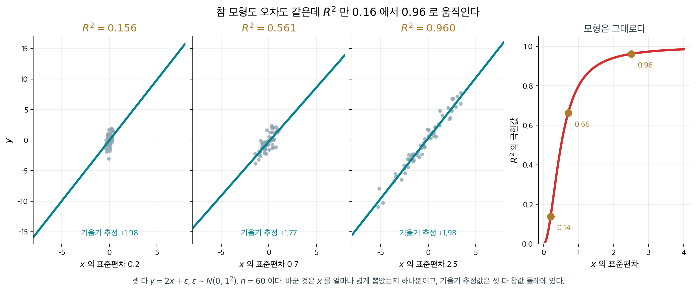
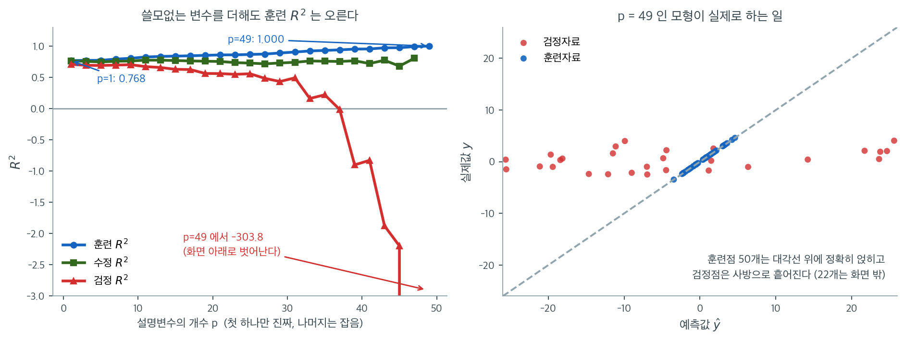

# 결정계수와 수정 결정계수

회귀모형을 적합하고 나면 자연스럽게 던지는 첫 질문은 이것이다. 이 모형은 반응변수의 변동을 실제로 얼마나 설명하는가? $Y$의 변동을 거의 다 포착하는 모형이 아주 조금만 설명하는 모형보다 쓸모 있다. 결정계수 $R^2$는 모형의 잔차 변동을 자료의 전체 변동과 비교하여 이 질문에 하나의 수치로 답한다.

---

## 1. 변동의 분해

회귀모형이 자료에 얼마나 잘 맞는지 재기 위해 반응변수 $Y$의 전체 변동을 두 성분으로 분해한다.

**총제곱합(SST)**은 $Y$가 평균 주위에서 갖는 전체 변동을 잰다.

$$
\text{SST} = \sum_{i=1}^{n} (y_i - \bar{y})^2
$$

**회귀제곱합(SSR)**은 모형이 설명하는 변동을 잰다.

$$
\text{SSR} = \sum_{i=1}^{n} (\hat{y}_i - \bar{y})^2
$$

**잔차제곱합(SSE)**은 설명되지 않고 남은 변동을 잰다.

$$
\text{SSE} = \sum_{i=1}^{n} (y_i - \hat{y}_i)^2
$$

모형에 절편이 포함되어 있으면 이 세 양은 다음의 기본 항등식을 만족한다.

$$
\text{SST} = \text{SSR} + \text{SSE}
$$

??? note "이 분해에 절편이 필요한 이유"
    항등식 $\text{SST} = \text{SSR} + \text{SSE}$는 교차항 $\sum (y_i - \hat{y}_i)(\hat{y}_i - \bar{y})$이 0이 되는 데 의존한다. 이는 정규방정식에서 따라 나오는데, 모형에 절편이 있으면 $\sum e_i = 0$과 $\sum e_i \hat{y}_i = 0$이 보장된다. 절편이 없으면 이 직교성 조건이 깨질 수 있고 분해도 더 이상 성립하지 않는다.

---

## 2. 결정계수

### 정의 1. 결정계수 { .dfn }

**결정계수** $R^2$는 회귀모형이 설명하는 $Y$의 전체 변동의 비율이다.

$$
R^2 = \frac{\text{SSR}}{\text{SST}} = 1 - \frac{\text{SSE}}{\text{SST}}
$$

$\text{SSR} = \text{SST} - \text{SSE}$이고 모든 제곱합이 음이 아니므로, 절편이 있는 모형에서 $R^2$는 0과 1 사이의 값을 갖는다.

- $R^2 = 0$: 모형이 변동을 전혀 설명하지 못한다(모든 관측값의 적합값이 $\bar{y}$와 같다).
- $R^2 = 1$: 모형이 변동을 전부 설명한다(모든 관측값이 적합선 위에 정확히 놓인다).

### 상관과의 관계

설명변수가 하나인 단순선형회귀에서 $R^2$는 $X$와 $Y$의 Pearson 상관계수의 제곱과 같다.

$$
R^2 = r_{XY}^2
$$

다중회귀에서 $R^2$는 관측값 $y_i$와 적합값 $\hat{y}_i$의 상관의 제곱과 같다.

$$
R^2 = r_{y, \hat{y}}^2
$$

단순선형회귀에서 $\text{SSR}$는 상관계수로 표현할 수 있다.

$$
\begin{array}{lll}
\text{SSR} &=& \displaystyle \sum_{i}\left(\hat{y}_{i} - \bar{y}\right)^{2} \\[10pt]
&=& \displaystyle \beta^2 \sum_{i}\left(x_i - \bar{x}\right)^{2} \\[10pt]
&\approx& \displaystyle n\sigma_x^2\beta^2 \\[10pt]
&\approx& \displaystyle n\sigma_x^2\left(\rho\frac{\sigma_y}{\sigma_x}\right)^2 \\[10pt]
&=& \displaystyle n\sigma_y^2\rho^2
\end{array}
$$

따라서

$$
R^2 = \frac{\text{SSR}}{\text{SST}} \approx \frac{n\sigma_y^2 \rho^2}{n\sigma_y^2} = \rho^2
$$

!!! note "사실은 정확한 등식이다"
    위 유도에서 $\approx$가 등장하는 것은 표본분산을 $n$으로 나누느냐 $n-1$로 나누느냐를 얼버무렸기 때문이다. 두 곳에서 같은 규약을 쓰면 인자가 상쇄되어 단순선형회귀에서는 $R^2 = \rho^2$이 **정확히** 성립한다. 첫 줄의 $\hat{y}_i - \bar{y} = \hat{\beta}(x_i - \bar{x})$도 근사가 아니라 정확한 등식이다(회귀직선이 평균점 $(\bar{x}, \bar{y})$를 지나기 때문이다).

단순선형회귀에서 $R^2$는 $x$와 $y$의 상관계수의 제곱이다.

!!! tip "참고"

    - [R-squared or coefficient of determination (Khan Academy)](https://www.khanacademy.org/math/ap-statistics/bivariate-data-ap/assessing-fit-least-squares-regression/v/r-squared-or-coefficient-of-determination)
    - [R-squared intuition (Khan Academy)](https://www.khanacademy.org/math/ap-statistics/bivariate-data-ap/assessing-fit-least-squares-regression/a/r-squared-intuition)

---

## 3. 결정계수의 한계

$R^2$는 널리 쓰이지만 모형 비교에는 결정적인 결함이 있다. **설명변수를 추가하면 결코 줄어들지 않는다.** 그 설명변수가 $Y$와 아무 관계가 없어도 그렇다.

이유를 보자. 모형 2가 모형 1의 모든 설명변수에 변수 하나를 더한 내포된 두 모형을 생각하자. 최소제곱은 SSE를 최소화하므로 모형 2의 SSE는 모형 1의 SSE보다 크지 않다(새 계수를 언제나 0으로 둘 수 있다). SST는 변하지 않으므로 모형 2의 $R^2$는 모형 1보다 작지 않다.

곧 설명변수가 $p$개인 모형은 그보다 적은 모형보다 $R^2$가 항상 크거나 같으며, 추가된 설명변수가 쓸모 있든 없든 마찬가지이다. 극단적으로 모수가 $n$개(관측값마다 하나)인 모형은 자료를 완벽하게 보간하여 $R^2 = 1$을 달성하지만 예측 가치는 전혀 없다.

---

**그림으로 보는 통계학 1.** 같은 모형인데 $0.16$ 이 되기도 하고 $0.96$ 이 되기도 한다

§3 이 짚은 결함은 「변수를 더하면 줄지 않는다」였다. 그보다 덜 알려졌지만 더 자주 사람을
속이는 결함이 하나 더 있다 — **$R^2$ 은 모형의 좋음이 아니라 자료를 모은 방식을 잰다.**

단순회귀에서 $R^2$ 이 수렴하는 값을 적어 보면 숨을 곳이 없다.

$$
R^2 \;\longrightarrow\; \frac{\beta^2\operatorname{Var}(x)}{\beta^2\operatorname{Var}(x) + \sigma^2}
$$

분자에 $\operatorname{Var}(x)$ 가 있다. 모형이 정한 양이 아니라 **설명변수를 어디서 얼마나
넓게 뽑았는지**, 곧 자료를 모은 사람이 정한 양이다.

<figure markdown>
  { width=1000 }
  <figcaption markdown>셋 다 $y = 2x + \varepsilon$, $\varepsilon \sim N(0, 1^2)$, $n = 60$ 이다. 바꾼 것은 $x$ 의 폭 하나인데 $R^2$ 이 여섯 배 넘게 움직인다. **기울기 추정값은 $+1.98$, $+1.77$, $+1.98$ 로 셋 다 참값 $2$ 둘레에 있다.** 자료에서 직접 그렸다.</figcaption>
</figure>

읽을 것이 셋이다.

**하나. $R^2$ 이 작다고 효과가 작은 것이 아니다.** 왼쪽 칸의 $R^2$ 은 $0.156$ 인데 기울기는
$+1.98$ 로 오른쪽 칸과 같다. 「$x$ 가 하나 늘면 $y$ 가 얼마나 변하는가」라는 물음의 답은
세 칸이 똑같다. $R^2$ 이 답하는 것은 다른 물음 — 「눈앞의 $y$ 들이 흩어진 까닭 가운데
$x$ 가 설명하는 몫이 얼마인가」 — 이고, 그 몫은 $x$ 를 얼마나 흔들어 놓았느냐에 달렸다.

**둘. 분야를 건너 $R^2$ 을 견주는 일은 뜻이 없다.** 물리 실험에서 $0.999$ 가 예사이고
사회과학에서 $0.1$ 이 실리는 것은 물리학자의 모형이 열 배 나아서가 아니다. 실험실에서는
$x$ 를 **일부러 넓게 흔들** 수 있고 $\sigma$ 를 작게 누를 수 있지만, 사람을 관찰하는 쪽은
주어진 폭을 받아들여야 한다.

**셋. 표본을 고르면 $R^2$ 이 깎인다.** 입학한 학생만 놓고 시험점수와 학점의 관계를 보면
$R^2$ 이 낮게 나오는데, 모형이 나빠서가 아니라 **이미 점수로 걸러서 $x$ 의 폭이 좁아졌기
때문**이다. 분모의 $\sigma^2$ 은 그대로인데 분자만 줄었다.

이름에도 사연이 조금 있다. 「결정계수」라는 말은 $1921$ 년에 **수얼 라이트**가 경로분석을
세우면서 쓴 것으로 알려져 있다. 그는 한 변수의 변동 가운데 다른 변수가 **「결정한」**
몫을 재려 했고, 그래서 그 이름이 붙었다. 그 뜻으로 읽으면 위의 셋이 당연해진다 — 결정된
몫을 재려면 **결정될 것이 얼마나 흔들렸는지**부터 정해져야 한다.

_확인한 곳 — $R^2 \to \beta^2\operatorname{Var}(x)/(\beta^2\operatorname{Var}(x)+\sigma^2)$ 는 단순회귀에서 바로 나오는 것이고, 범위를 좁히면 상관이 깎이는 「범위 제한」도 표준적인 사실이다 · 「coefficient of determination」이라는 용어가 수얼 라이트의 $1921$ 년 「Correlation and Causation」에서 왔다는 것은 널리 인용되는 바다 · 그림의 수치는 $n=60$ 으로 이 쪽이 직접 쟀다_

## 4. 수정 결정계수

### 정의 2. 수정 결정계수 { .dfn }

설명변수 추가에 따라 $R^2$가 자동으로 부풀려지는 것을 바로잡기 위해 **수정 결정계수**를 쓴다. 모수의 개수를 반영하여 모형의 복잡도에 벌점을 준다.

$$
R^2_{\text{adj}} = 1 - \frac{\text{SSE} / (n - p - 1)}{\text{SST} / (n - 1)}
$$

여기서 $n$은 관측값의 개수이고 $p$는 (절편을 제외한) 설명변수의 개수이다.

비 $\text{SSE} / (n - p - 1)$은 오차분산 $\sigma^2$의 불편추정값이고 $\text{SST} / (n - 1)$은 $Y$의 표본분산이다. 따라서 수정 $R^2$는 제곱합 자체가 아니라 분산 추정값들을 비교한다.

### 결정계수와의 관계

수정 $R^2$는 $R^2$로 직접 표현할 수 있다.

$$
R^2_{\text{adj}} = 1 - (1 - R^2) \frac{n - 1}{n - p - 1}
$$

$p \geq 1$이면 언제나 $\dfrac{n - 1}{n - p - 1} > 1$이므로 $R^2_{\text{adj}} \leq R^2$이다. $n$에 비해 $p$가 커질수록 $R^2$와 $R^2_{\text{adj}}$의 격차가 벌어진다.

### 주요 성질

- 쓸모없는 설명변수를 넣으면 **줄어들 수 있다**. $p$가 커지는 벌점이 SSE의 작은 감소를 웃돌 수 있기 때문이다.
- 모형이 절편만 있는 모형보다도 나쁘게 적합하면(곧 $\text{SSE}/(n - p - 1)$이 $\text{SST}/(n - 1)$을 넘으면) **음수가 될 수 있다**.
- $p = 0$(절편만 있는 모형)이면 벌점 인자가 $\frac{n-1}{n-1} = 1$이 되어 **$R^2$와 같아진다**.

앞 절의 주장을 실험으로 확인해 보자. 훈련자료 $n = 50$개를 $y = 1 + 2x + \varepsilon$($\varepsilon \sim N(0,1)$)로 만들고, 같은 규칙으로 검정자료 50개를 따로 준비했다. 그다음 $y$와 아무 관계도 없는 **순수한 잡음 변수**를 하나씩 모형에 집어넣으며 세 가지 수를 잰다. 왼쪽 그림의 파란 선이 훈련 $R^2$, 초록 선이 수정 $R^2$, 붉은 선이 검정자료에서 계산한 $R^2$다.

파란 선은 한 번도 내려가지 않는다. 진짜 설명변수 하나뿐일 때 $0.768$이던 것이 잡음 40개를 더한 $p = 41$에서 $0.954$가 되고, $p = 49 = n - 1$에 이르면 정확히 $1.000$이 된다. 모수 개수가 관측 개수와 같아져 자료를 완전히 보간한 것이다. 오른쪽 그림이 그 $p = 49$ 모형의 정체다. 훈련점 50개는 대각선 위에 한 치의 오차도 없이 얹혀 있지만, 검정점은 사방으로 흩어져 절반 가까이(50개 중 22개) 화면 밖으로 날아간다. 훈련 $R^2 = 1.000$짜리 모형의 검정 $R^2$는 $-303.8$이다. 검정자료의 평균값을 그냥 찍는 것보다 300배 나쁘다.

초록 선과 붉은 선이 이 부풀림을 잡아 준다. 수정 $R^2$는 $p = 1$에서 $0.763$으로 훈련값과 거의 같다가 잡음이 쌓일수록 벌어져 $p = 41$에서 $0.721$까지 내려간다. 자유도 벌점 $\frac{n-1}{n-p-1}$이 $p$가 커질수록 가팔라지기 때문이다. 검정 $R^2$는 더 정직해서 $0.708$에서 출발해 $p \approx 37$ 부근에서 0을 뚫고 내려간다. **훈련 $R^2$만 보면 모형이 계속 좋아지는 것처럼 보이지만, 같은 순간에 실제 예측 성능은 무너지고 있었다.** 그래서 $R^2$는 자료를 얼마나 잘 따라 그렸는지를 말할 뿐 모형이 얼마나 쓸모 있는지를 말하지 않으며, 설명변수 개수가 다른 모형을 $R^2$로 줄 세우는 일은 언제나 틀린다.

---

## 5. 실무에서 결정계수 해석하기

"좋은" $R^2$가 무엇인지에 대한 보편적 기준은 없다. 받아들일 만한 범위는 분야와 자료의 성격에 크게 의존한다.

| 맥락 | 전형적인 $R^2$ 범위 |
|---|---|
| 물리과학(통제된 실험) | 0.90 – 0.99 |
| 공학 모형 | 0.70 – 0.95 |
| 사회과학 | 0.30 – 0.70 |
| 금융 수익률(일간) | 0.01 – 0.10 |

!!! warning "결정계수는 모형 가정을 검증해 주지 않는다"
    $R^2$가 크다고 모형이 올바르게 설정되었다는 뜻은 아니다. 선형성, 독립성, 등분산성 가정을 위배하면서도 큰 $R^2$를 얻을 수 있다. 모형의 적절성을 확인하려면 항상 $R^2$에 잔차 진단을 곁들여야 한다.

---

## 6. 수치 보기

관측값 $n = 5$개인 자료를 생각하자.

| $i$ | $x_i$ | $y_i$ |
|---|---|---|
| 1 | 1 | 2 |
| 2 | 2 | 4 |
| 3 | 3 | 5 |
| 4 | 4 | 8 |
| 5 | 5 | 11 |

$\bar{x} = 3$, $\bar{y} = 6$이고 $S_{xx} = 10$, $S_{xy} = 22$이므로 OLS 적합선은

$$
\hat{y} = -0.6 + 2.2x
$$

이 적합선으로 각 항을 계산하면

| $i$ | $y_i$ | $\hat{y}_i$ | $y_i - \bar{y}$ | $\hat{y}_i - \bar{y}$ | $y_i - \hat{y}_i$ |
|-----|--------|--------------|------------------|------------------------|--------------------|
| 1   | 2      | 1.6          | $-4$             | $-4.4$                 | 0.4                |
| 2   | 4      | 3.8          | $-2$             | $-2.2$                 | 0.2                |
| 3   | 5      | 6.0          | $-1$             | 0.0                    | $-1.0$             |
| 4   | 8      | 8.2          | 2                | 2.2                    | $-0.2$             |
| 5   | 11     | 10.4         | 5                | 4.4                    | 0.6                |

제곱합을 계산하면

$$
\text{SST} = 16 + 4 + 1 + 4 + 25 = 50
$$

$$
\text{SSR} = 19.36 + 4.84 + 0 + 4.84 + 19.36 = 48.40
$$

$$
\text{SSE} = 0.16 + 0.04 + 1.00 + 0.04 + 0.36 = 1.60
$$

분해가 성립함을 확인할 수 있다: $48.40 + 1.60 = 50 = \text{SST}$.

$$
R^2 = 1 - \frac{1.60}{50} = \frac{48.40}{50} = 0.968
$$

단순선형회귀이므로 $p = 1$이고

$$
R^2_{\text{adj}} = 1 - (1 - 0.968)\frac{5 - 1}{5 - 1 - 1} = 1 - 0.032 \times \frac{4}{3} = 1 - 0.0427 = 0.957
$$

모형은 $Y$의 전체 변동 가운데 약 96.8%를 설명하며, 수정값 95.7%는 설명변수 하나에 대한 벌점을 반영한다.

---

## 연습문제

**연습문제 1.** 
어떤 모형의 SSE $= 200$, SST $= 1000$이다. $R^2$를 계산하라. 쓸모없는 설명변수(무작위 잡음)를 넣으면 $R^2$는 어떻게 되며, 왜 수정 $R^2$가 필요한가?

??? success "풀이"
    $$
    R^2 = 1 - \frac{\text{SSE}}{\text{SST}} = 1 - \frac{200}{1000} = 0.80
    $$

    어떤 설명변수를 넣든(무작위 잡음이라도) OLS가 더 넓은 모수공간에서 SSE를 최소화하므로 SSE는 줄거나 그대로일 뿐 늘지 않는다. 따라서 그 설명변수의 쓸모와 무관하게 $R^2$는 커지거나 같다. 곧 $R^2$는 언제나 더 복잡한 모형을 선호한다.

    **수정 $R^2$**는 모수 추가에 벌점을 주어 이를 바로잡는다.

    $$
    R^2_{\text{adj}} = 1 - \frac{\text{SSE}/(n-p-1)}{\text{SST}/(n-1)} = 1 - \frac{n-1}{n-p-1}(1 - R^2)
    $$

    쓸모없는 설명변수를 넣으면 SSE는 의미 있게 줄지 않으면서 $p$만 커지므로 벌점 $\frac{n-1}{n-p-1}$이 커져 $R^2_{\text{adj}}$가 줄어든다. 그래서 수정 $R^2$가 모형 비교에 더 나은 기준이 된다.

**연습문제 2.** 
$R^2$가 음수가 될 수 있는가? 어떤 상황에서 그런가?

??? success "풀이"
    절편이 있는 모형을 훈련자료에 적합했다면 구성상 $R^2 \geq 0$이다(절편이 있는 OLS는 SSE $\leq$ SST를 보장한다). 그러나 다음 두 상황에서는 $R^2$가 음수가 될 수 있다.

    1. **검정자료:** 훈련자료로 적합한 모형을 검정자료에 적용하면 예측이 단순히 검정자료의 평균을 예측하는 것보다 나쁠 수 있다. 그러면 (검정자료의 평균으로 계산한) SST보다 SSE가 커져 $R^2 < 0$이 된다.

    2. **절편 없는 모형:** 절편 없이 적합하면 예측이 $\bar{y}$를 지나지 않으므로 SSE가 SST를 넘을 수 있다.

    검정자료에서 $R^2$가 음수라는 것은 모형의 예측이 상수 기준선(평균 예측)보다도 나쁘다는 뜻이다. 심각한 과적합이나 모형 오설정의 신호이다.

**연습문제 3.** 
단순선형회귀에서 $R^2$와 $y$·$\hat{y}$ 사이의 Pearson 상관 $r$의 관계를 유도하라.

??? success "풀이"
    설명변수가 하나인 단순선형회귀에서 $y$와 $\hat{y}$의 Pearson 상관은 $|r_{xy}|$($x$와 $y$의 상관의 절댓값)와 같다. 따라서

    $$
    R^2 = r_{xy}^2
    $$

    더 일반적으로 다중회귀에서는 $R^2 = r_{y\hat{y}}^2$, 곧 관측값과 적합값 상관의 제곱이다. 다음이 성립하기 때문이다.

    $$
    R^2 = 1 - \frac{\text{SSE}}{\text{SST}} = \frac{\text{SSR}}{\text{SST}} = \frac{\lVert\hat{\mathbf{y}} - \bar{y}\mathbf{1}\rVert^2}{\lVert\mathbf{y} - \bar{y}\mathbf{1}\rVert^2} = r_{y\hat{y}}^2
    $$

    이 관계가 해석을 제공한다. $R^2$는 모형이 선형으로 설명하는 $y$의 분산 비율이다. $\square$

**연습문제 4.** 
어떤 모형이 훈련자료에서 $R^2 = 0.95$, 검정자료에서 $R^2 = 0.60$이다. 문제를 진단하고 대책을 제안하라.

??? success "풀이"
    훈련 $R^2$(0.95)와 검정 $R^2$(0.60)의 큰 격차는 **과적합**의 전형적인 신호이다. 모형이 훈련자료를 잡음까지 포함해 아주 잘 맞추었지만 일반화에 실패한 것이다.

    대책:

    1. **정칙화:** 릿지나 LASSO 회귀로 계수를 축소하여 분산을 줄인다.
    2. **변수 선택:** 신호가 아니라 잡음을 보태는 설명변수를 뺀다(교차검증이나 정보기준을 쓴다).
    3. **자료 확충:** $n$을 늘리면 모형 복잡도 대비 정보가 늘어 과적합이 줄어든다.
    4. **더 단순한 모형:** 설명변수의 개수나 다항 차수를 줄인다.
    5. **교차검증:** 언제나 성능을 과대평가하는 훈련 $R^2$에 기대지 말고 모형 개발 과정에서 교차검증을 쓴다.

**연습문제 5.** 
6절 수치 보기의 자료를 쓴다. 여기서 $S_{xx} = 10$, $S_{xy} = 22$, $S_{yy} = \text{SST} = 50$이다.

(a) 단순선형회귀에서 $\text{SSR} = S_{xy}^2 / S_{xx}$임을 보이고, 그 값이 6절 표에서 더해 얻은 $48.40$과 맞는지 확인하라.

(b) (a)를 써서 $R^2 = r_{xy}^2$를 유도하라. 그리고 이 자료의 $r_{xy}$를 소수 넷째 자리까지 구하라. 제곱근의 부호는 무엇으로 정해지는가?

??? success "풀이"
    **(a)** 적합선은 $(\bar{x}, \bar{y})$를 지나므로 $\hat{y}_i - \bar{y} = \hat{\beta}_1 (x_i - \bar{x})$이다. 실제로 $\hat{\beta}_1 = S_{xy}/S_{xx} = 22/10 = 2.2$이고, 6절 표의 네 번째 열은 $x_i - \bar{x} = -2, -1, 0, 1, 2$에 $2.2$를 곱한 $-4.4, -2.2, 0, 2.2, 4.4$와 정확히 같다.

    따라서

    $$
    \text{SSR} = \sum_{i=1}^{n} (\hat{y}_i - \bar{y})^2 = \hat{\beta}_1^2 \sum_{i=1}^{n} (x_i - \bar{x})^2 = \hat{\beta}_1^2 S_{xx} = \frac{S_{xy}^2}{S_{xx}}
    $$

    수치로는 $\text{SSR} = 22^2 / 10 = 484/10 = 48.40$이고, 표에서 더해 얻은 $19.36 + 4.84 + 0 + 4.84 + 19.36 = 48.40$과 같다.

    **(b)** 양변을 $\text{SST} = S_{yy}$로 나누면

    $$
    R^2 = \frac{\text{SSR}}{\text{SST}} = \frac{S_{xy}^2}{S_{xx} S_{yy}} = \left( \frac{S_{xy}}{\sqrt{S_{xx} S_{yy}}} \right)^2 = r_{xy}^2
    $$

    이 자료에서는 $R^2 = 484/500 = 0.968$이고

    $$
    r_{xy} = \frac{S_{xy}}{\sqrt{S_{xx} S_{yy}}} = \frac{22}{\sqrt{10 \times 50}} = \frac{22}{22.3607} = 0.9839
    $$

    부호는 $S_{xy}$의 부호, 곧 기울기 $\hat{\beta}_1 = S_{xy}/S_{xx}$의 부호로 정해진다. 여기서는 $S_{xy} = 22 > 0$이므로 양수다.

    제곱을 하는 순간 방향이 사라진다는 뜻이다. $R^2 = 0.968$은 $r_{xy} = +0.9839$인 자료와 $r_{xy} = -0.9839$인 자료를 구별하지 못한다.

**연습문제 6.** 
6절의 자료($n = 5$, $\text{SST} = 50$)에 설명변수를 하나 더 넣어 $p = 2$인 모형을 적합한다고 하자.

(a) $p = 2$일 때 $R^2_{\text{adj}} < 0$이 되는 SSE의 범위를 구하고, 그에 대응하는 $R^2$의 범위를 말하라.

(b) 6절의 단순회귀 모형($\text{SSE} = 1.60$)에 설명변수 하나를 **더해서** $p = 2$로 간 경우에 (a)의 일이 일어날 수 있는가? $R^2_{\text{adj}}$가 가질 수 있는 값의 범위를 구해서 답하라.

??? success "풀이"
    **(a)** $n = 5$, $p = 2$이므로 $n - p - 1 = 2$, $n - 1 = 4$이고

    $$
    R^2_{\text{adj}} = 1 - \frac{\text{SSE}/2}{50/4} = 1 - \frac{\text{SSE}/2}{12.5} = 1 - \frac{\text{SSE}}{25}
    $$

    이것이 음수가 되는 것은 $\text{SSE} > 25$일 때다. 이때 $R^2 = 1 - \text{SSE}/50 < 1 - 25/50 = 0.5$이므로 $R^2 < 0.5$에 해당한다. 곧 $n = 5$, $p = 2$에서는 $R^2$가 $0.5$에 못 미치면 수정값이 음수로 떨어진다.

    **(b)** 일어날 수 없다. 두 모형이 내포되어 있으므로(새 계수를 0으로 두면 원래 모형이 된다) 최소제곱은 $\text{SSE}_2 \leq \text{SSE}_1 = 1.60$을 보장한다. 따라서 $0 \leq \text{SSE}_2 \leq 1.60$이고

    $$
    R^2_{\text{adj}} = 1 - \frac{\text{SSE}_2}{25} \in \left[ 1 - \frac{1.60}{25},\ 1 \right] = [0.936,\ 1]
    $$

    최악의 경우라도 $0.936$이다. 새 설명변수가 SSE를 전혀 줄이지 못하면 수정값은 $0.957$에서 $0.936$으로 $0.021$만큼만 내려간다.

    (a)의 범위는 비어 있지 않지만 거기에 닿으려면 절편만 있는 모형보다도 나쁘게 적합해야 한다. 이미 $R^2 = 0.968$인 모형에 변수를 더하는 방식으로는 결코 그렇게 될 수 없고, 연습문제 2에서 본 다른 경로(검정자료, 절편 없는 모형)로만 갈 수 있다.

**연습문제 7.** 
설명변수가 $p$개인 모형(잔차제곱합 $\text{SSE}_1$)에 변수 하나를 더해 $p+1$개인 모형(잔차제곱합 $\text{SSE}_2$)으로 간다.

(a) $R^2_{\text{adj}}$가 **커질** 필요충분조건을 비 $\text{SSE}_2 / \text{SSE}_1$에 대한 부등식으로 적어라.

(b) 그림의 실험($n = 50$)에서 $p = 1 \to 2$일 때와 $p = 41 \to 42$일 때 SSE가 각각 최소 몇 퍼센트 줄어야 하는가?

(c) (a)의 문턱을 $\text{SSE}_1$과 자유도로 다시 쓰면 어떤 양이 되는가? 두 수치가 그렇게 차이 나는 까닭을 그 양으로 설명하라.

??? success "풀이"
    **(a)** 두 모형의 SST와 $n$이 같으므로 분모 $\text{SST}/(n-1)$은 공통이다. 따라서

    $$
    R^2_{\text{adj},2} > R^2_{\text{adj},1} \iff \frac{\text{SSE}_2}{n - p - 2} < \frac{\text{SSE}_1}{n - p - 1}
    $$

    이고, 정리하면

    $$
    \frac{\text{SSE}_2}{\text{SSE}_1} < \frac{n - p - 2}{n - p - 1}
    $$

    **(b)** $n = 50$을 넣는다.

    $p = 1 \to 2$: 문턱은 $\dfrac{50 - 3}{50 - 2} = \dfrac{47}{48} = 0.9792$이므로 SSE가 $1/48 = 2.08\%$보다 많이 줄어야 한다.

    $p = 41 \to 42$: 문턱은 $\dfrac{50 - 43}{50 - 42} = \dfrac{7}{8} = 0.875$이므로 SSE가 $1/8 = 12.5\%$보다 많이 줄어야 한다.

    **(c)** 부등식을 감소량으로 옮겨 적으면

    $$
    \text{SSE}_1 - \text{SSE}_2 > \text{SSE}_1 \left( 1 - \frac{n-p-2}{n-p-1} \right) = \frac{\text{SSE}_1}{n - p - 1} = \hat{\sigma}_1^2
    $$

    곧 문턱은 **지금 모형의 잔차평균제곱 $\hat{\sigma}_1^2$**이다. 새 변수가 오차분산 하나 몫보다 많은 SSE를 걷어 내야 수정값이 오른다.

    상대적인 크기로 보면 그 문턱은 $\text{SSE}_1$의 $1/(n-p-1)$이다. $p$가 커질수록 남은 자유도 $n-p-1$이 줄어들어 $1/48$에서 $1/8$로 여섯 배 가팔라진다. 자유도가 바닥나는 쪽에서는 아주 큰 설명력이 아니면 수정값이 오르지 못한다.

**연습문제 8.** 
그림의 실험은 $n = 50$이고, $p = 41$에서 수정 $R^2$가 $0.721$이었다.

(a) 이 값만으로 훈련 $R^2$를 되찾아 본문이 적은 $0.954$와 맞는지 확인하라.

(b) $p = 48$이면 $R^2_{\text{adj}} > 0$이기 위해 $R^2$가 얼마를 넘어야 하는가?

(c) 본문은 $p = 49$에서 훈련 $R^2 = 1.000$이라고 했다. 그 모형의 $R^2_{\text{adj}}$는 얼마인가?

??? success "풀이"
    **(a)** $R^2_{\text{adj}} = 1 - (1 - R^2)\dfrac{n-1}{n-p-1}$을 $R^2$에 대해 풀면

    $$
    1 - R^2 = (1 - R^2_{\text{adj}}) \frac{n - p - 1}{n - 1} = (1 - 0.721) \times \frac{50 - 42}{49} = 0.279 \times \frac{8}{49} = 0.04555
    $$

    따라서 $R^2 = 0.9544$이고, 본문의 $0.954$와 맞는다. 반대로 $R^2 = 0.954$에서 출발하면 $1 - 0.046 \times 49/8 = 1 - 0.2818 = 0.718$로 역시 $0.721$에 가깝다.

    **(b)** $p = 48$이면 $n - p - 1 = 1$이므로 벌점 인자는 $49/1 = 49$이고

    $$
    R^2_{\text{adj}} = 1 - 49(1 - R^2)
    $$

    이것이 양수이려면 $1 - R^2 < 1/49$, 곧

    $$
    R^2 > 1 - \frac{1}{49} = \frac{48}{49} = 0.9796
    $$

    이어야 한다. 설명하지 못한 변동이 $2\%$만 남아도 수정값은 음수로 떨어진다.

    **(c)** $p = 49$이면 $n - p - 1 = 50 - 50 = 0$이므로 $\text{SSE}/(n-p-1)$의 분모가 0이다. 자료를 완전히 보간해 $\text{SSE} = 0$이기도 하므로 이 비는 $0/0$ 꼴이고, $R^2_{\text{adj}}$는 **정의되지 않는다**.

    벌점이 $-\infty$로 가는 것이 아니라 아예 계산되지 않는다는 점이 중요하다. 모수가 관측값만큼 많아지면 오차분산을 추정할 자유도가 하나도 남지 않고, 그 순간 수정 $R^2$는 쓸 수 있는 도구가 아니다. 그 모형의 실제 성능($-303.8$)은 훈련자료 안에서 재는 어떤 수로도 드러나지 않으며 검정자료가 있어야 보인다.

**연습문제 9.** 
1절의 주석은 절편이 없으면 분해 $\text{SST} = \text{SSR} + \text{SSE}$가 깨질 수 있다고 했다. 반례를 하나 완성하라.

자료는 $(x_i, y_i) = (1, 6), (2, 3), (3, 3)$이고 모형은 절편 없는 $\hat{y} = bx$다.

(a) 최소제곱 추정값 $b$를 구하라.

(b) SST, SSR, SSE를 계산하고 $\text{SST} \neq \text{SSR} + \text{SSE}$임을 확인하라.

(c) $R^2$의 두 표현 $\text{SSR}/\text{SST}$와 $1 - \text{SSE}/\text{SST}$를 각각 계산하라.

(d) 교차항을 계산해서 $\sum e_i = 0$과 $\sum e_i \hat{y}_i = 0$ 가운데 어느 쪽이 깨졌는지 밝혀라.

??? success "풀이"
    **(a)** $\sum (y_i - bx_i)^2$을 $b$로 미분해 0으로 두면 $b = \dfrac{\sum x_i y_i}{\sum x_i^2}$이다.

    $$
    b = \frac{1 \cdot 6 + 2 \cdot 3 + 3 \cdot 3}{1^2 + 2^2 + 3^2} = \frac{6 + 6 + 9}{14} = \frac{21}{14} = 1.5
    $$

    적합값은 $\hat{y} = 1.5, 3.0, 4.5$이고 $\bar{y} = (6+3+3)/3 = 4$다.

    | $i$ | $y_i$ | $\hat{y}_i$ | $y_i - \bar{y}$ | $\hat{y}_i - \bar{y}$ | $e_i = y_i - \hat{y}_i$ |
    |---|---|---|---|---|---|
    | 1 | 6 | 1.5 | 2 | $-2.5$ | 4.5 |
    | 2 | 3 | 3.0 | $-1$ | $-1.0$ | 0.0 |
    | 3 | 3 | 4.5 | $-1$ | 0.5 | $-1.5$ |

    **(b)** 각 열을 제곱해 더한다.

    $$
    \text{SST} = 4 + 1 + 1 = 6, \qquad \text{SSR} = 6.25 + 1.00 + 0.25 = 7.50, \qquad \text{SSE} = 20.25 + 0 + 2.25 = 22.50
    $$

    $\text{SSR} + \text{SSE} = 30 \neq 6 = \text{SST}$이다. 분해가 완전히 깨졌다.

    **(c)**

    $$
    \frac{\text{SSR}}{\text{SST}} = \frac{7.50}{6} = 1.25, \qquad 1 - \frac{\text{SSE}}{\text{SST}} = 1 - \frac{22.50}{6} = -2.75
    $$

    본문에서 같은 수였던 두 표현이 $1.25$와 $-2.75$로 갈라진다. 하나는 1을 넘고 하나는 음수이므로 둘 다 "설명된 비율"로 읽을 수 없다. 절편이 없는 적합에 $R^2$를 보고하는 일이 왜 무의미한지가 여기서 보인다.

    **(d)** 전개식에서 빠진 항은 교차항이다.

    $$
    \text{SST} - \text{SSR} - \text{SSE} = 2 \sum_{i} e_i (\hat{y}_i - \bar{y}) = 2 \left[ 4.5 \times (-2.5) + 0 \times (-1.0) + (-1.5) \times 0.5 \right] = 2(-12) = -24
    $$

    실제로 $6 - 7.5 - 22.5 = -24$로 맞는다. 이 교차항을 둘로 쪼개면

    $$
    \sum_i e_i (\hat{y}_i - \bar{y}) = \sum_i e_i \hat{y}_i - \bar{y} \sum_i e_i
    $$

    이고, 절편 없는 모형의 정규방정식 $\sum e_i x_i = 0$에서 $\sum e_i \hat{y}_i = b \sum e_i x_i = 0$은 그대로 성립한다. 확인하면 $4.5 \times 1.5 + 0 - 1.5 \times 4.5 = 0$이다. 깨진 쪽은 나머지다.

    $$
    \sum_i e_i = 4.5 + 0 - 1.5 = 3 \neq 0
    $$

    따라서 교차항은 $0 - 4 \times 3 = -12$가 된다. 절편이 보장해 주는 조건은 바로 $\sum e_i = 0$이며, 이것이 없으면 잔차가 $\bar{y}\mathbf{1}$ 방향과 직교하지 않아 분해가 무너진다. $\square$

**연습문제 10.** 
연습문제 7의 조건을 검정통계량으로 바꿔 읽어 본다. 변수 하나를 더할 때의 부분 $F$ 통계량은

$$
F = \frac{\text{SSE}_1 - \text{SSE}_2}{\text{SSE}_2 / (n - p - 2)}
$$

이다.

(a) 연습문제 7(a)의 조건이 $F > 1$과 동치임을 보여라.

(b) 그림의 실험에서 $p = 1 \to 2$인 단계를 보자. 유의수준 $5\%$ $F$ 검정의 기각값은 $F_{0.05; 1, 47} = 4.05$이고, 쓸모없는 잡음 변수가 $F > 1$을 넘을 확률은 $P(F_{1,47} > 1) = 0.322$다. 이 두 수로 (i) 초록 선이 파란 선처럼 단조증가하지 않고 서서히 내려가는 모양과 (ii) $p = 41$에서 수정 $R^2$가 아직 $0.721$인데도 검정 $R^2$는 이미 음수라는 사실을 설명하라.

??? success "풀이"
    **(a)** $d = n - p - 2$라 쓰면 모형 1의 잔차 자유도는 $d + 1$이다. 연습문제 7(a)의 조건은

    $$
    \frac{\text{SSE}_2}{d} < \frac{\text{SSE}_1}{d + 1}
    $$

    양변에 $d(d+1) > 0$을 곱하면 $(d+1)\text{SSE}_2 < d\,\text{SSE}_1$이고, 오른쪽을 $d(\text{SSE}_2 + (\text{SSE}_1 - \text{SSE}_2))$로 쪼개면

    $$
    (d+1)\text{SSE}_2 < d\,\text{SSE}_2 + d(\text{SSE}_1 - \text{SSE}_2) \iff \text{SSE}_2 < d(\text{SSE}_1 - \text{SSE}_2)
    $$

    양변을 $\text{SSE}_2 > 0$으로 나누면

    $$
    1 < \frac{d(\text{SSE}_1 - \text{SSE}_2)}{\text{SSE}_2} = \frac{\text{SSE}_1 - \text{SSE}_2}{\text{SSE}_2/d} = F
    $$

    곧 $R^2_{\text{adj}}$가 커지는 것과 $F > 1$이 동치다. 연습문제 7(c)의 "감소량이 잔차평균제곱을 넘어야 한다"를 통계량 하나로 적은 것이다. $\square$

    **(b)(i)** 수정 $R^2$의 문턱 $F > 1$은 $5\%$ 검정의 기각값 $4.05$보다 훨씬 낮다. 그래서 수정 $R^2$는 검정이라면 기각하지 못할 잡음 변수도 받아들인다. 받아들일 확률이 $0.322$이므로 잡음 변수 한 개를 넣을 때 세 번 가운데 한 번쯤은 초록 선이 올라가고 두 번쯤은 내려간다. 오르는 걸음과 내리는 걸음이 섞이되 내리는 쪽이 더 많으므로, 한 번도 내려가지 않는 파란 선과 달리 초록 선은 들쭉날쭉하면서 서서히 내려간다. $0.763$에서 $0.721$까지 $40$걸음에 겨우 $0.042$ 내려간 완만함도 이 때문이다.

    **(b)(ii)** 문턱이 $1$이라는 것은 벌점이 아주 약하다는 뜻이다. 쓸모없는 변수는 평균적으로 오차분산 하나 몫만큼 SSE를 줄이는데, 그것이 바로 손익분기점이어서 수정 $R^2$는 잡음에 대해 체계적인 거부 성향이 거의 없다.

    더 근본적으로 $R^2_{\text{adj}}$는 $\hat{\sigma}^2 = \text{SSE}/(n-p-1)$과 $Y$의 표본분산을 비교하는 **훈련자료 안의** 수다. 자유도는 세지만, 추정한 계수 $42$개가 새 관측값에서 만들어 내는 예측의 분산은 보지 않는다. 그래서 $p = 41$에서 $0.721$이라는 그럴듯한 값을 내놓는 동안 검정 $R^2$는 $p \approx 37$에서 이미 0을 뚫고 내려간다. 수정 $R^2$는 $R^2$보다 나은 자이지만 검정자료를 대신하지는 못한다.

---

## 정리하며

$R^2$ 는 **설명된 분산의 비율**이다.

$$
R^2=1-\frac{\text{SSR}}{\text{SST}}
$$

- **변동의 분해에서 나온다.** $\text{SST}=\text{SSE}+\text{SSR}$ 이며, 11장의 분산분석 분해와 같은 구조다.
- **설명변수를 더하면 반드시 오른다.** 쓸모없는 변수를 넣어도 내려가지 않으므로, **모형 비교의 기준으로 쓸 수 없다.** 조정된 $R^2$ 이 자유도 벌점을 넣어 이를 보완한다.
- **단순회귀에서는 $R^2=r^2$ 이다.** 12장의 상관계수와 직접 연결된다.
- **높다고 좋은 모형이 아니다.** 인과를 보장하지 않고, 가정 위반을 잡아내지도 못하며, 외삽의 안전을 말해 주지도 않는다. **$R^2=0.99$ 인 모형도 잔차에 뚜렷한 곡선 패턴이 있을 수 있다.**
- **분야마다 기대 수준이 다르다.** 물리 실험에서는 $0.99$ 가 예사이고 사회과학에서는 $0.3$ 도 높다.

다음 절 **[MAE·MSE·RMSE](mae_mse_rmse.md)**로 넘어간다.
