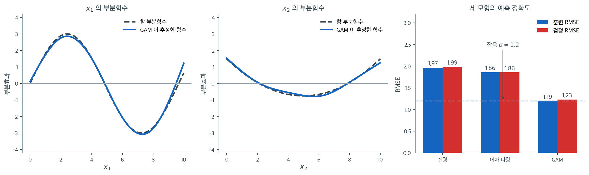
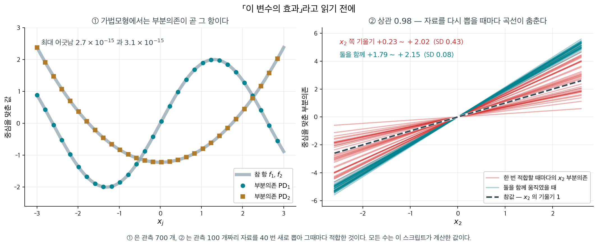

# GAM 주택 분석

## 개요

이 페이지는 King County 주택 자료를 이용해 집값 예측에 일반화가법모형(GAM)을 적용한다. 선형회귀, 다항회귀, GAM(statsmodels와 pyGAM 양쪽)을 비교하고, 부분의존 그림을 시각화하며, RMSE와 $R^2$로 모형 성능을 평가한다.

!!! note "자료에 대하여"
    `house_98105`는 King County 주택 매매 자료 가운데 우편번호 98105 지역만 걸러 낸 pandas `DataFrame`이다. 아래 코드는 이 변수가 이미 만들어져 있다고 가정한다.

---

## 1. 수학적 배경

일반화가법모형은 각 설명변수가 매끄러운 함수를 통해 비선형 효과를 갖도록 허용하여 선형회귀를 확장한다.

$$
y = \beta_0 + f_1(x_1) + f_2(x_2) + \cdots + f_p(x_p) + \varepsilon,
$$

여기서 각 $f_j$는 (보통 스플라인으로) 자료에서 추정한 매끄러운 함수이다. 각 설명변수가 반응변수에 독립적으로 기여하므로 "가법"이라 부른다.

### 평활 스플라인

각 $f_j$는 기저 전개, 흔히 B-스플라인으로 표현된다.

$$
f_j(x_j) = \sum_{m=1}^{M_j} \gamma_{jm}\, B_{jm}(x_j),
$$

여기서 $B_{jm}$은 기저함수이다. 매끄러움은 **평활 모수** $\lambda_j$로 조절되며 목적함수는 다음이 된다.

$$
\min_{\gamma} \sum_{i=1}^n \!\left(y_i - \beta_0 - \sum_{j=1}^p f_j(x_{ij})\right)^{\!2} + \sum_{j=1}^p \lambda_j \int [f_j''(t)]^2\, dt.
$$

벌점 $\lambda_j \int [f_j'']^2\,dt$가 $f_j$의 요동을 조절한다. $\lambda_j$가 클수록 더 매끄러운 곡선이 된다.

### 부분의존

$y$의 $x_j$에 대한 **부분의존**은 함수 $f_j(x_j)$이며, 다른 설명변수에 대해 평균을 낸 뒤 설명변수 $j$가 반응변수에 미치는 주변 효과를 보여준다.



GAM이 실제로 무엇을 되찾는지 보려면 정답을 아는 자료가 편하다. $y = 10 + f_1(x_1) + f_2(x_2) + \varepsilon$($\varepsilon \sim N(0, 1.2^2)$)로 관측값 $700$개를 만들었다. $f_1$은 오르내리는 파동이고 $f_2$는 U자다. 두 설명변수는 서로 독립이며, GAM에는 각각 자유도 $6$의 자연 스플라인을 주었다.

왼쪽 두 칸이 결과다. 파란 실선이 GAM이 추정한 부분함수, 검은 점선이 참 함수다. 거의 구별되지 않는다. 최대 오차가 $f_1$에서 $0.58$, $f_2$에서 $0.24$인데, 잡음의 표준편차가 $1.2$임을 생각하면 잡음보다 작은 차이다. 여기서 중요한 것은 **우리가 함수의 모양을 미리 알려 주지 않았다**는 점이다. "사인 곡선"이라고도, "이차식"이라고도 말하지 않았다. 스플라인 기저와 가법성 가정만 주었더니 모양이 자료에서 나왔다.

오른쪽이 그 유연성의 값어치다. 같은 자료에 선형 모형, 이차 다항 모형, GAM을 적합했다. 검정 RMSE가 각각 $1.99$, $1.86$, $1.23$이다. 선형 모형은 $f_1$의 오르내림을 전혀 잡지 못하고, 이차 다항은 $f_2$의 U자는 맞히지만 $f_1$의 파동은 여전히 놓친다. GAM만이 잡음의 하한 $1.2$에 닿는다. 그리고 훈련 RMSE와 검정 RMSE가 $1.19$ 대 $1.23$으로 거의 같다는 점도 함께 보아 두자. 유연한 모형인데도 과적합하지 않았는데, 이는 가법성이라는 제약이 남아 있기 때문이다.

바로 그 제약이 GAM의 해석 가능성을 만든다. 모형이 $p$차원 곡면 하나가 아니라 **$p$개의 일차원 곡선의 합**이므로, 설명변수마다 한 장씩 그림을 그려 "이 변수는 어떤 모양으로 작용하는가"를 따로 읽을 수 있다. 위 두 칸이 바로 그 부분의존 그림이다. 대가는 교호작용을 담지 못한다는 것인데, 필요하다면 이차원 매끄러운 항을 따로 넣어야 한다.

<div class="aibox" markdown>

**AI로 보는 통계학 1.** 「이 변수의 효과」라고 읽기 전에

바로 위의 **부분의존**은 가법모형의 항 $f_j(x_j)$ 였다. 가법성이 있으니 항을 그대로 꺼내 그리면 되고, 그래서 이 쪽은 「면적은 이런 모양으로 작용한다」를 한 장으로 읽을 수 있다.

오늘 부스팅·숲·신경망처럼 **가법성이 없는** 모형을 읽을 때 쓰는 그림도 이름이 같다. 다만 항을 꺼낼 수가 없으니 정의를 바꾸어 계산한다.

$$
\mathrm{PD}_j(v) \;=\; \frac1n \sum_{i=1}^{n} \hat f\bigl(v,\; \mathbf x_{i,-j}\bigr)
$$

곧 **모든 사람의 나머지 변수는 그대로 둔 채 그 변수만 $v$ 로 바꿔 예측하고 평균**한다. 가법모형이면 이 평균이 $f_j(v)$ 에 상수를 더한 것과 **정확히** 같아진다 — 나머지 항들이 $v$ 와 무관해 평균 속에서 상수가 되기 때문이다.

```python
import numpy as np

rng = np.random.default_rng(9)
X = rng.uniform(-3, 3, (700, 2))                 # 두 설명변수는 서로 독립이다
f1 = lambda v: 2.0 * np.sin(1.2 * v)
f2 = lambda v: 0.4 * v**2 - 1.2
fit = lambda Z: 10 + f1(Z[:, 0]) + f2(Z[:, 1])   # 적합된 가법모형

def pd(j, grid):                                 # 그 열만 v 로 바꿔 모든 행에 대해 평균
    return np.array([fit(np.where(np.arange(2) == j, v, X)).mean() for v in grid])

g = np.linspace(-3, 3, 120)
for j, f in ((0, f1), (1, f2)):
    c, t = pd(j, g), f(g)
    d = np.abs((c - c.mean()) - (t - t.mean())).max()
    print(f"PD_{j+1} 과 f_{j+1} 의 최대 차이 = {d:.1e}")
```

출력:

```
PD_1 과 f_1 의 최대 차이 = 2.7e-15
PD_2 과 f_2 의 최대 차이 = 3.1e-15
```

반올림 한계까지 같다. **그런데 이 일치는 가법성이 아니라 다른 것에 기대고 있다.** 위 자료에서 두 설명변수는 서로 **독립**이었다. 독립이 아니면 저 평균은 $(v,\ \mathbf x_{i,-j})$ 라는 짝을 만들어 모형에 넣는데, 그 짝이 **자료에 한 번도 나타난 적 없는 조합**일 수 있다. 모형을 배운 적 없는 자리에서 불러 세우는 것이다.



오른쪽 판이 그 대가다. 상관이 $0.98$ 인 두 변수에 $y = x_1 + x_2$ 가 참인 자료를 관측 $100$ 개씩 **$40$ 번 새로 뽑아** 그때마다 적합하고 $x_2$ 의 부분의존을 그렸다. 붉은 선 $40$ 개가 기울기 $+0.23$ 에서 $+2.02$ 까지 부채처럼 벌어진다(SD $0.43$ — 참값 $1$ 의 $43\%$). 같은 적합에서 **두 변수를 함께** 움직인 곡선(청록)은 $+1.79$ 에서 $+2.15$ 로 거의 한 줄이다(SD $0.08$ — 참값 $2$ 의 $4\%$). 두 흩어짐의 비가 $5.31$ 이고, 13.6절 [다중공선성](../diagnostics/multicollinearity.md)의 식이 말하는 $1/\sqrt{1-\rho^2} = 5.03$ 과 맞는다.

**예측은 안정적인데 「그 변수 하나의 효과」는 자료가 정해 주지 않는다.** 그래서 부분의존 곡선은 상관이 높은 설명변수에서 그 변수의 효과가 아니라 **모형이 어디에 몫을 얹기로 했는지**를 보여 준다. 이 쪽이 쓰는 면적·욕실 수·침실 수·건축등급이 서로 무관하다고 보기는 어려우므로, 곡선 한 장을 「이 변수의 효과」로 옮겨 적기 전에 그 변수가 다른 변수들과 얼마나 붙어 있는지를 먼저 보아야 한다.

</div>

---

## 2. 자료

<div class="exbox" markdown>

**보기 1.** <span class="diff easy" title="쉬움"></span> 주택 자료 읽기. 전체 자료에서 우편번호 98105 지역만 걸러 낸다.

**(1)** 98105 지역의 가격 수준을 전체와 견주고, 그 차이가 **집이 더 커서** 생긴 것인지 확인하시오.

**(2)** 한 우편번호만 남기는 것이 뒤의 모형들에 무엇을 주고 무엇을 빼앗는가. 수로 말하시오.

</div>

??? success "풀이"

    **유도할 식이 없는 보기다.** 자료를 자르는 것이 전부이므로, 자르고 난 뒤의 수를 읽는다.

    ```python
    import pandas as pd

    url = ("https://raw.githubusercontent.com/gedeck/"
           "practical-statistics-for-data-scientists/8a6d3bb6468e979c861d4b37215e1413702dfdfa/data/house_sales.csv")
    house = pd.read_csv(url, sep='\t')
    house_98105 = house.loc[house['ZipCode'] == 98105, :]

    print(f"98105 지역 {len(house_98105)}건")
    ```

    출력:

    ```
    98105 지역 313건
    ```

    자른 자료가 전체와 어떻게 다른지 찍어 본다.

    ```python
    import numpy as np

    zips = house['ZipCode'].value_counts()
    print(f"우편번호 {house['ZipCode'].nunique()}개, 건수 최소 {zips.min()} ~ 중앙값 {zips.median():.0f} ~ 최대 {zips.max()}")
    print(f"98105 는 {len(house_98105)}건으로 전체의 {100 * len(house_98105) / len(house):.1f}%")
    for name, d in [("98105", house_98105), ("전체", house)]:
        print(f"{name:>5}  가격 중앙값 {d['AdjSalePrice'].median():>9,.0f}   "
              f"면적 중앙값 {d['SqFtTotLiving'].median():>6,.0f}")
    print(f"가격 비 {house_98105['AdjSalePrice'].median() / house['AdjSalePrice'].median():.2f}배,  "
          f"면적 비 {house_98105['SqFtTotLiving'].median() / house['SqFtTotLiving'].median():.2f}배")
    for v in ['SqFtTotLiving', 'SqFtLot', 'Bathrooms', 'Bedrooms', 'BldgGrade']:
        print(f"{v:>14}  서로 다른 값 {house_98105[v].nunique():>3}개")
    ```

    출력:

    ```
    우편번호 80개, 건수 최소 1 ~ 중앙값 288 ~ 최대 788
    98105 는 313건으로 전체의 1.4%
    98105  가격 중앙값   630,041   면적 중앙값  1,850
       전체  가격 중앙값   471,315   면적 중앙값  1,910
    가격 비 1.34배,  면적 비 0.97배
     SqFtTotLiving  서로 다른 값 180개
           SqFtLot  서로 다른 값 171개
         Bathrooms  서로 다른 값  16개
          Bedrooms  서로 다른 값   8개
         BldgGrade  서로 다른 값   8개
    ```

    **(1) 비싼 것은 집이 아니라 자리다.** 98105 의 가격 중앙값은 $630{,}041$ 달러로 전체의 $471{,}315$ 달러보다 $1.34$ 배 높다. 그런데 거주면적 중앙값은 $1{,}850$ 평방피트로 전체의 $1{,}910$ 보다 오히려 **작다**($0.97$ 배).

    집이 작은데 $34\%$ 비싸다. 그러므로 이 가격차는 아래에서 쓸 설명변수 다섯 개 가운데 어느 것으로도 설명되지 않는다. 설명하는 것은 우편번호 자체, 곧 **입지**다. 98105 는 워싱턴 대학 부근이다.

    **(2) 교란변수를 하나 지우고 표본의 $98.6\%$ 를 버렸다.** 전체 자료에 그대로 회귀를 돌리면 입지가 교란변수가 된다. 좋은 동네의 집은 비싸고, 좋은 동네의 집은 등급도 높을 것이므로, `BldgGrade` 의 계수가 "등급의 효과"와 "동네의 효과"를 섞어 담는다. 우편번호를 하나로 고정하면 **입지가 상수가 되어** 그 섞임이 사라진다. 지역 더미 $80$ 개를 모형에 넣는 것보다 거친 방법이지만 간단하다.

    대가는 표본이다. $22{,}687$ 건에서 $313$ 건으로 줄었다. $1.4\%$ 만 남았다. 자유도 $10$ 짜리 스플라인을 쓰면 관측값 $31$ 개에 모수 하나를 쓰는 셈이니, 전체 자료에서라면 아무 문제가 없던 유연성이 여기서는 과적합의 문턱에 닿는다. 98105 가 유별나게 작은 조각인 것은 아니다. 우편번호가 $80$ 개이고 건수의 중앙값이 $288$ 이니 **보통 크기**이며, 어느 지역을 골랐어도 수백 건이었을 것이다.

    또 하나 눈에 둘 것은 **설명변수의 값이 몇 가지뿐**이라는 점이다. 면적은 서로 다른 값이 $180$ 개지만 `Bedrooms` 와 `BldgGrade` 는 각각 $8$ 개, `Bathrooms` 는 $16$ 개다. 값이 여덟 가지인 변수에 매끄러운 함수를 적합하는 것은 거의 뜻이 없고, 그래서 아래 보기 4 의 pygam 설정이 면적에만 `s()` 를 주고 나머지를 `l()` 로 둔다. 연습문제 2 가 다루는 위험이 바로 이것이다.

    여기까지가 자료다. 아래에서 선형, 다항, 스플라인, GAM 을 같은 $313$ 건에 적용해 비교한다.

### 선형 모형과 다항 모형

<div class="exbox" markdown>

**보기 2.** <span class="diff easy" title="쉬움"></span> 선형 모형과 다항 모형. 설명변수 다섯 개의 선형 모형을 기준선으로 두고, 면적에 이차항 하나를 더한 다항 모형을 세운다.

**(1)** 이 두 모형은 **중첩**되어 있다. 그 사실만으로 $R^2$ 에 대해 무엇을 단언할 수 있는가. 조정 $R^2$ 는 어떤 조건에서 오르는지 유도하시오.

**(2)** 이차항이 쓸 만한지 중첩 $F$ 검정으로 판정하고, 그 $F$ 가 이차항의 $t$ 값과 어떤 관계인지 수로 확인하시오.

</div>

??? success "풀이"

    **(1) 해석적으로.** 선형 모형의 설계행렬은 다항 모형의 설계행렬에서 이차항 열 하나를 뺀 것이다. 곧 열공간이 **포함 관계**에 있다.

    $$
    \mathcal{C}(\mathbf{X}_1) \subset \mathcal{C}(\mathbf{X}_2)
    $$

    최소제곱은 $\mathbf{y}$ 를 열공간에 사영하고 RSS 는 그 사영까지의 거리의 제곱이므로, 더 큰 공간으로 사영한 쪽의 거리가 더 멀 수 없다.

    $$
    \mathrm{RSS}_2 \le \mathrm{RSS}_1 \quad \Longrightarrow \quad R^2_2 = 1 - \frac{\mathrm{RSS}_2}{\mathrm{TSS}} \ge R^2_1
    $$

    **$R^2$ 는 결코 줄지 않는다.** 이차항이 아무 쓸모가 없어도, 심지어 무작위 잡음을 열로 넣어도 오른다. 그러므로 $R^2$ 가 올랐다는 사실은 아무 증거가 아니다.

    조정 $R^2$ 는 다르다. $p$ 를 절편을 포함한 모수의 개수라 하면

    $$
    R^2_{\text{adj}} = 1 - (1 - R^2)\frac{n-1}{n-p}
                     = 1 - \frac{\mathrm{RSS}/(n-p)}{\mathrm{TSS}/(n-1)}
    $$

    이고, $\mathrm{TSS}/(n-1)$ 은 모형과 무관한 상수다. 그러므로 **조정 $R^2$ 가 오르는 것과 $\hat\sigma^2 = \mathrm{RSS}/(n-p)$ 가 내려가는 것은 같은 말이다.** 모수를 하나 더할 때 그 조건을 풀어 보자. $\nu = n - p_2$ 를 큰 모형의 잔차 자유도라 하면 작은 모형의 잔차 자유도는 $\nu + 1$ 이고, 조건은

    $$
    \frac{\mathrm{RSS}_2}{\nu} < \frac{\mathrm{RSS}_1}{\nu + 1}
    $$

    이다. 양변에 $\nu(\nu+1) > 0$ 을 곱하면

    $$
    (\nu + 1)\,\mathrm{RSS}_2 < \nu\,\mathrm{RSS}_1
    \;\Longleftrightarrow\;
    \mathrm{RSS}_2 < \nu\,(\mathrm{RSS}_1 - \mathrm{RSS}_2)
    \;\Longleftrightarrow\;
    1 < \frac{\mathrm{RSS}_1 - \mathrm{RSS}_2}{\mathrm{RSS}_2/\nu} = F
    $$

    **모수를 하나 더해 조정 $R^2$ 가 오르는 것은 그 항의 부분 $F$ 가 $1$ 을 넘는 것과 같다.** 조정 $R^2$ 는 유의수준이 아니라 $F > 1$ 이라는 아주 느슨한 문턱을 쓰는 검정인 셈이다.

    **(2) 이차항의 검정.** 분자 자유도가 $1$ 인 중첩 $F$ 검정은 그 계수의 $t$ 검정과 **같은 검정**이다. 가설이 둘 다 $H_0: \beta_{\text{quad}} = 0$ 이고, 일반적으로

    $$
    F = \frac{(\mathrm{RSS}_1 - \mathrm{RSS}_2)/1}{\mathrm{RSS}_2/(n - p_2)} = t^2
    $$

    이 성립한다. $F_{1,\nu}$ 분포가 $t_\nu$ 의 제곱의 분포이므로 $p$-값도 정확히 같아야 한다. 그러므로 수치로 확인할 것은 $F = t^2$ 와 두 $p$-값의 일치다.

    ```python
    import numpy as np
    import pandas as pd
    import statsmodels.api as sm
    import statsmodels.formula.api as smf

    # 세 모형을 차례로 세워 견준다: 선형 → 다항 → GAM.
    predictors = ['SqFtTotLiving', 'SqFtLot', 'Bathrooms', 'Bedrooms', 'BldgGrade']
    outcome = 'AdjSalePrice'

    # 1) 선형 모형 — 기준선
    X_linear = house_98105[predictors].assign(const=1)
    result_linear = sm.OLS(house_98105[outcome], X_linear).fit()

    # 2) 다항 모형 — 면적에 이차항을 더한다. 곡선을 담을 수는 있지만
    # 다항식은 전 구간에 걸쳐 하나의 식이라, 한쪽 끝의 자료가 반대쪽 적합까지
    # 흔든다는 약점이 있다.
    formula_poly = ('AdjSalePrice ~ SqFtTotLiving + np.power(SqFtTotLiving, 2) + '
                    'SqFtLot + Bathrooms + Bedrooms + BldgGrade')
    result_poly = smf.ols(formula=formula_poly, data=house_98105).fit()
    ```

    ```python
    from scipy import stats

    n = len(house_98105)
    print(f"선형  R^2 = {result_linear.rsquared:.4f}   RSS = {result_linear.ssr:.6e}   모수 {int(result_linear.df_model) + 1}개")
    print(f"다항  R^2 = {result_poly.rsquared:.4f}   RSS = {result_poly.ssr:.6e}   모수 {int(result_poly.df_model) + 1}개")
    for name, res in [("선형", result_linear), ("다항", result_poly)]:
        p = int(res.df_model) + 1
        print(f"{name}  조정 R^2 = {1 - (1 - res.rsquared) * (n - 1) / (n - p):.4f}"
              f"   (statsmodels {res.rsquared_adj:.4f})")

    F = (result_linear.ssr - result_poly.ssr) / (result_poly.ssr / result_poly.df_resid)
    t = result_poly.tvalues['np.power(SqFtTotLiving, 2)']
    print(f"중첩 F = {F:.4f},   이차항의 t = {t:.4f},   t^2 = {t ** 2:.4f}")
    print(f"F 의 p-값 = {stats.f.sf(F, 1, result_poly.df_resid):.3e},   "
          f"t 의 p-값 = {result_poly.pvalues['np.power(SqFtTotLiving, 2)']:.3e}")
    ```

    출력:

    ```
    선형  R^2 = 0.7954   RSS = 9.781097e+12   모수 6개
    다항  R^2 = 0.8058   RSS = 9.285813e+12   모수 7개
    선형  조정 R^2 = 0.7921   (statsmodels 0.7921)
    다항  조정 R^2 = 0.8020   (statsmodels 0.8020)
    중첩 F = 16.3213,   이차항의 t = 4.0400,   t^2 = 16.3213
    F 의 p-값 = 6.766e-05,   t 의 p-값 = 6.766e-05
    ```

    **유도한 것이 모두 맞는다.**

    - $\mathrm{RSS}$ 가 $9.781 \times 10^{12}$ 에서 $9.286 \times 10^{12}$ 로 줄었고 $R^2$ 가 $0.7954 \to 0.8058$ 로 올랐다. 포함 관계가 보장한 방향 그대로다.
    - 손으로 쓴 조정 $R^2$ 식이 statsmodels 의 `rsquared_adj` 와 소수 넷째 자리까지 같다. $0.7921 \to 0.8020$ 으로 올랐다.
    - 중첩 $F = 16.3213$ 이 이차항 $t = 4.0400$ 의 제곱 $16.3213$ 과 **소수 넷째 자리까지 같다.** 두 $p$-값도 $6.766 \times 10^{-5}$ 로 같다.
    - $F = 16.32 > 1$ 이므로 (1)의 조건에 따라 조정 $R^2$ 가 올라야 하고, 실제로 올랐다.

    $p$-값이 $7 \times 10^{-5}$ 이니 **면적의 곡률은 실재한다.** 그런데 $R^2$ 로는 $0.0104$ 밖에 얻지 못했다. 유의성과 설명력은 다른 것이다. 관측값이 $313$ 개여서 작은 곡률도 잡아낼 만큼 검정력이 있을 뿐이다.

    이차항의 한계도 적어 두자. $\mathrm{SqFtTotLiving}^2$ 은 **전 구간에 걸친 하나의 식**이다. 큰 집 몇 채가 포물선의 벌어짐을 정하면 그 결정이 작은 집의 적합에도 그대로 전해진다. 아래 보기 3 의 스플라인은 바로 이 성질을 버리려고 조각별 다항을 쓴다.

### 평활항이 선형항보다 무엇을 더 잡아내는가

<div class="exbox" markdown>

**보기 3.** <span class="diff easy" title="쉬움"></span> statsmodels로 GAM 적합. `BSplines(df=[10, 3, 3, 3, 3])`로 변수마다 스플라인 기저를 만들고 `alpha`를 모두 $0$ 으로 두어 적합한다.

**(1)** `BSplines`가 만드는 기저 열의 개수를 세시오. 식의 선형항 다섯 개와 이 기저가 **함께** 설계행렬에 들어가면 계수(rank)가 몇이 되겠는가.

**(2)** `alpha`가 모두 $0$ 이면 이 GAM 은 같은 설계행렬의 보통 OLS 와 **똑같아야 한다.** 그것을 수로 확인하고, 선형·다항 모형과 적합을 견주시오.

</div>

??? success "풀이"

    **(1) 해석적으로 — 기저 열은 17 개다.** `BSplines` 는 변수 $j$ 마다 `df`$_j$ 개의 B-스플라인 기저함수를 만든 뒤, **절편과 겹치지 않도록 한 열을 버린다.** 기저함수 전체는 더하면 $1$ 이므로 그대로 두면 절편과 완전히 공선이 되기 때문이다. 따라서 변수마다 $\mathrm{df}_j - 1$ 열이고

    $$
    \sum_{j=1}^{5} (\mathrm{df}_j - 1) = \sum_j \mathrm{df}_j - 5 = (10 + 3 + 3 + 3 + 3) - 5 = 22 - 5 = 17
    $$

    열이다. 변수별로는 $9, 2, 2, 2, 2$ 다.

    **그런데 설계행렬에는 선형항도 들어 있다.** `from_formula` 에 넘긴 식이 `SqFtTotLiving + SqFtLot + ...` 이므로 절편 $1$ 개와 선형항 $5$ 개가 먼저 놓이고 그 뒤에 기저 $17$ 개가 붙는다. 열은 모두

    $$
    1 + 5 + 17 = 23
    $$

    개다. 그러나 이 $23$ 열은 **독립이 아니다.** 변수 $j$ 의 기저함수 전체가 치는 공간을 $V_j$ 라 하면, 한 열을 버린 $\mathrm{df}_j - 1$ 개에 **절편 열을 돌려주면 $V_j$ 가 그대로 복원된다**(버린 열 $=$ $1$ $-$ 남은 열들의 합). 그리고 차수 $d \ge 1$ 인 B-스플라인 기저는 조각별 $d$ 차 다항식 전체를 치므로 $V_j$ 는 일차함수 $x_j$ 를 품는다. 곧

    $$
    x_j \in V_j \subset \mathcal{C}\bigl(\,[\,\mathbf{1},\ \mathbf{B}_j\,]\,\bigr)
    $$

    이어서 **선형항 다섯 열은 모두 군더더기다.** 계수는

    $$
    23 - 5 = 18 = 1 + 17
    $$

    이 되어야 한다. 선형항을 쓸지 매끄러운 항을 쓸지는 고르는 것인데, 이 식은 두 가지를 **동시에** 적어 넣은 꼴이다.

    **(2) alpha = 0 이면 그냥 OLS 다.** 쪽머리의 목적함수에서 $\lambda_j = 0$ 을 넣으면 벌점항이 사라져

    $$
    \min_{\gamma} \sum_i \Bigl(y_i - \beta_0 - \sum_j f_j(x_{ij})\Bigr)^2
    $$

    만 남는다. 기저가 정해진 뒤에는 $f_j$ 가 계수에 대해 선형이므로 이것은 설계행렬 $23$ 열에 대한 보통 최소제곱이다. 반응변수가 정규이고 연결함수가 항등이므로 `GLMGam` 의 반복가중최소제곱도 한 걸음에 끝난다. 그러므로 계수와 적합값이 `sm.OLS` 와 **비트 단위로** 같을 것을 기대할 수 있다.

    ```python
    from statsmodels.gam.api import GLMGam, BSplines

    # 3) GAM — 변수마다 매끄러운 함수를 따로 둔다. 스플라인은 구간마다
    # 다른 다항식을 이어 붙이므로 다항식의 위 약점이 없다.
    # 면적에만 자유도 10 을 주고 나머지는 3 으로 낮춰 두었다.
    x_spline = house_98105[predictors]
    bs = BSplines(x_spline, df=[10, 3, 3, 3, 3], degree=[3, 2, 2, 2, 2])
    # alpha 는 매끄러움에 주는 벌점이다. 0 이면 벌점 없이 자유도대로 맞춘다.
    alpha = np.array([0] * 5)

    gam_sm = GLMGam.from_formula(
        'AdjSalePrice ~ SqFtTotLiving + SqFtLot + Bathrooms + Bedrooms + BldgGrade',
        data=house_98105, smoother=bs, alpha=alpha
    )
    res_sm = gam_sm.fit()
    ```

    ```python
    from sklearn.metrics import r2_score

    df_list = [10, 3, 3, 3, 3]
    print(f"변수별 열 = {[s.basis.shape[1] for s in bs.smoothers]},  합 {bs.basis.shape[1]}")
    print(f"예측: sum(df) - 변수수 = {sum(df_list)} - {len(df_list)} = {sum(df_list) - len(df_list)}")

    X_all = np.asarray(gam_sm.exog)
    print(f"GAM 설계행렬 열 = {X_all.shape[1]}  (절편 1 + 선형 {len(predictors)} + 기저 {bs.basis.shape[1]})")
    # 열마다 규모가 크게 다르므로 규모를 맞춘 뒤 특이값을 센다.
    sv = np.linalg.svd(X_all / np.abs(X_all).max(axis=0), compute_uv=False)
    print(f"열 규모를 맞춘 뒤 특이값 가운데 1e-10 보다 작은 것 = {(sv < 1e-10).sum()}개")
    print(f"계수(rank) = {np.linalg.matrix_rank(X_all)},  df_model = {res_sm.df_model:.0f},  df_resid = {res_sm.df_resid:.0f}")

    y = house_98105[outcome].values
    ols_same = sm.OLS(y, X_all).fit()
    print(f"벌점 없는 GAM 과 같은 설계행렬 OLS: 계수 최대 차이 {np.abs(np.asarray(res_sm.params) - ols_same.params).max():.3e}, "
          f"적합값 최대 차이 {np.abs(np.asarray(res_sm.fittedvalues) - ols_same.fittedvalues).max():.3e}")

    for name, pred, p in [("선형", result_linear.fittedvalues, 6),
                          ("다항", result_poly.fittedvalues, 7),
                          ("GAM ", res_sm.fittedvalues, 18)]:
        pred = np.asarray(pred)
        print(f"{name}  모수 {p:>2}개   R^2 = {r2_score(y, pred):.4f}   "
              f"RMSE = {np.sqrt(((y - pred) ** 2).mean()):>7,.0f}")
    ```

    출력:

    ```
    변수별 열 = [9, 2, 2, 2, 2],  합 17
    예측: sum(df) - 변수수 = 22 - 5 = 17
    GAM 설계행렬 열 = 23  (절편 1 + 선형 5 + 기저 17)
    열 규모를 맞춘 뒤 특이값 가운데 1e-10 보다 작은 것 = 5개
    계수(rank) = 18,  df_model = 17,  df_resid = 295
    벌점 없는 GAM 과 같은 설계행렬 OLS: 계수 최대 차이 0.000e+00, 적합값 최대 차이 0.000e+00
    선형  모수  6개   R^2 = 0.7954   RMSE = 176,775
    다항  모수  7개   R^2 = 0.8058   RMSE = 172,241
    GAM   모수 18개   R^2 = 0.8305   RMSE = 160,907
    ```

    **(1)의 세 수가 모두 맞는다.** 변수별 열이 $9, 2, 2, 2, 2$ 로 $\mathrm{df}_j - 1$ 그대로이고 합이 $17$ 이다. 설계행렬은 $23$ 열인데 특이값 가운데 $0$ 인 것이 정확히 **$5$ 개**이고 계수는 $18$ 이다. 유도대로 선형항 다섯 열이 군더더기다. statsmodels 가 보고하는 `df_resid` $= 295 = 313 - 18$ 도 계수 $18$ 과 맞는다.

    **(2) 벌점 없는 GAM 은 OLS 와 완전히 같다.** 계수와 적합값의 차이가 둘 다 정확히 $0$ 이다. 반올림 오차조차 없다. `GLMGam` 이 같은 정규방정식을 같은 방식으로 푼다는 뜻이다. 그러므로 `alpha = 0` 인 이 모형을 "GAM" 이라 부르는 것은 이름뿐이고, **실제로는 스플라인 기저를 넣은 다중회귀**다. 매끄러움을 조절하는 손잡이가 벌점이 아니라 `df` 하나뿐이다.

    적합은 $R^2$ $0.7954 \to 0.8058 \to 0.8305$, RMSE $176{,}775 \to 172{,}241 \to 160{,}907$ 달러로 좋아진다. **그러나 모수가 $6, 7, 18$ 개다.** 관측값 $313$ 개에 모수 $18$ 개를 쓰고 얻은 $R^2$ 를 모수 $6$ 개의 것과 나란히 놓고 "GAM 이 낫다"고 말할 수는 없다. 훈련 $R^2$ 는 모수를 늘리면 반드시 오르기 때문이다(보기 2 의 (1)). 이 비교를 하려면 연습문제 1 이 마지막에 적어 둔 대로 교차검증이나 남겨 둔 검정자료가 필요하다.

    `alpha` 를 모두 $0$ 으로 두었으므로 평활 벌점이 없는 회귀 스플라인이다. 매끄러움은 오직 `df`(기저함수의 개수)로만 조절된다. 아래 보기 4 의 pygam 은 이 손잡이를 자동으로 돌린다.

### 벌점을 자동으로 고르면 무엇을 얻고 무엇을 놓치는가

<div class="exbox" markdown>

**보기 4.** <span class="diff easy" title="쉬움"></span> pygam으로 GAM 적합. 면적에만 `s(0, n_splines=12)`를 주고 나머지 넷은 `l()`로 두고, `gridsearch`에 벌점 $\lambda$ 를 맡긴다.

**(1)** 이 모형의 **계수 개수**를 세시오. `gridsearch`는 기본 격자가 $\lambda \in$ `np.logspace(-3, 3, 11)` 인데, 항이 다섯 개이면 적합을 몇 번 해야 하는가. pygam 이 실제로 몇 번 하는지와 견주시오.

**(2)** 고른 $\lambda$ 와 **유효자유도**를 꺼내, 계수 개수와 유효자유도가 왜 다른지 말하시오. 보기 3 의 statsmodels GAM 과 견주어 이 자동화가 무엇을 얻고 무엇을 놓치는지 적으시오.

</div>

??? success "풀이"

    **(1) 계수는 17 개다.** pygam 은 항을 적은 그대로 계수를 배정한다.

    $$
    \underbrace{12}_{s(0),\ n\_splines=12} + \underbrace{1 + 1 + 1 + 1}_{l(1) \sim l(4)} + \underbrace{1}_{\text{절편}} = 17
    $$

    보기 3 의 statsmodels 설계행렬이 $23$ 열(계수 $18$)이었던 것과 거의 같은 규모다. 다만 pygam 은 선형항과 매끄러운 항을 **골라서** 적어 넣었으므로 군더더기 열이 없다.

    **격자 탐색의 횟수.** 항이 $5$ 개이고 각 항마다 $\lambda$ 를 따로 고를 수 있으므로, 격자를 제대로 다 훑으려면

    $$
    11^5 = 161{,}051
    $$

    번 적합해야 한다. $\lambda$ 하나에 적합 한 번이 아니고 **다섯 축의 격자**이기 때문이다.

    pygam 은 그렇게 하지 않는다. 기본 설정에서는 $\lambda$ 벡터를 **대각으로만** 움직인다. 곧 $\lambda_1 = \cdots = \lambda_5$ 로 묶어 두고 격자 $11$ 점을 훑으므로 적합이 $11$ 번이다. $161{,}051$ 을 $11$ 로 줄인 것이고, 그 값으로 **항마다 다른 매끄러움을 줄 수 있는 능력**을 내놓았다.

    **(2) 수치적으로.**

    ```python
    from pygam import LinearGAM, s, l

    X_gam = house_98105[predictors].values
    y_gam = house_98105[outcome].values

    # pygam 쪽은 항의 종류를 직접 고른다. s() 는 매끄러운 함수, l() 은 선형이다.
    gam_py = LinearGAM(
        s(0, n_splines=12) +  # SqFtTotLiving: smooth
        l(1) +                 # SqFtLot: linear
        l(2) +                 # Bathrooms: linear
        l(3) +                 # Bedrooms: linear
        l(4)                   # BldgGrade: linear
    )
    # gridsearch 가 벌점 lambda 를 자동으로 골라 준다. statsmodels 쪽에서
    # alpha 를 손으로 정한 것과 대비된다.
    gam_py.gridsearch(X_gam, y_gam)
    ```

    ```python
    from sklearn.metrics import r2_score

    print("항별 계수 개수 =", [t.n_coefs for t in gam_py.terms], " 합", len(gam_py.coef_))
    lam_grid = np.logspace(-3, 3, 11)
    print(f"기본 격자 = 10^{np.log10(lam_grid).round(1)}  ({len(lam_grid)}점)")
    print(f"대각 탐색 {len(lam_grid)}번  대 전체 격자 {len(lam_grid)}^5 = {len(lam_grid) ** 5:,}번")
    lam = gam_py.terms[0].lam[0]
    print(f"고른 lam = {lam:.4f} = 10^{np.log10(lam):.1f}")
    print("모든 항에 같은 lam =", {round(t.lam[0], 4) for t in gam_py.terms if t.lam is not None})
    st = gam_py.statistics_
    print(f"유효자유도(edof) = {st['edof']:.3f}   계수 {len(gam_py.coef_)}개   GCV = {st['GCV']:.4e}")
    pred = gam_py.predict(X_gam)
    print(f"R^2 = {r2_score(y_gam, pred):.4f}   RMSE = {np.sqrt(((y_gam - pred) ** 2).mean()):,.0f}")
    ```

    출력:

    ```
    항별 계수 개수 = [12, 1, 1, 1, 1, 1]  합 17
    기본 격자 = 10^[-3.  -2.4 -1.8 -1.2 -0.6  0.   0.6  1.2  1.8  2.4  3. ]  (11점)
    대각 탐색 11번  대 전체 격자 11^5 = 161,051번
    고른 lam = 15.8489 = 10^1.2
    모든 항에 같은 lam = {15.8489}
    유효자유도(edof) = 7.677   계수 17개   GCV = 3.0839e+10
    R^2 = 0.8117   RMSE = 169,580
    ```

    **(1)의 셈이 맞는다.** 항별 계수가 $[12, 1, 1, 1, 1, 1]$ 로 합이 $17$ 이다. 마지막 $1$ 이 절편이다. 그리고 다섯 항의 $\lambda$ 가 모두 $15.8489$ 로 **하나의 값**이다. 대각 탐색이라는 말 그대로이고, 적합 횟수도 $161{,}051$ 이 아니라 $11$ 이다.

    고른 값은 $\lambda = 15.8489 = 10^{1.2}$ 로 격자의 여덟째 점이다. **격자 안쪽에서 멈췄다**는 것이 중요하다. 양 끝 $10^{-3}$ 이나 $10^{3}$ 에 붙었다면 격자를 더 넓혀야 한다는 신호였을 것이다. 적합을 시작할 때의 기본값 $0.6$ 보다 $26$ 배 큰 값이므로, GCV 는 기본값보다 **더 매끄러운** 쪽을 원했다.

    **계수 17 개, 유효자유도 7.677.** 둘이 다른 까닭이 벌점의 정체다. 벌점 없는 회귀라면 모자행렬 $\mathbf{H} = \mathbf{B}(\mathbf{B}^\top\mathbf{B})^{-1}\mathbf{B}^\top$ 가 사영행렬이어서 $\operatorname{tr}\mathbf{H}$ 가 계수 개수와 같다. 벌점이 붙으면

    $$
    \mathbf{H}_\lambda = \mathbf{B}(\mathbf{B}^\top\mathbf{B} + \lambda\mathbf{D})^{-1}\mathbf{B}^\top
    $$

    가 되어 **사영이 아니라 축소**가 되고, 고윳값이 $1$ 에서 $0$ 쪽으로 끌려 내려간다. 유효자유도는 그 대각합 $\operatorname{tr}\mathbf{H}_\lambda$ 다. 여기서는 $17$ 개의 계수가 $7.677$ 개 몫만 쓰고 있다. 곧 **$\lambda$ 가 모수의 절반 이상을 거두어들였다.** 관측값이 $313$ 개뿐인 자료에서 이것은 반가운 일이다.

    **statsmodels 와 견주면.** 보기 3 의 모형은 `alpha = 0` 이라 벌점이 없고 모수 $18$ 개를 그대로 썼다. 훈련 $R^2$ 는 $0.8305$ 로 pygam 의 $0.8117$ 보다 높지만, 유효자유도가 $18$ 대 $7.677$ 이다. **모수를 두 배 넘게 쓰고 얻은 차이**이므로 훈련 $R^2$ 만으로는 어느 쪽이 나은지 알 수 없다.

    자동화가 얻은 것은 매끄러움을 자료가 정하게 했다는 것이다. 놓친 것은 두 가지다. 첫째, **항마다 다른 $\lambda$ 를 줄 수 없다.** 계수가 $12$ 개인 스플라인 항과 $1$ 개인 선형 항에 같은 $15.8489$ 가 걸린다. 둘째, **GCV 를 최소화한 $\lambda$ 에서의 성능을 그대로 일반화 성능으로 읽으면 낙관적이다.** $11$ 개 가운데 가장 좋은 것을 고른 뒤 그 값을 보고하는 것이므로 선택 편의가 섞인다. 항마다 다른 벌점이 필요하면 `lam` 에 격자의 목록을 직접 넘겨야 하고, 그러면 적합 횟수가 다시 $11^5$ 쪽으로 간다.

---

## 3. 해석

- **선형 모형**: 각 설명변수가 가격에 일정한 주변 효과를 갖는다고 가정한다. 단순하지만 거주 면적과 가격 사이의 곡률을 놓칠 수 있다.
- **다항 모형**: 이차항으로 $\text{SqFtTotLiving}$의 곡률을 포착하지만 전역적인 모양을 강제한다(다항식이 모든 구간에 똑같이 적용된다).
- **GAM**: 다른 설명변수는 선형으로 두면서 $\text{SqFtTotLiving}$의 효과만 매끄러운 스플라인으로 자유롭게 변하도록 허용한다. 이 유연성이 대체로 적합을 개선한다.
- **부분의존 그림**은 각 $f_j$의 모양을 드러낸다. 부분의존이 거의 선형이면 선형항으로 충분하다는 뜻이고, 곡률이 있으면 매끄러운 항이 정당화된다.
- **유효 자유도**(EDF)는 각 매끄러운 항의 복잡도를 잰다. EDF가 클수록 요동이 심하고 과적합 위험이 크다.

---

## 연습문제

<div class="drillbox" markdown>

**연습문제 1.** <span class="diff med" title="중간"></span> 선형, 다항, GAM 모형의 $R^2$와 RMSE를 비교하라. 어느 모형이 가장 좋으며 그 개선은 실질적인가?

</div>

??? success "풀이"

    ```python
    from sklearn.metrics import mean_squared_error, r2_score

    models = {
        'Linear': result_linear.fittedvalues,
        'Polynomial': result_poly.fittedvalues,
        'GAM (pyGAM)': gam_py.predict(X_gam),
    }
    for name, pred in models.items():
        rmse = np.sqrt(mean_squared_error(y_gam, pred))
        r2 = r2_score(y_gam, pred)
        print(f"{name}: R2={r2:.4f}, RMSE={rmse:.0f}")
    ```

    출력:

    ```
    Linear: R2=0.7954, RMSE=176775
    Polynomial: R2=0.8058, RMSE=172241
    GAM (pyGAM): R2=0.8117, RMSE=169580
    ```

    선형 $R^2 = 0.795$, 다항 0.806, GAM 0.812로 조금씩 나아진다. RMSE로는 176,775달러에서 169,580달러로 4% 줄었다.

    개선폭이 크지 않다는 점이 오히려 유익한 결론이다. 이 자료에서 주택 가격과 설명변수의 관계는 대체로 선형에 가깝고, 비선형 모형이 가져오는 이득이 제한적이다. **더 유연한 모형이 언제나 크게 낫지는 않다.**

    GAM은 선형 모형보다 대체로 완만하게 개선되며 다항 모형과는 비슷한 성능을 보인다. 개선의 폭은 참 관계가 얼마나 비선형인가에 달려 있다.

    다만 이 세 값은 모두 **훈련자료**에서 계산된 것이므로, 더 유연한 모형이 유리할 수밖에 없다는 점에 유의하라. 공정한 비교를 하려면 교차검증이나 남겨 둔 검정자료에서 평가해야 한다. $\square$

<div class="drillbox" markdown>

**연습문제 2.** <span class="diff med" title="중간"></span> pyGAM 설정을 바꾸어 모든 설명변수에 선형항 대신 매끄러운 스플라인을 쓰도록 하라. 적합이 개선되는가? 과적합의 위험을 논하라.

</div>

??? success "풀이"

    ```python
    gam_all_smooth = LinearGAM(
        s(0) + s(1) + s(2) + s(3) + s(4)
    )
    gam_all_smooth.gridsearch(X_gam, y_gam)
    ```

    모든 설명변수에 매끄러운 항을 쓰면 유연성이 커져 훈련 $R^2$는 대체로 오르지만 과적합할 수 있다. 유효 자유도가 늘어나고 모형이 신호가 아니라 잡음을 포착할 수 있다. 늘어난 유연성이 표본 밖 예측을 실제로 개선하는지는 교차검증으로 확인해야 한다.

    `Bathrooms`나 `Bedrooms`처럼 값이 몇 가지 정수뿐인 변수에 매끄러운 항을 쓰는 것은 특히 위험하다. 값의 종류가 적은 곳에 스플라인의 자유도를 쓰면 잡음을 외우기 쉽다. $\square$

<div class="drillbox" markdown>

**연습문제 3.** <span class="diff med" title="중간"></span> GAM이 왜 "가법"이라 불리는지 설명하라. 가법 구조는 어떤 가정을 부과하며 언제 위배될 수 있는가?

</div>

??? success "풀이"

    GAM은 반응변수가 개별 매끄러운 함수들의 합이라고 가정한다: $y = \beta_0 + f_1(x_1) + \cdots + f_p(x_p) + \varepsilon$. 곧 각 설명변수의 효과가 다른 설명변수의 값과 무관하다는 뜻이다(교호작용 없음). 예를 들어 거주 면적이 가격에 미치는 효과가 건물 등급에 따라 달라진다면(교호작용) 이 가정이 위배된다. 텐서곱 평활 같은 확장으로 교호작용을 다룰 수 있다. $\square$

<div class="drillbox" markdown>

**연습문제 4.** <span class="diff med" title="중간"></span> 평활 모수 $\lambda$는 편향–분산 절충을 조절한다. $\lambda \to 0$과 $\lambda \to \infty$일 때 어떻게 되는지 설명하라.

</div>

??? success "풀이"

    $\lambda \to 0$이면 벌점이 사라져 $f_j$가 자료를 보간한다(분산 큼, 편향 작음, 과적합). $\lambda \to \infty$이면 벌점이 $f_j'' \equiv 0$을 강제하여 $f_j$가 선형이 된다(분산 작음, 편향 클 수 있음, 과소적합). 최적 $\lambda$는 이 양극단의 균형을 잡는다. pyGAM에서는 `gridsearch`가 일반화 교차검증(GCV)이나 비슷한 기준을 최소화하여 $\lambda$를 고른다. $\square$

<div class="drillbox" markdown>

**연습문제 5.** <span class="diff hard" title="어려움"></span> B-스플라인 기저를 쓰는 단변량 GAM의 벌점최소제곱 문제를 행렬로 표현하라. $\mathbf{B}$가 기저행렬이고 $\mathbf{D}$가 벌점행렬일 때 해가 $(B^\top B + \lambda D)^{-1} B^\top y$임을 보여라.

</div>

??? success "풀이"

    $f(x) = \sum_{m=1}^M \gamma_m B_m(x)$라 하면 $\mathbf{f} = \mathbf{B}\boldsymbol{\gamma}$이고 $\mathbf{B}$는 $n \times M$ 기저행렬이다. 거칢 벌점은 $\int [f'']^2\,dt = \boldsymbol{\gamma}^\top\mathbf{D}\boldsymbol{\gamma}$이며 $D_{jk} = \int B_j''(t) B_k''(t)\,dt$이다. 벌점 목적함수는

    $$
    (\mathbf{y} - \mathbf{B}\boldsymbol{\gamma})^\top(\mathbf{y} - \mathbf{B}\boldsymbol{\gamma}) + \lambda\,\boldsymbol{\gamma}^\top\mathbf{D}\boldsymbol{\gamma}.
    $$

    $\boldsymbol{\gamma}$에 대해 미분하여 0으로 두면

    $$
    -2\mathbf{B}^\top(\mathbf{y} - \mathbf{B}\boldsymbol{\gamma}) + 2\lambda\mathbf{D}\boldsymbol{\gamma} = \mathbf{0} \implies \hat{\boldsymbol{\gamma}} = (\mathbf{B}^\top\mathbf{B} + \lambda\mathbf{D})^{-1}\mathbf{B}^\top\mathbf{y}.
    $$

    이는 기저 계수에 대한 릿지 형태의 회귀이며 $\lambda\mathbf{D}$가 구조를 가진 벌점 역할을 한다. $\square$

<div class="drillbox" markdown>

**연습문제 6.** <span class="diff hard" title="어려움"></span> 쪽머리의 모의실험에서 선형·이차 다항·GAM 의 검정 RMSE 가 각각 $1.99$, $1.86$, $1.23$ 이었고 잡음의 표준편차는 $\sigma = 1.2$ 였다.

**(1)** 검정 MSE 를 잡음 몫과 평균구조의 오차 몫으로 가르는 식을 세우고, 세 모형이 **놓친 구조의 제곱평균 크기** $\Delta$ 를 각각 구하시오.

**(2)** 그 세 수로 "이차 다항은 $f_2$ 의 U 자는 맞히지만 $f_1$ 의 파동은 여전히 놓친다"는 쪽머리의 말을 뒷받침하시오. 이차항은 되찾을 수 있었던 비선형 신호의 몇 퍼센트를 거두었는가.

**(3)** GAM 의 $\Delta$ 를 쪽머리가 보고한 부분함수의 최대 오차 $0.58$, $0.24$ 와 견주어 두 수가 어긋나지 않음을 보이시오. 또 어떤 모형도 검정 RMSE 를 $1.2$ 아래로 내릴 수 없는 까닭을 적으시오.

</div>

??? success "풀이"

    **(1) 검정 MSE = 평균구조의 오차 + 잡음.** 검정점 $(x^*, y^*)$ 가 훈련자료와 독립이고 $y^* = m(x^*) + \varepsilon^*$, $\operatorname{Var}(\varepsilon^*) = \sigma^2$, $\mathbb{E}[\varepsilon^*] = 0$ 이라 하자. 적합 $\hat m$ 은 훈련자료만 보고 만들어졌으므로 $\varepsilon^*$ 와 독립이고, 따라서 교차항의 기댓값이 $0$ 이 되어

    $$
    \mathbb{E}\bigl[(y^* - \hat m(x^*))^2\bigr]
    = \mathbb{E}\bigl[(m(x^*) - \hat m(x^*))^2\bigr] + \sigma^2
    = \Delta^2 + \sigma^2
    $$

    이다. 곧 $\Delta^2 = \mathrm{MSE} - \sigma^2$ 이고 여기서 $\sigma^2 = 1.2^2 = 1.44$ 다.

    - 선형: $\Delta^2 = 1.99^2 - 1.44 = 3.9601 - 1.44 = 2.5201$, $\ \Delta = 1.587$
    - 다항: $\Delta^2 = 1.86^2 - 1.44 = 3.4596 - 1.44 = 2.0196$, $\ \Delta = 1.421$
    - GAM: $\Delta^2 = 1.23^2 - 1.44 = 1.5129 - 1.44 = 0.0729$, $\ \Delta = 0.270$

    **(2) 이차항은 비선형 신호의 다섯 분의 일만 거두었다.** GAM 이 거의 다 되찾았으므로 "되찾을 수 있었던 비선형 신호"의 크기는 선형 모형이 놓친 $2.5201$ 에서 GAM 이 남긴 $0.0729$ 를 뺀 $2.4472$ 로 본다. 이차항이 거둔 몫은 $2.5201 - 2.0196 = 0.5005$ 이므로

    $$
    \frac{0.5005}{2.4472} = 0.2045
    $$

    곧 $20.5\%$ 다. $\Delta$ 로 보면 $1.587 \to 1.421$, 겨우 $10.5\%$ 줄었다. 모수 하나를 더해 U 자 하나를 맞혔을 뿐이고 나머지 $79.5\%$ — $f_1$ 의 파동 — 는 손도 대지 못했다. 쪽머리의 문장이 수로 확인된다. 이차식은 $x$ 범위 전체에 걸쳐 단조로 휘는 곡선 하나뿐이어서, 오르내리는 파동을 담을 자리가 애초에 없다.

    **(3) 제곱평균과 최댓값은 다른 수다.** 어느 $x$ 에서나 $\lvert m - \hat m \rvert \le 0.58 + 0.24 = 0.82$ 이므로 그 제곱평균도 $\Delta \le 0.82$ 다. 두 부분함수의 오차가 서로 독립이고 각각 최댓값 크기로 요동한다고 보면 더 조여서

    $$
    \Delta \le \sqrt{0.58^2 + 0.24^2} = 0.628
    $$

    이다. 실제 $\Delta = 0.270$ 은 이 상한의 $43\%$ 이니 어긋나지 않는다. 오차가 최댓값에 닿는 곳이 $x$ 범위의 좁은 구간뿐이고 나머지에서는 훨씬 작다는 뜻이다.

    하한 쪽은 이렇다. $\Delta^2 \ge 0$ 이므로 언제나 검정 MSE $\ge \sigma^2$, 곧 검정 RMSE $\ge 1.2$ 다. $\varepsilon$ 은 설명변수의 함수가 아니어서 **어떤 모형도 예측할 수 없다.** GAM 의 $1.23$ 은 그 하한에서 $0.03$ 떨어져 있을 뿐이고, 쪽머리가 "GAM 만이 잡음의 하한에 닿는다"고 말한 근거가 이것이다. 이 $0.270$ 을 추정분산 몫과 편향 몫으로 더 쪼개는 일은 연습문제 10 에서 한다. $\square$

<div class="drillbox" markdown>

**연습문제 7.** <span class="diff hard" title="어려움"></span> 보기 4 는 $n = 313$, 유효자유도 $7.677$, $\mathrm{RMSE} = 169{,}580$, $\mathrm{GCV} = 3.0839 \times 10^{10}$ 을 보고했다. pygam 의 GCV 가

$$
\mathrm{GCV}(\lambda) = \frac{n \cdot \mathrm{RSS}(\lambda)}{\bigl(n - \gamma\,\mathrm{edof}(\lambda)\bigr)^2}
$$

꼴이고 $\gamma$ 가 자료와 무관한 상수라 하자.

**(1)** 보고된 네 수에서 $\gamma$ 를 역산하시오.

**(2)** $\gamma$ 를 $1$ 로 되돌리면 이 적합의 GCV 는 얼마가 되는가. 그리고 $\gamma > 1$ 이 **고르는 $\lambda$** 를 어느 방향으로 미는지 식으로 논증하시오.

**(3)** 역산한 $\gamma$ 가 자료에서 추정된 것이 아니라 못박힌 상수라는 사실은, 보고된 $\mathrm{GCV} = 3.0839 \times 10^{10}$ 이라는 수를 읽는 일에 어떤 제약을 주는가.

</div>

??? success "풀이"

    **(1) $\gamma$ 를 뽑아낸다.** 먼저 RSS 를 RMSE 에서 되돌린다.

    $$
    \mathrm{RSS} = n \cdot \mathrm{RMSE}^2 = 313 \times 169{,}580^2 = 9.0011 \times 10^{12}
    $$

    식을 $\gamma$ 에 대해 풀면 $n - \gamma\,\mathrm{edof} = \sqrt{n\cdot\mathrm{RSS}/\mathrm{GCV}}$ 이고

    $$
    \sqrt{\frac{313 \times 9.0011 \times 10^{12}}{3.0839 \times 10^{10}}}
    = \sqrt{\frac{2.8173 \times 10^{15}}{3.0839 \times 10^{10}}}
    = \sqrt{91{,}356} = 302.25
    $$

    이므로

    $$
    \gamma = \frac{313 - 302.25}{7.677} = \frac{10.75}{7.677} = 1.400
    $$

    이다. **$\gamma = 1.4$.** 소수 첫째 자리에서 딱 떨어진다는 것 자체가 이 수의 정체를 말해 준다. 자료에서 추정된 값이라면 $1.3871\ldots$ 처럼 나왔을 것이다. 못박힌 기본값이다.

    **(2) $\gamma = 1$ 이면 GCV 가 작아지고, 고르는 $\lambda$ 도 작아진다.** 값부터 보면

    $$
    \frac{2.8173 \times 10^{15}}{(313 - 7.677)^2} = \frac{2.8173 \times 10^{15}}{93{,}222} = 3.0222 \times 10^{10}
    $$

    으로 보고값보다 $2.0\%$ 작다. 표준 GCV 는 $\gamma = 1$ 인 쪽이고, 그것이 하나 빼기 교차검증의 근사다. $\gamma > 1$ 은 그 근사를 일부러 보수적으로 비튼 손잡이다.

    방향은 두 $\lambda$ 의 비로 보면 분명하다. $\lambda_a < \lambda_b$ 라 하면 $\mathrm{RSS}_a < \mathrm{RSS}_b$ 이고 $\mathrm{edof}_a > \mathrm{edof}_b$ 이며

    $$
    \frac{\mathrm{GCV}(\lambda_a)}{\mathrm{GCV}(\lambda_b)}
    = \underbrace{\frac{\mathrm{RSS}_a}{\mathrm{RSS}_b}}_{<\,1}
      \times \underbrace{\left(\frac{n - \gamma\,\mathrm{edof}_b}{n - \gamma\,\mathrm{edof}_a}\right)^{\!2}}_{>\,1}
    $$

    이다. $\gamma$ 를 키우면 둘째 인자의 분모가 분자보다 빠르게 줄어 그 인자가 커진다. 곧 **유연한 쪽($\lambda$ 가 작은 쪽)이 더 불리해진다.** 그러므로 $\gamma > 1$ 은 더 큰 $\lambda$, 더 매끄러운 적합을 고르게 한다. 연습문제 9 에서 격자 열한 점을 직접 재어 보면 최소가 $\gamma = 1$ 에서 $\lambda = 10^{0.6}$(edof $9.02$), $\gamma = 1.4$ 에서 $\lambda = 10^{1.2}$(edof $7.68$) 로 정말 한 칸 옮겨 간다.

    **(3) 그 수는 "예측오차"가 아니라 "$\lambda$ 를 고르는 눈금"이다.** $\gamma$ 가 임의의 상수이므로 GCV 값의 절대 크기에는 뜻이 없다. 세 가지 제약이 따른다.

    - **패키지 사이에 수를 맞대어 비교할 수 없다.** $\gamma$ 를 다르게 두는 다른 구현의 GCV 와 $3.0839 \times 10^{10}$ 을 견주는 것은 눈금이 다른 두 자를 견주는 일이다.
    - **제곱근을 예측 RMSE 로 보고하면 안 된다.** $\sqrt{3.0839 \times 10^{10}} = 175{,}610$ 인데 $\gamma = 1$ 로 재면 $\sqrt{3.0222 \times 10^{10}} = 173{,}844$ 다. 같은 적합의 같은 성능을 두 수로 적을 수 있다면 어느 쪽도 성능이 아니다.
    - **뜻이 있는 것은 같은 자료·같은 $\gamma$ 안에서의 대소뿐이다.** 그리고 $\gamma$ 는 주어진 $\lambda$ 에서의 계수와 적합값을 바꾸지 않는다. 오직 어느 $\lambda$ 를 고를지만 바꾼다. $\square$

<div class="drillbox" markdown>

**연습문제 8.** <span class="diff hard" title="어려움"></span> 보기 3 은 설계행렬이 $23$ 열인데 계수(rank)가 $18$ 이고 선형항 다섯 열이 군더더기임을 보였다.

**(1)** 그런데도 적합값·$R^2$·`df_resid` 는 잘 정의된다. 무엇이 유일하고 무엇이 유일하지 않은지 사영의 언어로 가르시오. 보기 3 의 출력 "계수 최대 차이 0.000e+00" 이 계수의 유일성에 대한 증거가 **아닌** 까닭도 적으시오. 이 결론은 그 모형이 보고하는 `SqFtTotLiving` 선형항 계수를 읽는 일에 무엇을 뜻하는가.

**(2)** `from_formula` 에 넘긴 식에서 선형항 다섯 개를 모두 지우고 `'AdjSalePrice ~ 1'` 로 두면 적합값·$R^2$·`df_resid` 가 달라지는가. 근거를 적으시오.

**(3)** 선형항이 군더더기라는 논증은 "차수 $d \ge 1$ 인 B-스플라인 기저가 조각별 $d$ 차 다항식 전체를 친다"에 기댔다. $d = 0$(조각별 상수)이면 논증의 어디가 깨지며 계수는 몇이 되겠는가. 그 모형의 $f_j$ 는 어떤 꼴인가.

</div>

??? success "풀이"

    **(1) 유일한 것은 사영, 유일하지 않은 것은 좌표다.** 최소제곱이 정하는 것은

    $$
    \hat{\mathbf y} = P_{\mathcal{C}(\mathbf X)}\,\mathbf y
    $$

    이고 사영행렬은 **열공간에만** 달려 있다. 열이 몇 개인지, 서로 겹치는지는 사영을 바꾸지 않는다. 그러므로 적합값, $\mathrm{RSS}$, $R^2$, 그리고 $\dim \mathcal{C}(\mathbf X) = 18$ 에서 나오는 `df_resid` $= 313 - 18 = 295$ 가 모두 잘 정의된다.

    반면 $\mathbf X\boldsymbol\beta = \hat{\mathbf y}$ 의 해는 유일하지 않다. $\mathbf X\mathbf v = \mathbf 0$ 인 $\mathbf v$ 가 $23 - 18 = 5$ 차원만큼 있으므로, $\hat{\boldsymbol\beta}$ 가 해이면 $\hat{\boldsymbol\beta} + \mathbf v$ 도 **똑같은 적합값**을 준다. 해가 점이 아니라 $5$ 차원 아핀공간이다.

    "계수 최대 차이 0.000e+00" 은 `GLMGam` 과 `sm.OLS` 가 그 아핀공간에서 **같은 규칙으로 한 점을 골랐다**는 말일 뿐이다. 둘 다 무어–펜로즈 의사역행렬을 쓰므로 노름이 가장 작은 점을 고른다. 같은 규칙을 쓰는 두 구현이 같은 답을 내는 것은 당연하고, 유일성의 증거가 되려면 "서로 다른 규칙으로 풀어도 같은 답" 이어야 한다. 차이가 $0$ 이라는 사실이 증명한 것은 유일성이 아니라 **두 함수가 같은 수치 경로를 쓴다**는 것뿐이다.

    따라서 이 모형에서 `SqFtTotLiving` 의 선형항 계수를 "면적 한 평방피트의 값"으로 읽어서는 안 된다. 그 값을 기저 쪽 계수 아홉 개로 옮겨 적어도 적합은 한 치도 바뀌지 않는다. 뜻이 있는 것은 선형항과 기저가 **합쳐서** 만드는 곡선 $f_j$ 하나뿐이고, 그래서 GAM 의 해석 도구가 계수표가 아니라 부분의존 그림이다.

    **(2) 하나도 달라지지 않는다.** 보기 3 이 보인 포함 관계

    $$
    x_j \in V_j \subset \mathcal{C}\bigl([\,\mathbf 1,\ \mathbf B_j\,]\bigr)
    $$

    가 그대로 근거다. 선형항 다섯 열은 이미 절편과 기저가 치는 공간 안에 있으므로 지워도 **열공간이 변하지 않는다.** 사영이 같으니 적합값·$\mathrm{RSS}$·$R^2$ 가 같고, 랭크가 $18$ 이던 것이 이제 열 $18$ 개가 모두 독립이 되어 `df_resid` 도 $295$ 그대로다. 실제로 `'AdjSalePrice ~ 1'` 로 적합하면 열이 $18$ 개, 계수(rank) $18$, `df_resid` $= 295$, $R^2 = 0.830504$ 로 보기 3 과 같고 적합값의 최대 차이가 $10^{-8}$ 달러보다 작다(순전히 반올림 오차다).

    **달라지는 것은 하나 있다. 계수가 유일해진다.** 영공간이 $\{\mathbf 0\}$ 이 되므로 $18$ 개의 계수가 자료에서 정해지고, (1)이 지적한 "옮겨 적어도 같다"는 모호함이 사라진다. 군더더기 다섯 열은 적합에 아무것도 더해 주지 않으면서 계수의 뜻만 지운 셈이다. 같은 모형이라면 선형항 없이 적는 쪽이 옳다.

    **(3) $d = 0$ 이면 선형항이 군더더기가 아니다.** 조각별 상수 기저는 구간별 지시함수를 치므로 $V_j$ 는 **매듭 사이에서 값이 일정한 계단함수들의 공간**이다. 이 공간은 상수함수 $\mathbf 1$ 은 품지만 $x_j$ 는 품지 않는다. 한 구간 안에서 $x_j$ 는 변하는데 계단함수는 변하지 않으니 둘이 같을 수 없다. 논증의 첫 고리 "$x_j \in V_j$" 가 바로 여기서 끊어진다.

    그러면 $23$ 열이 모두 독립이므로 계수는 $23$, `df_resid` $= 313 - 23 = 290$ 이다. 실제로 분위수를 매듭으로 삼아 변수마다 $\mathrm{df}_j$ 개의 구간 지시함수를 만들고 한 열씩 버려 $1 + 5 + 17 = 23$ 열을 쌓아 보면 랭크가 $23$ 으로 나온다. 이때 $f_j$ 는 **직선 더하기 계단**, 곧 전 구간에 걸친 기울기 하나에 구간별 높이뛰기를 더한 꼴이 된다. 여기서는 선형항을 지우면 안 된다. 지우는 순간 $f_j$ 가 계단만 남아 구간 안의 변화를 전혀 담지 못한다.

    덧붙여, 이 실험을 statsmodels 로 바로 해 볼 수는 없다. `BSplines` 는 벌점을 만들려고 $2$ 차 도함수 기저까지 계산하므로 `degree` 를 $2$ 미만으로 주면 `ValueError: 0<=der=2<=k=1 must hold` 로 거부한다. 기저를 손으로 쌓아야 한다. $d = 0$ 의 세계는 다음 절 **계단함수**가 따로 다룬다. $\square$

<div class="drillbox" markdown>

**연습문제 9.** <span class="diff hard" title="어려움"></span> 보기 4 의 `gridsearch` 가 한 일을 손으로 되짚자. 격자 `np.logspace(-3, 3, 11)` 의 열한 점마다 같은 모형을 직접 적합해 유효자유도와 GCV 를 재고, 다음을 확인하시오.

**(1)** 연습문제 7 에서 역산한 $\gamma = 1.4$ 로 계산한 GCV 가 pygam 이 보고하는 값과 열한 점 모두에서 같은가. $\gamma = 1$ 로 고르면 최소가 어디로 옮겨 가는가.

**(2)** $\lambda$ 를 격자 밖으로 밀어 연습문제 4 의 두 극한을 확인하시오. $\lambda \to 0$ 에서 유효자유도가 계수 개수 $17$ 이 아니라 $16$ 쪽으로 가는 까닭은 무엇인가. $\lambda \to \infty$ 에서 적합이 보기 2 의 **선형 모형이 아니라** 면적만 쓴 단순회귀로 가는 까닭은 무엇인가.

</div>

??? success "풀이"

    유효자유도는 $\operatorname{tr}\mathbf H_\lambda$ 이고 pygam 이 `statistics_['edof']` 로 내준다. GCV 는 연습문제 7 의 식에 $\gamma$ 만 갈아 넣으면 되므로, $\lambda$ 를 고정해 적합하면서 $\mathrm{RSS}$ 와 edof 를 거둬 두 기준을 나란히 만든다.

    ```python
    from pygam import LinearGAM, s, l

    spec = s(0, n_splines=12) + l(1) + l(2) + l(3) + l(4)
    x1 = X_gam[:, 0]
    n = len(y_gam)

    print("  lam      edof    GCV(g=1)     GCV(g=1.4)   pygam 보고")
    table = []
    for lam in np.logspace(-3, 3, 11):
        g = LinearGAM(spec, lam=lam).fit(X_gam, y_gam)
        e = g.statistics_['edof']
        rss = ((y_gam - g.predict(X_gam)) ** 2).sum()
        gcv1, gcv14 = n * rss / (n - e) ** 2, n * rss / (n - 1.4 * e) ** 2
        table.append((lam, e, gcv1, gcv14))
        print(f"10^{np.log10(lam):+.1f}  {e:7.3f}  {gcv1:.4e}  {gcv14:.4e}  {g.statistics_['GCV']:.4e}")
    for name, k in [("gamma=1  ", 2), ("gamma=1.4", 3)]:
        best = min(table, key=lambda r: r[k])
        print(f"{name} 최소: lam = 10^{np.log10(best[0]):.1f} = {best[0]:.4f},  edof = {best[1]:.3f}")

    # 격자 밖의 두 극한. 비교 상대는 면적만 쓴 단순회귀와 보기 2 의 선형 모형이다.
    ols_area = sm.OLS(y_gam, sm.add_constant(x1)).fit()
    for lam in [1e-6, 1e12]:
        g = LinearGAM(spec, lam=lam).fit(X_gam, y_gam)
        f1 = g.partial_dependence(term=0, X=X_gam)
        pred = g.predict(X_gam)
        print(f"lam=10^{np.log10(lam):+5.0f}  edof = {g.statistics_['edof']:6.3f}   "
              f"corr(f1, x1) = {np.corrcoef(f1, x1)[0, 1]:.6f}   "
              f"단순회귀와 최대차 {np.abs(pred - ols_area.fittedvalues).max():>9,.0f}   "
              f"선형5 와 최대차 {np.abs(pred - result_linear.fittedvalues).max():>9,.0f}")
    print(f"면적만 쓴 단순회귀의 RMSE = {np.sqrt(((y_gam - ols_area.fittedvalues) ** 2).mean()):,.0f}"
          f"   (보기 2 의 선형 모형 176,775)")
    ```

    출력:

    ```text
      lam      edof    GCV(g=1)     GCV(g=1.4)   pygam 보고
    10^-3.0   15.176  3.0618e+10  3.1906e+10  3.1906e+10
    10^-2.4   14.686  3.0622e+10  3.1865e+10  3.1865e+10
    10^-1.8   14.008  3.0547e+10  3.1725e+10  3.1725e+10
    10^-1.2   13.057  3.0453e+10  3.1542e+10  3.1542e+10
    10^-0.6   11.806  3.0352e+10  3.1327e+10  3.1327e+10
    10^+0.0   10.391  3.0240e+10  3.1088e+10  3.1088e+10
    10^+0.6    9.021  3.0169e+10  3.0899e+10  3.0899e+10
    10^+1.2    7.677  3.0222e+10  3.0839e+10  3.0839e+10
    10^+1.8    6.150  3.1108e+10  3.1612e+10  3.1612e+10
    10^+2.4    4.568  3.4262e+10  3.4672e+10  3.4672e+10
    10^+3.0    3.547  3.8356e+10  3.8710e+10  3.8710e+10
    gamma=1   최소: lam = 10^0.6 = 3.9811,  edof = 9.021
    gamma=1.4 최소: lam = 10^1.2 = 15.8489,  edof = 7.677
    lam=10^   -6  edof = 15.998   corr(f1, x1) = 0.942788   단순회귀와 최대차 1,089,158   선형5 와 최대차   258,921
    lam=10^  +12  edof =  2.000   corr(f1, x1) = 1.000000   단순회귀와 최대차     2,175   선형5 와 최대차   893,001
    면적만 쓴 단순회귀의 RMSE = 217,053   (보기 2 의 선형 모형 176,775)
    ```

    **(1) $\gamma = 1.4$ 가 맞고, $\gamma = 1$ 은 한 칸 왼쪽을 고른다.** 넷째 열($\gamma = 1.4$)이 다섯째 열(pygam 이 보고하는 값)과 열한 점 **모두에서** 유효숫자 다섯 자리까지 같다. 연습문제 7 의 역산이 확인되었다. 그리고 $10^{1.2}$ 줄의 $3.0839 \times 10^{10}$ 과 edof $7.677$ 이 보기 4 의 출력과 글자까지 같으니, `gridsearch` 가 한 일이 정말 이 열한 번의 적합이었다는 것도 함께 확인된다.

    최소의 자리는 다르다. $\gamma = 1.4$ 는 $\lambda = 10^{1.2} = 15.85$(edof $7.677$)에서, $\gamma = 1$ 은 한 칸 왼쪽 $\lambda = 10^{0.6} = 3.98$(edof $9.021$)에서 멈춘다. 연습문제 7 의 (2)에서 유도한 방향 그대로 $\gamma > 1$ 이 더 매끄러운 쪽을 고른다. 다만 골짜기가 평평하다는 점도 보아 두자. $\gamma = 1$ 열에서 두 점의 값이 $3.0169$ 대 $3.0222$ 로 $0.2\%$ 차이이고, $\lambda = 10^{-0.6}$ 부터 $10^{1.2}$ 까지 여섯 점이 모두 $3.02$–$3.04$ 안에 들어온다. **$\lambda$ 를 고르는 일은 생각보다 느슨한 결정이다.** 반면 격자 양 끝 $10^{3.0}$ 의 $3.84 \times 10^{10}$ 은 뚜렷하게 나쁘다. 고를 때 조심할 일은 최적점을 소수점까지 맞히는 것이 아니라 양 끝으로 달아나지 않게 하는 것이다.

    **(2) $\lambda \to 0$: 계수는 17 개인데 자유도는 16 이다.** 기저함수 $12$ 개는 더하면 $1$ 이므로 **절편 열과 완전히 공선**이다(보기 3 이 statsmodels 쪽에서 "한 열을 버린다"고 한 것과 같은 사정인데, pygam 은 버리지 않고 벌점에 맡긴다). 벌점이 사라지면 설계행렬의 랭크가 $17$ 이 아니라 $16$ 이고, 사영행렬의 대각합은 랭크와 같으므로 $\operatorname{tr}\mathbf H_\lambda \to 16$ 이다. 출력의 $15.998$ 이 그 수다. 남은 $0.002$ 는 $\lambda = 10^{-6}$ 이 아직 $0$ 은 아니어서 생긴 몫이다.

    **$\lambda \to \infty$: 남는 것은 선형 모형이 아니라 단순회귀다.** edof 가 $2.000$ 으로 내려가고 $f_1$ 과 면적의 상관계수가 $1.000000$ 이다. 연습문제 4 의 주장대로 $f_1'' \equiv 0$ 이 강제되어 $f_1$ 이 직선이 되었다. 그런데 적합값은 면적만 쓴 단순회귀와 최대 $2{,}175$ 달러(가격 중앙값의 $0.3\%$)밖에 다르지 않은데, 보기 2 의 선형 모형과는 최대 $893{,}001$ 달러나 다르다.

    까닭은 **항마다 벌점의 종류가 다르다**는 것이다. `s(0)` 에 걸린 벌점은 $2$ 차 도함수 벌점이어서 영공간이 일차함수 $\{a + bx\}$ 다. $\lambda$ 를 아무리 키워도 직선은 벌을 받지 않으므로 살아남는다. 반면 `l(1)`~`l(4)` 에 걸린 벌점은 계수 자체에 걸리는 릿지라 영공간이 $\{0\}$ 이고, $\lambda \to \infty$ 면 네 계수가 모두 $0$ 으로 끌려 내려간다. 그래서 극한은 "절편 $+$ 면적의 직선", 곧 모수 두 개의 단순회귀이고 edof $2.000$ 이 바로 그 둘이다.

    이 극한이 얼마나 나쁜지도 수로 남는다. 단순회귀의 RMSE 가 $217{,}053$ 달러로 선형 모형의 $176{,}775$ 보다 훨씬 크다. 설명변수 넷을 벌점으로 지워 버렸으니 당연하다. **연습문제 4 의 "$\lambda \to \infty$ 면 선형이 된다"는 말은 매끄러운 항에 대해서만 참이다.** 선형항까지 함께 벌하는 구현에서는 극한이 선형 모형이 아니라 그보다 더 작은 모형이다. GCV 가 격자 안쪽 $10^{1.2}$ 에서 멈춘 것은 $\lambda \to 0$ 의 과적합과 이 과소적합 사이를 고른 결과다. $\square$

<div class="drillbox" markdown>

**연습문제 10.** <span class="diff hard" title="어려움"></span> 연습문제 1 은 세 모형의 비교가 모두 훈련자료에서 이루어졌음을 지적하고 공정한 비교를 미뤄 두었다. 모수를 세어 그 낙관을 보정하자. 모수 $p$ 개(절편 포함)인 선형 적합 $\hat{\mathbf y} = \mathbf H\mathbf y$($\mathbf H$ 는 사영, $\operatorname{tr}\mathbf H = p$)이고 참 평균이 모형 공간 안에 있으며 잡음 분산이 $\sigma^2$ 이라 하자.

**(1)** $\mathbb{E}[\text{훈련 MSE}] = \sigma^2(1 - p/n)$ 과, 같은 설계점에서 새 관측을 예측할 때 $\mathbb{E}[\text{예측 MSE}] = \sigma^2(1 + p/n)$ 을 보이시오. 그리고 훈련 MSE 에서 예측 MSE 를 추정하는 보정배수가 $(n+p)/(n-p)$ 임을 유도하시오.

**(2)** 쪽머리의 모의실험(관측값 $700$ 개, $\sigma = 1.2$, 자유도 $6$ 의 자연 스플라인 둘)에 이 식을 넣어 훈련 RMSE $1.19$ 와 검정 RMSE $1.23$ 과 견주시오. GAM 의 모수는 몇 개인가. 식이 맞히는 쪽과 어긋나는 쪽을 가르고, 어긋남을 연습문제 6 의 $\Delta = 0.270$ 과 이어 붙이려 할 때 **한 가지가 모순이 된다.** 그것이 무엇인지 말하시오.

**(3)** 98105 자료의 네 적합 — 선형($p = 6$, RMSE $176{,}775$), 다항($7$, $172{,}241$), 보기 3 의 statsmodels GAM($18$, $160{,}907$), 보기 4 의 pygam($p$ 자리에 edof $7.677$, $169{,}580$) — 에 보정배수를 적용하시오. 순위가 바뀌는가. 그리고 이 보정으로도 연습문제 1 의 결론을 지울 수 없는 까닭을 세 가지 적으시오.

</div>

??? success "풀이"

    **(1) 훈련은 $p$ 만큼 낙관하고 예측은 $p$ 만큼 비관한다.** 참 평균을 $\mathbf m = \mathbf X\boldsymbol\beta$, $\mathbf y = \mathbf m + \boldsymbol\varepsilon$ 이라 하자. $\mathbf H\mathbf m = \mathbf m$ 이므로 잔차는 $\mathbf y - \hat{\mathbf y} = (\mathbf I - \mathbf H)\boldsymbol\varepsilon$ 이고

    $$
    \mathbb{E}[\mathrm{RSS}] = \sigma^2 \operatorname{tr}(\mathbf I - \mathbf H) = \sigma^2 (n - p)
    \quad\Longrightarrow\quad
    \mathbb{E}[\text{훈련 MSE}] = \sigma^2\Bigl(1 - \frac{p}{n}\Bigr)
    $$

    이다. 이번에는 같은 설계점에서 새 관측 $\mathbf y^* = \mathbf m + \boldsymbol\varepsilon^*$ 를 예측한다. $\boldsymbol\varepsilon^*$ 는 훈련 잡음과 독립이고 $\hat{\mathbf y} - \mathbf m = \mathbf H\boldsymbol\varepsilon$ 이므로

    $$
    \mathbb{E}\|\mathbf y^* - \hat{\mathbf y}\|^2
    = \mathbb{E}\|\mathbf H\boldsymbol\varepsilon\|^2 + \mathbb{E}\|\boldsymbol\varepsilon^*\|^2
    = \sigma^2 \operatorname{tr}\mathbf H + n\sigma^2
    = \sigma^2(n + p)
    $$

    곧 $\mathbb{E}[\text{예측 MSE}] = \sigma^2(1 + p/n)$ 이다. 두 식의 차 $2\sigma^2 p/n$ 이 **낙관의 크기**이고, 모수 하나의 값이 $2\sigma^2/n$ 이다.

    보정배수는 $\sigma^2$ 을 지우면 나온다. $\hat\sigma^2 = \mathrm{RSS}/(n-p) = \text{훈련 MSE} \times n/(n-p)$ 가 불편추정이므로

    $$
    \widehat{\text{예측 MSE}} = \hat\sigma^2\Bigl(1 + \frac{p}{n}\Bigr)
    = \text{훈련 MSE} \times \frac{n}{n-p}\cdot\frac{n+p}{n}
    = \text{훈련 MSE} \times \frac{n+p}{n-p}
    $$

    이고 RMSE 로는 $\sqrt{(n+p)/(n-p)}$ 를 곱하면 된다. 참고로 보기 2 의 (1)에서 조정 $R^2$ 의 문턱이 $F > 1$ 이었던 것과 견주면, 이 기준은 모수 하나에 $2\sigma^2$ 을 요구하므로 문턱이 $F > 2$ 다. **예측을 보는 기준이 조정 $R^2$ 보다 두 배 엄하다.**

    **(2) 훈련 쪽은 맞고 검정 쪽이 $0.019$ 모자란다.** 모수는 절편 $1$ 개에 자유도 $6$ 의 자연 스플라인 둘이니

    $$
    p = 1 + 6 + 6 = 13, \qquad n = 700, \qquad \frac{p}{n} = 0.0186
    $$

    이다. 식에 넣으면

    $$
    \text{훈련 RMSE} \approx 1.2\sqrt{1 - 0.0186} = 1.2 \times 0.99067 = 1.1888,
    \qquad
    \text{검정 RMSE} \approx 1.2\sqrt{1 + 0.0186} = 1.2 \times 1.00924 = 1.2111
    $$

    이다. 훈련 쪽은 쪽머리의 $1.19$ 와 소수 둘째 자리까지 같다. 검정 쪽은 쪽머리가 $1.23$ 이라 했으니 식보다 $0.019$ 크고, MSE 로는 $1.23^2 - 1.2111^2 = 1.5129 - 1.4667 = 0.0462$ 만큼 크다.

    이제 연습문제 6 과 이어 보자. 거기서 검정 MSE 의 초과분이 $\Delta^2 = 0.0729$ 였고, 지금 식이 설명하는 몫은 추정분산 $\sigma^2 p/n = 1.44 \times 0.0186 = 0.0267$ 이다. 남는 $0.0729 - 0.0267 = 0.0462$ 를 **스플라인 근사의 편향**으로 돌리고 싶어진다. 제곱근을 재면 추정분산 쪽이 $0.163$, 편향 쪽이 $0.215$ 이고, $0.215$ 는 연습문제 6 의 상한 $0.628$ 안에 얌전히 들어오니 그럴듯해 보인다.

    **그런데 여기서 모순이 생긴다.** 편향은 검정 MSE 만 올리지 않는다. 참 함수가 모형 공간 밖에 있으면 훈련 MSE 도 거의 같은 만큼 오른다. 모수 $13$ 개로는 관측값 $700$ 점에 걸친 편향을 거의 흡수할 수 없으므로 훈련 MSE 도 $0.046$ 쯤 커져 훈련 RMSE 가 $\sqrt{1.4134 + 0.046} = 1.208$, 곧 $1.21$ 이어야 한다. 그러나 쪽머리의 수는 $1.19$ 이고, 그 값은 **편향이 없다고 두었을 때**의 예측과 맞는다. 하나의 편향으로 두 수를 동시에 맞출 수 없다.

    그러므로 검정 쪽 초과분의 정체는 편향이 아니라 **식의 "같은 설계점" 가정**이다. 쪽머리의 검정 RMSE 는 훈련에 쓰지 않은 새 $x$ 에서 재어졌는데, 스플라인 적합의 분산은 $x$ 범위의 양 끝에서 크게 부풀고 새로 뽑은 점은 그 끝에도 떨어진다. 새 $x$ 에서의 평균 분산은 설계점에서의 평균 $\sigma^2 p/n$ 보다 클 수 있다. 거기에 $1.19$ 와 $1.23$ 이 소수 둘째 자리로 보고된 수이고 검정표본 하나에서 나온 추정값이라는 점까지 더하면 $0.019$ 는 충분히 설명된다. 어느 쪽이든 모두 $2\%$ 안쪽의 이야기이므로 쪽머리의 결론 — 훈련과 검정이 거의 같다, 곧 과적합이 없다 — 은 흔들리지 않는다. 그 결론의 뿌리는 $p/n = 1.9\%$ 가 작다는 것이다.

    **(3) 순위는 그대로이고 간격만 좁아진다.** $n = 313$ 에 보정배수 $\sqrt{(n+p)/(n-p)}$ 를 곱한다.

    - 선형 $p = 6$: $\sqrt{319/307} = 1.0194$, $\ 176{,}775 \to 180{,}197$
    - 다항 $p = 7$: $\sqrt{320/306} = 1.0226$, $\ 172{,}241 \to 176{,}137$
    - statsmodels GAM $p = 18$: $\sqrt{331/295} = 1.0593$, $\ 160{,}907 \to 170{,}443$
    - pygam $p = 7.677$: $\sqrt{320.677/305.323} = 1.0248$, $\ 169{,}580 \to 173{,}792$

    순위는 훈련 RMSE 의 순위와 같다. GAM(statsmodels) $<$ pygam $<$ 다항 $<$ 선형이다. 간격은 줄어든다. 선형 모형에 대한 GAM 의 이득이 훈련 RMSE 로는 $8.98\%$ 였는데 보정 뒤에는 $5.41\%$ 다. 셈을 쪼개 보면 GAM 이 훈련 MSE 를 $(160{,}907/176{,}775)^2 = 0.829$, 곧 $17.1\%$ 줄였고 보정배수의 비 $1.122/1.039 = 1.080$ 이 그 가운데 $8.0\%$ 를 되돌렸다. **$17.1\% > 8.0\%$ 이므로 모수 $12$ 개를 더 쓴 값을 치르고도 남는다.** 보기 3 이 "모수가 $6, 7, 18$ 개인데 훈련 $R^2$ 만으로는 말할 수 없다"고 미뤄 둔 물음에 대한 첫 답이다.

    그래도 연습문제 1 의 결론은 지워지지 않는다. 세 가지 때문이다.

    - **벌점 적합에는 $p$ 가 하나가 아니다.** 낙관의 크기는 $\operatorname{tr}\mathbf H_\lambda$ 로 정해지지만 $\sigma^2$ 의 불편추정에 쓰는 잔차 자유도는 $n - 2\operatorname{tr}\mathbf H_\lambda + \operatorname{tr}(\mathbf H_\lambda\mathbf H_\lambda^{\!\top})$ 다. 사영이면 $\operatorname{tr}(\mathbf H\mathbf H^{\!\top}) = \operatorname{tr}\mathbf H$ 라 둘이 하나로 합쳐지지만, 벌점이 걸리면 고윳값이 $1$ 아래로 끌려 내려가 $\operatorname{tr}(\mathbf H_\lambda\mathbf H_\lambda^{\!\top}) < \operatorname{tr}\mathbf H_\lambda$ 이므로 갈린다. pygam 줄에 edof $7.677$ 을 두 자리 모두에 넣은 것은 근사다.
    - **$\lambda$ 와 이차항을 고른 값이 $p$ 에 들어 있지 않다.** pygam 은 격자 열한 점에서 가장 좋은 것을 골랐고(보기 4 가 짚은 선택 편의), 다항 모형의 이차항도 자료를 보고 넣은 항이다. 고르는 데 쓴 자유도는 어느 모수 수에도 세어지지 않았다.
    - **두 가정이 모두 참이 아니다.** 참 평균이 모형 공간 안에 있다는 가정은 스플라인 근사에서 거짓이고, 같은 설계점이라는 가정은 (2)에서 본 대로 새 $x$ 에서 벌을 더 키운다.

    그러므로 이 보정이 주는 것은 "순위가 뒤집힐 만큼 가깝지는 않다"는 정도의 안심이고, 수 자체를 믿으려면 연습문제 1 이 적어 둔 대로 교차검증이나 남겨 둔 검정자료가 필요하다. $\square$

---

## 정리하며

GAM 은 **각 변수의 효과를 매끄러운 함수로** 허용한다.

$$
y=\beta_0+f_1(x_1)+\cdots+f_p(x_p)+\varepsilon
$$

- **선형회귀와 완전 비선형 모형 사이에 있다.** 각 변수의 모양은 자유롭지만 **효과들이 여전히 더해진다**(가법성). 그래서 해석 가능성이 유지된다.
- **부분의존 그림이 해석의 도구다.** 변수 하나의 $f_j$ 를 그리면 "그 변수가 어떤 모양으로 영향을 주는가"가 직접 보인다. **선형회귀의 계수 하나가 곡선 하나로 바뀐 셈**이다.
- **매끄러움 정도를 정해야 한다.** 자유도나 벌점 모수를 교차검증으로 고르며, 너무 유연하면 과적합한다.
- **교호작용은 기본적으로 없다.** 필요하면 명시적으로 넣어야 하며, 그러면 해석이 어려워진다.
- **선형·다항과 비교해 얻는 것과 잃는 것.** 예측 성능은 대개 오르고, 계수 하나로 요약하는 간결함은 잃는다.

다음 절 **계단함수**로 넘어간다.
